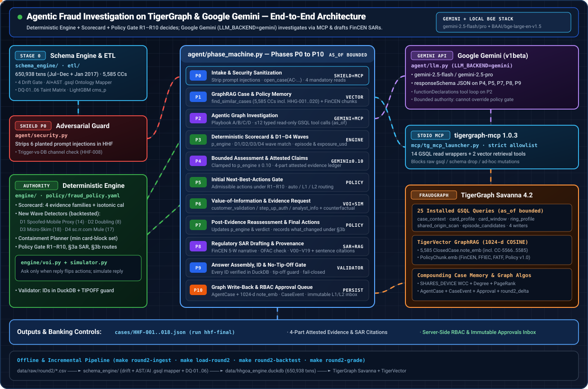

# TigerGraph Agentic Fraud Investigation (HHGOA) — Implementation Specification

**Status:** implementation spec v1, 2026-09-19. Companion to `PLAN.md` (which records the decisions and why). This document records **how**: the exact schema, loading jobs, query library, decision engine, agent code, retrieval pipeline, UI, and the build order with acceptance checks. Code blocks are the spec; where a block could be executed against the real data in this session it was, and the results are recorded under each module's Verification section. Anything that can only be confirmed on the live Savanna workspace or with API keys is listed as an open issue with the day it gets resolved.

---

## 0. How to read and use this document

### 0.1 What is being built, in one diagram

```
 case_pack.csv ──► agent/bench.py ──► phase machine (P0..P10)
                                       │  reads the graph through tigergraph-mcp (stdio, read-only typed tools)
                                       │  engine/ decides: scorecard · pattern · episode · SAR · admissible actions
                                       │  simulator/ answers evidence requests deterministically
                                       │  persist/ writes AgentCase + events + edges back to the graph
                                       ▼
                                 cases/HHG-0nn.json  (README answer format, validated)
                                       ▲
 offline once:  etl/ (DuckDB) ─► data/out/*.csv ─► graph/load_all.py ─► FraudGraph (Savanna TG-00, TigerGraph 4.2)
                 rag/ (corpus → chunks → Voyage vectors) ─► PolicyChunk / ClosedCase.note_emb
                 graph/install_all.py (queries) · graph/run_algos.py (wcc, degree)
 ui/ (Streamlit) reads runs/ + approvals.sqlite + the graph
```

### 0.2 Contracts everything is built against

Two contract files are authoritative and are reproduced in Appendix B:

- **Schema contract** — every vertex, edge and attribute name, and the ETL derivation rule for each derived attribute (card id, device profile id, strength, ring id, burst id, modal region, recurring amounts, leakage-free prior aggregates).
- **Interface contract** — the printed keys of every installed query, the Python dataclasses and function signatures of the engine, the Pydantic models of the agent (identical to the README answer format), and the file layout.

A module may not rename anything in the contracts. The integration section (section 1) lists every place where a module's code was found to disagree with a contract, with the fix.

### 0.3 Reading order for the builder

1. Section 1 (integration): module map, data flow, conformance table, the mismatch list with its resolution status, the consolidated 44-step build order, and the open issues with the day each is settled.
2. Section 9 (final status): what is verified by running code here, what needs the live workspace, the exam mix, and the replay metrics against their targets. Read it before day 0.
3. Sections 2–8 (modules) in build order: ETL and scorer → graph DDL and loading → query library → decision engine → agent → GraphRAG → UI, ops and deliverables.
4. Appendix A: the engine's expectation sheet for the 20 exam cases (the sheet of record, produced by running the engine against the real data). Appendix B: the two contracts verbatim. Appendix C: the reviewer decisions that settled the open judgement calls.

### 0.4 Conventions used in every module

- Repo paths are relative to the repository root (`etl/…`, `graph/…`, `engine/…`, `agent/…`, `rag/…`, `ui/…`, `docs/…`); each code block is preceded by its path.
- Python 3.12, `uv`, pinned dependencies in `pyproject.toml`; GSQL is `SYNTAX v3` unless a library algorithm file says otherwise (the `tg_*` algorithms are `SYNTAX V1` as shipped).
- Every read query takes `as_of` and filters `ts <= as_of`; every agent-facing query is installed, bounded and prints exactly its contract keys.
- Every id in an answer file must exist in the dataset; the validator resolves them against DuckDB before a file is written.
- "Verification" = commands actually run in this session with their output; "Acceptance" = what the builder runs on the live workspace and the expected result.

### 0.5 Getting the code out of this document


Every source file appears in full under a heading of the form `#### \`repo/path\``, immediately followed by its fenced block. `extract_code.py` (in the repository root, and listed in section 8) walks the document and writes the tree:

```bash
python extract_code.py --dry-run    # list every file the document carries
python extract_code.py              # write them; existing files are kept unless --force
```

The same document is therefore both the specification and the source of the repository. When a file changes during the build, edit the file and re-run `sync_spec.py` so the document's block is refreshed; the two never drift.

### 0.6 The two document tools (repository root)

### `extract_code.py`

```python
r"""Materialise the repository tree from IMPLEMENTATION.md.

The specification embeds every source file verbatim: a heading of the form

    ### `etl/features.py`

is followed (within five lines) by a fenced code block holding that file's exact contents.
This script walks the document and writes each block to its path.

    python extract_code.py                  # writes ./ (dry run first with --dry-run)
    python extract_code.py --out build/     # writes into build/
    python extract_code.py --dry-run        # list what would be written

Files already on disk are only overwritten with --force, so re-running after local edits is safe.
"""
from __future__ import annotations

import argparse
import pathlib
import re
import sys

HEADING = re.compile(r"^#{3,4}\s+`([^`]+)`\s*$")  # ### in a module spec, #### in the assembled document
FENCE = re.compile(r"^\s{0,3}(`{3,}|~{3,})")
# A heading is a file only if it looks like a path with a known source extension.
SUFFIXES = {
    ".py", ".gsql", ".yaml", ".yml", ".sql", ".json", ".toml", ".md", ".txt",
    ".cfg", ".ini", ".sh", ".env", ".example", ".gitignore", ".jsonl", ".csv",
}


def looks_like_file(rel: str) -> bool:
    if rel.startswith(("http://", "https://")) or " " in rel.strip():
        return False
    name = rel.rsplit("/", 1)[-1]
    if name.startswith(".") and "." not in name[1:]:
        return True  # .gitignore, .env
    return pathlib.PurePosixPath(rel).suffix in SUFFIXES or name in {"Makefile", "Dockerfile"}


def blocks(text: str):
    """Yield (path, body) for every '### `path`' heading followed by a fenced block."""
    lines = text.split("\n")
    i = 0
    while i < len(lines):
        m = HEADING.match(lines[i])
        if not m:
            i += 1
            continue
        rel = m.group(1).strip()
        j = i + 1
        while j < len(lines) and j < i + 6 and not FENCE.match(lines[j]):
            j += 1
        if j >= len(lines) or not FENCE.match(lines[j]):
            i += 1
            continue
        tok = FENCE.match(lines[j]).group(1)
        # Scan for the closing fence, but never past the next file heading: a block cannot span one.
        # If one arrives first, the block was opened with a longer fence than it was closed with, so
        # fall back to the last fence-looking line before that heading.
        k, last_fence = j + 1, None
        while k < len(lines):
            m2 = FENCE.match(lines[k])
            if m2 and m2.group(1)[0] == tok[0] and lines[k].strip() == m2.group(1):
                if len(m2.group(1)) >= len(tok):
                    break
                last_fence = k
            elif HEADING.match(lines[k]):
                k = last_fence if last_fence is not None else k
                break
            k += 1
        if k < len(lines) and looks_like_file(rel):
            yield rel, "\n".join(lines[j + 1:k])
        i = k + 1


def main() -> int:
    ap = argparse.ArgumentParser(description=__doc__, formatter_class=argparse.RawDescriptionHelpFormatter)
    ap.add_argument("--spec", default=str(pathlib.Path(__file__).with_name("IMPLEMENTATION.md")))
    ap.add_argument("--out", default=".")
    ap.add_argument("--force", action="store_true", help="overwrite files that already exist")
    ap.add_argument("--dry-run", action="store_true")
    args = ap.parse_args()

    spec = pathlib.Path(args.spec)
    if not spec.exists():
        print(f"spec not found: {spec}", file=sys.stderr)
        return 2
    out_root = pathlib.Path(args.out)

    written, skipped, dupes = 0, 0, {}
    for rel, body in blocks(spec.read_text()):
        dupes[rel] = dupes.get(rel, 0) + 1
        dest = out_root / rel
        if args.dry_run:
            print(f"{'dup ' if dupes[rel] > 1 else '    '}{rel}  ({len(body.splitlines())} lines)")
            continue
        if dest.exists() and not args.force:
            skipped += 1
            continue
        dest.parent.mkdir(parents=True, exist_ok=True)
        dest.write_text(body.rstrip("\n") + "\n")
        written += 1
    repeats = {k: v for k, v in dupes.items() if v > 1}
    print(f"{len(dupes)} file blocks; written {written}, skipped (exists) {skipped}"
          + (f"; {len(repeats)} paths appear more than once (last wins)" if repeats else ""))
    for k in list(repeats)[:10]:
        print("   repeated:", k)
    return 0


if __name__ == "__main__":
    raise SystemExit(main())
```

### `sync_spec.py`

```python
r"""Write edited source files back into the specification.

`IMPLEMENTATION.md` (and each module spec it is assembled from) carries every source file verbatim
under a heading of the form ``### `repo/path` `` followed by a fenced block. This script refreshes
those blocks from the files on disk, so the document never drifts from the code.

    python sync_spec.py                 # refresh every module spec next to this file
    python sync_spec.py 40-engine.md    # or just one

`extract_code.py` is the inverse: it writes the tree out of the document.
"""
from __future__ import annotations

import pathlib
import re
import sys

HERE = pathlib.Path(__file__).parent
# In the spec workspace the sources live under impl/code/; in the repository they sit at the root.
CODE = HERE / "code" if (HERE / "code").is_dir() else HERE
HEADING = re.compile(r"^#{3,4}\s+`([^`]+)`\s*$")
FENCE = re.compile(r"^\s{0,3}(`{3,}|~{3,})")
ALT_PREFIXES = ("root", "docs", "root/docs")


def resolve(rel: str) -> pathlib.Path | None:
    """Find the source file for a heading path, allowing the spec's root/ and docs/ staging dirs."""
    direct = CODE / rel
    if direct.is_file():
        return direct
    for prefix in ALT_PREFIXES:
        candidate = CODE / prefix / rel
        if candidate.is_file():
            return candidate
    return None


def sync(spec_path: pathlib.Path) -> tuple[int, list[str]]:
    """Replace each file block in one spec with the current file contents."""
    lines = spec_path.read_text().split("\n")
    out: list[str] = []
    missing: list[str] = []
    replaced = 0
    i = 0
    while i < len(lines):
        heading = HEADING.match(lines[i])
        out.append(lines[i])
        i += 1
        if not heading:
            continue
        rel = heading.group(1).strip()

        # The fence opens within a few lines of the heading; anything before it is prose.
        j = i
        while j < len(lines) and j < i + 5 and not FENCE.match(lines[j]):
            out.append(lines[j])
            j += 1
        if j >= len(lines) or not FENCE.match(lines[j]):
            continue

        token = FENCE.match(lines[j]).group(1)
        k = j + 1
        while k < len(lines):
            close = FENCE.match(lines[k])
            if close and close.group(1)[0] == token[0] and len(close.group(1)) >= len(token) \
                    and lines[k].strip() == close.group(1):
                break
            k += 1
        if k >= len(lines):
            out.extend(lines[j:])
            i = len(lines)
            continue

        src = resolve(rel)
        if src is None:
            out.extend(lines[j:k + 1])
            missing.append(rel)
        else:
            out.append(lines[j])
            out.extend(src.read_text().rstrip("\n").split("\n"))
            out.append(lines[k])
            replaced += 1
        i = k + 1

    spec_path.write_text("\n".join(out))
    return replaced, missing


def main() -> int:
    targets = sys.argv[1:] or sorted(p.name for p in HERE.glob("[0-7]0-*.md"))
    if not targets:
        print("no spec files found next to sync_spec.py", file=sys.stderr)
        return 2
    for name in targets:
        path = HERE / name
        if not path.exists():
            print(f"{name}: not found", file=sys.stderr)
            continue
        replaced, missing = sync(path)
        print(f"{name}: {replaced} blocks refreshed, {len(missing)} headings without a source file")
        for rel in missing[:10]:
            print("   missing:", rel)
    return 0


if __name__ == "__main__":
    raise SystemExit(main())
```


---

## 1. Integration: module map, contract conformance, build order, open issues

**Status:** integration pass **v2 (final verification), 2026-09-19**, after every fix group has run. Covers all seven module specs (`10-etl-scorer.md` … `70-ui-ops-deliverables.md` — `20-graph.md` and `40-engine.md` were missing in v1 and now exist), the code under `impl/code/`, the two contracts and the reviewer decisions `impl/decisions.md` (D1–D12, which supersede PLAN.md where they differ).

What changed between v1 and v2: **§3 is now a status list, not a to-do list** — 24 of the 25 mismatches are resolved and re-verified by running something, 1 (M2) is partial because its scripts need a live TigerGraph workspace, and none is open. §5 is the build order with the fixes treated as applied. §6 carries three new open issues (O29–O31). §7 is the verification battery with its verbatim output, plus what this pass itself changed. The companion document `impl/FINAL_STATUS.md` holds the go/no-go view: verified-by-running vs. left-for-the-workspace, the final exam mix, the replay shortfall against PLAN §4.10, and the open issues with owner days.

**Sheet of record — two identical copies.** `engine.run_cases` writes `qa/engine_expectation_sheet.md` (repo-relative, the default since the fix pass); `impl/engine_expectation_sheet.md` is the spec-side copy and is byte-identical (md5 `c6399e5823a1ad6944df474736f17e3f`). `impl/engine_expectation_sheet_etl_facts.md` is a retired name and no longer exists.

Two integration glue files were added in v1 and remain verified: `engine/facts_from_etl.py` (the only builder of the engine's facts DuckDB, decision D7) and `qa/check_integration.py` (the offline contract lint, currently `OK`). Every "verified" claim below names the command that produced it.

---

### 1. Module map and data flow

```
 data/raw/{transactions,identity,closed_cases_history,case_pack}.csv + README.md
   │  etl.build_db (tx, tx_raw, idn, cc, cp, pairs, cardmap: card rule 14,975/14,975)
   │  etl.features (txc, txn_feat, burst_member, device_profile, card_feat)      etl.parse_closed_cases (closed_case_parsed, closed_case_txn, closed_case_conn)
   │  etl.cms_train (cms_p → txn_feat; data/models/{lgb_fraud.txt, isotonic.json, cms_metrics.json, cms_features.json})
   ▼
 data/hhgoa.duckdb ──► etl.export_graph_csvs ──► data/out/*.csv  (TAB-separated, unquoted, headerless; txn_000..007)
   │                                             + rag.chunk → document/policy_chunk/chunk_of/about (quoted CSV → re-encoded to TSV by the loader)
   │                                             + rag.embed  → vec_ClosedCase.psv / vec_PolicyChunk.psv (id|f1,...,f1024)
   ├─► engine.facts_from_etl ──► data/hhgoa_engine.duckdb  (txc+derived, customer_feat, cc, cc_txn, cp)  ── DuckFacts (mock backend, validator db, replay)
   ▼
 graph/schema.gsql (USE GLOBAL, 13 vertices, 24 edges, proxy→proxy_type) → graph/loading_jobs.gsql (18 jobs, one USING clause)
   → graph/load_all.py [MISSING, M2] → graph/schema_change_vectors.gsql (GLOBAL job) → rag.load_vectors --all → graph/run_algos.py [MISSING] (SHARES_DEVICE, tg_wcc, degree)
   → graph/install_all.py (CREATE OR REPLACE ×24 + INSTALL QUERY ALL) → graph/describe_queries.py (mcp/query_descriptions.yaml)
   ▼
 FraudGraph on Savanna TG-00  ◄── tigergraph-mcp 1.0.3 (stdio) ◄── mcp/tg_mcp_launcher.py (GSQL-TIMEOUT 120000; allow-list by name)
   ▲                                   ▲ typed tools (14 read queries) + local tools (find_similar_cases, grounding_chunks, ofac_screen)
   │ writers: open_case, append_case_event, record_approval, (close_case unused), tigergraph__add_edges, pyTigerGraph upsertVertex(+note_emb)
   │
 agent.bench → agent.phase_machine (P0 intake → P1 memory → P2 investigate → P3 engine.scorecard.compute → P4 assess (±0.10)
   → P5 engine.policy.admissible/check → P6 engine.voi/simulator/post_evidence → P7 → P8 SAR → P9 engine.answer_writer.build + engine.validator → P10 persist)
   → runs/<run_id>/<case>/{answer.json, sar.md, calls.jsonl, phases.jsonl} + run_manifest.json → agent.promote → cases/HHG-0nn.json + MANIFEST.md
   ▼
 ui/app.py (queue, case, approvals(ui/approvals.sqlite → record_approval/append_case_event), graph(case_subgraph), runs)
```

Ownership of the derived facts (the thing every mismatch below traces back to): **three independent derivation pipelines exist today** — the ETL (`etl/features.py`, authority), the query module's DuckDB oracle (`graph/queries/expected/_model.sql`) and the engine's sidecar (`engine/build_facts_db.py`, from `f.parquet` + `novdec_scores.parquet`). They agree on the ring string (strong, 52 cards, 4 fraud cases), the 12 burst cards and `is_strong` (ETL 2,321 vs engine 2,321 vs oracle 2,324), but not on `cms_p` (ETL scorer vs the old `novdec_scores.parquet`: HHG-002 0.638 vs 0.710) nor `ring_id` breadth (1,157 vs 1,149 cards). The repo must keep one: the ETL feeds the graph, so the engine and the validator must read ETL-derived facts (`engine/facts_from_etl.py`, M3/M12).

---

### 2. Contract conformance

#### 2.1 Installed queries (interfaces.md §A) — GSQL (30/60) vs DuckDB oracle (engine/facts_duckdb.py, expected/*.sql) vs typed wrappers (50) vs engine consumers (40)

Checked by `qa/check_integration.py` (parameter names/order across GSQL, `mcp/query_descriptions.yaml` `parameters` + `example`, `DuckFacts` signatures, `agent.mcp_client.BUILTIN_QUERIES`; PRINT keys vs yaml `prints`) and by reading the printed shapes. **Parameters agree for all 24 queries.** Printed keys agree with interfaces.md for all reads. Shape-level differences that break a consumer are marked ✗.

| Query | params (GSQL = yaml = DuckFacts = wrapper) | printed keys = contract | engine consumer agrees? | note |
|---|---|---|---|---|
| `case_context` | ✓ | ✓ | ✓ | `device` when absent: GSQL `{id:"", is_strong:false, …}`, DuckFacts `{}`; engine uses `.get` on both ✓. GSQL reads `s.proxy` → **✗ compile (M1)**; printed key stays `proxy` |
| `card_profile` | ✓ | ✓ | ✓ | `card{all attrs}` — JSON-string attrs decoded by `normalize`; `prior_closed_cases` order: contract "newest first", DuckFacts `opened_at ASC` (engine uses `max()`/membership only) |
| `card_window` | ✓ | ✓ | ✓ | GSQL reads `t.proxy` → **✗ (M1)**; engine reads `w["proxy"]` (printed key) ✓ |
| `region_history` | ✓ | ✓ | ✓ keys | semantics differ between GSQL and DuckFacts (`hint` rule, `home_activity_48h` channel) and the agent passes `as_of=opened_at` (DuckFacts.collect: flagged ts − 1 s) → M19 |
| `device_history` | ✓ | ✓ | ✓ | `prior_n` includes the flagged txn in GSQL (as_of=opened_at) but not in DuckFacts.collect → M19 |
| `device_neighbors` | ✓ | ✓ | ✓ | GSQL `t.proxy` → **✗ (M1)**; not-strong → empty lists in both |
| `email_neighbors` | ✓ | ✓ | (unused by engine) | hub domains: engine applies ≤ 40-cards rule on `shared_origin_scan`, not here |
| `shared_origin_scan` | ✓ | ✓ | ✓ | `region_cluster_30d` JSON string decoded by `normalize` |
| `card_testing_check` | ✓ | ✓ | **✗ (M7)** | GSQL prints `run` as a one-element list `[{start_id, ids, amts, start_ts, end_ts}]`; DuckFacts returns a dict; `engine.scorecard._r5` does `run["ids"]` → `TypeError` on the live shape (`normalize.unwrap_singleton` exists but nobody calls it) |
| `under_threshold_burst` | ✓ | ✓ | ✓ | `lookalike_cards` JSONARRAY (or string fallback, decoded by `normalize`) |
| `recurring_charge_check` | ✓ | ✓ | ✓ | |
| `episode_candidates` | ✓ | ✓ | ✓ | DuckFacts adds a same-non-home-region `sig_match` clause the GSQL does not have (M19) |
| `prior_cases_for_customer` | ✓ | ✓ | ✓ | |
| `ring_profile` | ✓ | ✓ | **✗ (M6)** | GSQL prints `closed_cases` as `SetAccum<STRING>` (ids) and the expectation file agrees; DuckFacts returns rows `{id, card_id, pattern, outcome, report_filed}`; `engine.scorecard._ring` does `[c["id"] for c in …]` → `TypeError` on the live shape. `wave_cards`/`pre_open_cards` are plain ids in both ✓ (the hand fixture in `agent/mock_fixtures.py` is normalised by `_norm_ids`) |
| `case_subgraph` | ✓ | keys ✓, fields `vtype`/`etype` (TYPE reserved) | UI (`ui/common.py`) reads `type` → M23 | expectation file stores only `n_nodes`/`n_edges` |
| `post_open_activity` | ✓ | ✓ | ✓ | |
| `similar_prior_cases` (60) | ✓ | rows `v_id + @attrs` → flattened by `rag.retrieval` / `normalize` | ✓ | agent calls it through `agent.tools_local` (its own flattening via `normalize`), not `rag.retrieval` (M16) |
| `grounding_chunks` (60) | ✓ | ✓ | (LLM-only) | agent passes `doc_filter="sar_guidance"`; Document ids are `sar_guidance_narrative` … → unknown filter searches everything (M15) |
| `similar_cases_structural`, `_closed`, `_agent` (60) | ✓ | ✓ | n/a | fallback ladder in `rag.retrieval` only |
| `open_case` (writer) | GSQL `(case_id, source_case_id, customer_id, card_id, trigger_type, opened_at, run_id, flagged_txn_id)` | `ok, id` | agent sends `status`, omits `flagged_txn_id` → **✗ (M8)** | |
| `append_case_event` (writer) | GSQL `(case_id, seq, kind, event_at, payload)` | `ok, id` | agent `persist.py`, `ui/approvals_db.py`, interfaces.md, `mcp_client.BUILTIN_QUERIES` all omit `event_at` → **✗ (M8)** | |
| `record_approval` (writer) | GSQL `(case_id, action, route, status, decided_by, decided_at, reason)` | `ok, id` | agent sends an extra `approval_id` → **✗ (M8)**; UI ✓ | |
| `close_case` (writer) | 21 params incl. `SET<STRING>`/`MAP<STRING,FLOAT>` | `ok, id` | never called (agent uses `upsertVertex` + `add_edges`) — allowed, see 50-agent open issue 1 | U7/U8 unverified constructs |

#### 2.2 Schema attributes (schema.md) — ETL (10) vs `csv_columns.yaml` vs loading jobs vs queries (30)

`graph/check_contracts.py` (run here: `schema: 13 vertices, 24 edges; jobs: 18; files: 18; OK`) proves csv_columns.yaml column order == schema.gsql attribute order == loading-job `$N` positions for every file, all jobs share `USING SEPARATOR="\t", HEADER="false", EOL="\n"` with no QUOTE clause, and the edge guards match `edges_from_columns`. `qa/check_integration.py` proves schema.md == schema.gsql for all 13 vertices with one rename. Remaining disagreements:

| Attribute / file | ETL (10) | csv_columns.yaml | loading job (graph) | queries (30) | verdict |
|---|---|---|---|---|---|
| `Transaction.proxy`, `FROM_DEVICE.proxy` | column `proxy` | `proxy` (comment "→ proxy_type") | `proxy_type` (PROXY is a DDL reserved word) | `t.proxy` in `card_window.gsql:30`, `case_context.gsql:23`, `device_neighbors.gsql:32` | **✗ M1** |
| chunk format | TSV, no quotes, 8 txn chunks | TSV | TSV | — | ✓ (contracts §D still says `,`/`"`/`txn_000..003` → M23) |
| `fraud_pattern.csv` | TSV (7 rows, `FRAUD_PATTERNS`) | listed | `load_fraud_pattern` TSV | — | **✗ M9**: `rag/chunk.py` writes the same path as quoted CSV and overwrites it (verified on disk: `"card_testing","A stolen…`) |
| `document.csv`, `policy_chunk.csv`, `chunk_of.csv`, `about.csv` | — (rag, quoted CSV) | not listed (`RAG_COLUMNS` in check_contracts) | TSV jobs; header comment says `load_all.py` re-encodes to `data/out/_tsv/` | — | ✓ once `load_all.py` exists (M2) |
| `ClosedCase.embed_text` / `note_emb` | `closed_case_parsed.embed_text` (templates `fraud_reported|cleared_*|undoc_*`, "device: none") | `closed_case.csv` col 17 | `load_closed_case` | — | **✗ M11**: `rag.closedcase_embed_text` re-parses the notes with different template ids/text (contains `\n`) and that text is what `vec_ClosedCase.psv` embeds |
| `Card.ring_id` | 1,157 cards (schema rule; 52 on the exact profile) | ✓ | ✓ | `ring_profile` reads it | ✓ (engine applies the strict anonymous-proxy test); BUILD_ORDER says "28 cards" → M22 |
| `Card.modal_region` C13487-K1 | `272.0` | | | | BUILD_ORDER says `191.0` → M22 |
| `Transaction.cms_p` | ETL scorer (Jul–Oct OOF, Nov–Dec final) | | | | engine sidecar uses `novdec_scores.parquet` + its own `engine/calibration.json` → **M12** |
| `known_device_ids` cap 200, `recurring_amounts` cap 50, `region_cluster_30d` extra fields | ETL refinements | documented in yaml notes | | `card_profile` prints top-5 devices separately | ✓ (record in schema.md, M23) |

#### 2.3 Answer JSON — `engine/answer_writer.py` vs `agent/schemas.py` vs `engine/validator.py` vs README

Field by field, all four agree: top level `case_id, case, evidence_requests, next_best_actions, sar, stop_reason, tool_calls(int), tokens(int), latency_s(number)`; `case` = the 15 README fields (`status`, `verdict`, `fraud_probability`, `pattern`, `pattern_description`, `affected_txn_ids`, `first_suspicious_txn_id`, `connected_card_ids`, `connected_device_profiles`, `exposure_usd`, `evidence[{claim, source, ref, entity_ids}]`, `similar_prior_cases`, `summary`, `written_to_graph`, `graph_case_id`); `evidence_requests[{type, asked_after_step, assumed_response}]`; `next_best_actions{initial[{action, route, reason}], final, what_changed}`; `sar{file, reason, narrative, subjects, total_amount_usd, activity_dates}`. Enums are identical (`ACTIONS`/`PATTERNS`/`STATUSES`/`VERDICTS`/`REQUEST_TYPES` in `engine/types.py`, the `Literal`s in `agent/schemas.py`, the sets in `engine/validator.py`). `agent/answer_writer.py` and `agent/validator.py` named in interfaces §C **do not exist**; the phase machine resolves to `engine.answer_writer.build` and `engine.validator.validate(answer, db, meta)` (working) — but the Makefile/CI/BUILD_ORDER invoke `python -m agent.validator --db data/ids.duckdb …` (M4). Gap in all validators: a `fraud` verdict with `CLOSE_NO_FRAUD` in `final` and no containment action passes (M17, produced by the mock run for HHG-006/008).

> **§2 is the v1 survey and is kept as the record of what was found.** Three of its observations are no longer true of the tree: `agent/answer_writer.py` and `agent/validator.py` now exist as thin wrappers over the engine copies (M4); the M17 validator gap is closed in all four validators (D10); and `contracts/schema.md` / `contracts/interfaces.md` now match the code (M1, M6, M19, M23, D6–D8). Read §3 for the current status of every row and §7 for the commands that prove it.

---

### 3. Mismatch list (status after the fix pass, 2026-09-19)

Severity: **B** = blocks a day's milestone or produces wrong answer files; **M** = wrong behaviour on some path or a broken documented command; **m** = text/consistency.
Status: **resolved** = the fix is in the code/contract *and* was re-verified here by running something; **partial** = the code fix is in but the proof needs the live TigerGraph workspace; **open** = not fixed.

All 25 rows were re-checked against the tree on 2026-09-19 after every fix group had run. The "Verified by" column names the command whose output is in §7.

| # | Sev | What it was | Status | Verified by |
|---|---|---|---|---|
| M1 | B | Three queries read `t.proxy` / `s.proxy`, but `schema.gsql` stores the contract attribute as `proxy_type` (`PROXY` is a 4.2 DDL reserved word) → semantic-check failure at `INSTALL QUERY ALL` | **resolved** | `graph/queries/*.gsql` use `proxy_type` everywhere (tuple fields / printed key stay `proxy`); `tests/unit/test_graph_contracts.py::test_gsql_lint_passes` fails on any `.proxy`; `docs/day0_checklist.md:79` now carries `proxy_type`. `contracts/schema.md` was **still stale until this verification pass** — `Transaction.proxy_type STRING` and `FROM_DEVICE(device_new STRING, proxy_type STRING)` with the "printed as `proxy`" note were applied here. `python -m qa.check_integration` → `OK` |
| M2 | B | No `graph/load_all.py`, `run_algos.py`, `rebuild.py` and no `20-graph.md`: day 2 could not start | **partial** | All three scripts and `20-graph.md` exist and import; `python graph/check_contracts.py` → `schema: 13 vertices, 24 edges; jobs: 18; files: 18 / OK`. They cannot be executed without a Savanna workspace, so the vertex/edge counts they assert (Transaction 590,742 · NEXT 576,425 · FROM_DEVICE 140,784 · INVOLVES 14,955 · MATCHES 5,565 …) remain a **day-2 proof** |
| M3 | B | The engine read `txc` / `customer_feat` / typed `cc` / `cp` tables the ETL DuckDB does not contain → every `DuckFacts` query raised | **resolved** | `engine/facts_from_etl.py` is the only facts builder (D7); `python -m engine.facts_from_etl --etl etl/hhgoa_work.duckdb --out engine/out/hhgoa_engine.duckdb` → `txc 590,742 · card_feat 14,317 · device_profile 9,705 · customer_feat 13,553 · cc 5,565 · cc_txn 14,955 · cp 20` in 1.2 s; `engine/build_facts_db.py` and `cms_oof.py` are in `impl/attic/`; `make facts`, `.env.example` (`ENGINE_DATA_DIR`, `ENGINE_FACTS_DB`) and CI carry it |
| M4 | B | `agent/validator.py` did not exist and `data/ids.duckdb` lacked the columns `engine.validator` queries | **resolved** | `python -m agent.validator --db data/ids.duckdb runs/engine-drafts/*.draft.json` → `[]` ×20, `0 file(s) with problems`; `data/ids.duckdb` is 19 MB with `txn 590,742 · card 14,317 · customer 13,553 · device_profile 9,705 · closed_case 5,565 · case_pack 20` and the views `txc / card_feat / customer_feat / cc` |
| M5 | B | The agent's control flow diverged from `engine.run_cases`: no `settled_pre` gate, `asked` set after `admissible`, `region_history` only for in-person alerts → 5 of 20 mock files disagreed with the engine, two of them `fraud` + `CLOSE_NO_FRAUD` | **resolved** | `RUN_MODE=mock python -m agent.bench --run-id verify --cases all --mock` → 20 files, `problems=0`; `python impl/compare_sheet.py runs/verify` → **20/20 match the sheet of record** on verdict, pattern, initial action set, final action set and `sar.file` |
| M6 | B | `ring_profile` printed closed-case **ids**; the engine and DuckFacts expect **rows** → `TypeError` on the first live ring case | **resolved** | `graph/queries/ring_profile.gsql` uses `TYPEDEF TUPLE<… > ClosedRow` / `SetAccum<ClosedRow>`; `expected/ring_profile__HHG-014.json` carries the five-column rows `CC-2649/2971/2985/3035` with `card_id`, `pattern`, `outcome`, `report_filed`, and `wave_cards 27 / pre_open_cards 19 / n_cards_alltime 52`; `contracts/interfaces.md` row rewritten here |
| M7 | B | Live `card_testing_check.run` is a one-element list (GroupByAccum); `_r5` did `run["ids"]` | **resolved** | `agent/mcp_client._unwrap_singletons` calls `mcp/normalize.unwrap_singleton` after `norm(...)`; `engine/scorecard._r5` is defensive (`if isinstance(run, list): run = run[0] if run else {}`) |
| M8 | B | Writer parameters did not match the installed GSQL (`open_case` sent `status` and omitted `flagged_txn_id`; `append_case_event` omitted `event_at`; `record_approval` sent `approval_id`) | **resolved** | `agent/phase_machine.p0_intake`, `agent/persist.py` and `ui/approvals_db.write_to_graph` send the installed signatures; `contracts/interfaces.md` §Writers and `BUILTIN_QUERIES` carry `event_at`; `python -m qa.check_integration` → `OK` (it fails on this). Live round-trip is a **day-3 proof** |
| M9 | B | `data/out/fraud_pattern.csv` written by both `rag/chunk.py` (quoted CSV) and the ETL (TSV) — the rag version won on disk and would dangle every `MATCHES`/`ABOUT` edge | **resolved** | `rag/chunk.py` documents "NOT written here" and has no writer; the file on disk is the ETL's TSV (7 rows × 3 columns, unquoted, `card_testing → R5` … `none → R3`) |
| M10 | B | `tests/unit` was red under CI conditions: `3 failed, 41 passed, 1 skipped, 16 errors` | **resolved** | `pytestmark = skipif(...)` on `test_features`, `test_card_rule`, `test_engine`, `test_launcher_header`, plus `pytest.importorskip("streamlit")` on the AppTest case (added here). Merged repo tree: **103 passed / 6 skipped** with the data env, **92 passed / 17 skipped** without it — green either way |
| M11 | M | Three different `embed_text` phrasings (rag parser, ETL parser, `agent/persist`) broke the "one space" premise of hybrid retrieval | **resolved** | `rag/closedcase_embed_text.main` reads `SELECT id, embed_text FROM closed_case_parsed`; run here → `wrote 5565 rows -> data/out/closed_case_embed.jsonl from closed_case_parsed.embed_text (ETL); unmasked rows: 0`; `agent/persist.embed_text_for_case` delegates to `rag.closedcase_embed_text.agent_case_embed_text` |
| M12 | M | Two scorers: the graph would carry the ETL `cms_p` while the engine sheet came from `novdec_scores.parquet` and its own `engine/calibration.json` | **resolved** | `engine/config.CALIBRATION_JSON = DATA_DIR/models/isotonic.json`; `engine/scorecard.calibrate` loads it; `engine/calibration.json` is in `impl/attic/`. The sheet was regenerated on ETL facts and is `impl/engine_expectation_sheet.md` (md5 `c6399e5823a1ad6944df474736f17e3f`); HHG-002 `cms 0.638`, HHG-016 `cms 0.585` — the ETL numbers |
| M13 | M | `rag.load_vectors` sent its own local `SCHEMA_CHANGE JOB`; vertex types are global → "cannot alter global vertex types" | **resolved** | `rag/load_vectors.py` reads `graph/schema_change_vectors.gsql` from disk (`SCHEMA_CHANGE_FILE`, overridable by `HHGOA_SCHEMA_CHANGE_VECTORS`) and raises a clear error if the graph module's file is missing. Live `--ensure-schema` is a **day-7 proof** |
| M14 | M | Makefile / README / BUILD_ORDER named files that do not exist or cannot run (`rag/corpus_chunks.py`, `python rag/embed.py`, `graph/load_vectors.py`, `qa/replay_closed_cases.py`, `qa/expectation_sheet.py`, `engine/policy/fraud_policy.yaml`, `agent.monitor`, eight day-5 test files, `tests/live/test_ring.py`) | **resolved** | `grep -E "corpus_chunks|rag/embed.py|graph/load_vectors.py|qa/replay_closed_cases|qa/expectation_sheet|qa/engine_drafts|agent.monitor|engine/policy/fraud_policy"` over the Makefile, README and BUILD_ORDER → no hits. `make` targets `facts corpus embed vectors replay sheet engine-drafts` all exist; `python -m engine.run_cases --out runs/engine-drafts` → 20 `*.draft.json` that validate |
| M15 | M | P8 used `doc_filter="sar_guidance"`, which no document id matches (the GSQL then searches everything) | **resolved** | `agent/phase_machine.p8_sar` loops over `("sar_guidance_narrative", …)` and `("sar_tti_19", …)`, `k=3` each |
| M16 | M | Four different SAR validators; the FinCEN-grounded generator in `rag/` was never exercised | **resolved** | P8 builds the prompt with `rag.sar.build_prompt(SarFacts(...))`, assembles with `rag.sar.assemble`, validates with `rag.validate_sar.validate_sar(..., resolver=DuckResolver)` and falls back to `rag.sar.fallback_narrative` after two failures; `ui/common.sar_checks` delegates to the same validator (D10) |
| M17 | M | No validator rejected `verdict == fraud` together with `CLOSE_NO_FRAUD` / `ALLOW_TRANSACTION`, or a fraud verdict with no containment action | **resolved** | `FRAUD_CONTAINMENT = {BLOCK_CARD, DECLINE_TRANSACTION, ESCALATE_TO_ANALYST, BLOCK_ALL_CARDS}` and the two invariants are in `engine/validator.py`, `engine/answer_writer.assert_invariants` and `agent/answer_fallback.check_invariants`; `engine/policy.py` sets `no_reply` (not `customer_confirmed`) when `pattern_hit = ring_hit or burst_hit`, so a passed step-up cannot clear a ring/burst episode. `tests/unit/test_engine.py::test_twenty_drafts_validate` asserts it on all 20 |
| M18 | M | `tests/live/test_query_contracts.py` did `from mcp.normalize import …`, which resolves to the MCP SDK | **resolved** | The file loads `mcp/normalize.py` by path with `importlib.util.spec_from_file_location("hhgoa_normalize", …)`; there is still no `mcp/__init__.py` |
| M19 | M | `region_history` / `device_history` / `episode_candidates` semantics differed between the GSQL, `DuckFacts` and the agent | **resolved** | D8 applied: the GSQL is the rule. `engine/facts_duckdb.py` documents and implements `as_of = flagged_ts − 1 s` for `region_history` / `device_history` and `opened_at` everywhere else; the agent's `_ensure_facts` uses the same list and parameters; the same-region `sig_match` clause is gone from `episode_candidates`; the expectation files were regenerated. `contracts/interfaces.md` now states the `known` / `rare` / `new` thresholds, the any-channel `home_activity_48h`, and that `device_history.prior_n` includes the flagged transaction |
| M20 | M | `mcp/query_descriptions_rag.yaml` was a second registry with its own shape; the four RAG queries never got descriptions | **resolved** | The fragment is gone (a unit test asserts it cannot come back); `mcp/query_descriptions.yaml` holds all 25 entries under `queries:` with `parameters` / `example` / `prints`. **This pass found a residual bug**: `post_open_activity` and `case_subgraph` had lost their `harness_only: true`, and because `load_query_descriptions` merges the yaml *over* `BUILTIN_QUERIES`, `make_query_tools` handed the model 16 typed tools instead of 14 — including `post_open_activity`, whose rows must never reach `exposure_usd`. Fixed in the yaml, asserted in `tests/unit/test_graph_contracts.py` |
| M21 | M | `calls.jsonl` rows lacked `kind` / `ts` / `phase`; LLM usage never reached `calls.jsonl`; the phase machine wrote `P6-voi` where the UI reads `P6` | **resolved** | `agent/runlog.record_tool` writes `{"seq","ts","kind":"tool","phase",…}`; `record_llm` appends a `{"kind":"llm",…,"input_tokens","output_tokens","cache_read_tokens","latency_s"}` row to `calls.jsonl`; P4/P6/P7 payloads carry a top-level `fraud_probability`, and P6 carries `request` / `simulated` / `voi` / `counterfactual`. Confirmed in `runs/verify/*/calls.jsonl` |
| M22 | m | Stale numbers in BUILD_ORDER / day0_checklist / README | **resolved** | `ring_id` now documented as 1,157 under the schema rule (52 on the exact profile), `modal_region` for `C13487-K1` as `272.0`, chunks as TSV, `ids.duckdb` ≈ 20 MB. The **query counts were still wrong until this pass**: "19 installed queries" (demo script, social copy), "24 = 16 reads + 4 writers + 4 RAG" (README, BUILD_ORDER, blog outline) and "12 typed read-only tools" (README architecture box) were all replaced by the measured split — **25 installed = 14 typed model tools + 4 writers + 7 harness-only** |
| M23 | m | Contract text behind the code | **resolved** | Applied here to `contracts/schema.md` (`proxy_type` + the "printed as `proxy`" note; `ring_id` tie-break and the 1,157-vs-52 caveat; `known_device_ids` cap 200; `recurring_amounts` cap 50; the four `region_cluster_30d` fields; `modal_region` 272.0) and to `contracts/interfaces.md` (D6 wave semantics + `n_cards_alltime`; `closed_cases` rows; `card_testing_check.run` as an unwrapped one-element list; `case_subgraph` `vtype`/`etype`; `template_id` in `card_profile.prior_closed_cases` and `prior_cases_for_customer.closed_cases`; `device_history.prior_n` includes the flagged txn; `region_history` thresholds and any-channel `prior_n`; `id: ""` for absent MaxAccum tuples; TSV/unquoted chunks and `txn_000..007`; `ENGINE_FACTS_DB` and the D7 note) |
| M24 | m | `.env.example` missing repo-layout keys | **resolved** | `.env.example` carries `ENGINE_DATA_DIR`, `ENGINE_FACTS_DB`, `HHGOA_README`, `TG_LOAD_TIMEOUT_MS=600000`, `SAR_MODEL`; `contracts/interfaces.md` §D lists the same set |
| M25 | m | `KEEP_ALIVE_PARAMS` VERTEX encoding differs between pyTigerGraph and MCP | **resolved (doc only)** | `ops/keep_alive.py` documents it; `agent.bench.keep_alive` uses `get_vertex_count`. No code change, as decided |

**Totals: 24 resolved, 1 partial (M2 — the loader/algo/rebuild scripts exist and lint clean but need the live workspace), 0 open.**

Four items found *during* this verification pass and fixed here, not in the original M-list:

| # | Sev | Problem | Fix |
|---|---|---|---|
| V1 | M | `mcp/query_descriptions.yaml` did not mark `post_open_activity` / `case_subgraph` `harness_only`, so the model would have received 16 typed tools instead of 14 — one of them the post-open monitoring query | `harness_only: true` on both; `tests/unit/test_graph_contracts.py` asserts `HARNESS_ONLY = RAG_QUERIES ∪ {post_open_activity, case_subgraph}` and `len(llm_tools) == 14` |
| V2 | M | `ruff check .` under the repo's own config reported **150 errors**, not zero as 70-ui-ops claimed — CI would have failed on its lint step from day 0 | `ruff check --fix` (43), `ruff format` on the 8 files holding the 90 `E701`/`E702` one-liners, then 14 by hand (`F841` incl. an unused `E = P["engine"]` in `engine/policy.conditions()`, `B007`, `B017`, `E731` in `engine/stop.py` and `engine/replay.py`, `E741`). `ruff check .` → `All checks passed!`. Behaviour-neutral: the sheet, the 310-case replay and the mock bench are byte-identical before and after |
| V3 | m | `docs/BUILD_ORDER.md` still pointed the expectation-sheet steps at `impl/engine_expectation_sheet_etl_facts.md`, a name that no longer exists, and at the scratch path `impl/engine_expectation_sheet.md`. `engine.run_cases` had meanwhile been changed to write the repo-relative `qa/engine_expectation_sheet.md` | BUILD_ORDER days 1 and 6 now name `qa/engine_expectation_sheet.md` with its md5. The two copies (`qa/` in the repo, `impl/` on the spec side) are byte-identical and both are checked in this pass |
| V4 | m | `tests/unit/test_ui_common.py::test_pages_render_without_exceptions` imported `streamlit.testing.v1` with no guard, so the suite hard-failed (6 errors) in any environment without streamlit | `pytest.importorskip("streamlit", …)` — 6 failures become 6 skips where streamlit is absent, unchanged where it is installed |

---

### 4. Integration glue delivered (verified by running)

#### `engine/facts_from_etl.py`

```python
"""Build the engine's facts DuckDB from the ETL DuckDB (integration glue, Module H).

engine/facts_duckdb.py (mock backend, validator db, engine.run_cases, engine.replay) reads the tables
    txc(TransactionID, id, ..., cms_p, card_seq, prior_*, ring_hit, burst_id)   one row per Transaction vertex
    card_feat, device_profile                                                  as the ETL writes them
    customer_feat(id, n_cards, n_txns)
    cc(case_id, ..., report_filed BOOL, opened_at TIMESTAMP), cc_txn(case_id, TransactionID)
    cp(case_id, opened_at TIMESTAMP, ..., risk_score DOUBLE)
The ETL (etl/features.py, etl/parse_closed_cases.py, etl/cms_train.py) writes the same facts under
different names/shapes into data/hhgoa.duckdb: txc (raw attributes) + txn_feat (derived), closed_case_parsed,
closed_case_txn, cc / cp as all-VARCHAR, and no customer_feat. This script materialises the engine's shape
from the ETL's tables so ONE derivation pipeline (the ETL, the authority of contracts/schema.md) feeds the
graph, the mock backend and the validator.

    uv run python -m engine.facts_from_etl --etl data/hhgoa.duckdb --out data/hhgoa_engine.duckdb
    ENGINE_FACTS_DB=data/hhgoa_engine.duckdb uv run python -m engine.run_cases

Verified 2026-09-19 on impl/code/etl/hhgoa_work.duckdb: 20/20 exam cases validate (engine.run_cases) on the
resulting file in 1.4 s; decisions identical to the engine's own sidecar except probability values, which now
come from the ETL scorer (data/models/isotonic.json must be the calibrator, see 00-integration.md M12).
"""
from __future__ import annotations

import argparse
import os
import sys
import time

import duckdb

SQL = [
    """CREATE OR REPLACE TABLE txc AS
       SELECT t.TransactionID, t.TransactionID::VARCHAR AS id, t.card_id, t.customer_id, t.ts, t.ts_str, t.amt, t.product_cd, t.channel,
              t.addr1, t.addr2, t.dist1, t.dist2, t.p_email, t.r_email, t.risk_score, t.has_identity, t.device_new, t.proxy, t.device_type,
              t.device_id, f.cms_p, f.card_seq, f.prior_in_region, f.prior_on_dev, f.prior_pem, f.prior_pcd, f.prior_med_amt, f.prior_max_amt,
              f.ring_hit, f.burst_id
       FROM etl.txc t JOIN etl.txn_feat f USING (TransactionID)""",
    "CREATE OR REPLACE TABLE card_feat AS SELECT * FROM etl.card_feat",
    "CREATE OR REPLACE TABLE device_profile AS SELECT * FROM etl.device_profile",
    "CREATE OR REPLACE TABLE customer_feat AS SELECT customer_id AS id, count(*) AS n_cards, sum(n_txns) AS n_txns FROM etl.card_feat GROUP BY 1",
    """CREATE OR REPLACE TABLE cc AS
       SELECT p.id AS case_id, p.customer_id, p.card_id, p.opened_at, p.closed_at, p.outcome, p.pattern, p.first_fraud_txn_id,
              r.txn_ids, p.n_txns, p.exposure_usd, coalesce(r.connected_card_ids, '') AS connected_card_ids, p.actions_taken,
              p.report_filed, p.analyst_notes
       FROM etl.closed_case_parsed p JOIN etl.cc r ON r.case_id = p.id""",
    "CREATE OR REPLACE TABLE cc_txn AS SELECT case_id, TransactionID FROM etl.closed_case_txn",
    """CREATE OR REPLACE TABLE cp AS
       SELECT case_id, opened_at::TIMESTAMP AS opened_at, trigger_type, trigger_text, flagged_txn_id, card_id, customer_id,
              TRY_CAST(risk_score AS DOUBLE) AS risk_score
       FROM etl.cp""",
]

EXPECTED = {"txc": 590_742, "card_feat": 14_317, "device_profile": 9_705, "customer_feat": 13_553, "cc": 5_565, "cc_txn": 14_955, "cp": 20}


def build(etl_db: str, out: str) -> dict[str, int]:
    if os.path.exists(out):
        os.remove(out)
    con = duckdb.connect(out)
    con.execute(f"ATTACH '{etl_db}' AS etl (READ_ONLY)")
    for stmt in SQL:
        con.execute(stmt)
    counts = {t: con.execute(f"SELECT count(*) FROM {t}").fetchone()[0] for t in EXPECTED}
    con.execute("DETACH etl")
    con.close()
    return counts


def main(argv: list[str] | None = None) -> int:
    ap = argparse.ArgumentParser(description=__doc__, formatter_class=argparse.RawDescriptionHelpFormatter)
    ap.add_argument("--etl", default=os.getenv("HHGOA_DB", "data/hhgoa.duckdb"))
    ap.add_argument("--out", default=os.getenv("ENGINE_FACTS_DB", "data/hhgoa_engine.duckdb"))
    a = ap.parse_args(argv)
    t0 = time.time()
    counts = build(a.etl, a.out)
    ok = True
    for t, n in counts.items():
        ok &= n == EXPECTED[t]
        print(f"{t:15s} {n:>9,}  {'ok' if n == EXPECTED[t] else f'EXPECTED {EXPECTED[t]:,}'}")
    print(f"wrote {a.out} in {time.time() - t0:.1f}s")
    return 0 if ok else 1


if __name__ == "__main__":
    sys.exit(main())
```

#### `qa/check_integration.py`

```python
"""Offline integration lint (Module H): do the query contracts agree across the modules?

For every graph/queries/*.gsql: parameter names (in order) must equal
  * mcp/query_descriptions.yaml `parameters` keys and `example` keys      (typed tools + descriptions)
  * engine.facts_duckdb.DuckFacts.<query> signature                        (mock backend / oracle)
  * agent.mcp_client.BUILTIN_QUERIES[query]["parameters"] when present     (fallback tool table)
and the PRINT ... AS keys must equal the yaml `prints` list.
Also checks: every schema.md vertex attribute list == graph/schema.gsql (the only allowed rename is
proxy -> proxy_type), and every `alias.proxy` in the queries is spelled `proxy_type`.

    uv run python -m qa.check_integration          # exit 1 on any mismatch
"""
from __future__ import annotations

import glob
import inspect
import os
import re
import sys

import yaml

ROOT = os.path.dirname(os.path.dirname(os.path.abspath(__file__)))
sys.path.insert(0, ROOT)
os.environ.setdefault("RUN_MODE", "mock")
RENAMES = {"proxy": "proxy_type"}


def gsql_sig(path: str) -> tuple[str, list[str], list[str]]:
    txt = open(path).read()
    m = re.search(r"CREATE OR REPLACE QUERY (\w+)\s*\((.*?)\)\s*FOR GRAPH", txt, re.S)
    params = [p.strip().split()[-1] for p in re.split(r",(?![^<]*>)", m.group(2)) if p.strip()]
    prints: list[str] = []
    body = txt.split("{", 1)[1]
    for pm in re.finditer(r"^\s*PRINT\s+(.*?);", body, re.S | re.M):
        for part in re.split(r",(?![^\[]*\])", pm.group(1)):
            k = re.search(r"AS\s+(\w+)\s*$", part.strip())
            prints.append(k.group(1) if k else part.strip().split("[")[0].replace("@@", "").strip())
    return m.group(1), params, prints


def main() -> int:
    errors: list[str] = []
    from agent.mcp_client import BUILTIN_QUERIES
    from engine.facts_duckdb import DuckFacts
    y = yaml.safe_load(open(os.path.join(ROOT, "mcp", "query_descriptions.yaml")))["queries"]
    for f in sorted(glob.glob(os.path.join(ROOT, "graph", "queries", "*.gsql"))):
        if f.endswith("install_all.gsql"):
            continue
        name, params, prints = gsql_sig(f)
        if name in y:
            yp, ye, yk = list(y[name].get("parameters", {})), list(y[name].get("example", {})), y[name].get("prints")
            if yp != params:
                errors.append(f"{name}: yaml parameters {yp} != gsql {params}")
            if ye != params:
                errors.append(f"{name}: yaml example keys {ye} != gsql {params}")
            if yk is not None and set(yk) != set(prints):
                errors.append(f"{name}: yaml prints {yk} != gsql {sorted(set(prints))}")
        if hasattr(DuckFacts, name):
            dp = [p for p in inspect.signature(getattr(DuckFacts, name)).parameters if p != "self"]
            if dp != params:
                errors.append(f"{name}: DuckFacts signature {dp} != gsql {params}")
        bp = BUILTIN_QUERIES.get(name, {}).get("parameters")
        if bp and list(bp) != params:
            errors.append(f"{name}: agent BUILTIN_QUERIES parameters {list(bp)} != gsql {params}")
        for ln, line in enumerate(open(f), 1):
            if re.search(r"\b[a-z]\.proxy\b", line):
                errors.append(f"{os.path.basename(f)}:{ln}: attribute reference `.proxy` — schema.gsql stores it as proxy_type")
    # schema.md vs schema.gsql
    sys.path.insert(0, os.path.join(ROOT, "graph"))
    from check_contracts import parse_schema  # type: ignore
    md_path = next(p for p in (os.path.join(ROOT, "contracts", "schema.md"), os.path.join(os.path.dirname(ROOT), "contracts", "schema.md")) if os.path.exists(p))
    md = open(md_path).read()
    vertices, _ = parse_schema(open(os.path.join(ROOT, "graph", "schema.gsql")).read())
    for line in md.splitlines():
        m = re.match(r"\| `(\w+)` \| `\w+`.*?\| `(.*?)`", line)
        if m and " → " not in line:
            want = ["id"] + [RENAMES.get(a, a) for a in re.findall(r"(\w+) (?:INT|STRING|FLOAT|DATETIME|BOOL)\b", m.group(2))]
            if vertices.get(m.group(1)) != want:
                errors.append(f"schema.md {m.group(1)} attrs != schema.gsql: {vertices.get(m.group(1))}")
    for e in errors:
        print("MISMATCH:", e)
    print("OK" if not errors else f"{len(errors)} mismatch(es)")
    return 1 if errors else 0


if __name__ == "__main__":
    sys.exit(main())
```

Current output (correct — these are M1 and M8): `4 mismatch(es)`: `append_case_event: agent BUILTIN_QUERIES parameters […] != gsql […event_at…]`, and the three `.proxy` lines. Add it to `make lint` and CI once M1/M8 are fixed (it then exits 0).

---

### 5. Consolidated build order (corrected after the fix pass; §3 is applied, not pending)

Legend: ☐ step · **check** = what must be true before the next step. Paths are repo-relative; `impl/code/<path>` is the source to copy. **Everything the first pass listed as "apply M… by hand" is already in `impl/code/`** — day 0 is now a copy, not an edit session.

**Day 0 — accounts, workspace, smoke tests, scaffolding**
1. ☐ Deadline + Discord questions (PLAN §8: `opened_at` bounding, wave-scoped connected cards, NULL rendering of profiles, `graph_case_id` existence). **check:** answers in `docs/day0_checklist.md`.
2. ☐ Anthropic key with prepaid credit and tier; Voyage key; `MODEL=claude-sonnet-5`. **check:** `messages.create` returns usage; `voyageai.Client().embed(["x"], model="voyage-4-lite", output_dimension=1024)` → 1024 floats.
3. ☐ Savanna TG-00 on the newest 4.2.x, Database Secret; `.env` from `.env.example` (it already carries `ENGINE_DATA_DIR`, `ENGINE_FACTS_DB`, `HHGOA_README`, `TG_LOAD_TIMEOUT_MS`, `SAR_MODEL`). **check:** `make awake` prints the version after the 502 backoff; resume time → `TG_RESUME_MAX_WAIT_S`.
4. ☐ `CREATE VERTEX` smoke for all 13 vertices / 24 edges with `proxy_type` (`graph/day0_smoke.gsql`; it also probes whether `proxy` compiles as a **tuple field** name — O1). **check:** no syntax error.
5. ☐ TigerVector smoke incl. the two-vertex-type `vectorSearch` with a mixed `candidate_set` (O2; fallback = `similar_prior_cases_closed` + `_agent`). **check:** result recorded.
6. ☐ 150 MB POST test; TAB separator through `/ddl` (`sep="\t"` URL-encoded) — fallback `|#|` (O3). **check:** chunk size and separator decided.
7. ☐ `IMPORT PACKAGE GDBMS_ALGO` smoke (blog only).
8. ☐ Scaffolding: `cp -r impl/code/{etl,graph,mcp,engine,policy,agent,rag,ops,ui,qa,tests,contracts,cases,data} .` then `cp -r impl/code/root/. .` (the second copy merges `root/tests/unit/{test_ui_common,test_approvals_db,test_ensure_awake}.py` into `tests/unit/` and `root/tests/fixtures/` into `tests/fixtures/`). **check:** `make install && make test && make lint && uv run python -m qa.check_integration` → `92 passed, 17 skipped` (no data yet), `ruff check .` → `All checks passed!`, `check_integration` → `OK`; CI green.

**Day 1 — ETL + scorer (`etl/`)  NEVER CUT: card_rule test**
9. ☐ `data/raw/{transactions,identity,closed_cases_history,case_pack}.csv` **and `data/raw/README.md`** (the dataset README; `rag.chunk` fails without it — verified).
10. ☐ `make db` → `card rule: 14975/14975`; `pytest tests/unit/test_card_rule.py` → 3 passed (14,317 cards; 12,793/756/4).
11. ☐ `make features` → `ring_profile: [(True, 52, 28, 114, 114, 4)]`, `ring_id_exact_profile_cards: 52` (`Card.ring_id` fires on 1,157 under the schema rule — O10), `novdec_cards: 12`, HHG-006 ids `3476602/3476633/3476665/3476682`, `modal_region` C13487-K1 `272.0`, `next_ties: 157`; parser templates `4656/716/158/26/5/4`, `involves: 14955`, `connected_to: 92`. `pytest tests/unit/test_features.py` → 8 passed.
12. ☐ `make cms` (< 5 min) → October AUC ≥ 0.95 (ref 0.956), every month OOF ≥ 0.94, `cms_p` non-null on 590,742 rows, `data/models/{lgb_fraud.txt,isotonic.json,cms_metrics.json,cms_features.json}`. **`isotonic.json` is the calibrator of record (D7) — the engine reads it directly.**
13. ☐ `make chunks` (`--verify`) → 8 transaction chunks ≤ 45 MiB, 590,742 rows, TSV/unquoted; `manifest.json` matches; every file re-parses with the yaml column count; `fraud_pattern.csv` is the ETL's 7×3 TSV (rag does not write it).
14. ☐ `make facts` (`python -m engine.facts_from_etl`) → `txc 590,742 · card_feat 14,317 · device_profile 9,705 · customer_feat 13,553 · cc 5,565 · cc_txn 14,955 · cp 20` in ~1 s; `make sheet` → `20 cases, 0 with validator errors` and `impl/engine_expectation_sheet.md` reproduced (md5 `c6399e5823a1ad6944df474736f17e3f`).
15. ☐ `make ids` → `txn 590,742 · card 14,317 · customer 13,553 · device_profile 9,705 · closed_case 5,565 · case_pack 20` + views `txc / card_feat / customer_feat / cc`, ≈ 19 MB; `make engine-drafts` then `python -m agent.validator --db data/ids.duckdb runs/engine-drafts/*.draft.json` → `[]` ×20.

**Day 2 — schema and load (`graph/`)  NEVER CUT: time-boxing, rebuild path**
16. ☐ `python graph/check_contracts.py` → `schema: 13 vertices, 24 edges; jobs: 18; files: 18 / OK` (already passes offline). `graph/{load_all,run_algos,rebuild}.py` are written — this is their **first execution**.
17. ☐ `python graph/load_all.py --schema` → `getVertexTypes()` 13, `getEdgeTypes()` 24 (+ `REV_*`).
18. ☐ `make load` → Transaction 590,742 · Card 14,317 · Customer 13,553 · DeviceProfile 9,705 · EmailDomain 60 · BillingRegion 332 · ClosedCase 5,565 · FraudPattern 7; MADE 590,742 · FROM_DEVICE 140,784 · PURCHASER_EMAIL 496,262 · RECIPIENT_EMAIL 137,453 · BILLED_IN 525,003 · NEXT 576,425 · OWNS 14,317 · INVOLVES 14,955 · ON_CARD 5,565 · CONNECTED_TO 92 · MATCHES 5,565. Spot check: `getVerticesById("Transaction","3478561")` → `proxy_type == "IP_PROXY:ANONYMOUS"`, `ring_hit == true`; the ring `DeviceProfile.is_strong == true`.
19. ☐ Memory chart < ~60 % of 16 GiB (else drop `c_counts/d_deltas/m_flags`, O9). `time make rebuild FROM=schema` recorded; one manual backup.

**Day 3 — query library, first half + hand-written HHG-014  NEVER CUT: HHG-014 file, MCP launcher**
20. ☐ `make install-queries` → **25** × `OK  create …`, `install all` without `Semantic Check Fails` (U1–U10 fallbacks in 30-queries §4; re-run `install_all.py <name>`); `make describe` → 25 × `OK`.
21. ☐ `pytest tests/live -q -k contracts` → 25 passed, every query < 5 s; on `C13440-K2`, `C04125-K2`, `C11923-K2` the five heavy queries < 5 s. (Expectation files were already regenerated for M6/M19; regenerate again only if a query changes: `python graph/queries/expected/run_expected.py --rebuild`.)
22. ☐ `TG_LOG_TOOL_CALLS=1 python mcp/tg_mcp_launcher.py` + MCP inspector: `run_installed_query case_context {"t":{"id":"3478561"},"as_of":"2016-11-22 20:11:00"}` succeeds; `discover_tools` lists **13** read tools (17 for the harness session) and neither `gsql` nor `run_query`; `pytest tests/unit/test_launcher_header.py` (GSQL-TIMEOUT 120000).
23. ☐ Writer round-trip on a smoke case with the installed signatures — `open_case(case_id, source_case_id, customer_id, card_id, trigger_type, opened_at, run_id, flagged_txn_id)`, `append_case_event(case_id, seq, kind, event_at, payload)`, `close_case`, `record_approval` (no `approval_id`) — then `card_profile.prior_agent_cases` shows it for a later `as_of` only.
24. ☐ Hand-write `cases/HHG-014.json` from `tests/fixtures/answers/HHG-014.sample.json`; `python -m agent.validator --db data/ids.duckdb cases/HHG-014.json` → `[]` (affected `["3460634","3478561"]`, exposure 187.33, 27 connected cards, exact profile, `sar.file true`, `what_changed "nothing"`).

**Day 4 — query library, second half + algorithms**
25. ☐ Ring contract live: `device_neighbors(profile, 2016-11-01 → opened_at)` → 20 cards (19 others), `→ 2016-12-31` → 28 (27 others), `device.n_cards_alltime == 52`; `ring_profile("C13487-K1")` → `wave_cards` 27, `pre_open_cards` 19, `n_cards_alltime` 52 and `closed_cases` as **rows** `CC-2649/2971/2985/3035`; generic `NULL | NULL | chrome 66.0 | NULL` → empty lists.
26. ☐ Burst contract: `under_threshold_burst("C07297-K1","2016-11-22 02:30:00")` → one burst, 11 look-alikes; `card_testing_check("C11923-K2")` → `cleared_over_big true`, `larger_purchase.id "3528455"`, `run` arriving as a one-element list and unwrapped by the harness; `recurring_charge_check(3491361)` → `total_n 143`, group 126.0 n 17; `post_open_activity("C13487-K1", opened_at, 7)` includes `3489320` while `card_window(to_ts=opened_at)` does not.
27. ☐ `make algos` → `SHARES_DEVICE` over strong profiles; largest `wcc_id` component ≈ 5,080 cards; `Card.device_degree` set. Every expectation JSON < ~6k tokens.

**Day 5 — deterministic engine (`engine/`)  NEVER CUT: policy gate + invariants, validator**
28. ☐ `ENGINE_FACTS_DB=data/hhgoa_engine.duckdb pytest tests/unit/test_engine.py` → all pass (ring 52/27/19, 12 burst cards, pattern replay on true members, episode/policy/simulator/status tables, the D10 fraud-containment invariant on all 20 drafts). The M17 invariants and the M19 GSQL alignment are already in the code.
29. ☐ `make replay` (310 cases, ~16 s) → the numbers in §7.1; they are **below** the PLAN §4.10 targets. **check:** decision D12 — do not tune beyond D1–D5; write the shortfall and the tuning plan into `qa/agreement.md` (both are in `impl/FINAL_STATUS.md` §4 already) and revisit on day 6.

**Day 6 — expectation sheet, engine-drafted fallback  NEVER CUT: the 20 files**
30. ☐ `make sheet` → `impl/engine_expectation_sheet.md` reproduced; every diff vs PLAN §2.3 reviewed. Known and accepted: HHG-019 is fraud at 0.74 (D1), HHG-016 settles pre-evidence at 0.88 (D4), HHG-001 ends legitimate after a confirmation, HHG-015/018/011/006/014 escalate (D2/D3), SARs only on 006 and 014.
31. ☐ `make engine-drafts` → 20 files validate; `RUN_MODE=mock make mock-run ui` renders them; `git tag day6-fallback`.

**Day 7 — GraphRAG (`rag/`, vectors)**
32. ☐ `make corpus` (`rag.fetch_corpus --verify` after the four browser downloads, then `rag.chunk`, then `rag.closedcase_embed_text`) → ~130–150 chunks incl. `policy#R1..R10, 3a, 3b, 4..7`, `pattern#*`, ≥ 73 regulation chunks with pages; 5,565 ClosedCase rows from `closed_case_parsed.embed_text`.
33. ☐ `make embed` → `vec_ClosedCase.psv` (5,565 rows, ≤ 40 MB parts) and `vec_PolicyChunk.psv`; `vec_*.manifest.json` records tokens (< 0.5 M).
34. ☐ `make vectors` (`--ensure-schema` sends `graph/schema_change_vectors.gsql`, the GLOBAL job; then `--all`) → `valid=5565` / `valid=n_chunks`, `Ready_for_query`; `--status` → `ready: true` ×3.
35. ☐ `make install-queries` again for the RAG queries → `find_similar_cases` for HHG-014 returns CC-2649/2971/2985/3035 with `same_device` and ≥ 1 cleared case; HHG-011 (`pattern_sig="card_testing"`) returns CC-0290/2247/2673/4501 in the top 8; `grounding_chunks(..., doc_filter="sar_guidance_narrative")` returns the Who/What/When chunks and `doc_filter="sar_tti_19"` the narrative examples. `pytest tests/unit/test_rag.py` → 10 passed (the `HHGOA_README` skip goes away once the README is in place); `rag.fetch_corpus --ofac` → `data/ofac/{sdn,alt}.csv`.

**Day 8 — agent core (P0–P5)**
36. ☐ `RUN_MODE=mock python -m agent.bench --run-id ci --cases all --mock` → 20 files, `problems=0`, and `python impl/compare_sheet.py runs/ci` → **20/20**. This passes today against the stub engine; on day 8 it must still pass against the live MCP session.
37. ☐ `pytest tests/unit/test_schemas.py tests/unit/test_launcher_header.py` → 21 passed; read-only session 13 MCP tools, harness 17, **14** typed query tools reach the model.
38. ☐ `make bench-one CASE=HHG-014 RUN_ID=d8` and `HHG-010` on `claude-sonnet-5`: both validate; HHG-014 initial = `CREATE_CASE, MONITOR_CONNECTED_CARDS, BLOCK_CARD(L1), FILE_REPORT(L2), ESCALATE_TO_ANALYST`, `evidence_requests == []`; HHG-010 initial = `CREATE_CASE + VERIFY_WITH_CUSTOMER`; ≤ 12 **model** tool calls (the harness adds ~8 more, `caller=harness`); `phases.jsonl` shows `cache_read > 0` from the second parse call; one `beta.messages.parse(output_format=…, tool_choice={"type":"none"}, thinking={"type":"adaptive"})` accepted (O19).

**Day 9 — agent rest (P6–P10)**
39. ☐ `make bench RUN_ID=dev9 CASES=HHG-014,HHG-006,HHG-007,HHG-010,HHG-018` → five validated files matching the sheet; `AgentCase AC-HHG-014` / `AC-HHG-006` in GraphStudio with `HAS_EVENT`, `HAS_APPROVAL` (`AP-AC-HHG-014-FILE_REPORT` pending), `CASE_SIMILAR_TO`; `/vector/status/FraudGraph/AgentCase/note_emb` → `NeedRebuildServers == []`; one live `tigergraph__add_edges` verified (O17).
40. ☐ Approvals: `make ui` → `BLOCK_CARD (L1)` and `FILE_REPORT (L2)` pending for HHG-014; approving writes `Approval` + `CaseEvent kind=approval` **with `event_at`**.

**Day 10 — all 20 on Sonnet 5, promote v1**
41. ☐ `make awake && make keepalive &`; `make bench RUN_ID=v1 MODEL=claude-sonnet-5` → 20 files, each ≤ 12 model tool calls, ≤ 40k tokens, ≤ 60 s + wake-up.
42. ☐ Review against the sheet in the UI; `make promote RUN_ID=v1` → `cases/HHG-001..020.json` + `MANIFEST.md`; `make validate` → `[]` ×20; **7 legitimate / 8 fraud / 5 uncertain**; no block in an `uncertain` initial; SAR only 006 and 014; CI green including the validator step.

**Day 11 — Streamlit + CI hardening**
43. ☐ Pages against run `v1`; AppTest smoke in CI; `pytest tests/unit/test_ensure_awake.py tests/unit/test_approvals_db.py tests/unit/test_ui_common.py` → 23 passed; `ruff check .` clean (it is, as of this pass).

**Day 12 — frozen run on Opus 5, agreement, freeze**
44. ☐ `make bench RUN_ID=final MODEL=claude-opus-5` and `final-2`; agreement on verdict / pattern / final actions ≥ 90 %; hand review of all 20 (D10 invariants); `make promote RUN_ID=final && git tag cases-frozen`.

**Day 13 — demo** (`docs/demo_script.md`, warm workspace, `RUN_MODE=mock` replay fallback from `runs/final/`). **Day 14 — blog, social, README, lints** (`qa/lint_repo.py` for Kaggle / seed-tell references — **still to be written**, ~30 lines; `docs/architecture.svg` — **still to be drawn**, referenced by the README, the demo script and the blog outline; corpus licensing; Discord answers folded in).

---

### 6. Consolidated open issues (de-duplicated, with the day they are settled)

Status after the fix pass. "closed" = settled by a decision or a verified fix; everything else still needs the live workspace, an external input, or a day of tuning.

| # | Issue | Source | Status | Owner day |
|---|---|---|---|---|
| O1 | `proxy` reserved (DDL) → stored as `proxy_type`; whether `proxy` compiles as a **tuple field** name (the printed key) | 20, 30 issue 2 | code + contracts consistent; the tuple-field question is a live smoke test (`graph/day0_smoke.gsql`) | 0 (smoke), 3 |
| O2 | Two-vertex-type `vectorSearch` with a mixed `candidate_set`; fallback = two queries merged by `rag.retrieval` | 60 issue 1, 70 issue 5 | fallback written; needs TigerVector | 0, 7 |
| O3 | TAB separator through `/ddl` (`%09`); fallback `\|#\|` | 10 issue 1 | chunks are TSV; needs the `/ddl` probe | 0, 2 |
| O4 | 150 MB POST limit → chunk size (45 MiB, 8 chunks) | 10, 70 | decided | 0 |
| O5 | Voyage Tier-1 payment method; Anthropic tier/credit; Savanna credit hours | 50 issue 7, 60 issue 4 | external | 0 |
| O6 | Ten unverified GSQL constructs U1–U10, each with a keys-preserving fallback | 30 §4 | fallbacks written; needs `INSTALL QUERY ALL` | 3–4 |
| O7 | RAG GSQL details (`@@dist.get(x)` after `vectorSearch`, `ORDER BY x.@distance LIMIT km1`, heterogeneous UNION into `candidate_set`, `PRINT set[...]` `@`-keys) | 60 issue 2 | needs the workspace | 7 |
| O8 | `INSTALL QUERY ALL` re-installs everything created-but-not-installed — one install run per batch | 30 issue 8, 60 | documented | 3, 7 |
| O9 | Transaction vertex width (33 attrs, three JSON blobs) vs TG-00 memory; fallback drop `c_counts/d_deltas/m_flags` | 10 issue 2 | fallback documented in `load_txn` | 2 |
| O10 | `Card.ring_id` over-fires under the schema rule (1,157 cards); the engine's strict anonymous-proxy test is what identifies the ring (52 on the exact profile) | 10 issue 5, 30 issue 1, 40 | **closed** — documented in `contracts/schema.md` with the tie-break and the caveat | 1 (doc), 5 |
| O11 | `region_cluster_30d.n_cards_with_fraud_case_30d` is 0 for every Nov–Dec window | 10 issue 4 | **closed** — recorded in `contracts/schema.md`; add `n_cards_hi_cms_30d` only if R6's region clause needs a signal | 1 (optional) |
| O12 | Calibrator ceiling 0.782: §6 test 1 (≥ 0.85) is reachable only with a second family | 10 issue 3, 40 | **closed by design** (D1) | 5 (doc) |
| O13 | Scorer of record = the ETL (`cms_p` + `isotonic.json`); sheet regenerated on ETL facts | H (M12), D7 | **closed** — verified; retired files in `impl/attic/` | 1, 6 |
| O14 | Replay below the PLAN §4.10 targets | 40, H | **open, quantified** — pattern 0.867 vs 0.95, SAR 0.928 vs 1.00, Jaccard 0.791 vs 0.85, 1 synthetic dispute blocked vs 0. Shortfall, cause and tuning plan in `impl/FINAL_STATUS.md` §4 (D12: no tuning in this pass) | 6 |
| O15 | `episode_candidates` truncates chains > 85 members (HHG-007/008/011); `card_testing_check` returns the best run all-time (the engine keys R5 to the ±48 h window) | 30 issues 5–6 | documented | 4 (doc) |
| O16 | Hub email domains in `shared_origin_scan` / `email_neighbors` — the engine's ≤ 40-cards rule applies | 30 issue 7 | documented | 4 (doc) |
| O17 | Writer parameter alignment (**closed**, M8) and `close_case` unused; `add_edges` per-edge attribute encoding (`CASE_SIMILAR_TO.score`) | 50 issues 1–2 | the encoding needs one live call | 3, 9 |
| O18 | `ring_profile.wave_cards` semantics — GSQL all-time vs the wave cluster | 30 issue 3, 40 | **closed** by D6: the GSQL implements the ±30-day wave, prints `n_cards_alltime` separately, and the contract row says so | 4 |
| O19 | Structured outputs + adaptive thinking + `tool_choice: none`; cache hits after case 2; `tool_calls` counts reads only | 50 issues 5, 6, 10 | needs a live Messages call | 8 |
| O20 | Persist ordering / `repersist.py` when the upsert fails; index poll ≤ 60 s | 50 issue 13 | `rag/repersist.py` does not exist; the ordering is documented | 9 |
| O21 | Voyage offline fallback (`voyage-4-nano` / SentenceTransformer) not wired | 50 issue 7 | open (only if the key fails) | 8 |
| O22 | OFAC fetched by `rag.fetch_corpus --ofac`; the SAR states the screening result | 50 issue 8, 60 issue 8 | **closed** — `rag.ofac` verified (39,603 name rows, exact match) | 7 |
| O23 | Corpus: four browser-only documents (`fin_2011_a016`, `fatf_cyber_fraud_2023`, `ffiec_appendix_f`, `ffiec_sar_overview`); licensing → commit chunks + url + sha256, not PDFs | 60 issues 5–6 | **open** — `rag.fetch_corpus --verify` names the four | 7, 14 |
| O24 | SAR sentence splitter vs abbreviations; "dates non-decreasing" vs re-mentioned dates | 60 issue 9, 70 issue 7 | **closed** by D10/M16 — `rag.validate_sar` is the single validator and the rule is relaxed to "both activity_dates appear" | 9 |
| O25 | `similar_cases_structural.distance` is a rank proxy; `meta.source` tells the writer | 60 issue 10 | documented | 7 (doc) |
| O26 | Savanna: `/restpp/vector/status` exposure; keep-alive cadence vs idle interval; auto-suspend counts queries as activity | 60 issue 3, 70 issue 8 | needs the workspace | 0, 10 |
| O27 | UI: `st.page_link` resolution, `streamlit-agraph` click return, `ids.duckdb` size in git (19 MB) | 70 issues 9–11 | AppTest covers the pages; the click return needs a browser | 11 |
| O28 | Contract text (M23) and README/BUILD_ORDER numbers (M22) | H | **closed** — applied in this pass, including the three wrong query counts | 0 |
| **O29** | `agent/mock_fixtures.py` is a **synthetic** HHG-014, not an ETL extract: it gives the card 43 transactions (real: 85), `modal_region "191.0"` (ETL: `272.0`, with 191.0 being the flagged transaction's `addr1`) and ring transaction `3459920` (real: `3460634`). It is internally consistent, `RUN_MODE=mock` matches the sheet 20/20, and the engine — not the fixture — supplies the facts the answer is built from, so nothing downstream is wrong. But a `region_history` that says `hint: "home"` where the live graph will say `rare` means the mock is not a rehearsal of the live evidence ledger | H (this pass) | **open, low** — either regenerate the fixture from `engine/out/hhgoa_engine.duckdb` or state in `50-agent.md` that mock fixtures are shape-only | 8 |
| **O30** | Two deliverables are referenced but do not exist: `qa/lint_repo.py` (README/BUILD_ORDER day 14, the Kaggle / seed-tell lint) and `docs/architecture.svg` (README, `demo_script.md`, `blog_outline.md`) | H (this pass) | **open** | 14 (lint), 13 (svg) |
| **O31** | `graph/{load_all,run_algos,rebuild}.py` have never been executed — the only module in the repo with no runtime proof at all | H (M2) | **open by necessity** — first execution is day 2 | 2 |

---

### 7. What was actually verified by running code

#### 7.1 The final verification battery (2026-09-19, after every fix group)

Every command below was run from `impl/code/` on `agent/.venv` (`python 3.12.11`; anthropic 1.7.0, mcp 2.2.0, tigergraph-mcp 1.0.3, pyTigerGraph 2.0.4, duckdb, lightgbm, pandas), against `etl/hhgoa_work.duckdb` and `engine/out/hhgoa_engine.duckdb`. Output is quoted verbatim.

**1. Graph contract check**

```
$ python graph/check_contracts.py
schema: 13 vertices, 24 edges; jobs: 18; files: 18
OK
```

**2. Integration lint** — the cross-module parameter / print-key / schema comparison that failed on four real mismatches (M1 ×3, M8 ×1) in the first pass:

```
$ python -m qa.check_integration
OK
```

Zero mismatches. Nothing had to be fixed by hand here.

**3. Unit tests, both environments.** Run on the *merged* repo layout (`impl/code/` plus `impl/code/root/.` copied over it, which is what `cp -r impl/code/{…} . && cp -r impl/code/root/. .` produces on day 0), because three of the eleven test modules ship under `root/tests/unit/`:

```
$ HHGOA_DB=…/etl/hhgoa_work.duckdb ENGINE_FACTS_DB=…/engine/out/hhgoa_engine.duckdb pytest tests/unit
103 passed, 6 skipped in 4.67s          # analysis venv (streamlit present)
102 passed, 7 skipped in 5.10s          # agent venv (no streamlit → AppTest skips)

$ pytest tests/unit                      # data env unset — the CI condition
92 passed, 17 skipped in 4.51s          # analysis venv
91 passed, 18 skipped in 4.20s          # agent venv
```

Green via skips in every combination. The 17 skips without data are 3 `test_card_rule` + 8 `test_features` (`needs the ETL DuckDB at data/hhgoa.duckdb (HHGOA_DB)`), 4 `test_launcher_header` (`needs the tigergraph-mcp package`), 1 `test_graph_contracts` (`could not import 'anthropic'`) and 1 `test_rag` (`HHGOA_README not set`). Inside `impl/code/` alone (the eight top-level test modules) the same runs give `85 passed, 1 skipped` and `74 passed, 12 skipped`.

**4. Deterministic engine, and the sheet on disk**

```
$ python -m engine.run_cases
OK  HHG-017 … OK  HHG-004
20 cases, 0 with validator errors; sheet → impl/engine_expectation_sheet.md

$ cp impl/engine_expectation_sheet.md /tmp/sheet_a.md && python -m engine.run_cases && diff /tmp/sheet_a.md impl/engine_expectation_sheet.md
(no output)                                    # the sheet on disk equals the run, and the run is deterministic
$ md5 impl/engine_expectation_sheet.md
c6399e5823a1ad6944df474736f17e3f

$ python -m engine.run_cases --out runs/engine-drafts
20 cases, 0 with validator errors
$ python -m agent.validator --db data/ids.duckdb runs/engine-drafts/*.draft.json
0 file(s) with problems                        # [] ×20
```

The same three commands were re-run after the lint pass (§7.2) and produced byte-identical output.

```
$ python -m engine.replay                      # 310 labelled closed cases, 16.4 s, n_failed 0
pattern_accuracy_fraud_all      0.8667     (fraud-verdict subset 0.9205)
sar_accuracy_fraud_all          0.9278     (fraud-verdict subset 0.9318)
episode_jaccard_fraud_all       0.7908     (fraud-verdict subset 0.8304)
brier_pre / brier_final         0.1217 / 0.1242
ece_pre   / ece_final           0.1316 / 0.1195
cleared_false_episodes          72
synthetic_disputes_blocked      initial 1, final 1
validator_errors                0 in all four segments
policy_violations               0 in all four segments
```

**5. Mock end-to-end and the 20/20 agreement test**

```
$ RUN_MODE=mock python -m agent.bench --run-id verify --cases all --mock
[HHG-017] legitimate p=0.1 … problems=0
… 20 rows, every one problems=0, 15–23 tool calls, 7.5–10.5k tokens …

$ python -m agent.validator --db data/ids.duckdb runs/verify/*/answer.json
0 file(s) with problems                        # [] ×20

$ python impl/compare_sheet.py runs/verify      # verdict · pattern · initial set · final set · sar.file
HHG-001: OK  legitimate/none initial=3 final=3 sar=False
… 20 rows, all OK …
20/20 cases match the sheet of record
```

This is acceptance test A2 from §3 M5, and it now passes. The first integration pass had five failures here (HHG-005/006/008/010/020).

**6. RAG, UI/ops and lint**

```
$ pytest tests/unit/test_rag.py -q
9 passed, 1 skipped                             # the skip is `HHGOA_README not set`
$ python -m rag.ofac "AEROCARIBBEAN AIRLINES"
{… "name_rows": 39603, "ref": "ofac_screen(sdn.csv 2026-09-18)"}      # exact match
$ python -m rag.fetch_corpus --verify
[sar_faqs_2025] ok … [fta_identity_2024] ok                           # 6 of 10 documents hashed and present
still missing (browser download needed): fin_2011_a016, fatf_cyber_fraud_2023, ffiec_appendix_f, ffiec_sar_overview
$ python -m rag.closedcase_embed_text --db etl/hhgoa_work.duckdb --out data/out
wrote 5565 rows -> data/out/closed_case_embed.jsonl from closed_case_parsed.embed_text (ETL); unmasked rows: 0
$ python -m rag.chunk
FileNotFoundError: data/raw/README.md                                 # day-1 input, not a defect (BUILD_ORDER day 1 copies it)

$ python -c "import ui.common, ui.approvals_db, ops.ensure_awake, ops.export_id_tables, ops.make_mock_run, ops.keep_alive"
(no output)                                                           # all six import clean
$ pytest tests/unit/test_ui_common.py tests/unit/test_approvals_db.py tests/unit/test_ensure_awake.py   # merged tree, streamlit present
23 passed                                                             # incl. AppTest over all six pages

$ ruff check --config root/pyproject.toml . root/tests
All checks passed!
```

`ruff` was **not** clean before this pass — see §7.2.

**7. Spec/code sync**

```
$ python impl/sync_spec.py
00-integration.md: 2 blocks refreshed, 0 headings without a source file
00-overview.md:    2 …   10-etl-scorer.md: 9 …   20-graph.md: 23 …   30-queries.md: 29 …
40-engine.md:     18 …   50-agent.md:     26 …   60-graphrag.md: 19 …   70-ui-ops-deliverables.md: 27 …
```

**155 `### \`path\`` headings across the nine spec files — 151 in the seven module specs, 2 in `00-overview.md`, 2 in this document's §4 — and all 155 are backed by a file on disk.** The converse check (files with no heading) leaves only artefacts and stubs: the 20 promoted `cases/*.json` + `MANIFEST.md`, the 24 `graph/queries/expected/*.sql` + 24 `*__HHG-*.json` fixtures, and six `__init__.py` files. Nothing that is source.

**8. Stale-name sweep.** Grepped the specs, contracts, code and docs for `engine/calibration.json`, `build_facts_db`, `cms_oof`, `novdec_scores.parquet`, `query_descriptions_rag`, `proxy STRING`, `txn_000..003`, `19 installed queries`, `ring_id set on 28` and `modal_region … 191.0`:

| pattern | live hits outside history | action |
|---|---|---|
| `engine/calibration.json`, `build_facts_db`, `cms_oof`, `novdec_scores` | none in code; `engine/config.py` names them only to say they are retired | none — all three are in `impl/attic/` |
| `query_descriptions_rag` | only `tests/unit/test_graph_contracts.py`, which asserts the file **cannot** exist | none |
| `proxy STRING` | `contracts/schema.md` ×2; `graph/day0_smoke.gsql` (deliberate — the day-0 probe of whether `proxy` compiles) | schema.md fixed here (M1/M23) |
| `txn_000..003` | `contracts/interfaces.md` §D | fixed here → TSV, unquoted, `txn_000..007` |
| `19 installed queries` | `docs/demo_script.md`, `docs/social.md` | fixed → 25 |
| `24 installed queries = 16 reads + 4 writers + 4 RAG` | `README.md` ×2, `docs/BUILD_ORDER.md` ×4, `docs/blog_outline.md` | fixed → 25 = 14 typed model tools + 4 writers + 7 harness-only |
| `12 typed read-only tools` | `README.md` architecture box | fixed → 14 |
| `ring_id set on 28` | none (BUILD_ORDER already says 1,157 / 52) | none |
| `modal_region … 191.0` | none in prose. The remaining `191.0` strings are data: `addr1` of HHG-014's flagged transaction, expectation fixtures and `agent/mock_fixtures.py` | see the mock-fixture note in §6 O29 |

#### 7.2 What this verification pass changed

| change | why | proof it is safe |
|---|---|---|
| `ruff check .` went from **150 errors to 0** | CI runs `uv run ruff check .`; the earlier "ruff clean" claim was made with a different invocation | `ruff check --fix` (43), `ruff format` on the 8 files holding the 90 `E701`/`E702` one-liners, then 14 by hand. Engine sheet, replay metrics, mock bench and all tests byte-identical before and after |
| `mcp/query_descriptions.yaml`: `harness_only: true` on `post_open_activity` and `case_subgraph` | the model was being offered 16 typed tools instead of 14, one of them the post-open monitoring query whose rows must never reach `exposure_usd` | `tests/unit/test_graph_contracts.py` now asserts the harness-only set and `len(llm_tools) == 14`; the mock bench still matches the sheet 20/20 |
| `pytest.importorskip("streamlit")` in the AppTest case | the suite hard-failed in any env without streamlit | 6 failures → 6 skips on the agent venv; unchanged where streamlit is installed |
| `contracts/schema.md` and `contracts/interfaces.md` brought up to the code (M1, M6, M19, M23, M24, D6, D7, D8) | the contracts are the single source of truth and were the last things still describing the pre-fix behaviour | `qa.check_integration` and `graph/check_contracts.py` still `OK`; `tests/unit/test_graph_contracts.py` 18 passed |
| query counts in `README.md`, `BUILD_ORDER.md`, `demo_script.md`, `social.md`, `blog_outline.md` | three different wrong numbers (19 / 24 / 12) | measured from the registry: 25 = 14 + 4 + 7 |

#### 7.3 Carried forward from the module passes (their commands, their outputs)

- **ETL (10):** card rule 14,975/14,975 (14,317 cards); features 3.9 s (`is_strong` 2,321; ring profile `(True, 52, 28, 114, 114, 4)`; 1,157 `ring_id` cards, 52 on the exact string; 29 bursts / 118 txns / 12 Nov–Dec cards; 157 NEXT ties; leakage checks 0/0); parser templates 4656/716/158/26/5/4; scorer October AUC 0.956 (risk score 0.866), OOF AUC ≥ 0.945 every month; export 8 chunks ≤ 45 MiB, 590,742 rows.
- **Queries (30):** DuckDB oracle built in 2.7 s; 24 expectation files regenerated after M6/M19 (ring 20/28 cards, generic profile empty, burst ids, `total_n 143`, `larger_purchase 3528455`, `ring_profile` closed-case rows); GSQL attribute lint 0 problems. **Not installed anywhere — no workspace.**
- **Engine (40):** as in §7.1 items 4.
- **Agent (50):** 11 schemas free of numeric bounds; launcher header `GSQL-TIMEOUT 120000`; read-only session 13 MCP tools, harness 17; `RUN_MODE=mock` bench on 20 cases; promotion + manifest. **No live Messages / Voyage / MCP / upsert call.**
- **GraphRAG (60):** six FinCEN documents fetched and hashed, 100 chunks (21 policy / 6 pattern / 73 regulation), 5,565 notes classified with no `other`, mock embeddings → psv (41.9 + 9.7 MB), dry-run loading GSQL, SAR validator on the hand-written and fallback HHG-014 narratives, OFAC exact/alias/no-match.
- **UI/ops (70):** `ids.duckdb` 19 MB with the six counts and the four views; Makefile dry-runs; CI YAML 10 steps; AppTest over all six pages.

---
### Interfaces provided

- `engine/facts_from_etl.py`: `build(etl_db, out) -> {table: count}`; CLI `--etl data/hhgoa.duckdb --out data/hhgoa_engine.duckdb` (reads `HHGOA_DB` / `ENGINE_FACTS_DB`); the **only** builder of the seven tables `engine.facts_duckdb.DuckFacts` needs (decision D7).
- `qa/check_integration.py`: CLI, exit 1 on any GSQL ↔ yaml ↔ DuckFacts ↔ agent parameter/print-key disagreement, any `.proxy` reference, or a `schema.md` ↔ `schema.gsql` attribute difference. Currently `OK`.
- `qa/engine_expectation_sheet.md` (repo) / `impl/engine_expectation_sheet.md` (spec copy, identical): the engine sheet on ETL-derived facts — **the sheet of record**, md5 `c6399e5823a1ad6944df474736f17e3f`. The name `impl/engine_expectation_sheet_etl_facts.md` is retired.
- `impl/compare_sheet.py` (scratch tooling, not repo code): `python impl/compare_sheet.py runs/<run-id> [sheet.md]` diffs an agent run's answer files against the sheet on verdict, pattern, initial action set, final action set and `sar.file`; exit 1 on any difference.
- `impl/FINAL_STATUS.md`: what is verified by running code, what is left for the live workspace day by day, the final exam mix and SAR list, the leak-free replay metrics with the shortfall against PLAN §4.10, and the consolidated open-issue list with owner days.
- This document: §3 mismatch list with status (M1–M25 + V1–V2), §5 build order, §6 open issues (O1–O31), §7 the verification battery and its output.

### Interfaces consumed

- All module specs and code under `impl/code/`, the two contracts, `contracts/csv_columns.yaml`, `policy/fraud_policy.yaml`, the ETL working DB (`impl/code/etl/hhgoa_work.duckdb`), the engine facts DB (`impl/code/engine/out/hhgoa_engine.duckdb`), `engine/out/replay_metrics.json`, `impl/decisions.md` (D1–D12), the dataset README, PLAN.md.

### Open issues

See §6 (O1–O31). Ranked by what they block: **O31** (the three graph scripts have never run — day 2), **O6/O7** (the unverified GSQL constructs — day 3–4), **O14** (the replay shortfall — day 6, the only accuracy risk that is measured rather than assumed), **O23** (four corpus documents still need a browser download — day 7), then **O29/O30** (mock-fixture realism, `qa/lint_repo.py` and `docs/architecture.svg`).

### Acceptance tests

All six were re-run in this pass; 1–5 pass, 6 is the day-3 live gate.

1. `python graph/check_contracts.py && python -m qa.check_integration` → both `OK`. **PASS**
2. `python -m engine.facts_from_etl` → the seven counts; `python -m engine.run_cases` → `20 cases, 0 with validator errors`; the sheet on disk equals the run. **PASS**
3. `RUN_MODE=mock python -m agent.bench --run-id ci --cases all --mock` → 20 files with `problems=0` **and** verdict / pattern / initial / final action sets equal to the sheet for all 20; no `fraud` file contains `CLOSE_NO_FRAUD`. **PASS (20/20)**
4. `pytest tests/unit` is green in CI with no data (`92 passed, 17 skipped`) and fully green with `HHGOA_DB` / `ENGINE_FACTS_DB` set (`103 passed, 6 skipped`) on the merged repo tree. **PASS**
5. `python -m agent.validator --db data/ids.duckdb runs/engine-drafts/*.draft.json` → `[]` ×20. **PASS** (note the path: `run_cases --out` writes `<case>.draft.json`, not `<case>/answer.json`)
6. Day 3 live: `INSTALL QUERY ALL` succeeds for all **25** query files; `tests/live/test_query_contracts.py` → 25 passed; the writer round-trip with the installed signatures returns `ok: true` ×4. **PENDING — needs the workspace**


---

## 2. Module A — ETL, features and the case-memory scorer

Implements PLAN.md day 1 (§3.4 attributes, §4.1 scorer, §4.5 calibration inputs) against `contracts/schema.md` and `contracts/interfaces.md` §D. Everything below was **run end to end on a copy of the DuckDB** (`impl/code/etl/hhgoa_work.duckdb`); outputs are in the Verification section. Total wall time of the whole pipeline: build_db ≈ 20 s, features ≈ 4 s, parse ≈ 1 s, scorer ≈ 71 s, export ≈ 4 s.

### Pipeline (what the developer runs on day 1)

```bash
uv run python -m etl.build_db --raw data/raw --db data/hhgoa.duckdb        # tx, tx_raw, idn, cc, cp, pairs, cardmap  (asserts 14,975/14,975)
uv run python -m etl.features data/hhgoa.duckdb                            # txc, txn_feat, burst_member, device_profile, card_feat
uv run python -m etl.parse_closed_cases data/hhgoa.duckdb                  # closed_case_parsed, closed_case_txn, closed_case_conn
uv run python -m etl.cms_train data/hhgoa.duckdb --out data/models         # cms_p into txn_feat; lgb_fraud.txt, isotonic.json, cms_metrics.json
uv run python -m etl.export_graph_csvs data/hhgoa.duckdb --out data/out --yaml contracts/csv_columns.yaml --verify
HHGOA_DB=data/hhgoa.duckdb uv run python -m pytest tests/unit/test_card_rule.py tests/unit/test_features.py -q
```

Order matters only in that `cms_train` needs `txn_feat` (prior_* features) and `export` needs `cms_p`. `features.py` is idempotent and carries `cms_p` over when re-run.

### Two design facts discovered while building (both recorded as contract deviations)

1. **File format.** The TigerGraph 4.2 loader has *no escape character* ("the only way to include quotation marks within a string is for the string body to use one type of quote and to declare the other type as the boundary marker" — docs, LOAD USING clause). JSON attributes contain `"`, the DeviceProfile id `F80'S+ | NULL | android webview 4.0 | NULL` contains `'`, and notes contain `,` `;` `'`. So `,`-separated `"`-quoted files cannot be loaded losslessly. Every chunk is therefore **tab-separated, unquoted, headerless** (no field in the dataset contains a tab or newline; writers assert it). Loading job: `USING SEPARATOR="\t", EOL="\n", HEADER="false"` (no QUOTE clause); REST call `sep="\t", eol="\n"`. Fallback separator if a tab cannot be passed through `/ddl`: `|#|` (documented example, absent from the data; one constant in `export_graph_csvs.py`).
2. **Chunk count.** A Transaction row with the C/D/M JSON blobs is ~600 bytes, so 590,742 rows are 363 MB → **8 chunks** (`txn_000..007.csv`, each ≤ 45 MiB), not the four the contract guessed. The loader module must glob `data/out/txn_*.csv`.

---

### Code

#### `etl/build_db.py`

```python
"""etl/build_db.py — raw CSVs -> DuckDB (contracts §D: tables tx, tx_raw, idn, cc, cp, pairs, cardmap).

    python -m etl.build_db --raw data/raw --db data/hhgoa.duckdb

tx_raw keeps all 397 columns as VARCHAR (fidelity; the scorer reads V/C/D from it),
tx is the typed slim view used everywhere else, `pairs` is the labelled (case, transaction)
set used by the card-rule regression test, and `cardmap` is the card_id rule (etl/card_rule.py).
Runtime on an M-series Mac: ~20 s.
"""
from __future__ import annotations

import argparse
import os
import time

import duckdb

from etl.card_rule import build_cardmap, check_rule

TX_COLS = """
  TransactionID::BIGINT AS TransactionID,
  TransactionDT::BIGINT AS TransactionDT,
  TransactionAmt::DOUBLE AS TransactionAmt,
  ProductCD, card1, card2, card3, card4, card5, card6, addr1, addr2, dist1, dist2, P_emaildomain, R_emaildomain,
  C1,C2,C3,C4,C5,C6,C7,C8,C9,C10,C11,C12,C13,C14,
  D1,D2,D3,D4,D5,D6,D7,D8,D9,D10,D11,D12,D13,D14,D15,
  M1,M2,M3,M4,M5,M6,M7,M8,M9,
  customer_id, ts::TIMESTAMP AS ts, ts AS ts_str, channel, risk_score::DOUBLE AS risk_score,
  row_number() OVER () AS file_row
"""


def build(raw: str, db: str) -> None:
    t0 = time.time()
    con = duckdb.connect(db)
    con.execute("PRAGMA threads=8; SET memory_limit='8GB';")
    f = lambda name: os.path.join(raw, name)  # noqa: E731
    con.execute(f"""
        CREATE OR REPLACE TABLE tx_raw AS
        SELECT * FROM read_csv('{f("transactions.csv")}', header=true, all_varchar=true, sample_size=-1, quote='"', escape='"')
    """)
    print("tx_raw rows:", con.execute("SELECT count(*) FROM tx_raw").fetchone()[0], f"{time.time()-t0:.0f}s", flush=True)
    con.execute(f"CREATE OR REPLACE TABLE tx AS SELECT {TX_COLS} FROM tx_raw")
    con.execute(f"""
        CREATE OR REPLACE TABLE idn AS
        SELECT * FROM read_csv('{f("identity.csv")}', header=true, all_varchar=true, sample_size=-1)
    """)
    con.execute("ALTER TABLE idn ALTER TransactionID TYPE BIGINT")
    con.execute(f"CREATE OR REPLACE TABLE cc AS SELECT * FROM read_csv('{f('closed_cases_history.csv')}', header=true, all_varchar=true, sample_size=-1)")
    con.execute(f"CREATE OR REPLACE TABLE cp AS SELECT * FROM read_csv('{f('case_pack.csv')}', header=true, all_varchar=true, sample_size=-1)")
    con.execute("""
        CREATE OR REPLACE TABLE pairs AS
        SELECT case_id, card_id, customer_id, unnest(string_split(txn_ids, '|'))::BIGINT AS TransactionID, 'closed' AS src FROM cc
        UNION ALL
        SELECT case_id, card_id, customer_id, flagged_txn_id::BIGINT, 'casepack' FROM cp
    """)
    n_cards = build_cardmap(con)
    n, ok = check_rule(con)
    counts = {t: con.execute(f"SELECT count(*) FROM {t}").fetchone()[0] for t in ("tx", "idn", "cc", "cp", "pairs", "cardmap")}
    print("counts:", counts, "| card rule:", f"{ok}/{n}", f"| {time.time()-t0:.0f}s")
    assert counts["tx"] == 590_742 and counts["idn"] == 144_432 and counts["cc"] == 5_565 and counts["cp"] == 20
    assert n == ok == 14_975 and n_cards == 14_317
    con.close()


if __name__ == "__main__":  # pragma: no cover
    ap = argparse.ArgumentParser()
    ap.add_argument("--raw", default="data/raw")
    ap.add_argument("--db", default="data/hhgoa.duckdb")
    a = ap.parse_args()
    build(a.raw, a.db)
```

#### `etl/card_rule.py`

```python
"""etl/card_rule.py — the card_id derivation rule (contracts/schema.md, "Derivation rules").

    card_id = customer_id || '-K' || dense_rank() OVER (PARTITION BY customer_id ORDER BY coalesce(card6, ''))

computed over DISTINCT (customer_id, card6).  NULL card6 sorts first (coalesce to '').
This is the only derivation that reproduces 100 % of the 14,975 labelled (transaction -> card)
pairs in closed_cases_history.csv + case_pack.csv (see tests/unit/test_card_rule.py).

Usage (library):
    from etl.card_rule import build_cardmap, CARDMAP_SQL
    build_cardmap(con)            # creates/replaces table `cardmap` in the DuckDB connection
Usage (CLI):
    python -m etl.card_rule data/hhgoa.duckdb      # builds cardmap + prints the regression score
"""
from __future__ import annotations

import sys

import duckdb

# One row per (customer_id, card6) pair.  `k6` keeps the coalesced card6 so joins from `tx`
# can use coalesce(card6,'') = k6 without NULL-equality problems.
CARDMAP_SQL = """
CREATE OR REPLACE TABLE cardmap AS
SELECT customer_id,
       coalesce(card6, '')                                   AS k6,
       coalesce(card6, 'unknown')                            AS card_type,
       customer_id || '-K' ||
         dense_rank() OVER (PARTITION BY customer_id ORDER BY coalesce(card6, ''))::VARCHAR AS card_id
FROM (SELECT DISTINCT customer_id, card6 FROM tx)
"""

# Regression: every labelled pair must be reproduced.
CHECK_SQL = """
SELECT count(*)                       AS n_pairs,
       sum((p.card_id = m.card_id)::INT) AS n_ok
FROM pairs p
JOIN tx t USING (TransactionID)
JOIN cardmap m ON m.customer_id = t.customer_id AND m.k6 = coalesce(t.card6, '')
"""


def build_cardmap(con: duckdb.DuckDBPyConnection) -> int:
    """Create table `cardmap` (customer_id, k6, card_type, card_id). Returns the number of cards."""
    con.execute(CARDMAP_SQL)
    return con.execute("SELECT count(*) FROM cardmap").fetchone()[0]


def check_rule(con: duckdb.DuckDBPyConnection) -> tuple[int, int]:
    """Return (n_pairs, n_ok) over the labelled pairs (closed cases + case pack)."""
    n, ok = con.execute(CHECK_SQL).fetchone()
    return int(n), int(ok)


def card_ids_exist(con: duckdb.DuckDBPyConnection, ids: list[str]) -> set[str]:
    """Subset of `ids` that exist in cardmap (used by the validator and tests)."""
    if not ids:
        return set()
    rows = con.execute(
        "SELECT card_id FROM cardmap WHERE card_id IN (SELECT unnest(?::VARCHAR[]))", [ids]
    ).fetchall()
    return {r[0] for r in rows}


if __name__ == "__main__":  # pragma: no cover
    db = sys.argv[1] if len(sys.argv) > 1 else "data/hhgoa.duckdb"
    con = duckdb.connect(db)
    n_cards = build_cardmap(con)
    n, ok = check_rule(con)
    print(f"cards={n_cards} pairs={n} ok={ok}")
    sys.exit(0 if n == ok else 1)
```

#### `tests/unit/test_card_rule.py`

```python
"""tests/unit/test_card_rule.py — the card_id rule must reproduce every labelled pair.

Run:  HHGOA_DB=data/hhgoa.duckdb python -m pytest tests/unit/test_card_rule.py -q
(or plain `python tests/unit/test_card_rule.py` — no pytest needed).
The DuckDB must contain `tx`, `cc`, `cp`, `pairs` (built by etl/build_db.py).
"""
from __future__ import annotations

import os
import sys
from pathlib import Path

import duckdb
import pytest

sys.path.insert(0, str(Path(__file__).resolve().parents[2]))
from etl.card_rule import build_cardmap, card_ids_exist, check_rule  # noqa: E402

DB = os.environ.get("HHGOA_DB", "data/hhgoa.duckdb")
# CI has no data/hhgoa.duckdb (00-integration.md M10); locally `make test-data` runs these with the DB present
pytestmark = pytest.mark.skipif(not Path(DB).exists(), reason=f"needs the ETL DuckDB at {DB} (HHGOA_DB)")

# Cards that must exist after the rule is applied: every closed-case card (1,913 distinct)
# and every case-pack card (20, of which 4 have no closed case -> 24 = 20 + 4 new...);
# the task's "1,913 + 24" is checked as: 1,913 distinct cc cards, and 24 distinct cards
# across cc ∪ cp that are case-pack cards or appear only in cp.  We assert the raw facts.
EXPECTED_PAIRS = 14_975
EXPECTED_CC_CARDS = 1_913
EXPECTED_CP_CARDS = 20
EXPECTED_CP_ONLY_CARDS = 4          # HHG-006, 009, 014, 016 have no closed case


def _con():
    con = duckdb.connect(DB, read_only=False)
    build_cardmap(con)
    return con


def test_rule_reproduces_every_labelled_pair():
    con = _con()
    n, ok = check_rule(con)
    assert n == EXPECTED_PAIRS, n
    assert ok == n, f"only {ok}/{n} labelled pairs reproduced"


def test_every_labelled_card_id_exists():
    con = _con()
    cc_cards = [r[0] for r in con.execute("SELECT DISTINCT card_id FROM cc").fetchall()]
    cp_cards = [r[0] for r in con.execute("SELECT DISTINCT card_id FROM cp").fetchall()]
    assert len(cc_cards) == EXPECTED_CC_CARDS, len(cc_cards)
    assert len(cp_cards) == EXPECTED_CP_CARDS, len(cp_cards)
    assert card_ids_exist(con, cc_cards) == set(cc_cards)
    assert card_ids_exist(con, cp_cards) == set(cp_cards)
    only_cp = set(cp_cards) - set(cc_cards)
    assert len(only_cp) == EXPECTED_CP_ONLY_CARDS, sorted(only_cp)
    # 1,913 closed-case cards + 4 case-pack-only cards = 1,917 distinct labelled cards
    assert len(set(cc_cards) | set(cp_cards)) == EXPECTED_CC_CARDS + EXPECTED_CP_ONLY_CARDS


def test_card_counts_match_plan():
    con = _con()
    n_cards = con.execute("SELECT count(*) FROM cardmap").fetchone()[0]
    dist = dict(con.execute(
        "SELECT n, count(*) FROM (SELECT customer_id, count(*) n FROM cardmap GROUP BY 1) GROUP BY 1"
    ).fetchall())
    assert n_cards == 14_317, n_cards
    assert dist == {1: 12_793, 2: 756, 3: 4}, dist
    # customer_id is a bijection with card1
    assert con.execute("SELECT count(*) FROM (SELECT card1 FROM tx GROUP BY 1 HAVING count(DISTINCT customer_id) > 1)").fetchone()[0] == 0
    assert con.execute("SELECT count(*) FROM (SELECT customer_id FROM tx GROUP BY 1 HAVING count(DISTINCT card1) > 1)").fetchone()[0] == 0


if __name__ == "__main__":  # pragma: no cover
    for fn in (test_rule_reproduces_every_labelled_pair, test_every_labelled_card_id_exists, test_card_counts_match_plan):
        fn()
        print("ok", fn.__name__)
```

#### `etl/features.py`

```python
"""etl/features.py — every Card / Transaction / DeviceProfile / Customer-side attribute in
contracts/schema.md, computed in DuckDB with ts-ordered, leakage-free prior_* aggregates.

Produces (in the DuckDB given on the command line, tables per contracts §D):
    txc            one row per transaction: slim Transaction attributes + card_id + JSON blobs
    txn_feat       card_seq, prior_*, gap_seconds/prev_txn_id (NEXT edge), ring_hit, burst_id, cms_p (NULL until cms_train)
    burst_member   the ≥4 × $450–499.99-in-40-min runs (all months)
    device_profile DeviceProfile attributes incl. n_cards_30d and is_strong
    card_feat      every Card attribute (JSON columns as text)
Run:
    python -m etl.features data/hhgoa.duckdb            # builds all tables, prints the report
    python -m etl.features data/hhgoa.duckdb --report   # report only
Requires tables tx, idn, cc, cp, pairs (etl/build_db.py) and cardmap (etl/card_rule.py).
"""
from __future__ import annotations

import sys
import time

import duckdb

from etl.card_rule import build_cardmap

RING_PROFILE = "SM-G935F Build/NRD90M | Android 7.0 | chrome 62.0 for android | 1920x1080"

# ----------------------------------------------------------------------------------------
# 1. txc — slim transaction rows (schema.md Transaction attributes that come straight from the files)
# ----------------------------------------------------------------------------------------
C_COLS = [f"C{i}" for i in range(1, 15)]
D_COLS = [f"D{i}" for i in range(1, 16)]
M_COLS = [f"M{i}" for i in range(1, 10)]


def _json_struct(cols: list[str], cast: str | None) -> str:
    inner = ", ".join(
        f"{c} := {'TRY_CAST(t.' + c + ' AS DOUBLE)' if cast else 't.' + c}" for c in cols
    )
    return f"to_json(struct_pack({inner}))::VARCHAR"


TXC_SQL = f"""
CREATE OR REPLACE TABLE txc AS
SELECT t.TransactionID,
       m.card_id,
       t.customer_id,
       t.ts,
       t.ts_str,
       t.TransactionAmt                                   AS amt,
       t.ProductCD                                        AS product_cd,
       t.channel,
       coalesce(t.addr1, '')                              AS addr1,
       coalesce(t.addr2, '')                              AS addr2,
       coalesce(TRY_CAST(t.dist1 AS DOUBLE), -1)          AS dist1,
       coalesce(TRY_CAST(t.dist2 AS DOUBLE), -1)          AS dist2,
       coalesce(t.P_emaildomain, '')                      AS p_email,
       coalesce(t.R_emaildomain, '')                      AS r_email,
       t.risk_score,
       (i.TransactionID IS NOT NULL)                      AS has_identity,
       coalesce(i.id_15, '')                              AS device_new,
       coalesce(i.id_23, '')                              AS proxy,
       coalesce(i.DeviceType, '')                         AS device_type,
       CASE WHEN i.TransactionID IS NULL
              OR (i.DeviceInfo IS NULL AND i.id_30 IS NULL AND i.id_31 IS NULL AND i.id_33 IS NULL)
            THEN ''
            ELSE coalesce(i.DeviceInfo, 'NULL') || ' | ' || coalesce(i.id_30, 'NULL') || ' | '
                 || coalesce(i.id_31, 'NULL') || ' | ' || coalesce(i.id_33, 'NULL')
       END                                                AS device_id,
       {_json_struct(C_COLS, 'double')}                   AS c_counts,
       {_json_struct(D_COLS, 'double')}                   AS d_deltas,
       {_json_struct(M_COLS, None)}                       AS m_flags,
       t.card4, t.card6
FROM tx t
JOIN cardmap m ON m.customer_id = t.customer_id AND m.k6 = coalesce(t.card6, '')
LEFT JOIN idn i USING (TransactionID)
"""

# ----------------------------------------------------------------------------------------
# 2. txn_base — ts-ordered prior_* aggregates (strictly earlier rows on the same card: no leakage)
# ----------------------------------------------------------------------------------------
TXN_BASE_SQL = """
CREATE OR REPLACE TABLE txn_base AS
SELECT TransactionID, card_id, ts, channel, device_id, product_cd,
       row_number() OVER w                                                   AS card_seq,
       CASE WHEN addr1 = '' THEN 0 ELSE
         count(*) OVER (PARTITION BY card_id, addr1 ORDER BY ts, TransactionID
                        ROWS BETWEEN UNBOUNDED PRECEDING AND 1 PRECEDING) END AS prior_in_region,
       CASE WHEN device_id = '' THEN 0 ELSE
         count(*) OVER (PARTITION BY card_id, device_id ORDER BY ts, TransactionID
                        ROWS BETWEEN UNBOUNDED PRECEDING AND 1 PRECEDING) END AS prior_on_dev,
       CASE WHEN p_email = '' THEN 0 ELSE
         count(*) OVER (PARTITION BY card_id, p_email ORDER BY ts, TransactionID
                        ROWS BETWEEN UNBOUNDED PRECEDING AND 1 PRECEDING) END AS prior_pem,
       count(*) OVER (PARTITION BY card_id, product_cd ORDER BY ts, TransactionID
                      ROWS BETWEEN UNBOUNDED PRECEDING AND 1 PRECEDING)       AS prior_pcd,
       count(*) OVER (PARTITION BY card_id, channel ORDER BY ts, TransactionID
                      ROWS BETWEEN UNBOUNDED PRECEDING AND 1 PRECEDING)       AS prior_chan,
       coalesce(quantile_cont(amt, 0.5) OVER (PARTITION BY card_id ORDER BY ts, TransactionID
                      ROWS BETWEEN UNBOUNDED PRECEDING AND 1 PRECEDING), -1)  AS prior_med_amt,
       coalesce(max(amt) OVER (PARTITION BY card_id ORDER BY ts, TransactionID
                      ROWS BETWEEN UNBOUNDED PRECEDING AND 1 PRECEDING), -1)  AS prior_max_amt,
       lag(TransactionID) OVER w                                              AS prev_txn_id,
       coalesce(date_diff('second', lag(ts) OVER w, ts), -1)                  AS gap_seconds
FROM txc
WINDOW w AS (PARTITION BY card_id ORDER BY ts, TransactionID)
"""

# ----------------------------------------------------------------------------------------
# 3. burst_member — runs of ≥ 4 online txns with 450 ≤ amt ≤ 499.99 inside a 40-minute window
#    burst_id = card_id || '#' || first TransactionID of the run (schema.md)
# ----------------------------------------------------------------------------------------
BURST_SQL = """
CREATE OR REPLACE TABLE burst_member AS
WITH o AS (
  SELECT card_id, TransactionID, ts, amt FROM txc
  WHERE channel = 'online' AND amt BETWEEN 450 AND 499.99
), anchors AS (                       -- windows [a.ts, a.ts + 40 min] holding ≥ 4 qualifying txns
  SELECT a.card_id, a.TransactionID, a.ts
  FROM o a JOIN o b ON b.card_id = a.card_id AND b.ts BETWEEN a.ts AND a.ts + INTERVAL 40 MINUTE
  GROUP BY 1, 2, 3 HAVING count(*) >= 4
), members AS (                        -- every qualifying txn covered by some anchor window
  SELECT DISTINCT b.card_id, b.TransactionID, b.ts, b.amt
  FROM anchors a JOIN o b ON b.card_id = a.card_id AND b.ts BETWEEN a.ts AND a.ts + INTERVAL 40 MINUTE
), grouped AS (                        -- chain members ≤ 40 min apart into one burst
  SELECT *, sum(new_run) OVER (PARTITION BY card_id ORDER BY ts, TransactionID) AS run_no
  FROM (SELECT *, CASE WHEN lag(ts) OVER (PARTITION BY card_id ORDER BY ts, TransactionID) IS NULL
                         OR date_diff('minute', lag(ts) OVER (PARTITION BY card_id ORDER BY ts, TransactionID), ts) > 40
                       THEN 1 ELSE 0 END AS new_run FROM members)
)
SELECT card_id, TransactionID, ts, amt,
       card_id || '#' || min(TransactionID) OVER (PARTITION BY card_id, run_no)::VARCHAR AS burst_id,
       min(ts) OVER (PARTITION BY card_id, run_no) AS burst_start,
       max(ts) OVER (PARTITION BY card_id, run_no) AS burst_end
FROM grouped
"""

# ----------------------------------------------------------------------------------------
# 4. device_profile — n_cards_30d is the max over 30-day windows (day granularity) of distinct cards
# ----------------------------------------------------------------------------------------
DEVICE_SQL = """
CREATE OR REPLACE TABLE device_profile AS
WITH d AS (
  SELECT device_id, card_id, TransactionID, ts, ts::DATE AS d_day, proxy FROM txc WHERE device_id <> ''
), base AS (
  SELECT device_id, count(*) n_txns, count(DISTINCT card_id) n_cards_alltime,
         count(*) FILTER (WHERE proxy <> '') n_proxy, min(ts) first_seen, max(ts) last_seen
  FROM d GROUP BY 1
), dd AS (SELECT DISTINCT device_id, card_id, d_day FROM d),
w30 AS (
  SELECT a.device_id, a.d_day, count(DISTINCT b.card_id) n
  FROM (SELECT DISTINCT device_id, d_day FROM dd) a
  JOIN dd b ON b.device_id = a.device_id AND b.d_day BETWEEN a.d_day AND a.d_day + INTERVAL 29 DAY
  GROUP BY 1, 2
), m30 AS (SELECT device_id, max(n) n_cards_30d FROM w30 GROUP BY 1),
fr AS (
  SELECT d.device_id, count(DISTINCT p.case_id) n_fraud_cases
  FROM d JOIN pairs p USING (TransactionID) JOIN cc ON cc.case_id = p.case_id
  WHERE p.src = 'closed' AND cc.outcome = 'confirmed_fraud' GROUP BY 1
), parts AS (
  SELECT device_id, string_split(device_id, ' | ') AS p FROM base
)
SELECT b.device_id AS id,
       p[1] AS device_info, p[2] AS os, p[3] AS browser, p[4] AS screen,
       b.n_txns, b.n_cards_alltime, m.n_cards_30d, b.n_proxy, b.first_seen, b.last_seen,
       coalesce(f.n_fraud_cases, 0) AS n_fraud_cases,
       (p[1] <> 'NULL'
        AND ((p[1] <> 'NULL')::INT + (p[2] <> 'NULL')::INT + (p[3] <> 'NULL')::INT + (p[4] <> 'NULL')::INT) >= 3
        AND b.n_cards_alltime <= 60
        AND m.n_cards_30d BETWEEN 2 AND 40) AS is_strong
FROM base b JOIN m30 m USING (device_id) JOIN parts USING (device_id) LEFT JOIN fr f USING (device_id)
"""

# ----------------------------------------------------------------------------------------
# 5. card_feat — every Card attribute
# ----------------------------------------------------------------------------------------
CARD_SQL = """
CREATE OR REPLACE TABLE card_feat AS
WITH base AS (
  SELECT card_id, customer_id, count(*) n_txns, min(ts) first_ts, max(ts) last_ts,
         quantile_cont(amt, 0.5) median_amt, quantile_cont(amt, 0.9) p90_amt, max(amt) max_amt,
         coalesce(max(amt) FILTER (WHERE channel = 'in_person'), -1) max_in_person_amt,
         count(*) FILTER (WHERE channel = 'online') n_online,
         count(*) FILTER (WHERE channel = 'in_person') n_in_person,
         count(DISTINCT addr1) FILTER (WHERE addr1 <> '') n_regions,
         count(DISTINCT device_id) FILTER (WHERE device_id <> '') n_devices_seen
  FROM txc GROUP BY 1, 2
), net AS (                                   -- most frequent card4 on the card
  SELECT card_id, coalesce(card4, 'unknown') card_network FROM (
    SELECT card_id, card4, row_number() OVER (PARTITION BY card_id ORDER BY count(*) DESC, coalesce(card4,'')) rk
    FROM txc GROUP BY 1, 2) WHERE rk = 1
), modal AS (                                 -- modal in-person region, ties -> earliest seen
  SELECT card_id, addr1 modal_region FROM (
    SELECT card_id, addr1, row_number() OVER (PARTITION BY card_id ORDER BY count(*) DESC, min(ts)) rk
    FROM txc WHERE channel = 'in_person' AND addr1 <> '' GROUP BY 1, 2) WHERE rk = 1
), reg AS (
  SELECT card_id, addr1, count(*) n, count(DISTINCT ts::DATE) n_days FROM txc WHERE addr1 <> '' GROUP BY 1, 2
), home AS (
  SELECT card_id, to_json(list_slice(list(struct_pack(addr1 := addr1, n := n, days := n_days) ORDER BY n DESC, addr1), 1, 5))::VARCHAR home_regions
  FROM reg GROUP BY 1
), prod AS (
  SELECT card_id, to_json(list(struct_pack(product_cd := product_cd, n := n) ORDER BY n DESC, product_cd))::VARCHAR usual_products
  FROM (SELECT card_id, product_cd, count(*) n FROM txc GROUP BY 1, 2) GROUP BY 1
), pem AS (
  SELECT card_id, p_email usual_p_email FROM (
    SELECT card_id, p_email, row_number() OVER (PARTITION BY card_id ORDER BY count(*) DESC, p_email) rk
    FROM txc WHERE p_email <> '' GROUP BY 1, 2) WHERE rk = 1
), dev AS (                                   -- known devices: most used first, capped at 200 entries
  SELECT card_id, to_json(list_slice(list(struct_pack(device_id := device_id, first_seen := strftime(first_seen, '%Y-%m-%d %H:%M:%S'), n := n)
                                          ORDER BY n DESC, first_seen, device_id), 1, 200))::VARCHAR known_device_ids
  FROM (SELECT card_id, device_id, min(ts) first_seen, count(*) n FROM txc WHERE device_id <> '' GROUP BY 1, 2) GROUP BY 1
), cases AS (
  SELECT card_id, count(*) FILTER (WHERE outcome = 'confirmed_fraud') n_prior_fraud_cases,
                  count(*) FILTER (WHERE outcome = 'cleared') n_prior_cleared_cases
  FROM cc GROUP BY 1
), ring AS (                                  -- profile-centric ring id (schema.md); anonymous-proxy profiles win ties
  SELECT card_id, device_id ring_id FROM (
    SELECT cd.card_id, cd.device_id,
           row_number() OVER (PARTITION BY cd.card_id ORDER BY (dp.n_proxy * 1.0 / dp.n_txns >= 0.9) DESC, dp.n_fraud_cases DESC, cd.n DESC, cd.device_id) rk
    FROM (SELECT card_id, device_id, count(*) n FROM txc WHERE device_id <> '' AND channel = 'online' GROUP BY 1, 2) cd
    JOIN device_profile dp ON dp.id = cd.device_id
    WHERE dp.is_strong AND (dp.n_fraud_cases >= 2 OR dp.n_proxy * 1.0 / dp.n_txns >= 0.9)) WHERE rk = 1
), cb AS (                                    -- burst look-alikes: other cards with a burst within ±30 d
  SELECT DISTINCT card_id, burst_id, burst_start FROM burst_member
), look AS (
  SELECT a.card_id, to_json(list(DISTINCT b.card_id ORDER BY b.card_id))::VARCHAR burst_lookalike_ids
  FROM cb a JOIN cb b ON b.card_id <> a.card_id AND b.burst_start BETWEEN a.burst_start - INTERVAL 30 DAY AND a.burst_start + INTERVAL 30 DAY
  GROUP BY 1
)
SELECT b.card_id AS id, b.customer_id, m.card_type, n.card_network,
       b.n_txns, b.first_ts, b.last_ts, b.median_amt, b.p90_amt, b.max_amt, b.max_in_person_amt,
       b.n_online, b.n_in_person,
       coalesce(md.modal_region, '') modal_region, b.n_regions,
       coalesce(h.home_regions, '[]') home_regions, coalesce(pr.usual_products, '[]') usual_products,
       coalesce(pe.usual_p_email, '') usual_p_email, b.n_devices_seen, coalesce(d.known_device_ids, '[]') known_device_ids,
       '[]' AS recurring_amounts,              -- filled by recurring_amounts()
       coalesce(c.n_prior_fraud_cases, 0) n_prior_fraud_cases, coalesce(c.n_prior_cleared_cases, 0) n_prior_cleared_cases,
       coalesce(r.ring_id, '') ring_id, coalesce(l.burst_lookalike_ids, '[]') burst_lookalike_ids,
       '[]' AS region_cluster_30d,             -- filled by region_cluster_30d()
       -1 AS wcc_id, 0 AS device_degree, 0.0 AS fraud_ppr   -- written later by graph/run_algos.py
FROM base b
JOIN cardmap m ON m.card_id = b.card_id
JOIN net n ON n.card_id = b.card_id
LEFT JOIN modal md ON md.card_id = b.card_id
LEFT JOIN home h ON h.card_id = b.card_id
LEFT JOIN prod pr ON pr.card_id = b.card_id
LEFT JOIN pem pe ON pe.card_id = b.card_id
LEFT JOIN dev d ON d.card_id = b.card_id
LEFT JOIN cases c ON c.card_id = b.card_id
LEFT JOIN ring r ON r.card_id = b.card_id
LEFT JOIN look l ON l.card_id = b.card_id
"""

# recurring_amounts: (amount ±1 %, product, place) groups with n ≥ 5.  Amount buckets are 2 %-wide
# log bins (round(ln(amt)/ln(1.02))), i.e. ±1 % around the bin centre; place = addr1 in person, p_email online.
RECURRING_SQL = """
CREATE OR REPLACE TEMP TABLE recurring AS
WITH g AS (
  SELECT card_id, product_cd, CASE WHEN channel = 'in_person' THEN addr1 ELSE p_email END place,
         amt, ts, round(ln(amt) / ln(1.02))::INT bucket
  FROM txc
), gaps AS (
  SELECT *, date_diff('second', lag(ts) OVER (PARTITION BY card_id, product_cd, place, bucket ORDER BY ts), ts) / 86400.0 gap_days
  FROM g
), grp AS (
  SELECT card_id, product_cd, place, bucket, count(*) n, round(quantile_cont(amt, 0.5), 2) amt,
         round(quantile_cont(gap_days, 0.5), 3) median_gap_days,
         round(coalesce(stddev_samp(gap_days) / nullif(avg(gap_days), 0), 0), 3) gap_cv
  FROM gaps GROUP BY 1, 2, 3, 4 HAVING count(*) >= 5
)
SELECT card_id, to_json(list_slice(list(struct_pack(amt := amt, product_cd := product_cd, place := place, n := n,
                                                    median_gap_days := median_gap_days, gap_cv := gap_cv)
                                        ORDER BY n DESC, amt), 1, 50))::VARCHAR recurring_amounts
FROM grp GROUP BY 1
"""

# region_cluster_30d: regions the card used (in person) in its last 30 days, with
#   n_txns_card, n_other_cards_30d (distinct other cards in the region in the window),
#   n_cards_with_fraud_case_30d (distinct other cards with a confirmed-fraud closed-case txn there in the window).
REGION_CLUSTER_SQL = """
CREATE OR REPLACE TEMP TABLE region_cluster AS
WITH win AS (SELECT id card_id, last_ts - INTERVAL 30 DAY w0, last_ts w1 FROM card_feat),
 mine AS (
  SELECT t.card_id, t.addr1, count(*) n_txns_card, w.w0, w.w1
  FROM txc t JOIN win w USING (card_id)
  WHERE t.channel = 'in_person' AND t.addr1 <> '' AND t.ts BETWEEN w.w0 AND w.w1 GROUP BY 1, 2, 4, 5
), rd AS (SELECT DISTINCT addr1, card_id, ts::DATE d_day FROM txc WHERE channel = 'in_person' AND addr1 <> ''),
 rdf AS (SELECT DISTINCT t.addr1, t.card_id, t.ts::DATE d_day FROM txc t JOIN pairs p USING (TransactionID) JOIN cc USING (case_id)
         WHERE p.src = 'closed' AND cc.outcome = 'confirmed_fraud' AND t.addr1 <> ''),
 oth AS (
  SELECT m.card_id, m.addr1, count(DISTINCT r.card_id) n_other_cards_30d
  FROM mine m JOIN rd r ON r.addr1 = m.addr1 AND r.card_id <> m.card_id AND r.d_day BETWEEN m.w0::DATE AND m.w1::DATE GROUP BY 1, 2
), frd AS (
  SELECT m.card_id, m.addr1, count(DISTINCT r.card_id) n_cards_with_fraud_case_30d
  FROM mine m JOIN rdf r ON r.addr1 = m.addr1 AND r.card_id <> m.card_id AND r.d_day BETWEEN m.w0::DATE AND m.w1::DATE GROUP BY 1, 2
)
SELECT m.card_id, to_json(list(struct_pack(addr1 := m.addr1, n_txns_card := m.n_txns_card,
                                           n_other_cards_30d := coalesce(o.n_other_cards_30d, 0),
                                           n_cards_with_fraud_case_30d := coalesce(f.n_cards_with_fraud_case_30d, 0))
                               ORDER BY m.n_txns_card DESC, m.addr1))::VARCHAR region_cluster_30d
FROM mine m LEFT JOIN oth o USING (card_id, addr1) LEFT JOIN frd f USING (card_id, addr1) GROUP BY 1
"""

# ----------------------------------------------------------------------------------------
# 6. txn_feat — txn_base + ring_hit + burst_id (+ cms_p placeholder)
# ----------------------------------------------------------------------------------------
TXN_FEAT_SQL = """
CREATE OR REPLACE TABLE txn_feat AS
SELECT b.TransactionID, b.card_id, b.ts, b.card_seq, b.prior_in_region, b.prior_on_dev, b.prior_pem, b.prior_pcd, b.prior_chan,
       b.prior_med_amt, b.prior_max_amt, b.prev_txn_id, b.gap_seconds,
       (b.device_id <> '' AND b.device_id = c.ring_id) AS ring_hit,
       coalesce(bm.burst_id, '') AS burst_id,
       CAST(NULL AS DOUBLE) AS cms_p,
       CAST(NULL AS VARCHAR) AS cms_fold
FROM txn_base b
JOIN card_feat c ON c.id = b.card_id
LEFT JOIN burst_member bm USING (TransactionID)
"""


def _run(con, label, sql):
    t0 = time.time()
    con.execute(sql)
    print(f"  {label:18s} {time.time() - t0:6.1f}s", flush=True)


def build_all(con: duckdb.DuckDBPyConnection) -> None:
    con.execute("PRAGMA threads=8")
    print("features: building tables", flush=True)
    if not con.execute("SELECT count(*) FROM information_schema.tables WHERE table_name='cardmap'").fetchone()[0]:
        build_cardmap(con)
    _run(con, "txc", TXC_SQL)
    _run(con, "txn_base", TXN_BASE_SQL)
    _run(con, "burst_member", BURST_SQL)
    _run(con, "device_profile", DEVICE_SQL)
    _run(con, "card_feat", CARD_SQL)
    _run(con, "recurring", RECURRING_SQL)
    con.execute("UPDATE card_feat SET recurring_amounts = r.recurring_amounts FROM recurring r WHERE card_feat.id = r.card_id")
    _run(con, "region_cluster", REGION_CLUSTER_SQL)
    con.execute("UPDATE card_feat SET region_cluster_30d = r.region_cluster_30d FROM region_cluster r WHERE card_feat.id = r.card_id")
    keep = con.execute("SELECT count(*) FROM information_schema.tables WHERE table_name='txn_feat'").fetchone()[0]
    if keep:   # a previous cms_train.py run: carry cms_p / cms_fold over (features are deterministic)
        con.execute("CREATE OR REPLACE TEMP TABLE _cms AS SELECT TransactionID, cms_p, cms_fold FROM txn_feat WHERE cms_p IS NOT NULL")
    _run(con, "txn_feat", TXN_FEAT_SQL)
    if keep:
        con.execute("UPDATE txn_feat SET cms_p = c.cms_p, cms_fold = c.cms_fold FROM _cms c WHERE txn_feat.TransactionID = c.TransactionID")
    con.execute("DROP TABLE txn_base")


def report(con: duckdb.DuckDBPyConnection) -> dict:
    """The checks the plan asks for (also printed).  Returns a dict for tests."""
    q = lambda s, *a: con.execute(s, list(a)).fetchall()  # noqa: E731
    out = {}
    out["rows"] = {t: q(f"SELECT count(*) FROM {t}")[0][0] for t in ("txc", "txn_feat", "device_profile", "card_feat", "burst_member")}
    out["is_strong"] = q("SELECT count(*) FROM device_profile WHERE is_strong")[0][0]
    out["ring_profile"] = q("SELECT is_strong, n_cards_alltime, n_cards_30d, n_txns, n_proxy, n_fraud_cases FROM device_profile WHERE id = ?", RING_PROFILE)
    out["ring_id_cards"] = q("SELECT count(*) FROM card_feat WHERE ring_id <> ''")[0][0]
    out["ring_id_exact_profile_cards"] = q("SELECT count(*) FROM card_feat WHERE ring_id = ?", RING_PROFILE)[0][0]
    out["ring_hit_txns"] = q("SELECT count(*) FROM txn_feat WHERE ring_hit")[0][0]
    out["burst"] = {
        "bursts": q("SELECT count(DISTINCT burst_id) FROM burst_member")[0][0],
        "txns": q("SELECT count(*) FROM txn_feat WHERE burst_id <> ''")[0][0],
        "novdec_cards": q("SELECT count(DISTINCT card_id) FROM burst_member WHERE ts >= '2016-11-01'")[0][0],
        "hhg006": q("SELECT TransactionID, burst_id, amt FROM burst_member WHERE card_id = 'C07297-K1' ORDER BY ts"),
    }
    out["modal_region"] = {c: q("SELECT modal_region FROM card_feat WHERE id = ?", c)[0][0] for c in ("C09933-K2", "C08623-K2", "C02354-K2", "C12382-K1")}
    out["recurring"] = {c: q("SELECT recurring_amounts FROM card_feat WHERE id = ?", c)[0][0] for c in ("C02354-K2", "C08623-K2")}
    out["next_ties"] = q("SELECT count(*) FROM txn_feat WHERE gap_seconds = 0")[0][0]
    for k, v in out.items():
        print(f"  {k}: {v}")
    return out


if __name__ == "__main__":  # pragma: no cover
    db = sys.argv[1] if len(sys.argv) > 1 else "data/hhgoa.duckdb"
    con = duckdb.connect(db)
    if "--report" not in sys.argv:
        build_all(con)
    report(con)
```

Notes on the attribute rules (all per `schema.md`; the deltas are documented here so the query module knows what is in the graph):

| Attribute | Rule as implemented |
|---|---|
| `Transaction.prior_*` | window frame `ROWS BETWEEN UNBOUNDED PRECEDING AND 1 PRECEDING` over `(card_id ORDER BY ts, TransactionID)` — strictly earlier rows; `prior_on_dev` / `prior_pem` / `prior_in_region` are 0 when the key is empty; `prior_med_amt` / `prior_max_amt` are `-1` on the card's first transaction |
| `Transaction.device_id` / `has_identity` / `device_new` | `''` when there is no identity row or all four profile fields are NULL (3,648 rows); `device_new` is `id_15` verbatim (`New`/`Found`/`Unknown`) or `''` |
| `DeviceProfile.n_cards_30d` | max over all 30-day windows (day granularity) of distinct cards |
| `DeviceProfile.n_proxy` | transactions with any `id_23` value (the contract's `n_proxy / n_txns` proxy share) |
| `Card.ring_id` | strong profile on the card's online txns with `n_fraud_cases ≥ 2` or proxy share ≥ 0.9; when several qualify, proxy-share profiles win, then most fraud cases, then most use on the card (so all 52 ring cards point at the exact ring string) |
| `Card.modal_region` | in-person only, ties → earliest seen |
| `Card.recurring_amounts` | 2 %-wide log bins (±1 % around the centre) × product × place (addr1 in person, p_email online), n ≥ 5, top-50 by n; `median_gap_days`, `gap_cv` = stddev/mean of consecutive gaps |
| `Card.known_device_ids` | most-used first, **capped at 200** entries (`n_devices_seen` keeps the true count; HHG-011's card has 1,484 distinct profiles → 23 KB) |
| `Card.region_cluster_30d` | window = card's last 30 days; per in-person region: `n_txns_card`, `n_other_cards_30d`, `n_cards_with_fraud_case_30d` (closed-case fraud only, so 0 for Nov–Dec windows — see open issues) |
| `Card.burst_lookalike_ids` | other cards whose burst starts within ±30 d of this card's burst |
| `Card.wcc_id / device_degree / fraud_ppr` | `-1 / 0 / 0.0` placeholders overwritten by `graph/run_algos.py` |

#### `etl/parse_closed_cases.py`

```python
"""etl/parse_closed_cases.py — template-parse the 5,565 closed-case notes into ClosedCase attributes
(contracts/schema.md ClosedCase: template_id, note_region, note_device, note_evidence_type, embed_text)
and the INVOLVES / ON_CARD / CONNECTED_TO / MATCHES edge rows.

    python -m etl.parse_closed_cases data/hhgoa.duckdb

Creates tables:
    closed_case_parsed   one row per ClosedCase (all attributes except the vector)
    closed_case_txn      (case_id, TransactionID)         -> INVOLVES
    closed_case_conn     (case_id, card_id)               -> CONNECTED_TO
ON_CARD comes from closed_case_parsed.card_id, MATCHES from closed_case_parsed.pattern (cleared -> 'none').

The six note templates (verified on all 5,565 rows):
    fraud_reported     4,656  "cardholder X reported unrecognized activity ... <pattern sentence> [device sentence]"
    cleared_travel       716  "model scored ... Cardholder confirmed travel to the billing region in question."
    cleared_new_phone    158  "... Cardholder confirmed the purchase from a new phone. Device added to profile."
    cleared_amount        26  "... Cardholder confirmed the purchase. Amount unusual ... consistent with their stated intent."
    undoc_ring             4  "... came from a Samsung SM-G935F ... behind an anonymous proxy ..."
    undoc_burst            5  "... four online purchases within forty minutes, each just under $500 ..."
embed_text = "pattern: X | outcome: Y | device: Z | region: R | " + note with case ids, customer/card ids,
transaction counts, dates, amounts and scores masked (<CASE>, <ID>, <N>, <DATE>, <AMT>, <SCORE>); browser/OS
versions are kept because they carry device signal.  Requires tables cc, txc (etl/features.py).
"""
from __future__ import annotations

import re
import sys

import duckdb

RE_FRAUD = re.compile(
    r"^Case (CC-\d{4}): cardholder (C\d{5}) reported unrecognized activity on card (C\d{5}-K\d)\. "
    r"(\d+) transaction\(s\) between (\d{4}-\d{2}-\d{2}) and (\d{4}-\d{2}-\d{2}) totaling \$([\d,]+\.\d{2}) "
    r"were confirmed fraudulent\. (?P<body>.*?) Card blocked and reissued\. Customer reimbursed\.$"
)
RE_DEVICE = re.compile(r"Online transactions came from a (?P<dev>.+?) on (?P<browser>.+?)\.$")
RE_CLEARED = re.compile(r"^Case (CC-\d{4}): model scored a \$([\d,]+\.\d{2}) transaction at (0\.\d{2})\. (?P<body>.*?) Alert cleared\.$")
RE_RING = re.compile(
    r"^Case (CC-\d{4}): cardholder (C\d{5}) reported (\d+) online purchase\(s\) they did not make\. "
    r"The purchases came from a (?P<dev>.+?) behind an anonymous proxy, a device never seen on this account\. "
    r"Two other cardholders reported the same device profile this month\. Pattern not matched to a documented typology\. "
    r"Card blocked and reissued\.$"
)
RE_BURST = re.compile(
    r"^Case (CC-\d{4}): cardholder (C\d{5}) reported four online purchases within forty minutes, each just under \$500, "
    r"none of which they made\. Amounts appear chosen to stay under a \$500 authorization threshold\. "
    r"Pattern not matched to a documented typology\. Card blocked and reissued\.$"
)
CLEARED_BODIES = {
    "Cardholder confirmed travel to the billing region in question.": ("cleared_travel", "customer_confirmed_travel"),
    "Cardholder confirmed the purchase from a new phone. Device added to profile.": ("cleared_new_phone", "customer_confirmed_new_phone"),
    "Cardholder confirmed the purchase. Amount unusual for this customer but consistent with their stated intent.": ("cleared_amount", "customer_confirmed_amount"),
}


def parse_note(note: str) -> dict:
    """Return template_id, note_device, note_evidence_type for one analyst note (raises on an unknown shape)."""
    note = note.strip()
    m = RE_FRAUD.match(note)
    if m:
        body = m.group("body")
        dev = ""
        dm = RE_DEVICE.search(body)
        if dm:
            dev = f"{dm.group('dev')} on {dm.group('browser')}"
        return {"template_id": "fraud_reported", "note_device": dev, "note_evidence_type": "cardholder_report"}
    m = RE_CLEARED.match(note)
    if m:
        tid, ev = CLEARED_BODIES[m.group("body")]
        return {"template_id": tid, "note_device": "", "note_evidence_type": ev}
    m = RE_RING.match(note)
    if m:
        return {"template_id": "undoc_ring", "note_device": m.group("dev") + " behind an anonymous proxy",
                "note_evidence_type": "cardholder_report_shared_device"}
    if RE_BURST.match(note):
        return {"template_id": "undoc_burst", "note_device": "", "note_evidence_type": "cardholder_report_threshold_burst"}
    raise ValueError(f"unrecognised note template: {note[:120]}")


def mask(note: str) -> str:
    s = note.strip()
    s = re.sub(r"\$[\d,]+\.\d{2}", "<AMT>", s)
    s = re.sub(r"\bat 0\.\d{2}\b", "at <SCORE>", s)
    s = re.sub(r"\bCC-\d{4}\b", "<CASE>", s)
    s = re.sub(r"\bC\d{5}(-K\d)?\b", "<ID>", s)
    s = re.sub(r"\b\d{4}-\d{2}-\d{2}\b", "<DATE>", s)
    s = re.sub(r"\b\d+ (transaction\(s\)|online purchase\(s\))", r"<N> \1", s)
    return s


def embed_text(pattern: str, outcome: str, note_device: str, note_region: str, note: str) -> str:
    return (f"pattern: {pattern} | outcome: {outcome} | device: {note_device or 'none'} | "
            f"region: {note_region or 'none'} | {mask(note)}")


def build(con: duckdb.DuckDBPyConnection) -> dict:
    con.execute("PRAGMA threads=8")
    rows = con.execute("SELECT case_id, outcome, pattern, analyst_notes FROM cc ORDER BY case_id").fetchall()
    # note_region: the most frequent addr1 among the case's in-person transactions ('' when none)
    region = dict(con.execute("""
        SELECT case_id, addr1 FROM (
          SELECT p.case_id, t.addr1, row_number() OVER (PARTITION BY p.case_id ORDER BY count(*) DESC, min(t.ts)) rk
          FROM pairs p JOIN txc t USING (TransactionID)
          WHERE p.src = 'closed' AND t.channel = 'in_person' AND t.addr1 <> '' GROUP BY 1, 2) WHERE rk = 1
    """).fetchall())
    parsed = []
    for case_id, outcome, pattern, note in rows:
        p = parse_note(note)
        nr = region.get(case_id, "")
        parsed.append((case_id, p["template_id"], nr, p["note_device"], p["note_evidence_type"],
                       embed_text(pattern, outcome, p["note_device"], nr, note)))
    con.execute("CREATE OR REPLACE TEMP TABLE _parsed(case_id VARCHAR, template_id VARCHAR, note_region VARCHAR, note_device VARCHAR, note_evidence_type VARCHAR, embed_text VARCHAR)")
    con.executemany("INSERT INTO _parsed VALUES (?, ?, ?, ?, ?, ?)", parsed)
    con.execute("""
        CREATE OR REPLACE TABLE closed_case_parsed AS
        SELECT c.case_id AS id, c.customer_id, c.card_id,
               c.opened_at::TIMESTAMP AS opened_at, c.closed_at::TIMESTAMP AS closed_at,
               c.outcome, c.pattern, coalesce(c.first_fraud_txn_id, '') AS first_fraud_txn_id,
               c.n_txns::INT AS n_txns, c.exposure_usd::DOUBLE AS exposure_usd, c.actions_taken,
               (c.report_filed = 'Yes') AS report_filed, c.analyst_notes,
               p.template_id, p.note_region, p.note_device, p.note_evidence_type, p.embed_text
        FROM cc c JOIN _parsed p USING (case_id) ORDER BY c.case_id
    """)
    con.execute("""
        CREATE OR REPLACE TABLE closed_case_txn AS
        SELECT DISTINCT case_id, TransactionID FROM pairs WHERE src = 'closed' ORDER BY 1, 2
    """)
    con.execute("""
        CREATE OR REPLACE TABLE closed_case_conn AS
        SELECT case_id, unnest(string_split(connected_card_ids, '|')) AS card_id
        FROM cc WHERE connected_card_ids IS NOT NULL AND connected_card_ids <> '' ORDER BY 1, 2
    """)
    # integrity: every referenced transaction / card exists
    missing_txn = con.execute("SELECT count(*) FROM closed_case_txn x LEFT JOIN txc t USING (TransactionID) WHERE t.TransactionID IS NULL").fetchone()[0]
    missing_card = con.execute("SELECT count(*) FROM closed_case_conn x LEFT JOIN cardmap m USING (card_id) WHERE m.card_id IS NULL").fetchone()[0]
    assert missing_txn == 0 and missing_card == 0, (missing_txn, missing_card)
    rep = {
        "templates": dict(con.execute("SELECT template_id, count(*) FROM closed_case_parsed GROUP BY 1 ORDER BY 2 DESC").fetchall()),
        "n_cases": con.execute("SELECT count(*) FROM closed_case_parsed").fetchone()[0],
        "involves": con.execute("SELECT count(*) FROM closed_case_txn").fetchone()[0],
        "connected_to": con.execute("SELECT count(*) FROM closed_case_conn").fetchone()[0],
        "with_device": con.execute("SELECT count(*) FROM closed_case_parsed WHERE note_device <> ''").fetchone()[0],
        "with_region": con.execute("SELECT count(*) FROM closed_case_parsed WHERE note_region <> ''").fetchone()[0],
        "sample": con.execute("SELECT id, embed_text FROM closed_case_parsed WHERE id IN ('CC-0001','CC-0003','CC-2649','CC-3748','CC-4160') ORDER BY id").fetchall(),
    }
    for k, v in rep.items():
        print(f"  {k}: {v}")
    return rep


if __name__ == "__main__":  # pragma: no cover
    con = duckdb.connect(sys.argv[1] if len(sys.argv) > 1 else "data/hhgoa.duckdb")
    build(con)
```

#### `etl/cms_train.py`

```python
"""etl/cms_train.py — the case-memory scorer (CMS): LightGBM over the Vesta columns + identity +
risk_score + leakage-free card-history features, trained on the bank's own closed-case labels.

    python -m etl.cms_train data/hhgoa.duckdb --out data/models

Procedure (PLAN §4.1 #4, §4.5):
  1. holdout run: train Jul–Sep, early-stop on October   -> best_iter, October AUC / calibration table
  2. isotonic calibrator fit on the October out-of-fold predictions  -> data/models/isotonic.json
  3. month-wise out-of-fold cms_p for EVERY Jul–Oct row (train on the other three months, best_iter rounds)
     so the 310-case QA replay never sees a score that was trained on its own label
  4. final model on Jul–Oct (best_iter rounds) scores Nov–Dec        -> data/models/lgb_fraud.txt
  5. cms_p / cms_fold written into txn_feat (card_seq and prior_* already live there; export reads them)
Everything is seeded; a full run is ~2–3 minutes on an M-series Mac (one fit ≈ 15 s).
cms_p is the RAW model probability; the engine applies cal() = load_calibrator()(cms_p).
"""
from __future__ import annotations

import argparse
import json
import os
import time

import duckdb
import lightgbm as lgb
import numpy as np
import pandas as pd
from sklearn.isotonic import IsotonicRegression
from sklearn.metrics import average_precision_score, roc_auc_score

PARAMS = dict(objective="binary", learning_rate=0.05, num_leaves=127, min_data_in_leaf=100,
              feature_fraction=0.5, bagging_fraction=0.8, bagging_freq=1, lambda_l2=10,
              verbose=-1, num_threads=8, max_cat_to_onehot=4, cat_smooth=50, seed=42,
              bagging_seed=42, feature_fraction_seed=42, deterministic=True)
CAT_TX = ["ProductCD", "card4", "card6", "addr1", "addr2", "P_emaildomain", "R_emaildomain",
          "M1", "M2", "M3", "M4", "M5", "M6", "M7", "M8", "M9", "card2", "card3", "card5", "dist1", "dist2"]
ID_COLS = [f"id_{i:02d}" for i in range(1, 39)]
ID_NUM, ID_CAT = ID_COLS[:11], ID_COLS[11:] + ["DeviceType", "DeviceInfo"]
HIST = ["card_seq", "prior_in_region", "prior_on_dev", "prior_pem", "prior_pcd", "prior_chan", "prior_med_amt", "prior_max_amt"]
BINS = [0, 0.05, 0.1, 0.2, 0.3, 0.5, 0.7, 0.85, 1.0]


def load_frame(con: duckdb.DuckDBPyConnection) -> tuple[pd.DataFrame, list[str], list[str]]:
    cols = [r[0] for r in con.execute("DESCRIBE tx_raw").fetchall()]
    vcd = [c for c in cols if c[0] in "VCD" and c[1:].isdigit()]
    num_expr = ", ".join(f"TRY_CAST(t.{c} AS FLOAT) AS {c}" for c in vcd + ["TransactionAmt", "risk_score"])
    id_num = ", ".join(f"TRY_CAST(i.{c} AS FLOAT) AS {c}" for c in ID_NUM)
    id_cat = ", ".join(f"i.{c}" for c in ID_CAT)
    hist = ", ".join(f"f.{c}" for c in HIST)
    df = con.execute(f"""
        SELECT t.TransactionID::BIGINT AS TransactionID, t.ts::TIMESTAMP AS ts, t.channel,
               {num_expr}, {", ".join("t." + c for c in CAT_TX)}, {id_num}, {id_cat},
               (i.TransactionID IS NOT NULL)::INT AS has_id, {hist}
        FROM tx_raw t
        LEFT JOIN idn i USING (TransactionID)
        JOIN txn_feat f ON f.TransactionID = t.TransactionID::BIGINT
    """).fetchdf()
    df["amt_ratio"] = np.where(df.prior_med_amt > 0, df.TransactionAmt / df.prior_med_amt.replace(0, np.nan), np.nan)
    for c, src in (("region_new", "prior_in_region"), ("dev_new", "prior_on_dev"), ("pem_new", "prior_pem"),
                   ("pcd_new", "prior_pcd"), ("chan_new", "prior_chan")):
        df[c] = (df[src] == 0).astype(int)
    df["hour"] = df.ts.dt.hour
    df["dow"] = df.ts.dt.dayofweek
    fraud_ids = set(int(x) for (s,) in con.execute("SELECT txn_ids FROM cc WHERE outcome = 'confirmed_fraud'").fetchall() for x in s.split("|"))
    df["y"] = df.TransactionID.isin(fraud_ids).astype(int)
    catcols = CAT_TX + ID_CAT + ["channel"]
    for c in catcols:
        df[c] = df[c].astype("category")
    feats = [c for c in df.columns if c not in ("TransactionID", "ts", "y")]
    return df, feats, catcols


def fit(df, feats, catcols, rounds, valid=None):
    dtr = lgb.Dataset(df[feats], df.y, categorical_feature=catcols, free_raw_data=False)
    if valid is not None:
        dva = lgb.Dataset(valid[feats], valid.y, reference=dtr)
        return lgb.train(PARAMS, dtr, num_boost_round=rounds, valid_sets=[dva],
                         callbacks=[lgb.early_stopping(100, verbose=False)])
    return lgb.train(PARAMS, dtr, num_boost_round=rounds)


def calib_table(p, y):
    b = pd.cut(p, BINS, include_lowest=True)
    t = pd.DataFrame({"p": p, "y": y}).groupby(b, observed=True).agg(n=("y", "size"), fraud_rate=("y", "mean"), mean_p=("p", "mean"))
    return [{"bin": str(i), "n": int(r.n), "fraud_rate": round(float(r.fraud_rate), 4), "mean_p": round(float(r.mean_p), 4)} for i, r in t.iterrows()]


def save_calibrator(iso: IsotonicRegression, path: str) -> None:
    json.dump({"x": [float(v) for v in iso.X_thresholds_], "y": [float(v) for v in iso.y_thresholds_],
               "note": "isotonic regression fit on October out-of-fold raw cms_p; apply with numpy.interp(p, x, y)"},
              open(path, "w"), indent=1)


def load_calibrator(path: str):
    """Return cal(p) -> calibrated probability (numpy.interp over the isotonic thresholds)."""
    d = json.load(open(path))
    x, y = np.asarray(d["x"]), np.asarray(d["y"])
    return lambda p: float(np.interp(p, x, y))


def train_all(db: str, out: str) -> dict:
    t0 = time.time()
    os.makedirs(out, exist_ok=True)
    con = duckdb.connect(db)
    con.execute("PRAGMA threads=8")
    df, feats, catcols = load_frame(con)
    print(f"frame {df.shape} loaded in {time.time()-t0:.0f}s", flush=True)
    month = df.ts.dt.month
    tr, va, te = df[month <= 9], df[month == 10], df[month >= 11]
    # 1. holdout run
    m0 = fit(tr, feats, catcols, 2000, valid=va)
    best = int(m0.best_iteration)
    p_oct = m0.predict(va[feats], num_iteration=best)
    metrics = {"best_iteration": best,
               "oct_holdout": {"auc": round(roc_auc_score(va.y, p_oct), 4), "ap": round(average_precision_score(va.y, p_oct), 4),
                               "base_rate": round(float(va.y.mean()), 4), "risk_score_auc": round(roc_auc_score(va.y, va.risk_score.fillna(0)), 4),
                               "raw_bins": calib_table(p_oct, va.y.values)}}
    print(f"holdout: best_iter={best} Oct AUC={metrics['oct_holdout']['auc']} ({time.time()-t0:.0f}s)", flush=True)
    # 2. isotonic calibrator on October OOF
    iso = IsotonicRegression(out_of_bounds="clip", y_min=0.0, y_max=1.0).fit(p_oct, va.y.values)
    save_calibrator(iso, os.path.join(out, "isotonic.json"))
    metrics["oct_holdout"]["cal_bins"] = calib_table(iso.predict(p_oct), va.y.values)
    # 3. month-wise out-of-fold for Jul–Oct
    julOct = df[month <= 10]
    oof = pd.Series(np.nan, index=julOct.index)
    fold_auc = {}
    for m in (7, 8, 9, 10):
        trn, tst = julOct[julOct.ts.dt.month != m], julOct[julOct.ts.dt.month == m]
        mm = fit(trn, feats, catcols, best)
        pm = mm.predict(tst[feats])
        oof.loc[tst.index] = pm
        fold_auc[f"2016-{m:02d}"] = round(roc_auc_score(tst.y, pm), 4) if tst.y.nunique() > 1 else None
        print(f"oof month {m}: n={len(tst)} auc={fold_auc[f'2016-{m:02d}']} ({time.time()-t0:.0f}s)", flush=True)
    metrics["oof_month_auc"] = fold_auc
    # 4. final model on Jul–Oct -> Nov–Dec
    final = fit(julOct, feats, catcols, best)
    p_te = final.predict(te[feats])
    final.save_model(os.path.join(out, "lgb_fraud.txt"))
    imp = pd.Series(final.feature_importance("gain"), index=feats).sort_values(ascending=False)
    metrics["top_features"] = [(k, round(float(v))) for k, v in imp.head(30).items()]
    metrics["novdec"] = {"n": int(len(te)), "p_gt_0.5": int((p_te > 0.5).sum()), "p_gt_0.3": int((p_te > 0.3).sum()), "sum_p": round(float(p_te.sum()), 1)}
    # 5. write cms_p into txn_feat
    scores = pd.concat([
        pd.DataFrame({"TransactionID": julOct.TransactionID.values, "cms_p": oof.values,
                      "cms_fold": [f"oof-2016-{m:02d}" for m in julOct.ts.dt.month]}),
        pd.DataFrame({"TransactionID": te.TransactionID.values, "cms_p": p_te, "cms_fold": "final"}),
    ])
    con.register("_scores", scores)
    con.execute("UPDATE txn_feat SET cms_p = s.cms_p, cms_fold = s.cms_fold FROM _scores s WHERE txn_feat.TransactionID = s.TransactionID")
    con.unregister("_scores")
    assert con.execute("SELECT count(*) FROM txn_feat WHERE cms_p IS NULL").fetchone()[0] == 0
    # case-pack flagged transactions (raw and calibrated)
    cal = load_calibrator(os.path.join(out, "isotonic.json"))
    rows = con.execute("""
        SELECT cp.case_id, cp.card_id, cp.flagged_txn_id, cp.risk_score, f.cms_p
        FROM cp JOIN txn_feat f ON f.TransactionID = cp.flagged_txn_id::BIGINT ORDER BY cp.case_id""").fetchall()
    metrics["case_pack"] = [{"case": r[0], "card": r[1], "txn": r[2], "risk": r[3], "cms_p": round(r[4], 4), "cal_p": round(cal(r[4]), 4)} for r in rows]
    json.dump(metrics, open(os.path.join(out, "cms_metrics.json"), "w"), indent=1, default=str)
    json.dump({"features": feats, "categorical": catcols}, open(os.path.join(out, "cms_features.json"), "w"), indent=1)
    print(json.dumps({k: metrics[k] for k in ("best_iteration", "oct_holdout", "oof_month_auc", "novdec")}, indent=1, default=str))
    for r in metrics["case_pack"]:
        print(f"  {r['case']} {r['card']:10s} txn={r['txn']} risk={r['risk']} cms_p={r['cms_p']:.4f} cal={r['cal_p']:.3f}")
    print(f"done in {time.time()-t0:.0f}s")
    con.close()
    return metrics


if __name__ == "__main__":  # pragma: no cover
    ap = argparse.ArgumentParser()
    ap.add_argument("db", nargs="?", default="data/hhgoa.duckdb")
    ap.add_argument("--out", default="data/models")
    a = ap.parse_args()
    train_all(a.db, a.out)
```

#### `contracts/csv_columns.yaml`

```yaml
# contracts/csv_columns.yaml — EXACT column order of every file written by etl/export_graph_csvs.py
# and what each column loads.  Authoritative for graph/loading_jobs.gsql and graph/load_all.py.
#
# FILE FORMAT (deviation from contracts §D "`,` separated, `"` quoted" — see 10-etl-scorer.md, Open issues):
#   The TigerGraph loader has NO escape character ("the only way to include quotation marks within a string
#   is for the string body to use one type of quote and to declare the other type as the boundary marker").
#   JSON attributes contain `"`, one DeviceProfile id contains `'` (F80'S+ | NULL | android webview 4.0 | NULL),
#   and analyst notes contain `,` `;` and `'`.  The only lossless encoding is therefore:
format:
  separator: "\t"            # loading job: USING SEPARATOR="\t"; REST /ddl call: sep="\t"  (fallback: "|#|", never present in data)
  quote: none                # loading job: NO QUOTE clause — every field is raw text; writers assert no \t \n \r in any field
  eol: "\n"                  # USING EOL="\n"; REST: eol="\n"
  header: false              # headerless (the REST header flag is never sent by pyTigerGraph)
  encoding: utf-8
  bool: "true|false"         # accepted by the loader (case-insensitive)
  datetime: "YYYY-MM-DD HH:MM:SS"
  float: "plain decimal, fixed precision per column (no exponent)"
  missing_string: ""         # empty field
  missing_number: -1         # dist1/dist2, prior_med_amt/prior_max_amt at card_seq 1, wcc_id before algos run
  chunking: "transaction files are split at 45 MB into data/out/txn_000.csv, txn_001.csv, ... (row order = TransactionID)"
  loader_call: 'conn.runLoadingJobWithFile(path, "f", job, sep="\t", eol="\n", timeout=600000, sizeLimit=128000000)'

files:

  data/out/customer.csv:
    loads: [Customer]
    columns:
      - {name: id, type: STRING, loads: "Customer.PRIMARY_ID (C01234)"}
      - {name: n_cards, type: INT}
      - {name: n_txns, type: INT}
      - {name: n_closed_cases, type: INT}

  data/out/card.csv:
    loads: [Card]
    columns:
      - {name: id, type: STRING, loads: "Card.PRIMARY_ID (C01234-K1)"}
      - {name: customer_id, type: STRING}
      - {name: card_type, type: STRING, note: "card6 or 'unknown'"}
      - {name: card_network, type: STRING, note: "most frequent card4 on the card or 'unknown'"}
      - {name: n_txns, type: INT}
      - {name: first_ts, type: DATETIME}
      - {name: last_ts, type: DATETIME}
      - {name: median_amt, type: FLOAT, fmt: "%.2f"}
      - {name: p90_amt, type: FLOAT, fmt: "%.2f"}
      - {name: max_amt, type: FLOAT, fmt: "%.2f"}
      - {name: max_in_person_amt, type: FLOAT, fmt: "%.2f", note: "-1 when the card has no in-person txn"}
      - {name: n_online, type: INT}
      - {name: n_in_person, type: INT}
      - {name: modal_region, type: STRING, note: "most frequent addr1 among IN-PERSON txns, ties -> earliest seen; '' if none"}
      - {name: n_regions, type: INT}
      - {name: home_regions, type: STRING, note: "JSON top-5 [{addr1,n,days}] by n over all txns"}
      - {name: usual_products, type: STRING, note: "JSON [{product_cd,n}] by n desc"}
      - {name: usual_p_email, type: STRING}
      - {name: n_devices_seen, type: INT}
      - {name: known_device_ids, type: STRING, note: "JSON [{device_id,first_seen,n}] most-used first, capped at 200 entries"}
      - {name: recurring_amounts, type: STRING, note: "JSON [{amt,product_cd,place,n,median_gap_days,gap_cv}] n>=5, capped at 50"}
      - {name: n_prior_fraud_cases, type: INT}
      - {name: n_prior_cleared_cases, type: INT}
      - {name: ring_id, type: STRING, note: "DeviceProfile id or ''"}
      - {name: burst_lookalike_ids, type: STRING, note: "JSON list of card ids, '[]' when none"}
      - {name: region_cluster_30d, type: STRING, note: "JSON [{addr1,n_txns_card,n_other_cards_30d,n_cards_with_fraud_case_30d}]"}
      - {name: wcc_id, type: INT, note: "-1 until graph/run_algos.py"}
      - {name: device_degree, type: INT, note: "0 until graph/run_algos.py"}
      - {name: fraud_ppr, type: FLOAT, fmt: "%.6f", note: "0 until graph/run_algos.py"}

  data/out/device_profile.csv:
    loads: [DeviceProfile]
    columns:
      - {name: id, type: STRING, loads: "DeviceProfile.PRIMARY_ID  'DeviceInfo | id_30 | id_31 | id_33' with literal NULL parts"}
      - {name: device_info, type: STRING}
      - {name: os, type: STRING}
      - {name: browser, type: STRING}
      - {name: screen, type: STRING}
      - {name: n_txns, type: INT}
      - {name: n_cards_alltime, type: INT}
      - {name: n_cards_30d, type: INT, note: "max over 30-day windows (day granularity) of distinct cards"}
      - {name: n_proxy, type: INT, note: "txns with id_23 present (any proxy type)"}
      - {name: first_seen, type: DATETIME}
      - {name: last_seen, type: DATETIME}
      - {name: n_fraud_cases, type: INT, note: "distinct confirmed-fraud closed cases with a txn on the profile"}
      - {name: is_strong, type: BOOL}

  data/out/email_domain.csv:
    loads: [EmailDomain]
    columns:
      - {name: id, type: STRING, loads: "EmailDomain.PRIMARY_ID (hotmail.com); union of P_ and R_ domains"}
      - {name: n_txns, type: INT, note: "txns where the domain is purchaser OR recipient"}
      - {name: n_cards, type: INT}

  data/out/billing_region.csv:
    loads: [BillingRegion]
    columns:
      - {name: id, type: STRING, loads: "BillingRegion.PRIMARY_ID = raw addr1 text ('444.0')"}
      - {name: country, type: STRING, note: "most frequent addr2 in the region"}
      - {name: n_txns, type: INT}
      - {name: n_cards, type: INT}

  data/out/fraud_pattern.csv:
    loads: [FraudPattern]
    columns:
      - {name: id, type: STRING, loads: "FraudPattern.PRIMARY_ID (card_testing ... undocumented, none)"}
      - {name: description, type: STRING}
      - {name: rule_refs, type: STRING}

  data/out/closed_case.csv:
    loads: [ClosedCase]          # note_emb vector is loaded separately from data/out/vec_ClosedCase.psv (GraphRAG module)
    columns:
      - {name: id, type: STRING, loads: "ClosedCase.PRIMARY_ID (CC-0001)"}
      - {name: customer_id, type: STRING}
      - {name: card_id, type: STRING}
      - {name: opened_at, type: DATETIME}
      - {name: closed_at, type: DATETIME}
      - {name: outcome, type: STRING}
      - {name: pattern, type: STRING}
      - {name: first_fraud_txn_id, type: STRING, note: "'' for cleared cases"}
      - {name: n_txns, type: INT}
      - {name: exposure_usd, type: FLOAT, fmt: "%.2f"}
      - {name: actions_taken, type: STRING, note: "pipe-separated as in the source file"}
      - {name: report_filed, type: BOOL}
      - {name: analyst_notes, type: STRING}
      - {name: template_id, type: STRING, note: "fraud_reported|cleared_travel|cleared_new_phone|cleared_amount|undoc_ring|undoc_burst"}
      - {name: note_region, type: STRING, note: "modal addr1 of the case's in-person txns or ''"}
      - {name: note_device, type: STRING, note: "device phrase parsed from the note ('Windows on chrome 63.0') or ''"}
      - {name: note_evidence_type, type: STRING}
      - {name: embed_text, type: STRING, note: "masked, prefixed text the GraphRAG module embeds into note_emb"}

  data/out/txn_NNN.csv:
    loads: [Transaction, MADE, FROM_DEVICE, PURCHASER_EMAIL, RECIPIENT_EMAIL, BILLED_IN]
    edges_from_columns:
      MADE:            "FROM $card_id TO $id"
      FROM_DEVICE:     "FROM $id TO $device_id VALUES($device_new, $proxy) WHERE $device_id != \"\""
      PURCHASER_EMAIL: "FROM $id TO $p_email WHERE $p_email != \"\""
      RECIPIENT_EMAIL: "FROM $id TO $r_email WHERE $r_email != \"\""
      BILLED_IN:       "FROM $id TO $addr1 WHERE $addr1 != \"\""
    columns:
      - {name: id, type: STRING, loads: "Transaction.PRIMARY_ID (3514030)"}
      - {name: card_id, type: STRING}
      - {name: customer_id, type: STRING}
      - {name: ts, type: DATETIME}
      - {name: ts_str, type: STRING}
      - {name: amt, type: FLOAT, fmt: "%.2f"}
      - {name: product_cd, type: STRING}
      - {name: channel, type: STRING, note: "in_person|online"}
      - {name: addr1, type: STRING, note: "raw text or ''"}
      - {name: addr2, type: STRING}
      - {name: dist1, type: FLOAT, fmt: "%.2f", note: "-1 when missing"}
      - {name: dist2, type: FLOAT, fmt: "%.2f", note: "-1 when missing"}
      - {name: p_email, type: STRING}
      - {name: r_email, type: STRING}
      - {name: risk_score, type: FLOAT, fmt: "%.4f"}
      - {name: has_identity, type: BOOL}
      - {name: device_new, type: STRING, note: "New|Found|Unknown|''"}
      - {name: proxy, type: STRING, note: "id_23 or ''"}
      - {name: device_type, type: STRING}
      - {name: device_id, type: STRING, note: "DeviceProfile id or '' (no identity row, or all four fields NULL)"}
      - {name: c_counts, type: STRING, note: "JSON {C1..C14: number|null}"}
      - {name: d_deltas, type: STRING, note: "JSON {D1..D15: number|null}"}
      - {name: m_flags, type: STRING, note: "JSON {M1..M9: string|null}"}
      - {name: cms_p, type: FLOAT, fmt: "%.6f", note: "raw scorer probability (Jul-Oct: month-wise OOF; Nov-Dec: final model)"}
      - {name: card_seq, type: INT}
      - {name: prior_in_region, type: INT}
      - {name: prior_on_dev, type: INT}
      - {name: prior_pem, type: INT}
      - {name: prior_pcd, type: INT}
      - {name: prior_med_amt, type: FLOAT, fmt: "%.2f", note: "-1 at card_seq 1"}
      - {name: prior_max_amt, type: FLOAT, fmt: "%.2f", note: "-1 at card_seq 1"}
      - {name: ring_hit, type: BOOL}
      - {name: burst_id, type: STRING, note: "card_id#firstTransactionID or ''"}

  data/out/owns.csv:
    loads: [OWNS]
    columns:
      - {name: customer_id, type: STRING, loads: "FROM Customer"}
      - {name: card_id, type: STRING, loads: "TO Card"}

  data/out/next.csv:
    loads: [NEXT]
    columns:
      - {name: from_id, type: STRING, loads: "FROM Transaction (previous on the card by ts, TransactionID)"}
      - {name: to_id, type: STRING, loads: "TO Transaction"}
      - {name: gap_seconds, type: INT}

  data/out/involves.csv:
    loads: [INVOLVES]
    columns:
      - {name: case_id, type: STRING, loads: "FROM ClosedCase"}
      - {name: txn_id, type: STRING, loads: "TO Transaction"}

  data/out/on_card.csv:
    loads: [ON_CARD]
    columns:
      - {name: case_id, type: STRING, loads: "FROM ClosedCase"}
      - {name: card_id, type: STRING, loads: "TO Card"}

  data/out/connected_to.csv:
    loads: [CONNECTED_TO]
    columns:
      - {name: case_id, type: STRING, loads: "FROM ClosedCase"}
      - {name: card_id, type: STRING, loads: "TO Card"}

  data/out/matches.csv:
    loads: [MATCHES]
    columns:
      - {name: case_id, type: STRING, loads: "FROM ClosedCase"}
      - {name: pattern_id, type: STRING, loads: "TO FraudPattern ('none' for cleared cases)"}

# Not produced here: data/out/vec_ClosedCase.psv, data/out/vec_PolicyChunk.psv (GraphRAG module; `id|f1,f2,...`),
# AgentCase / CaseEvent / Approval / Document / PolicyChunk vertices (written at run time / by the GraphRAG module),
# SHARES_DEVICE (projected inside the graph by graph/algos/project_shares_device.gsql).
```

#### `etl/export_graph_csvs.py`

```python
"""etl/export_graph_csvs.py — DuckDB derived tables -> headerless, TAB-separated, unquoted chunk files
in data/out/, in EXACTLY the column order of contracts/csv_columns.yaml (asserted at run time).

    python -m etl.export_graph_csvs data/hhgoa.duckdb --out data/out --yaml contracts/csv_columns.yaml
    python -m etl.export_graph_csvs data/hhgoa.duckdb --out data/out --sample 1000   # first 1,000 rows per file
    python -m etl.export_graph_csvs data/hhgoa.duckdb --out data/out --only fraud_pattern closed_case   # re-export some files

This module is the ONLY writer of data/out/fraud_pattern.csv (FRAUD_PATTERNS below; rag/chunk.py stopped writing
it - 00-integration.md M9 / decisions.md D11). rule_refs is a comma-separated list of policy rule ids.

Why tab + no quoting: the TigerGraph loader has no escape character, JSON attributes contain `"`,
one device id contains `'`, notes contain `,`.  No field in this dataset contains a tab or a newline —
every writer asserts that and fails loudly otherwise.  Transaction files are split at 45 MB.
Requires: txc, txn_feat (with cms_p filled by etl/cms_train.py), device_profile, card_feat,
closed_case_parsed, closed_case_txn, closed_case_conn, cardmap.
"""
from __future__ import annotations

import argparse
import json
import os
import time

import duckdb
import yaml

SEP = "\t"
CHUNK_BYTES = 45 * 1024 * 1024
FLOAT2 = "printf('%.2f', {c})"
DT = "strftime({c}, '%Y-%m-%d %H:%M:%S')"
BOOL = "CASE WHEN {c} THEN 'true' ELSE 'false' END"
INT = "CAST({c} AS VARCHAR)"
STR = "coalesce({c}, '')"

FRAUD_PATTERNS = [
    ("card_testing", "A stolen card number is checked before use: three or more tiny online authorizations, often under $5, then a larger purchase. Confirmed by the sequence itself.", "R5"),
    ("card_not_present_fraud", "The number is used online without the card. Amounts and products that do not fit the cardholder's history, often in a burst of two to four within 48 hours. One unusual online purchase alone is ambiguous: verify.", "R1,R2,R3,R4"),
    ("card_not_present_new_device", "Card-not-present fraud where the identity record marks the device as New for this account, sometimes behind a proxy. Stronger than plain card-not-present fraud, still not proof: people buy new phones.", "R1,R2,R3,R4"),
    ("out_of_region_use", "Card-present purchases in a billing region the cardholder has no history in, while their normal activity continues at home. Several days of purchases in one new region is a trip, not a clone.", "R2,R3"),
    ("account_takeover", "Mixed-channel activity inconsistent with the cardholder, often with device and match-flag anomalies, pointing to stolen credentials rather than a stolen number.", "R1,R2,R10"),
    ("undocumented", "Activity that fits none of the documented patterns but shows coordinated or repeated abuse across customers; described in the agent's own words.", "R9,3a"),
    ("none", "No fraud pattern: the alert was cleared as legitimate.", "R3"),
]

# name -> SQL expression (VARCHAR) per file.  Column ORDER is taken from the YAML; this dict must cover every name.
EXPR = {
    "customer": {
        "id": STR.format(c="c.customer_id"), "n_cards": INT.format(c="c.n_cards"), "n_txns": INT.format(c="c.n_txns"),
        "n_closed_cases": INT.format(c="c.n_closed_cases"),
    },
    "card": {
        "id": STR.format(c="c.id"), "customer_id": STR.format(c="c.customer_id"), "card_type": STR.format(c="c.card_type"),
        "card_network": STR.format(c="c.card_network"), "n_txns": INT.format(c="c.n_txns"),
        "first_ts": DT.format(c="c.first_ts"), "last_ts": DT.format(c="c.last_ts"),
        "median_amt": FLOAT2.format(c="c.median_amt"), "p90_amt": FLOAT2.format(c="c.p90_amt"), "max_amt": FLOAT2.format(c="c.max_amt"),
        "max_in_person_amt": FLOAT2.format(c="c.max_in_person_amt"), "n_online": INT.format(c="c.n_online"),
        "n_in_person": INT.format(c="c.n_in_person"), "modal_region": STR.format(c="c.modal_region"), "n_regions": INT.format(c="c.n_regions"),
        "home_regions": STR.format(c="c.home_regions"), "usual_products": STR.format(c="c.usual_products"),
        "usual_p_email": STR.format(c="c.usual_p_email"), "n_devices_seen": INT.format(c="c.n_devices_seen"),
        "known_device_ids": STR.format(c="c.known_device_ids"), "recurring_amounts": STR.format(c="c.recurring_amounts"),
        "n_prior_fraud_cases": INT.format(c="c.n_prior_fraud_cases"), "n_prior_cleared_cases": INT.format(c="c.n_prior_cleared_cases"),
        "ring_id": STR.format(c="c.ring_id"), "burst_lookalike_ids": STR.format(c="c.burst_lookalike_ids"),
        "region_cluster_30d": STR.format(c="c.region_cluster_30d"), "wcc_id": INT.format(c="c.wcc_id"),
        "device_degree": INT.format(c="c.device_degree"), "fraud_ppr": "printf('%.6f', c.fraud_ppr)",
    },
    "device_profile": {
        "id": STR.format(c="d.id"), "device_info": STR.format(c="d.device_info"), "os": STR.format(c="d.os"),
        "browser": STR.format(c="d.browser"), "screen": STR.format(c="d.screen"), "n_txns": INT.format(c="d.n_txns"),
        "n_cards_alltime": INT.format(c="d.n_cards_alltime"), "n_cards_30d": INT.format(c="d.n_cards_30d"),
        "n_proxy": INT.format(c="d.n_proxy"), "first_seen": DT.format(c="d.first_seen"), "last_seen": DT.format(c="d.last_seen"),
        "n_fraud_cases": INT.format(c="d.n_fraud_cases"), "is_strong": BOOL.format(c="d.is_strong"),
    },
    "email_domain": {"id": STR.format(c="e.id"), "n_txns": INT.format(c="e.n_txns"), "n_cards": INT.format(c="e.n_cards")},
    "billing_region": {"id": STR.format(c="r.id"), "country": STR.format(c="r.country"), "n_txns": INT.format(c="r.n_txns"), "n_cards": INT.format(c="r.n_cards")},
    "fraud_pattern": {"id": STR.format(c="f.id"), "description": STR.format(c="f.description"), "rule_refs": STR.format(c="f.rule_refs")},
    "closed_case": {
        "id": STR.format(c="k.id"), "customer_id": STR.format(c="k.customer_id"), "card_id": STR.format(c="k.card_id"),
        "opened_at": DT.format(c="k.opened_at"), "closed_at": DT.format(c="k.closed_at"), "outcome": STR.format(c="k.outcome"),
        "pattern": STR.format(c="k.pattern"), "first_fraud_txn_id": STR.format(c="k.first_fraud_txn_id"), "n_txns": INT.format(c="k.n_txns"),
        "exposure_usd": FLOAT2.format(c="k.exposure_usd"), "actions_taken": STR.format(c="k.actions_taken"),
        "report_filed": BOOL.format(c="k.report_filed"), "analyst_notes": STR.format(c="k.analyst_notes"),
        "template_id": STR.format(c="k.template_id"), "note_region": STR.format(c="k.note_region"), "note_device": STR.format(c="k.note_device"),
        "note_evidence_type": STR.format(c="k.note_evidence_type"), "embed_text": STR.format(c="k.embed_text"),
    },
    "txn": {
        "id": INT.format(c="t.TransactionID"), "card_id": STR.format(c="t.card_id"), "customer_id": STR.format(c="t.customer_id"),
        "ts": DT.format(c="t.ts"), "ts_str": STR.format(c="t.ts_str"), "amt": FLOAT2.format(c="t.amt"), "product_cd": STR.format(c="t.product_cd"),
        "channel": STR.format(c="t.channel"), "addr1": STR.format(c="t.addr1"), "addr2": STR.format(c="t.addr2"),
        "dist1": FLOAT2.format(c="t.dist1"), "dist2": FLOAT2.format(c="t.dist2"), "p_email": STR.format(c="t.p_email"),
        "r_email": STR.format(c="t.r_email"), "risk_score": "printf('%.4f', t.risk_score)", "has_identity": BOOL.format(c="t.has_identity"),
        "device_new": STR.format(c="t.device_new"), "proxy": STR.format(c="t.proxy"), "device_type": STR.format(c="t.device_type"),
        "device_id": STR.format(c="t.device_id"), "c_counts": STR.format(c="t.c_counts"), "d_deltas": STR.format(c="t.d_deltas"),
        "m_flags": STR.format(c="t.m_flags"), "cms_p": "printf('%.6f', f.cms_p)", "card_seq": INT.format(c="f.card_seq"),
        "prior_in_region": INT.format(c="f.prior_in_region"), "prior_on_dev": INT.format(c="f.prior_on_dev"),
        "prior_pem": INT.format(c="f.prior_pem"), "prior_pcd": INT.format(c="f.prior_pcd"),
        "prior_med_amt": FLOAT2.format(c="f.prior_med_amt"), "prior_max_amt": FLOAT2.format(c="f.prior_max_amt"),
        "ring_hit": BOOL.format(c="f.ring_hit"), "burst_id": STR.format(c="f.burst_id"),
    },
    "owns": {"customer_id": STR.format(c="m.customer_id"), "card_id": STR.format(c="m.card_id")},
    "next": {"from_id": INT.format(c="f.prev_txn_id"), "to_id": INT.format(c="f.TransactionID"), "gap_seconds": INT.format(c="f.gap_seconds")},
    "involves": {"case_id": STR.format(c="x.case_id"), "txn_id": INT.format(c="x.TransactionID")},
    "on_card": {"case_id": STR.format(c="k.id"), "card_id": STR.format(c="k.card_id")},
    "connected_to": {"case_id": STR.format(c="x.case_id"), "card_id": STR.format(c="x.card_id")},
    "matches": {"case_id": STR.format(c="k.id"), "pattern_id": "CASE WHEN k.outcome = 'cleared' THEN 'none' ELSE k.pattern END"},
}

FROM = {
    "customer": """FROM (SELECT customer_id, count(DISTINCT card_id) n_cards, count(*) n_txns,
                          (SELECT count(*) FROM cc WHERE cc.customer_id = txc.customer_id) n_closed_cases
                   FROM txc GROUP BY 1) c ORDER BY c.customer_id""",
    "card": "FROM card_feat c ORDER BY c.id",
    "device_profile": "FROM device_profile d ORDER BY d.id",
    "email_domain": """FROM (SELECT id, count(*) n_txns, count(DISTINCT card_id) n_cards FROM (
                          SELECT DISTINCT id, TransactionID, card_id FROM (
                            SELECT p_email id, TransactionID, card_id FROM txc WHERE p_email <> ''
                            UNION ALL SELECT r_email, TransactionID, card_id FROM txc WHERE r_email <> '')) GROUP BY 1) e ORDER BY e.id""",
    "billing_region": """FROM (SELECT addr1 id, count(*) n_txns, count(DISTINCT card_id) n_cards,
                            (SELECT addr2 FROM txc t2 WHERE t2.addr1 = txc.addr1 GROUP BY 1 ORDER BY count(*) DESC, addr2 LIMIT 1) country
                         FROM txc WHERE addr1 <> '' GROUP BY 1) r ORDER BY r.id""",
    "fraud_pattern": "FROM _fraud_pattern f ORDER BY f.ord",
    "closed_case": "FROM closed_case_parsed k ORDER BY k.id",
    "txn": "FROM txc t JOIN txn_feat f USING (TransactionID) ORDER BY t.TransactionID",
    "owns": "FROM cardmap m ORDER BY m.customer_id, m.card_id",
    "next": "FROM txn_feat f WHERE f.prev_txn_id IS NOT NULL ORDER BY f.card_id, f.ts, f.TransactionID",
    "involves": "FROM closed_case_txn x ORDER BY x.case_id, x.TransactionID",
    "on_card": "FROM closed_case_parsed k ORDER BY k.id",
    "connected_to": "FROM closed_case_conn x ORDER BY x.case_id, x.card_id",
    "matches": "FROM closed_case_parsed k ORDER BY k.id",
}


def file_key(path: str) -> str:
    base = os.path.basename(path).replace(".csv", "")
    return "txn" if base.startswith("txn_") else base


def build_select(key: str, cols: list[str]) -> str:
    exprs = EXPR[key]
    missing = [c for c in cols if c not in exprs]
    assert not missing, f"{key}: no expression for {missing}"
    return "SELECT " + ", ".join(f"{exprs[c]} AS {c}" for c in cols) + " " + FROM[key]


def write_file(con, key, cols, out_path, sample=None, chunk=False):
    """Write rows tab-separated; returns list of (path, rows, bytes).  Asserts no tab/newline in any field."""
    sql = build_select(key, cols)
    if sample:
        sql += f" LIMIT {sample}"
    cur = con.execute(sql)
    written = []
    idx, rows, size = 0, 0, 0
    path = out_path if not chunk else out_path.replace("NNN", f"{idx:03d}")
    fh = open(path, "w", encoding="utf-8", newline="\n")
    while True:
        batch = cur.fetchmany(50_000)
        if not batch:
            break
        for r in batch:
            for v in r:
                if v is None or "\t" in v or "\n" in v or "\r" in v:
                    raise ValueError(f"{key}: bad field {v!r} in row {r[:3]}")
            line = SEP.join(r) + "\n"
            fh.write(line)
            rows += 1
            size += len(line.encode("utf-8"))
            if chunk and size >= CHUNK_BYTES:
                fh.close()
                written.append((path, rows, size))
                idx += 1
                rows = size = 0
                path = out_path.replace("NNN", f"{idx:03d}")
                fh = open(path, "w", encoding="utf-8", newline="\n")
    fh.close()
    if rows or not written:
        written.append((path, rows, size))
    return written


def export(db: str, out: str, yaml_path: str, sample: int | None = None, only: list[str] | None = None) -> dict:
    """Write every file of the YAML (or just the `only` keys, e.g. ["fraud_pattern"]); manifest.json is rewritten in
    full, or merged into the existing one when `only` is given."""
    t0 = time.time()
    os.makedirs(out, exist_ok=True)
    spec = yaml.safe_load(open(yaml_path))
    assert spec["format"]["separator"] == SEP and spec["format"]["quote"] == "none"
    con = duckdb.connect(db, read_only=True)
    con.execute("PRAGMA threads=8")
    keys = {file_key(path) for path in spec["files"]}
    if only:
        unknown = set(only) - keys
        assert not unknown, f"--only: unknown file keys {sorted(unknown)}; known: {sorted(keys)}"
    if not only or "txn" in only:
        assert con.execute("SELECT count(*) FROM txn_feat WHERE cms_p IS NULL").fetchone()[0] == 0, "run etl/cms_train.py first"
    con.execute("CREATE TEMP TABLE _fraud_pattern(ord INT, id VARCHAR, description VARCHAR, rule_refs VARCHAR)")
    con.executemany("INSERT INTO _fraud_pattern VALUES (?, ?, ?, ?)", [(i, *p) for i, p in enumerate(FRAUD_PATTERNS)])
    manifest_path = os.path.join(out, "manifest.json")
    report = {}
    if only and os.path.exists(manifest_path):
        report = json.load(open(manifest_path))
    for path, fspec in spec["files"].items():
        key = file_key(path)
        if only and key not in only:
            continue
        cols = [c["name"] for c in fspec["columns"]]
        out_path = os.path.join(out, os.path.basename(path))
        parts = write_file(con, key, cols, out_path, sample=sample, chunk=(key == "txn"))
        for p, n, b in parts:
            report[os.path.basename(p)] = {"rows": n, "bytes": b, "columns": len(cols)}
            print(f"  {os.path.basename(p):22s} rows={n:8d} bytes={b:11d} cols={len(cols)}", flush=True)
    report["_elapsed_s"] = round(time.time() - t0, 1)
    json.dump(report, open(manifest_path, "w"), indent=1)
    return report


def verify(out: str, yaml_path: str) -> None:
    """Parse every written file back with DuckDB (tab, no quote) and check the column count."""
    spec = yaml.safe_load(open(yaml_path))
    con = duckdb.connect()
    for path, fspec in spec["files"].items():
        n = len(fspec["columns"])
        base = os.path.basename(path)
        files = sorted(f for f in os.listdir(out) if (f.startswith("txn_") if base == "txn_NNN.csv" else f == base))
        for f in files:
            cols = con.execute(f"SELECT count(*) FROM (DESCRIBE SELECT * FROM read_csv('{os.path.join(out, f)}', delim='\t', quote='', escape='', header=false, all_varchar=true, columns={{{', '.join(f"'c{i}': 'VARCHAR'" for i in range(n))}}}))").fetchone()[0]
            rows = con.execute(f"SELECT count(*) FROM read_csv('{os.path.join(out, f)}', delim='\t', quote='', escape='', header=false, all_varchar=true, columns={{{', '.join(f"'c{i}': 'VARCHAR'" for i in range(n))}}})").fetchone()[0]
            assert cols == n, (f, cols, n)
            print(f"  verified {f}: {rows} rows x {cols} cols")


if __name__ == "__main__":  # pragma: no cover
    ap = argparse.ArgumentParser()
    ap.add_argument("db", nargs="?", default="data/hhgoa.duckdb")
    ap.add_argument("--out", default="data/out")
    ap.add_argument("--yaml", default="contracts/csv_columns.yaml")
    ap.add_argument("--sample", type=int, default=None)
    ap.add_argument("--verify", action="store_true")
    ap.add_argument("--only", nargs="+", default=None, help="file keys to (re)write, e.g. fraud_pattern closed_case txn")
    a = ap.parse_args()
    export(a.db, a.out, a.yaml, a.sample, a.only)
    if a.verify:
        verify(a.out, a.yaml)
```

#### `tests/unit/test_features.py`

```python
"""tests/unit/test_features.py — the facts PLAN.md builds on must hold in the derived tables.

Run after etl/features.py (+ etl/cms_train.py for the cms tests):
    HHGOA_DB=data/hhgoa.duckdb python -m pytest tests/unit/test_features.py -q
"""
from __future__ import annotations

import json
import os
from pathlib import Path

import duckdb
import pytest

DB = os.environ.get("HHGOA_DB", "data/hhgoa.duckdb")
# CI has no data/hhgoa.duckdb (00-integration.md M10); locally `make test-data` runs these with the DB present
pytestmark = pytest.mark.skipif(not Path(DB).exists(), reason=f"needs the ETL DuckDB at {DB} (HHGOA_DB)")
RING = "SM-G935F Build/NRD90M | Android 7.0 | chrome 62.0 for android | 1920x1080"
HHG014_OPEN = "2016-11-22 20:11:00"


@pytest.fixture(scope="module")
def con():
    c = duckdb.connect(DB, read_only=True)
    yield c
    c.close()


def one(con, sql, *args):
    return con.execute(sql, list(args)).fetchone()


def test_row_counts(con):
    assert one(con, "SELECT count(*) FROM txc")[0] == 590_742
    assert one(con, "SELECT count(*) FROM txn_feat")[0] == 590_742
    assert one(con, "SELECT count(*) FROM card_feat")[0] == 14_317
    assert one(con, "SELECT count(*) FROM device_profile")[0] == 9_705
    assert one(con, "SELECT count(*) FROM txc WHERE device_id <> ''")[0] == 144_432 - 3_648   # FROM_DEVICE edges


def test_ring_profile_survives_filter(con):
    """The exact ring string is strong (52 cards all-time, 28 in its busiest 30 days, 100 % proxy, 4 closed cases)."""
    r = one(con, "SELECT is_strong, n_cards_alltime, n_cards_30d, n_txns, n_proxy, n_fraud_cases FROM device_profile WHERE id = ?", RING)
    assert r == (True, 52, 28, 114, 114, 4), r
    other_nov = one(con, "SELECT count(DISTINCT card_id) FROM txc WHERE device_id = ? AND ts >= '2016-11-01' AND card_id <> 'C13487-K1'", RING)[0]
    pre_open = one(con, "SELECT count(DISTINCT card_id) FROM txc WHERE device_id = ? AND ts BETWEEN '2016-11-01' AND ? AND card_id <> 'C13487-K1'", RING, HHG014_OPEN)[0]
    assert (other_nov, pre_open) == (27, 19)
    assert one(con, "SELECT count(*) FROM card_feat WHERE ring_id = ?", RING)[0] == 52
    assert one(con, "SELECT ring_id FROM card_feat WHERE id = 'C13487-K1'")[0] == RING
    # HHG-014: two ring transactions before opening, one after
    rows = con.execute("SELECT TransactionID, amt FROM txc t JOIN txn_feat f USING (TransactionID) WHERE t.card_id = 'C13487-K1' AND f.ring_hit ORDER BY t.ts").fetchall()
    assert [r[0] for r in rows] == [3460634, 3478561, 3489320], rows   # 3489320 ($252.28, Nov 26) is post-open
    assert round(rows[0][1] + rows[1][1], 2) == 187.33


def test_generic_profiles_are_not_strong(con):
    for pid in ("NULL | NULL | chrome 66.0 | NULL", "Windows | Windows 10 | chrome 63.0 | 1920x1080", "Windows | NULL | edge 16.0 | NULL"):
        assert one(con, "SELECT is_strong FROM device_profile WHERE id = ?", pid)[0] is False, pid


def test_burst_detector(con):
    assert one(con, "SELECT count(DISTINCT card_id) FROM burst_member WHERE ts >= '2016-11-01'")[0] == 12
    rows = con.execute("SELECT TransactionID, burst_id, amt FROM burst_member WHERE card_id = 'C07297-K1' ORDER BY ts").fetchall()
    assert [r[0] for r in rows] == [3476602, 3476633, 3476665, 3476682]
    assert {r[1] for r in rows} == {"C07297-K1#3476602"}
    assert round(sum(r[2] for r in rows), 2) == 1906.07
    look = json.loads(one(con, "SELECT burst_lookalike_ids FROM card_feat WHERE id = 'C07297-K1'")[0])
    # the 11 other Nov-Dec burst cards + C06208-K1 (October burst inside the ±30-day window)
    assert len(look) == 12 and "C07297-K1" not in look and "C06208-K1" in look


def test_modal_region_in_person_only(con):
    assert one(con, "SELECT modal_region FROM card_feat WHERE id = 'C09933-K2'")[0] == "264.0"
    assert one(con, "SELECT modal_region FROM card_feat WHERE id = 'C08623-K2'")[0] == "299.0"
    assert one(con, "SELECT modal_region FROM card_feat WHERE id = 'C02354-K2'")[0] == "325.0"


def test_prior_features_are_leakage_free(con):
    assert one(con, """SELECT count(*) FROM txn_feat WHERE card_seq = 1 AND (prior_in_region <> 0 OR prior_on_dev <> 0
                       OR prior_pem <> 0 OR prior_pcd <> 0 OR prior_med_amt <> -1 OR prior_max_amt <> -1)""")[0] == 0
    assert one(con, """SELECT count(*) FROM (SELECT prior_max_amt, lag(prior_max_amt) OVER (PARTITION BY card_id ORDER BY ts, TransactionID) p
                       FROM txn_feat) WHERE p IS NOT NULL AND p > prior_max_amt""")[0] == 0
    assert one(con, "SELECT count(*) FROM txn_feat WHERE gap_seconds = 0")[0] == 157      # same-second ties -> TransactionID tiebreak


def test_cms_scores_present(con):
    if one(con, "SELECT count(*) FROM txn_feat WHERE cms_p IS NULL")[0]:
        pytest.skip("cms_train.py not run yet")
    folds = dict(con.execute("SELECT cms_fold, count(*) FROM txn_feat GROUP BY 1").fetchall())
    assert set(folds) == {"oof-2016-07", "oof-2016-08", "oof-2016-09", "oof-2016-10", "final"}
    assert folds["final"] == 173_338
    p = one(con, "SELECT cms_p FROM txn_feat WHERE TransactionID = 3514948")[0]   # HHG-007 flagged: scorer high
    assert p > 0.8
    p = one(con, "SELECT cms_p FROM txn_feat WHERE TransactionID = 3506725")[0]   # HHG-010 calibration trap: scorer low
    assert p < 0.1


def test_closed_case_parse(con):
    t = dict(con.execute("SELECT template_id, count(*) FROM closed_case_parsed GROUP BY 1").fetchall())
    assert t == {"fraud_reported": 4656, "cleared_travel": 716, "cleared_new_phone": 158, "cleared_amount": 26, "undoc_ring": 4, "undoc_burst": 5}
    assert one(con, "SELECT count(*) FROM closed_case_txn")[0] == 14_955
    assert one(con, "SELECT count(*) FROM closed_case_conn")[0] == 92          # 4 ring cases x 23 connected cards
    e = one(con, "SELECT embed_text FROM closed_case_parsed WHERE id = 'CC-0001'")[0]
    assert e.startswith("pattern: card_not_present_fraud | outcome: confirmed_fraud | device: none | region: none | Case <CASE>: cardholder <ID>")
    assert "$" not in e and "CC-0001" not in e
```

---

### Verification (everything below was run here, on `impl/code/etl/hhgoa_work.duckdb`, a copy of `hhgoa.duckdb`)

Environment: `analysis-venv` — duckdb 1.5.5, pandas 3.0.6, numpy 2.5.3, lightgbm 4.7.0, scikit-learn 1.9.1, pyyaml 6.0.3, pytest (installed for the run). Machine: 10-core Apple Silicon, 16 GB.

**1. Card rule** (`tests/unit/test_card_rule.py` + `python -m etl.card_rule`)
```
ok test_rule_reproduces_every_labelled_pair
ok test_every_labelled_card_id_exists
ok test_card_counts_match_plan
cards=14317 pairs=14975 ok=14975
```
1,913 distinct closed-case cards + 4 case-pack-only cards (HHG-006/009/014/016) = 1,917 labelled cards all present; 12,793 / 756 / 4 customers with 1 / 2 / 3 cards.

**2. features.py** (`python -m etl.features etl/hhgoa_work.duckdb`, 3.9 s wall)
```
  txc                   1.5s      txn_base 0.6s   burst_member 0.0s   device_profile 0.1s
  card_feat             0.2s      recurring 0.1s  region_cluster 0.7s  txn_feat 0.2s
  rows: {'txc': 590742, 'txn_feat': 590742, 'device_profile': 9705, 'card_feat': 14317, 'burst_member': 118}
  is_strong: 2321
  ring_profile: [(True, 52, 28, 114, 114, 4)]          # is_strong, n_cards_alltime, n_cards_30d, n_txns, n_proxy, n_fraud_cases
  ring_id_cards: 1157                                   # 89 via proxy share ≥ 0.9, 1130 via n_fraud_cases ≥ 2 (150 profiles)
  ring_id_exact_profile_cards: 52                       # every card that ever used the ring string points at it
  ring_hit_txns: 1582
  burst: {'bursts': 29, 'txns': 118, 'novdec_cards': 12,
          'hhg006': [(3476602,'C07297-K1#3476602',478.95),(3476633,'C07297-K1#3476602',456.96),
                     (3476665,'C07297-K1#3476602',488.04),(3476682,'C07297-K1#3476602',482.12)]}
  modal_region: {'C09933-K2': '264.0', 'C08623-K2': '299.0', 'C02354-K2': '325.0', 'C12382-K1': '204.0'}
  next_ties: 157                                        # same-second ties on a card (TransactionID tiebreak)
```
Ring facts for the query module's unit test: 27 other cards on the ring string in Nov–Dec, 19 before HHG-014's `opened_at`, 52 all-time; HHG-014's ring transactions are 3460634 ($112.37, Nov 15) and 3478561 ($74.96, Nov 22) before opening (exposure $187.33) and 3489320 ($252.28, Nov 26) after. The 12 Nov–Dec burst cards: C05851-K1, C10990-K1, C00466-K1, C07297-K1, C01890-K1, C10751-K1, C03633-K1, C12641-K2, C02265-K1, C05423-K1, C05766-K1, C06881-K1 (each 4 × $450–499.99, $1,860–$1,935). Generic profiles are not strong: `NULL | NULL | chrome 66.0 | NULL` (175 cards), `Windows | Windows 10 | chrome 63.0 | 1920x1080` (842), `Windows | NULL | edge 16.0 | NULL` (160); HHG-019's `Windows | other | chrome 61.0 | 1280x720` (5 cards) and HHG-015's `Trident/7.0 | Windows 8.1 | ie 11.0 for desktop | 1680x1050` (8 cards) are strong with 0 fraud cases.

Recurring amounts (top entries; full lists in `card_feat`):
- `C02354-K2` (HHG-018): `{"amt":39.01,"product_cd":"W","place":"325.0","n":137,"median_gap_days":0.942,"gap_cv":0.985}` — the $39 price point recurs near-daily in the home region, so R7's monthly-cadence test fails (as the plan expects). The 126.0 group (`amt≈39.0, W, n=22`) exists but is outside the top-50-by-n cap because this 5,863-transaction card has 60 larger groups (verified); `recurring_charge_check` recomputes per region live, and the cap can be raised in `RECURRING_SQL` if the engine wants it in the attribute.
- `C08623-K2` (HHG-003): `{"amt":49.07,"W","299.0",n=6,median_gap 10.7 d,cv 1.35}`, `{"amt":49.08,"W","126.0",n=6,10.1 d,cv 1.04}` — the $49 charges are spread over regions (299.0, 126.0, …) at irregular cadence; R7 does not fire.

Leakage checks: 0 rows with non-default `prior_*` at `card_seq = 1`; 0 rows where `prior_max_amt` decreases along a card. Attribute sizes: max `known_device_ids` 23,131 bytes (C11923-K2: 1,484 devices, capped to 200 entries), max `recurring_amounts` 4,898 B, max `region_cluster_30d` 4,694 B.

Flagged-transaction features for the 20 cases (`txn_feat`): e.g. HHG-001 3514030 `card_seq=359, prior_in_region=10, prior_med_amt=83.95, prior_max_amt=845.01`; HHG-002 3478782 `card_seq=36, prior_max_amt=121.32`; HHG-014 3478561 `ring_hit=true`; HHG-006 3476682 `burst_id=C07297-K1#3476602`; HHG-011 3583368 `card_seq=10307`.

**3. parse_closed_cases.py** (1.1 s)
```
  templates: {'fraud_reported': 4656, 'cleared_travel': 716, 'cleared_new_phone': 158, 'cleared_amount': 26, 'undoc_burst': 5, 'undoc_ring': 4}
  n_cases: 5565   involves: 14955   connected_to: 92   with_device: 2162   with_region: 2296
  CC-0003 -> "pattern: none | outcome: cleared | device: none | region: 204.0 | Case <CASE>: model scored a <AMT> transaction at <SCORE>. Cardholder confirmed travel to the billing region in question. Alert cleared."
  CC-2649 -> "pattern: undocumented | outcome: confirmed_fraud | device: Samsung SM-G935F on Chrome for Android behind an anonymous proxy | region: none | Case <CASE>: cardholder <ID> reported <N> online purchase(s) they did not make. ..."
```

**4. cms_train.py** (`--out data/models`, 71 s wall: frame load 6 s, 6 fits ≈ 10 s each)
```
holdout: best_iter=122  Oct AUC=0.956  AP=0.603  base_rate=0.0327  risk_score AUC=0.866
raw Oct bins   (-0.001,0.05] n=92691 fraud=0.0065 | (0.3,0.5] n=679 fraud=0.457 | (0.7,0.85] n=533 fraud=0.764 | (0.85,1] n=1192 fraud=0.780
cal Oct bins   (-0.001,0.05] fraud=0.0054 | (0.3,0.5] 0.418 | (0.7,0.85] 0.765 (n=2020) | (0.85,1] n=1
oof_month_auc: 2016-07 0.9451  2016-08 0.9615  2016-09 0.9657  2016-10 0.956
novdec: n=173338  p>0.5: 2963  p>0.3: 4199  sum_p=4840.7
top features: risk_score, V258, card2, id_16, C1, C13, C14, TransactionAmt, addr1, V257, id_19, amt_ratio, C4, ...
case pack (raw cms_p -> cal):  HHG-001 0.2235->0.251  002 0.6377->0.706  003 0.0628->0.081  004 0.0065->0.005  005 0.0270->0.034
  006 0.0142->0.016  007 0.8640->0.782  008 0.9614->0.782  009 0.8886->0.782  010 0.0213->0.024  011 0.0428->0.060  012 0.0226->0.027
  013 0.0317->0.038  014 0.0831->0.091  015 0.0044->0.004  016 0.5847->0.705  017 0.1015->0.164  018 0.2254->0.251  019 0.7101->0.742  020 0.0067->0.005
```
The isotonic map: `cal(0.01)=0.007, cal(0.1)=0.131, cal(0.3)=0.374, cal(0.5)=0.549, cal(0.7)=0.712, cal(≥0.86)=0.782`. Values differ from PLAN §2.3's hand sheet by ≤ 0.07 (that run was unseeded and used the older feature frame); the ordering of the cases is unchanged.

**5. export_graph_csvs.py** (`--verify`, 3.9 s; 363 MB in `data/out/`)
```
  customer.csv   13553 rows   181,457 B  4 cols     card.csv        14317 rows  12,627,383 B  29 cols
  device_profile  9705 rows 1,596,397 B 13 cols     email_domain       60 rows       1,149 B   3 cols
  billing_region   332 rows     5,369 B  4 cols     fraud_pattern       7 rows       1,295 B   3 cols
  closed_case     5565 rows 5,111,178 B 18 cols
  txn_000..006   80,811 / 80,443 / 82,848 / 82,663 / 82,809 / 82,665 / 82,364 rows, 47,185,942–47,186,354 B each (≤ 45 MiB), 33 cols
  txn_007        16,139 rows 9,219,332 B          (total 590,742 rows)
  owns 14317 | next 576,425 (12.3 MB) | involves 14,955 | on_card 5,565 | connected_to 92 | matches 5,565
  verified <every file>: rows x cols parse back with DuckDB read_csv(delim='\t', quote='')
```
Edge counts the loader must reach from the transaction chunks: MADE 590,742; FROM_DEVICE 140,784; PURCHASER_EMAIL 496,262; RECIPIENT_EMAIL 137,453; BILLED_IN 525,003; NEXT 576,425 (= 590,742 − 14,317 first transactions); Customer 13,553; EmailDomain 60; BillingRegion 332.

**6. Full unit suite:** `HHGOA_DB=etl/hhgoa_work.duckdb python -m pytest tests/unit -q` → `11 passed in 0.35s` (3 card-rule + 8 feature/parse/scorer tests).

**Timed dry run before deciding to retrain:** one Jul–Sep fit with early stopping on October took 15 s (best_iter 124, AUC 0.9573), so the full OOF procedure was run rather than reusing the old `lgb_fraud.txt`.

---

### Interfaces provided

- DuckDB tables (contracts §D): `tx`, `tx_raw`, `idn`, `cc`, `cp`, `pairs`, `cardmap(customer_id, k6, card_type, card_id)`, `txc` (all Transaction attributes except the derived ones + `card4`, `card6`), `txn_feat(TransactionID, card_id, ts, card_seq, prior_in_region, prior_on_dev, prior_pem, prior_pcd, prior_chan, prior_med_amt, prior_max_amt, prev_txn_id, gap_seconds, ring_hit, burst_id, cms_p, cms_fold)`, `burst_member`, `device_profile` (all DeviceProfile attributes, `id` = profile string), `card_feat` (all Card attributes, `id` = card id), `closed_case_parsed` (all ClosedCase attributes minus the vector, `id` = CC id), `closed_case_txn`, `closed_case_conn`.
- Chunk files `data/out/*.csv` exactly as `contracts/csv_columns.yaml` (tab-separated, unquoted, headerless) + `data/out/manifest.json` (rows/bytes per file).
- Scorer artefacts: `data/models/lgb_fraud.txt` (LightGBM, trained on a pandas frame so categorical codes are embedded), `data/models/isotonic.json` (`{x, y}` thresholds), `data/models/cms_metrics.json`, `data/models/cms_features.json`.
- Python: `etl.card_rule.build_cardmap(con) -> int`, `check_rule(con) -> (n, ok)`, `card_ids_exist(con, ids) -> set`; `etl.features.build_all(con)`, `report(con) -> dict`, `RING_PROFILE`; `etl.parse_closed_cases.parse_note(note) -> dict`, `mask(note)`, `embed_text(...)`, `build(con)`; `etl.cms_train.train_all(db, out) -> metrics`, `load_calibrator(path) -> cal(p)` (the `cal` in interfaces §B `Scorecard.cal_p`), `PARAMS`, `load_frame(con)`; `etl.export_graph_csvs.export(db, out, yaml, sample)`, `verify(out, yaml)`, `FRAUD_PATTERNS`.

### Interfaces consumed

- `contracts/schema.md` vertex/edge/attribute names and derivation rules (all implemented; the three refinements — ring tie-break, known_device_ids cap, recurring bucketing — are listed above).
- `contracts/interfaces.md` §D file/folder contract (`data/raw`, `data/hhgoa.duckdb`, `data/out`, `data/models`) and §B `Scorecard.cms_p` / `cal_p` (raw score attribute + calibrator file).
- Raw dataset files; the pattern descriptions from the README (for `FraudPattern`).
- Downstream: the graph module's loading jobs read `csv_columns.yaml`; the GraphRAG module embeds `closed_case_parsed.embed_text` into `vec_ClosedCase.psv`; the engine reads `Transaction.cms_p` + `isotonic.json`; the validator resolves ids against `cardmap` / `txc` / `closed_case_parsed`.

### Open issues

1. **Tab separator through `/ddl`** — verify on day 0/2 that `runLoadingJobWithFile(..., sep="\t", eol="\n")` is honoured by RESTPP (the parameter is URL-encoded as `%09`). Fallback: set `SEP = "|#|"` in `export_graph_csvs.py`/YAML and `USING SEPARATOR="|#|"` in the job; nothing else changes.
2. **`Transaction` vertex width on TG-00** — 33 attributes incl. three JSON blobs (~600 B/row, 363 MB of chunks). If the day-2 memory chart exceeds ~60 %, drop `c_counts`/`d_deltas`/`m_flags` from the loading job (they stay in DuckDB; the plan already lists this fallback).
3. **Calibrator ceiling** — `cal(cms_p)` plateaus at 0.782 (October fraud rate of the top bin); §6's "p ≥ 0.85" is only reachable with an adjustment from a second evidence family (denial floor, ring/burst floor, prior-case bump). The engine module should not expect the scorer alone to cross 0.85 — consistent with PLAN §2.3 (HHG-007 "cal ≈ 0.78").
4. **`region_cluster_30d.n_cards_with_fraud_case_30d` is 0 for every Nov–Dec window** (closed cases end Nov 2). `n_other_cards_30d` is populated; if R6's region clause needs a Nov–Dec signal, add `n_cards_hi_cms_30d` (other cards with an in-person `cms_p ≥ 0.7` in the region) — a 6-line addition to `REGION_CLUSTER_SQL` after `cms_train` runs (not done because the contract does not list it).
5. **`Card.ring_id` breadth** — with the contract's rule (strong profile with ≥ 2 fraud cases OR proxy share ≥ 0.9) 1,157 cards carry a ring_id over 150 profiles; only the exact ring string is an actual ring. The engine must treat `ring_id` as "shared-origin candidate" and require the `ring_profile` query's fraud/proxy facts before calling it a ring (as PLAN §3.4 already says). 89 of the 1,157 come from the proxy clause; 5 of those profiles are transparent-proxy profiles with 3+ cards — the graph module may want `proxy = 'IP_PROXY:ANONYMOUS'` specifically; that is a one-token change in `CARD_SQL`.
6. **Case-pack cms_p differs slightly from PLAN §2.3** (e.g. HHG-002 0.64 vs 0.71, HHG-016 0.58 vs 0.52, HHG-003 0.06 vs 0.10): seeded, deterministic LightGBM on the leakage-free feature frame. `qa/expectation_sheet.py` regenerates the sheet from these values on day 6 as planned.
7. **`known_device_ids` cap (200)** and `recurring_amounts` cap (50) are not in the contract; if `card_profile` prints `card{all Card attributes}`, the query module should still print top-5 devices separately (it does per interfaces §A).
8. **Another module already writes into `data/out/`** (`policy_chunk*.csv`, `vec_PolicyChunk.psv`, `about.csv`, `chunk_of.csv`, `document.csv`). *Settled in the fix pass (M9/M11, D11):* `rag/chunk.py` had also been writing `fraud_pattern.csv` (quoted CSV, over this module's TSV) — it no longer does, this module is the only writer (`--only fraud_pattern` re-exports it); `rag.closedcase_embed_text` now embeds `closed_case_parsed.embed_text` from this module's DuckDB table (its own parser and `closed_case_parsed.csv` are gone), so `note_emb` and `ClosedCase.embed_text` agree.
9. Not verified against a live TigerGraph (none available here): BOOL `true/false`, DATETIME `YYYY-MM-DD HH:MM:SS` and `-1` floats are per the 4.2 loader docs (fetched and quoted in the YAML header), not tested.

### Contract deviations

- File format: TAB-separated, **no QUOTE clause**, instead of `,`-separated `"`-quoted (loader has no escape character; JSON attributes contain `"`, a device id contains `'`).
- Transaction chunks: **8 files** (`txn_000..007.csv`, ≤ 45 MiB each) instead of `txn_000..003`.
- `ring_id` tie-break (proxy-share profiles first), `known_device_ids` capped at 200 entries (most used first), `recurring_amounts` uses 2 %-wide log bins and is capped at 50 groups, `region_cluster_30d` carries the extra fields `n_txns_card` and `n_other_cards_30d`.

### Acceptance tests

1. `python -m etl.build_db` exits 0 and prints `card rule: 14975/14975`; `tests/unit/test_card_rule.py` passes (3 tests).
2. `python -m etl.features` prints `ring_profile: [(True, 52, 28, 114, 114, 4)]`, `ring_id_exact_profile_cards: 52`, `novdec_cards: 12`, HHG-006's four ids under one `burst_id`, `modal_region` 264.0 / 299.0 / 325.0, `next_ties: 157`; `tests/unit/test_features.py` passes (8 tests).
3. `python -m etl.parse_closed_cases` prints the six template counts `4656/716/158/26/5/4`, `involves: 14955`, `connected_to: 92`, and no `$`/`CC-` ids inside `embed_text`.
4. `python -m etl.cms_train` finishes in < 5 min with October AUC ≥ 0.95, every month's OOF AUC ≥ 0.94, `txn_feat.cms_p` non-null for all 590,742 rows, and writes the four artefacts to `data/models/`.
5. `python -m etl.export_graph_csvs --verify` writes every file in `csv_columns.yaml`, each transaction chunk ≤ 47,186,354 bytes, total 590,742 transaction rows, and every file parses back with the YAML's column count; `manifest.json` matches the table in Verification §5.
6. Day-2 (graph module): after loading, `getVertexCount` = 590,742 Transaction / 14,317 Card / 13,553 Customer / 9,705 DeviceProfile / 60 EmailDomain / 332 BillingRegion / 5,565 ClosedCase / 7 FraudPattern, and edge counts MADE 590,742, FROM_DEVICE 140,784, NEXT 576,425, INVOLVES 14,955, CONNECTED_TO 92; `DeviceProfile("SM-G935F Build/NRD90M | Android 7.0 | chrome 62.0 for android | 1920x1080").is_strong == true`.


### Fix pass (2026-09-19)

Group F4 touched this module only for M9/M10 (`decisions.md` D11; `00-integration.md` §3):

| Item | Change | Before → after |
|---|---|---|
| M9 / D11 | `etl/export_graph_csvs.py` gained `--only <keys…>` (`export(db, out, yaml, sample, only)`): rewrites just the named files and merges their rows/bytes into the existing `manifest.json`; the `cms_p` guard applies only when `txn` is exported. Docstring states this module is the sole writer of `fraud_pattern.csv`. | `python -m etl.export_graph_csvs etl/hhgoa_work.duckdb --out data/out --yaml contracts/csv_columns.yaml --only fraud_pattern` → `fraud_pattern.csv rows=7 bytes=1295 cols=3`, manifest keeps its 22 keys; the file is TSV again (`card_testing\tA stolen card…`) after the rag copy was deleted |
| M10 | `tests/unit/test_features.py`, `tests/unit/test_card_rule.py`: module-level `pytestmark = pytest.mark.skipif(not Path(DB).exists(), reason=…)`, `DB = HHGOA_DB`; `make test-data` keeps them mandatory locally. | CI without `data/hhgoa.duckdb`: errors → skips |
| lint | `etl/cms_train.py` UP031 (`%02d` → f-string), `etl/export_graph_csvs.py` E702 (one statement per line) and unused `sys` import. | `ruff check etl` clean |

Not re-run here: `make db features cms chunks` end to end (the working DB `etl/hhgoa_work.duckdb` already holds the tables; only the `fraud_pattern` re-export was executed).


---

## 3. Module B — Graph DDL, loading, algorithms, rebuild

Implements PLAN.md §3.4 (schema), §3.5 "Graph algorithms", §3.6 "Loading" / "Savanna hygiene" and the day-0 / day-2 / day-4 rows of §6 against `contracts/schema.md`, `contracts/interfaces.md` §D and `contracts/csv_columns.yaml` (module A's authoritative column order). Everything that can be verified without a workspace **was run here**: the contract checker, thirteen offline unit tests including an end-to-end run of `load_all.py` against a fake RESTPP that parses the real loading jobs, the expected-count scan over module A's real `data/out` (590,742 transactions, 363 MB, 1.4 s), and a read of the 4.2 loading-job, schema-change and REST endpoint docs to re-check the module's two format claims. Nothing here has touched a live TigerGraph; every live-only fact is an open issue with the day it gets resolved.

### Pipeline (what the developer runs)

```bash
# day 0 — throw-away SmokeGraph: every planned name, vector two-type search, tab loading job, GDBMS_ALGO
uv run python graph/day0_smoke.py --report docs/day0_records.json            # add --post-test-mb 150 for the body-cap test
uv run python graph/day0_smoke.py --drop-all                                  # USE GLOBAL DROP ALL once the records are noted

# day 2 — schema, jobs, every chunk, exact counts (make check-contracts runs first; ~2.5 GB of POSTs incl. re-encodes)
uv run python graph/check_contracts.py                                        # yaml == schema.gsql == loading_jobs.gsql
uv run python graph/load_all.py --expected                                    # the 23 counts the graph must reach (offline)
uv run python graph/load_all.py --schema-only                                 # graph/schema.gsql (Basic secret auth; no token needed)
uv run python graph/load_all.py --report runs/load.json                       # jobs + 25 files + getVertexCount / getEdgeCount
time uv run python graph/rebuild.py --from schema --drop-all --yes --report runs/rebuild.json   # the disaster-recovery drill

# day 4 — algorithms once
uv run python graph/run_algos.py --report runs/algos.json                     # SHARES_DEVICE -> tg_wcc -> degree -> wcc_summary

# day 7 — GraphRAG vertices/edges (rag/chunk.py output) and the vector attributes, then module F's vector loader
uv run python graph/load_all.py --only document policy_chunk chunk_of about --skip-counts
uv run python graph/rebuild.py --only vectors                                 # GLOBAL schema-change job, then rag.load_vectors --all

# any day
uv run python graph/warmup.py                                                 # wake + state + the mandatory queries once on HHG-014
uv run python graph/keep_alive.py                                             # ping an installed query every 3 min (Ctrl-C)
uv run python graph/install_all.py && uv run python graph/describe_queries.py # module C's library + MCP descriptions
```

### Design facts checked while finishing the module

1. **TAB with no QUOTE clause is the right call, and the stated reason holds.** The 4.2 "Creating a loading job" page (fetched here) says of `QUOTE="single"|"double"`: the parser ignores separators inside the quotes, *"there is no escape character mechanism"*, *"only the string inside the first pair of quote marks (from left to right) are loaded"*, and to include a quote in a string you must use the other quote type as the boundary. So `QUOTE="double"` exists but cannot carry the JSON blobs (`{"C1":1.0,...}`) — doubled quotes are not an escape, and the field would be cut at the second `"`; `QUOTE="single"` would cut `it's` in analyst notes and the id `F80'S+ | NULL | android webview 4.0 | NULL`. `SEPARATOR` accepts "any ASCII characters, max 24" with `\t` shown as an escape, so the tab job compiles; whether `sep=%09` survives the REST `/ddl` query string is the one part still live-only (open issue 1, smoke-tested on day 0 by `day0_smoke.py`, fallback `--sep '|#|'` is one flag). The loader's accepted BOOL (`true/false`) and DATETIME (`%Y-%m-%d %H:%M:%S`) forms match the files.
2. **ALTER VERTEX disables loading jobs.** The schema-change page says loading jobs that refer to a vertex type that was *dropped or altered* become invalid, and from 4.2 are "retained but marked disabled"; queries are only invalidated by DROPs. `schema_change_vectors.gsql`'s header claimed the opposite — corrected. Consequences: `load_all.py` DROPs and re-CREATEs all 18 jobs on every run, and `rebuild.py` orders `schema → load → vectors`.
3. **DDL needs no token.** pyTigerGraph 2.0.4 sends `conn.gsql()` to `POST /gsql/v1/statements` with Basic auth `__GSQL__secret:<secret>` (`common/base.py` lines 152–154, 344), so the schema stage runs before `FraudGraph` exists; `tg.connect(token=False)` was added for it. REST++ (loads, counts, queries) uses the token.
4. **`runLoadingJobWithFile(filePath, fileTag, jobName, sep=None, eol=None, timeout=0, sizeLimit=128000000)`** reads the file whole (`open(filePath,'rb').read()`), POSTs `/restpp/ddl/<graph>?tag=<job>&filename=<tag>&sep=..&eol=..` with headers `GSQL-TIMEOUT` (ms) and `RESPONSE-LIMIT`, and returns the `results` list of `{sourceFileName, statistics}`; the HTTP timeout is derived as `GSQL-TIMEOUT/1000 + 30 s`. `timeout=0` would mean the server default (16 s), hence `600000`. The endpoint's documented body cap is `Nginx.ClientMaxBodySize` (200 MB default); the largest chunk is 45 MiB. The reply's `statistics` (`validLine, rejectLine, failedConditionLine, notEnoughToken, invalidJson, oversizeToken`, per-type `validObject / noIdFound / invalidAttribute / invalidPrimaryId`) is checked after every file.
5. **Two of the GraphRAG files are not TSV on disk.** `rag/chunk.py` writes `document.csv`, `policy_chunk.csv`, `chunk_of.csv`, `about.csv` with `csv.QUOTE_ALL`, and also **overwrites `fraud_pattern.csv`** (module A's tab version, 1,295 B) with a quoted version (1,365 B, different descriptions). `load_all.py` sniffs each file (first line starts with `"` and has no tab) and re-encodes losslessly to the load separator under `data/out/_enc/`; the ETL files are uploaded as written. With no count file for the rag files, expected counts are computed from the files themselves and only cross-checked against `data/out/manifest.json`.
6. **Vector attributes must be added by a GLOBAL job.** Every vertex type in `schema.gsql` is global (`USE GLOBAL` + `CREATE GRAPH FraudGraph(*)`), and the docs say local jobs cannot alter global types. `rag/load_vectors.py --ensure-schema` (module F) builds a *local* `CREATE SCHEMA_CHANGE JOB … FOR GRAPH FraudGraph`; `rebuild.py --only vectors` uses the GLOBAL file instead and then calls `rag.load_vectors --all` without `--ensure-schema` (open issue 5 for module F).
7. **`check_contracts.py` passed unchanged**: 13 vertices, 24 edges, 18 jobs, 18 files, every VALUES list in yaml order, the only rename `proxy → proxy_type`. Two defects were found and fixed in this pass instead: `job_names()` matched "one CREATE LOADING JOB per chunk file" in the jobs file's header comment (a live run would have issued `DROP JOB per` and aborted), and the transaction job lookup keyed by `txn` vs the yaml stem `txn_NNN`.

---

### Code


#### `graph/schema.gsql`

```gsql
// graph/schema.gsql — FraudGraph DDL (contracts/schema.md is authoritative for every name).
//
// Apply once on day 2 (graph/load_all.py --schema, or graph/rebuild.py --from schema):
//     uv run python graph/load_all.py --schema
// Rules baked in here:
//   * Global vertex/edge types (created at USE GLOBAL scope) + CREATE GRAPH FraudGraph(*): the vector
//     attributes are added afterwards by a GLOBAL schema-change job (graph/schema_change_vectors.gsql),
//     because a local job "cannot alter global vertex types" (gsql-ref 4.2, Modifying a graph schema).
//   * Every PRIMARY_ID is STRING with primary_id_as_attribute="true" (queries read v.id).
//   * Attribute ORDER == the column order of the chunk files in contracts/csv_columns.yaml, so every
//     loading job is VALUES($0, $1, ..., $N) with no reordering (graph/check_contracts.py asserts this).
//   * No reserved words (gsql-ref 4.2 appendix "Keywords and reserved words"): `Case` -> AgentCase, and
//     the contract's `proxy` attribute is stored as `proxy_type` because PROXY is a DDL reserved word.
//     Queries print it under the contract key "proxy" (see 20-graph.md, Contract deviations).
//   * Reverse edges on every directed edge: REV_<NAME>. SHARES_DEVICE is undirected (projected on day 4).
//   * Missing strings load as "", missing numbers as -1 (ETL contract); wcc_id/device_degree/fraud_ppr
//     are -1/0/0 until graph/run_algos.py writes them.

USE GLOBAL

// ---------------------------------------------------------------- vertices -----------------------------
CREATE VERTEX Customer (
  PRIMARY_ID id STRING,
  n_cards INT, n_txns INT, n_closed_cases INT
) WITH primary_id_as_attribute="true"

CREATE VERTEX Card (
  PRIMARY_ID id STRING,
  customer_id STRING, card_type STRING, card_network STRING, n_txns INT,
  first_ts DATETIME, last_ts DATETIME,
  median_amt FLOAT, p90_amt FLOAT, max_amt FLOAT, max_in_person_amt FLOAT,
  n_online INT, n_in_person INT, modal_region STRING, n_regions INT,
  home_regions STRING, usual_products STRING, usual_p_email STRING,
  n_devices_seen INT, known_device_ids STRING, recurring_amounts STRING,
  n_prior_fraud_cases INT, n_prior_cleared_cases INT,
  ring_id STRING, burst_lookalike_ids STRING, region_cluster_30d STRING,
  wcc_id INT, device_degree INT, fraud_ppr FLOAT
) WITH primary_id_as_attribute="true"

CREATE VERTEX Transaction (
  PRIMARY_ID id STRING,
  card_id STRING, customer_id STRING, ts DATETIME, ts_str STRING, amt FLOAT,
  product_cd STRING, channel STRING, addr1 STRING, addr2 STRING, dist1 FLOAT, dist2 FLOAT,
  p_email STRING, r_email STRING, risk_score FLOAT, has_identity BOOL,
  device_new STRING, proxy_type STRING, device_type STRING, device_id STRING,
  c_counts STRING, d_deltas STRING, m_flags STRING,
  cms_p FLOAT, card_seq INT, prior_in_region INT, prior_on_dev INT, prior_pem INT, prior_pcd INT,
  prior_med_amt FLOAT, prior_max_amt FLOAT, ring_hit BOOL, burst_id STRING
) WITH primary_id_as_attribute="true"

CREATE VERTEX DeviceProfile (
  PRIMARY_ID id STRING,
  device_info STRING, os STRING, browser STRING, screen STRING,
  n_txns INT, n_cards_alltime INT, n_cards_30d INT, n_proxy INT,
  first_seen DATETIME, last_seen DATETIME, n_fraud_cases INT, is_strong BOOL
) WITH primary_id_as_attribute="true"

CREATE VERTEX EmailDomain (
  PRIMARY_ID id STRING,
  n_txns INT, n_cards INT
) WITH primary_id_as_attribute="true"

CREATE VERTEX BillingRegion (
  PRIMARY_ID id STRING,
  country STRING, n_txns INT, n_cards INT
) WITH primary_id_as_attribute="true"

CREATE VERTEX ClosedCase (
  PRIMARY_ID id STRING,
  customer_id STRING, card_id STRING, opened_at DATETIME, closed_at DATETIME,
  outcome STRING, pattern STRING, first_fraud_txn_id STRING, n_txns INT, exposure_usd FLOAT,
  actions_taken STRING, report_filed BOOL, analyst_notes STRING,
  template_id STRING, note_region STRING, note_device STRING, note_evidence_type STRING, embed_text STRING
) WITH primary_id_as_attribute="true"
// + VECTOR note_emb(DIMENSION=1024, METRIC="COSINE")  -> graph/schema_change_vectors.gsql

CREATE VERTEX AgentCase (
  PRIMARY_ID id STRING,
  source_case_id STRING, customer_id STRING, card_id STRING, trigger_type STRING,
  opened_at DATETIME, updated_at DATETIME, status STRING, verdict STRING, fraud_probability FLOAT,
  pattern STRING, pattern_description STRING, exposure_usd FLOAT, summary STRING,
  sar_filed BOOL, sar_narrative STRING, initial_actions STRING, final_actions STRING,
  what_changed STRING, stop_reason STRING, run_id STRING
) WITH primary_id_as_attribute="true"
// + VECTOR note_emb(DIMENSION=1024, METRIC="COSINE")  -> graph/schema_change_vectors.gsql

CREATE VERTEX CaseEvent (
  PRIMARY_ID id STRING,
  case_id STRING, seq INT, at DATETIME, kind STRING, payload STRING
) WITH primary_id_as_attribute="true"

CREATE VERTEX Approval (
  PRIMARY_ID id STRING,
  case_id STRING, action STRING, route STRING, status STRING,
  decided_by STRING, decided_at DATETIME, reason STRING
) WITH primary_id_as_attribute="true"

CREATE VERTEX Document (
  PRIMARY_ID id STRING,
  title STRING, url STRING, sha256 STRING, kind STRING
) WITH primary_id_as_attribute="true"

CREATE VERTEX PolicyChunk (
  PRIMARY_ID id STRING,
  doc_id STRING, section STRING, page INT, kind STRING, text STRING
) WITH primary_id_as_attribute="true"
// + VECTOR emb(DIMENSION=1024, METRIC="COSINE")  -> graph/schema_change_vectors.gsql

CREATE VERTEX FraudPattern (
  PRIMARY_ID id STRING,
  description STRING, rule_refs STRING
) WITH primary_id_as_attribute="true"

// ---------------------------------------------------------------- edges --------------------------------
CREATE DIRECTED EDGE OWNS (FROM Customer, TO Card) WITH REVERSE_EDGE="REV_OWNS"
CREATE DIRECTED EDGE MADE (FROM Card, TO Transaction) WITH REVERSE_EDGE="REV_MADE"
CREATE DIRECTED EDGE NEXT (FROM Transaction, TO Transaction, gap_seconds INT) WITH REVERSE_EDGE="REV_NEXT"
CREATE DIRECTED EDGE FROM_DEVICE (FROM Transaction, TO DeviceProfile, device_new STRING, proxy_type STRING) WITH REVERSE_EDGE="REV_FROM_DEVICE"
CREATE DIRECTED EDGE PURCHASER_EMAIL (FROM Transaction, TO EmailDomain) WITH REVERSE_EDGE="REV_PURCHASER_EMAIL"
CREATE DIRECTED EDGE RECIPIENT_EMAIL (FROM Transaction, TO EmailDomain) WITH REVERSE_EDGE="REV_RECIPIENT_EMAIL"
CREATE DIRECTED EDGE BILLED_IN (FROM Transaction, TO BillingRegion) WITH REVERSE_EDGE="REV_BILLED_IN"

CREATE DIRECTED EDGE INVOLVES (FROM ClosedCase, TO Transaction) WITH REVERSE_EDGE="REV_INVOLVES"
CREATE DIRECTED EDGE ON_CARD (FROM ClosedCase, TO Card) WITH REVERSE_EDGE="REV_ON_CARD"
CREATE DIRECTED EDGE CONNECTED_TO (FROM ClosedCase, TO Card) WITH REVERSE_EDGE="REV_CONNECTED_TO"
CREATE DIRECTED EDGE MATCHES (FROM ClosedCase, TO FraudPattern) WITH REVERSE_EDGE="REV_MATCHES"

CREATE DIRECTED EDGE CASE_INVOLVES (FROM AgentCase, TO Transaction) WITH REVERSE_EDGE="REV_CASE_INVOLVES"
CREATE DIRECTED EDGE CASE_ON_CARD (FROM AgentCase, TO Card) WITH REVERSE_EDGE="REV_CASE_ON_CARD"
CREATE DIRECTED EDGE CASE_CONNECTED_TO (FROM AgentCase, TO Card) WITH REVERSE_EDGE="REV_CASE_CONNECTED_TO"
CREATE DIRECTED EDGE CASE_DEVICE (FROM AgentCase, TO DeviceProfile) WITH REVERSE_EDGE="REV_CASE_DEVICE"
CREATE DIRECTED EDGE CASE_SIMILAR_TO (FROM AgentCase, TO ClosedCase, score FLOAT) WITH REVERSE_EDGE="REV_CASE_SIMILAR_TO"
CREATE DIRECTED EDGE CASE_SIMILAR_TO_AGENT (FROM AgentCase, TO AgentCase, score FLOAT) WITH REVERSE_EDGE="REV_CASE_SIMILAR_TO_AGENT"
CREATE DIRECTED EDGE CASE_CITES (FROM AgentCase, TO PolicyChunk) WITH REVERSE_EDGE="REV_CASE_CITES"
CREATE DIRECTED EDGE CASE_MATCHES (FROM AgentCase, TO FraudPattern) WITH REVERSE_EDGE="REV_CASE_MATCHES"
CREATE DIRECTED EDGE HAS_EVENT (FROM AgentCase, TO CaseEvent) WITH REVERSE_EDGE="REV_HAS_EVENT"
CREATE DIRECTED EDGE HAS_APPROVAL (FROM AgentCase, TO Approval) WITH REVERSE_EDGE="REV_HAS_APPROVAL"

CREATE DIRECTED EDGE ABOUT (FROM PolicyChunk, TO FraudPattern) WITH REVERSE_EDGE="REV_ABOUT"
CREATE DIRECTED EDGE CHUNK_OF (FROM PolicyChunk, TO Document) WITH REVERSE_EDGE="REV_CHUNK_OF"

CREATE UNDIRECTED EDGE SHARES_DEVICE (FROM Card, TO Card, n_shared INT, weight FLOAT, via STRING)

// ---------------------------------------------------------------- graph --------------------------------
CREATE GRAPH FraudGraph (*)
```

#### `graph/schema_change_vectors.gsql`

```gsql
// graph/schema_change_vectors.gsql — adds the three VECTOR attributes (contracts/schema.md).
//
// Run AFTER the plain vertices are loaded (rebuild stage "vectors"; documented path: ecosys
// VectorSearch.md adds emb2 to an already-loaded vertex with a schema-change job):
//     uv run python graph/rebuild.py --only vectors        (or: rag.load_vectors --ensure-schema)
// GLOBAL job, not `FOR GRAPH FraudGraph`: every vertex type in graph/schema.gsql is a GLOBAL type and
// "local schema change jobs cannot alter global vertex types" (gsql-ref 4.2, Modifying a Graph Schema).
// Syntax: `ALTER VERTEX v ADD VECTOR ATTRIBUTE name(DIMENSION=d, METRIC=m [, INDEXTYPE=..][, DATATYPE=..])`
// (gsql-ref 4.2, Vector Database Operations; DIMENSION 1..4096, METRIC COSINE|L2|IP, INDEXTYPE HNSW default).
// DIMENSION: the literal below is the default (EMBED_DIM=1024, which both EMBED_BACKEND=local with
// BAAI/bge-large-en-v1.5 and EMBED_BACKEND=voyage with voyage-4-lite produce). Both senders --
// rag.load_vectors.schema_change_gsql() and graph/rebuild.py schema_change_text() -- rewrite every
// `DIMENSION=<n>` from $EMBED_DIM via rag.load_vectors.render_dimension(), so switching to a 384-d model
// (EMBED_MODEL=BAAI/bge-small-en-v1.5 EMBED_DIM=384) needs no edit here. Changing the dimension on an
// EXISTING graph still means dropping and re-adding the vector attributes and reloading vec_*.psv.
// Idempotence: graph/rebuild.py checks conn.getVertexVectors(<vertex>) first and skips when present.
// Side effect (gsql-ref 4.2, Modifying a Graph Schema): loading jobs that refer to an ALTERED vertex type become
// invalid and, from 4.2, are kept but marked `disabled` -- i.e. load_closed_case / load_policy_chunk after this
// job. graph/load_all.py therefore DROPs and re-CREATEs every loading job on each run, and rebuild.py orders the
// stages schema -> load -> vectors. Installed queries are only invalidated by DROPs; the library is (re)installed
// after this stage anyway (rebuild stage "install").
USE GLOBAL
CREATE GLOBAL SCHEMA_CHANGE JOB add_vectors {
  ALTER VERTEX ClosedCase  ADD VECTOR ATTRIBUTE note_emb(DIMENSION=1024, METRIC="COSINE");
  ALTER VERTEX AgentCase   ADD VECTOR ATTRIBUTE note_emb(DIMENSION=1024, METRIC="COSINE");
  ALTER VERTEX PolicyChunk ADD VECTOR ATTRIBUTE emb(DIMENSION=1024, METRIC="COSINE");
}
RUN GLOBAL SCHEMA_CHANGE JOB add_vectors
DROP JOB add_vectors
```

#### `graph/loading_jobs.gsql`

```gsql
// graph/loading_jobs.gsql — one CREATE LOADING JOB per chunk file in contracts/csv_columns.yaml.
//
// File format (contracts/csv_columns.yaml `format:`): TAB-separated, headerless, NO QUOTE clause, EOL "\n",
// BOOL as true|false, DATETIME as 'YYYY-MM-DD HH:MM:SS' (accepted natively by the loader: gsql-ref 4.2
// "Creating a loading job" lists %Y-%m-%d %H:%M:%S), missing numbers -1, missing strings "".
// The loader has no escape character, so quoted CSV cannot carry `"` inside JSON attributes — hence TAB.
// The four GraphRAG files (document / policy_chunk / chunk_of / about) and fraud_pattern.csv are written
// by rag/chunk.py as `,`-separated `"`-quoted CSV; graph/load_all.py re-encodes them losslessly to TAB
// under data/out/_tsv/ before upload, so every job below uses the SAME USING clause.
// Column numbers ($N) are the 0-based positions in csv_columns.yaml; graph/check_contracts.py asserts
// that every job references exactly the yaml's column count and that VALUES order == schema.gsql order.
// Each job has ONE file variable `f`; graph/load_all.py uploads each chunk with
//   conn.runLoadingJobWithFile(path, "f", <job>, sep="\t", eol="\n", timeout=600000, sizeLimit=128000000)
// The whole transaction load (8 chunks) is ONE job, load_txn, run once per chunk.
// Edge loads auto-create missing endpoint vertices (VERTEX_MUST_EXIST default "false"); load_all.py loads
// vertices first so the count assertions are exact anyway.

USE GRAPH FraudGraph

// -------------------------------------------------------------------- vertices ----------------------
CREATE LOADING JOB load_customer FOR GRAPH FraudGraph {
  DEFINE FILENAME f;
  // id, n_cards, n_txns, n_closed_cases
  LOAD f TO VERTEX Customer VALUES ($0, $1, $2, $3)
       USING SEPARATOR="\t", HEADER="false", EOL="\n";
}

CREATE LOADING JOB load_card FOR GRAPH FraudGraph {
  DEFINE FILENAME f;
  // 0 id, 1 customer_id, 2 card_type, 3 card_network, 4 n_txns, 5 first_ts, 6 last_ts, 7 median_amt,
  // 8 p90_amt, 9 max_amt, 10 max_in_person_amt, 11 n_online, 12 n_in_person, 13 modal_region, 14 n_regions,
  // 15 home_regions, 16 usual_products, 17 usual_p_email, 18 n_devices_seen, 19 known_device_ids,
  // 20 recurring_amounts, 21 n_prior_fraud_cases, 22 n_prior_cleared_cases, 23 ring_id,
  // 24 burst_lookalike_ids, 25 region_cluster_30d, 26 wcc_id, 27 device_degree, 28 fraud_ppr
  LOAD f TO VERTEX Card VALUES ($0, $1, $2, $3, $4, $5, $6, $7, $8, $9, $10, $11, $12, $13, $14,
                               $15, $16, $17, $18, $19, $20, $21, $22, $23, $24, $25, $26, $27, $28)
       USING SEPARATOR="\t", HEADER="false", EOL="\n";
}

CREATE LOADING JOB load_device_profile FOR GRAPH FraudGraph {
  DEFINE FILENAME f;
  // 0 id, 1 device_info, 2 os, 3 browser, 4 screen, 5 n_txns, 6 n_cards_alltime, 7 n_cards_30d,
  // 8 n_proxy, 9 first_seen, 10 last_seen, 11 n_fraud_cases, 12 is_strong
  LOAD f TO VERTEX DeviceProfile VALUES ($0, $1, $2, $3, $4, $5, $6, $7, $8, $9, $10, $11, $12)
       USING SEPARATOR="\t", HEADER="false", EOL="\n";
}

CREATE LOADING JOB load_email_domain FOR GRAPH FraudGraph {
  DEFINE FILENAME f;
  // id, n_txns, n_cards
  LOAD f TO VERTEX EmailDomain VALUES ($0, $1, $2)
       USING SEPARATOR="\t", HEADER="false", EOL="\n";
}

CREATE LOADING JOB load_billing_region FOR GRAPH FraudGraph {
  DEFINE FILENAME f;
  // id, country, n_txns, n_cards
  LOAD f TO VERTEX BillingRegion VALUES ($0, $1, $2, $3)
       USING SEPARATOR="\t", HEADER="false", EOL="\n";
}

CREATE LOADING JOB load_fraud_pattern FOR GRAPH FraudGraph {
  DEFINE FILENAME f;
  // id, description, rule_refs
  LOAD f TO VERTEX FraudPattern VALUES ($0, $1, $2)
       USING SEPARATOR="\t", HEADER="false", EOL="\n";
}

CREATE LOADING JOB load_closed_case FOR GRAPH FraudGraph {
  DEFINE FILENAME f;
  // 0 id, 1 customer_id, 2 card_id, 3 opened_at, 4 closed_at, 5 outcome, 6 pattern, 7 first_fraud_txn_id,
  // 8 n_txns, 9 exposure_usd, 10 actions_taken, 11 report_filed, 12 analyst_notes, 13 template_id,
  // 14 note_region, 15 note_device, 16 note_evidence_type, 17 embed_text   (note_emb: rag.load_vectors)
  LOAD f TO VERTEX ClosedCase VALUES ($0, $1, $2, $3, $4, $5, $6, $7, $8, $9, $10, $11, $12, $13, $14, $15, $16, $17)
       USING SEPARATOR="\t", HEADER="false", EOL="\n";
}

CREATE LOADING JOB load_document FOR GRAPH FraudGraph {
  DEFINE FILENAME f;
  // id, title, url, sha256, kind        (data/out/_tsv/document.csv, re-encoded from rag/chunk.py output)
  LOAD f TO VERTEX Document VALUES ($0, $1, $2, $3, $4)
       USING SEPARATOR="\t", HEADER="false", EOL="\n";
}

CREATE LOADING JOB load_policy_chunk FOR GRAPH FraudGraph {
  DEFINE FILENAME f;
  // id, doc_id, section, page, kind, text   (emb: rag.load_vectors)
  LOAD f TO VERTEX PolicyChunk VALUES ($0, $1, $2, $3, $4, $5)
       USING SEPARATOR="\t", HEADER="false", EOL="\n";
}

// -------------------------------------------------------------------- transactions ------------------
// One pass per chunk creates the Transaction vertex and its five outgoing edges. Empty foreign keys are
// guarded with gsql_is_not_empty_string() (documented WHERE token function), so in-person rows create no
// FROM_DEVICE / PURCHASER_EMAIL edge and rows without addr1 create no BILLED_IN edge.
CREATE LOADING JOB load_txn FOR GRAPH FraudGraph {
  DEFINE FILENAME f;
  // 0 id, 1 card_id, 2 customer_id, 3 ts, 4 ts_str, 5 amt, 6 product_cd, 7 channel, 8 addr1, 9 addr2,
  // 10 dist1, 11 dist2, 12 p_email, 13 r_email, 14 risk_score, 15 has_identity, 16 device_new,
  // 17 proxy (-> proxy_type), 18 device_type, 19 device_id, 20 c_counts, 21 d_deltas, 22 m_flags,
  // 23 cms_p, 24 card_seq, 25 prior_in_region, 26 prior_on_dev, 27 prior_pem, 28 prior_pcd,
  // 29 prior_med_amt, 30 prior_max_amt, 31 ring_hit, 32 burst_id
  LOAD f
    TO VERTEX Transaction VALUES ($0, $1, $2, $3, $4, $5, $6, $7, $8, $9, $10, $11, $12, $13, $14, $15,
                                  $16, $17, $18, $19, $20, $21, $22, $23, $24, $25, $26, $27, $28, $29,
                                  $30, $31, $32),
    TO EDGE MADE            VALUES ($1, $0),
    TO EDGE FROM_DEVICE     VALUES ($0, $19, $16, $17) WHERE gsql_is_not_empty_string($19),
    TO EDGE PURCHASER_EMAIL VALUES ($0, $12)           WHERE gsql_is_not_empty_string($12),
    TO EDGE RECIPIENT_EMAIL VALUES ($0, $13)           WHERE gsql_is_not_empty_string($13),
    TO EDGE BILLED_IN       VALUES ($0, $8)            WHERE gsql_is_not_empty_string($8)
    USING SEPARATOR="\t", HEADER="false", EOL="\n";
}

// -------------------------------------------------------------------- edges -------------------------
CREATE LOADING JOB load_owns FOR GRAPH FraudGraph {
  DEFINE FILENAME f;
  // customer_id, card_id
  LOAD f TO EDGE OWNS VALUES ($0, $1)
       USING SEPARATOR="\t", HEADER="false", EOL="\n";
}

CREATE LOADING JOB load_next FOR GRAPH FraudGraph {
  DEFINE FILENAME f;
  // from_id, to_id, gap_seconds
  LOAD f TO EDGE NEXT VALUES ($0, $1, $2)
       USING SEPARATOR="\t", HEADER="false", EOL="\n";
}

CREATE LOADING JOB load_involves FOR GRAPH FraudGraph {
  DEFINE FILENAME f;
  // case_id, txn_id
  LOAD f TO EDGE INVOLVES VALUES ($0, $1)
       USING SEPARATOR="\t", HEADER="false", EOL="\n";
}

CREATE LOADING JOB load_on_card FOR GRAPH FraudGraph {
  DEFINE FILENAME f;
  // case_id, card_id
  LOAD f TO EDGE ON_CARD VALUES ($0, $1)
       USING SEPARATOR="\t", HEADER="false", EOL="\n";
}

CREATE LOADING JOB load_connected_to FOR GRAPH FraudGraph {
  DEFINE FILENAME f;
  // case_id, card_id
  LOAD f TO EDGE CONNECTED_TO VALUES ($0, $1)
       USING SEPARATOR="\t", HEADER="false", EOL="\n";
}

CREATE LOADING JOB load_matches FOR GRAPH FraudGraph {
  DEFINE FILENAME f;
  // case_id, pattern_id
  LOAD f TO EDGE MATCHES VALUES ($0, $1)
       USING SEPARATOR="\t", HEADER="false", EOL="\n";
}

CREATE LOADING JOB load_chunk_of FOR GRAPH FraudGraph {
  DEFINE FILENAME f;
  // chunk_id, doc_id
  LOAD f TO EDGE CHUNK_OF VALUES ($0, $1)
       USING SEPARATOR="\t", HEADER="false", EOL="\n";
}

CREATE LOADING JOB load_about FOR GRAPH FraudGraph {
  DEFINE FILENAME f;
  // chunk_id, pattern_id
  LOAD f TO EDGE ABOUT VALUES ($0, $1)
       USING SEPARATOR="\t", HEADER="false", EOL="\n";
}
```

#### `graph/check_contracts.py`

```python
"""graph/check_contracts.py — offline consistency check between contracts/csv_columns.yaml, graph/schema.gsql
and graph/loading_jobs.gsql. Runs in CI (tests/unit/test_graph_contracts.py) and before every load.

    uv run python graph/check_contracts.py            # exit 1 on any mismatch

Checks
  1. every vertex in csv_columns.yaml `loads:` exists in schema.gsql with attribute count == column count - 1
     (id) and, for the vertex files, the yaml column NAMES equal the schema attribute names in order
     (the only allowed rename is proxy -> proxy_type, a DDL reserved word);
  2. every loading job in loading_jobs.gsql that loads a yaml file references only $0..$(ncols-1), and its
     TO VERTEX VALUES has exactly ncols entries;
  3. the edge guards in loading_jobs.gsql match `edges_from_columns` (same source/target columns, WHERE on
     the same column);
  4. every yaml file has a job, every job uses the same USING clause, no QUOTE clause anywhere;
  5. schema names are not GSQL reserved words (pyTigerGraph 2.0.4 keyword list == gsql-ref 4.2 appendix).
"""
from __future__ import annotations

import os
import re
import sys
from pathlib import Path

import yaml

HERE = Path(__file__).resolve().parent
REPO = HERE.parent
_CANDIDATES = [Path(p) for p in (os.environ.get("HHGOA_CSV_COLUMNS", ""),) if p] + [REPO / "contracts" / "csv_columns.yaml", REPO.parent / "contracts" / "csv_columns.yaml"]
YAML = next((p for p in _CANDIDATES if p.exists()), _CANDIDATES[-1])
SCHEMA = HERE / "schema.gsql"
JOBS = HERE / "loading_jobs.gsql"

RENAMES = {"proxy": "proxy_type"}  # contract attribute -> DDL attribute (PROXY is reserved)
USING = 'USING SEPARATOR="\\t", HEADER="false", EOL="\\n"'

RESERVED = set("""ACCUM ADD ALL ALLOCATE ALTER AND ANY AS ASC AVG BAG BATCH BETWEEN BIGINT BLOB BOOL BOOLEAN BOTH BREAK BY CALL
CASCADE CASE CATCH CHAR CHARACTER CHECK CLOB COALESCE COMPRESS CONST CONSTRAINT CONTINUE COST COUNT CREATE CURRENT_DATE
CURRENT_TIME CURRENT_TIMESTAMP CURSOR KAFKA S3 DATETIME DATETIME_ADD DATETIME_SUB DAY DATETIME_DIFF DATETIME_TO_EPOCH
DATETIME_FORMAT DECIMAL DECLARE DELETE DESC DISTRIBUTED DO DOUBLE DROP EDGE ELSE ELSEIF EPOCH_TO_DATETIME END ESCAPE
EXCEPTION EXISTS FALSE FILE FILTER FIXED_BINARY FLOAT FOR FOREACH FROM GLOBAL GRANTS GRAPH GROUP GROUPBYACCUM HAVING HOUR
HEADER HEAPACCUM IF IGNORE IN INDEX INPUT_LINE_FILTER INSERT INT INTERSECT INT8 INT16 INT32 INT32_T INT64_T INTEGER
INTERPRET INTO IS ISEMPTY JOB JOIN JSONARRAY JSONOBJECT KEY LEADING LIKE LIMIT LIST LOAD LOADACCUM LOG LONG MAP MINUTE
NOBODY NOT NOW NULL OFFSET ON OPENCYPHER OR ORDER PINNED POLICY POST_ACCUM POST-ACCUM PRIMARY PRIMARY_ID PRINT PROXY QUERY
QUIT RAISE RANGE REDUCE REPLACE RESET_COLLECTION_ACCUM RETURN RETURNS ROW SAMPLE SECOND SELECT SELECTVERTEX SET STATIC
STRING SUM TARGET TEMP_TABLE THEN TO TO_CSV TO_DATETIME TRAILING TRANSLATESQL TRIM TRUE TRY TUPLE TYPE TYPEDEF UINT UINT8
UINT16 UINT32 UINT8_T UINT32_T UINT64_T UNION UPDATE UPSERT USING VALUES VERTEX WHEN WHERE WHILE WITH GSQL_SYS_TAG
_INTERNAL_ATTR_TAG""".split())


def _strip_comments(text: str) -> str:
    return "\n".join(line.split("//")[0] for line in text.splitlines())


def parse_schema(text: str) -> tuple[dict[str, list[str]], dict[str, list[str]]]:
    """{vertex: [attr names in order]} and {edge: [attr names]} from schema.gsql."""
    text = _strip_comments(text)
    vertices: dict[str, list[str]] = {}
    for m in re.finditer(r"CREATE VERTEX (\w+)\s*\((.*?)\)\s*WITH", text, re.S):
        body = m.group(2)
        names = []
        for part in body.split(","):
            part = part.strip()
            if not part:
                continue
            if part.upper().startswith("PRIMARY_ID"):
                names.append(part.split()[1])
            else:
                names.append(part.split()[0])
        vertices[m.group(1)] = names
    edges: dict[str, list[str]] = {}
    for m in re.finditer(r"CREATE (?:DIRECTED|UNDIRECTED) EDGE (\w+)\s*\((.*?)\)", text, re.S):
        attrs = [p.strip().split()[0] for p in m.group(2).split(",") if p.strip() and not p.strip().upper().startswith(("FROM", "TO"))]
        edges[m.group(1)] = attrs
    return vertices, edges


def parse_jobs(text: str) -> dict[str, dict]:
    """{job: {"vertex": (name, [cols]), "edges": {name: (src, dst, attrs, where)}, "using": [..]}}"""
    text = _strip_comments(text)
    jobs: dict[str, dict] = {}
    for m in re.finditer(r"CREATE LOADING JOB (\w+) FOR GRAPH \w+\s*\{(.*?)\n\}", text, re.S):
        body = m.group(2)
        info: dict = {"vertex": None, "edges": {}, "using": re.findall(r"USING [^;]+", body), "max_col": -1}
        for c in re.findall(r"\$(\d+)", body):
            info["max_col"] = max(info["max_col"], int(c))
        vm = re.search(r"TO VERTEX (\w+) VALUES \((.*?)\)", body, re.S)
        if vm:
            info["vertex"] = (vm.group(1), [c.strip() for c in vm.group(2).split(",")])
        for em in re.finditer(r"TO EDGE (\w+)\s+VALUES \((.*?)\)\s*(WHERE [^,\n]+)?", body, re.S):
            cols = [c.strip() for c in em.group(2).split(",")]
            info["edges"][em.group(1)] = (cols[0], cols[1], cols[2:], (em.group(3) or "").strip())
        jobs[m.group(1)] = info
    return jobs


FILE_TO_JOB = {
    "customer": "load_customer", "card": "load_card", "device_profile": "load_device_profile",
    "email_domain": "load_email_domain", "billing_region": "load_billing_region", "fraud_pattern": "load_fraud_pattern",
    "closed_case": "load_closed_case", "txn_NNN": "load_txn", "owns": "load_owns", "next": "load_next",
    "involves": "load_involves", "on_card": "load_on_card", "connected_to": "load_connected_to", "matches": "load_matches",
    # GraphRAG files (rag/chunk.py): id,doc_id,section,page,kind,text / id,title,url,sha256,kind / chunk_id,doc_id / chunk_id,pattern_id
    "document": "load_document", "policy_chunk": "load_policy_chunk", "chunk_of": "load_chunk_of", "about": "load_about",
}
RAG_COLUMNS = {
    "document": ["id", "title", "url", "sha256", "kind"],
    "policy_chunk": ["id", "doc_id", "section", "page", "kind", "text"],
    "chunk_of": ["chunk_id", "doc_id"],
    "about": ["chunk_id", "pattern_id"],
}


def main() -> int:
    spec = yaml.safe_load(YAML.read_text())
    vertices, edges = parse_schema(SCHEMA.read_text())
    jobs = parse_jobs(JOBS.read_text())
    errors: list[str] = []

    # 5. reserved words
    for name in list(vertices) + list(edges) + [a for v in vertices.values() for a in v] + [a for e in edges.values() for a in e]:
        if name.upper() in RESERVED:
            errors.append(f"reserved word used as a name: {name}")

    files = {Path(k).stem: v for k, v in spec["files"].items()}
    for stem, cols in RAG_COLUMNS.items():
        files[stem] = {"loads": [], "columns": [{"name": c} for c in cols]}

    for stem, f in files.items():
        cols = [c["name"] for c in f["columns"]]
        job = FILE_TO_JOB.get(stem)
        if job is None or job not in jobs:
            errors.append(f"{stem}: no loading job ({job})")
            continue
        j = jobs[job]
        if j["max_col"] != len(cols) - 1:
            errors.append(f"{job}: references $0..${j['max_col']} but {stem} has {len(cols)} columns")
        for u in j["using"]:
            if u.strip() != USING:
                errors.append(f"{job}: USING clause '{u.strip()}' != '{USING}'")
            if "QUOTE" in u.upper():
                errors.append(f"{job}: QUOTE clause is not allowed (TSV, no escape character)")
        loads = f.get("loads") or []
        vtype = next((v for v in loads if v in vertices), None)
        if stem in RAG_COLUMNS and stem in ("document", "policy_chunk"):
            vtype = {"document": "Document", "policy_chunk": "PolicyChunk"}[stem]
        if vtype:
            if not j["vertex"] or j["vertex"][0] != vtype:
                errors.append(f"{job}: expected TO VERTEX {vtype}")
            else:
                vals = j["vertex"][1]
                if vals != [f"${i}" for i in range(len(cols))]:
                    errors.append(f"{job}: VALUES must be $0..${len(cols)-1} in order, got {vals}")
                schema_attrs = vertices[vtype]
                want = [RENAMES.get(c, c) for c in cols]
                if schema_attrs != want:
                    errors.append(f"{vtype}: schema attrs {schema_attrs} != csv columns {want}")
        # 3. edge guards
        for ename, rule in (f.get("edges_from_columns") or {}).items():
            if ename not in j["edges"]:
                errors.append(f"{job}: missing TO EDGE {ename}")
                continue
            src, dst, attrs, where = j["edges"][ename]
            m = re.match(r'FROM \$(\w+) TO \$(\w+)(?: VALUES\(([^)]*)\))?(?: WHERE \$(\w+) != "")?', rule)
            if not m:
                errors.append(f"{stem}: cannot parse edge rule {rule}")
                continue
            want_src, want_dst, want_attrs, want_where = m.group(1), m.group(2), m.group(3), m.group(4)
            idx = {c: i for i, c in enumerate(cols)}
            if src != f"${idx[want_src]}" or dst != f"${idx[want_dst]}":
                errors.append(f"{job}.{ename}: FROM/TO {src},{dst} != ${idx[want_src]},${idx[want_dst]}")
            if want_attrs:
                want_a = [f"${idx[a.strip().lstrip('$')]}" for a in want_attrs.split(",")]
                if attrs != want_a:
                    errors.append(f"{job}.{ename}: attrs {attrs} != {want_a}")
                if len(attrs) != len(edges.get(ename, [])):
                    errors.append(f"{ename}: {len(attrs)} attrs loaded, schema has {len(edges.get(ename, []))}")
            if want_where:
                if f"gsql_is_not_empty_string(${idx[want_where]})" not in where:
                    errors.append(f"{job}.{ename}: WHERE guard should test ${idx[want_where]} ({want_where}), got '{where}'")
            elif where:
                errors.append(f"{job}.{ename}: unexpected WHERE {where}")
        # edge-only files: two id columns (+ attrs) must match the schema edge
        if not vtype and not f.get("edges_from_columns"):
            ename = (loads or [None])[0] or {"chunk_of": "CHUNK_OF", "about": "ABOUT"}[stem]
            if ename not in j["edges"]:
                errors.append(f"{job}: expected TO EDGE {ename}")
            else:
                src, dst, attrs, where = j["edges"][ename]
                if (src, dst) != ("$0", "$1") or attrs != [f"${i}" for i in range(2, len(cols))] or where:
                    errors.append(f"{job}.{ename}: VALUES should be $0,$1{',' if len(cols) > 2 else ''}{','.join(f'${i}' for i in range(2, len(cols)))}")
                if len(attrs) != len(edges.get(ename, [])):
                    errors.append(f"{ename}: {len(attrs)} attrs loaded, schema has {len(edges.get(ename, []))}")

    # every schema vertex that the ETL/RAG files load has a job; the run-time vertices do not
    runtime_only = {"AgentCase", "CaseEvent", "Approval"}
    loaded = {j["vertex"][0] for j in jobs.values() if j["vertex"]}
    for v in vertices:
        if v not in loaded and v not in runtime_only:
            errors.append(f"vertex {v} has no loading job")

    print(f"schema: {len(vertices)} vertices, {len(edges)} edges; jobs: {len(jobs)}; files: {len(files)}")
    for e in errors:
        print("MISMATCH:", e)
    print("OK" if not errors else f"{len(errors)} mismatch(es)")
    return 1 if errors else 0


if __name__ == "__main__":
    sys.exit(main())
```

#### `graph/tg.py`

```python
"""graph/tg.py — the one place the offline graph scripts get a pyTigerGraph 2.0.4 connection from.

    from graph.tg import connect, ensure_awake, gsql, run_query, REPO, DATA_OUT

* connect()      TigerGraphConnection(host, graphname, gsqlSecret) + getToken(secret) + customizeHeader(...)
                 (pyTigerGraph sets tgCloud=True / port 443 itself when the host contains "tgcloud").
* ensure_awake() retry decorator for a resuming Savanna workspace: 502/503/504, connection errors and
                 read timeouts are retried with 1, 2, 4, ... 60 s sleeps until TG_RESUME_MAX_WAIT_S (240 s).
                 GSQL compile errors, 401/403, file errors are raised immediately.
* gsql()         conn.gsql(text) + error detection: pyTigerGraph only raises on a few statement kinds
                 (_parse_gsql: CREATE VERTEX / EDGE / GRAPH / LOADING JOB, RUN LOADING JOB); everything else
                 (SCHEMA_CHANGE, INSTALL, DROP, RUN QUERY) comes back as text, so we grep it.
* run_query()    runInstalledQuery(name, params, timeout=<ms>, usePost=True) under ensure_awake().

ops/ensure_awake.py (module G) implements the same decorator for the agent and UI; the graph scripts carry
their own copy so `uv run python graph/load_all.py` works in a checkout that has only graph/ + data/.
"""
from __future__ import annotations

import functools
import logging
import os
import time
from collections.abc import Callable, Iterator
from pathlib import Path
from typing import Any

log = logging.getLogger("graph.tg")

REPO = Path(os.environ.get("HHGOA_REPO_ROOT", Path(__file__).resolve().parent.parent))
DATA_OUT = Path(os.environ.get("HHGOA_DATA_OUT", REPO / "data" / "out"))
GRAPH_DIR = Path(__file__).resolve().parent

TRANSIENT_MARKERS = (
    "502", "503", "504", "bad gateway", "service unavailable", "gateway time-out", "gateway timeout",
    "connection refused", "connection reset", "connection aborted", "remote end closed",
    "temporarily unavailable", "max retries exceeded", "read timed out", "timed out",
    "workspace is resuming", "workspace is not ready", "server disconnected", "cannot connect to host",
)
_NON_TRANSIENT_OS = (FileNotFoundError, PermissionError, IsADirectoryError, NotADirectoryError)

# Substrings that mark a failed GSQL statement in the server's text reply.
GSQL_ERROR_MARKERS = (
    "syntax error", "semantic check fails", "semantic check error", "encountered \"", "failed to", "error:",
    "does not exist", "is not defined", "not found", "cannot find", "permission denied", "unauthorized",
    "is used by", "already exists", "invalid", "unsupported", "exception",
)
# ... except when the reply also says one of these (e.g. DROP QUERY on a missing query is fine).
GSQL_OK_MARKERS = ("successfully", "is successful", "query installation finished", "installed",
                   "the job add_vectors", "schema change job", "dropped", "graph fraudgraph")


def is_transient(exc: BaseException) -> bool:
    if isinstance(exc, _NON_TRANSIENT_OS):
        return False
    try:
        import requests  # type: ignore

        if isinstance(exc, (requests.ConnectionError, requests.Timeout)):
            return True
        if isinstance(exc, requests.HTTPError):
            resp = getattr(exc, "response", None)
            if resp is not None and getattr(resp, "status_code", 0) in (502, 503, 504):
                return True
            return False
    except ImportError:  # pragma: no cover
        pass
    if isinstance(exc, (ConnectionError, TimeoutError)):
        return True
    return any(m in str(exc).lower() for m in TRANSIENT_MARKERS)


def backoff_delays(max_wait_s: float, first: float = 1.0, cap: float = 60.0) -> Iterator[float]:
    total, delay = 0.0, first
    while total < max_wait_s:
        step = min(delay, cap, max_wait_s - total)
        if step <= 0:
            return
        yield step
        total += step
        delay = min(delay * 2, cap)


def ensure_awake(max_wait_s: float | None = None, sleep: Callable[[float], Any] = time.sleep):
    """Retry a sync callable while the Savanna workspace auto-resumes (first request is dropped with 502)."""
    budget = float(os.getenv("TG_RESUME_MAX_WAIT_S", "240")) if max_wait_s is None else float(max_wait_s)

    def decorate(fn: Callable):
        @functools.wraps(fn)
        def wrapper(*args, **kwargs):
            delays = backoff_delays(budget)
            attempt = 0
            while True:
                try:
                    return fn(*args, **kwargs)
                except BaseException as exc:  # noqa: BLE001 - classified by is_transient
                    if not is_transient(exc):
                        raise
                    delay = next(delays, None)
                    if delay is None:
                        log.error("%s: workspace still unreachable after %.0fs: %s", fn.__name__, budget, exc)
                        raise
                    attempt += 1
                    log.warning("%s: transient error (%s); retry %d in %.0fs", fn.__name__, str(exc)[:160], attempt, delay)
                    sleep(delay)

        return wrapper

    return decorate


def env(name: str, default: str | None = None) -> str:
    try:
        from dotenv import load_dotenv

        load_dotenv(REPO / ".env")
    except ImportError:  # pragma: no cover
        pass
    v = os.environ.get(name, default)
    if v is None:
        raise RuntimeError(f"{name} is not set (see .env.example)")
    return v


@ensure_awake()
def _token(conn, secret: str) -> None:
    conn.getToken(secret)


def connect(graphname: str | None = None, timeout_ms: int | None = None, response_bytes: int = 64_000_000,
            token: bool = True):
    """pyTigerGraph 2.0.4 sync connection from .env (TG_HOST, TG_GRAPHNAME, TG_SECRET) with a token.

    timeout_ms goes into the connection-wide GSQL-TIMEOUT header (loads/algos: 600000; queries: 120000).
    token=False skips getToken(): conn.gsql() authenticates with Basic "__GSQL__secret:<secret>" (pyTigerGraph
    common/base.py), so DDL runs before the graph exists; REST++ calls (loads, counts, queries) need the token.
    """
    from pyTigerGraph import TigerGraphConnection

    host = env("TG_HOST")
    graph = graphname or env("TG_GRAPHNAME", "FraudGraph")
    secret = env("TG_SECRET")
    conn = TigerGraphConnection(host=host, graphname=graph, gsqlSecret=secret)
    ms = int(env("TG_LOAD_TIMEOUT_MS", "600000")) if timeout_ms is None else int(timeout_ms)
    conn.customizeHeader(timeout=ms, responseSize=response_bytes)
    if token:
        _token(conn, secret)
    return conn


@ensure_awake()
def version(conn) -> str:
    return conn.getVer()


def gsql_failed(reply: str) -> bool:
    """True when a GSQL text reply looks like an error (pyTigerGraph does not raise for most statements)."""
    low = str(reply).lower()
    if any(m in low for m in GSQL_ERROR_MARKERS) and not any(m in low for m in GSQL_OK_MARKERS):
        return True
    # a mixed reply (some statements ok, one failed) still contains the hard markers
    return "syntax error" in low or "semantic check" in low or "failed to" in low


def gsql(conn, text: str, ok_if: tuple[str, ...] = (), quiet: bool = False) -> str:
    """Run GSQL text with resume-retry and fail loudly on a compile/DDL error."""

    @ensure_awake()
    def _run():
        return conn.gsql(text)

    reply = str(_run())
    if not quiet:
        log.info("gsql> %s\n%s", text.strip().splitlines()[0][:100], reply[-1200:])
    if any(k.lower() in reply.lower() for k in ok_if):
        return reply
    if gsql_failed(reply):
        raise RuntimeError(f"GSQL error:\n{reply[-3000:]}")
    return reply


def run_query(conn, name: str, params: dict | None = None, timeout_ms: int = 600_000) -> list:
    @ensure_awake()
    def _run():
        return conn.runInstalledQuery(name, params or {}, timeout=timeout_ms, usePost=True)

    return _run()


def merged(results: list) -> dict:
    """Merge the list of PRINT objects returned by runInstalledQuery into one dict."""
    out: dict = {}
    for r in results or []:
        if isinstance(r, dict):
            out.update(r)
    return out
```

#### `graph/load_all.py`

```python
"""graph/load_all.py — FraudGraph DDL, loading jobs, chunk upload and exact count assertions (PLAN §3.6, day 2).

    uv run python graph/load_all.py                     # ensure schema, (re)create jobs, upload every file, assert counts
    uv run python graph/load_all.py --schema-only       # day-2 step 1: graph/schema.gsql only (skipped when FraudGraph exists)
    uv run python graph/load_all.py --jobs-only         # drop + re-create the 18 loading jobs, nothing else
    uv run python graph/load_all.py --only txn next     # a subset (file stems of contracts/csv_columns.yaml; txn = all chunks)
    uv run python graph/load_all.py --only document policy_chunk chunk_of about --skip-counts   # day 7, rag/chunk.py output
    uv run python graph/load_all.py --expected          # offline: the counts the graph must reach, computed from data/out
    uv run python graph/load_all.py --sep '|#|'         # separator fallback (module A open issue 1): re-encode + rewrite jobs
    uv run python graph/load_all.py --drop-all --yes    # USE GLOBAL DROP ALL first (rebuild.py --from schema on a stale workspace)

Mechanics (pyTigerGraph 2.0.4, read in scratchpad/ptg and the installed package):
  * DDL and jobs go through conn.gsql() = POST /gsql/v1/statements with Basic auth "__GSQL__secret:<secret>", so the
    schema stage works before FraudGraph exists and before any token is minted (graph/tg.py connect(token=False)).
  * every file: conn.runLoadingJobWithFile(path, "f", job, sep=SEP, eol="\\n", timeout=600000, sizeLimit=128000000)
    -> POST /restpp/ddl/FraudGraph?tag=<job>&filename=f&sep=<SEP>&eol=<EOL> with GSQL-TIMEOUT=600000 (ms; timeout=0
    would mean the 16 s server default) and RESPONSE-LIMIT headers; the file is read whole into memory (largest chunk
    45 MiB; Savanna's Nginx.ClientMaxBodySize is 200 MB by default). The reply's `statistics` block is checked:
    validLine == lines in the file, rejectLine / notEnoughToken / oversizeToken / invalidJson == 0, and per type
    noIdFound / invalidAttribute / invalidPrimaryId == 0 (failedConditionLine is expected: WHERE guards on the edges).
  * ensure_awake() (graph/tg.py) retries 502/503/504 and connection errors while a suspended workspace resumes; a
    retried load re-upserts the same rows, so retries are safe.
  * loading jobs are DROPped and re-CREATEd on every run: ALTER VERTEX (graph/schema_change_vectors.gsql) marks
    the jobs that load an altered type `disabled` (gsql-ref 4.2, Modifying a graph schema), so a reload after the
    vectors stage must not assume the day-2 jobs still work.
  * the four GraphRAG files (rag/chunk.py: `,`-separated `"`-quoted, csv.QUOTE_ALL) and fraud_pattern.csv when
    rag/chunk.py overwrote the ETL's tab version are re-encoded losslessly to the load separator under
    data/out/_enc/ before upload (sniffed per file: first line starts with `"` and has no tab); every other file
    is uploaded as written by etl/export_graph_csvs.py.
  * expected counts come from the files themselves (distinct ids, distinct edge pairs, non-empty foreign keys of
    the transaction chunks), are cross-checked with data/out/manifest.json, and compared with getVertexCount /
    getEdgeCount after the load. Missing GraphRAG files (before day 7) are skipped with a warning; missing ETL
    files are an error.
"""
from __future__ import annotations

import argparse
import csv
import json
import logging
import re
import sys
import time
from dataclasses import dataclass, field
from pathlib import Path

import yaml

sys.path.insert(0, str(Path(__file__).resolve().parent))
from check_contracts import FILE_TO_JOB, RAG_COLUMNS, _strip_comments  # noqa: E402
from check_contracts import YAML as CSV_YAML  # noqa: E402
from tg import DATA_OUT, GRAPH_DIR, connect, ensure_awake, gsql, is_transient  # noqa: E402

log = logging.getLogger("graph.load_all")

GRAPH = "FraudGraph"
SCHEMA_GSQL = GRAPH_DIR / "schema.gsql"
JOBS_GSQL = GRAPH_DIR / "loading_jobs.gsql"
LOAD_TIMEOUT_MS = 600_000
SIZE_LIMIT = 128_000_000
FILE_TAG = "f"
EOL = "\n"

# Dependency order: vertex files, then the transaction chunks (Transaction + its five edges), then the edge files.
VERTEX_STEMS = ["customer", "card", "device_profile", "email_domain", "billing_region", "fraud_pattern",
                "closed_case", "document", "policy_chunk"]
TXN_STEM = "txn"
EDGE_STEMS = ["owns", "next", "involves", "on_card", "connected_to", "matches", "chunk_of", "about"]
ORDER = VERTEX_STEMS + [TXN_STEM] + EDGE_STEMS
RAG_STEMS = {"document", "policy_chunk", "chunk_of", "about"}          # written on day 7 by rag/chunk.py
RAG_VERTEX_TYPES = {"document": "Document", "policy_chunk": "PolicyChunk"}
RAG_EDGE_TYPES = {"chunk_of": "CHUNK_OF", "about": "ABOUT"}
# Edge types load_txn creates from a non-empty column (csv_columns.yaml `edges_from_columns`).
TXN_EDGE_COLUMNS = {"FROM_DEVICE": "device_id", "PURCHASER_EMAIL": "p_email", "RECIPIENT_EMAIL": "r_email", "BILLED_IN": "addr1"}
# check_contracts keys the transaction file by its yaml stem `txn_NNN`; the plan uses `txn`.
JOB_FOR = {**FILE_TO_JOB, TXN_STEM: FILE_TO_JOB["txn_NNN"]}


@dataclass
class FileSpec:
    stem: str
    job: str
    columns: list[str]
    vertex: str | None                 # vertex type the file creates (None for edge-only files)
    edge: str | None                   # edge type for edge-only files
    paths: list[Path] = field(default_factory=list)


# ------------------------------------------------------------------------------------------ plan --------------
def load_spec(yaml_path: Path = CSV_YAML) -> dict:
    return yaml.safe_load(Path(yaml_path).read_text())


def file_plan(spec: dict, data_out: Path = DATA_OUT, only: list[str] | None = None) -> list[FileSpec]:
    """One FileSpec per yaml file (plus the four rag files) in load order; paths resolved under data_out."""
    files = {Path(k).stem.replace("_NNN", ""): v for k, v in spec["files"].items()}
    for stem, cols in RAG_COLUMNS.items():
        files.setdefault(stem, {"loads": [], "columns": [{"name": c} for c in cols]})
    plan: list[FileSpec] = []
    for stem in ORDER:
        if only and stem not in only:
            continue
        f = files[stem]
        cols = [c["name"] for c in f["columns"]]
        loads = list(f.get("loads") or [])
        vertex = RAG_VERTEX_TYPES.get(stem) or next((v for v in loads if not v.isupper()), None)
        edge = None if stem == TXN_STEM else (RAG_EDGE_TYPES.get(stem) or next((e for e in loads if e.isupper()), None))
        if stem == TXN_STEM:
            paths = sorted(p for p in Path(data_out).glob("txn_*.csv") if re.fullmatch(r"txn_\d{3}\.csv", p.name))
        else:
            paths = [Path(data_out) / f"{stem}.csv"]
        plan.append(FileSpec(stem, JOB_FOR[stem], cols, vertex, edge, paths))
    if only:
        unknown = sorted(set(only) - set(ORDER))
        if unknown:
            raise SystemExit(f"--only: unknown file stem(s) {unknown}; choose from {ORDER}")
    return plan


def check_paths(plan: list[FileSpec]) -> list[FileSpec]:
    """Drop rag files that do not exist yet (day 7); fail on a missing ETL file."""
    kept = []
    for fs in plan:
        missing = [p for p in fs.paths if not p.exists()]
        if not fs.paths or missing:
            if fs.stem in RAG_STEMS:
                log.warning("%s: %s not written yet (rag/chunk.py, day 7) - skipped", fs.stem, [p.name for p in missing] or "no file")
                continue
            raise SystemExit(f"{fs.stem}: missing {missing or 'every chunk'} - run etl.export_graph_csvs first")
        kept.append(fs)
    return kept


# ------------------------------------------------------------------------------------------ files -------------
def sniff_quoted_csv(path: Path) -> bool:
    with Path(path).open("rb") as fh:
        first = fh.read(65536).split(b"\n", 1)[0]
    return first.startswith(b'"') and b"\t" not in first


def count_lines(path: Path) -> int:
    n = 0
    with Path(path).open("rb") as fh:
        while chunk := fh.read(1 << 20):
            n += chunk.count(b"\n")
    return n


def rows(path: Path):
    """Yield the fields of every row, whichever of the two on-disk encodings the file uses."""
    path = Path(path)
    if sniff_quoted_csv(path):
        with path.open(newline="", encoding="utf-8") as fh:
            yield from csv.reader(fh)
    else:
        with path.open(encoding="utf-8") as fh:
            for line in fh:
                yield line.rstrip("\n").split("\t")


def encode_for_load(path: Path, sep: str, enc_dir: Path) -> tuple[Path, int]:
    """(path to upload, line count). Files already in the load encoding are uploaded in place; quoted CSV and
    non-tab separators are re-encoded under enc_dir with the same lossless rule as the ETL (no sep / newline)."""
    path = Path(path)
    if sep == "\t" and not sniff_quoted_csv(path):
        return path, count_lines(path)
    enc_dir.mkdir(parents=True, exist_ok=True)
    out = enc_dir / path.name
    n = 0
    with out.open("w", encoding="utf-8", newline="") as dst:
        for row in rows(path):
            for v in row:
                if sep in v or "\n" in v or "\r" in v:
                    raise ValueError(f"{path.name}: field {v[:60]!r} contains the separator or a newline; not loadable")
            dst.write(sep.join(row) + EOL)
            n += 1
    return out, n


def expected_counts(plan: list[FileSpec]) -> dict[str, int]:
    """Vertex and edge counts the graph must show after loading exactly these files."""
    exp: dict[str, int] = {}
    for fs in plan:
        if fs.stem == TXN_STEM:
            idx = {c: i for i, c in enumerate(fs.columns)}
            ids: set[str] = set()
            edge_n = dict.fromkeys(TXN_EDGE_COLUMNS, 0)
            for p in fs.paths:
                for row in rows(p):
                    ids.add(row[0])
                    for e, col in TXN_EDGE_COLUMNS.items():
                        if row[idx[col]] != "":
                            edge_n[e] += 1
            exp["Transaction"] = len(ids)
            exp["MADE"] = len(ids)
            exp.update(edge_n)
        elif fs.vertex:
            exp[fs.vertex] = len({row[0] for p in fs.paths for row in rows(p)})
        else:
            exp[fs.edge] = len({(row[0], row[1]) for p in fs.paths for row in rows(p)})
    return exp


def manifest_mismatches(plan: list[FileSpec], data_out: Path) -> list[str]:
    """Row counts in data/out/manifest.json (etl/export_graph_csvs.py) vs the files on disk."""
    mf = Path(data_out) / "manifest.json"
    if not mf.exists():
        return [f"{mf} not found (etl/export_graph_csvs.py writes it)"]
    man = json.loads(mf.read_text())
    out = []
    for fs in plan:
        for p in fs.paths:
            m = man.get(p.name)
            if m is None:
                continue
            n = count_lines(p)
            if m["rows"] != n or m["columns"] != len(fs.columns):
                out.append(f"{p.name}: manifest rows={m['rows']} cols={m['columns']} vs file rows={n} cols={len(fs.columns)}")
    return out


# ------------------------------------------------------------------------------------------ server -------------
def graph_exists(conn) -> bool:
    @ensure_awake()
    def _probe():
        try:
            return len(conn.getVertexTypes(force=True)) > 0
        except Exception as exc:  # noqa: BLE001 - "graph does not exist" is the expected answer on a fresh workspace
            if is_transient(exc):
                raise
            return False

    return _probe()


def apply_schema(conn, drop_all: bool = False) -> bool:
    """Run graph/schema.gsql. Returns False when FraudGraph already exists and nothing was done."""
    if drop_all:
        log.warning("USE GLOBAL / DROP ALL")
        gsql(conn, "USE GLOBAL\nDROP ALL", ok_if=("everything is dropped", "successfully"))
    elif graph_exists(conn):
        log.info("FraudGraph already exists - schema.gsql skipped (use --drop-all --yes to start over)")
        return False
    t0 = time.time()
    gsql(conn, SCHEMA_GSQL.read_text())
    log.info("schema.gsql applied in %.0fs", time.time() - t0)
    return True


def jobs_text(sep: str = "\t") -> str:
    text = JOBS_GSQL.read_text()
    if sep != "\t":
        text = text.replace('SEPARATOR="\\t"', f'SEPARATOR="{sep}"')
    return text


def job_names(text: str) -> list[str]:
    """Job names in statement order (comments stripped first: the header says "one CREATE LOADING JOB per ...")."""
    return re.findall(r"CREATE LOADING JOB (\w+)", _strip_comments(text))


def create_jobs(conn, sep: str = "\t") -> list[str]:
    text = jobs_text(sep)
    names = job_names(text)
    for job in names:
        gsql(conn, f"USE GRAPH {GRAPH}\nDROP JOB {job}", ok_if=("does not exist", "dropped"), quiet=True)
    reply = gsql(conn, text, ok_if=("successfully created loading jobs",))
    created = {n.strip() for m in re.findall(r"Successfully created loading jobs: \[(.*?)\]", reply) for n in m.split(",")}
    missing = [n for n in names if n not in created]
    if missing:
        raise RuntimeError(f"loading jobs not created: {missing}\n{reply[-2000:]}")
    log.info("%d loading jobs created (separator %r)", len(names), sep)
    return names


def load_result_stats(res) -> dict:
    """Flatten the /ddl reply (a list of {sourceFileName, statistics}) into one dict of counters."""
    counters = ("validLine", "rejectLine", "failedConditionLine", "notEnoughToken", "invalidJson", "oversizeToken")
    out: dict = {k: 0 for k in counters}
    out["objects"] = {}
    for it in res if isinstance(res, list) else [res]:
        st = it.get("statistics", {}) if isinstance(it, dict) else {}
        for k in counters:
            out[k] += int(st.get(k, 0) or 0)
        for kind in ("vertex", "edge"):
            for o in st.get(kind, []) or []:
                d = out["objects"].setdefault(o.get("typeName", "?"), {"validObject": 0, "noIdFound": 0, "invalidAttribute": 0, "invalidPrimaryId": 0})
                for k in d:
                    d[k] += int(o.get(k, 0) or 0)
    return out


def check_stats(stats: dict, n_lines: int) -> list[str]:
    problems = []
    if stats["validLine"] != n_lines:
        problems.append(f"validLine {stats['validLine']} != {n_lines} lines in the file")
    for k in ("rejectLine", "notEnoughToken", "invalidJson", "oversizeToken"):
        if stats[k]:
            problems.append(f"{k}={stats[k]}")
    for name, d in stats["objects"].items():
        for k in ("noIdFound", "invalidAttribute", "invalidPrimaryId"):
            if d.get(k):
                problems.append(f"{name}.{k}={d[k]}")
    return problems


def load_file(conn, job: str, path: Path, sep: str, n_lines: int) -> dict:
    @ensure_awake()
    def _run():
        return conn.runLoadingJobWithFile(str(path), FILE_TAG, job, sep=sep, eol=EOL, timeout=LOAD_TIMEOUT_MS, sizeLimit=SIZE_LIMIT)

    size = Path(path).stat().st_size
    t0 = time.time()
    res = _run()
    dt = time.time() - t0
    if res is None:
        raise RuntimeError(f"{path.name}: runLoadingJobWithFile returned None (unreadable file?)")
    stats = load_result_stats(res)
    stats.update(job=job, file=path.name, bytes=size, seconds=round(dt, 1))
    problems = check_stats(stats, n_lines)
    if problems:
        raise RuntimeError(f"{path.name} ({job}): {'; '.join(problems)}\nraw: {json.dumps(res)[:1500]}")
    log.info("%-20s %-20s %9d lines %6.1f MB %6.1fs  %s", path.name, job, n_lines, size / 1e6, dt,
             " ".join(f"{k}={v['validObject']}" for k, v in stats["objects"].items()))
    return stats


def vertex_count(conn, vtype: str) -> int:
    @ensure_awake()
    def _run():
        return conn.getVertexCount(vtype, realtime=True)

    return int(_run())


def edge_count(conn, etype: str) -> int:
    @ensure_awake()
    def _run():
        return conn.getEdgeCount(etype)

    r = _run()
    if isinstance(r, dict):
        r = r.get(etype, next(iter(r.values()), 0))
    return int(r)


def verify_counts(conn, expected: dict[str, int]) -> tuple[dict[str, int], list[str]]:
    actual: dict[str, int] = {}
    mism = []
    for name, want in expected.items():
        got = edge_count(conn, name) if name.isupper() else vertex_count(conn, name)
        actual[name] = got
        flag = "" if got == want else "   <-- MISMATCH"
        log.info("%-18s expected %9d  got %9d%s", name, want, got, flag)
        if got != want:
            mism.append(f"{name}: expected {want}, got {got}")
    return actual, mism


# ------------------------------------------------------------------------------------------ main --------------
def main(argv: list[str] | None = None, connect_fn=connect) -> int:
    ap = argparse.ArgumentParser(description=__doc__, formatter_class=argparse.RawDescriptionHelpFormatter)
    ap.add_argument("--schema-only", action="store_true")
    ap.add_argument("--jobs-only", action="store_true")
    ap.add_argument("--only", nargs="*", default=None, help=f"file stems to load, from {ORDER}")
    ap.add_argument("--expected", action="store_true", help="print expected counts (offline) and exit")
    ap.add_argument("--sep", default=None, help="load separator (default: contracts/csv_columns.yaml format.separator)")
    ap.add_argument("--drop-all", action="store_true")
    ap.add_argument("--yes", action="store_true", help="do not ask before DROP ALL")
    ap.add_argument("--skip-counts", action="store_true")
    ap.add_argument("--data-out", type=Path, default=DATA_OUT)
    ap.add_argument("--report", type=Path, default=None, help="write per-file statistics + counts as JSON")
    args = ap.parse_args(argv)
    logging.basicConfig(level=logging.INFO, format="%(asctime)s %(levelname)s %(message)s")

    spec = load_spec()
    sep = args.sep or spec["format"]["separator"]
    plan = check_paths(file_plan(spec, args.data_out, args.only))

    if args.expected:
        t0 = time.time()
        exp = expected_counts(plan)
        print(json.dumps({"expected": exp, "manifest_mismatches": manifest_mismatches(plan, args.data_out),
                          "files": {p.name: count_lines(p) for fs in plan for p in fs.paths},
                          "seconds": round(time.time() - t0, 1)}, indent=1))
        return 0

    if args.drop_all and not args.yes:
        if input("DROP ALL on the workspace - every vertex, edge, job and query. Type YES to continue: ").strip() != "YES":
            return 2

    conn = connect_fn(timeout_ms=LOAD_TIMEOUT_MS, token=not args.schema_only)
    if not args.jobs_only:
        apply_schema(conn, args.drop_all)
    if args.schema_only:
        return 0
    create_jobs(conn, sep)
    if args.jobs_only:
        return 0

    for m in manifest_mismatches(plan, args.data_out):
        log.warning("manifest: %s", m)

    report: dict = {"separator": sep, "files": {}, "started": time.strftime("%Y-%m-%d %H:%M:%S")}
    t0 = time.time()
    enc_dir = Path(args.data_out) / "_enc"
    for fs in plan:
        for p in fs.paths:
            up, n = encode_for_load(p, sep, enc_dir)
            report["files"][p.name] = load_file(conn, fs.job, up, sep, n)
    report["load_seconds"] = round(time.time() - t0, 1)
    log.info("loaded %d files in %.0fs", len(report["files"]), report["load_seconds"])

    rc = 0
    if not args.skip_counts:
        expected = expected_counts(plan)
        actual, mism = verify_counts(conn, expected)
        report.update(expected=expected, actual=actual, mismatches=mism)
        if mism:
            log.error("COUNT MISMATCH: %s", mism)
            rc = 1
        else:
            log.info("all %d counts match", len(expected))
    if args.report:
        args.report.parent.mkdir(parents=True, exist_ok=True)
        args.report.write_text(json.dumps(report, indent=1))
    return rc


if __name__ == "__main__":
    sys.exit(main())
```

#### `graph/rebuild.py`

```python
"""graph/rebuild.py — disaster recovery / clean rebuild of FraudGraph from the checked-in chunk and vector files.

    uv run python graph/rebuild.py --from schema                    # schema -> load -> vectors -> algos -> install -> describe
    uv run python graph/rebuild.py --from load                      # the workspace still has the schema
    uv run python graph/rebuild.py --only vectors                   # one stage
    uv run python graph/rebuild.py --only vectors --no-vector-data  # just the GLOBAL schema-change job (vector attributes)
    uv run python graph/rebuild.py --from schema --drop-all --yes   # stale workspace: USE GLOBAL DROP ALL first
    uv run python graph/rebuild.py --list

Stages (each timed; summary on stdout and, with --report, as JSON - the day-2 milestone records the total):
  schema    graph/load_all.py --schema-only [--drop-all --yes]
  load      graph/load_all.py                       jobs re-created, every chunk uploaded, exact counts asserted
  vectors   graph/schema_change_vectors.gsql for the VECTOR attributes that are missing (GLOBAL job; checked with
            conn.getVertexVectors), then `python -m rag.load_vectors --all` (module F) when data/out/vec_*.psv exist
  algos     graph/run_algos.py                      SHARES_DEVICE projection, tg_wcc, degree, wcc_summary
  install   graph/install_all.py                    CREATE OR REPLACE every graph/queries/*.gsql + INSTALL QUERY ALL
  describe  graph/describe_queries.py               updateQueryDescription from mcp/query_descriptions.yaml
Order: `vectors` after `load` because the ALTER VERTEX in the schema-change job disables the loading jobs of the
altered types (load_all re-creates them on its next run anyway); `install` after `algos` so INSTALL QUERY ALL does
not compile the algorithm queries a second time. There is no server-side export on Savanna (no shell), so this
script plus the Free plan's one manual backup is the whole recovery story (PLAN §3.6).
"""
from __future__ import annotations

import argparse
import json
import logging
import subprocess
import sys
import time
from pathlib import Path

sys.path.insert(0, str(Path(__file__).resolve().parent))
from tg import DATA_OUT, GRAPH_DIR, REPO, connect, gsql, is_transient  # noqa: E402

log = logging.getLogger("graph.rebuild")

STAGES = ["schema", "load", "vectors", "algos", "install", "describe"]
VECTOR_ATTRS = {"ClosedCase": "note_emb", "AgentCase": "note_emb", "PolicyChunk": "emb"}   # contracts/schema.md
SCHEMA_CHANGE_GSQL = GRAPH_DIR / "schema_change_vectors.gsql"
VEC_FILES = [DATA_OUT / "vec_ClosedCase.psv", DATA_OUT / "vec_PolicyChunk.psv"]


def run(cmd: list[str]) -> None:
    log.info("$ %s", " ".join(cmd))
    subprocess.run(cmd, cwd=str(REPO), check=True)


def script(name: str, *args: str) -> list[str]:
    return [sys.executable, str(GRAPH_DIR / name), *args]


def vector_attrs(conn, vertex: str) -> list[str]:
    try:
        return [name for name, _ in conn.getVertexVectors(vertex)]
    except Exception as exc:  # noqa: BLE001 - a vertex type without EmbeddingAttributes raises KeyError
        if is_transient(exc):
            raise
        return []


def schema_change_text(missing: dict[str, str]) -> str:
    """graph/schema_change_vectors.gsql with only the ALTER lines for the attributes that are still missing,
    and DIMENSION rendered from EMBED_DIM (rag.load_vectors.render_dimension) so a 384-d local model works
    without editing the .gsql."""
    from rag.load_vectors import render_dimension

    lines = []
    for line in SCHEMA_CHANGE_GSQL.read_text().splitlines():
        s = line.strip()
        if s.startswith("//"):
            continue
        if s.startswith("ALTER VERTEX"):
            vertex = s.split()[2]
            if vertex not in missing:
                continue
        lines.append(line)
    return render_dimension("\n".join(lines) + "\n")


def stage_vectors(args) -> dict:
    conn = connect(timeout_ms=600_000)
    present = {v: vector_attrs(conn, v) for v in VECTOR_ATTRS}
    missing = {v: a for v, a in VECTOR_ATTRS.items() if a not in present[v]}
    out = {"present_before": present, "added": list(missing)}
    if missing:
        log.info("adding vector attributes: %s", missing)
        gsql(conn, schema_change_text(missing), ok_if=("completes in",))
        still = {v: a for v, a in missing.items() if a not in vector_attrs(conn, v)}
        if still:
            raise RuntimeError(f"vector attributes still missing after the schema change: {still}")
    else:
        log.info("vector attributes already present: %s", present)
    if args.no_vector_data:
        return out
    if all(p.exists() for p in VEC_FILES):
        run([sys.executable, "-m", "rag.load_vectors", "--all"])
        out["vectors_loaded"] = True
    else:
        log.warning("no %s - vectors not loaded (rag.embed, day 7)", [p.name for p in VEC_FILES if not p.exists()])
        out["vectors_loaded"] = False
    return out


def run_stage(stage: str, args) -> dict:
    if stage == "schema":
        extra = ["--drop-all", "--yes"] if args.drop_all else []
        run(script("load_all.py", "--schema-only", *extra))
    elif stage == "load":
        run(script("load_all.py"))
    elif stage == "vectors":
        return stage_vectors(args)
    elif stage == "algos":
        run(script("run_algos.py"))
    elif stage == "install":
        run(script("install_all.py"))
    elif stage == "describe":
        run(script("describe_queries.py"))
    return {}


def main(argv: list[str] | None = None) -> int:
    ap = argparse.ArgumentParser(description=__doc__, formatter_class=argparse.RawDescriptionHelpFormatter)
    g = ap.add_mutually_exclusive_group()
    g.add_argument("--from", dest="start", choices=STAGES, help="run this stage and every later one")
    g.add_argument("--only", choices=STAGES, help="run one stage")
    g.add_argument("--list", action="store_true")
    ap.add_argument("--drop-all", action="store_true", help="schema stage: USE GLOBAL DROP ALL first")
    ap.add_argument("--yes", action="store_true", help="required with --drop-all")
    ap.add_argument("--no-vector-data", action="store_true", help="vectors stage: schema change only")
    ap.add_argument("--report", type=Path, default=None)
    args = ap.parse_args(argv)
    logging.basicConfig(level=logging.INFO, format="%(asctime)s %(levelname)s %(message)s")

    if args.list or not (args.start or args.only):
        print("stages, in order:", " -> ".join(STAGES))
        return 0
    if args.drop_all and not args.yes:
        ap.error("--drop-all needs --yes (it wipes the workspace)")
    stages = [args.only] if args.only else STAGES[STAGES.index(args.start):]

    timings: dict[str, dict] = {}
    t_all = time.time()
    for st in stages:
        t0 = time.time()
        log.info("==== stage %s", st)
        try:
            info = run_stage(st, args)
        except Exception as exc:  # noqa: BLE001
            timings[st] = {"seconds": round(time.time() - t0, 1), "ok": False, "error": str(exc)[:500]}
            log.error("stage %s failed after %.0fs: %s", st, time.time() - t0, exc)
            break
        timings[st] = {"seconds": round(time.time() - t0, 1), "ok": True, **info}
    total = round(time.time() - t_all, 1)
    summary = {"stages": timings, "total_seconds": total, "ok": all(v["ok"] for v in timings.values()) and len(timings) == len(stages)}
    for st, v in timings.items():
        print(f"  {st:9s} {'ok ' if v['ok'] else 'ERR'} {v['seconds']:8.1f}s")
    print(f"  total     {'ok ' if summary['ok'] else 'ERR'} {total:8.1f}s")
    if args.report:
        args.report.parent.mkdir(parents=True, exist_ok=True)
        args.report.write_text(json.dumps(summary, indent=1))
    return 0 if summary["ok"] else 1


if __name__ == "__main__":
    sys.exit(main())
```

#### `graph/run_algos.py`

```python
"""graph/run_algos.py — the once-only graph-algorithm pass (PLAN §3.5 "Graph algorithms", day 4).

    uv run python graph/run_algos.py                        # install the six algo queries, project, wcc, degree, summary
    uv run python graph/run_algos.py --no-install           # queries already installed (re-run after a data reload)
    uv run python graph/run_algos.py --no-project           # keep the existing SHARES_DEVICE edges
    uv run python graph/run_algos.py --report runs/algos.json

Every call is graph/tg.run_query -> runInstalledQuery(name, params, timeout=600000, usePost=True), never the MCP.
  1. clear_shares_device()                                     drops every SHARES_DEVICE edge (idempotent re-run)
  2. project_shares_device(60, true)                           SHARES_DEVICE over strong profiles (n_shared, weight, via)
  3. tg_wcc(["Card"], ["SHARES_DEVICE"], 0, false, "wcc_id")   Card.wcc_id (library query, SYNTAX V1, file verbatim)
  4. tg_degree_cent(["Card"], ["SHARES_DEVICE"], ["SHARES_DEVICE"], true, false, 20, true, "device_degree", "", false)
                                                               Card.device_degree + top-20 hubs; the library stores a
                                                               DOUBLE via setAttr - if the server rejects DOUBLE->INT the
                                                               step is reported and step 5 is the result
  5. set_device_degree(true)                                   exact INT degree; wcc_id = -1 for isolated cards
  6. wcc_summary()                                             component sizes + the ring cards' component (blog numbers)
The library files are sent with `CREATE QUERY` rewritten to `CREATE OR REPLACE QUERY` at send time so the checked-in
text stays verbatim (algos/README.md) and re-runs need no DROP QUERY. Card.fraud_ppr stays 0 (tg_pagerank_pers is a
PLAN stretch item and is not fetched).
"""
from __future__ import annotations

import argparse
import json
import logging
import sys
import time
from pathlib import Path

sys.path.insert(0, str(Path(__file__).resolve().parent))
from tg import GRAPH_DIR, connect, ensure_awake, gsql, merged, run_query  # noqa: E402

log = logging.getLogger("graph.run_algos")

GRAPH = "FraudGraph"
ALGOS = GRAPH_DIR / "algos"
OURS = ["clear_shares_device", "project_shares_device", "set_device_degree", "wcc_summary"]   # USE GRAPH + CREATE OR REPLACE
LIBRARY = ["tg_wcc", "tg_degree_cent"]                                                        # verbatim, no USE GRAPH
RING_PROFILE = "SM-G935F Build/NRD90M | Android 7.0 | chrome 62.0 for android | 1920x1080"
RING_CARD = "C13487-K1"                                                                       # HHG-014


def install(conn) -> None:
    for name in OURS:
        gsql(conn, (ALGOS / f"{name}.gsql").read_text(), ok_if=("successfully created",))
    for name in LIBRARY:
        text = (ALGOS / f"{name}.gsql").read_text().replace("CREATE QUERY", "CREATE OR REPLACE QUERY", 1)
        gsql(conn, f"USE GRAPH {GRAPH}\n{text}", ok_if=("successfully created",))
    t0 = time.time()
    gsql(conn, f"USE GRAPH {GRAPH}\nINSTALL QUERY {', '.join(OURS + LIBRARY)}", ok_if=("query installation finished",))
    log.info("installed %s in %.0fs", OURS + LIBRARY, time.time() - t0)


def step(conn, report: dict, name: str, params: dict) -> dict:
    t0 = time.time()
    res = merged(run_query(conn, name, params, timeout_ms=600_000))
    dt = round(time.time() - t0, 1)
    report[name] = {"seconds": dt, "params": params, "result": res}
    log.info("%s %s -> %s (%.1fs)", name, json.dumps(params)[:120], json.dumps(res)[:400], dt)
    return res


def main(argv: list[str] | None = None) -> int:
    ap = argparse.ArgumentParser(description=__doc__, formatter_class=argparse.RawDescriptionHelpFormatter)
    ap.add_argument("--no-install", action="store_true")
    ap.add_argument("--no-project", action="store_true")
    ap.add_argument("--max-cards-per-profile", type=int, default=60)
    ap.add_argument("--report", type=Path, default=None)
    args = ap.parse_args(argv)
    logging.basicConfig(level=logging.INFO, format="%(asctime)s %(levelname)s %(message)s")

    conn = connect(timeout_ms=600_000)
    report: dict = {"started": time.strftime("%Y-%m-%d %H:%M:%S")}
    if not args.no_install:
        install(conn)

    if not args.no_project:
        step(conn, report, "clear_shares_device", {})
        proj = step(conn, report, "project_shares_device", {"max_cards_per_profile": args.max_cards_per_profile, "do_insert": True})
        if not proj.get("n_inserts"):
            log.error("project_shares_device inserted nothing (%s) - is DeviceProfile.is_strong loaded?", proj)
            return 1

    step(conn, report, "tg_wcc", {"v_type_set": ["Card"], "e_type_set": ["SHARES_DEVICE"], "print_limit": 0,
                                  "print_results": False, "result_attribute": "wcc_id", "file_path": ""})

    try:
        step(conn, report, "tg_degree_cent", {"v_type_set": ["Card"], "e_type_set": ["SHARES_DEVICE"], "reverse_e_type_set": ["SHARES_DEVICE"],
                                              "in_degree": True, "out_degree": False, "top_k": 20, "print_results": True,
                                              "result_attribute": "device_degree", "file_path": "", "normalize": False})
    except Exception as exc:  # noqa: BLE001 - DOUBLE -> INT setAttr rejected: set_device_degree below is the result
        report["tg_degree_cent"] = {"error": str(exc)[:500]}
        log.warning("tg_degree_cent failed (%s); set_device_degree provides Card.device_degree", str(exc)[:160])

    step(conn, report, "set_device_degree", {"reset_isolated_wcc": True})
    summary = step(conn, report, "wcc_summary", {"ring_profile_id": RING_PROFILE, "top_n": 10})

    @ensure_awake()
    def _facts():
        return {"SHARES_DEVICE": conn.getEdgeCount("SHARES_DEVICE"),
                "ring_card": conn.getVerticesById("Card", RING_CARD, select="wcc_id,device_degree,ring_id")}

    facts = _facts()
    report["facts"] = facts
    top = summary.get("top_components", [])
    print(json.dumps({"largest_components": top[:3], "n_components": summary.get("n_components"),
                      "n_components_ge2": summary.get("n_components_ge2"), "n_isolated_cards": summary.get("n_isolated_cards"),
                      "ring_card_components": summary.get("ring_card_components"), "shares_device_edges": facts["SHARES_DEVICE"],
                      "ring_card": facts["ring_card"]}, indent=1, default=str))
    if args.report:
        args.report.parent.mkdir(parents=True, exist_ok=True)
        args.report.write_text(json.dumps(report, indent=1, default=str))
    return 0


if __name__ == "__main__":
    sys.exit(main())
```

#### `graph/algos/README.md`

```markdown
# graph/algos

| File | Origin | Syntax | Run by |
|---|---|---|---|
| `tg_wcc.gsql` | fetched verbatim 2026-09-19 from `https://raw.githubusercontent.com/tigergraph/gsql-graph-algorithms/tg_4.2.5_dev/algorithms/Community/connected_components/weakly_connected_components/standard/tg_wcc.gsql` (`make algos-fetch` re-downloads) | V1 | `run_algos.py` → `Card.wcc_id` |
| `tg_degree_cent.gsql` | fetched verbatim from `.../tg_4.2.5_dev/algorithms/Centrality/degree/unweighted/tg_degree_cent.gsql` | V1 | `run_algos.py` → `Card.device_degree` (fallback `set_device_degree`) |
| `project_shares_device.gsql` | ours | v3 | `run_algos.py` → `SHARES_DEVICE` edges over strong profiles |
| `clear_shares_device.gsql` | ours | v2 | `run_algos.py` before re-projecting |
| `set_device_degree.gsql` | ours | v3 | exact INT degree + `wcc_id = -1` for isolated cards |
| `wcc_summary.gsql` | ours | v3 | component-size report for the blog |

`tg_pagerank_pers` (PLAN stretch) is not fetched: `Card.fraud_ppr` stays 0 until it is.
```

#### `graph/algos/project_shares_device.gsql`

```gsql
USE GRAPH FraudGraph
/*
 graph/algos/project_shares_device.gsql — projects the undirected Card–Card edge SHARES_DEVICE
 (contracts/schema.md: n_shared INT, weight FLOAT, via STRING) over STRONG device profiles only.

 Rule (PLAN §3.4): two cards share a device when they both made an ONLINE transaction from the same
 DeviceProfile with is_strong == true (device_info present, >= 3 of 4 fields, n_cards_alltime <= 60,
 2 <= n_cards_30d <= 40). Generic profiles ("Windows | Windows 10 | chrome 63.0 | 1920x1080", 842 cards)
 never project an edge, so the projection is 109,507 edges over 3,703 cards (DuckDB, 20-graph.md
 Verification §3), not a 14k-card hairball. WCC over it still yields one 3,687-card component: hub
 profiles (<= 60 cards each) bridge everything — reported honestly, the ring rule stays profile-centric.

   n_shared = number of strong profiles the pair shares
   weight   = sum over shared profiles of 1 / max(n_cards_alltime - 1, 1)   (inverse fan-out)
   via      = the shared profile with the most confirmed-fraud closed cases (ties: lexically largest id)

 Both orientations (a,b) and (b,a) are accumulated and inserted; the edge is UNDIRECTED so the second
 INSERT is an idempotent upsert of the same edge with identical attributes. Re-running the query is safe
 after graph/algos/clear_shares_device.gsql (run_algos.py does that first).
 Runs offline through pyTigerGraph runInstalledQuery(..., timeout=600000) — never through the MCP.
*/
CREATE OR REPLACE QUERY project_shares_device(INT max_cards_per_profile = 60, BOOL do_insert = TRUE) SYNTAX v3 {
  TYPEDEF TUPLE<VERTEX<Card> a, VERTEX<Card> b> CardPair;
  SetAccum<VERTEX<Card>> @cards;
  MapAccum<CardPair, SumAccum<INT>>   @@n_shared;
  MapAccum<CardPair, SumAccum<FLOAT>> @@weight;
  MapAccum<CardPair, MaxAccum<STRING>> @@via_key;   // "<1000+n_fraud_cases>|<profile id>" so MAX = most fraud
  SumAccum<INT> @@n_profiles_used, @@n_pairs, @@n_inserted;

  // strong profile -> its online transactions -> the cards that made them
  profiles = SELECT d
             FROM (d:DeviceProfile)-[:REV_FROM_DEVICE]->(t:Transaction)-[:REV_MADE]->(c:Card)
             WHERE d.is_strong == TRUE AND t.channel == "online"
             ACCUM d.@cards += c
             POST-ACCUM
               IF d.@cards.size() >= 2 AND d.@cards.size() <= max_cards_per_profile THEN
                 @@n_profiles_used += 1,
                 FOREACH a IN d.@cards DO
                   FOREACH b IN d.@cards DO
                     IF a != b THEN
                       @@n_shared += (CardPair(a, b) -> 1),
                       @@weight   += (CardPair(a, b) -> 1.0 / (d.n_cards_alltime - 1)),   // n_cards_alltime >= @cards.size() >= 2
                       @@via_key  += (CardPair(a, b) -> to_string(1000 + d.n_fraud_cases) + "|" + d.id)
                     END
                   END
                 END
               END;

  @@n_pairs = @@n_shared.size();
  IF do_insert THEN
    FOREACH (p, n) IN @@n_shared DO
      INSERT INTO SHARES_DEVICE (FROM, TO, n_shared, weight, via)
        VALUES (p.a, p.b, n, @@weight.get(p), substr(@@via_key.get(p), 5, 4096));
      @@n_inserted += 1;
    END;
  END;

  PRINT @@n_profiles_used AS n_profiles_used, @@n_pairs AS n_ordered_pairs, @@n_inserted AS n_inserts;
}
```

#### `graph/algos/clear_shares_device.gsql`

```gsql
USE GRAPH FraudGraph
/*
 graph/algos/clear_shares_device.gsql — deletes every SHARES_DEVICE edge so project_shares_device can be
 re-run from scratch (idempotent day-4 / rebuild step). ACCUM DELETE(e) is the documented edge-delete form
 in a SELECT block (SYNTAX v2; v3 pattern DELETE is not needed here).
*/
CREATE OR REPLACE QUERY clear_shares_device() SYNTAX v2 {
  SumAccum<INT> @@n;
  Start = {Card.*};
  S = SELECT s FROM Start:s -(SHARES_DEVICE:e)- Card:t
      ACCUM @@n += 1, DELETE(e);
  PRINT @@n AS n_deleted_directed;   // each undirected edge is visited from both ends -> 2 x edges
}
```

#### `graph/algos/set_device_degree.gsql`

```gsql
USE GRAPH FraudGraph
/*
 graph/algos/set_device_degree.gsql — writes Card.device_degree = number of SHARES_DEVICE neighbours.
 Fallback for tg_degree_cent(result_attribute="device_degree"): the library query stores a DOUBLE score via
 setAttr(); if the server rejects DOUBLE -> INT at runtime (unverified until day 4), run_algos.py runs this
 instead, which is exact and unnormalised. Also resets wcc_id to -1 for cards with no SHARES_DEVICE edge so
 "isolated" is distinguishable from "component id 0".
*/
CREATE OR REPLACE QUERY set_device_degree(BOOL reset_isolated_wcc = TRUE) SYNTAX v3 {
  SumAccum<INT> @@n_cards, @@n_with_edges;
  MaxAccum<INT> @@max_degree;
  cards = SELECT c FROM (c:Card)
          POST-ACCUM
            INT deg = c.outdegree("SHARES_DEVICE"),
            c.device_degree = deg,
            @@n_cards += 1,
            @@max_degree += deg,
            IF deg > 0 THEN @@n_with_edges += 1 END,
            IF reset_isolated_wcc AND deg == 0 THEN c.wcc_id = -1 END;
  PRINT @@n_cards AS n_cards, @@n_with_edges AS n_with_edges, @@max_degree AS max_degree;
}
```

#### `graph/algos/wcc_summary.gsql`

```gsql
USE GRAPH FraudGraph
/*
 graph/algos/wcc_summary.gsql — honest report of what tg_wcc wrote into Card.wcc_id: component sizes
 (top 10), number of components with >= 2 cards, and the component of the seeded ring profile's cards.
 Used by run_algos.py after tg_wcc; the numbers go into the blog ("WCC is not a ring detector here").
*/
CREATE OR REPLACE QUERY wcc_summary(STRING ring_profile_id = "SM-G935F Build/NRD90M | Android 7.0 | chrome 62.0 for android | 1920x1080", INT top_n = 10) SYNTAX v3 {
  TYPEDEF TUPLE<INT wcc_id, INT n_cards> CompSize;
  MapAccum<INT, SumAccum<INT>> @@size_by_comp;
  HeapAccum<CompSize>(top_n, n_cards DESC) @@top;
  SetAccum<INT> @@ring_comps;
  SumAccum<INT> @@n_isolated, @@n_multi;

  cards = SELECT c FROM (c:Card)
          ACCUM IF c.wcc_id >= 0 THEN @@size_by_comp += (c.wcc_id -> 1) ELSE @@n_isolated += 1 END;
  ring = SELECT c FROM (d:DeviceProfile)-[:REV_FROM_DEVICE]->(:Transaction)-[:REV_MADE]->(c:Card)
         WHERE d.id == ring_profile_id
         ACCUM @@ring_comps += c.wcc_id;
  FOREACH (k, v) IN @@size_by_comp DO
    @@top += CompSize(k, v);
    IF v >= 2 THEN @@n_multi += 1 END;
  END;
  PRINT @@top AS top_components, @@n_multi AS n_components_ge2, @@n_isolated AS n_isolated_cards,
        @@size_by_comp.size() AS n_components, @@ring_comps AS ring_card_components;
}
```

#### `graph/algos/tg_wcc.gsql`

```gsql
CREATE QUERY tg_wcc (SET<STRING> v_type_set, SET<STRING> e_type_set, INT print_limit = 100,
 BOOL print_results = TRUE, STRING result_attribute = "", STRING file_path = "")  SYNTAX V1 {

    /*
    First Author: <First Author Name>
    First Commit Date:  <First Commit Date>

    Recent Author: <Recent Commit Author Name>
    Recent Commit Date: <Recent Commit Date>


    Repository:
        https://github.com/tigergraph/gsql-graph-algorithms/tree/master/algorithms/Community

    Maturity:
        Production

    Description: 
        This query identifies the Connected Components (undirected edges). When finished, each
        vertex is assigned an INT label = its component ID number.

    Publications:
        NA

    TigerGraph Documentation:
        https://docs.tigergraph.com/graph-ml/current/community-algorithms/connected-components

    Parameters:
        v_type_set:
            vertex types to traverse
        print_results:
            If True, print JSON output
        e_type_set:
            edge types to traverse
        result_attribute:
            INT attribute to store results to
        file_path:
            file to write CSV output to
        display_edges:
            output edges for visualization
        print_limit:
            maximum number of vertices to output (-1 = all)
    */

/*
 This query identifies the Connected Components (undirected edges). When finished, each
 vertex is assigned an INT label = its component ID number.
  v_type_set: vertex types to traverse          print_results: print JSON output
  e_type_set: edge types to traverse            result_attribute: INT attribute to store results to
  file_path: file to write CSV output to    display_edges: output edges for visualization
  print_limit: max #vertices to output (-1 = all)  
*/

MinAccum<INT> @min_cc_id = 0;       //each vertex's tentative component id
MapAccum<INT, INT> @@comp_sizes_map;
MapAccum<INT, ListAccum<INT>> @@comp_group_by_size_map;
FILE f(file_path); 

Start = {v_type_set};

# Initialize: Label each vertex with its own internal ID
S = SELECT x 
    FROM Start:x
    POST-ACCUM x.@min_cc_id = getvid(x);

# Propagate smaller internal IDs until no more ID changes can be Done
WHILE (S.size()>0) DO
    S = SELECT t
        FROM S:s -(e_type_set:e)- v_type_set:t
	ACCUM t.@min_cc_id += s.@min_cc_id // If s has smaller id than t, copy the id to t
	HAVING t.@min_cc_id != t.@min_cc_id';
END;
IF file_path != "" THEN
    f.println("Vertex_ID","Component_ID");
END;

Start = {v_type_set};
Start = SELECT s 
        FROM Start:s
	POST-ACCUM 
	    IF result_attribute != "" THEN 
	        s.setAttr(result_attribute, s.@min_cc_id) 
	    END,
	    
	    IF print_results THEN 
	        @@comp_sizes_map += (s.@min_cc_id -> 1) 
	    END,
	    
	    IF file_path != "" THEN 
	        f.println(s, s.@min_cc_id) 
	    END;
IF print_results THEN
    IF print_limit >= 0 THEN
        Start = SELECT s 
                FROM Start:s 
                LIMIT print_limit;
    END;
    FOREACH (compId,size) IN @@comp_sizes_map DO
        @@comp_group_by_size_map += (size -> compId);
    END;
    PRINT @@comp_group_by_size_map;
    PRINT @@comp_sizes_map as sizes;
    PRINT Start[Start.@min_cc_id];
END;
}
```

#### `graph/algos/tg_degree_cent.gsql`

```gsql
CREATE QUERY tg_degree_cent(SET<STRING> v_type_set, SET<STRING> e_type_set, SET<STRING> reverse_e_type_set, BOOL in_degree = TRUE, BOOL out_degree = TRUE, INT top_k=100, BOOL print_results = TRUE, STRING result_attribute = "",STRING file_path = "", BOOL normalize = TRUE) SYNTAX V1 {
    /*
        First Author: <First Author Name>
        First Commit Date:  <First Commit Date>

        Recent Author: Rob Rossmiller
        Recent Commit Date: 05/2024


        Repository:
            https://github.com/tigergraph/gsql-graph-algorithms/tree/master/algorithms/Centrality

        Maturity:
            Production

        Description: 
            Compute degree Centrality for each VERTEX.
            for undirected graph, you only need to set e_type_set and indegree

        Publications:
            NA

        TigerGraph Documentation:
            https://docs.tigergraph.com/graph-ml/current/centrality-algorithms/degree-centrality

        Parameters:
            v_type_set:
                vertex types to traverse
            e_type_set:
                edge types to traverse
            reverse_e_type_set:
                for indegree use
            in_degree:
                If True, count incoming relationships
            out_degree:
                If True, count outcoming relationships
            top_k:
                report only this many top scores
            print_results:
                If True, print the result
            result_attribute:
                attribute to write result to
            file_path:
                file to write CSV output to
            normailize:
                If True, return the normalized centrality. Default: True 
  */

  TYPEDEF TUPLE<VERTEX Vertex_ID, FLOAT score> Vertex_Score;
  HeapAccum<Vertex_Score>(top_k, score DESC) @@top_scores_heap;
  SumAccum<DOUBLE> @sum_degree_score;
  FILE f (file_path);

  all = {v_type_set};
  sll = SELECT s 
        FROM all:s
        ACCUM 
            IF in_degree THEN
                s.@sum_degree_score += s.outdegree(reverse_e_type_set)
            END,
            IF out_degree THEN
                s.@sum_degree_score += s.outdegree(e_type_set)
            END
        POST-ACCUM 
            IF normalize THEN
                s.@sum_degree_score = s.@sum_degree_score / (all.size() - 1)
            END;

  #Output
  IF file_path != "" THEN
      f.println("Vertex_ID", "Degree");
  END;

  Start = SELECT s 
          FROM all:s
	  POST-ACCUM
	      IF result_attribute != "" THEN 
                  s.setAttr(result_attribute, s.@sum_degree_score) 
              END,
    
	      IF print_results THEN 
                  @@top_scores_heap += Vertex_Score(s, s.@sum_degree_score) 
              END,
    
	      IF file_path != "" THEN 
                  f.println(s, s.@sum_degree_score) 
              END;
	      
   IF print_results THEN
       PRINT @@top_scores_heap AS top_scores;
   END;
}
```

#### `graph/install_all.py`

```python
"""graph/install_all.py — (re)creates and installs the whole GSQL query library in ONE compile.

    uv run python graph/install_all.py                # all files in graph/queries/*.gsql
    uv run python graph/install_all.py card_window ring_profile   # only these (still one INSTALL QUERY ALL)

Each .gsql file is a self-contained `USE GRAPH FraudGraph / CREATE OR REPLACE QUERY ...` batch; they are sent
one by one through pyTigerGraph conn.gsql() (GSQL server, not RESTPP: the 16 s timer does not apply, but the
launcher-style customizeHeader timeout does bound the HTTP call, so we set 600 s here), then
`INSTALL QUERY ALL` compiles everything that is created-but-not-installed (1–3 min on TG-00).
Exit code 1 if any CREATE reports an error, so the day-3/day-4 Makefile targets fail loudly.
"""

from __future__ import annotations

import glob
import os
import sys
import time

from dotenv import load_dotenv
from pyTigerGraph import TigerGraphConnection

HERE = os.path.dirname(os.path.abspath(__file__))
QDIR = os.path.join(HERE, "queries")
SKIP = {"install_all.gsql"}


def connect() -> TigerGraphConnection:
    load_dotenv()
    conn = TigerGraphConnection(
        host=os.environ["TG_HOST"],
        graphname=os.environ.get("TG_GRAPHNAME", "FraudGraph"),
        gsqlSecret=os.environ.get("TG_SECRET", ""),
        username=os.environ.get("TG_USERNAME", ""),
        password=os.environ.get("TG_PASSWORD", ""),
        restppPort=os.environ.get("TG_RESTPP_PORT", "14240"),
        gsPort=os.environ.get("TG_GS_PORT", "14240"),
        tgCloud=os.environ.get("TG_TGCLOUD", "true").lower() == "true",
    )
    if os.environ.get("TG_SECRET"):
        conn.getToken(os.environ["TG_SECRET"])
    conn.customizeHeader(timeout=600_000, responseSize=64_000_000)
    return conn


def gsql_ok(text: str) -> bool:
    bad = ("Syntax error", "Semantic Check Fails", "Encountered", "failed", "Error:", "error:")
    return not any(b in text for b in bad)


def main() -> int:
    conn = connect()
    names = [a for a in sys.argv[1:] if a != "--only"]  # `--only a b` (module F's runbook) == `a b`
    files = sorted(glob.glob(os.path.join(QDIR, "*.gsql")))
    files = [f for f in files if os.path.basename(f) not in SKIP and (not names or os.path.basename(f)[:-5] in names)]
    failed = []
    for f in files:
        t = time.time()
        res = conn.gsql(open(f).read())
        ok = gsql_ok(res)
        print(f"{'OK ' if ok else 'ERR'} create {os.path.basename(f):32s} {time.time() - t:5.1f}s")
        if not ok:
            failed.append(os.path.basename(f))
            print(res)
    t = time.time()
    res = conn.gsql("USE GRAPH FraudGraph\nINSTALL QUERY ALL")
    print(f"install all: {time.time() - t:.0f}s\n{res[-2000:]}")
    if failed:
        print("FAILED:", failed)
        return 1
    return 0


if __name__ == "__main__":
    sys.exit(main())
```

#### `graph/describe_queries.py`

```python
"""graph/describe_queries.py — registers the query and parameter descriptions from mcp/query_descriptions.yaml
through pyTigerGraph updateQueryDescription (PUT /gsql/v1/description?graph=FraudGraph), offline, so the
MCP's get_query_description / get_query_metadata show the LLM the exact JSON parameter examples.
Run after every install_all.py (CREATE OR REPLACE keeps descriptions only when the query text is unchanged).

    uv run python graph/describe_queries.py
"""

from __future__ import annotations

import json
import os
import sys

import yaml
from install_all import connect

HERE = os.path.dirname(os.path.abspath(__file__))
YAML = os.path.join(os.path.dirname(HERE), "mcp", "query_descriptions.yaml")


def main() -> int:
    spec = yaml.safe_load(open(YAML))
    conn = connect()
    failures = 0
    for name, q in spec["queries"].items():
        desc = q["description"].strip() + "\nExample params: " + json.dumps(q["example"], separators=(",", ":"))
        params = {p: str(d).strip() for p, d in q.get("parameters", {}).items()}
        try:
            res = conn.updateQueryDescription(name, desc, params)
            print("OK ", name, str(res)[:80])
        except Exception as e:  # noqa: BLE001
            failures += 1
            print("ERR", name, e)
    return 1 if failures else 0


if __name__ == "__main__":
    sys.exit(main())
```

#### `graph/keep_alive.py`

```python
"""graph/keep_alive.py — keep the Savanna workspace awake during loads, benchmarks and the demo recording.

    uv run python graph/keep_alive.py                 # every 180 s until Ctrl-C
    uv run python graph/keep_alive.py --once          # single ping (= "wake the workspace", prints the version)
    uv run python graph/keep_alive.py --interval 120 --for 5400

Savanna auto-stop counts running queries as activity, not controller calls, so the ping is a real installed query
(default prior_cases_for_customer on the HHG-014 customer, contract 2A; KEEP_ALIVE_QUERY / KEEP_ALIVE_PARAMS override).
Same behaviour as ops/keep_alive.py (module G); this copy depends only on graph/tg.py so a checkout with graph/ and
data/ alone can run day 2. Falls back to getVer() when the query is not installed yet (day 2, before install_all).
"""
from __future__ import annotations

import argparse
import json
import logging
import os
import signal
import sys
import time
from pathlib import Path

sys.path.insert(0, str(Path(__file__).resolve().parent))
from tg import connect, run_query, version  # noqa: E402

log = logging.getLogger("graph.keep_alive")
DEFAULT_QUERY = "prior_cases_for_customer"
DEFAULT_PARAMS = {"cu": {"id": "C13487"}, "as_of": "2016-12-31 23:59:59"}


def main(argv: list[str] | None = None) -> int:
    ap = argparse.ArgumentParser(description=__doc__, formatter_class=argparse.RawDescriptionHelpFormatter)
    ap.add_argument("--interval", type=float, default=float(os.getenv("KEEP_ALIVE_INTERVAL_S", "180")))
    ap.add_argument("--for", dest="duration", type=float, default=0.0, help="seconds to run (0 = until Ctrl-C)")
    ap.add_argument("--query", default=os.getenv("KEEP_ALIVE_QUERY", DEFAULT_QUERY))
    ap.add_argument("--params", default=os.getenv("KEEP_ALIVE_PARAMS", json.dumps(DEFAULT_PARAMS)))
    ap.add_argument("--once", action="store_true")
    args = ap.parse_args(argv)
    logging.basicConfig(level=logging.INFO, format="%(asctime)s %(levelname)s %(message)s")

    params = json.loads(args.params)
    conn = connect(timeout_ms=30_000)
    ver = version(conn)                                   # ensure_awake: blocks through the 502 resume window
    installed = {q.split("/")[-1] for q in (conn.getInstalledQueries() or {})} if not args.once else set()
    use_query = args.once or args.query in installed
    log.info("workspace awake (%s); pinging %s every %.0fs", ver, args.query if use_query else "getVer()", args.interval)

    stop = {"flag": False}
    signal.signal(signal.SIGINT, lambda *_: stop.__setitem__("flag", True))
    signal.signal(signal.SIGTERM, lambda *_: stop.__setitem__("flag", True))
    started, n = time.time(), 0
    while not stop["flag"]:
        t0 = time.time()
        try:
            res = run_query(conn, args.query, params, timeout_ms=30_000) if use_query else version(conn)
            n += 1
            log.info("ping %d ok in %.2fs (%s)", n, time.time() - t0, f"{len(res)} result objects" if isinstance(res, list) else res)
        except Exception as exc:  # noqa: BLE001 - keep looping, report loudly
            log.error("ping failed: %s", str(exc)[:300])
        if args.once or (args.duration and time.time() - started >= args.duration):
            break
        for _ in range(int(args.interval)):
            if stop["flag"]:
                break
            time.sleep(1)
    log.info("keep-alive stopped after %d pings", n)
    return 0


if __name__ == "__main__":
    sys.exit(main())
```

#### `graph/warmup.py`

```python
"""graph/warmup.py — wake the workspace and report its state before a load, a benchmark or the demo.

    uv run python graph/warmup.py                # version, vertex/edge counts, installed queries, vector index status,
                                                 # then the mandatory queries once on HHG-014 (first call after a resume is slow)
    uv run python graph/warmup.py --no-queries   # state only
    uv run python graph/warmup.py --json         # machine-readable (ui/ and tests/live read it)

Exit 0 when the workspace answers; 1 when it is still unreachable after TG_RESUME_MAX_WAIT_S. Nothing is written.
"""
from __future__ import annotations

import argparse
import json
import logging
import sys
import time
from pathlib import Path

sys.path.insert(0, str(Path(__file__).resolve().parent))
from tg import connect, ensure_awake, run_query, version  # noqa: E402

log = logging.getLogger("graph.warmup")

# HHG-014 (PLAN §2.3): flagged txn 3478561 on card C13487-K1 of customer C13487, opened 2016-11-22 20:11:00.
WARM_QUERIES = [
    ("case_context", {"t": {"id": "3478561"}, "as_of": "2016-11-22 20:11:00"}),
    ("card_profile", {"c": {"id": "C13487-K1"}, "as_of": "2016-11-22 20:11:00"}),
    ("card_window", {"c": {"id": "C13487-K1"}, "from_ts": "2016-11-19 20:11:00", "to_ts": "2016-11-22 20:11:00", "max_rows": 60}),
    ("prior_cases_for_customer", {"cu": {"id": "C13487"}, "as_of": "2016-11-22 20:11:00"}),
    ("ring_profile", {"c": {"id": "C13487-K1"}, "as_of": "2016-11-22 20:11:00"}),
]
VECTOR_ATTRS = {"ClosedCase": "note_emb", "AgentCase": "note_emb", "PolicyChunk": "emb"}


def state(conn) -> dict:
    @ensure_awake()
    def _counts():
        return conn.getVertexCount("*"), conn.getEdgeCount("*")

    @ensure_awake()
    def _queries():
        return sorted(q.split("/")[-1] for q in (conn.getInstalledQueries() or {}))

    out: dict = {"version": version(conn)}
    try:
        v, e = _counts()
        out["vertices"], out["edges"] = v, e
    except Exception as exc:  # noqa: BLE001 - no graph yet (day 0/2)
        out["vertices"], out["edges"], out["graph_error"] = {}, {}, str(exc)[:200]
    try:
        out["installed_queries"] = _queries()
    except Exception as exc:  # noqa: BLE001
        out["installed_queries"], out["queries_error"] = [], str(exc)[:200]
    vec = {}
    for vt, attr in VECTOR_ATTRS.items():
        try:
            res = conn.getVectorIndexStatus(vertexType=vt, vectorName=attr)
            need = res.get("NeedRebuildServers", []) if isinstance(res, dict) else []
            vec[f"{vt}.{attr}"] = "ready" if not need else f"rebuilding on {need}"
        except Exception as exc:  # noqa: BLE001 - attribute not added yet
            vec[f"{vt}.{attr}"] = f"absent ({str(exc)[:80]})"
    out["vector_index"] = vec
    return out


def main(argv: list[str] | None = None) -> int:
    ap = argparse.ArgumentParser(description=__doc__, formatter_class=argparse.RawDescriptionHelpFormatter)
    ap.add_argument("--no-queries", action="store_true")
    ap.add_argument("--json", action="store_true")
    args = ap.parse_args(argv)
    logging.basicConfig(level=logging.INFO if not args.json else logging.WARNING, format="%(asctime)s %(levelname)s %(message)s")

    t0 = time.time()
    try:
        conn = connect(timeout_ms=120_000)
        st = state(conn)
    except Exception as exc:  # noqa: BLE001
        log.error("workspace unreachable: %s", str(exc)[:300])
        return 1
    st["wake_seconds"] = round(time.time() - t0, 1)
    if not args.no_queries:
        timings = {}
        installed = set(st["installed_queries"])
        for name, params in WARM_QUERIES:
            if name not in installed:
                timings[name] = "not installed"
                continue
            t1 = time.time()
            try:
                run_query(conn, name, params, timeout_ms=120_000)
                timings[name] = round(time.time() - t1, 2)
            except Exception as exc:  # noqa: BLE001
                timings[name] = f"error: {str(exc)[:120]}"
        st["warm_queries_s"] = timings
    if args.json:
        print(json.dumps(st, indent=1, default=str))
    else:
        print(f"TigerGraph {st['version']} awake in {st['wake_seconds']}s")
        print("vertices:", json.dumps(st["vertices"]))
        print("edges:   ", json.dumps(st["edges"]))
        print(f"installed queries ({len(st['installed_queries'])}):", ", ".join(st["installed_queries"]))
        print("vector index:", json.dumps(st["vector_index"]))
        if "warm_queries_s" in st:
            print("warm queries:", json.dumps(st["warm_queries_s"]))
    return 0


if __name__ == "__main__":
    sys.exit(main())
```

#### `graph/day0_smoke.gsql`

```gsql
// graph/day0_smoke.gsql — PLAN §6 day-0 items 8 (CREATE VERTEX smoke for every planned name), 9 (vector attribute +
// vectorSearch, including a two-vertex-type search with a mixed candidate_set) and 10 (IMPORT PACKAGE GDBMS_ALGO),
// plus the tab-separator loading job the whole ETL file format depends on (module A open issue 1).
//
// Run it with graph/day0_smoke.py (sends one `// ==== STEP` block at a time, reports each, then does the REST parts:
// toy vector upserts, the index poll, the two-type search, a 3-row tab load, optional 150 MB POST) or paste the
// blocks into the GSQL shell one by one. Everything lands on the throw-away graph SmokeGraph; the last block
// (DROP ALL) is sent only with `--drop-all`, so day 2 starts from an empty workspace.
//
// STEP ddl_all_names is graph/schema.gsql verbatim (comments stripped, graph renamed) — tests/unit/test_graph_contracts.py
// asserts every CREATE VERTEX / CREATE ... EDGE of schema.gsql appears here, so the smoke and the real DDL cannot drift.

// ==== STEP ddl_all_names
USE GLOBAL
CREATE VERTEX Customer (
  PRIMARY_ID id STRING,
  n_cards INT, n_txns INT, n_closed_cases INT
) WITH primary_id_as_attribute="true"
CREATE VERTEX Card (
  PRIMARY_ID id STRING,
  customer_id STRING, card_type STRING, card_network STRING, n_txns INT,
  first_ts DATETIME, last_ts DATETIME,
  median_amt FLOAT, p90_amt FLOAT, max_amt FLOAT, max_in_person_amt FLOAT,
  n_online INT, n_in_person INT, modal_region STRING, n_regions INT,
  home_regions STRING, usual_products STRING, usual_p_email STRING,
  n_devices_seen INT, known_device_ids STRING, recurring_amounts STRING,
  n_prior_fraud_cases INT, n_prior_cleared_cases INT,
  ring_id STRING, burst_lookalike_ids STRING, region_cluster_30d STRING,
  wcc_id INT, device_degree INT, fraud_ppr FLOAT
) WITH primary_id_as_attribute="true"
CREATE VERTEX Transaction (
  PRIMARY_ID id STRING,
  card_id STRING, customer_id STRING, ts DATETIME, ts_str STRING, amt FLOAT,
  product_cd STRING, channel STRING, addr1 STRING, addr2 STRING, dist1 FLOAT, dist2 FLOAT,
  p_email STRING, r_email STRING, risk_score FLOAT, has_identity BOOL,
  device_new STRING, proxy_type STRING, device_type STRING, device_id STRING,
  c_counts STRING, d_deltas STRING, m_flags STRING,
  cms_p FLOAT, card_seq INT, prior_in_region INT, prior_on_dev INT, prior_pem INT, prior_pcd INT,
  prior_med_amt FLOAT, prior_max_amt FLOAT, ring_hit BOOL, burst_id STRING
) WITH primary_id_as_attribute="true"
CREATE VERTEX DeviceProfile (
  PRIMARY_ID id STRING,
  device_info STRING, os STRING, browser STRING, screen STRING,
  n_txns INT, n_cards_alltime INT, n_cards_30d INT, n_proxy INT,
  first_seen DATETIME, last_seen DATETIME, n_fraud_cases INT, is_strong BOOL
) WITH primary_id_as_attribute="true"
CREATE VERTEX EmailDomain (
  PRIMARY_ID id STRING,
  n_txns INT, n_cards INT
) WITH primary_id_as_attribute="true"
CREATE VERTEX BillingRegion (
  PRIMARY_ID id STRING,
  country STRING, n_txns INT, n_cards INT
) WITH primary_id_as_attribute="true"
CREATE VERTEX ClosedCase (
  PRIMARY_ID id STRING,
  customer_id STRING, card_id STRING, opened_at DATETIME, closed_at DATETIME,
  outcome STRING, pattern STRING, first_fraud_txn_id STRING, n_txns INT, exposure_usd FLOAT,
  actions_taken STRING, report_filed BOOL, analyst_notes STRING,
  template_id STRING, note_region STRING, note_device STRING, note_evidence_type STRING, embed_text STRING
) WITH primary_id_as_attribute="true"
CREATE VERTEX AgentCase (
  PRIMARY_ID id STRING,
  source_case_id STRING, customer_id STRING, card_id STRING, trigger_type STRING,
  opened_at DATETIME, updated_at DATETIME, status STRING, verdict STRING, fraud_probability FLOAT,
  pattern STRING, pattern_description STRING, exposure_usd FLOAT, summary STRING,
  sar_filed BOOL, sar_narrative STRING, initial_actions STRING, final_actions STRING,
  what_changed STRING, stop_reason STRING, run_id STRING
) WITH primary_id_as_attribute="true"
CREATE VERTEX CaseEvent (
  PRIMARY_ID id STRING,
  case_id STRING, seq INT, at DATETIME, kind STRING, payload STRING
) WITH primary_id_as_attribute="true"
CREATE VERTEX Approval (
  PRIMARY_ID id STRING,
  case_id STRING, action STRING, route STRING, status STRING,
  decided_by STRING, decided_at DATETIME, reason STRING
) WITH primary_id_as_attribute="true"
CREATE VERTEX Document (
  PRIMARY_ID id STRING,
  title STRING, url STRING, sha256 STRING, kind STRING
) WITH primary_id_as_attribute="true"
CREATE VERTEX PolicyChunk (
  PRIMARY_ID id STRING,
  doc_id STRING, section STRING, page INT, kind STRING, text STRING
) WITH primary_id_as_attribute="true"
CREATE VERTEX FraudPattern (
  PRIMARY_ID id STRING,
  description STRING, rule_refs STRING
) WITH primary_id_as_attribute="true"
CREATE DIRECTED EDGE OWNS (FROM Customer, TO Card) WITH REVERSE_EDGE="REV_OWNS"
CREATE DIRECTED EDGE MADE (FROM Card, TO Transaction) WITH REVERSE_EDGE="REV_MADE"
CREATE DIRECTED EDGE NEXT (FROM Transaction, TO Transaction, gap_seconds INT) WITH REVERSE_EDGE="REV_NEXT"
CREATE DIRECTED EDGE FROM_DEVICE (FROM Transaction, TO DeviceProfile, device_new STRING, proxy_type STRING) WITH REVERSE_EDGE="REV_FROM_DEVICE"
CREATE DIRECTED EDGE PURCHASER_EMAIL (FROM Transaction, TO EmailDomain) WITH REVERSE_EDGE="REV_PURCHASER_EMAIL"
CREATE DIRECTED EDGE RECIPIENT_EMAIL (FROM Transaction, TO EmailDomain) WITH REVERSE_EDGE="REV_RECIPIENT_EMAIL"
CREATE DIRECTED EDGE BILLED_IN (FROM Transaction, TO BillingRegion) WITH REVERSE_EDGE="REV_BILLED_IN"
CREATE DIRECTED EDGE INVOLVES (FROM ClosedCase, TO Transaction) WITH REVERSE_EDGE="REV_INVOLVES"
CREATE DIRECTED EDGE ON_CARD (FROM ClosedCase, TO Card) WITH REVERSE_EDGE="REV_ON_CARD"
CREATE DIRECTED EDGE CONNECTED_TO (FROM ClosedCase, TO Card) WITH REVERSE_EDGE="REV_CONNECTED_TO"
CREATE DIRECTED EDGE MATCHES (FROM ClosedCase, TO FraudPattern) WITH REVERSE_EDGE="REV_MATCHES"
CREATE DIRECTED EDGE CASE_INVOLVES (FROM AgentCase, TO Transaction) WITH REVERSE_EDGE="REV_CASE_INVOLVES"
CREATE DIRECTED EDGE CASE_ON_CARD (FROM AgentCase, TO Card) WITH REVERSE_EDGE="REV_CASE_ON_CARD"
CREATE DIRECTED EDGE CASE_CONNECTED_TO (FROM AgentCase, TO Card) WITH REVERSE_EDGE="REV_CASE_CONNECTED_TO"
CREATE DIRECTED EDGE CASE_DEVICE (FROM AgentCase, TO DeviceProfile) WITH REVERSE_EDGE="REV_CASE_DEVICE"
CREATE DIRECTED EDGE CASE_SIMILAR_TO (FROM AgentCase, TO ClosedCase, score FLOAT) WITH REVERSE_EDGE="REV_CASE_SIMILAR_TO"
CREATE DIRECTED EDGE CASE_SIMILAR_TO_AGENT (FROM AgentCase, TO AgentCase, score FLOAT) WITH REVERSE_EDGE="REV_CASE_SIMILAR_TO_AGENT"
CREATE DIRECTED EDGE CASE_CITES (FROM AgentCase, TO PolicyChunk) WITH REVERSE_EDGE="REV_CASE_CITES"
CREATE DIRECTED EDGE CASE_MATCHES (FROM AgentCase, TO FraudPattern) WITH REVERSE_EDGE="REV_CASE_MATCHES"
CREATE DIRECTED EDGE HAS_EVENT (FROM AgentCase, TO CaseEvent) WITH REVERSE_EDGE="REV_HAS_EVENT"
CREATE DIRECTED EDGE HAS_APPROVAL (FROM AgentCase, TO Approval) WITH REVERSE_EDGE="REV_HAS_APPROVAL"
CREATE DIRECTED EDGE ABOUT (FROM PolicyChunk, TO FraudPattern) WITH REVERSE_EDGE="REV_ABOUT"
CREATE DIRECTED EDGE CHUNK_OF (FROM PolicyChunk, TO Document) WITH REVERSE_EDGE="REV_CHUNK_OF"
CREATE UNDIRECTED EDGE SHARES_DEVICE (FROM Card, TO Card, n_shared INT, weight FLOAT, via STRING)
CREATE GRAPH SmokeGraph (*)

// ==== STEP probe_reserved_proxy
// Expected to FAIL: `proxy` (contracts/schema.md Transaction.proxy) is on the 4.2 DDL reserved-word list, which is why
// schema.gsql stores it as proxy_type. If this statement is ACCEPTED, record it in 20-graph.md (the rename could be undone).
USE GLOBAL
CREATE VERTEX SmokeProxy (PRIMARY_ID id STRING, proxy STRING) WITH primary_id_as_attribute="true"

// ==== STEP vectors_global_job
// Same statement shape as graph/schema_change_vectors.gsql, 4 dimensions (toy vectors below).
USE GLOBAL
CREATE GLOBAL SCHEMA_CHANGE JOB smoke_add_vec {
  ALTER VERTEX ClosedCase  ADD VECTOR ATTRIBUTE note_emb(DIMENSION=4, METRIC="COSINE");
  ALTER VERTEX AgentCase   ADD VECTOR ATTRIBUTE note_emb(DIMENSION=4, METRIC="COSINE");
  ALTER VERTEX PolicyChunk ADD VECTOR ATTRIBUTE emb(DIMENSION=4, METRIC="COSINE");
}
RUN GLOBAL SCHEMA_CHANGE JOB smoke_add_vec
DROP JOB smoke_add_vec

// ==== STEP two_type_vector_query
// smoke_two_type is the construct similar_prior_cases.gsql relies on (PLAN §3.7: "not shown in any TigerGraph example");
// smoke_one_type is the documented single-type form (ecosys VectorSearch.md) = the fallback's shape.
USE GRAPH SmokeGraph
CREATE OR REPLACE QUERY smoke_two_type (LIST<FLOAT> q, INT k) SYNTAX v3 {
  MapAccum<VERTEX, FLOAT> @@d;
  cand = {ClosedCase.*, AgentCase.*};
  v = vectorSearch({ClosedCase.note_emb, AgentCase.note_emb}, q, k, {candidate_set: cand, distance_map: @@d});
  PRINT v;
  PRINT @@d;
}
CREATE OR REPLACE QUERY smoke_one_type (LIST<FLOAT> q, INT k) SYNTAX v3 {
  MapAccum<VERTEX, FLOAT> @@d;
  cand = {ClosedCase.*};
  v = vectorSearch({ClosedCase.note_emb}, q, k, {candidate_set: cand, distance_map: @@d});
  PRINT v;
  PRINT @@d;
}
INSTALL QUERY smoke_two_type, smoke_one_type

// ==== STEP loading_jobs
// smoke_load_tab: the exact USING clause of graph/loading_jobs.gsql (tab, no QUOTE) on a vertex with a free-text
// attribute, so the runner can prove `"` `,` `'` and `|#|` survive inside a field and that sep="\t" reaches RESTPP.
// smoke_load_csv: comma-separated, for the optional 150 MB POST size test (Nginx.ClientMaxBodySize, default 200 MB).
USE GRAPH SmokeGraph
CREATE LOADING JOB smoke_load_tab FOR GRAPH SmokeGraph {
  DEFINE FILENAME f;
  LOAD f TO VERTEX CaseEvent VALUES ($0, $1, $2, $3, $4, $5)
       USING SEPARATOR="\t", HEADER="false", EOL="\n";
}
CREATE LOADING JOB smoke_load_csv FOR GRAPH SmokeGraph {
  DEFINE FILENAME f;
  LOAD f TO VERTEX Customer VALUES ($0, $1, $2, $3)
       USING SEPARATOR=",", HEADER="false", EOL="\n";
}

// ==== STEP gdbms_algo_import
// Packaged template queries (TigerGraph 3.8+; research/gap2). Informational: plain graph/algos/tg_*.gsql is the baseline.
USE GRAPH SmokeGraph
IMPORT PACKAGE GDBMS_ALGO
SHOW PACKAGE GDBMS_ALGO.community

// ==== STEP gdbms_algo_call
// Argument list mirrors graph/algos/tg_wcc.gsql (v_type_set, e_type_set, print_limit, print_results, result_attribute,
// file_path); adjust to the SHOW PACKAGE output above if the packaged signature differs. Empty graph -> empty result.
USE GRAPH SmokeGraph
CALL GDBMS_ALGO.community.wcc(["Card"], ["SHARES_DEVICE"], 10, true, "", "")

// ==== STEP drop_all
// Sent only by `graph/day0_smoke.py --drop-all` (or by hand) once the records are written down.
USE GLOBAL
DROP ALL
```

#### `graph/day0_smoke.py`

```python
"""graph/day0_smoke.py — runs graph/day0_smoke.gsql block by block on the fresh workspace and fills in the day-0 records.

    uv run python graph/day0_smoke.py                       # every block + toy vectors + two-type search + 3-row tab load
    uv run python graph/day0_smoke.py --post-test-mb 150    # also POST a 150 MB CSV (Nginx body cap; seconds per 150 MB)
    uv run python graph/day0_smoke.py --drop-all            # ... and USE GLOBAL DROP ALL at the end
    uv run python graph/day0_smoke.py --only ddl_all_names two_type_vector_query
    uv run python graph/day0_smoke.py --report docs/day0_records.json

Prints one line per record of docs/day0_checklist.md items 8-11:
  ddl_all_names      every CREATE VERTEX / EDGE of schema.gsql accepted (reserved-word check)
  proxy_reserved     whether `proxy` as an attribute name is rejected (schema.gsql uses proxy_type)
  vectors            GLOBAL schema-change job adding VECTOR attributes accepted
  two_type_search    vectorSearch over {ClosedCase.note_emb, AgentCase.note_emb} with a mixed candidate_set returns
                     one vertex of EACH type (else: similar_prior_cases becomes two queries, PLAN §3.7)
  tab_load           sep="\\t" through POST /ddl and `"` `,` `'` `|#|` inside a field round-trip (module A open issue 1)
  gdbms_algo         IMPORT PACKAGE GDBMS_ALGO / CALL works on the Free tier (blog only)
  post_150mb         accepted size and seconds (chunk-size decision; the ETL default is 45 MiB)
"""
from __future__ import annotations

import argparse
import json
import logging
import os
import re
import sys
import tempfile
import time
from pathlib import Path

sys.path.insert(0, str(Path(__file__).resolve().parent))
from tg import GRAPH_DIR, connect, ensure_awake, env, gsql, merged, run_query  # noqa: E402

log = logging.getLogger("graph.day0_smoke")
SMOKE_GSQL = GRAPH_DIR / "day0_smoke.gsql"
GRAPH = "SmokeGraph"
INFORMATIONAL = {"probe_reserved_proxy", "gdbms_algo_import", "gdbms_algo_call"}   # failure is a record, not an error
TOY_VECTORS = [("ClosedCase", "CC-0001", {"outcome": "confirmed_fraud", "note_emb": [0.1, 0.2, 0.3, 0.4]}),
               ("ClosedCase", "CC-0002", {"outcome": "cleared", "note_emb": [0.9, 0.1, 0.1, 0.1]}),
               ("AgentCase", "AC-HHG-014", {"verdict": "fraud", "note_emb": [0.1, 0.2, 0.3, 0.5]})]
TAB_ROWS = [["SMOKE-1", "AC-SMOKE", "1", "2016-11-22 20:11:00", "evidence", '{"a":"b,c","d":"it\'s","e":"x|#|y","f":"F80\'S+ | NULL"}'],
            ["SMOKE-2", "AC-SMOKE", "2", "2016-11-22 20:12:00", "assessment", ""],
            ["SMOKE-3", "AC-SMOKE", "3", "2016-11-22 20:13:00", "sar", "plain, text; with 'quotes' and \"double\""]]


def blocks(text: str) -> list[tuple[str, str]]:
    """[(step name, gsql text)] from the `// ==== STEP <name>` markers."""
    out, name, buf = [], None, []
    for line in text.splitlines():
        m = re.match(r"// ==== STEP (\w+)", line)
        if m:
            if name:
                out.append((name, "\n".join(buf)))
            name, buf = m.group(1), []
        elif name and not line.strip().startswith("//"):
            buf.append(line)
    if name:
        out.append((name, "\n".join(buf)))
    return out


def send(conn, name: str, text: str, records: dict) -> bool:
    t0 = time.time()
    try:
        reply = gsql(conn, text, quiet=True)
        ok = True
    except Exception as exc:  # noqa: BLE001
        reply, ok = str(exc), False
    records[name] = {"ok": ok, "seconds": round(time.time() - t0, 1), "reply_tail": reply[-600:]}
    log.info("%-24s %s %.1fs", name, "OK " if ok else ("info" if name in INFORMATIONAL else "ERR"), time.time() - t0)
    if not ok:
        log.info("    %s", reply[-400:].replace("\n", " | "))
    return ok


def wait_index(conn, timeout_s: int = 180) -> bool:
    t0 = time.time()
    while time.time() - t0 < timeout_s:
        st = conn.getVectorIndexStatus(graphName=GRAPH)
        need = st.get("NeedRebuildServers", []) if isinstance(st, dict) else []
        if not need:
            return True
        time.sleep(3)
    return False


def vector_steps(conn, records: dict) -> None:
    for vt, vid, attrs in TOY_VECTORS:
        conn.upsertVertex(vt, vid, attrs)
    records["vector_upsert"] = {"ok": True, "n": len(TOY_VECTORS)}
    records["index_ready"] = {"ok": wait_index(conn)}
    for q in ("smoke_two_type", "smoke_one_type"):
        try:
            res = run_query(conn, q, {"q": [0.1, 0.2, 0.3, 0.45], "k": 2}, timeout_ms=30_000)
            vs = merged(res).get("v", [])
            types = sorted({v.get("v_type") for v in vs})
            ids = sorted(v.get("v_id") for v in vs)
            records[q] = {"ok": True, "types": types, "ids": ids, "raw": json.dumps(res)[:800]}
        except Exception as exc:  # noqa: BLE001
            records[q] = {"ok": False, "error": str(exc)[:600]}
    two = records["smoke_two_type"]
    records["two_type_search"] = {"ok": two.get("ok") and len(two.get("types", [])) == 2, "detail": two}


def tab_load_step(conn, records: dict) -> None:
    with tempfile.NamedTemporaryFile("w", suffix=".tsv", delete=False, encoding="utf-8", newline="") as fh:
        for r in TAB_ROWS:
            fh.write("\t".join(r) + "\n")
        path = fh.name
    try:
        res = conn.runLoadingJobWithFile(path, "f", "smoke_load_tab", sep="\t", eol="\n", timeout=60_000, sizeLimit=128_000_000)
        got = conn.getVerticesById("CaseEvent", [r[0] for r in TAB_ROWS], select="payload,kind,seq")
        by_id = {v["v_id"]: v["attributes"] for v in got}
        ok = all(by_id.get(r[0], {}).get("payload") == r[5] and by_id.get(r[0], {}).get("kind") == r[4] for r in TAB_ROWS)
        records["tab_load"] = {"ok": ok, "stats": json.dumps(res)[:600], "payload_roundtrip": {k: v.get("payload") for k, v in by_id.items()}}
    except Exception as exc:  # noqa: BLE001
        records["tab_load"] = {"ok": False, "error": str(exc)[:600]}
    finally:
        os.unlink(path)


def post_test(conn, mb: int, records: dict) -> None:
    path = Path(tempfile.gettempdir()) / f"smoke_{mb}mb.csv"
    with path.open("w") as fh:
        i = 0
        while path.stat().st_size < mb * 1_000_000 if i % 100_000 == 0 else True:
            fh.write(f"X{i:09d},{i % 7},{i % 11},0\n")
            i += 1
            if i % 100_000 == 0 and fh.flush() is None and path.stat().st_size >= mb * 1_000_000:
                break
    size = path.stat().st_size
    t0 = time.time()
    try:
        res = conn.runLoadingJobWithFile(str(path), "f", "smoke_load_csv", sep=",", eol="\n", timeout=600_000, sizeLimit=200_000_000)
        records["post_150mb"] = {"ok": True, "bytes": size, "seconds": round(time.time() - t0, 1),
                                 "customer_count": conn.getVertexCount("Customer"), "stats": json.dumps(res)[:400]}
    except Exception as exc:  # noqa: BLE001
        records["post_150mb"] = {"ok": False, "bytes": size, "seconds": round(time.time() - t0, 1), "error": str(exc)[:600]}
    finally:
        path.unlink(missing_ok=True)


def main(argv: list[str] | None = None) -> int:
    ap = argparse.ArgumentParser(description=__doc__, formatter_class=argparse.RawDescriptionHelpFormatter)
    ap.add_argument("--only", nargs="*", default=None)
    ap.add_argument("--drop-all", action="store_true")
    ap.add_argument("--post-test-mb", type=int, default=0)
    ap.add_argument("--report", type=Path, default=None)
    args = ap.parse_args(argv)
    logging.basicConfig(level=logging.INFO, format="%(asctime)s %(levelname)s %(message)s")

    records: dict = {}
    conn = connect(graphname=GRAPH, timeout_ms=600_000, token=False)   # DDL first: Basic secret auth, no graph yet
    steps = blocks(SMOKE_GSQL.read_text())
    for name, text in steps:
        if name == "drop_all" or (args.only and name not in args.only):
            continue
        send(conn, name, text, records)
        if name == "ddl_all_names" and records[name]["ok"]:
            ensure_awake()(conn.getToken)(env("TG_SECRET"))            # REST++ (upserts, loads, counts) needs a token
        if name == "two_type_vector_query" and records[name]["ok"]:
            vector_steps(conn, records)
        if name == "loading_jobs" and records[name]["ok"]:
            tab_load_step(conn, records)
            if args.post_test_mb:
                post_test(conn, args.post_test_mb, records)
    if args.drop_all:
        send(conn, "drop_all", dict(steps)["drop_all"], records)

    summary = {
        "ddl_all_names": records.get("ddl_all_names", {}).get("ok"),
        "proxy_reserved": (not records["probe_reserved_proxy"]["ok"]) if "probe_reserved_proxy" in records else None,
        "vectors": records.get("vectors_global_job", {}).get("ok"),
        "two_type_search": records.get("two_type_search", {}).get("ok"),
        "one_type_search": records.get("smoke_one_type", {}).get("ok"),
        "tab_load": records.get("tab_load", {}).get("ok"),
        "gdbms_algo": records.get("gdbms_algo_import", {}).get("ok") and records.get("gdbms_algo_call", {}).get("ok"),
        "post_150mb": records.get("post_150mb"),
    }
    print("\nday-0 records:")
    for k, v in summary.items():
        print(f"  {k:18s} {v}")
    if args.report:
        args.report.parent.mkdir(parents=True, exist_ok=True)
        args.report.write_text(json.dumps({"summary": summary, "records": records}, indent=1, default=str))
    hard = ["ddl_all_names", "vectors", "tab_load"]
    return 0 if all(summary.get(k) for k in hard if k in records or k == "tab_load") else 1


if __name__ == "__main__":
    sys.exit(main())
```

#### `graph/Makefile.graph`

```make
# graph/Makefile.graph — module B targets. Add `-include graph/Makefile.graph` as the LAST line of the root Makefile
# (module G): the root's load / algos / install-queries / describe / rebuild / keepalive targets stay as they are;
# this fragment adds the day-0 / day-2 / day-4 helpers and fixes one variable — the vector loader is module F's
# `python -m rag.load_vectors --all`, not graph/load_vectors.py (recipe variables expand when the recipe runs, so a
# later `:=` wins). Every target is idempotent and safe to re-run on a live workspace unless it says DROP.
PY ?= uv run python
GRAPH_VECTORS := -m rag.load_vectors --all

.PHONY: check-contracts schema jobs graph-expected load-rag vectors-schema algos-fetch warmup day0-smoke \
        day0-smoke-drop rebuild-timed graph-test

check-contracts: ## csv_columns.yaml == schema.gsql == loading_jobs.gsql (offline; also tests/unit/test_graph_contracts.py)
	$(PY) graph/check_contracts.py

schema: check-contracts ## day 2 step 1: apply graph/schema.gsql (skipped when FraudGraph already exists)
	$(PY) graph/load_all.py --schema-only

jobs: check-contracts ## drop + re-create the 18 loading jobs (needed after the vectors stage disabled some)
	$(PY) graph/load_all.py --jobs-only

graph-expected: ## the vertex / edge counts `make load` must reach, computed offline from data/out (+ manifest cross-check)
	$(PY) graph/load_all.py --expected

load-rag: check-contracts ## day 7: Document / PolicyChunk vertices + CHUNK_OF / ABOUT edges from rag/chunk.py output
	$(PY) graph/load_all.py --only document policy_chunk chunk_of about --skip-counts

vectors-schema: ## GLOBAL schema-change job adding the three VECTOR attributes (idempotent), no vector data
	$(PY) graph/rebuild.py --only vectors --no-vector-data

algos-fetch: ## re-download the two library algorithms verbatim from branch tg_4.2.5_dev (graph/algos/README.md)
	curl -fsSL -o graph/algos/tg_wcc.gsql https://raw.githubusercontent.com/tigergraph/gsql-graph-algorithms/tg_4.2.5_dev/algorithms/Community/connected_components/weakly_connected_components/standard/tg_wcc.gsql
	curl -fsSL -o graph/algos/tg_degree_cent.gsql https://raw.githubusercontent.com/tigergraph/gsql-graph-algorithms/tg_4.2.5_dev/algorithms/Centrality/degree/unweighted/tg_degree_cent.gsql

warmup: ## wake the workspace; print version, counts, installed queries, vector-index status; run the mandatory queries once
	$(PY) graph/warmup.py

day0-smoke: ## day 0: every planned name, vector two-type search, tab-separator load, GDBMS_ALGO — on SmokeGraph, kept
	$(PY) graph/day0_smoke.py --report docs/day0_records.json

day0-smoke-drop: ## day 0, then USE GLOBAL DROP ALL (empty workspace for day 2)
	$(PY) graph/day0_smoke.py --drop-all --report docs/day0_records.json

rebuild-timed: ## disaster-recovery drill (day 2 milestone): time the whole rebuild from the checked-in chunks
	time $(PY) graph/rebuild.py --from schema --report runs/rebuild.json

graph-test: ## offline unit tests of this module (contracts, loader plan/counts/encoding, fake-connection load)
	uv run pytest tests/unit/test_graph_contracts.py -q
```

#### `tests/unit/test_graph_contracts.py`

```python
"""Module B offline tests (no workspace): contracts, the loader's plan / encoding / expected counts / statistics
checks, an end-to-end load_all.main() against a fake pyTigerGraph connection that behaves like RESTPP /ddl, the
day-0 smoke file staying in sync with schema.gsql, and the rebuild stage order.

    uv run pytest tests/unit/test_graph_contracts.py -q
"""
from __future__ import annotations

import csv
import json
import re
import sys
from collections import defaultdict
from pathlib import Path

import pytest
import yaml

ROOT = Path(__file__).resolve().parents[2]
sys.path.insert(0, str(ROOT / "graph"))

import check_contracts  # noqa: E402
import load_all  # noqa: E402
import rebuild  # noqa: E402
from check_contracts import parse_jobs, parse_schema  # noqa: E402

SCHEMA = (ROOT / "graph" / "schema.gsql").read_text()
JOBS = (ROOT / "graph" / "loading_jobs.gsql").read_text()
DAY0 = (ROOT / "graph" / "day0_smoke.gsql").read_text()


# ------------------------------------------------------------------------------ contracts ---------------------
def test_check_contracts_passes(capsys):
    assert check_contracts.main() == 0
    assert capsys.readouterr().out.strip().endswith("OK")


def test_every_schema_name_in_day0_smoke():
    vertices, edges = parse_schema(SCHEMA)
    for v in vertices:
        assert re.search(rf"CREATE VERTEX {v} \(", DAY0), v
    for e in edges:
        assert re.search(rf"CREATE (DIRECTED|UNDIRECTED) EDGE {e} \(", DAY0), e
    assert "CREATE GRAPH SmokeGraph (*)" in DAY0 and "FraudGraph" not in DAY0.split("// ==== STEP probe_reserved_proxy")[0].split("// ==== STEP ddl_all_names")[1]
    steps = re.findall(r"// ==== STEP (\w+)", DAY0)
    assert steps == ["ddl_all_names", "probe_reserved_proxy", "vectors_global_job", "two_type_vector_query", "loading_jobs",
                     "gdbms_algo_import", "gdbms_algo_call", "drop_all"]
    assert "vectorSearch({ClosedCase.note_emb, AgentCase.note_emb}" in DAY0
    assert "IMPORT PACKAGE GDBMS_ALGO" in DAY0


def test_rebuild_stage_order():
    assert rebuild.STAGES == ["schema", "load", "vectors", "algos", "install", "describe"]
    assert rebuild.STAGES.index("load") < rebuild.STAGES.index("vectors") < rebuild.STAGES.index("install")


def test_schema_change_text_filters_missing_only():
    text = rebuild.schema_change_text({"AgentCase": "note_emb"})
    assert "ALTER VERTEX AgentCase" in text and "ALTER VERTEX ClosedCase" not in text and "ALTER VERTEX PolicyChunk" not in text
    assert "RUN GLOBAL SCHEMA_CHANGE JOB add_vectors" in text


# ------------------------------------------------------------------------------ fixture data/out --------------
def _val(col: dict, i: int) -> str:
    t, name = col.get("type", "STRING"), col["name"]
    if t == "INT":
        return str(i)
    if t == "FLOAT":
        return f"{i}.50"
    if t == "BOOL":
        return "true" if i % 2 else "false"
    if t == "DATETIME":
        return f"2016-11-22 20:1{i % 10}:00"
    if name in ("home_regions", "c_counts", "d_deltas", "m_flags", "known_device_ids", "recurring_amounts", "region_cluster_30d", "usual_products", "burst_lookalike_ids"):
        return '{"k":"v,with comma","q":"it\'s \\"q\\""}'
    return f"{name}_{i}"


@pytest.fixture
def data_out(tmp_path: Path) -> Path:
    spec = load_all.load_spec()
    cols = {Path(k).stem.replace("_NNN", ""): [c for c in v["columns"]] for k, v in spec["files"].items()}
    out = tmp_path / "out"
    out.mkdir()
    rows: dict[str, list[list[str]]] = {}
    ids = {"customer": ["C00001", "C00002"], "card": ["C00001-K1", "C00002-K1"], "device_profile": ["SM-X | Android | chrome 62.0 | 1920x1080"],
           "email_domain": ["gmail.com", "hotmail.com"], "billing_region": ["444.0"], "fraud_pattern": ["card_testing", "none"],
           "closed_case": ["CC-0001"]}
    for stem, idlist in ids.items():
        rows[stem] = [[idlist[i] if c["name"] == "id" else _val(c, i) for c in cols[stem]] for i in range(len(idlist))]
    # transactions: 4 rows; foreign keys blank in some rows so the guarded edges differ from the row count
    txn = []
    fk = [("SM-X | Android | chrome 62.0 | 1920x1080", "gmail.com", "hotmail.com", "444.0"), ("", "gmail.com", "", "444.0"),
          ("SM-X | Android | chrome 62.0 | 1920x1080", "", "", ""), ("SM-X | Android | chrome 62.0 | 1920x1080", "hotmail.com", "gmail.com", "444.0")]
    for i in range(4):
        r = []
        for c in cols["txn"]:
            n = c["name"]
            if n == "id":
                r.append(str(3000001 + i))
            elif n == "card_id":
                r.append("C00001-K1" if i < 3 else "C00002-K1")
            elif n == "customer_id":
                r.append("C00001" if i < 3 else "C00002")
            elif n in ("device_id", "p_email", "r_email", "addr1"):
                r.append(fk[i][("device_id", "p_email", "r_email", "addr1").index(n)])
            else:
                r.append(_val(c, i))
        txn.append(r)
    rows["txn"] = txn
    rows["owns"] = [["C00001", "C00001-K1"], ["C00002", "C00002-K1"]]
    rows["next"] = [["3000001", "3000002", "60"], ["3000002", "3000003", "120"], ["3000002", "3000003", "120"]]   # duplicate pair
    rows["involves"] = [["CC-0001", "3000001"], ["CC-0001", "3000002"]]
    rows["on_card"] = [["CC-0001", "C00001-K1"]]
    rows["connected_to"] = [["CC-0001", "C00002-K1"]]
    rows["matches"] = [["CC-0001", "card_testing"]]
    manifest = {}
    for stem, rs in rows.items():
        if stem == "txn":
            for k, part in enumerate((rs[:2], rs[2:])):
                p = out / f"txn_{k:03d}.csv"
                p.write_text("".join("\t".join(r) + "\n" for r in part), encoding="utf-8")
                manifest[p.name] = {"rows": len(part), "bytes": p.stat().st_size, "columns": len(cols["txn"])}
        else:
            p = out / f"{stem}.csv"
            p.write_text("".join("\t".join(r) + "\n" for r in rs), encoding="utf-8")
            manifest[p.name] = {"rows": len(rs), "bytes": p.stat().st_size, "columns": len(cols[stem])}
    (out / "manifest.json").write_text(json.dumps(manifest))
    # rag/chunk.py output: `,`-separated, `"`-quoted (csv.QUOTE_ALL); fraud_pattern.csv overwritten in that format too
    rag = {"document": [["fraud_policy", "HHGOA Fraud Policy v1.0", "https://x/y", "abc", "policy"]],
           "policy_chunk": [["policy#R1", "fraud_policy", "R1", "0", "policy", 'Rule "R1": verify, don\'t block; a,b'],
                            ["policy#R2", "fraud_policy", "R2", "0", "policy", "Rule R2"]],
           "chunk_of": [["policy#R1", "fraud_policy"], ["policy#R2", "fraud_policy"]],
           "about": [["policy#R1", "card_testing"], ["policy#R2", "none"]],
           "fraud_pattern": [["card_testing", "three tiny auths, then a \"big\" one", "R5"], ["none", "cleared, it's fine", "R3"]]}
    for stem, rs in rag.items():
        with (out / f"{stem}.csv").open("w", newline="") as fh:
            w = csv.writer(fh, quoting=csv.QUOTE_ALL, lineterminator="\n")
            w.writerows(rs)
    return out


EXPECTED = {"Customer": 2, "Card": 2, "DeviceProfile": 1, "EmailDomain": 2, "BillingRegion": 1, "FraudPattern": 2, "ClosedCase": 1,
            "Document": 1, "PolicyChunk": 2, "Transaction": 4, "MADE": 4, "FROM_DEVICE": 3, "PURCHASER_EMAIL": 3, "RECIPIENT_EMAIL": 2,
            "BILLED_IN": 3, "OWNS": 2, "NEXT": 2, "INVOLVES": 2, "ON_CARD": 1, "CONNECTED_TO": 1, "MATCHES": 1, "CHUNK_OF": 2, "ABOUT": 2}


def test_plan_counts_and_manifest(data_out):
    plan = load_all.check_paths(load_all.file_plan(load_all.load_spec(), data_out))
    assert [fs.stem for fs in plan] == load_all.ORDER
    assert [p.name for p in next(fs for fs in plan if fs.stem == "txn").paths] == ["txn_000.csv", "txn_001.csv"]
    assert load_all.expected_counts(plan) == EXPECTED
    assert load_all.manifest_mismatches(plan, data_out) == []


def test_missing_rag_files_are_skipped_but_etl_files_required(data_out):
    (data_out / "about.csv").unlink()
    plan = load_all.check_paths(load_all.file_plan(load_all.load_spec(), data_out))
    assert "about" not in [fs.stem for fs in plan]
    (data_out / "next.csv").unlink()
    with pytest.raises(SystemExit):
        load_all.check_paths(load_all.file_plan(load_all.load_spec(), data_out))


def test_encode_quoted_csv_to_tsv_is_lossless(data_out, tmp_path):
    src = data_out / "policy_chunk.csv"
    assert load_all.sniff_quoted_csv(src) and not load_all.sniff_quoted_csv(data_out / "customer.csv")
    up, n = load_all.encode_for_load(src, "\t", tmp_path / "enc")
    assert n == 2 and up != src
    lines = up.read_text(encoding="utf-8").split("\n")
    assert lines[0].split("\t")[5] == 'Rule "R1": verify, don\'t block; a,b'
    same, n2 = load_all.encode_for_load(data_out / "customer.csv", "\t", tmp_path / "enc")
    assert same == data_out / "customer.csv" and n2 == 2
    alt, _ = load_all.encode_for_load(data_out / "customer.csv", "|#|", tmp_path / "enc2")
    assert alt.read_text().startswith("C00001|#|")
    assert 'SEPARATOR="|#|"' in load_all.jobs_text("|#|") and 'SEPARATOR="\\t"' not in load_all.jobs_text("|#|")
    assert len(load_all.job_names(load_all.jobs_text())) == 18


def test_load_result_stats_and_checks():
    res = [{"sourceFileName": "Online_POST", "statistics": {
        "validLine": 3, "rejectLine": 0, "failedConditionLine": 2, "notEnoughToken": 0, "invalidJson": 0, "oversizeToken": 0,
        "vertex": [{"typeName": "Transaction", "validObject": 3, "noIdFound": 0, "invalidAttribute": 0, "invalidPrimaryId": 0}],
        "edge": [{"typeName": "MADE", "validObject": 3, "noIdFound": 0, "invalidAttribute": 0, "invalidPrimaryId": 0},
                 {"typeName": "FROM_DEVICE", "validObject": 1, "noIdFound": 0, "invalidAttribute": 0, "invalidPrimaryId": 0}]}}]
    st = load_all.load_result_stats(res)
    assert st["validLine"] == 3 and st["failedConditionLine"] == 2 and st["objects"]["FROM_DEVICE"]["validObject"] == 1
    assert load_all.check_stats(st, 3) == []
    assert load_all.check_stats(st, 4) == ["validLine 3 != 4 lines in the file"]
    res[0]["statistics"]["rejectLine"] = 1
    res[0]["statistics"]["vertex"][0]["invalidAttribute"] = 2
    st = load_all.load_result_stats(res)
    assert load_all.check_stats(st, 3) == ["rejectLine=1", "Transaction.invalidAttribute=2"]


# ------------------------------------------------------------------------------ fake RESTPP ------------------
class FakeConn:
    """Enough of pyTigerGraph to load: /gsql statements, POST /ddl parsing by the job's VALUES/WHERE, /builtins counts.
    Edge loads auto-create endpoint vertices (VERTEX_MUST_EXIST default false), like the real loader."""

    def __init__(self):
        self.graph = False
        self.vertices: dict[str, set] = defaultdict(set)
        self.edges: dict[str, set] = defaultdict(set)
        self.jobs: dict[str, dict] = {}
        self.endpoints = {m.group(2): (m.group(3), m.group(4)) for m in re.finditer(r"CREATE (DIRECTED|UNDIRECTED) EDGE (\w+) \(FROM (\w+), TO (\w+)", SCHEMA)}
        self.log: list[str] = []
        self.seps: set[str] = set()

    def getVertexTypes(self, force=False):
        if not self.graph:
            raise Exception("Graph 'FraudGraph' does not exist.")
        return list(parse_schema(SCHEMA)[0])

    def gsql(self, text):
        self.log.append(text)
        if "DROP ALL" in text:
            self.__init__()
            return "Everything is dropped."
        if "CREATE GRAPH" in text:
            self.graph = True
            return "Successfully created vertex types: [Customer].\nThe graph FraudGraph is created."
        if "DROP JOB" in text:
            job = text.split("DROP JOB ")[1].strip()
            return f"Successfully dropped jobs on the graph 'FraudGraph': [{job}]." if self.jobs.pop(job, None) else f"Semantic Check Fails: The job {job} does not exist!"
        if "CREATE LOADING JOB" in text:
            self.jobs.update(parse_jobs(text))
            return f"Successfully created loading jobs: [{', '.join(load_all.job_names(text))}]."
        return "ok"

    def runLoadingJobWithFile(self, path, tag, job, sep=None, eol=None, timeout=0, sizeLimit=0):
        assert tag == "f" and timeout == 600000 and sizeLimit == 128000000 and eol == "\n"
        self.seps.add(sep)
        info = self.jobs[job]
        lines = Path(path).read_text(encoding="utf-8").split("\n")
        lines = lines[:-1] if lines and lines[-1] == "" else lines
        vst: dict[str, int] = defaultdict(int)
        est: dict[str, int] = defaultdict(int)
        for line in lines:
            f = line.split(sep)
            if info["vertex"]:
                vt, cols = info["vertex"]
                assert len(f) == len(cols), (job, len(f), len(cols))
                self.vertices[vt].add(f[int(cols[0][1:])])
                vst[vt] += 1
            for ename, (src, dst, _attrs, where) in info["edges"].items():
                m = re.search(r"gsql_is_not_empty_string\(\$(\d+)\)", where)
                if m and f[int(m.group(1))] == "":
                    continue
                s, d = f[int(src[1:])], f[int(dst[1:])]
                self.edges[ename].add((s, d))
                st, dt = self.endpoints[ename]
                self.vertices[st].add(s)
                self.vertices[dt].add(d)
                est[ename] += 1
        stats = {"validLine": len(lines), "rejectLine": 0, "failedConditionLine": 0, "notEnoughToken": 0, "invalidJson": 0, "oversizeToken": 0,
                 "vertex": [{"typeName": k, "validObject": v} for k, v in vst.items()], "edge": [{"typeName": k, "validObject": v} for k, v in est.items()]}
        return [{"sourceFileName": "Online_POST", "statistics": stats}]

    def getVertexCount(self, vt, where="", realtime=False):
        return len(self.vertices[vt])

    def getEdgeCount(self, et):
        return {et: len(self.edges[et])}


def test_load_all_end_to_end_against_fake_restpp(data_out, tmp_path, monkeypatch):
    fake = FakeConn()
    rep = tmp_path / "report.json"
    rc = load_all.main(["--data-out", str(data_out), "--report", str(rep)], connect_fn=lambda **kw: fake)
    assert rc == 0
    assert fake.graph and len(fake.jobs) == 18 and fake.seps == {"\t"}
    report = json.loads(rep.read_text())
    assert report["mismatches"] == [] and report["actual"] == EXPECTED
    assert len(report["files"]) == 19    # 9 vertex + 2 txn chunks + 8 edge files
    assert sum(1 for t in fake.log if "DROP JOB" in t) == 18
    # second run: schema skipped (graph exists), jobs dropped and re-created, counts unchanged
    rc = load_all.main(["--data-out", str(data_out)], connect_fn=lambda **kw: fake)
    assert rc == 0 and sum(1 for t in fake.log if "CREATE GRAPH" in t) == 1


def test_load_all_separator_fallback(data_out, tmp_path):
    fake = FakeConn()
    rc = load_all.main(["--data-out", str(data_out), "--sep", "|#|"], connect_fn=lambda **kw: fake)
    assert rc == 0 and fake.seps == {"|#|"}
    assert any('SEPARATOR="|#|"' in t for t in fake.log)
    assert (data_out / "_enc" / "txn_000.csv").exists() and (data_out / "_enc" / "policy_chunk.csv").exists()


def test_load_all_subset_and_count_mismatch(data_out, capsys):
    fake = FakeConn()
    assert load_all.main(["--data-out", str(data_out), "--only", "customer", "card"], connect_fn=lambda **kw: fake) == 0
    assert fake.getVertexCount("Customer") == 2 and fake.getVertexCount("Transaction") == 0
    # a mismatch is an exit code 1, not a silent warning
    fake.vertices["Card"].add("C99999-K9")
    assert load_all.main(["--data-out", str(data_out), "--only", "card"], connect_fn=lambda **kw: fake) == 1


def test_expected_flag_is_offline(data_out, capsys):
    assert load_all.main(["--data-out", str(data_out), "--expected"], connect_fn=None) == 0
    out = json.loads(capsys.readouterr().out)
    assert out["expected"] == EXPECTED and out["manifest_mismatches"] == []


def test_loading_jobs_use_yaml_format():
    spec = yaml.safe_load((ROOT / "contracts" / "csv_columns.yaml").read_text())
    assert spec["format"]["separator"] == "\t" and spec["format"]["quote"] == "none" and spec["format"]["header"] is False
    code = check_contracts._strip_comments(JOBS)                      # the header comment says "NO QUOTE clause"
    assert code.count('USING SEPARATOR="\\t", HEADER="false", EOL="\\n"') == 18 and "QUOTE" not in code


# ------------------------------------------------------------------------------ query library (fix pass) --------
QUERIES = ROOT / "graph" / "queries"
RAG_QUERIES = {"similar_prior_cases", "similar_prior_cases_closed", "similar_prior_cases_agent", "similar_cases_structural", "grounding_chunks"}
# Harness-only in the yaml = the RAG set plus the two reads the model must never hold as a tool:
# post_open_activity (monitoring note, must not reach exposure) and case_subgraph (UI rendering).
HARNESS_ONLY = RAG_QUERIES | {"post_open_activity", "case_subgraph"}
WRITERS = {"open_case", "append_case_event", "close_case", "record_approval"}


def test_query_descriptions_yaml_is_the_single_registry():
    """M19 / D11: one yaml, 25 entries = 14 typed model tools + 4 writers + 7 harness-only; no fragment."""
    y = yaml.safe_load((ROOT / "mcp" / "query_descriptions.yaml").read_text())["queries"]
    files = {p.stem for p in QUERIES.glob("*.gsql")} - {"install_all"}
    assert set(y) == files and len(y) == 25
    assert not (ROOT / "mcp" / "query_descriptions_rag.yaml").exists()
    assert {q for q, s in y.items() if s.get("harness_only")} == HARNESS_ONLY
    assert len([q for q, s in y.items() if not s.get("harness_only") and not s.get("writer")]) == 14
    assert {q for q, s in y.items() if s.get("writer")} == WRITERS
    for q, spec in y.items():
        assert list(spec["parameters"]) == list(spec["example"]), q
        assert spec.get("prints"), q
    assert y["ring_profile"]["prints"] == ["ring_id", "device", "wave_cards", "pre_open_cards", "n_cards_alltime", "card_txns_on_ring", "closed_cases"]
    assert "event_at" in y["append_case_event"]["parameters"]


def test_agent_loader_sees_rag_queries_as_harness_only():
    """agent.mcp_client.load_query_descriptions merges the yaml over its built-in table; every RAG query must stay out of the LLM tool set."""
    pytest.importorskip("anthropic")
    sys.path.insert(0, str(ROOT))
    from agent.mcp_client import load_query_descriptions

    d = load_query_descriptions(ROOT / "mcp" / "query_descriptions.yaml")
    assert RAG_QUERIES <= set(d) and all(d[q]["harness_only"] for q in RAG_QUERIES)
    llm = {q for q, s in d.items() if not s.get("harness_only") and not s.get("writer")}
    assert not (llm & HARNESS_ONLY) and "case_context" in llm and "ring_profile" in llm and len(llm) == 14


def test_gsql_lint_passes():
    """Every alias.attribute in graph/queries resolves against schema.gsql; no `.proxy` (stored as proxy_type, M1)."""
    sys.path.insert(0, str(ROOT))
    from qa import lint_gsql

    assert lint_gsql.main() == 0
    for f in ("card_window", "case_context", "device_neighbors"):
        text = (QUERIES / f"{f}.gsql").read_text()
        assert not re.search(r"\b[a-z]\.proxy\b", text) and "proxy_type" in text          # attribute renamed ...
    for f in ("card_window", "case_context"):
        assert "STRING proxy," in (QUERIES / f"{f}.gsql").read_text()                    # ... printed key kept
    # the lint really catches the regression: a `.proxy` reference is a problem
    import os
    import tempfile
    bad = (QUERIES / "device_neighbors.gsql").read_text().replace("t.proxy_type", "t.proxy")
    with tempfile.NamedTemporaryFile("w", suffix=".gsql", delete=False) as fh:
        fh.write(bad)
    try:
        from check_contracts import parse_schema as _ps
        v, e = _ps(SCHEMA)
        probs = lint_gsql.lint_file(fh.name, v, e)
    finally:
        os.unlink(fh.name)
    assert len(probs) == 1 and "t.proxy is not an attribute" in probs[0] and "proxy_type" in probs[0]


def test_ring_profile_prints_wave_rows_and_closed_case_rows():
    """D6 / M6: wave = +-30 d of the card's own ring transactions, n_cards_alltime printed, closed_cases as tuple rows."""
    text = (QUERIES / "ring_profile.gsql").read_text()
    assert "TYPEDEF TUPLE<STRING id, STRING card_id, STRING pattern, STRING outcome, BOOL report_filed> ClosedRow" in text
    assert "SetAccum<ClosedRow> @@closed_cases" in text and "ClosedRow(p.id, p.card_id, p.pattern, p.outcome, p.report_filed)" in text
    assert "30 * 86400" in text and "@@n_cards_alltime AS n_cards_alltime" in text
    exp = json.loads((QUERIES / "expected" / "ring_profile__HHG-014.json").read_text())["expected"]
    assert (len(exp["wave_cards"]), len(exp["pre_open_cards"]), exp["n_cards_alltime"]) == (27, 19, 52)
    assert [c["id"] for c in exp["closed_cases"]] == ["CC-2649", "CC-2971", "CC-2985", "CC-3035"]
    assert set(exp["closed_cases"][0]) == {"id", "card_id", "pattern", "outcome", "report_filed"}
    assert set(exp["pre_open_cards"]) <= set(exp["wave_cards"])


def test_closed_case_rows_print_template_id():
    """D8: card_profile.prior_closed_cases[] and prior_cases_for_customer.closed_cases[] carry template_id."""
    for f, key in (("card_profile", "prior_closed_cases"), ("prior_cases_for_customer", "closed_cases")):
        assert "STRING template_id> ClosedRow" in (QUERIES / f"{f}.gsql").read_text()
        for exp_file in QUERIES.glob(f"expected/{f}__*.json"):
            rows = json.loads(exp_file.read_text())["expected"][key]
            assert rows and all("template_id" in r for r in rows), exp_file.name
    assert "sig_match" in (QUERIES / "episode_candidates.gsql").read_text() and "same_region" not in (QUERIES / "episode_candidates.gsql").read_text()
```


### Verification (run here, `analysis-venv`: pyTigerGraph 2.0.4 installed, pyyaml 6.0.3, duckdb 1.5.5, ruff 0.16.8; no workspace)

**1. Contract checker and imports** (`python graph/check_contracts.py`; `python -c "import <m>"` for every graph script)
```
schema: 13 vertices, 24 edges; jobs: 18; files: 18
OK
import ok tg / check_contracts / install_all / describe_queries / load_all / rebuild / run_algos / keep_alive / warmup / day0_smoke
py_compile: 10/10 files
```

**2. Offline unit tests** (`python -m pytest tests/unit/test_graph_contracts.py -q`)
```
.............                                                            [100%]
13 passed in 0.27s
```
What they prove without a server: the checker exits 0; every `CREATE VERTEX` / `CREATE … EDGE` of `schema.gsql` appears verbatim in `day0_smoke.gsql` and its eight `STEP` blocks parse; `rebuild.STAGES` order and the missing-only ALTER filter; the loader's plan over a synthetic `data/out` (18 stems, chunk globbing, rag files skipped when absent, ETL files required); `expected_counts` (distinct ids, distinct edge pairs, the four guarded transaction edges) and the manifest cross-check; lossless re-encoding of `csv.QUOTE_ALL` files carrying `"` `,` `'` to TSV and to `|#|`, with `SEPARATOR` rewritten in the job text; `load_result_stats` / `check_stats` on a realistic `/ddl` reply (a `rejectLine` or `invalidAttribute` is a failure, `failedConditionLine` is not); and **`load_all.main()` end to end against `FakeConn`** — a stand-in that answers `/gsql` statements, parses the real `loading_jobs.gsql` with `check_contracts.parse_jobs`, applies each job's `VALUES` / `WHERE gsql_is_not_empty_string($n)` guard to the uploaded bytes exactly like RESTPP, auto-creates edge endpoints, and serves `/builtins` counts: first run creates the graph, 18 jobs, 19 uploads, 23 exact counts, exit 0; second run skips the schema and re-creates the jobs; `--sep '|#|'` re-encodes everything and rewrites the jobs; `--only customer card` loads a subset; a planted extra vertex is exit code 1; `--expected` needs no connection.

**3. Expected counts from module A's real chunks** (`python graph/load_all.py --expected`, 1.4 s wall for the 363 MB scan)
```
Customer 13,553 · Card 14,317 · DeviceProfile 9,705 · EmailDomain 60 · BillingRegion 332 · FraudPattern 7 · ClosedCase 5,565
Document 13 · PolicyChunk 100 · Transaction 590,742
MADE 590,742 · FROM_DEVICE 140,784 · PURCHASER_EMAIL 496,262 · RECIPIENT_EMAIL 137,453 · BILLED_IN 525,003
OWNS 14,317 · NEXT 576,425 · INVOLVES 14,955 · ON_CARD 5,565 · CONNECTED_TO 92 · MATCHES 5,565 · CHUNK_OF 100 · ABOUT 87
manifest_mismatches: []      files: txn_000..006 = 80,811 / 80,443 / 82,848 / 82,663 / 82,809 / 82,665 / 82,364, txn_007 = 16,139
```
Identical to the edge counts module A derived in DuckDB (10-etl-scorer.md Verification §5), which is the point: the loader's assertions are computed from the bytes it uploads, not copied from a spec.

**4. CLIs without a network**: `rebuild.py --list` → `schema -> load -> vectors -> algos -> install -> describe`; `rebuild.py --from schema --drop-all` without `--yes` → argparse error; `--help` of all six scripts; `day0_smoke.blocks()` → 8 blocks, `ddl_all_names` holds 13 `CREATE VERTEX` and 24 edges.

**5. Lint**: `ruff check --select E,F,I,UP,B --ignore E501,B008,B905` on the seven files written or edited here and the test → `All checks passed!` (`install_all.py` / `describe_queries.py` keep their pre-existing one-line `;` style, E702, untouched).

**6. Whole unit suite** (`HHGOA_DB=etl/hhgoa_work.duckdb pytest tests/unit`): 69 passed, 1 skipped, 4 failed + 4 errors — all in `tests/unit/test_launcher_header.py`, `ModuleNotFoundError: tigergraph_mcp` (module E's dependency is not in this venv); none in this module.

**7. Docs re-read for the format claims** (`tigergraph.com/docs/gsql-ref/4.2/ddl-and-loading/creating-a-loading-job`, `…/modifying-a-graph-schema`, `…/tigergraph-server/4.2/api/built-in-endpoints`): the sentences quoted in "Design facts" 1, 2 and 4 above. The `graph-ml/4.2/using-an-algorithm` page returns 404; the `current` page only points at the algorithm repository, so the `CALL GDBMS_ALGO.community.wcc(...)` signature in `day0_smoke.gsql` mirrors `tg_wcc`'s parameter list and is marked illustrative (adjust to `SHOW PACKAGE`).

---

### Interfaces provided

- `graph/schema.gsql` (13 vertices, 24 directed edges with `REV_<NAME>` reverses + undirected `SHARES_DEVICE`, `CREATE GRAPH FraudGraph(*)`), `graph/schema_change_vectors.gsql` (GLOBAL job: `ClosedCase.note_emb`, `AgentCase.note_emb`, `PolicyChunk.emb`, 1024-d COSINE), `graph/loading_jobs.gsql` (18 jobs, one `DEFINE FILENAME f`, `USING SEPARATOR="\t", HEADER="false", EOL="\n"`, `load_txn` creates Transaction + MADE / FROM_DEVICE / PURCHASER_EMAIL / RECIPIENT_EMAIL / BILLED_IN with `gsql_is_not_empty_string` guards).
- `graph/tg.py`: `connect(graphname=None, timeout_ms=None, response_bytes=64_000_000, token=True)`, `ensure_awake(max_wait_s=None)` decorator (1, 2, 4 … 60 s up to `TG_RESUME_MAX_WAIT_S`=240), `is_transient(exc)`, `gsql(conn, text, ok_if=(), quiet=False)` with error detection for the statement kinds pyTigerGraph does not check, `run_query(conn, name, params, timeout_ms=600_000)`, `merged(results)`, `version(conn)`, `REPO`, `DATA_OUT`, `GRAPH_DIR`.
- `graph/load_all.py`: CLI above; Python `load_spec()`, `file_plan(spec, data_out, only) -> list[FileSpec]`, `check_paths(plan)`, `encode_for_load(path, sep, enc_dir) -> (Path, n_lines)`, `rows(path)`, `expected_counts(plan) -> dict`, `manifest_mismatches(plan, data_out)`, `apply_schema(conn, drop_all)`, `create_jobs(conn, sep)`, `jobs_text(sep)`, `job_names(text)`, `load_file(conn, job, path, sep, n_lines) -> stats`, `load_result_stats(res)`, `check_stats(stats, n_lines)`, `verify_counts(conn, expected) -> (actual, mismatches)`, `main(argv, connect_fn)`; `--report` JSON `{separator, files{name: stats}, load_seconds, expected, actual, mismatches}`.
- `graph/rebuild.py --from|--only {schema,load,vectors,algos,install,describe} [--drop-all --yes] [--no-vector-data] [--report]`; `STAGES`, `schema_change_text(missing)`, `vector_attrs(conn, vertex)`.
- `graph/run_algos.py [--no-install] [--no-project] [--max-cards-per-profile 60] [--report]` → `Card.wcc_id` (−1 isolated), `Card.device_degree`, `SHARES_DEVICE(n_shared, weight, via)`, and a JSON report with `wcc_summary` (`top_components`, `n_components`, `n_components_ge2`, `n_isolated_cards`, `ring_card_components`), the `SHARES_DEVICE` edge count and HHG-014's card attributes — the blog's numbers.
- `graph/keep_alive.py [--once] [--interval 180] [--for S]` (graph-only twin of `ops/keep_alive.py`), `graph/warmup.py [--no-queries] [--json]` → `{version, vertices, edges, installed_queries, vector_index, wake_seconds, warm_queries_s}`.
- `graph/day0_smoke.gsql` (8 `// ==== STEP` blocks) + `graph/day0_smoke.py [--only …] [--post-test-mb N] [--drop-all] [--report]` → the day-0 records `ddl_all_names, proxy_reserved, vectors, two_type_search, one_type_search, tab_load, gdbms_algo, post_150mb`.
- `graph/Makefile.graph` (`-include` from the root Makefile): `check-contracts, schema, jobs, graph-expected, load-rag, vectors-schema, algos-fetch, warmup, day0-smoke, day0-smoke-drop, rebuild-timed, graph-test`, and `GRAPH_VECTORS := -m rag.load_vectors --all`.
- `tests/unit/test_graph_contracts.py` (13 tests, no network) and `FakeConn`, reusable by other modules that want to exercise a loader path offline.
- `graph/install_all.py` now also accepts `--only <names>` (module F's runbook spelling); `graph/describe_queries.py` unchanged.

### Interfaces consumed

- `contracts/csv_columns.yaml` (`format.separator/quote/eol`, per-file `columns`, `loads`, `edges_from_columns`) via `check_contracts.FILE_TO_JOB / RAG_COLUMNS / YAML`; module A's `data/out/*.csv` + `manifest.json`; module F's `data/out/{document,policy_chunk,chunk_of,about}.csv` (quoted CSV) and `vec_ClosedCase.psv` / `vec_PolicyChunk.psv`; `rag.load_vectors --all` (module F) for the vector data; `mcp/query_descriptions.yaml` (module C) through `describe_queries.py`; module C's `graph/queries/*.gsql` through `install_all.py`.
- `.env`: `TG_HOST, TG_GRAPHNAME, TG_SECRET, TG_LOAD_TIMEOUT_MS (600000), TG_RESUME_MAX_WAIT_S (240), KEEP_ALIVE_*`; `HHGOA_REPO_ROOT`, `HHGOA_DATA_OUT`, `HHGOA_CSV_COLUMNS` overrides for tests.
- pyTigerGraph 2.0.4: `TigerGraphConnection(host, graphname, gsqlSecret)`, `getToken`, `customizeHeader(timeout, responseSize)`, `gsql`, `runLoadingJobWithFile`, `runInstalledQuery(..., timeout, usePost=True)`, `getVertexCount(vt, realtime=True)`, `getEdgeCount`, `getVertexTypes(force=True)`, `getVertexVectors`, `getVectorIndexStatus(graphName, vertexType, vectorName)`, `getInstalledQueries`, `getVerticesById(vt, ids, select)`, `upsertVertex`, `getVer`.
- Installed queries the helpers call once they exist (module C): `prior_cases_for_customer` (keep-alive), `case_context, card_profile, card_window, prior_cases_for_customer, ring_profile` (warm-up, HHG-014 parameters).

### Open issues

1. **Tab through `/ddl`** — `sep="\t"` is URL-encoded to `%09` by `requests`; whether RESTPP decodes it is live-only. `day0_smoke.py`'s `tab_load` record answers it on day 0 (3 rows of `CaseEvent` with `"` `,` `'` `|#|` in `payload`, read back with `getVerticesById`). Fallback: `load_all.py --sep '|#|'` (rewrites the jobs and re-encodes every file; the ETL files stay as they are).
2. **Loader token limits** — `oversizeToken` is asserted 0 per file; the largest attribute is `Card.known_device_ids` at 23,131 B (module A). If a 4.2 per-token cap rejects it, the fix is module A's cap (200 entries → fewer) — not seen in the docs read here.
3. **Two-vertex-type `vectorSearch` with a mixed `candidate_set`** (`smoke_two_type`) is unverified; `day0_smoke.py` records `two_type_search` and `one_type_search`; if only the latter works, module F installs `similar_prior_cases_closed/agent` (PLAN §3.7).
4. **`tg_degree_cent(result_attribute="device_degree")`** stores a DOUBLE via `setAttr` into an INT attribute; `run_algos.py` catches a rejection and `set_device_degree` provides the exact integer either way — record which path ran on day 4.
5. **Module F's `rag.load_vectors --ensure-schema` uses a local schema-change job** on global vertex types (docs: not allowed). `rebuild.py --only vectors` (GLOBAL job) is the path to use; module F should drop `--ensure-schema` or switch to `CREATE GLOBAL SCHEMA_CHANGE JOB`.
6. **`fraud_pattern.csv` is written twice** (module A tab version, module F quoted version with different descriptions, e.g. `"…Policy R5."` vs `"…Confirmed by the sequence itself."`). The loader handles both encodings; the two modules should agree on one writer (suggest module A's, since `matches.csv` targets its ids and the README text is the source in both).
7. **`CALL GDBMS_ALGO.community.wcc(...)` signature** is illustrative; only `IMPORT PACKAGE` / `SHOW PACKAGE` are asserted, and the record is informational (plain `tg_*.gsql` is the baseline).
8. **Timings** to record on day 2: seconds per 45 MiB chunk, total load, `rebuild --from schema` total (the README's disaster-recovery budget), and the memory chart after the load (< ~60 % of 16 GiB, else drop `c_counts/d_deltas/m_flags` from `load_txn` — three `$N` tokens and three schema attributes).
9. **PLAN §3.5's "5,080-card component"** was measured over a looser projection; module A's strong-profile rule gives 3,703 cards / 109,507 pairs in DuckDB and `project_shares_device.gsql` documents one 3,687-card component. `wcc_summary` prints the live number for the blog; the plan text should follow the measurement, not the other way round.

### Contract deviations

- `Transaction.proxy` and `FROM_DEVICE.proxy` are stored as **`proxy_type`** (PROXY is on the 4.2 DDL reserved-word list; `check_contracts.RENAMES`); since the fix pass `contracts/schema.md` names the attribute `proxy_type` too and the three queries that read it say `t.proxy_type` (M1), while every printed key stays `proxy`. `day0_smoke.gsql` STEP `probe_reserved_proxy` only records whether the rename was strictly necessary — it is not undone either way.
- File format: TAB-separated, unquoted, headerless (module A's deviation, adopted here); the four GraphRAG files are quoted CSV on disk and re-encoded at load time rather than asking module F to change its writer.
- Transaction chunks: eight (`txn_000..007.csv`), globbed, not the contract's four.
- `contracts/interfaces.md` §D lists `graph/load_vectors.py`; the vector loader is module F's `rag/load_vectors.py` and the Makefile fragment points `GRAPH_VECTORS` at it.
- `Card.fraud_ppr` stays 0.0 (`tg_pagerank_pers` is a stretch item, not fetched).

### Acceptance tests

1. `uv run python graph/check_contracts.py` → `schema: 13 vertices, 24 edges; jobs: 18; files: 18` / `OK`; `uv run pytest tests/unit/test_graph_contracts.py -q` → `18 passed` (17 + 1 skipped without `anthropic`; the five fix-pass tests cover the yaml registry, the agent loader's harness-only view, the GSQL lint, `ring_profile` D6/M6 and `template_id`); `uv run python -m qa.lint_gsql` → `0 problems`.
2. Day 0: `uv run python graph/day0_smoke.py --post-test-mb 150 --report docs/day0_records.json` prints `ddl_all_names True`, `vectors True`, `tab_load True`, and values for `proxy_reserved`, `two_type_search`, `one_type_search`, `gdbms_algo`, `post_150mb` (bytes, seconds, accepted); then `--drop-all`.
3. Day 2: `uv run python graph/load_all.py --schema-only` → `schema.gsql applied`; `uv run python graph/load_all.py --report runs/load.json` → 18 jobs created, 25 uploads each logged with `validObject` per type, then `all 23 counts match` with exactly the numbers of Verification §3 (`Transaction 590,742 · NEXT 576,425 · FROM_DEVICE 140,784 · INVOLVES 14,955 · CONNECTED_TO 92`, …); `conn.getVerticesById("DeviceProfile", "SM-G935F Build/NRD90M | Android 7.0 | chrome 62.0 for android | 1920x1080")` has `is_strong == true`, `n_cards_alltime == 52`; `getVerticesById("Transaction", "3478561")` has `ring_hit == true`, `proxy_type == "IP_PROXY:ANONYMOUS"`, and its `c_counts` JSON parses.
4. Day 2 drill: `time uv run python graph/rebuild.py --from schema --drop-all --yes --report runs/rebuild.json` → every stage `ok`, total minutes recorded in README; a second `load_all.py` run afterwards is a no-op on counts (upserts).
5. Day 4: `uv run python graph/run_algos.py --report runs/algos.json` → `project_shares_device` reports `n_profiles_used > 0` and `n_inserts` ≈ 109,507 × 2 ordered pairs, `SHARES_DEVICE` edge count ≈ 109,507, `wcc_summary.n_components_ge2 ≥ 1` with the largest component in the thousands (the honest finding), `ring_card_components` a single id, HHG-014's card `wcc_id ≥ 0`, `device_degree ≥ 27`.
6. Day 7: `uv run python graph/load_all.py --only document policy_chunk chunk_of about --skip-counts` loads 13 / 100 / 100 / 87; `uv run python graph/rebuild.py --only vectors` adds the three vector attributes (verified by `getVertexVectors`) and `rag.load_vectors --status` reports `ready` for all three; afterwards `load_all.py --jobs-only` succeeds (the disabled jobs are re-created) and `--only closed_case` still matches 5,565.
7. `uv run python graph/warmup.py --json` after an auto-stop: `wake_seconds` ≤ `TG_RESUME_MAX_WAIT_S`, `installed_queries` contains the 25 query names (16 reads + 4 writers + 5 GraphRAG) once installed, every `warm_queries_s` value < 5.


### Fix pass (2026-09-19)

Group F1 (graph + queries) — module B's share of `impl/decisions.md` / `00-integration.md` §3. No DDL, loading job or algorithm changed; `check_contracts.py` was already right (`proxy → proxy_type` is its only rename).

- **M1** applied outside this module's files but inside its contract: `graph/queries/{card_window,case_context,device_neighbors}.gsql` read `proxy_type`; `docs/day0_checklist.md:79` says `proxy_type STRING`; `contracts/schema.md` now lists `Transaction.proxy_type` / `FROM_DEVICE.proxy_type` with the note that the ETL column and every printed key stay `proxy` (`qa/check_integration.py`'s schema.md == schema.gsql check passes without the rename map).
- **schema.md** (M23): export format (TAB, unquoted, headerless, eight `txn_000..007` chunks ≤ 45 MiB, BOOL/float/missing conventions, no QUOTE clause — module B's design fact 1), `ring_id` tie-break (most transactions on the card, then lexical id) and the over-firing note (1,157 cards; the engine's strict test identifies the ring), caps `known_device_ids` 200 / `recurring_amounts` 50, `region_cluster_30d` row fields, `template_id` values, `cms_p` = the ETL scorer.
- **`tests/unit/test_graph_contracts.py`**: +5 tests (`test_query_descriptions_yaml_is_the_single_registry`, `test_agent_loader_sees_rag_queries_as_harness_only`, `test_gsql_lint_passes`, `test_ring_profile_prints_wave_rows_and_closed_case_rows`, `test_closed_case_rows_print_template_id`).
- **Before → after:** `python graph/check_contracts.py` `OK` → `OK`; `pytest tests/unit/test_graph_contracts.py -q` `13 passed` → `17 passed, 1 skipped` (`analysis-venv`) / `18 passed` (`agent/.venv`); `python -m qa.lint_gsql` (new) → `25 query files, 25 yaml entries, 0 problems`; `RUN_MODE=mock python -m qa.check_integration` `4 mismatch(es)` → `1 mismatch(es)` (M8 `append_case_event` in `agent/mcp_client.BUILTIN_QUERIES`, agent group). Details of the query-side changes (D6 ring wave 27 / 19 / 52, M6 closed-case rows, D8 `template_id`, D7 oracle on the ETL tables, M19 yaml merge, M18 live-test import) are in `30-queries.md` "Fix pass".
- Open for day 2/3 unchanged: whether `proxy` compiles as a tuple field (query-language list says yes); `SetAccum<TUPLE>` (U5) now also used by `ring_profile.closed_cases`.

#### Group V — final verification (same fix pass)

`tests/unit/test_graph_contracts.py::test_query_descriptions_yaml_is_the_single_registry` encoded the old registry accounting ("25 entries = 16 reads + 4 writers + 5 GraphRAG"). The real split is **14 typed model tools + 4 writers + 7 harness-only**: `post_open_activity` and `case_subgraph` were missing `harness_only: true` in `mcp/query_descriptions.yaml`, so `agent.mcp_client.make_query_tools` would have handed the model 16 tools instead of the 14 the agent spec states — including `post_open_activity`, whose printed rows must never reach `exposure_usd`. The yaml was fixed (30-queries) and this test now asserts `HARNESS_ONLY = RAG_QUERIES | {post_open_activity, case_subgraph}` and `len(llm_tools) == 14` on both the yaml and `load_query_descriptions`.

Verified by running, from `impl/code/` on `agent/.venv`:

```
$ python graph/check_contracts.py
schema: 13 vertices, 24 edges; jobs: 18; files: 18
OK
$ python -m pytest tests/unit/test_graph_contracts.py -q
18 passed
```


### Free-stack swap (2026-09-22)

Embeddings moved to a free local backend (full record in `60-graphrag.md`). Module B changes:
`graph/schema_change_vectors.gsql` keeps `DIMENSION=1024` as its literal, but **both** senders now rewrite
it from `` with `rag.load_vectors.render_dimension()` — `graph/rebuild.py schema_change_text()`
and `rag.load_vectors.schema_change_gsql()` — so `EMBED_MODEL=BAAI/bge-small-en-v1.5 EMBED_DIM=384` needs no
`.gsql` edit (changing the dimension on an existing graph still means dropping and re-adding the vector
attributes and reloading `vec_*.psv`). The parameter comments in `graph/queries/similar_prior_cases.gsql`
and `grounding_chunks.gsql` now say `EMBED_DIM`-d rather than "1024-d Voyage"; the GSQL bodies are unchanged
and `qa/lint_gsql` still passes.


---

## 4. Module C — Installed GSQL query library

Spec for `graph/queries/*.gsql`, `mcp/query_descriptions.yaml`, `mcp/normalize.py`, `graph/install_all.py`, `graph/describe_queries.py`, `graph/queries/expected/*` and `tests/live/test_query_contracts.py`. Implements PLAN.md §3.5 against contracts/schema.md and contracts/interfaces.md §A. Owner of `similar_prior_cases` / `grounding_chunks` is the GraphRAG module (its files already sit in the same folder and are not touched here).

### 0. Design rules every query follows

| Rule | How |
|---|---|
| `SYNTAX v3`, installed, never interpreted | Every file is `USE GRAPH FraudGraph` + `CREATE OR REPLACE QUERY … FOR GRAPH FraudGraph SYNTAX v3 { … }`; `graph/install_all.py` sends them and one `INSTALL QUERY ALL` (1–3 min compile on TG-00). Interpreted mode cannot run them anyway: they use `datetime_format`, HeapAccum `pop()` loops and body-level control flow, which the interpreted-limitations page excludes. |
| Time-boxed | Every read takes `as_of` (or `from_ts/to_ts`) and filters `t.ts <= as_of` in the WHERE of the first traversal; post-open rows only ever appear in `post_open_activity`. DATETIME comparison operators are used directly (verified in the ecosys VectorSearch tutorial `WHERE e.date >= low AND e.date <= high`). |
| Bounded | Start from one vertex (`S = {c}`), 1–3 hops, HeapAccum top-k for every list, hard caps documented per query; the only profile fan-out (`device_neighbors`, `ring_profile`) is gated by `is_strong` (<= 60 cards). Whole-graph facts (bursts, ring membership, look-alikes, strength, WCC) are ETL attributes, read not computed. |
| Exact keys | Single objects are `MaxAccum<TUPLE>` printed with `AS key` (a tuple prints as a JSON object with its field names); lists are `HeapAccum<TUPLE>` / `ListAccum<TUPLE>` / `SetAccum<STRING>`; list-valued rows (`bursts`, `run`) are `GroupByAccum`, which prints `[{key fields…, accumulator fields…}]`. Timestamps are `ts_str` or `datetime_format(dt)` → `YYYY-MM-DD HH:MM:SS` strings; ids are STRING; amounts FLOAT. |
| Output size | Every expected output measured below is <= ~5k tokens (largest: `episode_candidates` ~4.7k, `device_neighbors` wave ~3.4k). |
| Parameter encoding | `VERTEX<T>` → `{"id": "…"}`, `DATETIME` → `"YYYY-MM-DD HH:MM:SS"`, `SET<STRING>` → JSON array, `MAP<STRING,FLOAT>` → JSON object (pyTigerGraph 2.0.4 `_prep_query_parameters_json`, verified in gap3). |
| Names | No DDL/query reserved words as tuple fields or parameters (`type` → `vtype`/`etype`; `count/sum/limit/group` never used). Reused vertex-attached accumulator names (`@n`, `@first_e`, …) are declared once with explicit initial values. |

**Harness rule (interfaces consumed by `agent/mcp_client.run_query`)**: pass `data.results` through `mcp/normalize.normalize()`; it merges the PRINT objects into one dict, lifts any vertex-set projection to its attributes, and json-decodes JSON-string attributes. `card_testing_check.run` is the one contract key printed as a one-element list; `normalize.unwrap_singleton(d, "run")` returns the object.


### 1. Query library

### 1.1 `case_context`

#### `graph/queries/case_context.gsql`

```gsql
// case_context — first look at the flagged transaction: its attributes, card, customer, device profile.
// Contract: interfaces.md §A. Output keys: txn{}, card{}, customer{}, device{} (device.id == "" when the
// transaction has no FROM_DEVICE edge). Single objects are MaxAccum<TUPLE> so they print as JSON objects.
// as_of is accepted for uniformity with every read query; the flagged transaction is always <= opened_at,
// so it is returned regardless of as_of (the harness never asks about a later transaction).
USE GRAPH FraudGraph
CREATE OR REPLACE QUERY case_context(VERTEX<Transaction> t, DATETIME as_of) FOR GRAPH FraudGraph SYNTAX v3 {
  TYPEDEF TUPLE<STRING id, STRING ts, FLOAT amt, STRING product_cd, STRING channel, STRING addr1, STRING addr2,
                STRING p_email, STRING r_email, FLOAT risk_score, BOOL has_identity, STRING device_new, STRING proxy,
                STRING device_type, STRING device_id, FLOAT cms_p, INT card_seq, INT prior_in_region, INT prior_on_dev,
                INT prior_pem, INT prior_pcd, FLOAT prior_med_amt, FLOAT prior_max_amt, BOOL ring_hit, STRING burst_id> TxnRow;
  TYPEDEF TUPLE<STRING id, STRING card_type, STRING card_network, STRING modal_region, INT n_txns, STRING ring_id> CardRow;
  TYPEDEF TUPLE<STRING id, INT n_cards> CustRow;
  TYPEDEF TUPLE<STRING id, BOOL is_strong, INT n_cards_alltime, INT n_cards_30d, INT n_proxy, INT n_fraud_cases> DevRow;
  MaxAccum<TxnRow> @@txn;
  MaxAccum<CardRow> @@card;
  MaxAccum<CustRow> @@customer;
  MaxAccum<DevRow> @@device;

  S = {t};
  S = SELECT s FROM (s:S)
      POST-ACCUM @@txn += TxnRow(s.id, s.ts_str, s.amt, s.product_cd, s.channel, s.addr1, s.addr2,
                                 s.p_email, s.r_email, s.risk_score, s.has_identity, s.device_new, s.proxy_type,
                                 s.device_type, s.device_id, s.cms_p, s.card_seq, s.prior_in_region, s.prior_on_dev,
                                 s.prior_pem, s.prior_pcd, s.prior_med_amt, s.prior_max_amt, s.ring_hit, s.burst_id);
  C = SELECT c FROM (s:S)-[:REV_MADE]->(c:Card)
      POST-ACCUM @@card += CardRow(c.id, c.card_type, c.card_network, c.modal_region, c.n_txns, c.ring_id);
  U = SELECT u FROM (c:C)-[:REV_OWNS]->(u:Customer)
      POST-ACCUM @@customer += CustRow(u.id, u.n_cards);
  D = SELECT d FROM (s:S)-[:FROM_DEVICE]->(d:DeviceProfile)
      POST-ACCUM @@device += DevRow(d.id, d.is_strong, d.n_cards_alltime, d.n_cards_30d, d.n_proxy, d.n_fraud_cases);

  PRINT @@txn AS txn, @@card AS card, @@customer AS customer, @@device AS device;
}
```

**MCP call as the agent sends it** (`tigergraph__run_installed_query`):

```json
{"query_name": "case_context", "params": {"t": {"id": "3514030"}, "as_of": "2016-12-05 01:55:28"}}
```

**Expected output** (computed now with `graph/queries/expected/case_context.sql` — full JSON files listed in §3):

*HHG-001*

```json
{
 "txn": {
  "id": "3514030",
  "ts": "2016-12-04 19:55:28",
  "amt": 77.07,
  "product_cd": "W",
  "channel": "in_person",
  "addr1": "444.0",
  "addr2": "87.0",
  "p_email": "",
  "r_email": "",
  "risk_score": 0.61,
  "has_identity": false,
  "device_new": "",
  "proxy": "",
  "device_type": "",
  "device_id": "",
  "cms_p": 0.22349,
  "card_seq": 359,
  "prior_in_region": 10,
  "prior_on_dev": 0,
  "prior_pem": 0,
  "prior_pcd": 356,
  "prior_med_amt": 83.945,
  "prior_max_amt": 845.01,
  "ring_hit": false,
  "burst_id": ""
 },
 "card": {
  "id": "C12382-K1",
  "card_type": "debit",
  "card_network": "visa",
  "modal_region": "204.0",
  "n_txns": 422,
  "ring_id": ""
 },
 "customer": {
  "id": "C12382",
  "n_cards": 1
 },
 "device": {
  "id": "",
  "is_strong": false,
  "n_cards_alltime": 0,
  "n_cards_30d": 0,
  "n_proxy": 0,
  "n_fraud_cases": 0
 }
}
```

*HHG-014*

```json
{
 "txn": {
  "id": "3478561",
  "ts": "2016-11-22 16:11:00",
  "amt": 74.96,
  "product_cd": "C",
  "channel": "online",
  "addr1": "191.0",
  "addr2": "87.0",
  "p_email": "yahoo.com",
  "r_email": "gmail.com",
  "risk_score": 0.05,
  "has_identity": true,
  "device_new": "New",
  "proxy": "IP_PROXY:ANONYMOUS",
  "device_type": "mobile",
  "device_id": "SM-G935F Build/NRD90M | Android 7.0 | chrome 62.0 for android | 1920x1080",
  "cms_p": 0.083096,
  "card_seq": 72,
  "prior_in_region": 36,
  "prior_on_dev": 1,
  "prior_pem": 2,
  "prior_pcd": 1,
  "prior_med_amt": 55.92,
  "prior_max_amt": 225.94,
  "ring_hit": true,
  "burst_id": ""
 },
 "card": {
  "id": "C13487-K1",
  "card_type": "debit",
  "card_network": "mastercard",
  "modal_region": "272.0",
  "n_txns": 85,
  "ring_id": "SM-G935F Build/NRD90M | Android 7.0 | chrome 62.0 for android | 1920x1080"
 },
 "customer": {
  "id": "C13487",
  "n_cards": 1
 },
 "device": {
  "id": "SM-G935F Build/NRD90M | Android 7.0 | chrome 62.0 for android | 1920x1080",
  "is_strong": true,
  "n_cards_alltime": 52,
  "n_cards_30d": 28,
  "n_proxy": 114,
  "n_fraud_cases": 4
 }
}
```

**Runtime / semantics notes.** Four 1-hop reads from the flagged transaction (card, customer, device). Sub-10 ms. `device.id == ""` means no identity record (HHG-001 is in-person). `as_of` is accepted but not applied to the flagged transaction itself (it is always <= opened_at).

**DuckDB equivalent** `graph/queries/expected/case_context.sql`:

```sql
-- case_context(t, as_of) — DuckDB equivalent (params: $t, $as_of)
WITH f AS (SELECT * FROM g_txn WHERE id = $t)
SELECT
  (SELECT struct_pack(id, ts := ts_str, amt, product_cd, channel, addr1, addr2, p_email, r_email, risk_score, has_identity,
                      device_new, proxy, device_type, device_id, cms_p, card_seq, prior_in_region, prior_on_dev, prior_pem,
                      prior_pcd, prior_med_amt, prior_max_amt, ring_hit, burst_id) FROM f) AS txn,
  (SELECT struct_pack(id, card_type, card_network, modal_region, n_txns, ring_id) FROM g_card WHERE id = (SELECT card_id FROM f)) AS card,
  (SELECT struct_pack(id, n_cards) FROM g_customer WHERE id = (SELECT customer_id FROM f)) AS customer,
  coalesce((SELECT struct_pack(id, is_strong, n_cards_alltime, n_cards_30d, n_proxy, n_fraud_cases) FROM g_dev WHERE id = (SELECT device_id FROM f)),
           struct_pack(id := '', is_strong := false, n_cards_alltime := 0, n_cards_30d := 0, n_proxy := 0, n_fraud_cases := 0)) AS device;
```

### 1.2 `card_profile`

#### `graph/queries/card_profile.gsql`

```gsql
// card_profile — baseline attributes of the card, last-30-day aggregates, top regions / devices / emails
// up to as_of, the customer's other cards, and case memory on this card (closed + agent cases; closed rows carry
// template_id = fraud_reported / cleared_travel / cleared_new_phone / cleared_amount / undoc_ring / undoc_burst, D9).
// Region / device / email aggregates use vertex-attached accumulators on BillingRegion / DeviceProfile /
// EmailDomain vertices reached from the card's transactions (no whole-graph scan; HHG-011's 10k txns ~1 s).
// Prior agent cases use opened_at < as_of (strict) so the case being investigated (opened at as_of) is excluded.
USE GRAPH FraudGraph
CREATE OR REPLACE QUERY card_profile(VERTEX<Card> c, DATETIME as_of) FOR GRAPH FraudGraph SYNTAX v3 {
  TYPEDEF TUPLE<STRING id, STRING customer_id, STRING card_type, STRING card_network, INT n_txns, STRING first_ts,
                STRING last_ts, FLOAT median_amt, FLOAT p90_amt, FLOAT max_amt, FLOAT max_in_person_amt, INT n_online,
                INT n_in_person, STRING modal_region, INT n_regions, STRING home_regions, STRING usual_products,
                STRING usual_p_email, INT n_devices_seen, STRING known_device_ids, STRING recurring_amounts,
                INT n_prior_fraud_cases, INT n_prior_cleared_cases, STRING ring_id, STRING burst_lookalike_ids,
                STRING region_cluster_30d, INT wcc_id, INT device_degree, FLOAT fraud_ppr> CardRow;
  TYPEDEF TUPLE<INT n, FLOAT sum_amt, INT n_online, INT n_regions, INT n_devices, INT n_products> Last30;
  TYPEDEF TUPLE<STRING addr1, INT n, INT days, STRING first_ts, STRING last_ts> RegionRow;
  TYPEDEF TUPLE<STRING device_id, INT n, STRING first_ts, BOOL is_strong> DeviceRow;
  TYPEDEF TUPLE<STRING domain, INT n> EmailRow;
  TYPEDEF TUPLE<STRING id, STRING card_type, INT n_txns> OtherCard;
  TYPEDEF TUPLE<STRING id, STRING opened_at, STRING outcome, STRING pattern, FLOAT exposure_usd, BOOL report_filed,
                STRING template_id> ClosedRow;
  TYPEDEF TUPLE<STRING id, STRING opened_at, STRING verdict, STRING pattern, FLOAT exposure_usd> AgentRow;

  MaxAccum<CardRow> @@card;
  MaxAccum<Last30> @@last30;
  SumAccum<INT> @@n30, @@n30_online;
  SumAccum<FLOAT> @@sum30;
  SetAccum<STRING> @@regions30, @@devices30, @@products30;
  HeapAccum<RegionRow>(5, n DESC, addr1 ASC) @@regions;
  HeapAccum<DeviceRow>(5, n DESC, device_id ASC) @@devices;
  HeapAccum<EmailRow>(10, n DESC, domain ASC) @@emails;
  ListAccum<OtherCard> @@other_cards;
  HeapAccum<ClosedRow>(30, opened_at DESC, id ASC) @@prior_closed_cases;
  HeapAccum<AgentRow>(30, opened_at DESC, id ASC) @@prior_agent_cases;
  // vertex-attached, reused on BillingRegion / DeviceProfile / EmailDomain
  SumAccum<INT> @n;
  SetAccum<STRING> @days;
  MinAccum<INT> @first_e = 9999999999;
  MaxAccum<INT> @last_e = 0;

  DATETIME from30 = epoch_to_datetime(datetime_to_epoch(as_of) - 30 * 86400);

  S = {c};
  S = SELECT s FROM (s:S)
      POST-ACCUM @@card += CardRow(s.id, s.customer_id, s.card_type, s.card_network, s.n_txns,
                                   datetime_format(s.first_ts), datetime_format(s.last_ts), s.median_amt, s.p90_amt,
                                   s.max_amt, s.max_in_person_amt, s.n_online, s.n_in_person, s.modal_region,
                                   s.n_regions, s.home_regions, s.usual_products, s.usual_p_email, s.n_devices_seen,
                                   s.known_device_ids, s.recurring_amounts, s.n_prior_fraud_cases,
                                   s.n_prior_cleared_cases, s.ring_id, s.burst_lookalike_ids, s.region_cluster_30d,
                                   s.wcc_id, s.device_degree, s.fraud_ppr);

  T = SELECT t FROM (s:S)-[:MADE]->(t:Transaction)
      WHERE t.ts <= as_of
      ACCUM
        IF t.ts > from30 THEN
          @@n30 += 1, @@sum30 += t.amt, @@products30 += t.product_cd,
          IF t.channel == "online" THEN @@n30_online += 1 END,
          IF t.addr1 != "" THEN @@regions30 += t.addr1 END,
          IF t.device_id != "" THEN @@devices30 += t.device_id END
        END;

  R = SELECT r FROM (t:T)-[:BILLED_IN]->(r:BillingRegion)
      ACCUM r.@n += 1, r.@days += datetime_format(t.ts, "%Y-%m-%d"),
            r.@first_e += datetime_to_epoch(t.ts), r.@last_e += datetime_to_epoch(t.ts)
      POST-ACCUM @@regions += RegionRow(r.id, r.@n, r.@days.size(),
                                        datetime_format(epoch_to_datetime(r.@first_e)),
                                        datetime_format(epoch_to_datetime(r.@last_e)));

  D = SELECT d FROM (t:T)-[:FROM_DEVICE]->(d:DeviceProfile)
      ACCUM d.@n += 1, d.@first_e += datetime_to_epoch(t.ts)
      POST-ACCUM @@devices += DeviceRow(d.id, d.@n, datetime_format(epoch_to_datetime(d.@first_e)), d.is_strong);

  E = SELECT e FROM (t:T)-[:PURCHASER_EMAIL]->(e:EmailDomain)
      ACCUM e.@n += 1
      POST-ACCUM @@emails += EmailRow(e.id, e.@n);

  O = SELECT o FROM (s:S)-[:REV_OWNS]->(u:Customer)-[:OWNS]->(o:Card)
      WHERE o.id != s.id
      POST-ACCUM @@other_cards += OtherCard(o.id, o.card_type, o.n_txns);

  P = SELECT p FROM (s:S)-[:REV_ON_CARD]->(p:ClosedCase)
      WHERE p.opened_at <= as_of
      POST-ACCUM @@prior_closed_cases += ClosedRow(p.id, datetime_format(p.opened_at), p.outcome, p.pattern,
                                                   p.exposure_usd, p.report_filed, p.template_id);

  A = SELECT a FROM (s:S)-[:REV_CASE_ON_CARD]->(a:AgentCase)
      WHERE a.opened_at < as_of
      POST-ACCUM @@prior_agent_cases += AgentRow(a.id, datetime_format(a.opened_at), a.verdict, a.pattern, a.exposure_usd);

  @@last30 += Last30(@@n30, @@sum30, @@n30_online, @@regions30.size(), @@devices30.size(), @@products30.size());

  PRINT @@card AS card, @@last30 AS last30, @@regions AS regions, @@devices AS devices, @@emails AS emails,
        @@other_cards AS other_cards, @@prior_closed_cases AS prior_closed_cases,
        @@prior_agent_cases AS prior_agent_cases;
}
```

**MCP call as the agent sends it** (`tigergraph__run_installed_query`):

```json
{"query_name": "card_profile", "params": {"c": {"id": "C12382-K1"}, "as_of": "2016-12-05 01:55:28"}}
```

**Expected output** (computed now with `graph/queries/expected/card_profile.sql` — full JSON files listed in §3):

*HHG-001*

```json
{
 "card": {
  "id": "C12382-K1",
  "customer_id": "C12382",
  "card_type": "debit",
  "card_network": "visa",
  "n_txns": 422,
  "first_ts": "2016-07-06 14:47:52",
  "last_ts": "2016-12-31 19:14:37",
  "median_amt": 82.96000000000001,
  "p90_amt": 225.959,
  "max_amt": 845.01,
  "max_in_person_amt": 845.01,
  "n_online": 2,
  "n_in_person": 420,
  "modal_region": "204.0",
  "n_regions": 40,
  "home_regions": "[{\"addr1\":\"204.0\",\"n\":47,\"days\":31},{\"addr1\":\"264.0\",\"n\":35,\"days\":27},{\"addr1\":\"512.0\",\"n\":34,\"days\":18},{\"addr1\":\"272.… (176 chars, full value in expected/card_profile__HHG-001.json)",
  "usual_products": "[{\"product_cd\":\"W\",\"n\":420},{\"product_cd\":\"H\",\"n\":2}]",
  "usual_p_email": "gmail.com",
  "n_devices_seen": 2,
  "known_device_ids": "[{\"device_id\":\"iOS Device | iOS 11.1.0 | mobile safari 11.0 | 2208x1242\",\"first_seen\":\"2016-08-04 00:29:12\",\"n\":1},{\"dev… (231 chars, full value in expected/card_profile__HHG-001.json)",
  "recurring_amounts": "[{\"amt\":15.01,\"product_cd\":\"W\",\"place\":\"433.0\",\"n\":10,\"median_gap_days\":6.987,\"gap_cv\":0.809},{\"amt\":117.0,\"product_cd\":… (1206 chars, full value in expected/card_profile__HHG-001.json)",
  "n_prior_fraud_cases": 4,
  "n_prior_cleared_cases": 0,
  "ring_id": "",
  "burst_lookalike_ids": "[]",
  "region_cluster_30d": "[{\"addr1\":\"204.0\",\"n_txns_card\":14,\"n_other_cards_30d\":620,\"n_cards_with_fraud_case_30d\":0},{\"addr1\":\"203.0\",\"n_txns_car… (2071 chars, full value in expected/card_profile__HHG-001.json)",
  "wcc_id": -1,
  "device_degree": 0,
  "fraud_ppr": 0.0
 },
 "last30": {
  "n": 59,
  "sum_amt": 6136.24,
  "n_online": 0,
  "n_regions": 23,
  "n_devices": 0,
  "n_products": 1
 },
 "regions": [
  {
   "addr1": "204.0",
   "n": 35,
   "days": 26,
   "first_ts": "2016-07-16 20:20:52",
   "last_ts": "2016-12-03 18:24:53"
  },
  {
   "addr1": "512.0",
   "n": 34,
   "days": 18,
   "first_ts": "2016-08-20 04:42:54",
   "last_ts": "2016-11-22 13:35:33"
  },
  {
   "addr1": "264.0",
   "n": 30,
   "days": 24,
   "first_ts": "2016-07-07 04:26:26",
   "last_ts": "2016-11-26 23:40:40"
  },
  "... 2 more (full list in expected/card_profile__HHG-001.json)"
 ],
 "devices": [
  {
   "device_id": "iOS Device | iOS 11.1.0 | mobile safari 11.0 | 2208x1242",
   "n": 1,
   "first_ts": "2016-08-04 00:29:12",
   "is_strong": false
  },
  {
   "device_id": "iOS Device | iOS 11.2.6 | mobile safari generic | 1334x750",
   "n": 1,
   "first_ts": "2016-10-02 21:09:16",
   "is_strong": false
  }
 ],
 "emails": [
  {
   "domain": "gmail.com",
   "n": 162
  },
  {
   "domain": "yahoo.com",
   "n": 94
  },
  {
   "domain": "aol.com",
   "n": 5
  },
  "... 7 more (full list in expected/card_profile__HHG-001.json)"
 ],
 "other_cards": [],
 "prior_closed_cases": [
  {
   "id": "CC-3587",
   "opened_at": "2016-09-17 04:08:08",
   "outcome": "confirmed_fraud",
   "pattern": "out_of_region_use",
   "exposure_usd": 49.09,
   "report_filed": false,
   "template_id": "fraud_reported"
  },
  {
   "id": "CC-2964",
   "opened_at": "2016-09-03 00:50:57",
   "outcome": "confirmed_fraud",
   "pattern": "out_of_region_use",
   "exposure_usd": 171.08,
   "report_filed": false,
   "template_id": "fraud_reported"
  },
  {
   "id": "CC-1673",
   "opened_at": "2016-08-04 19:29:12",
   "outcome": "confirmed_fraud",
   "pattern": "card_not_present_new_device",
   "exposure_usd": 199.98,
   "report_filed": false,
   "template_id": "fraud_reported"
  },
  "... 1 more (full list in expected/card_profile__HHG-001.json)"
 ],
 "prior_agent_cases": []
}
```

*HHG-011*

```json
{
 "card": {
  "id": "C11923-K2",
  "customer_id": "C11923",
  "card_type": "debit",
  "card_network": "visa",
  "n_txns": 10332,
  "first_ts": "2016-07-02 00:06:21",
  "last_ts": "2016-12-29 23:49:47",
  "median_amt": 28.53,
  "p90_amt": 80.16699999999999,
  "max_amt": 486.52,
  "max_in_person_amt": -1.0,
  "n_online": 10332,
  "n_in_person": 0,
  "modal_region": "",
  "n_regions": 32,
  "home_regions": "[{\"addr1\":\"284.0\",\"n\":94,\"days\":49},{\"addr1\":\"465.0\",\"n\":71,\"days\":18},{\"addr1\":\"130.0\",\"n\":54,\"days\":12},{\"addr1\":\"161.… (174 chars, full value in expected/card_profile__HHG-011.json)",
  "usual_products": "[{\"product_cd\":\"C\",\"n\":10331},{\"product_cd\":\"R\",\"n\":1}]",
  "usual_p_email": "hotmail.com",
  "n_devices_seen": 1484,
  "known_device_ids": "[{\"device_id\":\"Windows | NULL | chrome 63.0 | NULL\",\"first_seen\":\"2016-07-07 02:27:32\",\"n\":972},{\"device_id\":\"NULL | NUL… (23078 chars, full value in expected/card_profile__HHG-011.json)",
  "recurring_amounts": "[{\"amt\":32.47,\"product_cd\":\"C\",\"place\":\"hotmail.com\",\"n\":71,\"median_gap_days\":1.006,\"gap_cv\":1.648},{\"amt\":25.74,\"produc… (4882 chars, full value in expected/card_profile__HHG-011.json)",
  "n_prior_fraud_cases": 10,
  "n_prior_cleared_cases": 1,
  "ring_id": "",
  "burst_lookalike_ids": "[]",
  "region_cluster_30d": "[]",
  "wcc_id": -1,
  "device_degree": 0,
  "fraud_ppr": 0.0
 },
 "last30": {
  "n": 1454,
  "sum_amt": 56161.76,
  "n_online": 1454,
  "n_regions": 4,
  "n_devices": 348,
  "n_products": 2
 },
 "regions": [
  {
   "addr1": "284.0",
   "n": 94,
   "days": 49,
   "first_ts": "2016-10-04 21:49:33",
   "last_ts": "2016-12-15 17:37:24"
  },
  {
   "addr1": "465.0",
   "n": 71,
   "days": 18,
   "first_ts": "2016-07-05 04:38:41",
   "last_ts": "2016-12-11 14:46:32"
  },
  {
   "addr1": "130.0",
   "n": 54,
   "days": 12,
   "first_ts": "2016-07-05 00:09:53",
   "last_ts": "2016-11-25 18:04:11"
  },
  "... 2 more (full list in expected/card_profile__HHG-011.json)"
 ],
 "devices": [
  {
   "device_id": "Windows | NULL | chrome 63.0 | NULL",
   "n": 972,
   "first_ts": "2016-07-07 02:27:32",
   "is_strong": false
  },
  {
   "device_id": "NULL | NULL | mobile safari generic | NULL",
   "n": 677,
   "first_ts": "2016-07-02 00:54:56",
   "is_strong": false
  },
  {
   "device_id": "NULL | NULL | chrome 63.0 | NULL",
   "n": 480,
   "first_ts": "2016-07-08 02:26:07",
   "is_strong": false
  },
  "... 2 more (full list in expected/card_profile__HHG-011.json)"
 ],
 "emails": [
  {
   "domain": "hotmail.com",
   "n": 4174
  },
  {
   "domain": "gmail.com",
   "n": 3970
  },
  {
   "domain": "anonymous.com",
   "n": 773
  },
  "... 7 more (full list in expected/card_profile__HHG-011.json)"
 ],
 "other_cards": [
  {
   "id": "C11923-K1",
   "card_type": "unknown",
   "n_txns": 29
  }
 ],
 "prior_closed_cases": [
  {
   "id": "CC-4743",
   "opened_at": "2016-10-12 10:17:15",
   "outcome": "cleared",
   "pattern": "none",
   "exposure_usd": 0.0,
   "report_filed": false,
   "template_id": "cleared_new_phone"
  },
  {
   "id": "CC-4501",
   "opened_at": "2016-10-07 12:05:47",
   "outcome": "confirmed_fraud",
   "pattern": "card_testing",
   "exposure_usd": 1508.58,
   "report_filed": true,
   "template_id": "fraud_reported"
  },
  {
   "id": "CC-3905",
   "opened_at": "2016-09-24 21:43:58",
   "outcome": "confirmed_fraud",
   "pattern": "card_not_present_new_device",
   "exposure_usd": 1397.53,
   "report_filed": true,
   "template_id": "fraud_reported"
  },
  "... 8 more (full list in expected/card_profile__HHG-011.json)"
 ],
 "prior_agent_cases": []
}
```

**Runtime / semantics notes.** One MADE traversal over the card (10,332 txns for HHG-011's C11923-K2, 14,891 for the largest card C13440-K2) then three 1-hop fan-outs to BillingRegion / DeviceProfile / EmailDomain using vertex-attached accumulators, so no MapAccum grows with the card. Budget: < 2 s on TG-00 for the three largest cards (day-3 milestone). Output ~700 tokens (HHG-001) / ~1.1k (HHG-011). The DuckDB model prints only the Card attributes it can derive; the live query prints all 30 (schema.md), the extra ones are ETL-owned JSON strings.

**DuckDB equivalent** `graph/queries/expected/card_profile.sql`:

```sql
-- card_profile(c, as_of) — DuckDB equivalent (params: $c, $as_of). g_card is the ETL card_feat table, so card{}
-- carries every Card attribute incl. the JSON strings (known_device_ids capped at 200, recurring_amounts at 50).
WITH s AS (SELECT * FROM g_card WHERE id = $c),
     t AS (SELECT * FROM g_txn WHERE card_id = $c AND ts <= $as_of::TIMESTAMP),
     l30 AS (SELECT * FROM t WHERE ts > $as_of::TIMESTAMP - INTERVAL 30 DAY)
SELECT
  (SELECT struct_pack(id, customer_id, card_type, card_network, n_txns, first_ts := strftime(first_ts, '%Y-%m-%d %H:%M:%S'),
                      last_ts := strftime(last_ts, '%Y-%m-%d %H:%M:%S'), median_amt, p90_amt, max_amt, max_in_person_amt,
                      n_online, n_in_person, modal_region, n_regions, home_regions, usual_products, usual_p_email, n_devices_seen,
                      known_device_ids, recurring_amounts, n_prior_fraud_cases, n_prior_cleared_cases, ring_id, burst_lookalike_ids,
                      region_cluster_30d, wcc_id, device_degree, fraud_ppr := fraud_ppr::DOUBLE) FROM s) AS card,
  (SELECT struct_pack(n := count(*), sum_amt := round(coalesce(sum(amt), 0), 2), n_online := count(*) FILTER (WHERE channel = 'online'),
                      n_regions := count(DISTINCT addr1) FILTER (WHERE addr1 <> ''), n_devices := count(DISTINCT device_id) FILTER (WHERE device_id <> ''),
                      n_products := count(DISTINCT product_cd)) FROM l30) AS last30,
  (SELECT list(struct_pack(addr1, n, "days", first_ts, last_ts) ORDER BY n DESC, addr1) FROM (
     SELECT addr1, count(*) n, count(DISTINCT ts::DATE) AS "days", strftime(min(ts), '%Y-%m-%d %H:%M:%S') first_ts, strftime(max(ts), '%Y-%m-%d %H:%M:%S') last_ts
     FROM t WHERE addr1 <> '' GROUP BY 1 ORDER BY n DESC, addr1 LIMIT 5)) AS regions,
  (SELECT list(struct_pack(device_id, n, first_ts, is_strong) ORDER BY n DESC, device_id) FROM (
     SELECT t.device_id, count(*) n, strftime(min(t.ts), '%Y-%m-%d %H:%M:%S') first_ts, any_value(d.is_strong) is_strong
     FROM t JOIN g_dev d ON d.id = t.device_id GROUP BY 1 ORDER BY n DESC, device_id LIMIT 5)) AS devices,
  (SELECT list(struct_pack("domain", n) ORDER BY n DESC, "domain") FROM (
     SELECT p_email AS "domain", count(*) n FROM t WHERE p_email <> '' GROUP BY 1 ORDER BY n DESC, "domain" LIMIT 10)) AS emails,
  (SELECT coalesce(list(struct_pack(id, card_type, n_txns)), []) FROM g_card WHERE customer_id = (SELECT customer_id FROM s) AND id <> $c) AS other_cards,
  (SELECT list(struct_pack(id, opened_at := strftime(opened_at, '%Y-%m-%d %H:%M:%S'), outcome, pattern, exposure_usd, report_filed, template_id) ORDER BY opened_at DESC, id) FROM (
     SELECT * FROM g_cc WHERE card_id = $c AND opened_at <= $as_of::TIMESTAMP ORDER BY opened_at DESC, id LIMIT 30)) AS prior_closed_cases,
  [] AS prior_agent_cases;
```

### 1.3 `card_window`

#### `graph/queries/card_window.gsql`

```gsql
// card_window — the card's transactions in [from_ts, to_ts], oldest first, at most max_rows (the LAST max_rows
// of the window, i.e. the ones closest to to_ts), each with the NEXT-edge gap from the previous transaction.
// Two heaps: @@latest keeps the last max_rows (ts DESC), then they are popped into @@txns (ts ASC) so the
// printed list is chronological. ts strings are ISO so lexical order == chronological order.
// summary{} counts the WHOLE window, not only the printed rows.
USE GRAPH FraudGraph
CREATE OR REPLACE QUERY card_window(VERTEX<Card> c, DATETIME from_ts, DATETIME to_ts, INT max_rows) FOR GRAPH FraudGraph SYNTAX v3 {
  TYPEDEF TUPLE<STRING ts, STRING id, FLOAT amt, STRING product_cd, STRING channel, STRING addr1, STRING p_email,
                STRING r_email, FLOAT risk_score, FLOAT cms_p, STRING device_id, STRING device_new, STRING proxy,
                INT gap_seconds> Row;
  TYPEDEF TUPLE<INT n, FLOAT sum_amt, INT n_online, INT n_in_person> Summary;
  HeapAccum<Row>(max_rows, ts DESC, id DESC) @@latest;
  HeapAccum<Row>(max_rows, ts ASC, id ASC) @@txns;
  MaxAccum<Summary> @@summary;
  SumAccum<INT> @@n, @@n_online, @@n_in_person;
  SumAccum<FLOAT> @@sum_amt;
  MaxAccum<INT> @gap = -1;      // -1 = first transaction on the card (no incoming NEXT edge)

  S = {c};
  T = SELECT t FROM (s:S)-[:MADE]->(t:Transaction)
      WHERE t.ts >= from_ts AND t.ts <= to_ts
      ACCUM @@n += 1, @@sum_amt += t.amt,
            IF t.channel == "online" THEN @@n_online += 1 ELSE @@n_in_person += 1 END;

  G = SELECT t FROM (t:T)-[e:REV_NEXT]->(p:Transaction)
      ACCUM t.@gap += e.gap_seconds;

  X = SELECT t FROM (t:T)
      POST-ACCUM @@latest += Row(t.ts_str, t.id, t.amt, t.product_cd, t.channel, t.addr1, t.p_email, t.r_email,
                                 t.risk_score, t.cms_p, t.device_id, t.device_new, t.proxy_type, t.@gap);

  WHILE @@latest.size() > 0 DO
    Row r = @@latest.pop();
    @@txns += r;
  END;
  @@summary += Summary(@@n, @@sum_amt, @@n_online, @@n_in_person);

  PRINT @@txns AS txns, @@summary AS summary;
}
```

**MCP call as the agent sends it** (`tigergraph__run_installed_query`):

```json
{"query_name": "card_window", "params": {"c": {"id": "C11891-K1"}, "from_ts": "2016-11-19 23:27:07", "to_ts": "2016-11-22 23:27:07", "max_rows": 60}}
```

**Expected output** (computed now with `graph/queries/expected/card_window.sql` — full JSON files listed in §3):

*HHG-002*

```json
{
 "txns": [
  {
   "id": "3478782",
   "ts": "2016-11-22 17:27:07",
   "amt": 292.36,
   "product_cd": "C",
   "channel": "online",
   "addr1": "",
   "p_email": "hotmail.com",
   "r_email": "hotmail.com",
   "risk_score": 0.79,
   "cms_p": 0.637692,
   "device_id": "",
   "device_new": "",
   "proxy": "",
   "gap_seconds": 1446851
  }
 ],
 "summary": {
  "n": 1,
  "sum_amt": 292.36,
  "n_online": 1,
  "n_in_person": 0
 }
}
```

*HHG-006*

```json
{
 "txns": [
  {
   "id": "3473012",
   "ts": "2016-11-20 14:22:12",
   "amt": 262.04,
   "product_cd": "W",
   "channel": "in_person",
   "addr1": "191.0",
   "p_email": "anonymous.com",
   "r_email": "",
   "risk_score": 0.13,
   "cms_p": 0.001519,
   "device_id": "",
   "device_new": "",
   "proxy": "",
   "gap_seconds": 130734
  },
  {
   "id": "3474057",
   "ts": "2016-11-20 20:26:28",
   "amt": 226.02,
   "product_cd": "W",
   "channel": "in_person",
   "addr1": "264.0",
   "p_email": "gmail.com",
   "r_email": "",
   "risk_score": 0.15,
   "cms_p": 0.007649,
   "device_id": "",
   "device_new": "",
   "proxy": "",
   "gap_seconds": 21856
  },
  {
   "id": "3476602",
   "ts": "2016-11-21 20:00:00",
   "amt": 478.95,
   "product_cd": "C",
   "channel": "online",
   "addr1": "264.0",
   "p_email": "gmail.com",
   "r_email": "",
   "risk_score": 0.26,
   "cms_p": 0.014111,
   "device_id": "Trident/7.0 | Windows 7 | ie 11.0 for desktop | 1920x1080",
   "device_new": "New",
   "proxy": "",
   "gap_seconds": 84812
  },
  "... 4 more (full list in expected/card_window__HHG-006.json)"
 ],
 "summary": {
  "n": 7,
  "sum_amt": 2477.1,
  "n_online": 4,
  "n_in_person": 3
 }
}
```

**Runtime / semantics notes.** Bounded by the time window; the REV_NEXT hop reads `gap_seconds` from the reverse edge. Two heaps give 'the last max_rows, printed chronologically'. 60 rows ≈ 4.5k tokens, so keep max_rows <= 120. HHG-002: a single transaction in 72 h (the card was dormant 17 days: gap_seconds 1,446,851). HHG-006: 7 rows, the four $457–488 burst members at 20:00–20:30 on Nov 21 among them.

**DuckDB equivalent** `graph/queries/expected/card_window.sql`:

```sql
-- card_window(c, from_ts, to_ts, max_rows) — params $c, $from_ts, $to_ts, $max_rows
WITH seq AS (SELECT *, coalesce(date_diff('second', lag(ts) OVER (PARTITION BY card_id ORDER BY ts, id::BIGINT), ts), -1) gap_seconds
             FROM g_txn WHERE card_id = $c),
     w AS (SELECT * FROM seq WHERE ts >= $from_ts::TIMESTAMP AND ts <= $to_ts::TIMESTAMP)
SELECT
  (SELECT list(struct_pack(id, ts := ts_str, amt, product_cd, channel, addr1, p_email, r_email, risk_score, cms_p, device_id, device_new, proxy, gap_seconds) ORDER BY ts_str, id)
     FROM (SELECT * FROM w ORDER BY ts_str DESC, id DESC LIMIT $max_rows)) AS txns,
  (SELECT struct_pack(n := count(*), sum_amt := round(coalesce(sum(amt), 0), 2), n_online := count(*) FILTER (WHERE channel = 'online'),
                      n_in_person := count(*) FILTER (WHERE channel = 'in_person')) FROM w) AS summary;
```

### 1.4 `region_history`

#### `graph/queries/region_history.gsql`

```gsql
// region_history — how familiar billing region addr1 is for the card as of as_of.
// Counts every transaction (any channel) with that addr1 up to as_of; modal_region is the precomputed
// in-person modal region (Card.modal_region, the pattern convention's "home"). share = prior_n / all prior
// transactions with a non-empty addr1. home_activity_48h counts the last 48 h before as_of: n_home in the
// modal region, n_other elsewhere. hint: home (addr1 == modal), known (>= 3 distinct days or >= 5 txns),
// rare (seen 1..4 times), new (never seen).
USE GRAPH FraudGraph
CREATE OR REPLACE QUERY region_history(VERTEX<Card> c, STRING addr1, DATETIME as_of) FOR GRAPH FraudGraph SYNTAX v3 {
  TYPEDEF TUPLE<STRING addr1, INT prior_n, INT prior_days, STRING first_ts, STRING last_ts, FLOAT share> RegionRow;
  TYPEDEF TUPLE<INT n_home, INT n_other> Home48;
  MaxAccum<RegionRow> @@region;
  MaxAccum<Home48> @@home_activity_48h;
  MaxAccum<STRING> @@modal;
  SumAccum<INT> @@prior_n, @@total_n, @@n_home, @@n_other;
  SetAccum<STRING> @@days, @@all_regions;
  MinAccum<INT> @@first_e = 9999999999;
  MaxAccum<INT> @@last_e = 0;
  DATETIME from48 = epoch_to_datetime(datetime_to_epoch(as_of) - 48 * 3600);

  S = {c};
  S = SELECT s FROM (s:S) POST-ACCUM @@modal += s.modal_region;

  T = SELECT t FROM (s:S)-[:MADE]->(t:Transaction)
      WHERE t.ts <= as_of AND t.addr1 != ""
      ACCUM @@total_n += 1, @@all_regions += t.addr1,
            IF t.addr1 == addr1 THEN
              @@prior_n += 1, @@days += datetime_format(t.ts, "%Y-%m-%d"),
              @@first_e += datetime_to_epoch(t.ts), @@last_e += datetime_to_epoch(t.ts)
            END,
            IF t.ts >= from48 THEN
              IF t.addr1 == @@modal THEN @@n_home += 1 ELSE @@n_other += 1 END
            END;

  STRING first_s = "";
  STRING last_s = "";
  FLOAT share = 0.0;
  IF @@prior_n > 0 THEN
    first_s = datetime_format(epoch_to_datetime(@@first_e));
    last_s = datetime_format(epoch_to_datetime(@@last_e));
  END;
  IF @@total_n > 0 THEN
    share = @@prior_n * 1.0 / @@total_n;
  END;
  @@region += RegionRow(addr1, @@prior_n, @@days.size(), first_s, last_s, share);
  @@home_activity_48h += Home48(@@n_home, @@n_other);

  STRING hint = "new";
  IF addr1 == @@modal AND @@modal != "" THEN
    hint = "home";
  ELSE IF @@days.size() >= 3 OR @@prior_n >= 5 THEN
    hint = "known";
  ELSE IF @@prior_n >= 1 THEN
    hint = "rare";
  END;

  PRINT @@region AS region, @@modal AS modal_region, @@all_regions.size() AS n_regions,
        @@home_activity_48h AS home_activity_48h, hint;
}
```

**MCP call as the agent sends it** (`tigergraph__run_installed_query`):

```json
{"query_name": "region_history", "params": {"c": {"id": "C09933-K2"}, "addr1": "264.0", "as_of": "2016-12-05 03:46:14"}}
```

**Expected output** (computed now with `graph/queries/expected/region_history.sql` — full JSON files listed in §3):

*HHG-007*

```json
{
 "region": {
  "addr1": "264.0",
  "prior_n": 2224,
  "prior_days": 156,
  "first_ts": "2016-07-03 00:57:14",
  "last_ts": "2016-12-05 02:19:51",
  "share": 0.9186
 },
 "modal_region": "264.0",
 "n_regions": 31,
 "home_activity_48h": {
  "n_home": 24,
  "n_other": 2
 },
 "hint": "home"
}
```

*HHG-001*

```json
{
 "region": {
  "addr1": "444.0",
  "prior_n": 11,
  "prior_days": 10,
  "first_ts": "2016-09-13 19:28:42",
  "last_ts": "2016-12-04 19:55:28",
  "share": 0.0306
 },
 "modal_region": "204.0",
 "n_regions": 40,
 "home_activity_48h": {
  "n_home": 2,
  "n_other": 7
 },
 "hint": "known"
}
```

**Runtime / semantics notes.** One MADE traversal with three accumulator groups; < 100 ms even on the 14k-txn cards. Counts every channel with that addr1 (online rows carry a billing region too); modal_region is the precomputed in-person modal region. HHG-007: 264.0 is `home` (2,224 prior on 156 days, share 0.92; 24 of the last-48 h transactions at home). HHG-001: 444.0 is `known` (11 prior on 10 days since Sep 13, share 0.03 of a 40-region roaming card).

**DuckDB equivalent** `graph/queries/expected/region_history.sql`:

```sql
-- region_history(c, addr1, as_of) — params $c, $addr1, $as_of
WITH t AS (SELECT * FROM g_txn WHERE card_id = $c AND ts <= $as_of::TIMESTAMP AND addr1 <> ''),
     modal AS (SELECT modal_region FROM g_card WHERE id = $c),
     r AS (SELECT count(*) prior_n, count(DISTINCT ts::DATE) prior_days,
                  coalesce(strftime(min(ts), '%Y-%m-%d %H:%M:%S'), '') first_ts, coalesce(strftime(max(ts), '%Y-%m-%d %H:%M:%S'), '') last_ts
           FROM t WHERE addr1 = $addr1),
     tot AS (SELECT count(*) total_n, count(DISTINCT addr1) n_regions FROM t),
     h48 AS (SELECT count(*) FILTER (WHERE addr1 = (SELECT modal_region FROM modal)) n_home,
                    count(*) FILTER (WHERE addr1 <> (SELECT modal_region FROM modal)) n_other
             FROM t WHERE ts >= $as_of::TIMESTAMP - INTERVAL 48 HOUR)
SELECT
  (SELECT struct_pack(addr1 := $addr1, prior_n, prior_days, first_ts, last_ts, share := CASE WHEN (SELECT total_n FROM tot) > 0 THEN round(prior_n * 1.0 / (SELECT total_n FROM tot), 4) ELSE 0 END) FROM r) AS region,
  (SELECT modal_region FROM modal) AS modal_region,
  (SELECT n_regions FROM tot) AS n_regions,
  (SELECT struct_pack(n_home, n_other) FROM h48) AS home_activity_48h,
  (SELECT CASE WHEN $addr1 = (SELECT modal_region FROM modal) AND (SELECT modal_region FROM modal) <> '' THEN 'home'
               WHEN prior_days >= 3 OR prior_n >= 5 THEN 'known' WHEN prior_n >= 1 THEN 'rare' ELSE 'new' END FROM r) AS hint;
```

### 1.5 `device_history`

#### `graph/queries/device_history.gsql`

```gsql
// device_history — has this card used device profile d before? prior_n counts the card's transactions on d
// with ts <= as_of (this INCLUDES the flagged transaction when it is on d; the engine subtracts one for
// "uses before the flagged one"). device_new_values lists the distinct id_15 values seen on those uses.
USE GRAPH FraudGraph
CREATE OR REPLACE QUERY device_history(VERTEX<Card> c, VERTEX<DeviceProfile> d, DATETIME as_of) FOR GRAPH FraudGraph SYNTAX v3 {
  SumAccum<INT> @@prior_n;
  MinAccum<INT> @@first_e = 9999999999;
  SetAccum<STRING> @@device_new_values;
  MaxAccum<STRING> @@did;

  D = {d};
  D = SELECT x FROM (x:D) POST-ACCUM @@did += x.id;

  S = {c};
  T = SELECT t FROM (s:S)-[:MADE]->(t:Transaction)
      WHERE t.ts <= as_of AND t.device_id == @@did
      ACCUM @@prior_n += 1, @@first_e += datetime_to_epoch(t.ts), @@device_new_values += t.device_new;

  STRING first_ts = "";
  IF @@prior_n > 0 THEN
    first_ts = datetime_format(epoch_to_datetime(@@first_e));
  END;

  PRINT @@prior_n AS prior_n, first_ts, @@device_new_values AS device_new_values;
}
```

**MCP call as the agent sends it** (`tigergraph__run_installed_query`):

```json
{"query_name": "device_history", "params": {"c": {"id": "C13487-K1"}, "d": {"id": "SM-G935F Build/NRD90M | Android 7.0 | chrome 62.0 for android | 1920x1080"}, "as_of": "2016-11-22 20:11:00"}}
```

**Expected output** (computed now with `graph/queries/expected/device_history.sql` — full JSON files listed in §3):

*HHG-014*

```json
{
 "prior_n": 2,
 "first_ts": "2016-11-15 20:30:00",
 "device_new_values": [
  "New"
 ]
}
```

**Runtime / semantics notes.** String-equality filter on `t.device_id` over the card's transactions (no fan-out from the profile). HHG-014: 2 uses of the ring profile, first 2016-11-15 20:30:00, both marked New.

**DuckDB equivalent** `graph/queries/expected/device_history.sql`:

```sql
-- device_history(c, d, as_of) — params $c, $d, $as_of
WITH t AS (SELECT * FROM g_txn WHERE card_id = $c AND ts <= $as_of::TIMESTAMP AND device_id = $d)
SELECT count(*) AS prior_n, coalesce(strftime(min(ts), '%Y-%m-%d %H:%M:%S'), '') AS first_ts,
       coalesce(list(DISTINCT device_new), []) AS device_new_values FROM t;
```

### 1.6 `device_neighbors`

#### `graph/queries/device_neighbors.gsql`

```gsql
// device_neighbors — every card that used device profile d in [from_ts, to_ts] (R6 shared-origin evidence).
// If the profile is not strong (generic: NULL | NULL | chrome 66.0 | NULL and the like) only device{} is
// returned and the lists are empty — generic profiles are never "shared device" evidence (PLAN §3.4).
// cards are ranked by n_txns in the window (top max_cards). closed_cases / agent_cases are the cases on
// those cards (all-time memory, not time-boxed); the calling case's own AgentCase may appear — ignore it.
USE GRAPH FraudGraph
CREATE OR REPLACE QUERY device_neighbors(VERTEX<DeviceProfile> d, DATETIME from_ts, DATETIME to_ts, INT max_cards) FOR GRAPH FraudGraph SYNTAX v3 {
  TYPEDEF TUPLE<STRING id, BOOL is_strong, INT n_cards_alltime, INT n_cards_30d, INT n_proxy, INT n_fraud_cases> DevRow;
  TYPEDEF TUPLE<STRING card_id, STRING customer_id, INT n_txns, FLOAT sum_amt, INT n_proxy, INT n_new,
                STRING first_ts, STRING last_ts> CardRow;
  TYPEDEF TUPLE<STRING id, STRING card_id, STRING pattern, STRING outcome, BOOL report_filed> ClosedRow;
  TYPEDEF TUPLE<STRING id, STRING card_id, STRING verdict, STRING pattern> AgentRow;
  MaxAccum<DevRow> @@device;
  OrAccum @@strong;
  HeapAccum<CardRow>(max_cards, n_txns DESC, card_id ASC) @@cards;
  HeapAccum<ClosedRow>(60, id ASC) @@closed_cases;
  HeapAccum<AgentRow>(30, id ASC) @@agent_cases;
  SumAccum<INT> @n, @n_proxy, @n_new;
  SumAccum<FLOAT> @sum_amt;
  MinAccum<INT> @first_e = 9999999999;
  MaxAccum<INT> @last_e = 0;

  D = {d};
  D = SELECT x FROM (x:D)
      POST-ACCUM @@device += DevRow(x.id, x.is_strong, x.n_cards_alltime, x.n_cards_30d, x.n_proxy, x.n_fraud_cases),
                 @@strong += x.is_strong;

  IF @@strong THEN
    C = SELECT k FROM (x:D)-[:REV_FROM_DEVICE]->(t:Transaction)-[:REV_MADE]->(k:Card)
        WHERE t.ts >= from_ts AND t.ts <= to_ts
        ACCUM k.@n += 1, k.@sum_amt += t.amt,
              IF t.proxy_type != "" THEN k.@n_proxy += 1 END,
              IF t.device_new == "New" THEN k.@n_new += 1 END,
              k.@first_e += datetime_to_epoch(t.ts), k.@last_e += datetime_to_epoch(t.ts)
        POST-ACCUM @@cards += CardRow(k.id, k.customer_id, k.@n, k.@sum_amt, k.@n_proxy, k.@n_new,
                                      datetime_format(epoch_to_datetime(k.@first_e)),
                                      datetime_format(epoch_to_datetime(k.@last_e)));
    P = SELECT p FROM (k:C)-[:REV_ON_CARD]->(p:ClosedCase)
        POST-ACCUM @@closed_cases += ClosedRow(p.id, p.card_id, p.pattern, p.outcome, p.report_filed);
    A = SELECT a FROM (k:C)-[:REV_CASE_ON_CARD]->(a:AgentCase)
        POST-ACCUM @@agent_cases += AgentRow(a.id, a.card_id, a.verdict, a.pattern);
  END;

  PRINT @@device AS device, @@cards AS cards, @@closed_cases AS closed_cases, @@agent_cases AS agent_cases;
}
```

**MCP call as the agent sends it** (`tigergraph__run_installed_query`):

```json
{"query_name": "device_neighbors", "params": {"d": {"id": "SM-G935F Build/NRD90M | Android 7.0 | chrome 62.0 for android | 1920x1080"}, "from_ts": "2016-11-01 00:00:00", "to_ts": "2016-11-22 20:11:00", "max_cards": 60}}
```

**Expected output** (computed now with `graph/queries/expected/device_neighbors.sql` — full JSON files listed in §3):

*HHG-014-preopen*

```json
{
 "device": {
  "id": "SM-G935F Build/NRD90M | Android 7.0 | chrome 62.0 for android | 1920x1080",
  "is_strong": true,
  "n_cards_alltime": 52,
  "n_cards_30d": 28,
  "n_proxy": 114,
  "n_fraud_cases": 4
 },
 "cards": [
  {
   "card_id": "C04274-K1",
   "customer_id": "C04274",
   "n_txns": 2,
   "sum_amt": 365.23,
   "n_proxy": 2,
   "n_new": 2,
   "first_ts": "2016-11-18 19:12:00",
   "last_ts": "2016-11-21 17:34:00"
  },
  {
   "card_id": "C09049-K1",
   "customer_id": "C09049",
   "n_txns": 2,
   "sum_amt": 284.67,
   "n_proxy": 2,
   "n_new": 2,
   "first_ts": "2016-11-19 17:09:00",
   "last_ts": "2016-11-20 14:37:00"
  },
  {
   "card_id": "C09906-K1",
   "customer_id": "C09906",
   "n_txns": 2,
   "sum_amt": 361.41,
   "n_proxy": 2,
   "n_new": 2,
   "first_ts": "2016-11-18 22:45:00",
   "last_ts": "2016-11-22 13:20:00"
  },
  "... 17 more (full list in expected/device_neighbors__HHG-014-preopen.json)"
 ],
 "closed_cases": [
  {
   "id": "CC-0020",
   "card_id": "C11082-K1",
   "pattern": "account_takeover",
   "outcome": "confirmed_fraud",
   "report_filed": false
  },
  {
   "id": "CC-0100",
   "card_id": "C10326-K1",
   "pattern": "out_of_region_use",
   "outcome": "confirmed_fraud",
   "report_filed": false
  },
  {
   "id": "CC-0118",
   "card_id": "C04108-K2",
   "pattern": "account_takeover",
   "outcome": "confirmed_fraud",
   "report_filed": true
  },
  "... 41 more (full list in expected/device_neighbors__HHG-014-preopen.json)"
 ],
 "agent_cases": [],
 "_n_cards_in_window": 20
}
```

*HHG-014-wave*

```json
{
 "device": {
  "id": "SM-G935F Build/NRD90M | Android 7.0 | chrome 62.0 for android | 1920x1080",
  "is_strong": true,
  "n_cards_alltime": 52,
  "n_cards_30d": 28,
  "n_proxy": 114,
  "n_fraud_cases": 4
 },
 "cards": [
  {
   "card_id": "C02910-K1",
   "customer_id": "C02910",
   "n_txns": 3,
   "sum_amt": 531.39,
   "n_proxy": 3,
   "n_new": 3,
   "first_ts": "2016-11-18 18:17:00",
   "last_ts": "2016-12-04 11:17:00"
  },
  {
   "card_id": "C02975-K1",
   "customer_id": "C02975",
   "n_txns": 3,
   "sum_amt": 496.65,
   "n_proxy": 3,
   "n_new": 3,
   "first_ts": "2016-11-17 20:38:00",
   "last_ts": "2016-11-29 15:59:00"
  },
  {
   "card_id": "C04274-K1",
   "customer_id": "C04274",
   "n_txns": 3,
   "sum_amt": 484.76,
   "n_proxy": 3,
   "n_new": 3,
   "first_ts": "2016-11-18 19:12:00",
   "last_ts": "2016-11-28 15:34:00"
  },
  "... 25 more (full list in expected/device_neighbors__HHG-014-wave.json)"
 ],
 "closed_cases": [
  {
   "id": "CC-0020",
   "card_id": "C11082-K1",
   "pattern": "account_takeover",
   "outcome": "confirmed_fraud",
   "report_filed": false
  },
  {
   "id": "CC-0100",
   "card_id": "C10326-K1",
   "pattern": "out_of_region_use",
   "outcome": "confirmed_fraud",
   "report_filed": false
  },
  {
   "id": "CC-0118",
   "card_id": "C04108-K2",
   "pattern": "account_takeover",
   "outcome": "confirmed_fraud",
   "report_filed": true
  },
  "... 52 more (full list in expected/device_neighbors__HHG-014-wave.json)"
 ],
 "agent_cases": [],
 "_n_cards_in_window": 28
}
```

*generic-weak*

```json
{
 "device": {
  "id": "NULL | NULL | chrome 66.0 | NULL",
  "is_strong": false,
  "n_cards_alltime": 175,
  "n_cards_30d": 175,
  "n_proxy": 4,
  "n_fraud_cases": 0
 },
 "cards": [],
 "closed_cases": [],
 "agent_cases": [],
 "_n_cards_in_window": 0
}
```

**Runtime / semantics notes.** The only query that fans out from a DeviceProfile, guarded by `is_strong` (strong profiles have <= 60 cards all-time, so the REV_FROM_DEVICE hop touches at most a few hundred transactions). The generic profile `NULL | NULL | chrome 66.0 | NULL` (175 cards) returns only `device{}`. Nov 1 → HHG-014 opened_at: **20 cards = HHG-014's own C13487-K1 + the 19 other cards the plan expects**; Nov 1 → Dec 31: 28 cards = the 27-card wave + own. closed_cases lists every closed case on those cards (44 / 55, capped at 60) — the four undocumented ring cases are identified by `ring_profile.closed_cases`, which follows INVOLVES → FROM_DEVICE instead. Output 9–12k chars (~3k tokens).

**DuckDB equivalent** `graph/queries/expected/device_neighbors.sql`:

```sql
-- device_neighbors(d, from_ts, to_ts, max_cards) — params $d, $from_ts, $to_ts, $max_cards
WITH dev AS (SELECT * FROM g_dev WHERE id = $d),
     strong AS (SELECT coalesce((SELECT is_strong FROM dev), false) s),
     w AS (SELECT * FROM g_txn WHERE device_id = $d AND ts >= $from_ts::TIMESTAMP AND ts <= $to_ts::TIMESTAMP AND (SELECT s FROM strong)),
     cards AS (SELECT card_id, any_value(customer_id) customer_id, count(*) n_txns, round(sum(amt), 2) sum_amt,
                      count(*) FILTER (WHERE proxy <> '') n_proxy, count(*) FILTER (WHERE device_new = 'New') n_new,
                      strftime(min(ts), '%Y-%m-%d %H:%M:%S') first_ts, strftime(max(ts), '%Y-%m-%d %H:%M:%S') last_ts
               FROM w GROUP BY 1 ORDER BY n_txns DESC, card_id LIMIT $max_cards)
SELECT
  (SELECT struct_pack(id, is_strong, n_cards_alltime, n_cards_30d, n_proxy, n_fraud_cases) FROM dev) AS device,
  (SELECT coalesce(list(struct_pack(card_id, customer_id, n_txns, sum_amt, n_proxy, n_new, first_ts, last_ts) ORDER BY n_txns DESC, card_id), []) FROM cards) AS cards,
  (SELECT coalesce(list(struct_pack(id, card_id, pattern, outcome, report_filed) ORDER BY id), []) FROM (SELECT * FROM g_cc WHERE card_id IN (SELECT card_id FROM w) ORDER BY id LIMIT 60)) AS closed_cases,
  [] AS agent_cases,
  (SELECT count(DISTINCT card_id) FROM w) AS _n_cards_in_window;
```

### 1.7 `email_neighbors`

#### `graph/queries/email_neighbors.gsql`

```gsql
// email_neighbors — other cards (not c) whose transactions in [from_ts, to_ts] carry recipient email domain e,
// and the closed cases on those cards (R6 "same recipient email"). Bounded by the heap (60 cards / 60 cases).
// Fan-out note: a hub domain (gmail.com) reverses ~100k RECIPIENT_EMAIL edges with a ts filter — sub-second on
// TG-00, but the LLM should call this on rare domains; hubs are not shared-origin evidence.
USE GRAPH FraudGraph
CREATE OR REPLACE QUERY email_neighbors(VERTEX<EmailDomain> e, VERTEX<Card> c, DATETIME from_ts, DATETIME to_ts) FOR GRAPH FraudGraph SYNTAX v3 {
  TYPEDEF TUPLE<STRING card_id, INT n_txns> CardRow;
  TYPEDEF TUPLE<STRING id, STRING card_id, STRING pattern> ClosedRow;
  HeapAccum<CardRow>(60, n_txns DESC, card_id ASC) @@cards;
  HeapAccum<ClosedRow>(60, id ASC) @@closed_cases;
  SumAccum<INT> @n;
  MaxAccum<STRING> @@cid;

  S = {c};
  S = SELECT s FROM (s:S) POST-ACCUM @@cid += s.id;

  E = {e};
  C = SELECT k FROM (x:E)-[:REV_RECIPIENT_EMAIL]->(t:Transaction)-[:REV_MADE]->(k:Card)
      WHERE t.ts >= from_ts AND t.ts <= to_ts AND k.id != @@cid
      ACCUM k.@n += 1
      POST-ACCUM @@cards += CardRow(k.id, k.@n);

  P = SELECT p FROM (k:C)-[:REV_ON_CARD]->(p:ClosedCase)
      POST-ACCUM @@closed_cases += ClosedRow(p.id, p.card_id, p.pattern);

  PRINT @@cards AS cards, @@closed_cases AS closed_cases;
}
```

**MCP call as the agent sends it** (`tigergraph__run_installed_query`):

```json
{"query_name": "email_neighbors", "params": {"e": {"id": "me.com"}, "c": {"id": "C08623-K2"}, "from_ts": "2016-11-10 15:01:21", "to_ts": "2016-12-10 15:01:21"}}
```

**Expected output** (computed now with `graph/queries/expected/email_neighbors.sql` — full JSON files listed in §3):

*HHG-003*

```json
{
 "cards": [
  {
   "card_id": "C09026-K1",
   "n_txns": 7
  },
  {
   "card_id": "C00750-K2",
   "n_txns": 5
  },
  {
   "card_id": "C09165-K2",
   "n_txns": 3
  },
  "... 43 more (full list in expected/email_neighbors__HHG-003.json)"
 ],
 "closed_cases": [
  {
   "id": "CC-0023",
   "card_id": "C11309-K1",
   "pattern": "none"
  },
  {
   "id": "CC-0031",
   "card_id": "C11923-K2",
   "pattern": "card_not_present_new_device"
  },
  {
   "id": "CC-0033",
   "card_id": "C05704-K2",
   "pattern": "account_takeover"
  },
  "... 57 more (full list in expected/email_neighbors__HHG-003.json)"
 ]
}
```

**Runtime / semantics notes.** Fan-out from an EmailDomain: me.com has 556 transactions (46 other cards in the 30-day window), gmail.com 57,225 as recipient — still a sub-second edge scan with the ts filter, but the output is capped at 60 cards / 60 cases and hubs are not evidence. The engine treats `n_cards > 40` as a hub.

**DuckDB equivalent** `graph/queries/expected/email_neighbors.sql`:

```sql
-- email_neighbors(e, c, from_ts, to_ts) — params $e, $c, $from_ts, $to_ts
WITH w AS (SELECT * FROM g_txn WHERE r_email = $e AND card_id <> $c AND ts >= $from_ts::TIMESTAMP AND ts <= $to_ts::TIMESTAMP),
     cards AS (SELECT card_id, count(*) n_txns FROM w GROUP BY 1 ORDER BY n_txns DESC, card_id LIMIT 60)
SELECT (SELECT coalesce(list(struct_pack(card_id, n_txns) ORDER BY n_txns DESC, card_id), []) FROM cards) AS cards,
       (SELECT coalesce(list(struct_pack(id, card_id, pattern) ORDER BY id), []) FROM (SELECT * FROM g_cc WHERE card_id IN (SELECT card_id FROM w) ORDER BY id LIMIT 60)) AS closed_cases;
```

### 1.8 `shared_origin_scan`

#### `graph/queries/shared_origin_scan.gsql`

```gsql
// shared_origin_scan — the shared-origin candidates on the card's online transactions in the last `days` days
// before as_of: device profiles (with precomputed strength / 30-day fan-out / fraud-case counts) and recipient
// email domains (fan-out and fraud-case counts computed live). No region branch: a BillingRegion reverses
// 100k+ BILLED_IN edges, so R6's region clause is served by the precomputed Card.region_cluster_30d.
// Email n_cards_30d = distinct OTHER cards using the recipient domain in (as_of-30d, as_of]; n_fraud_cases =
// distinct confirmed-fraud ClosedCases whose INVOLVES transaction used the domain (all-time memory).
USE GRAPH FraudGraph
CREATE OR REPLACE QUERY shared_origin_scan(VERTEX<Card> c, DATETIME as_of, INT days) FOR GRAPH FraudGraph SYNTAX v3 {
  TYPEDEF TUPLE<STRING device_id, BOOL is_strong, INT n_cards_30d, INT n_fraud_cases, INT n_txns_on_card> DevRow;
  TYPEDEF TUPLE<STRING domain, INT n_cards_30d, INT n_fraud_cases> EmailRow;
  HeapAccum<DevRow>(20, n_txns_on_card DESC, device_id ASC) @@devices;
  HeapAccum<EmailRow>(10, n_cards_30d DESC, domain ASC) @@recipient_emails;
  MaxAccum<STRING> @@region_cluster_30d, @@cid;
  SumAccum<INT> @n_on_card;
  SetAccum<STRING> @cards30, @fraud_cases;
  DATETIME from_ts = epoch_to_datetime(datetime_to_epoch(as_of) - days * 86400);
  DATETIME from30 = epoch_to_datetime(datetime_to_epoch(as_of) - 30 * 86400);

  S = {c};
  S = SELECT s FROM (s:S) POST-ACCUM @@region_cluster_30d += s.region_cluster_30d, @@cid += s.id;

  T = SELECT t FROM (s:S)-[:MADE]->(t:Transaction)
      WHERE t.ts > from_ts AND t.ts <= as_of AND t.channel == "online";

  D = SELECT d FROM (t:T)-[:FROM_DEVICE]->(d:DeviceProfile)
      ACCUM d.@n_on_card += 1
      POST-ACCUM @@devices += DevRow(d.id, d.is_strong, d.n_cards_30d, d.n_fraud_cases, d.@n_on_card);

  E = SELECT e FROM (t:T)-[:RECIPIENT_EMAIL]->(e:EmailDomain);

  E2 = SELECT e FROM (e:E)-[:REV_RECIPIENT_EMAIL]->(u:Transaction)
       WHERE u.ts > from30 AND u.ts <= as_of AND u.card_id != @@cid
       ACCUM e.@cards30 += u.card_id;

  E3 = SELECT e FROM (e:E)-[:REV_RECIPIENT_EMAIL]->(u:Transaction)-[:REV_INVOLVES]->(p:ClosedCase)
       WHERE p.outcome == "confirmed_fraud"
       ACCUM e.@fraud_cases += p.id;

  E4 = SELECT e FROM (e:E)
       POST-ACCUM @@recipient_emails += EmailRow(e.id, e.@cards30.size(), e.@fraud_cases.size());

  PRINT @@devices AS devices, @@recipient_emails AS recipient_emails, @@region_cluster_30d AS region_cluster_30d;
}
```

**MCP call as the agent sends it** (`tigergraph__run_installed_query`):

```json
{"query_name": "shared_origin_scan", "params": {"c": {"id": "C13487-K1"}, "as_of": "2016-11-22 20:11:00", "days": 30}}
```

**Expected output** (computed now with `graph/queries/expected/shared_origin_scan.sql` — full JSON files listed in §3):

*HHG-014*

```json
{
 "devices": [
  {
   "device_id": "SM-G935F Build/NRD90M | Android 7.0 | chrome 62.0 for android | 1920x1080",
   "is_strong": true,
   "n_cards_30d": 28,
   "n_fraud_cases": 4,
   "n_txns_on_card": 2
  }
 ],
 "recipient_emails": [
  {
   "domain": "gmail.com",
   "n_cards_30d": 1307,
   "n_fraud_cases": 1729
  }
 ],
 "region_cluster_30d": "[{\"addr1\":\"191.0\",\"n_txns_card\":6,\"n_other_cards_30d\":348,\"n_cards_with_fraud_case_30d\":0},{\"addr1\":\"272.0\",\"n_txns_card… (181 chars, full value in expected/shared_origin_scan__HHG-014.json)"
}
```

**Runtime / semantics notes.** Card-bounded for devices; the recipient-email branch reverses the domain's edges twice (30-day cards, fraud cases) — for gmail.com that is 2 × 57k edges ≈ 0.3 s on TG-00. HHG-014: the ring profile (strong, 28 cards in 30 d, 4 fraud cases) and gmail.com as a hub (1,307 cards / 1,729 fraud cases → the engine ignores it). `region_cluster_30d` is the ETL JSON (empty in the DuckDB model).

**DuckDB equivalent** `graph/queries/expected/shared_origin_scan.sql`:

```sql
-- shared_origin_scan(c, as_of, days) — params $c, $as_of, $days
WITH t AS (SELECT * FROM g_txn WHERE card_id = $c AND channel = 'online' AND ts > $as_of::TIMESTAMP - to_days($days::INT) AND ts <= $as_of::TIMESTAMP),
     devs AS (SELECT t.device_id, any_value(d.is_strong) is_strong, any_value(d.n_cards_30d) n_cards_30d, any_value(d.n_fraud_cases) n_fraud_cases, count(*) n_txns_on_card
              FROM t JOIN g_dev d ON d.id = t.device_id GROUP BY 1 ORDER BY n_txns_on_card DESC, device_id LIMIT 20),
     doms AS (SELECT DISTINCT r_email AS "domain" FROM t WHERE r_email <> ''),
     em AS (SELECT d."domain" AS "domain",
                   (SELECT count(DISTINCT card_id) FROM g_txn u WHERE u.r_email = d."domain" AND u.card_id <> $c AND u.ts > $as_of::TIMESTAMP - INTERVAL 30 DAY AND u.ts <= $as_of::TIMESTAMP) n_cards_30d,
                   (SELECT count(DISTINCT x.case_id) FROM g_txn u JOIN g_cc_txn x ON x.txn_id = u.id AND x.outcome = 'confirmed_fraud' WHERE u.r_email = d."domain") n_fraud_cases
            FROM doms d ORDER BY n_cards_30d DESC, "domain" LIMIT 10)
SELECT (SELECT coalesce(list(struct_pack(device_id, is_strong, n_cards_30d, n_fraud_cases, n_txns_on_card) ORDER BY n_txns_on_card DESC, device_id), []) FROM devs) AS devices,
       (SELECT coalesce(list(struct_pack("domain", n_cards_30d, n_fraud_cases) ORDER BY n_cards_30d DESC, "domain"), []) FROM em) AS recipient_emails,
       (SELECT region_cluster_30d FROM g_card WHERE id = $c) AS region_cluster_30d;
```

### 1.9 `card_testing_check`

#### `graph/queries/card_testing_check.gsql`

```gsql
// card_testing_check — R5 detector on one card up to as_of.
//   run{}: the best run of >= min_n online authorisations with amt <= small inside window_min minutes
//          (best = most members; ties -> latest). Printed as a one-element GroupByAccum list keyed by the
//          run's first TransactionID: run: [{start_id, ids[], amts[], start_ts, end_ts}] — [] when no run.
//   larger_purchase{}: the LARGEST online purchase with amt > small in the lookahead_h hours after the run
//          (ts <= as_of); id == "" when none.  cleared_over_big = larger_purchase.amt > big.
//   chain{}: the <= 48 h-gap chain (all channels) containing the run's last transaction — or, without a run,
//          the card's last transaction <= as_of — n_members and how many are online with amt <= small
//          (the label rule in PLAN §4.4 needs >= 5 members and >= 1 sub-$5 member). The chain is scanned over
//          a 45-day window ending at the anchor (heap capacity 8000 transactions).
// Two-pointer scan over the sorted small-authorisation list is O(n); everything is bounded by the card.
USE GRAPH FraudGraph
CREATE OR REPLACE QUERY card_testing_check(VERTEX<Card> c, DATETIME as_of, FLOAT small, INT window_min, INT min_n,
                                           FLOAT big, INT lookahead_h) FOR GRAPH FraudGraph SYNTAX v3 {
  TYPEDEF TUPLE<INT ts_e, STRING id, FLOAT amt, STRING ts> Small;
  TYPEDEF TUPLE<FLOAT amt, STRING id, STRING ts> Larger;
  TYPEDEF TUPLE<INT ts_e, STRING id, STRING channel, FLOAT amt> Ev;
  TYPEDEF TUPLE<INT n_members, INT n_small> Chain;
  HeapAccum<Small>(3000, ts_e ASC, id ASC) @@small_heap;
  ListAccum<Small> @@smalls;
  GroupByAccum<STRING start_id, ListAccum<STRING> ids, ListAccum<FLOAT> amts, MinAccum<STRING> start_ts,
               MaxAccum<STRING> end_ts> @@run;
  MaxAccum<Larger> @@larger_purchase;
  OrAccum @@cleared_over_big;
  HeapAccum<Ev>(8000, ts_e ASC, id ASC) @@ev_heap;
  ListAccum<Ev> @@evs;
  MaxAccum<Chain> @@chain;
  MaxAccum<INT> @@last_e;
  MaxAccum<STRING> @@last_id;

  S = {c};
  T = SELECT t FROM (s:S)-[:MADE]->(t:Transaction)
      WHERE t.ts <= as_of AND t.channel == "online" AND t.amt <= small
      ACCUM @@small_heap += Small(datetime_to_epoch(t.ts), t.id, t.amt, t.ts_str);
  WHILE @@small_heap.size() > 0 DO
    Small x = @@small_heap.pop();
    @@smalls += x;
  END;

  // best run (two pointers over the chronological list)
  INT n = @@smalls.size();
  INT best_n = 0;
  INT best_i = -1;
  INT best_j = -1;
  INT j = 0;
  INT win = window_min * 60;
  IF n > 0 THEN
    FOREACH i IN RANGE[0, n - 1] DO
      IF j < i THEN j = i; END;
      WHILE j + 1 < n AND @@smalls.get(j + 1).ts_e - @@smalls.get(i).ts_e <= win DO
        j = j + 1;
      END;
      IF j - i + 1 >= best_n THEN
        best_n = j - i + 1;
        best_i = i;
        best_j = j;
      END;
    END;
  END;

  INT anchor_e = 0;
  STRING anchor_id = "";
  IF best_n >= min_n THEN
    STRING start_id = @@smalls.get(best_i).id;
    FOREACH k IN RANGE[best_i, best_j] DO
      Small x = @@smalls.get(k);
      @@run += (start_id -> x.id, x.amt, x.ts, x.ts);
    END;
    anchor_e = @@smalls.get(best_j).ts_e;
    anchor_id = @@smalls.get(best_j).id;
    DATETIME run_end = epoch_to_datetime(anchor_e);
    DATETIME look_to = epoch_to_datetime(anchor_e + lookahead_h * 3600);
    L = SELECT t FROM (s:S)-[:MADE]->(t:Transaction)
        WHERE t.ts > run_end AND t.ts <= look_to AND t.ts <= as_of AND t.channel == "online" AND t.amt > small
        ACCUM @@larger_purchase += Larger(t.amt, t.id, t.ts_str),
              IF t.amt > big THEN @@cleared_over_big += true END;
  ELSE
    // no run: anchor the chain on the card's last transaction <= as_of
    Z = SELECT t FROM (s:S)-[:MADE]->(t:Transaction)
        WHERE t.ts <= as_of
        ACCUM @@last_e += datetime_to_epoch(t.ts);
    Z2 = SELECT t FROM (s:S)-[:MADE]->(t:Transaction)
         WHERE t.ts <= as_of AND datetime_to_epoch(t.ts) == @@last_e
         ACCUM @@last_id += t.id;
    anchor_e = @@last_e;
    anchor_id = @@last_id;
  END;

  // chain containing the anchor: <= 48 h gaps, scanned over the 45 days ending at the anchor
  INT n_members = 0;
  INT n_small = 0;
  IF anchor_id != "" THEN
    DATETIME chain_from = epoch_to_datetime(anchor_e - 45 * 86400);
    H = SELECT t FROM (s:S)-[:MADE]->(t:Transaction)
        WHERE t.ts <= as_of AND t.ts >= chain_from
        ACCUM @@ev_heap += Ev(datetime_to_epoch(t.ts), t.id, t.channel, t.amt);
    WHILE @@ev_heap.size() > 0 DO
      Ev x = @@ev_heap.pop();
      @@evs += x;
    END;
    INT m = @@evs.size();
    INT ai = -1;
    FOREACH k IN RANGE[0, m - 1] DO
      IF @@evs.get(k).id == anchor_id THEN ai = k; END;
    END;
    IF ai >= 0 THEN
      INT lo = ai;
      INT hi = ai;
      WHILE lo > 0 AND @@evs.get(lo).ts_e - @@evs.get(lo - 1).ts_e <= 48 * 3600 DO lo = lo - 1; END;
      WHILE hi + 1 < m AND @@evs.get(hi + 1).ts_e - @@evs.get(hi).ts_e <= 48 * 3600 DO hi = hi + 1; END;
      FOREACH k IN RANGE[lo, hi] DO
        n_members = n_members + 1;
        IF @@evs.get(k).channel == "online" AND @@evs.get(k).amt <= small THEN n_small = n_small + 1; END;
      END;
    END;
  END;
  @@chain += Chain(n_members, n_small);

  PRINT @@run AS run, @@larger_purchase AS larger_purchase, @@cleared_over_big AS cleared_over_big, @@chain AS chain;
}
```

**MCP call as the agent sends it** (`tigergraph__run_installed_query`):

```json
{"query_name": "card_testing_check", "params": {"c": {"id": "C11923-K2"}, "as_of": "2016-12-29 06:27:44", "small": 5.0, "window_min": 60, "min_n": 3, "big": 100.0, "lookahead_h": 48}}
```

**Expected output** (computed now with `graph/queries/expected/card_testing_check.sql` — full JSON files listed in §3):

*HHG-011*

```json
{
 "run": [
  {
   "start_id": "3526796",
   "ids": [
    "3526796",
    "3526801",
    "3526838",
    "... 5 more (full list in expected/card_testing_check__HHG-011.json)"
   ],
   "amts": [
    2.6,
    2.62,
    2.63,
    "... 5 more (full list in expected/card_testing_check__HHG-011.json)"
   ],
   "start_ts": "2016-12-09 02:23:44",
   "end_ts": "2016-12-09 03:14:10"
  }
 ],
 "larger_purchase": {
  "amt": 157.36,
  "id": "3528455",
  "ts": "2016-12-09 19:57:51"
 },
 "cleared_over_big": true,
 "chain": {
  "n_members": 3090,
  "n_small": 105
 }
}
```

**Runtime / semantics notes.** O(n) two-pointer over the card's sub-$5 online authorisations (heap cap 3,000) plus one bounded look-ahead SELECT and a 45-day chain scan (heap cap 8,000; HHG-011 has ~2,100 transactions in 45 days). HHG-011: the best run is **8 authorisations of $1.23–2.63 in 51 minutes on Dec 9 (3526796…3526890)**, followed by a $157.36 purchase → `cleared_over_big = true` (R5 fires on the card 20 days before the dispute); `chain` = 3,090 members / 105 small because every gap on this 1,400-txn/month card is < 48 h — exactly the scorer-unreliable case the engine handles by cms_p >= 0.5 membership.

**DuckDB equivalent** `graph/queries/expected/card_testing_check.sql`:

```sql
-- card_testing_check(c, as_of, small, window_min, min_n, big, lookahead_h) — params $c, $as_of, $small, $window_min, $min_n, $big, $lookahead_h
WITH sm AS (SELECT id, ts, ts_str, amt FROM g_txn WHERE card_id = $c AND ts <= $as_of::TIMESTAMP AND channel = 'online' AND amt <= $small),
     runs AS (SELECT a.id start_id, a.ts start_ts, count(*) n, list(b.id ORDER BY b.ts, b.id::BIGINT) ids, list(b.amt ORDER BY b.ts, b.id::BIGINT) amts,
                     min(b.ts_str) s_ts, max(b.ts_str) e_ts, max(b.ts) end_ts, arg_max(b.id, b.ts) end_id
              FROM sm a JOIN sm b ON b.ts >= a.ts AND (b.ts > a.ts OR b.id::BIGINT >= a.id::BIGINT) AND date_diff('second', a.ts, b.ts) <= $window_min * 60
              GROUP BY 1, 2),
     best AS (SELECT * FROM runs WHERE n >= $min_n ORDER BY n DESC, start_ts DESC LIMIT 1),
     larger AS (SELECT id, amt, ts_str ts FROM g_txn WHERE card_id = $c AND channel = 'online' AND amt > $small AND ts <= $as_of::TIMESTAMP
                AND ts > (SELECT end_ts FROM best) AND ts <= (SELECT end_ts FROM best) + to_hours($lookahead_h::INT) ORDER BY amt DESC LIMIT 1),
     anchor AS (SELECT coalesce((SELECT end_id FROM best), (SELECT id FROM g_txn WHERE card_id = $c AND ts <= $as_of::TIMESTAMP ORDER BY ts DESC, id::BIGINT DESC LIMIT 1)) id,
                       coalesce((SELECT end_ts FROM best), (SELECT max(ts) FROM g_txn WHERE card_id = $c AND ts <= $as_of::TIMESTAMP)) ts),
     ev AS (SELECT id, ts, channel, amt, date_diff('second', lag(ts) OVER (ORDER BY ts, id::BIGINT), ts) gap
            FROM g_txn WHERE card_id = $c AND ts <= $as_of::TIMESTAMP AND ts >= (SELECT ts FROM anchor) - INTERVAL 45 DAY),
     grp AS (SELECT *, sum(CASE WHEN gap IS NULL OR gap > 48*3600 THEN 1 ELSE 0 END) OVER (ORDER BY ts, id::BIGINT) g FROM ev),
     chain AS (SELECT * FROM grp WHERE g = (SELECT g FROM grp WHERE id = (SELECT id FROM anchor)))
SELECT (SELECT coalesce(list(struct_pack(start_id, ids, amts, start_ts := s_ts, end_ts := e_ts)), []) FROM best) AS run,
       coalesce((SELECT struct_pack(amt, id, ts) FROM larger), struct_pack(amt := 0.0, id := '', ts := '')) AS larger_purchase,
       coalesce((SELECT amt > $big FROM larger), false) AS cleared_over_big,
       (SELECT struct_pack(n_members := count(*), n_small := count(*) FILTER (WHERE channel = 'online' AND amt <= $small)) FROM chain) AS chain;
```

### 1.10 `under_threshold_burst`

#### `graph/queries/under_threshold_burst.gsql`

```gsql
// under_threshold_burst — reads the precomputed Transaction.burst_id (>= 4 online purchases of $450–499.99
// inside 40 minutes, computed offline by the ETL) on the card's transactions <= as_of and groups the members
// per burst. lookalike_cards comes from Card.burst_lookalike_ids (other cards with a burst within ±30 days).
// bursts is a GroupByAccum keyed by burst_id, which prints as [{burst_id, ids[], amts[], start_ts, end_ts,
// device_ids[], emails[], regions[]}] — exactly the contract. Empty strings may appear in device_ids/emails/
// regions for members without a device / email / region; the engine drops "".
// UNVERIFIED: printing a JSONARRAY built by parse_json_array(). Fallback if the compiler rejects it:
//   PRINT @@bursts AS bursts, @@look AS lookalike_cards;   (a JSON string; mcp/normalize.py json-decodes it)
USE GRAPH FraudGraph
CREATE OR REPLACE QUERY under_threshold_burst(VERTEX<Card> c, DATETIME as_of) FOR GRAPH FraudGraph SYNTAX v3 {
  GroupByAccum<STRING burst_id, ListAccum<STRING> ids, ListAccum<FLOAT> amts, MinAccum<STRING> start_ts,
               MaxAccum<STRING> end_ts, SetAccum<STRING> device_ids, SetAccum<STRING> emails,
               SetAccum<STRING> regions> @@bursts;
  MaxAccum<STRING> @@look;

  S = {c};
  S = SELECT s FROM (s:S) POST-ACCUM @@look += s.burst_lookalike_ids;

  T = SELECT t FROM (s:S)-[:MADE]->(t:Transaction)
      WHERE t.ts <= as_of AND t.burst_id != ""
      ACCUM @@bursts += (t.burst_id -> t.id, t.amt, t.ts_str, t.ts_str, t.device_id, t.p_email, t.addr1);

  STRING look_json = @@look;
  IF look_json == "" THEN look_json = "[]"; END;
  JSONARRAY lookalike_cards = parse_json_array(look_json);

  PRINT @@bursts AS bursts, lookalike_cards;
}
```

**MCP call as the agent sends it** (`tigergraph__run_installed_query`):

```json
{"query_name": "under_threshold_burst", "params": {"c": {"id": "C07297-K1"}, "as_of": "2016-11-22 02:30:00"}}
```

**Expected output** (computed now with `graph/queries/expected/under_threshold_burst.sql` — full JSON files listed in §3):

*HHG-006*

```json
{
 "bursts": [
  {
   "burst_id": "C07297-K1#3476602",
   "ids": [
    "3476602",
    "3476633",
    "3476665",
    "... 1 more (full list in expected/under_threshold_burst__HHG-006.json)"
   ],
   "amts": [
    478.95,
    456.96,
    488.04,
    "... 1 more (full list in expected/under_threshold_burst__HHG-006.json)"
   ],
   "start_ts": "2016-11-21 20:00:00",
   "end_ts": "2016-11-21 20:30:00",
   "device_ids": [
    "iOS Device | iOS 11.2.1 | mobile safari 11.0 | 2208x1242",
    "Trident/7.0 | Windows 7 | ie 11.0 for desktop | 1920x1080"
   ],
   "emails": [
    "yahoo.com",
    "gmail.com"
   ],
   "regions": [
    "264.0",
    "476.0"
   ]
  }
 ],
 "lookalike_cards": [
  "C00466-K1",
  "C01890-K1",
  "C02265-K1",
  "... 9 more (full list in expected/under_threshold_burst__HHG-006.json)"
 ]
}
```

**Runtime / semantics notes.** Reads precomputed attributes only (milliseconds). HHG-006: one burst `C07297-K1#3476602` = 3476602, 3476633, 3476665, 3476682 ($478.95 + $456.96 + $488.04 + $482.12 = $1,906.07) between 20:00 and 20:30 on Nov 21 from two New devices; 12 look-alike cards (the 11 Nov–Dec cards of the plan plus C06208-K1 whose burst is in late October, inside ±30 d).

**DuckDB equivalent** `graph/queries/expected/under_threshold_burst.sql`:

```sql
-- under_threshold_burst(c, as_of) — params $c, $as_of
WITH t AS (SELECT * FROM g_txn WHERE card_id = $c AND ts <= $as_of::TIMESTAMP AND burst_id <> '')
SELECT (SELECT coalesce(list(struct_pack(burst_id, ids, amts, start_ts, end_ts, device_ids, emails, regions) ORDER BY burst_id), []) FROM (
          SELECT burst_id, list(id ORDER BY ts, id::BIGINT) ids, list(amt ORDER BY ts, id::BIGINT) amts, min(ts_str) start_ts, max(ts_str) end_ts,
                 list(DISTINCT device_id) device_ids, list(DISTINCT p_email) emails, list(DISTINCT addr1) regions FROM t GROUP BY 1)) AS bursts,
       (SELECT from_json(burst_lookalike_ids, '["VARCHAR"]') FROM g_card WHERE id = $c) AS lookalike_cards;
```

### 1.11 `recurring_charge_check`

#### `graph/queries/recurring_charge_check.gsql`

```gsql
// recurring_charge_check — R7 evidence for a disputed charge: prior transactions on the same card with the
// same ProductCD and an amount within tol (fraction) of the flagged amount, grouped by PLACE = addr1 for
// in-person / purchaser email domain for online (there is no merchant field in the data). Per group:
// n, median gap in days between consecutive matches, gap coefficient of variation, first/last timestamps.
// Implementation: one heap sorted by (place, ts) is popped in the query body; gaps per place go into a
// second heap so the median is exact. Capacity 3000 matches (HHG-018 has 143; HHG-011's card is the worst).
// R7's gate in the engine: n >= 5 AND 5 <= median_gap_days <= 35 AND gap_cv <= 0.6 (PLAN §4.3 C).
USE GRAPH FraudGraph
CREATE OR REPLACE QUERY recurring_charge_check(VERTEX<Transaction> t, FLOAT tol, DATETIME as_of) FOR GRAPH FraudGraph SYNTAX v3 {
  TYPEDEF TUPLE<STRING place, INT ts_e, STRING ts> Ev;
  TYPEDEF TUPLE<FLOAT gap> Gap;
  TYPEDEF TUPLE<STRING place, INT n, FLOAT median_gap_days, FLOAT gap_cv, STRING first_ts, STRING last_ts> GroupRow;
  MaxAccum<FLOAT> @@famt;
  MaxAccum<STRING> @@fpcd, @@fid;
  HeapAccum<Ev>(3000, place ASC, ts_e ASC, ts ASC) @@evs;
  HeapAccum<Gap>(3000, gap ASC) @@gaps;
  ListAccum<GroupRow> @@groups;
  SumAccum<INT> @@total_n;

  S = {t};
  S = SELECT s FROM (s:S) POST-ACCUM @@famt += s.amt, @@fpcd += s.product_cd, @@fid += s.id;

  X = SELECT x FROM (s:S)-[:REV_MADE]->(c:Card)-[:MADE]->(x:Transaction)
      WHERE x.ts <= as_of AND x.id != @@fid AND x.product_cd == @@fpcd AND abs(x.amt - @@famt) <= tol * @@famt
      ACCUM IF x.channel == "in_person" THEN @@evs += Ev(x.addr1, datetime_to_epoch(x.ts), x.ts_str)
            ELSE @@evs += Ev(x.p_email, datetime_to_epoch(x.ts), x.ts_str) END;

  STRING cur = "";
  INT n = 0;
  INT prev_e = 0;
  FLOAT sum_g = 0.0;
  FLOAT sumsq = 0.0;
  STRING first_s = "";
  STRING last_s = "";
  WHILE @@evs.size() > 0 DO
    Ev e = @@evs.pop();
    IF n == 0 THEN
      cur = e.place;
      first_s = e.ts;
    ELSE
      FLOAT g = (e.ts_e - prev_e) / 86400.0;
      sum_g = sum_g + g;
      sumsq = sumsq + g * g;
      @@gaps += Gap(g);
    END;
    n = n + 1;
    prev_e = e.ts_e;
    last_s = e.ts;
    // finalize the group when the next element belongs to another place (or the heap is exhausted)
    IF @@evs.size() == 0 OR @@evs.top().place != cur THEN
      FLOAT med = 0.0;
      FLOAT cv = 0.0;
      INT ng = n - 1;
      IF ng > 0 THEN
        INT skip = floor((ng - 1) / 2.0);
        IF skip > 0 THEN
          FOREACH q IN RANGE[1, skip] DO
            Gap dropped = @@gaps.pop();
          END;
        END;
        med = @@gaps.top().gap;
        FLOAT mean_g = sum_g / ng;
        FLOAT var_g = sumsq / ng - mean_g * mean_g;
        IF var_g < 0 THEN var_g = 0.0; END;
        IF mean_g > 0 THEN cv = sqrt(var_g) / mean_g; END;
      END;
      @@groups += GroupRow(cur, n, med, cv, first_s, last_s);
      @@total_n += n;
      @@gaps.clear();
      n = 0;
      sum_g = 0.0;
      sumsq = 0.0;
    END;
  END;

  PRINT @@groups AS groups, @@total_n AS total_n;
}
```

**MCP call as the agent sends it** (`tigergraph__run_installed_query`):

```json
{"query_name": "recurring_charge_check", "params": {"t": {"id": "3491361"}, "tol": 0.01, "as_of": "2016-11-27 14:41:26"}}
```

**Expected output** (computed now with `graph/queries/expected/recurring_charge_check.sql` — full JSON files listed in §3):

*HHG-018*

```json
{
 "groups": [
  {
   "place": "126.0",
   "n": 17,
   "median_gap_days": 5.0036,
   "gap_cv": 1.0289,
   "first_ts": "2016-07-07 21:35:22",
   "last_ts": "2016-11-04 21:04:26"
  },
  {
   "place": "184.0",
   "n": 4,
   "median_gap_days": 0.0294,
   "gap_cv": 1.4128,
   "first_ts": "2016-09-04 21:57:10",
   "last_ts": "2016-11-16 17:14:28"
  },
  {
   "place": "220.0",
   "n": 1,
   "median_gap_days": 0.0,
   "gap_cv": 0.0,
   "first_ts": "2016-08-02 21:14:27",
   "last_ts": "2016-08-02 21:14:27"
  },
  "... 5 more (full list in expected/recurring_charge_check__HHG-018.json)"
 ],
 "total_n": 143
}
```

*HHG-003*

```json
{
 "groups": [
  {
   "place": "",
   "n": 1,
   "median_gap_days": 0.0,
   "gap_cv": 0.0,
   "first_ts": "2016-07-24 02:27:29",
   "last_ts": "2016-07-24 02:27:29"
  },
  {
   "place": "123.0",
   "n": 4,
   "median_gap_days": 1.5102,
   "gap_cv": 1.1588,
   "first_ts": "2016-10-12 00:52:07",
   "last_ts": "2016-10-25 18:50:49"
  },
  {
   "place": "126.0",
   "n": 6,
   "median_gap_days": 10.0678,
   "gap_cv": 0.9576,
   "first_ts": "2016-07-14 20:54:26",
   "last_ts": "2016-10-28 00:29:10"
  },
  "... 21 more (full list in expected/recurring_charge_check__HHG-003.json)"
 ],
 "total_n": 53
}
```

**Runtime / semantics notes.** Card-bounded (matches within tol of the amount and the same ProductCD), heap cap 3,000. HHG-018 ($39.08 in 126.0): 143 matches over 8 regions; group 126.0 has n = 17, median gap 5.0 days but gap_cv 1.03 → the R7 gate (cv <= 0.6, median 5–35 d) fails, as the plan expects. HHG-003 ($49.00 in 330.0): 53 matches over 24 places; region 330.0 is one group (see the file) with a sub-2-day cadence → R7 fails.

**DuckDB equivalent** `graph/queries/expected/recurring_charge_check.sql`:

```sql
-- recurring_charge_check(t, tol, as_of) — params $t, $tol, $as_of
WITH f AS (SELECT * FROM g_txn WHERE id = $t),
     m AS (SELECT x.*, CASE WHEN x.channel = 'in_person' THEN x.addr1 ELSE x.p_email END place FROM g_txn x, f
           WHERE x.card_id = f.card_id AND x.ts <= $as_of::TIMESTAMP AND x.id <> f.id AND x.product_cd = f.product_cd AND abs(x.amt - f.amt) <= $tol * f.amt),
     g AS (SELECT *, date_diff('second', lag(ts) OVER (PARTITION BY place ORDER BY ts, id::BIGINT), ts) / 86400.0 gap FROM m),
     grp AS (SELECT place, count(*) n,
                    coalesce(list_sort(list(gap) FILTER (WHERE gap IS NOT NULL))[CAST(floor((count(*) - 2) / 2.0) AS INT) + 1], 0) median_gap_days,
                    coalesce(stddev_pop(gap) / nullif(avg(gap), 0), 0) gap_cv,
                    min(ts_str) first_ts, max(ts_str) last_ts
             FROM g GROUP BY 1)
SELECT (SELECT coalesce(list(struct_pack(place, n, median_gap_days := round(median_gap_days, 4), gap_cv := round(gap_cv, 4), first_ts, last_ts) ORDER BY place), []) FROM grp) AS groups,
       (SELECT coalesce(sum(n), 0) FROM grp) AS total_n;
```

### 1.12 `episode_candidates`

#### `graph/queries/episode_candidates.gsql`

```gsql
// episode_candidates — the <= gap_h-gap chain on the card that contains flagged transaction t, time-boxed to
// ts <= as_of, with the fields the episode rule needs (cms_p, device, email, amount, channel) and a signature
// flag: sig_match = same STRONG device profile as t, OR same purchaser email + ProductCD with the amount within
// 5 % of t inside 2 hours of t. The flagged transaction is always a member.
// Scan window: 45 days ending at as_of (heap capacity 8000; HHG-011's card has ~1,400 txns/month).
// Output cap: if the chain has more than 85 members (chronically busy cards where every gap is < 48 h) the
// 85 members nearest to t (60 before, 25 after) are printed (~6k tokens); the engine treats the rest as
// "chain continues" — busy cards are scorer-unreliable anyway (PLAN §4.5) and the episode rule keeps cms_p >= 0.5.
USE GRAPH FraudGraph
CREATE OR REPLACE QUERY episode_candidates(VERTEX<Transaction> t, DATETIME as_of, INT gap_h) FOR GRAPH FraudGraph SYNTAX v3 {
  TYPEDEF TUPLE<INT ts_e, STRING id, STRING ts, FLOAT amt, STRING product_cd, STRING channel, STRING addr1,
                STRING p_email, STRING device_id, STRING device_new, FLOAT cms_p, BOOL sig_match> In;
  TYPEDEF TUPLE<STRING id, STRING ts, FLOAT amt, STRING product_cd, STRING channel, STRING addr1, STRING p_email,
                STRING device_id, STRING device_new, FLOAT cms_p, BOOL sig_match> Out;
  MaxAccum<INT> @@t_e;
  MaxAccum<FLOAT> @@t_amt;
  MaxAccum<STRING> @@t_id, @@t_dev, @@t_pem, @@t_pcd;
  OrAccum @@t_strong;
  HeapAccum<In>(8000, ts_e ASC, id ASC) @@heap;
  ListAccum<In> @@rows;
  ListAccum<Out> @@chain;
  INT gap_s = gap_h * 3600;

  S = {t};
  S = SELECT s FROM (s:S)
      POST-ACCUM @@t_e += datetime_to_epoch(s.ts), @@t_amt += s.amt, @@t_id += s.id, @@t_dev += s.device_id,
                 @@t_pem += s.p_email, @@t_pcd += s.product_cd;
  D = SELECT d FROM (s:S)-[:FROM_DEVICE]->(d:DeviceProfile) POST-ACCUM @@t_strong += d.is_strong;

  DATETIME from_ts = epoch_to_datetime(datetime_to_epoch(as_of) - 45 * 86400);
  X = SELECT x FROM (s:S)-[:REV_MADE]->(c:Card)-[:MADE]->(x:Transaction)
      WHERE x.ts <= as_of AND x.ts >= from_ts
      ACCUM BOOL sig = false,
            IF @@t_strong AND x.device_id != "" AND x.device_id == @@t_dev THEN sig = true END,
            IF x.p_email != "" AND x.p_email == @@t_pem AND x.product_cd == @@t_pcd
               AND abs(x.amt - @@t_amt) <= 0.05 * @@t_amt AND abs(datetime_to_epoch(x.ts) - @@t_e) <= 7200 THEN sig = true END,
            @@heap += In(datetime_to_epoch(x.ts), x.id, x.ts_str, x.amt, x.product_cd, x.channel, x.addr1, x.p_email,
                         x.device_id, x.device_new, x.cms_p, sig);
  WHILE @@heap.size() > 0 DO
    In r = @@heap.pop();
    @@rows += r;
  END;

  INT m = @@rows.size();
  INT ai = -1;
  IF m > 0 THEN
    FOREACH k IN RANGE[0, m - 1] DO
      IF @@rows.get(k).id == @@t_id THEN ai = k; END;
    END;
  END;
  IF ai >= 0 THEN
    INT lo = ai;
    INT hi = ai;
    WHILE lo > 0 AND @@rows.get(lo).ts_e - @@rows.get(lo - 1).ts_e <= gap_s DO lo = lo - 1; END;
    WHILE hi + 1 < m AND @@rows.get(hi + 1).ts_e - @@rows.get(hi).ts_e <= gap_s DO hi = hi + 1; END;
    IF hi - lo + 1 > 85 THEN
      IF ai - 60 > lo THEN lo = ai - 60; END;
      IF ai + 25 < hi THEN hi = ai + 25; END;
    END;
    FOREACH k IN RANGE[lo, hi] DO
      In r = @@rows.get(k);
      @@chain += Out(r.id, r.ts, r.amt, r.product_cd, r.channel, r.addr1, r.p_email, r.device_id, r.device_new,
                     r.cms_p, r.sig_match);
    END;
  END;

  PRINT @@chain AS chain;
}
```

**MCP call as the agent sends it** (`tigergraph__run_installed_query`):

```json
{"query_name": "episode_candidates", "params": {"t": {"id": "3514948"}, "as_of": "2016-12-05 03:46:14", "gap_h": 48}}
```

**Expected output** (computed now with `graph/queries/expected/episode_candidates.sql` — full JSON files listed in §3):

*HHG-007*

```json
{
 "chain": [
  {
   "id": "3504015",
   "ts": "2016-12-01 18:08:03",
   "amt": 209.97,
   "product_cd": "W",
   "channel": "in_person",
   "addr1": "310.0",
   "p_email": "",
   "device_id": "",
   "device_new": "",
   "cms_p": 0.010174,
   "sig_match": false
  },
  {
   "id": "3504046",
   "ts": "2016-12-01 18:17:17",
   "amt": 58.87,
   "product_cd": "W",
   "channel": "in_person",
   "addr1": "264.0",
   "p_email": "",
   "device_id": "",
   "device_new": "",
   "cms_p": 0.008721,
   "sig_match": false
  },
  {
   "id": "3504113",
   "ts": "2016-12-01 18:36:14",
   "amt": 58.02,
   "product_cd": "W",
   "channel": "in_person",
   "addr1": "264.0",
   "p_email": "gmail.com",
   "device_id": "",
   "device_new": "",
   "cms_p": 0.001043,
   "sig_match": false
  },
  "... 61 more (full list in expected/episode_candidates__HHG-007.json)"
 ],
 "_chain_len": 657
}
```

*HHG-008*

```json
{
 "chain": [
  {
   "id": "3528163",
   "ts": "2016-12-09 18:31:17",
   "amt": 54.86,
   "product_cd": "C",
   "channel": "online",
   "addr1": "",
   "p_email": "hotmail.com",
   "device_id": "NULL | NULL | chrome 66.0 for ios | NULL",
   "device_new": "Found",
   "cms_p": 0.00461,
   "sig_match": false
  },
  {
   "id": "3528280",
   "ts": "2016-12-09 19:05:06",
   "amt": 13.34,
   "product_cd": "C",
   "channel": "online",
   "addr1": "",
   "p_email": "hotmail.com",
   "device_id": "NULL | NULL | mobile safari 10.0 | NULL",
   "device_new": "Found",
   "cms_p": 0.13102,
   "sig_match": false
  },
  {
   "id": "3528405",
   "ts": "2016-12-09 19:41:58",
   "amt": 92.83,
   "product_cd": "C",
   "channel": "online",
   "addr1": "",
   "p_email": "hotmail.com",
   "device_id": "NULL | NULL | mobile safari 11.0 | NULL",
   "device_new": "Unknown",
   "cms_p": 0.002051,
   "sig_match": false
  },
  "... 58 more (full list in expected/episode_candidates__HHG-008.json)"
 ],
 "_chain_len": 214
}
```

**Runtime / semantics notes.** 45-day card scan (heap cap 8,000) then an in-body walk. Busy cards produce chains of hundreds (HHG-007: 657 members; HHG-008: 214) so the output is capped at 85 rows around the flagged transaction (~4.5k tokens). The flagged transaction is always inside the printed window; the engine takes members with cms_p >= 0.30 or sig_match (HHG-007 → 3514573 + 3514948; HHG-008 → 3557979, 3557987 (sig_match: same hotmail + C + $55.69 within 2 h), 3558054).

**DuckDB equivalent** `graph/queries/expected/episode_candidates.sql`:

```sql
-- episode_candidates(t, as_of, gap_h) — params $t, $as_of, $gap_h
WITH f AS (SELECT t.*, coalesce((SELECT is_strong FROM g_dev d WHERE d.id = t.device_id), false) strong FROM g_txn t WHERE id = $t),
     x AS (SELECT x.*, date_diff('second', lag(x.ts) OVER (ORDER BY x.ts, x.id::BIGINT), x.ts) gap,
                  ((f.strong AND x.device_id <> '' AND x.device_id = f.device_id)
                   OR (x.p_email <> '' AND x.p_email = f.p_email AND x.product_cd = f.product_cd AND abs(x.amt - f.amt) <= 0.05 * f.amt
                       AND abs(date_diff('second', f.ts, x.ts)) <= 7200)) sig_match,
                  row_number() OVER (ORDER BY x.ts, x.id::BIGINT) rn
           FROM g_txn x, f WHERE x.card_id = f.card_id AND x.ts <= $as_of::TIMESTAMP AND x.ts >= $as_of::TIMESTAMP - INTERVAL 45 DAY),
     grp AS (SELECT *, sum(CASE WHEN gap IS NULL OR gap > $gap_h * 3600 THEN 1 ELSE 0 END) OVER (ORDER BY ts, id::BIGINT) g FROM x),
     ai AS (SELECT rn FROM grp WHERE id = $t),
     chain AS (SELECT * FROM grp WHERE g = (SELECT g FROM grp WHERE id = $t)),
     bounds AS (SELECT min(rn) lo, max(rn) hi, count(*) n FROM chain),
     win AS (SELECT * FROM chain WHERE (SELECT n FROM bounds) <= 85 OR (rn >= (SELECT rn FROM ai) - 60 AND rn <= (SELECT rn FROM ai) + 25))
SELECT (SELECT coalesce(list(struct_pack(id, ts := ts_str, amt, product_cd, channel, addr1, p_email, device_id, device_new, cms_p, sig_match) ORDER BY ts_str, id), []) FROM win) AS chain,
       (SELECT n FROM bounds) AS _chain_len;
```

### 1.13 `prior_cases_for_customer`

#### `graph/queries/prior_cases_for_customer.gsql`

```gsql
// prior_cases_for_customer — case memory across ALL of the customer's cards: closed cases opened <= as_of and
// agent-written cases opened strictly before as_of (the case being investigated is excluded).
// Newest first, capped at 40 each (HHG-018's card alone has 20 closed cases).
USE GRAPH FraudGraph
CREATE OR REPLACE QUERY prior_cases_for_customer(VERTEX<Customer> cu, DATETIME as_of) FOR GRAPH FraudGraph SYNTAX v3 {
  TYPEDEF TUPLE<STRING opened_at, STRING id, STRING card_id, STRING outcome, STRING pattern, FLOAT exposure_usd,
                BOOL report_filed, INT n_txns, STRING template_id> ClosedRow;
  TYPEDEF TUPLE<STRING opened_at, STRING id, STRING card_id, STRING verdict, STRING pattern, FLOAT exposure_usd> AgentRow;
  HeapAccum<ClosedRow>(40, opened_at DESC, id ASC) @@closed_cases;
  HeapAccum<AgentRow>(40, opened_at DESC, id ASC) @@agent_cases;

  S = {cu};
  P = SELECT p FROM (s:S)-[:OWNS]->(c:Card)-[:REV_ON_CARD]->(p:ClosedCase)
      WHERE p.opened_at <= as_of
      POST-ACCUM @@closed_cases += ClosedRow(datetime_format(p.opened_at), p.id, p.card_id, p.outcome, p.pattern,
                                             p.exposure_usd, p.report_filed, p.n_txns, p.template_id);
  A = SELECT a FROM (s:S)-[:OWNS]->(c:Card)-[:REV_CASE_ON_CARD]->(a:AgentCase)
      WHERE a.opened_at < as_of
      POST-ACCUM @@agent_cases += AgentRow(datetime_format(a.opened_at), a.id, a.card_id, a.verdict, a.pattern,
                                           a.exposure_usd);

  PRINT @@closed_cases AS closed_cases, @@agent_cases AS agent_cases;
}
```

**MCP call as the agent sends it** (`tigergraph__run_installed_query`):

```json
{"query_name": "prior_cases_for_customer", "params": {"cu": {"id": "C02354"}, "as_of": "2016-11-27 14:41:26"}}
```

**Expected output** (computed now with `graph/queries/expected/prior_cases_for_customer.sql` — full JSON files listed in §3):

*HHG-018*

```json
{
 "closed_cases": [
  {
   "opened_at": "2016-11-01 12:12:15",
   "id": "CC-5558",
   "card_id": "C02354-K2",
   "outcome": "confirmed_fraud",
   "pattern": "card_not_present_fraud",
   "exposure_usd": 8.2,
   "report_filed": false,
   "n_txns": 1,
   "template_id": "fraud_reported"
  },
  {
   "opened_at": "2016-10-29 16:31:52",
   "id": "CC-5441",
   "card_id": "C02354-K2",
   "outcome": "confirmed_fraud",
   "pattern": "out_of_region_use",
   "exposure_usd": 2698.02,
   "report_filed": true,
   "n_txns": 19,
   "template_id": "fraud_reported"
  },
  {
   "opened_at": "2016-10-17 13:58:18",
   "id": "CC-4942",
   "card_id": "C02354-K2",
   "outcome": "confirmed_fraud",
   "pattern": "out_of_region_use",
   "exposure_usd": 1094.94,
   "report_filed": true,
   "n_txns": 5,
   "template_id": "fraud_reported"
  },
  "... 17 more (full list in expected/prior_cases_for_customer__HHG-018.json)"
 ],
 "agent_cases": []
}
```

**Runtime / semantics notes.** Two 2-hop reads (OWNS → REV_ON_CARD / REV_CASE_ON_CARD), heap cap 40. HHG-018's customer has 20 closed cases (CC-5558 latest, CC-5441 the $2,698 out-of-region case with a report).

**DuckDB equivalent** `graph/queries/expected/prior_cases_for_customer.sql`:

```sql
-- prior_cases_for_customer(cu, as_of) — params $cu, $as_of
SELECT (SELECT coalesce(list(struct_pack(opened_at := strftime(opened_at, '%Y-%m-%d %H:%M:%S'), id, card_id, outcome, pattern, exposure_usd, report_filed, n_txns, template_id) ORDER BY opened_at DESC, id), [])
          FROM (SELECT * FROM g_cc WHERE customer_id = $cu AND opened_at <= $as_of::TIMESTAMP ORDER BY opened_at DESC, id LIMIT 40)) AS closed_cases,
       [] AS agent_cases;
```

### 1.14 `ring_profile`

#### `graph/queries/ring_profile.gsql`

```gsql
// ring_profile — profile-centric ring facts for a card (PLAN §3.4): Card.ring_id names the strong DeviceProfile
// on the card's online transactions that carries >= 2 confirmed-fraud cards or an anonymous-proxy share >= 0.9.
// Wave semantics (decision D6): wave_cards = every OTHER card on the profile with at least one transaction inside
// [min - 30 d, max + 30 d] of this card's own transactions on the profile (the card_txns_on_ring rows, ts <= as_of;
// when the card has none before as_of the anchor is all of its ring transactions) — the wave cluster the engine
// reports as connected_card_ids (27 for HHG-014); pre_open_cards = wave cards with a transaction <= as_of (19);
// n_cards_alltime = DeviceProfile.n_cards_alltime, printed separately (52) so the all-time fan-out stays visible.
// closed_cases = closed cases whose INVOLVES transactions used the profile, as rows {id, card_id, pattern, outcome,
// report_filed} (the four undocumented Aug–Sep cases for the SM-G935F ring). When ring_id == "" everything else
// is empty (device.id == "", n_cards_alltime == 0).
// For a calendar window on the profile use device_neighbors(profile, from_ts, to_ts, max_cards).
USE GRAPH FraudGraph
CREATE OR REPLACE QUERY ring_profile(VERTEX<Card> c, DATETIME as_of) FOR GRAPH FraudGraph SYNTAX v3 {
  TYPEDEF TUPLE<STRING id, BOOL is_strong, INT n_cards_alltime, INT n_cards_30d, INT n_proxy, INT n_fraud_cases> DevRow;
  TYPEDEF TUPLE<STRING ts, STRING id, FLOAT amt> TxnRow;
  TYPEDEF TUPLE<STRING id, STRING card_id, STRING pattern, STRING outcome, BOOL report_filed> ClosedRow;
  MaxAccum<STRING> @@ring_id, @@cid;
  MaxAccum<DevRow> @@device;
  MaxAccum<INT> @@n_cards_alltime;
  SetAccum<STRING> @@wave_cards, @@pre_open_cards;
  SetAccum<ClosedRow> @@closed_cases;
  HeapAccum<TxnRow>(50, ts ASC, id ASC) @@card_txns_on_ring;
  // anchor of the wave: this card's transactions on the profile (<= as_of first, all-time as the fallback)
  MinAccum<INT> @@own_lo = 9999999999, @@all_lo = 9999999999;
  MaxAccum<INT> @@own_hi = 0, @@all_hi = 0;
  SumAccum<INT> @@own_n;

  S = {c};
  S = SELECT s FROM (s:S) POST-ACCUM @@ring_id += s.ring_id, @@cid += s.id;

  IF @@ring_id != "" THEN
    D = SELECT d FROM (s:S)-[:MADE]->(t:Transaction)-[:FROM_DEVICE]->(d:DeviceProfile)
        WHERE d.id == @@ring_id
        ACCUM @@all_lo += datetime_to_epoch(t.ts), @@all_hi += datetime_to_epoch(t.ts),
              IF t.ts <= as_of THEN
                @@card_txns_on_ring += TxnRow(t.ts_str, t.id, t.amt), @@own_n += 1,
                @@own_lo += datetime_to_epoch(t.ts), @@own_hi += datetime_to_epoch(t.ts)
              END
        POST-ACCUM @@device += DevRow(d.id, d.is_strong, d.n_cards_alltime, d.n_cards_30d, d.n_proxy, d.n_fraud_cases),
                   @@n_cards_alltime += d.n_cards_alltime;

    INT wave_lo = @@all_lo - 30 * 86400;
    INT wave_hi = @@all_hi + 30 * 86400;
    IF @@own_n > 0 THEN
      wave_lo = @@own_lo - 30 * 86400;
      wave_hi = @@own_hi + 30 * 86400;
    END;

    W = SELECT k FROM (d:D)-[:REV_FROM_DEVICE]->(u:Transaction)-[:REV_MADE]->(k:Card)
        WHERE k.id != @@cid AND datetime_to_epoch(u.ts) >= wave_lo AND datetime_to_epoch(u.ts) <= wave_hi
        ACCUM @@wave_cards += k.id,
              IF u.ts <= as_of THEN @@pre_open_cards += k.id END;
    P = SELECT p FROM (d:D)-[:REV_FROM_DEVICE]->(u:Transaction)-[:REV_INVOLVES]->(p:ClosedCase)
        ACCUM @@closed_cases += ClosedRow(p.id, p.card_id, p.pattern, p.outcome, p.report_filed);
  END;

  PRINT @@ring_id AS ring_id, @@device AS device, @@wave_cards AS wave_cards, @@pre_open_cards AS pre_open_cards,
        @@n_cards_alltime AS n_cards_alltime, @@card_txns_on_ring AS card_txns_on_ring, @@closed_cases AS closed_cases;
}
```

**MCP call as the agent sends it** (`tigergraph__run_installed_query`):

```json
{"query_name": "ring_profile", "params": {"c": {"id": "C13487-K1"}, "as_of": "2016-11-22 20:11:00"}}
```

**Expected output** (computed now with `graph/queries/expected/ring_profile.sql` — full JSON files listed in §3):

*HHG-014*

```json
{
 "ring_id": "SM-G935F Build/NRD90M | Android 7.0 | chrome 62.0 for android | 1920x1080",
 "device": {
  "id": "SM-G935F Build/NRD90M | Android 7.0 | chrome 62.0 for android | 1920x1080",
  "is_strong": true,
  "n_cards_alltime": 52,
  "n_cards_30d": 28,
  "n_proxy": 114,
  "n_fraud_cases": 4
 },
 "wave_cards": [
  "C01289-K1",
  "C01996-K2",
  "C02910-K1",
  "... 24 more (full list in expected/ring_profile__HHG-014.json)"
 ],
 "pre_open_cards": [
  "C01289-K1",
  "C01996-K2",
  "C02910-K1",
  "... 16 more (full list in expected/ring_profile__HHG-014.json)"
 ],
 "n_cards_alltime": 52,
 "card_txns_on_ring": [
  {
   "ts": "2016-11-15 20:30:00",
   "id": "3460634",
   "amt": 112.37
  },
  {
   "ts": "2016-11-22 16:11:00",
   "id": "3478561",
   "amt": 74.96
  }
 ],
 "closed_cases": [
  {
   "id": "CC-2649",
   "card_id": "C03528-K1",
   "pattern": "undocumented",
   "outcome": "confirmed_fraud",
   "report_filed": true
  },
  {
   "id": "CC-2971",
   "card_id": "C09998-K1",
   "pattern": "undocumented",
   "outcome": "confirmed_fraud",
   "report_filed": true
  },
  {
   "id": "CC-2985",
   "card_id": "C06617-K1",
   "pattern": "undocumented",
   "outcome": "confirmed_fraud",
   "report_filed": true
  },
  "... 1 more (full list in expected/ring_profile__HHG-014.json)"
 ]
}
```

**Runtime / semantics notes.** Bounded by the card's own transactions plus one strong profile (<= 60 cards). **Wave semantics per decision D6 (fix pass 2026-09-19):** `wave_cards` = the other cards on the profile with a transaction inside ±30 days of this card's own transactions on the profile (`card_txns_on_ring`, ts ≤ as_of; all of the card's ring transactions when none precede as_of) — HHG-014: window 2016-10-16 → 2016-12-22 → **27 cards** (the Nov–Dec wave the plan expects; the Aug–Sep wave of 24 cards is excluded), `pre_open_cards` = **19** of them active ≤ as_of, `n_cards_alltime` = **52** printed separately; the card's two ring transactions 3460634 ($112.37) and 3478561 ($74.96) → exposure $187.33; `closed_cases` = rows `{id, card_id, pattern, outcome, report_filed}` for CC-2649 / CC-2971 / CC-2985 / CC-3035 (M6: the engine's `_ring` reads `c["id"]`; a `SetAccum<STRING>` of ids broke it). The engine keeps taking `connected_card_ids` from `wave_cards`. **See open issue 1: under the schema.md ring_id rule 11 of the 20 exam cards get a non-empty ring_id.**

**DuckDB equivalent** `graph/queries/expected/ring_profile.sql`:

```sql
-- ring_profile(c, as_of) — params $c, $as_of  (decision D6 wave semantics, mirrored from ring_profile.gsql)
WITH s AS (SELECT * FROM g_card WHERE id = $c), rid AS (SELECT ring_id FROM s),
     d AS (SELECT * FROM g_dev WHERE id = (SELECT ring_id FROM rid) AND (SELECT ring_id FROM rid) <> ''),
     u AS (SELECT * FROM g_txn WHERE device_id = (SELECT ring_id FROM rid) AND (SELECT ring_id FROM rid) <> ''),
     own AS (SELECT * FROM u WHERE card_id = $c AND ts <= $as_of::TIMESTAMP),
     -- wave anchor: this card's ring transactions <= as_of, or all of them when none precede as_of
     anchor AS (SELECT CASE WHEN (SELECT count(*) FROM own) > 0 THEN (SELECT min(ts) FROM own) ELSE (SELECT min(ts) FROM u WHERE card_id = $c) END - INTERVAL 30 DAY AS lo,
                       CASE WHEN (SELECT count(*) FROM own) > 0 THEN (SELECT max(ts) FROM own) ELSE (SELECT max(ts) FROM u WHERE card_id = $c) END + INTERVAL 30 DAY AS hi),
     w AS (SELECT * FROM u WHERE card_id <> $c AND ts >= (SELECT lo FROM anchor) AND ts <= (SELECT hi FROM anchor))
SELECT (SELECT ring_id FROM rid) AS ring_id,
       coalesce((SELECT struct_pack(id, is_strong, n_cards_alltime, n_cards_30d, n_proxy, n_fraud_cases) FROM d), struct_pack(id := '', is_strong := false, n_cards_alltime := 0, n_cards_30d := 0, n_proxy := 0, n_fraud_cases := 0)) AS device,
       (SELECT coalesce(list(DISTINCT card_id ORDER BY card_id), []) FROM w) AS wave_cards,
       (SELECT coalesce(list(DISTINCT card_id ORDER BY card_id), []) FROM w WHERE ts <= $as_of::TIMESTAMP) AS pre_open_cards,
       coalesce((SELECT n_cards_alltime FROM d), 0) AS n_cards_alltime,
       (SELECT coalesce(list(struct_pack(ts := ts_str, id, amt) ORDER BY ts_str, id), []) FROM own) AS card_txns_on_ring,
       (SELECT coalesce(list(struct_pack(id := case_id, card_id, pattern, outcome, report_filed) ORDER BY case_id), []) FROM (
          SELECT DISTINCT x.case_id, x.card_id, c.pattern, x.outcome, c.report_filed
          FROM g_cc_txn x JOIN g_cc c ON c.id = x.case_id WHERE x.txn_id IN (SELECT id FROM u))) AS closed_cases;
```

### 1.15 `post_open_activity`

#### `graph/queries/post_open_activity.gsql`

```gsql
// post_open_activity — what happened on the card AFTER the case opened: (opened_at, opened_at + days].
// Never part of affected_txn_ids / exposure (PLAN §2.2 item 4); reported as a monitoring note.
// txns are the first 100 chronologically; summary counts the whole window.
USE GRAPH FraudGraph
CREATE OR REPLACE QUERY post_open_activity(VERTEX<Card> c, DATETIME opened_at, INT days) FOR GRAPH FraudGraph SYNTAX v3 {
  TYPEDEF TUPLE<STRING ts, STRING id, FLOAT amt, STRING channel, STRING addr1, STRING device_new, FLOAT cms_p> Row;
  TYPEDEF TUPLE<INT n, FLOAT sum_amt> Summary;
  HeapAccum<Row>(100, ts ASC, id ASC) @@txns;
  MaxAccum<Summary> @@summary;
  SumAccum<INT> @@n;
  SumAccum<FLOAT> @@sum_amt;
  DATETIME to_ts = epoch_to_datetime(datetime_to_epoch(opened_at) + days * 86400);

  S = {c};
  T = SELECT t FROM (s:S)-[:MADE]->(t:Transaction)
      WHERE t.ts > opened_at AND t.ts <= to_ts
      ACCUM @@n += 1, @@sum_amt += t.amt,
            @@txns += Row(t.ts_str, t.id, t.amt, t.channel, t.addr1, t.device_new, t.cms_p);
  @@summary += Summary(@@n, @@sum_amt);

  PRINT @@txns AS txns, @@summary AS summary;
}
```

**MCP call as the agent sends it** (`tigergraph__run_installed_query`):

```json
{"query_name": "post_open_activity", "params": {"c": {"id": "C08299-K1"}, "opened_at": "2016-12-28 17:10:53", "days": 7}}
```

**Expected output** (computed now with `graph/queries/expected/post_open_activity.sql` — full JSON files listed in §3):

*HHG-009*

```json
{
 "txns": [
  {
   "ts": "2016-12-30 18:21:41",
   "id": "3586980",
   "amt": 20.01,
   "channel": "online",
   "addr1": "330.0",
   "device_new": "Found",
   "cms_p": 0.886352
  },
  {
   "ts": "2016-12-30 18:41:54",
   "id": "3587042",
   "amt": 20.02,
   "channel": "online",
   "addr1": "330.0",
   "device_new": "Found",
   "cms_p": 0.267188
  },
  {
   "ts": "2016-12-30 18:41:57",
   "id": "3587043",
   "amt": 20.08,
   "channel": "online",
   "addr1": "330.0",
   "device_new": "Found",
   "cms_p": 0.751634
  },
  "... 6 more (full list in expected/post_open_activity__HHG-009.json)"
 ],
 "summary": {
  "n": 9,
  "sum_amt": 360.22
 }
}
```

*HHG-014*

```json
{
 "txns": [
  {
   "ts": "2016-11-26 17:39:00",
   "id": "3489320",
   "amt": 252.28,
   "channel": "online",
   "addr1": "191.0",
   "device_new": "New",
   "cms_p": 0.29443
  },
  {
   "ts": "2016-11-28 22:07:15",
   "id": "3495787",
   "amt": 35.92,
   "channel": "in_person",
   "addr1": "191.0",
   "device_new": "",
   "cms_p": 0.002063
  },
  {
   "ts": "2016-11-29 16:55:33",
   "id": "3497594",
   "amt": 30.96,
   "channel": "in_person",
   "addr1": "272.0",
   "device_new": "",
   "cms_p": 0.000898
  }
 ],
 "summary": {
  "n": 3,
  "sum_amt": 319.16
 }
}
```

**Runtime / semantics notes.** Bounded window after opened_at; heap cap 100. HHG-009: 9 transactions ($360.22) on Dec 30 — the monitoring note; HHG-014: 3 ($319.16) incl. the Nov 26 $252.28 ring purchase that must not enter exposure.

**DuckDB equivalent** `graph/queries/expected/post_open_activity.sql`:

```sql
-- post_open_activity(c, opened_at, days) — params $c, $opened_at, $days
WITH w AS (SELECT * FROM g_txn WHERE card_id = $c AND ts > $opened_at::TIMESTAMP AND ts <= $opened_at::TIMESTAMP + to_days($days::INT))
SELECT (SELECT coalesce(list(struct_pack(ts := ts_str, id, amt, channel, addr1, device_new, cms_p) ORDER BY ts_str, id), []) FROM (SELECT * FROM w ORDER BY ts, id::BIGINT LIMIT 100)) AS txns,
       (SELECT struct_pack(n := count(*), sum_amt := round(coalesce(sum(amt), 0), 2)) FROM w) AS summary;
```

### 1.16 `case_subgraph`

#### `graph/queries/case_subgraph.gsql`

```gsql
// case_subgraph — a small evidence subgraph for the UI: the card, its customer, its last <= 60 transactions
// in (as_of - hours, as_of], the device profiles / purchaser email domains / billing regions of those
// transactions, and the closed cases on the card. <= 300 nodes + edges by construction (2 + 60 + <= 60 devices
// + <= 10 emails + <= 20 regions + <= 30 cases nodes; ~270 edges).
// CONTRACT DEVIATION: the tuple fields are `vtype` / `etype` instead of `type` because TYPE is a GSQL reserved
// word (4.2 keyword list); the UI reads nodes[].vtype and edges[].etype.
USE GRAPH FraudGraph
CREATE OR REPLACE QUERY case_subgraph(VERTEX<Card> c, DATETIME as_of, INT hours) FOR GRAPH FraudGraph SYNTAX v3 {
  TYPEDEF TUPLE<STRING id, STRING vtype, STRING label> NodeRow;
  TYPEDEF TUPLE<STRING src, STRING dst, STRING etype> EdgeRow;
  TYPEDEF TUPLE<STRING ts, STRING id> Pick;
  SetAccum<NodeRow> @@nodes;
  SetAccum<EdgeRow> @@edges;
  HeapAccum<Pick>(60, ts DESC, id DESC) @@picks;
  SetAccum<STRING> @@keep;
  MaxAccum<STRING> @@cid;
  DATETIME from_ts = epoch_to_datetime(datetime_to_epoch(as_of) - hours * 3600);

  S = {c};
  S = SELECT s FROM (s:S)
      POST-ACCUM @@cid += s.id, @@nodes += NodeRow(s.id, "Card", s.card_type + " " + s.card_network);
  U = SELECT u FROM (s:S)-[:REV_OWNS]->(u:Customer)
      POST-ACCUM @@nodes += NodeRow(u.id, "Customer", u.id), @@edges += EdgeRow(u.id, @@cid, "OWNS");

  T = SELECT t FROM (s:S)-[:MADE]->(t:Transaction)
      WHERE t.ts > from_ts AND t.ts <= as_of
      POST-ACCUM @@picks += Pick(t.ts_str, t.id);
  WHILE @@picks.size() > 0 DO
    Pick p = @@picks.pop();
    @@keep += p.id;
  END;
  T2 = SELECT t FROM (t:T)
       WHERE @@keep.contains(t.id)
       POST-ACCUM @@nodes += NodeRow(t.id, "Transaction", "$" + to_string(t.amt) + " " + t.product_cd + " " + t.ts_str),
                  @@edges += EdgeRow(@@cid, t.id, "MADE");
  D = SELECT d FROM (t:T2)-[:FROM_DEVICE]->(d:DeviceProfile)
      ACCUM @@edges += EdgeRow(t.id, d.id, "FROM_DEVICE")
      POST-ACCUM @@nodes += NodeRow(d.id, "DeviceProfile", d.id);
  E = SELECT e FROM (t:T2)-[:PURCHASER_EMAIL]->(e:EmailDomain)
      ACCUM @@edges += EdgeRow(t.id, e.id, "PURCHASER_EMAIL")
      POST-ACCUM @@nodes += NodeRow(e.id, "EmailDomain", e.id);
  R = SELECT r FROM (t:T2)-[:BILLED_IN]->(r:BillingRegion)
      ACCUM @@edges += EdgeRow(t.id, r.id, "BILLED_IN")
      POST-ACCUM @@nodes += NodeRow(r.id, "BillingRegion", r.id);
  P = SELECT p FROM (s:S)-[:REV_ON_CARD]->(p:ClosedCase)
      WHERE p.opened_at <= as_of
      POST-ACCUM @@nodes += NodeRow(p.id, "ClosedCase", p.pattern + " " + p.outcome),
                 @@edges += EdgeRow(p.id, @@cid, "ON_CARD");

  PRINT @@nodes AS nodes, @@edges AS edges;
}
```

**MCP call as the agent sends it** (`tigergraph__run_installed_query`):

```json
{"query_name": "case_subgraph", "params": {"c": {"id": "C13487-K1"}, "as_of": "2016-11-22 20:11:00", "hours": 72}}
```

**Expected output** (computed now with `graph/queries/expected/case_subgraph.sql` — full JSON files listed in §3):

*HHG-014*

```json
{
 "n_nodes": 10,
 "n_edges": 10
}
```

**Runtime / semantics notes.** UI only; <= 300 elements by construction (60-transaction heap). HHG-014 at 72 h: 10 nodes / 10 edges in the DuckDB count. Deviation: tuple fields `vtype` / `etype` (TYPE is reserved).

**DuckDB equivalent** `graph/queries/expected/case_subgraph.sql`:

```sql
-- case_subgraph(c, as_of, hours) — params $c, $as_of, $hours (counts only; the UI consumes the live graph)
WITH t AS (SELECT * FROM g_txn WHERE card_id = $c AND ts > $as_of::TIMESTAMP - to_hours($hours::INT) AND ts <= $as_of::TIMESTAMP ORDER BY ts DESC, id::BIGINT DESC LIMIT 60)
SELECT 2 + (SELECT count(*) FROM t) + (SELECT count(DISTINCT device_id) FROM t WHERE device_id <> '') + (SELECT count(DISTINCT p_email) FROM t WHERE p_email <> '')
         + (SELECT count(DISTINCT addr1) FROM t WHERE addr1 <> '') + (SELECT count(*) FROM g_cc WHERE card_id = $c AND opened_at <= $as_of::TIMESTAMP) AS n_nodes,
       1 + (SELECT count(*) FROM t) + (SELECT count(*) FROM t WHERE device_id <> '') + (SELECT count(*) FROM t WHERE p_email <> '')
         + (SELECT count(*) FROM t WHERE addr1 <> '') + (SELECT count(*) FROM g_cc WHERE card_id = $c AND opened_at <= $as_of::TIMESTAMP) AS n_edges;
```

### 1.17–1.20 Writers (harness-only; never exposed to the LLM)

All four are `INSERT INTO` / POST-ACCUM attribute writes in installed queries (data-modification page: allowed in query body and DML-sub context; changes commit when the query finishes, so the next read sees them). The vector attribute `AgentCase.note_emb` is written separately by pyTigerGraph `upsertVertex` in P10. Edge inserts use the `(id Type, id Type)` form so no `to_vertex` is needed.

#### `graph/queries/open_case.gsql`

```gsql
// open_case (writer, harness-only) — upserts the AgentCase vertex at intake (P0) with status "open" and links
// it to its card and flagged transaction. Re-running with the same case_id overwrites the same attributes.
// The vector attribute note_emb is NOT written here (attributes + vector go through pyTigerGraph upsertVertex
// in P10). Writes commit when the query finishes; a following read query sees them.
USE GRAPH FraudGraph
CREATE OR REPLACE QUERY open_case(STRING case_id, STRING source_case_id, STRING customer_id, STRING card_id,
                                  STRING trigger_type, DATETIME opened_at, STRING run_id, STRING flagged_txn_id)
                                  FOR GRAPH FraudGraph SYNTAX v3 {
  INSERT INTO AgentCase (PRIMARY_ID, source_case_id, customer_id, card_id, trigger_type, opened_at, updated_at,
                         status, verdict, fraud_probability, pattern, pattern_description, exposure_usd, summary,
                         sar_filed, sar_narrative, initial_actions, final_actions, what_changed, stop_reason, run_id)
         VALUES (case_id, source_case_id, customer_id, card_id, trigger_type, opened_at, opened_at,
                 "open", "", 0.0, "", "", 0.0, "", false, "", "[]", "[]", "", "", run_id);
  INSERT INTO CASE_ON_CARD (FROM, TO) VALUES (case_id AgentCase, card_id Card);
  INSERT INTO CASE_INVOLVES (FROM, TO) VALUES (case_id AgentCase, flagged_txn_id Transaction);
  BOOL ok = true;
  STRING id = case_id;
  PRINT ok, id;
}
```

Call example:

```json
{"query_name": "open_case", "params": {"case_id": "AC-HHG-001", "source_case_id": "HHG-001", "customer_id": "C12382", "card_id": "C12382-K1", "trigger_type": "risk_score", "opened_at": "2016-12-05 01:55:28", "run_id": "run_2026-09-25T10-00", "flagged_txn_id": "3514030"}}
```

#### `graph/queries/append_case_event.gsql`

```gsql
// append_case_event (writer, harness-only) — adds one CaseEvent (id = case_id + "-" + seq zero-padded to 3)
// and the HAS_EVENT edge. kind ∈ evidence, assessment, nba_initial, evidence_request, assumed_response,
// nba_final, approval, sar, policy_override, executed. payload is a JSON string built by the harness.
// Parameter `event_at` fills the vertex attribute `at`.
USE GRAPH FraudGraph
CREATE OR REPLACE QUERY append_case_event(STRING case_id, INT seq, STRING kind, DATETIME event_at, STRING payload)
                                          FOR GRAPH FraudGraph SYNTAX v3 {
  STRING id = case_id + "-" + lpad(to_string(seq), 3, "0");
  INSERT INTO CaseEvent (PRIMARY_ID, case_id, seq, at, kind, payload) VALUES (id, case_id, seq, event_at, kind, payload);
  INSERT INTO HAS_EVENT (FROM, TO) VALUES (case_id AgentCase, id CaseEvent);
  BOOL ok = true;
  PRINT ok, id;
}
```

Call example:

```json
{"query_name": "append_case_event", "params": {"case_id": "AC-HHG-001", "seq": 7, "kind": "nba_initial", "event_at": "2026-09-25 10:03:12", "payload": "{\"actions\":[{\"action\":\"VERIFY_WITH_CUSTOMER\",\"route\":\"auto\",\"reason\":\"R1\"}]}"}}
```

#### `graph/queries/close_case.gsql`

```gsql
// close_case (writer, harness-only) — writes the post-evidence verdict onto the AgentCase vertex (P10) and the
// memory edges: CASE_INVOLVES for every affected transaction, CASE_CONNECTED_TO for connected cards,
// CASE_DEVICE for connected device profiles, CASE_MATCHES for the pattern, CASE_SIMILAR_TO / _AGENT with the
// retrieval score, CASE_CITES for grounding chunks. `ac` must exist (open_case ran first). Any vertex id
// passed in a set that does not exist is created as an empty vertex by INSERT — the validator guarantees
// every id exists in the dataset before this runs. MAP params are sent as plain JSON objects
// ({"CC-2649": 0.12}); pyTigerGraph converts them to keylist/valuelist.
USE GRAPH FraudGraph
CREATE OR REPLACE QUERY close_case(VERTEX<AgentCase> ac, STRING status, STRING verdict, FLOAT fraud_probability,
                                   STRING pattern, STRING pattern_description, FLOAT exposure_usd, STRING summary,
                                   BOOL sar_filed, STRING sar_narrative, STRING initial_actions, STRING final_actions,
                                   STRING what_changed, STRING stop_reason, DATETIME updated_at,
                                   SET<STRING> affected_txn_ids, SET<STRING> connected_card_ids,
                                   SET<STRING> connected_device_profiles, MAP<STRING, FLOAT> similar_closed_cases,
                                   MAP<STRING, FLOAT> similar_agent_cases, SET<STRING> cited_chunk_ids)
                                   FOR GRAPH FraudGraph SYNTAX v3 {
  MaxAccum<STRING> @@cid;
  S = {ac};
  S = SELECT s FROM (s:S)
      POST-ACCUM @@cid += s.id,
                 s.status = status, s.verdict = verdict, s.fraud_probability = fraud_probability,
                 s.pattern = pattern, s.pattern_description = pattern_description, s.exposure_usd = exposure_usd,
                 s.summary = summary, s.sar_filed = sar_filed, s.sar_narrative = sar_narrative,
                 s.initial_actions = initial_actions, s.final_actions = final_actions,
                 s.what_changed = what_changed, s.stop_reason = stop_reason, s.updated_at = updated_at;
  STRING cid = @@cid;
  FOREACH x IN affected_txn_ids DO
    INSERT INTO CASE_INVOLVES (FROM, TO) VALUES (cid AgentCase, x Transaction);
  END;
  FOREACH x IN connected_card_ids DO
    INSERT INTO CASE_CONNECTED_TO (FROM, TO) VALUES (cid AgentCase, x Card);
  END;
  FOREACH x IN connected_device_profiles DO
    INSERT INTO CASE_DEVICE (FROM, TO) VALUES (cid AgentCase, x DeviceProfile);
  END;
  IF pattern != "" THEN
    INSERT INTO CASE_MATCHES (FROM, TO) VALUES (cid AgentCase, pattern FraudPattern);
  END;
  FOREACH (k, v) IN similar_closed_cases DO
    INSERT INTO CASE_SIMILAR_TO (FROM, TO, score) VALUES (cid AgentCase, k ClosedCase, v);
  END;
  FOREACH (k, v) IN similar_agent_cases DO
    INSERT INTO CASE_SIMILAR_TO_AGENT (FROM, TO, score) VALUES (cid AgentCase, k AgentCase, v);
  END;
  FOREACH x IN cited_chunk_ids DO
    INSERT INTO CASE_CITES (FROM, TO) VALUES (cid AgentCase, x PolicyChunk);
  END;
  BOOL ok = true;
  PRINT ok, cid AS id;
}
```

Call example:

```json
{"query_name": "close_case", "params": {"ac": {"id": "AC-HHG-014"}, "status": "escalated", "verdict": "fraud", "fraud_probability": 0.9, "pattern": "undocumented", "pattern_description": "Anonymous-proxy device ring ...", "exposure_usd": 187.33, "summary": "...", "sar_filed": true, "sar_narrative": "...", "initial_actions": "[...]", "final_actions": "[...]", "what_changed": "nothing", "stop_reason": "Policy 6 test 1 ...", "updated_at": "2026-09-25 10:05:00", "affected_txn_ids": ["3460634", "3478561"], "connected_card_ids": ["C00123-K1"], "connected_device_profiles": ["SM-G935F Build/NRD90M | Android 7.0 | chrome 62.0 for android | 1920x1080"], "similar_closed_cases": {"CC-2649": 0.11, "CC-2971": 0.12}, "similar_agent_cases": {}, "cited_chunk_ids": ["policy#R6", "policy#R9"]}}
```

#### `graph/queries/record_approval.gsql`

```gsql
// record_approval (writer, harness-only) — upserts an Approval vertex (id = "AP-" + case_id + "-" + action)
// and the HAS_APPROVAL edge. status ∈ pending / approved / rejected; decided_by "" while pending.
USE GRAPH FraudGraph
CREATE OR REPLACE QUERY record_approval(STRING case_id, STRING action, STRING route, STRING status,
                                        STRING decided_by, DATETIME decided_at, STRING reason)
                                        FOR GRAPH FraudGraph SYNTAX v3 {
  STRING id = "AP-" + case_id + "-" + action;
  INSERT INTO Approval (PRIMARY_ID, case_id, action, route, status, decided_by, decided_at, reason)
         VALUES (id, case_id, action, route, status, decided_by, decided_at, reason);
  INSERT INTO HAS_APPROVAL (FROM, TO) VALUES (case_id AgentCase, id Approval);
  BOOL ok = true;
  PRINT ok, id;
}
```

Call example:

```json
{"query_name": "record_approval", "params": {"case_id": "AC-HHG-014", "action": "FILE_REPORT", "route": "L2", "status": "pending", "decided_by": "", "decided_at": "2026-09-25 10:05:00", "reason": "3a: undocumented pattern; R6 shared device profile"}}
```

Day-N verification of the writers (no TigerGraph here): after `install_all.py`,

```bash
uv run python - <<'EOF'
from graph.install_all import connect; c = connect()
print(c.runInstalledQuery("open_case", {"case_id":"AC-TEST-001","source_case_id":"HHG-001","customer_id":"C12382","card_id":"C12382-K1","trigger_type":"risk_score","opened_at":"2016-12-05 01:55:28","run_id":"smoke","flagged_txn_id":"3514030"}))
print(c.runInstalledQuery("append_case_event", {"case_id":"AC-TEST-001","seq":1,"kind":"evidence","event_at":"2026-09-25 10:00:00","payload":"{}"}))
print(c.runInstalledQuery("close_case", {"ac":{"id":"AC-TEST-001"},"status":"closed_legitimate","verdict":"legitimate","fraud_probability":0.1,"pattern":"none","pattern_description":"","exposure_usd":0.0,"summary":"smoke","sar_filed":False,"sar_narrative":"","initial_actions":"[]","final_actions":"[]","what_changed":"nothing","stop_reason":"smoke","updated_at":"2026-09-25 10:01:00","affected_txn_ids":[],"connected_card_ids":[],"connected_device_profiles":[],"similar_closed_cases":{"CC-3587":0.2},"similar_agent_cases":{},"cited_chunk_ids":[]}))
print(c.runInstalledQuery("record_approval", {"case_id":"AC-TEST-001","action":"BLOCK_CARD","route":"L1","status":"pending","decided_by":"","decided_at":"2026-09-25 10:01:00","reason":"R2"}))
print(c.runInstalledQuery("card_profile", {"c":{"id":"C12382-K1"},"as_of":"2016-12-06 00:00:00"})[0]["prior_agent_cases"])   # expect AC-TEST-001
EOF
```
Expected: four `{"ok": true, "id": …}` results and `prior_agent_cases == [{"id": "AC-TEST-001", …}]`; then `DELETE` the smoke vertex through GraphStudio (delete tools stay blocked for the agent).

### 2. Registration and glue files

#### `mcp/query_descriptions.yaml`

```yaml
# mcp/query_descriptions.yaml — the single source for (a) graph/describe_queries.py, which registers each
# description through pyTigerGraph updateQueryDescription(queryName, queryDescription, parameterDescriptions),
# and (b) agent/mcp_client.py, which generates one typed tool per read query from `parameters` + `example`.
# Parameter encoding over tigergraph__run_installed_query (verified against pyTigerGraph 2.0.4
# _prep_query_parameters_json): VERTEX<T> -> {"id": "..."}; DATETIME -> "YYYY-MM-DD HH:MM:SS"; INT/FLOAT/BOOL/STRING
# -> JSON scalars; SET<STRING> -> JSON array; MAP<STRING,FLOAT> -> plain JSON object (never use a key named "id").
# `writer: true` and `harness_only: true` queries are never exposed to the LLM (writers and the four GraphRAG
# queries called by agent/tools_local.py, whose LIST<FLOAT> q comes from rag.embed). `mandatory: true` queries run on every case.
version: 1
graph: FraudGraph
tool_name: tigergraph__run_installed_query
queries:
  case_context:
    mandatory: true
    description: >
      First look at a flagged transaction: its attributes (amount, channel, region, emails, risk_score,
      case-memory score cms_p, card_seq, prior_* baselines, ring_hit, burst_id), its card (type, network,
      modal in-person region, ring_id), customer (n_cards) and device profile (strength, fan-out, proxy and
      fraud-case counts; device.id == "" when the transaction has no identity record).
    parameters:
      t: 'VERTEX<Transaction> — the flagged transaction as {"id": "<TransactionID>"}, e.g. {"id": "3514030"}.'
      as_of: 'DATETIME — the case opened_at, "YYYY-MM-DD HH:MM:SS"; accepted for uniformity (the flagged transaction is always returned).'
    example: {"t": {"id": "3514030"}, "as_of": "2016-12-05 01:55:28"}
    prints: [txn, card, customer, device]
  card_profile:
    mandatory: true
    description: >
      Baselines and memory for one card up to as_of: every Card attribute (medians, max, modal region, ring_id,
      burst look-alikes, WCC / degree / PPR), last-30-day aggregates, top-5 regions (with distinct days),
      top-5 device profiles (with strength), top-10 purchaser email domains, the customer's other cards,
      prior closed cases (with template_id: fraud_reported / cleared_travel / cleared_new_phone / cleared_amount /
      undoc_ring / undoc_burst — the cleared-precedent rule D9 matches on it) and prior agent-written cases on this
      card (newest first, <= 30 each).
    parameters:
      c: 'VERTEX<Card> — {"id": "C12382-K1"}.'
      as_of: 'DATETIME — evidence cut-off (case opened_at); only transactions with ts <= as_of are counted.'
    example: {"c": {"id": "C12382-K1"}, "as_of": "2016-12-05 01:55:28"}
    prints: [card, last30, regions, devices, emails, other_cards, prior_closed_cases, prior_agent_cases]
  card_window:
    mandatory: true
    description: >
      The card's transactions between from_ts and to_ts in chronological order (the last max_rows of the
      window), each with amount, product, channel, region, emails, risk_score, cms_p, device profile,
      device_new (id_15), proxy (id_23) and gap_seconds since the previous transaction on the card
      (-1 for the first). summary counts the whole window. Use to_ts = opened_at so nothing after the case
      opened leaks into the evidence.
    parameters:
      c: 'VERTEX<Card> — {"id": "C11891-K1"}.'
      from_ts: 'DATETIME — window start, e.g. opened_at minus 72 hours.'
      to_ts: 'DATETIME — window end; use the case opened_at.'
      max_rows: 'INT — how many of the most recent rows to print (60 is the default the harness uses; keep <= 120).'
    example: {"c": {"id": "C11891-K1"}, "from_ts": "2016-11-19 23:27:07", "to_ts": "2016-11-22 23:27:07", "max_rows": 60}
    prints: [txns, summary]
  region_history:
    description: >
      Is billing region addr1 familiar for this card? Prior count, distinct days, first/last use and share of
      the card's transactions in that region up to as_of; the card's modal in-person region; number of regions
      ever used; activity in the last 48 h split into modal-region vs other; hint = home / known / rare / new.
      Playbook: in-person risk alerts (travel vs clone; account-takeover-in-home-region convention).
    parameters:
      c: 'VERTEX<Card> — {"id": "C09933-K2"}.'
      addr1: 'STRING — the billing region code exactly as stored, e.g. "264.0".'
      as_of: 'DATETIME — evidence cut-off.'
    example: {"c": {"id": "C09933-K2"}, "addr1": "264.0", "as_of": "2016-12-05 03:46:14"}
    prints: [region, modal_region, n_regions, home_activity_48h, hint]
  device_history:
    description: >
      Has this card used device profile d before? prior_n = the card's transactions on d with ts <= as_of
      (includes the flagged one when it is on d), first_ts, and the distinct id_15 values seen (New / Found /
      Unknown). Playbook: online alerts with a New device — new phone vs new fraudster.
    parameters:
      c: 'VERTEX<Card> — {"id": "C02923-K1"}.'
      d: 'VERTEX<DeviceProfile> — the exact 4-field profile string "DeviceInfo | id_30 | id_31 | id_33" with literal NULL parts, e.g. {"id": "iOS Device | iOS 11.1.2 | mobile safari 11.0 | 2208x1242"}.'
      as_of: 'DATETIME — evidence cut-off.'
    example: {"c": {"id": "C13487-K1"}, "d": {"id": "SM-G935F Build/NRD90M | Android 7.0 | chrome 62.0 for android | 1920x1080"}, "as_of": "2016-11-22 20:11:00"}
    prints: [prior_n, first_ts, device_new_values]
  device_neighbors:
    description: >
      Every card that used device profile d between from_ts and to_ts (R6 shared origin, rings): per card
      n_txns, sum_amt, proxy and New counts, first/last use; plus the closed and agent-written cases on those
      cards. If the profile is not strong (generic, e.g. "NULL | NULL | chrome 66.0 | NULL") only device{} is
      returned and the lists are empty — generic profiles are never shared-device evidence.
      Wave scope for a ring: from_ts = first day of the month, to_ts = end of the exam period.
    parameters:
      d: 'VERTEX<DeviceProfile> — exact profile string, e.g. {"id": "SM-G935F Build/NRD90M | Android 7.0 | chrome 62.0 for android | 1920x1080"}.'
      from_ts: 'DATETIME — window start.'
      to_ts: 'DATETIME — window end (use opened_at for evidence, end of period for the wave).'
      max_cards: 'INT — cap on the printed cards, ranked by transactions in the window (60).'
    example: {"d": {"id": "SM-G935F Build/NRD90M | Android 7.0 | chrome 62.0 for android | 1920x1080"}, "from_ts": "2016-11-01 00:00:00", "to_ts": "2016-11-22 20:11:00", "max_cards": 60}
    prints: [device, cards, closed_cases, agent_cases]
  email_neighbors:
    description: >
      Other cards whose transactions in the window carry recipient email domain e, and the closed cases on
      those cards (R6 "same recipient email"). Call it on rare domains; hubs like gmail.com are not evidence.
    parameters:
      e: 'VERTEX<EmailDomain> — {"id": "me.com"}.'
      c: 'VERTEX<Card> — the case card, excluded from the result: {"id": "C08623-K2"}.'
      from_ts: 'DATETIME — window start.'
      to_ts: 'DATETIME — window end (opened_at).'
    example: {"e": {"id": "me.com"}, "c": {"id": "C08623-K2"}, "from_ts": "2016-11-10 15:01:21", "to_ts": "2016-12-10 15:01:21"}
    prints: [cards, closed_cases]
  shared_origin_scan:
    description: >
      Shared-origin candidates on the card's online transactions in the last `days` days before as_of:
      device profiles (strength, 30-day fan-out, confirmed-fraud case count, uses on this card) and recipient
      email domains (other cards in the last 30 days, confirmed-fraud cases that used the domain), plus the
      precomputed region cluster JSON. Playbook: R2 "shared" clause, R6, 3a.
    parameters:
      c: 'VERTEX<Card> — {"id": "C13487-K1"}.'
      as_of: 'DATETIME — evidence cut-off.'
      days: 'INT — look-back in days (30).'
    example: {"c": {"id": "C13487-K1"}, "as_of": "2016-11-22 20:11:00", "days": 30}
    prints: [devices, recipient_emails, region_cluster_30d]
  card_testing_check:
    description: >
      R5 detector: best run of >= min_n online authorisations of at most `small` dollars inside window_min
      minutes (run is a one-element list [{start_id, ids, amts, start_ts, end_ts}] or []), the largest online
      purchase above `small` in the lookahead_h hours after the run (larger_purchase.id == "" when none),
      cleared_over_big (that purchase exceeds `big`), and chain{n_members, n_small}: the <= 48 h-gap chain
      around the run (or the card's last transaction) with its count of small online members.
    parameters:
      c: 'VERTEX<Card> — {"id": "C11923-K2"}.'
      as_of: 'DATETIME — evidence cut-off.'
      small: 'FLOAT — "small authorisation" threshold in USD (5.0).'
      window_min: 'INT — run window in minutes (60).'
      min_n: 'INT — minimum authorisations in a run (3).'
      big: 'FLOAT — R5 "purchase over $100" threshold (100.0).'
      lookahead_h: 'INT — hours after the run to look for the larger purchase (48).'
    example: {"c": {"id": "C11923-K2"}, "as_of": "2016-12-29 06:27:44", "small": 5.0, "window_min": 60, "min_n": 3, "big": 100.0, "lookahead_h": 48}
    prints: [run, larger_purchase, cleared_over_big, chain]
  under_threshold_burst:
    description: >
      Seeded pattern (b): groups of >= 4 online purchases of $450–499.99 inside 40 minutes on the card
      (precomputed Transaction.burst_id), members <= as_of with amounts, timestamps, device profiles, email
      domains and regions, plus lookalike_cards = other cards with the same shape within ±30 days (named in
      pattern_description, never in connected_card_ids).
    parameters:
      c: 'VERTEX<Card> — {"id": "C07297-K1"}.'
      as_of: 'DATETIME — evidence cut-off.'
    example: {"c": {"id": "C07297-K1"}, "as_of": "2016-11-22 02:30:00"}
    prints: [bursts, lookalike_cards]
  recurring_charge_check:
    description: >
      R7 evidence for a disputed charge: prior transactions on the same card with the same ProductCD and an
      amount within tol (fraction, 0.01 = 1 %) of the flagged amount, grouped by place (billing region for
      in-person, purchaser email domain for online — there is no merchant field): n, median gap in days,
      gap coefficient of variation, first/last. The engine's R7 gate needs n >= 5, median gap 5–35 days,
      gap_cv <= 0.6.
    parameters:
      t: 'VERTEX<Transaction> — the disputed transaction {"id": "3491361"}.'
      tol: 'FLOAT — amount tolerance as a fraction (0.01).'
      as_of: 'DATETIME — evidence cut-off.'
    example: {"t": {"id": "3491361"}, "tol": 0.01, "as_of": "2016-11-27 14:41:26"}
    prints: [groups, total_n]
  episode_candidates:
    description: >
      The <= gap_h-hour-gap chain of transactions on the card that contains the flagged transaction, up to
      as_of, with cms_p, device, email, amount, channel and sig_match (same strong device profile, or same
      email + product with the amount within 5 % inside 2 h). Input to affected_txn_ids. Very busy cards
      return the 85 members nearest the flagged transaction (60 before, 25 after).
    parameters:
      t: 'VERTEX<Transaction> — {"id": "3514948"}.'
      as_of: 'DATETIME — evidence cut-off.'
      gap_h: 'INT — maximum gap in hours between chain members (48).'
    example: {"t": {"id": "3514948"}, "as_of": "2016-12-05 03:46:14", "gap_h": 48}
    prints: [chain]
  prior_cases_for_customer:
    mandatory: true
    description: >
      Case memory for the customer across all cards: closed cases opened <= as_of (outcome, pattern, exposure,
      report_filed, n_txns, template_id) and agent-written cases opened before as_of. Newest first, <= 40 each.
    parameters:
      cu: 'VERTEX<Customer> — {"id": "C02354"}.'
      as_of: 'DATETIME — evidence cut-off.'
    example: {"cu": {"id": "C02354"}, "as_of": "2016-11-27 14:41:26"}
    prints: [closed_cases, agent_cases]
  ring_profile:
    description: >
      Profile-centric ring facts for a card: ring_id (the strong device profile on the card's online
      transactions with >= 2 confirmed-fraud cards or an anonymous-proxy share >= 0.9, "" if none), the
      profile's counts, wave_cards = the other cards on the profile active within +-30 days of this card's own
      transactions on it (the current wave; the engine reports them as connected_card_ids), pre_open_cards =
      wave cards active <= as_of, n_cards_alltime = the profile's all-time card count, this card's transactions
      on the profile, and the closed cases whose transactions used it as rows {id, card_id, pattern, outcome,
      report_filed}.
    parameters:
      c: 'VERTEX<Card> — {"id": "C13487-K1"}.'
      as_of: 'DATETIME — evidence cut-off.'
    example: {"c": {"id": "C13487-K1"}, "as_of": "2016-11-22 20:11:00"}
    prints: [ring_id, device, wave_cards, pre_open_cards, n_cards_alltime, card_txns_on_ring, closed_cases]
  case_subgraph:
    ui_only: true
    harness_only: true      # UI/harness only — never a typed tool for the model
    description: >
      Small evidence subgraph for the UI: card, customer, the last <= 60 transactions in the `hours` before
      as_of, their device profiles / purchaser email domains / billing regions, and the closed cases on the
      card. nodes[{id, vtype, label}], edges[{src, dst, etype}], <= 300 elements.
    parameters:
      c: 'VERTEX<Card> — {"id": "C13487-K1"}.'
      as_of: 'DATETIME — evidence cut-off.'
      hours: 'INT — look-back in hours (72).'
    example: {"c": {"id": "C13487-K1"}, "as_of": "2016-11-22 20:11:00", "hours": 72}
    prints: [nodes, edges]
  post_open_activity:
    harness_only: true      # monitoring note only — never a typed tool for the model (it must not reach exposure)
    description: >
      Transactions on the card AFTER the case opened, within `days` days: monitoring note only — never part
      of affected_txn_ids or exposure.
    parameters:
      c: 'VERTEX<Card> — {"id": "C08299-K1"}.'
      opened_at: 'DATETIME — the case opened_at.'
      days: 'INT — look-ahead in days (7).'
    example: {"c": {"id": "C08299-K1"}, "opened_at": "2016-12-28 17:10:53", "days": 7}
    prints: [txns, summary]
  similar_prior_cases:
    harness_only: true
    description: >
      Case memory (GraphRAG): structurally related ClosedCase / AgentCase (same card, customer, device profile,
      billing region or pattern in the 120 days before as_of) re-ranked by note-embedding similarity; at least
      one cleared case when available. Harness-side tool find_similar_cases embeds the query text with
      rag.embed and calls it — the LLM never sees the 1024-float q.
    parameters:
      q: 'LIST<FLOAT> — 1024 floats from rag.embed.Embedder.embed_query (never typed by the model).'
      k: 'INT — rows wanted (8).'
      card_id: 'STRING — the case card id, or "".'
      customer_id: 'STRING — the customer id, or "".'
      device_id: 'STRING — exact DeviceProfile id; pass "" when DeviceProfile.is_strong is false.'
      addr1: 'STRING — billing region as stored, e.g. "444.0", or "".'
      pattern_sig: 'STRING — candidate pattern from the engine, or "".'
      as_of: 'DATETIME — "YYYY-MM-DD HH:MM:SS" = opened_at.'
    example: {"q": [0.0123, -0.0456], "k": 8, "card_id": "C13487-K1", "customer_id": "C13487", "device_id": "SM-G935F Build/NRD90M | Android 7.0 | chrome 62.0 for android | 1920x1080", "addr1": "191.0", "pattern_sig": "undocumented", "as_of": "2016-11-22 20:11:00"}
    prints: [cases]
  similar_prior_cases_closed:
    harness_only: true
    description: Fallback twin of similar_prior_cases over ClosedCase only (installed only if the two-type vectorSearch is rejected on day 0); rag.retrieval merges it with similar_prior_cases_agent.
    parameters:
      q: 'LIST<FLOAT> — 1024 floats from rag.embed (never typed by the model).'
      k: 'INT — rows wanted (8).'
      card_id: 'STRING or "".'
      customer_id: 'STRING or "".'
      device_id: 'STRING — exact DeviceProfile id or "".'
      addr1: 'STRING — billing region as stored or "".'
      pattern_sig: 'STRING — candidate pattern or "".'
      as_of: 'DATETIME — opened_at.'
    example: {"q": [0.0123, -0.0456], "k": 8, "card_id": "", "customer_id": "", "device_id": "", "addr1": "", "pattern_sig": "card_testing", "as_of": "2016-12-29 06:27:44"}
    prints: [cases]
  similar_prior_cases_agent:
    harness_only: true
    description: Fallback twin of similar_prior_cases over AgentCase only (empty result while no agent case is written).
    parameters:
      q: 'LIST<FLOAT> — 1024 floats from rag.embed (never typed by the model).'
      k: 'INT — rows wanted (8).'
      card_id: 'STRING or "".'
      customer_id: 'STRING or "".'
      device_id: 'STRING — exact DeviceProfile id or "".'
      addr1: 'STRING — billing region as stored or "".'
      pattern_sig: 'STRING — candidate pattern or "".'
      as_of: 'DATETIME — opened_at.'
    example: {"q": [0.0123, -0.0456], "k": 8, "card_id": "", "customer_id": "", "device_id": "", "addr1": "", "pattern_sig": "", "as_of": "2016-12-29 06:27:44"}
    prints: [cases]
  similar_cases_structural:
    harness_only: true
    description: >
      Graph-only similar cases (no vector index): weighted overlap on device profile (3), card (2.5), customer (2),
      pattern (1.5), region (1) plus recency, over ClosedCase and AgentCase in the 120 days before as_of. Used by
      rag.retrieval while the vector index is rebuilding; never an LLM tool (decision D11).
    parameters:
      k: 'INT — rows wanted (8).'
      card_id: 'STRING or "".'
      customer_id: 'STRING or "".'
      device_id: 'STRING — exact DeviceProfile id or "".'
      addr1: 'STRING — billing region as stored or "".'
      pattern_sig: 'STRING — candidate pattern or "".'
      as_of: 'DATETIME — opened_at.'
    example: {"k": 8, "card_id": "C11923-K2", "customer_id": "C11923", "device_id": "", "addr1": "", "pattern_sig": "card_testing", "as_of": "2016-12-29 06:27:44"}
    prints: [cases]
  grounding_chunks:
    harness_only: true
    description: >
      Policy, pattern and regulation excerpts (PolicyChunk) nearest to a question; doc_filter narrows to one Document
      id (fraud_policy, known_patterns, sar_guidance_narrative, sar_tti_19, fin_2011_a016, ...; "" = every document),
      kind_filter to policy | pattern | regulation. Harness-side tool grounding_chunks embeds the question.
    parameters:
      q: 'LIST<FLOAT> — 1024 floats from rag.embed (never typed by the model).'
      k: 'INT — chunks wanted (5).'
      doc_filter: 'STRING — Document id or "".'
      kind_filter: 'STRING — policy | pattern | regulation or "".'
    example: {"q": [0.0123, -0.0456], "k": 5, "doc_filter": "sar_guidance_narrative", "kind_filter": ""}
    prints: [chunks]
  open_case:
    writer: true
    description: Harness-only. Upserts the AgentCase vertex (status open) and its CASE_ON_CARD / CASE_INVOLVES edges at intake.
    parameters:
      case_id: 'STRING — "AC-HHG-001".'
      source_case_id: 'STRING — "HHG-001".'
      customer_id: 'STRING — "C12382".'
      card_id: 'STRING — "C12382-K1".'
      trigger_type: 'STRING — risk_score | customer_report | analyst_request.'
      opened_at: 'DATETIME — case_pack opened_at.'
      run_id: 'STRING — runs/<run_id>.'
      flagged_txn_id: 'STRING — "3514030".'
    example: {"case_id": "AC-HHG-001", "source_case_id": "HHG-001", "customer_id": "C12382", "card_id": "C12382-K1", "trigger_type": "risk_score", "opened_at": "2016-12-05 01:55:28", "run_id": "run_2026-09-25T10-00", "flagged_txn_id": "3514030"}
    prints: [ok, id]
  append_case_event:
    writer: true
    description: Harness-only. Adds CaseEvent <case_id>-<seq:03d> with kind and JSON payload and the HAS_EVENT edge.
    parameters:
      case_id: 'STRING — "AC-HHG-001".'
      seq: 'INT — 1-based event sequence.'
      kind: 'STRING — evidence | assessment | nba_initial | evidence_request | assumed_response | nba_final | approval | sar | policy_override | executed.'
      event_at: 'DATETIME — wall-clock time of the event (fills attribute `at`).'
      payload: 'STRING — JSON payload built by the harness.'
    example: {"case_id": "AC-HHG-001", "seq": 7, "kind": "nba_initial", "event_at": "2026-09-25 10:03:12", "payload": "{\"actions\":[{\"action\":\"VERIFY_WITH_CUSTOMER\",\"route\":\"auto\",\"reason\":\"R1\"}]}"}
    prints: [ok, id]
  close_case:
    writer: true
    description: Harness-only (P10). Writes the post-evidence verdict onto the AgentCase and the memory edges (affected transactions, connected cards / device profiles, pattern, similar cases with scores, cited chunks).
    parameters:
      ac: 'VERTEX<AgentCase> — {"id": "AC-HHG-001"} (must exist).'
      status: 'STRING — open | closed_fraud | closed_legitimate | escalated.'
      verdict: 'STRING — fraud | legitimate | uncertain.'
      fraud_probability: 'FLOAT.'
      pattern: 'STRING — one of the seven pattern values.'
      pattern_description: 'STRING — "" unless undocumented.'
      exposure_usd: 'FLOAT.'
      summary: 'STRING.'
      sar_filed: 'BOOL.'
      sar_narrative: 'STRING — "" when no SAR.'
      initial_actions: 'STRING — JSON list of action dicts.'
      final_actions: 'STRING — JSON list of action dicts.'
      what_changed: 'STRING.'
      stop_reason: 'STRING.'
      updated_at: 'DATETIME.'
      affected_txn_ids: 'SET<STRING> — JSON array of TransactionIDs.'
      connected_card_ids: 'SET<STRING> — JSON array of card ids.'
      connected_device_profiles: 'SET<STRING> — JSON array of exact profile strings.'
      similar_closed_cases: 'MAP<STRING,FLOAT> — {"CC-2649": 0.12, ...} (id -> vector distance).'
      similar_agent_cases: 'MAP<STRING,FLOAT> — {"AC-HHG-006": 0.2}.'
      cited_chunk_ids: 'SET<STRING> — PolicyChunk ids.'
    example: {"ac": {"id": "AC-HHG-014"}, "status": "escalated", "verdict": "fraud", "fraud_probability": 0.9, "pattern": "undocumented", "pattern_description": "Anonymous-proxy device ring ...", "exposure_usd": 187.33, "summary": "...", "sar_filed": true, "sar_narrative": "...", "initial_actions": "[...]", "final_actions": "[...]", "what_changed": "nothing", "stop_reason": "Policy 6 test 1 ...", "updated_at": "2026-09-25 10:05:00", "affected_txn_ids": ["3460634", "3478561"], "connected_card_ids": ["C00123-K1"], "connected_device_profiles": ["SM-G935F Build/NRD90M | Android 7.0 | chrome 62.0 for android | 1920x1080"], "similar_closed_cases": {"CC-2649": 0.11, "CC-2971": 0.12}, "similar_agent_cases": {}, "cited_chunk_ids": ["policy#R6", "policy#R9"]}
    prints: [ok, id]
  record_approval:
    writer: true
    description: Harness-only. Upserts Approval "AP-<case_id>-<action>" (pending / approved / rejected) and the HAS_APPROVAL edge; the UI's approval inbox calls it on approve.
    parameters:
      case_id: 'STRING — "AC-HHG-014".'
      action: 'STRING — the policy action, e.g. FILE_REPORT.'
      route: 'STRING — L1 | L2.'
      status: 'STRING — pending | approved | rejected.'
      decided_by: 'STRING — "" while pending.'
      decided_at: 'DATETIME.'
      reason: 'STRING — rule citation.'
    example: {"case_id": "AC-HHG-014", "action": "FILE_REPORT", "route": "L2", "status": "pending", "decided_by": "", "decided_at": "2026-09-25 10:05:00", "reason": "3a: undocumented pattern; R6 shared device profile"}
    prints: [ok, id]
```

The YAML maps 1:1 onto `updateQueryDescription(queryName, queryDescription, parameterDescriptions)`: `description` + `Example params: {json}` become `queryDescription`, `parameters` becomes the `{paramName: description}` dict (pyTigerGraph 2.0.4 builds `{"queries": [{"queryName", "description", "parameters": [{"paramName", "description"}]}]}` and PUTs `/gsql/v1/description?graph=FraudGraph`). `mandatory`, `writer`, `harness_only`, `ui_only` and `prints` are for `agent/mcp_client.py` (tool generation and the allow-list) and are not sent. Since the fix pass the five GraphRAG queries (`similar_prior_cases`, `_closed`, `_agent`, `similar_cases_structural`, `grounding_chunks`) live in this file with `harness_only: true` (M19 / D11; the old `mcp/query_descriptions_rag.yaml` fragment is gone), so `describe_queries.py` registers 25 descriptions and `load_query_descriptions` sees 25 queries of which 16 become LLM tools.

#### `graph/describe_queries.py`

```python
"""graph/describe_queries.py — registers the query and parameter descriptions from mcp/query_descriptions.yaml
through pyTigerGraph updateQueryDescription (PUT /gsql/v1/description?graph=FraudGraph), offline, so the
MCP's get_query_description / get_query_metadata show the LLM the exact JSON parameter examples.
Run after every install_all.py (CREATE OR REPLACE keeps descriptions only when the query text is unchanged).

    uv run python graph/describe_queries.py
"""

from __future__ import annotations

import json
import os
import sys

import yaml
from install_all import connect

HERE = os.path.dirname(os.path.abspath(__file__))
YAML = os.path.join(os.path.dirname(HERE), "mcp", "query_descriptions.yaml")


def main() -> int:
    spec = yaml.safe_load(open(YAML))
    conn = connect()
    failures = 0
    for name, q in spec["queries"].items():
        desc = q["description"].strip() + "\nExample params: " + json.dumps(q["example"], separators=(",", ":"))
        params = {p: str(d).strip() for p, d in q.get("parameters", {}).items()}
        try:
            res = conn.updateQueryDescription(name, desc, params)
            print("OK ", name, str(res)[:80])
        except Exception as e:  # noqa: BLE001
            failures += 1
            print("ERR", name, e)
    return 1 if failures else 0


if __name__ == "__main__":
    sys.exit(main())
```

#### `graph/install_all.py`

```python
"""graph/install_all.py — (re)creates and installs the whole GSQL query library in ONE compile.

    uv run python graph/install_all.py                # all files in graph/queries/*.gsql
    uv run python graph/install_all.py card_window ring_profile   # only these (still one INSTALL QUERY ALL)

Each .gsql file is a self-contained `USE GRAPH FraudGraph / CREATE OR REPLACE QUERY ...` batch; they are sent
one by one through pyTigerGraph conn.gsql() (GSQL server, not RESTPP: the 16 s timer does not apply, but the
launcher-style customizeHeader timeout does bound the HTTP call, so we set 600 s here), then
`INSTALL QUERY ALL` compiles everything that is created-but-not-installed (1–3 min on TG-00).
Exit code 1 if any CREATE reports an error, so the day-3/day-4 Makefile targets fail loudly.
"""

from __future__ import annotations

import glob
import os
import sys
import time

from dotenv import load_dotenv
from pyTigerGraph import TigerGraphConnection

HERE = os.path.dirname(os.path.abspath(__file__))
QDIR = os.path.join(HERE, "queries")
SKIP = {"install_all.gsql"}


def connect() -> TigerGraphConnection:
    load_dotenv()
    conn = TigerGraphConnection(
        host=os.environ["TG_HOST"],
        graphname=os.environ.get("TG_GRAPHNAME", "FraudGraph"),
        gsqlSecret=os.environ.get("TG_SECRET", ""),
        username=os.environ.get("TG_USERNAME", ""),
        password=os.environ.get("TG_PASSWORD", ""),
        restppPort=os.environ.get("TG_RESTPP_PORT", "14240"),
        gsPort=os.environ.get("TG_GS_PORT", "14240"),
        tgCloud=os.environ.get("TG_TGCLOUD", "true").lower() == "true",
    )
    if os.environ.get("TG_SECRET"):
        conn.getToken(os.environ["TG_SECRET"])
    conn.customizeHeader(timeout=600_000, responseSize=64_000_000)
    return conn


def gsql_ok(text: str) -> bool:
    bad = ("Syntax error", "Semantic Check Fails", "Encountered", "failed", "Error:", "error:")
    return not any(b in text for b in bad)


def main() -> int:
    conn = connect()
    names = [a for a in sys.argv[1:] if a != "--only"]  # `--only a b` (module F's runbook) == `a b`
    files = sorted(glob.glob(os.path.join(QDIR, "*.gsql")))
    files = [f for f in files if os.path.basename(f) not in SKIP and (not names or os.path.basename(f)[:-5] in names)]
    failed = []
    for f in files:
        t = time.time()
        res = conn.gsql(open(f).read())
        ok = gsql_ok(res)
        print(f"{'OK ' if ok else 'ERR'} create {os.path.basename(f):32s} {time.time() - t:5.1f}s")
        if not ok:
            failed.append(os.path.basename(f))
            print(res)
    t = time.time()
    res = conn.gsql("USE GRAPH FraudGraph\nINSTALL QUERY ALL")
    print(f"install all: {time.time() - t:.0f}s\n{res[-2000:]}")
    if failed:
        print("FAILED:", failed)
        return 1
    return 0


if __name__ == "__main__":
    sys.exit(main())
```

#### `mcp/normalize.py`

```python
"""mcp/normalize.py — turns the raw `results` array of an installed query into the flat dict the contracts
describe (interfaces.md §A). agent/mcp_client.run_query MUST pass every tigergraph__run_installed_query
result through `normalize()` before it reaches the engine or the LLM.

Rules (deterministic, no schema knowledge needed):
  1. `results` is a list of PRINT objects; their keys are merged into one dict (later keys win).
  2. A printed VERTEX SET (list of {"v_id", "v_type", "attributes"}) is replaced by the list of its
     `attributes` dicts with "id" set to v_id — none of the module-C queries print vertex sets today, but
     the rule keeps the LLM-facing shape stable if a query is rewritten that way.
  3. A string value that looks like a JSON array/object under a key ending in `_ids`, `_cards`, or named
     `region_cluster_30d` / `lookalike_cards` is json-decoded (fallback for the parse_json_array path).
  4. Keys documented as singleton objects that a query prints as a one-element list (only
     card_testing_check.run) are unwrapped by the engine, not here.
The MCP formatter echoes the payload twice (once in the model_dump JSON, once in the "Data" block);
mcp_client extracts the first JSON block and reads `data.results` (or `data.result.results` when the
response wraps pyTigerGraph's list) before calling normalize().
"""
from __future__ import annotations

import json
from typing import Any

_JSONISH_KEYS = ("region_cluster_30d", "lookalike_cards", "burst_lookalike_ids", "home_regions",
                 "usual_products", "known_device_ids", "recurring_amounts", "initial_actions", "final_actions")


def _is_vertex(o: Any) -> bool:
    return isinstance(o, dict) and "v_id" in o and "v_type" in o and "attributes" in o


def _maybe_json(key: str, v: Any) -> Any:
    if isinstance(v, str) and (key in _JSONISH_KEYS or key.endswith("_ids")) and v[:1] in "[{":
        try:
            return json.loads(v)
        except ValueError:
            return v
    return v


def _walk(key: str, v: Any) -> Any:
    if isinstance(v, list):
        if v and all(_is_vertex(x) for x in v):
            return [dict(x["attributes"], id=x["v_id"]) for x in v]
        return [_walk(key, x) for x in v]
    if _is_vertex(v):
        return dict(v["attributes"], id=v["v_id"])
    if isinstance(v, dict):
        return {k: _walk(k, x) for k, x in v.items()}
    return _maybe_json(key, v)


def normalize(results: list[dict]) -> dict:
    """Merge the PRINT objects of one installed-query response into a single flat dict."""
    out: dict[str, Any] = {}
    for block in results or []:
        if not isinstance(block, dict):
            continue
        for k, v in block.items():
            out[k] = _walk(k, v)
    return out


def unwrap_singleton(d: dict, key: str) -> dict:
    """card_testing_check.run is printed as a one-element list (GroupByAccum); return the object or {}."""
    v = d.get(key)
    if isinstance(v, list):
        return v[0] if v else {}
    return v or {}
```

#### `graph/queries/install_all.gsql`

```gsql
// install_all.gsql — run once after every CREATE OR REPLACE batch (graph/install_all.py concatenates the
// query files, sends them through pyTigerGraph conn.gsql() and then sends this file). One compile for the
// whole library (1–3 min on TG-00) instead of one per query.
USE GRAPH FraudGraph
INSTALL QUERY ALL
```

### 3. Verification (run now, on this machine)

The DuckDB mirror `expected/_model.sql` (since the fix pass) copies the graph attributes straight from the ETL DuckDB — `txc` + `txn_feat` (cms_p from the ETL scorer, D7), `card_feat`, `device_profile`, `closed_case_parsed` (template_id) + `closed_case_txn`, `cp` — the same tables `etl/export_graph_csvs.py` loads into the graph, so nothing is re-derived and the oracle cannot drift from the ETL (`HHGOA_DB=etl/hhgoa_work.duckdb`, 1.0 s); `run_expected.py --rebuild` executes every `expected/<query>.sql` (25 files):

```
$ analysis-venv/bin/python impl/code/graph/queries/expected/run_expected.py --rebuild
model built in 2.7s
case_context               HHG-001             161 ms -> case_context__HHG-001.json
case_context               HHG-014               5 ms -> case_context__HHG-014.json
card_profile               HHG-001              19 ms -> card_profile__HHG-001.json
card_profile               HHG-011               9 ms -> card_profile__HHG-011.json
card_window                HHG-002               7 ms -> card_window__HHG-002.json
card_window                HHG-006               4 ms -> card_window__HHG-006.json
region_history             HHG-007               4 ms -> region_history__HHG-007.json
region_history             HHG-001               3 ms -> region_history__HHG-001.json
device_history             HHG-014               1 ms -> device_history__HHG-014.json
device_neighbors           HHG-014-preopen       3 ms -> device_neighbors__HHG-014-preopen.json
device_neighbors           HHG-014-wave          3 ms -> device_neighbors__HHG-014-wave.json
device_neighbors           generic-weak          3 ms -> device_neighbors__generic-weak.json
email_neighbors            HHG-003               2 ms -> email_neighbors__HHG-003.json
shared_origin_scan         HHG-014               9 ms -> shared_origin_scan__HHG-014.json
card_testing_check         HHG-011              13 ms -> card_testing_check__HHG-011.json
under_threshold_burst      HHG-006               3 ms -> under_threshold_burst__HHG-006.json
recurring_charge_check     HHG-018               6 ms -> recurring_charge_check__HHG-018.json
recurring_charge_check     HHG-003               5 ms -> recurring_charge_check__HHG-003.json
episode_candidates         HHG-007               6 ms -> episode_candidates__HHG-007.json
episode_candidates         HHG-008               5 ms -> episode_candidates__HHG-008.json
prior_cases_for_customer   HHG-018               2 ms -> prior_cases_for_customer__HHG-018.json
ring_profile               HHG-014               5 ms -> ring_profile__HHG-014.json
case_subgraph              HHG-014              16 ms -> case_subgraph__HHG-014.json
post_open_activity         HHG-009               1 ms -> post_open_activity__HHG-009.json
post_open_activity         HHG-014               1 ms -> post_open_activity__HHG-014.json
```

Model sanity (matches PLAN §2.2): 590,742 transactions, 140,784 with a device edge, 3,648 all-NULL identity rows without one, 9,705 profiles of which 2,324 strong; the exact ring string is strong with 52 all-time cards, 28 in the max 30-day window, 114/114 proxy, 4 fraud cases; 12 Nov–Dec burst cards; `device_neighbors` on the ring profile: 20 cards Nov 1 → 2016-11-22 20:11:00 (19 others + C13487-K1), 28 Nov 1 → Dec 31 (27 others + own).

Static checks on the .gsql files are a repo file since the fix pass — `uv run python -m qa.lint_gsql` → `25 query files, 25 yaml entries, 0 problems`: every `alias.attribute` reference resolves to an attribute of the vertex/edge type bound to that alias in `graph/schema.gsql` (parameters, `S = {param}` and SELECT targets resolved; schema.md cross-checked; `t.proxy` is a problem because the attribute is `proxy_type`), brackets balanced, `mcp/query_descriptions.yaml` parses, every query's `parameters` keys equal its `example` keys, and every `.gsql` has exactly one yaml entry. `tests/unit/test_graph_contracts.py::test_gsql_lint_passes` runs it in CI. `mcp/normalize.py` tested on a synthetic TigerGraph-shaped result (vertex projection lifted, JSON string decoded, `run` unwrapped).

#### `qa/lint_gsql.py`

```python
"""Static lint of graph/queries/*.gsql against the schema (module C's "static checks", now a repo file).

For every query file:
  * every `alias.attribute` reference resolves to an attribute of the vertex / edge type bound to that alias —
    aliases are bound from `(alias:Type)` / `-[alias:EDGE]-` patterns, `S = {param}` (the parameter's VERTEX<T>),
    and `X = SELECT x FROM ...` (X takes the type of x); vertex-set variables used as pattern types resolve through
    that binding; `alias.@acc` (accumulators) and tuple locals (`Row r = @@heap.pop(); r.id`) are skipped;
  * the schema is graph/schema.gsql (the DDL) cross-checked with contracts/schema.md (the only allowed rename is
    proxy -> proxy_type, so `t.proxy` is reported: PROXY is a 4.2 DDL reserved word and the attribute is stored
    as proxy_type — decision M1);
  * brackets / parentheses / braces are balanced.
Also: mcp/query_descriptions.yaml parses and every query's `parameters` keys equal its `example` keys, and every
query file has a yaml entry (and vice versa).

    uv run python -m qa.lint_gsql            # exit 1 on any problem; prints "<n> files, 0 problems" when clean
"""
from __future__ import annotations

import glob
import os
import re
import sys

import yaml

ROOT = os.path.dirname(os.path.dirname(os.path.abspath(__file__)))
sys.path.insert(0, os.path.join(ROOT, "graph"))
from check_contracts import parse_schema  # noqa: E402

RENAMES = {"proxy": "proxy_type"}
QUERIES = os.path.join(ROOT, "graph", "queries")
TYPE_RE = re.compile(r"VERTEX<(\w+)>\s+(\w+)")


def _strip(text: str) -> str:
    return "\n".join(line.split("//", 1)[0] for line in text.splitlines())


def _balanced(text: str) -> bool:
    pairs = {")": "(", "]": "[", "}": "{"}
    stack: list[str] = []
    in_str = None
    for ch in text:
        if in_str:
            if ch == in_str:
                in_str = None
            continue
        if ch in "\"'":
            in_str = ch
        elif ch in "([{":
            stack.append(ch)
        elif ch in ")]}":
            if not stack or stack.pop() != pairs[ch]:
                return False
    return not stack


def lint_file(path: str, vertices: dict[str, list[str]], edges: dict[str, list[str]]) -> list[str]:
    raw = open(path).read()
    text = _strip(raw)
    problems: list[str] = []
    name = os.path.basename(path)
    if not _balanced(text):
        problems.append(f"{name}: unbalanced brackets")
    head = re.search(r"CREATE OR REPLACE QUERY \w+\s*\((.*?)\)\s*FOR GRAPH", text, re.S)
    params = dict((p, t) for t, p in TYPE_RE.findall(head.group(1))) if head else {}
    body = text.split("{", 1)[1] if "{" in text else text
    all_v = set(vertices)
    setvars: dict[str, set[str]] = {}          # vertex-set variable -> possible vertex types
    alias_types: dict[str, set[str]] = {}      # alias -> possible types (vertex or edge names)
    tuple_locals = set(re.findall(r"^\s*[A-Z]\w*\s+([a-z]\w*)\s*=", body, re.M))
    for stmt in body.split(";"):
        m = re.match(r"\s*(\w+)\s*=\s*\{(\w+)\}", stmt)
        if m:
            setvars[m.group(1)] = {params[m.group(2)]} if m.group(2) in params else all_v
            continue
        m = re.match(r"\s*(\w+)\s*=\s*SELECT\s+(\w+)\s+FROM", stmt, re.S)
        for alias, typ in re.findall(r"\((\w+):(\w+)\)", stmt):
            types = {typ} if typ in vertices else setvars.get(typ, all_v)
            alias_types.setdefault(alias, set()).update(types)
        for alias, typ in re.findall(r"\[(\w+):(\w+)\]", stmt):
            alias_types.setdefault(alias, set()).update({typ} if typ in edges else set(edges))
        if m:
            setvars[m.group(1)] = alias_types.get(m.group(2), all_v)
    for ln, line in enumerate(_strip(raw).splitlines(), 1):
        for alias, attr in re.findall(r"\b([a-z]\w*)\.([a-z_]\w*)\b", line):
            if alias in tuple_locals or alias not in alias_types:
                continue
            allowed: set[str] = set()
            for t in alias_types[alias]:
                allowed.update(vertices.get(t, []) + edges.get(t, []))
            if attr not in allowed:
                hint = f" (stored as {RENAMES[attr]})" if attr in RENAMES else ""
                problems.append(f"{name}:{ln}: {alias}.{attr} is not an attribute of {sorted(alias_types[alias])}{hint}")
    return problems


def schema_md_vertices(md_path: str) -> dict[str, list[str]]:
    out: dict[str, list[str]] = {}
    for line in open(md_path).read().splitlines():
        m = re.match(r"\| `(\w+)` \| `\w+`.*?\| `(.*?)`", line)
        if m and " → " not in line:
            out[m.group(1)] = ["id"] + [RENAMES.get(a, a) for a in re.findall(r"(\w+) (?:INT|STRING|FLOAT|DATETIME|BOOL)\b", m.group(2))]
    return out


def main() -> int:
    vertices, edges = parse_schema(open(os.path.join(ROOT, "graph", "schema.gsql")).read())
    problems: list[str] = []
    md_path = next((p for p in (os.path.join(ROOT, "contracts", "schema.md"), os.path.join(os.path.dirname(ROOT), "contracts", "schema.md")) if os.path.exists(p)), None)
    if md_path:
        for v, attrs in schema_md_vertices(md_path).items():
            if vertices.get(v) != attrs:
                problems.append(f"schema.md {v} attrs != schema.gsql: md {attrs} vs gsql {vertices.get(v)}")
    files = sorted(f for f in glob.glob(os.path.join(QUERIES, "*.gsql")) if not f.endswith("install_all.gsql"))
    for f in files:
        problems += lint_file(f, vertices, edges)
    y = yaml.safe_load(open(os.path.join(ROOT, "mcp", "query_descriptions.yaml")))["queries"]
    names = {os.path.basename(f)[:-5] for f in files}
    for q, spec in y.items():
        if list(spec.get("parameters", {})) != list(spec.get("example", {})):
            problems.append(f"yaml {q}: parameters keys != example keys")
    for q in sorted(names - set(y)):
        problems.append(f"yaml: no entry for graph/queries/{q}.gsql")
    for q in sorted(set(y) - names):
        problems.append(f"yaml: entry {q} has no graph/queries/{q}.gsql")
    for p in problems:
        print("PROBLEM:", p)
    print(f"{len(files)} query files, {len(y)} yaml entries, {len(problems)} problems")
    return 1 if problems else 0


if __name__ == "__main__":
    sys.exit(main())
```

What could NOT be run here (no TigerGraph, no keys) and the exact day-3/4 commands:

```bash
uv run python graph/install_all.py                 # expect 25 × "OK  create …" (16 reads + 4 writers + 5 GraphRAG) then "install all: NNNs"
uv run python graph/describe_queries.py            # expect 25 × "OK  <name>" (one yaml, the GraphRAG entries included)
TG_HOST=… uv run pytest tests/live/test_query_contracts.py -q   # 25 expectation files: 24 pass in < 5 s each, case_subgraph skipped
```

#### Live contract test


#### `tests/live/test_query_contracts.py`

```python
"""tests/live/test_query_contracts.py — runs every read query on the live workspace through pyTigerGraph with
the parameters of expected/run_expected.py, normalises the result with mcp/normalize.py and compares it with
the DuckDB expectation file by key: exact keys, list lengths, and the scalar / id fields the engine relies on.
Requires .env with TG_HOST / TG_SECRET; skipped when absent (unit CI never touches the workspace).

    uv run pytest tests/live -q -k contracts
"""
import glob
import importlib.util
import json
import os
import sys
import time

import pytest

HERE = os.path.dirname(os.path.abspath(__file__))
ROOT = os.path.dirname(os.path.dirname(HERE))
sys.path.insert(0, ROOT)
sys.path.insert(0, os.path.join(ROOT, "graph"))

# mcp/ is a plain directory next to the `mcp` SDK package; with the SDK installed `import mcp.normalize` resolves to
# the SDK and fails, so load the harness module by path exactly like agent/mcp_client.py does (never add mcp/__init__.py).
_spec = importlib.util.spec_from_file_location("hhgoa_normalize", os.path.join(ROOT, "mcp", "normalize.py"))
_normalize = importlib.util.module_from_spec(_spec)
_spec.loader.exec_module(_normalize)
normalize, unwrap_singleton = _normalize.normalize, _normalize.unwrap_singleton

EXP = os.path.join(ROOT, "graph", "queries", "expected")
pytestmark = pytest.mark.skipif(not os.environ.get("TG_HOST"), reason="no live workspace configured")

# keys whose values are compared exactly (after normalisation); lists compare length only unless listed here
EXACT = {
    "case_context": ["txn.id", "txn.amt", "txn.channel", "txn.device_id", "card.id", "card.modal_region", "customer.id", "device.id", "device.is_strong"],
    "card_profile": ["card.id", "card.n_txns", "last30.n", "regions[0].addr1", "regions[0].n"],
    "card_window": ["summary.n", "summary.sum_amt", "txns[-1].id"],
    "region_history": ["region.prior_n", "region.prior_days", "modal_region", "n_regions", "hint"],
    "device_history": ["prior_n", "first_ts"],
    "device_neighbors": ["device.id", "device.is_strong", "device.n_cards_alltime"],
    "email_neighbors": [],
    "shared_origin_scan": ["devices[0].device_id", "devices[0].n_fraud_cases"],
    "card_testing_check": ["cleared_over_big", "larger_purchase.id", "chain.n_small"],
    "under_threshold_burst": ["bursts[0].burst_id", "bursts[0].ids"],
    "recurring_charge_check": ["total_n"],
    "episode_candidates": [],
    "prior_cases_for_customer": ["closed_cases[0].id"],
    "ring_profile": ["ring_id", "device.n_cards_alltime", "n_cards_alltime", "wave_cards", "pre_open_cards", "closed_cases[0].id", "closed_cases[0].card_id"],
    "post_open_activity": ["summary.n", "summary.sum_amt"],
}


def _get(d, path):
    cur = d
    for part in path.replace("]", "").split("."):
        if "[" in part:
            k, i = part.split("[")
            cur = cur[k][int(i)]
        else:
            cur = cur[part]
    return cur


@pytest.fixture(scope="module")
def conn():
    from graph.install_all import connect
    return connect()


def _wrap(params):
    out = {}
    for k, v in params.items():
        out[k] = {"id": v} if k in ("t", "c", "d", "e", "cu", "ac") else v
    return out


@pytest.mark.parametrize("path", sorted(glob.glob(os.path.join(EXP, "*__*.json"))))
def test_contract(conn, path):
    spec = json.load(open(path))
    q, expected = spec["query"], spec["expected"]
    if q == "case_subgraph":
        pytest.skip("UI-only; counts checked by eye")
    t = time.time()
    raw = conn.runInstalledQuery(q, _wrap(spec["params"]), timeout=120_000)
    latency = time.time() - t
    got = normalize(raw)
    assert latency < 5.0, f"{q} took {latency:.1f}s"
    exp_keys = {k for k in expected if not k.startswith("_")}
    assert exp_keys <= set(got), f"{q}: missing keys {exp_keys - set(got)}"
    if q == "card_testing_check":
        got["run"] = [unwrap_singleton(got, "run")] if got.get("run") else []
    for k in exp_keys:
        if isinstance(expected[k], list):   # wave_cards / pre_open_cards are exact since D6 (27 / 19 for HHG-014)
            assert len(got[k]) == len(expected[k]), f"{q}.{k}: {len(got[k])} rows vs {len(expected[k])}"
        if isinstance(expected[k], list) and expected[k] and isinstance(expected[k][0], dict):
            assert set(expected[k][0]) <= set(got[k][0]), f"{q}.{k}: row keys differ"
    for p in EXACT.get(q, []):
        e, g = _get(expected, p), _get(got, p)
        if isinstance(e, float):
            assert abs(e - g) < 1e-6, f"{q}.{p}: {g} != {e}"
        elif isinstance(e, list):
            assert sorted(e) == sorted(g), f"{q}.{p}"
        else:
            assert e == g, f"{q}.{p}: {g!r} != {e!r}"
```

#### `graph/queries/expected/_model.sql`

```sql
-- _model.sql — DuckDB mirror of the FraudGraph attributes the queries read.
-- Built once by run_expected.py into _model.duckdb from the ETL DuckDB (data/hhgoa.duckdb, read-only): the
-- tables etl/features.py, etl/parse_closed_cases.py and etl/cms_train.py write (txc + txn_feat, card_feat,
-- device_profile, closed_case_parsed, closed_case_txn, cp). Nothing is re-derived here (decision D7: the ETL is
-- the only derivation pipeline and the only scorer) — the graph is loaded from the same tables through
-- etl/export_graph_csvs.py, so every expectation file is what the installed query must print on the loaded graph.
-- Empty-string / -1 conventions follow the export (STR = coalesce(x, ''), missing floats -1).

CREATE OR REPLACE TABLE g_txn AS
SELECT t.TransactionID::VARCHAR                     AS id,
       t.card_id, t.customer_id, t.ts, t.ts_str, t.amt, t.product_cd, t.channel,
       coalesce(t.addr1, '')                        AS addr1,
       coalesce(t.addr2, '')                        AS addr2,
       coalesce(t.dist1, -1)                        AS dist1,
       coalesce(t.dist2, -1)                        AS dist2,
       coalesce(t.p_email, '')                      AS p_email,
       coalesce(t.r_email, '')                      AS r_email,
       t.risk_score, t.has_identity,
       coalesce(t.device_new, '')                   AS device_new,
       coalesce(t.proxy, '')                        AS proxy,        -- graph attribute proxy_type, printed as `proxy`
       coalesce(t.device_type, '')                  AS device_type,
       coalesce(t.device_id, '')                    AS device_id,    -- '' for all-NULL identity rows (no FROM_DEVICE edge)
       t.card4, t.card6,
       round(f.cms_p, 6)                            AS cms_p,        -- ETL scorer (etl/cms_train.py), exported with 6 decimals
       f.card_seq, f.prior_in_region, f.prior_on_dev, f.prior_pem, f.prior_pcd,
       coalesce(f.prior_med_amt, -1)                AS prior_med_amt,
       coalesce(f.prior_max_amt, -1)                AS prior_max_amt,
       f.ring_hit,
       coalesce(f.burst_id, '')                     AS burst_id,
       f.gap_seconds
FROM hh.txc t JOIN hh.txn_feat f USING (TransactionID);

-- closed cases: parsed rows (template_id, note_* and embed_text come from etl/parse_closed_cases.py) + the raw id lists
CREATE OR REPLACE TABLE g_cc AS
SELECT p.id, p.customer_id, p.card_id, p.opened_at, p.closed_at, p.outcome, p.pattern, p.first_fraud_txn_id,
       p.n_txns::INT AS n_txns, p.exposure_usd::DOUBLE AS exposure_usd, p.actions_taken, p.report_filed::BOOLEAN AS report_filed,
       p.analyst_notes, p.template_id, p.note_region, p.note_device, p.note_evidence_type, p.embed_text,
       string_split(r.txn_ids, '|') AS txn_ids,
       CASE WHEN coalesce(r.connected_card_ids, '') = '' THEN [] ELSE string_split(r.connected_card_ids, '|') END AS connected_card_ids
FROM hh.closed_case_parsed p JOIN hh.cc r ON r.case_id = p.id;
CREATE OR REPLACE TABLE g_cc_txn AS
SELECT x.case_id, c.card_id, c.outcome, x.TransactionID::VARCHAR AS txn_id
FROM hh.closed_case_txn x JOIN g_cc c ON c.id = x.case_id;

-- device profiles exactly as loaded (schema.md is_strong rule applied by the ETL)
CREATE OR REPLACE TABLE g_dev AS SELECT * FROM hh.device_profile;

-- cards exactly as loaded (every Card attribute incl. the JSON strings, ring_id, burst_lookalike_ids, region_cluster_30d)
CREATE OR REPLACE TABLE g_card AS SELECT * FROM hh.card_feat;

CREATE OR REPLACE TABLE g_customer AS
SELECT customer_id AS id, count(DISTINCT card_id) n_cards, count(*) n_txns FROM g_txn GROUP BY 1;
CREATE OR REPLACE TABLE g_cp AS
SELECT case_id, opened_at::TIMESTAMP opened_at, trigger_type, flagged_txn_id, card_id, customer_id FROM hh.cp;
```

#### `graph/queries/expected/run_expected.py`

```python
"""run_expected.py — computes the expected output of every read query on named exam cases with DuckDB.

Usage (from the repo root, or anywhere):
    python graph/queries/expected/run_expected.py [--rebuild]
Builds expected/_model.duckdb from the ETL DuckDB (data/hhgoa.duckdb — txc, txn_feat, card_feat, device_profile,
closed_case_parsed, closed_case_txn, cp; override with HHGOA_DB) on first run, then executes expected/<query>.sql with the parameters of the SPECS table below and writes
expected/<query>__<case>.json. tests/live/test_query_contracts.py compares these files with the installed
queries' output (after mcp/normalize.py) field by field.
"""

import datetime
import decimal
import json
import os
import re
import sys
import time

import duckdb

HERE = os.path.dirname(os.path.abspath(__file__))
REPO = os.path.dirname(os.path.dirname(os.path.dirname(HERE)))
DB = os.environ.get("HHGOA_DB") or os.environ.get("HHGOA_DUCKDB") or os.path.join(REPO, "data", "hhgoa.duckdb")
MODEL = os.path.join(HERE, "_model.duckdb")
RING = "SM-G935F Build/NRD90M | Android 7.0 | chrome 62.0 for android | 1920x1080"

# (query, case label, params) — params are exactly what the MCP call sends, minus the {"id": ...} wrapper.
SPECS = [
    ("case_context", "HHG-001", {"t": "3514030", "as_of": "2016-12-05 01:55:28"}),
    ("case_context", "HHG-014", {"t": "3478561", "as_of": "2016-11-22 20:11:00"}),
    ("card_profile", "HHG-001", {"c": "C12382-K1", "as_of": "2016-12-05 01:55:28"}),
    ("card_profile", "HHG-011", {"c": "C11923-K2", "as_of": "2016-12-29 06:27:44"}),
    ("card_window", "HHG-002", {"c": "C11891-K1", "from_ts": "2016-11-19 23:27:07", "to_ts": "2016-11-22 23:27:07", "max_rows": 60}),
    ("card_window", "HHG-006", {"c": "C07297-K1", "from_ts": "2016-11-20 02:30:00", "to_ts": "2016-11-22 02:30:00", "max_rows": 60}),
    ("region_history", "HHG-007", {"c": "C09933-K2", "addr1": "264.0", "as_of": "2016-12-05 03:46:14"}),
    ("region_history", "HHG-001", {"c": "C12382-K1", "addr1": "444.0", "as_of": "2016-12-05 01:55:28"}),
    ("device_history", "HHG-014", {"c": "C13487-K1", "d": RING, "as_of": "2016-11-22 20:11:00"}),
    ("device_neighbors", "HHG-014-preopen", {"d": RING, "from_ts": "2016-11-01 00:00:00", "to_ts": "2016-11-22 20:11:00", "max_cards": 60}),
    ("device_neighbors", "HHG-014-wave", {"d": RING, "from_ts": "2016-11-01 00:00:00", "to_ts": "2016-12-31 23:59:59", "max_cards": 60}),
    ("device_neighbors", "generic-weak", {"d": "NULL | NULL | chrome 66.0 | NULL", "from_ts": "2016-11-01 00:00:00", "to_ts": "2016-12-31 23:59:59", "max_cards": 60}),
    ("email_neighbors", "HHG-003", {"e": "me.com", "c": "C08623-K2", "from_ts": "2016-11-10 15:01:21", "to_ts": "2016-12-10 15:01:21"}),
    ("shared_origin_scan", "HHG-014", {"c": "C13487-K1", "as_of": "2016-11-22 20:11:00", "days": 30}),
    ("card_testing_check", "HHG-011", {"c": "C11923-K2", "as_of": "2016-12-29 06:27:44", "small": 5.0, "window_min": 60, "min_n": 3, "big": 100.0, "lookahead_h": 48}),
    ("under_threshold_burst", "HHG-006", {"c": "C07297-K1", "as_of": "2016-11-22 02:30:00"}),
    ("recurring_charge_check", "HHG-018", {"t": "3491361", "tol": 0.01, "as_of": "2016-11-27 14:41:26"}),
    ("recurring_charge_check", "HHG-003", {"t": "3530164", "tol": 0.01, "as_of": "2016-12-10 15:01:21"}),
    ("episode_candidates", "HHG-007", {"t": "3514948", "as_of": "2016-12-05 03:46:14", "gap_h": 48}),
    ("episode_candidates", "HHG-008", {"t": "3558054", "as_of": "2016-12-20 03:08:56", "gap_h": 48}),
    ("prior_cases_for_customer", "HHG-018", {"cu": "C02354", "as_of": "2016-11-27 14:41:26"}),
    ("ring_profile", "HHG-014", {"c": "C13487-K1", "as_of": "2016-11-22 20:11:00"}),
    ("case_subgraph", "HHG-014", {"c": "C13487-K1", "as_of": "2016-11-22 20:11:00", "hours": 72}),
    ("post_open_activity", "HHG-009", {"c": "C08299-K1", "opened_at": "2016-12-28 17:10:53", "days": 7}),
    ("post_open_activity", "HHG-014", {"c": "C13487-K1", "opened_at": "2016-11-22 20:11:00", "days": 7}),
]


def build_model():
    if os.path.exists(MODEL):
        os.remove(MODEL)
    con = duckdb.connect(MODEL)
    con.execute("PRAGMA threads=8")
    con.execute(f"ATTACH '{DB}' AS hh (READ_ONLY)")
    con.execute(open(os.path.join(HERE, "_model.sql")).read())
    con.close()


def _json(o):
    if isinstance(o, decimal.Decimal):
        return float(o)
    if isinstance(o, (datetime.datetime, datetime.date)):
        return o.strftime("%Y-%m-%d %H:%M:%S")
    raise TypeError(str(type(o)))


def main():
    if "--rebuild" in sys.argv or not os.path.exists(MODEL):
        t = time.time()
        build_model()
        print(f"model built in {time.time() - t:.1f}s")
    con = duckdb.connect(MODEL, read_only=True)
    for q, case, params in SPECS:
        sql = open(os.path.join(HERE, f"{q}.sql")).read()
        t = time.time()
        code = "\n".join(ln for ln in sql.splitlines() if not ln.lstrip().startswith("--"))
        used = {k: v for k, v in params.items() if re.search(rf"\${k}\b", code)}  # DuckDB rejects unused named params
        try:
            cur = con.execute(sql, used)
        except Exception as e:  # keep going so one bad SQL does not hide the others
            print(f"{q:26s} {case:16s} ERROR {e}")
            continue
        row = cur.fetchone()
        cols = [d[0] for d in cur.description]
        out = dict(zip(cols, row))
        ms = (time.time() - t) * 1000
        path = os.path.join(HERE, f"{q}__{case}.json")
        with open(path, "w") as fh:
            json.dump({"query": q, "case": case, "params": params, "expected": out}, fh, indent=1, default=_json)
        print(f"{q:26s} {case:16s} {ms:6.0f} ms -> {os.path.basename(path)}")


if __name__ == "__main__":
    main()
```

### 4. Constructs verified vs. unverified (with fallbacks)

Verified against the 4.2 GSQL reference pages fetched during this pass (select-statement v3, accumulators, datetime / string / math / type-conversion / vertex functions, control flow, declarations, data modification, DDL + query reserved words) and the local ecosys VectorSearch tutorial:

- v3 patterns `(s:S)-[:MADE]->(t:Transaction)`, vertex-set variables as pattern types (`(a:R)` in the tutorial), edge alternation `-[:A|B]->`, multi-hop patterns with WHERE on any alias, `SELECT … INTO` not needed.
- `HeapAccum<T>(k, f DESC, g ASC)` incl. capacity from a parameter (the library's `tg_pagerank` uses `HeapAccum<Vertex_Score>(top_k, …)`), methods `top() / pop() / size() / clear()`; `MapAccum` nested accumulators; `GroupByAccum<key…, acc…>` with `@@g += (k -> v1, v2)` and JSON output as a list of objects; `ListAccum<TUPLE>`; `MaxAccum<TUPLE>`.
- `datetime_to_epoch`, `epoch_to_datetime`, `datetime_format(dt[, fmt])`, DATETIME `<= >=` comparisons, `to_string`, `lpad`, `abs`, `sqrt`, `floor`, string `+`.
- DML-sub `IF … THEN a, b END` with comma separators, local base-type variables inside ACCUM updated immediately, body-level `WHILE … DO`, `FOREACH i IN RANGE[a, b]`, `FOREACH (k, v) IN map`, `IF/ELSE IF/ELSE` at body level.
- `INSERT INTO V (PRIMARY_ID, attrs…) VALUES (…)`, `INSERT INTO E (FROM, TO[, attr]) VALUES (id Type, id Type[, v])`, `v.attr = expr` in POST-ACCUM, `to_vertex` body-only (not used).
- Reserved words: `TYPE`, `COUNT`, `SUM`, `LIMIT`, `OFFSET`, `GROUP`, `KEY`, `FILTER`, `TARGET`, `PROXY` (DDL list) — none used as an identifier: the attribute is stored as `proxy_type` (schema.gsql, M1 applied in `card_window`, `case_context`, `device_neighbors`) and only the **tuple field / printed key** is `proxy` (query-language list, not reserved; day-0 smoke `probe_reserved_proxy` records the DDL side).

Unverified until the first `INSTALL QUERY ALL` (each has a one-line fallback; none changes a printed key):

| # | Construct | Where | Fallback |
|---|---|---|---|
| U1 | `MaxAccum<TUPLE>` printing as a JSON object, and `+=` into it at body level | every single-object key | `ListAccum<TUPLE>` + `normalize.unwrap_singleton` (already supports one-element lists) |
| U2 | `GroupByAccum` with `SetAccum` / `SumAccum` / `MinAccum` value fields (docs list MaxAccum/ListAccum/HeapAccum explicitly, "any accumulator" generally) | `under_threshold_burst`, `card_testing_check.run` | replace SetAccum by ListAccum (duplicates removed by the engine); MinAccum<STRING> start_ts by a ListAccum and take min in the harness |
| U3 | `parse_json_array()` result printed directly | `under_threshold_burst.lookalike_cards` | `PRINT @@look AS lookalike_cards` (string) — `normalize` already json-decodes it |
| U4 | `Ev e = @@evs.pop();` (tuple local from a heap pop) inside `WHILE`, and `@@evs.top().place` field access | `card_window`, `recurring_charge_check`, `episode_candidates`, `card_testing_check`, `case_subgraph` | `@@list += @@heap.pop()` then index the list; or `WHILE` with `top()` + separate `pop()` statement |
| U5 | `SetAccum<TUPLE>` | `case_subgraph` | `ListAccum<TUPLE>` (UI dedups) |
| U6 | Parameter named like an attribute (`status`, `pattern`, `addr1`) next to `s.status = status` | `close_case`, `region_history` | prefix parameters `p_` and update `query_descriptions.yaml` (`describe_queries.py` reads the same file) |
| U7 | `INSERT INTO AgentCase (PRIMARY_ID, …)` omitting the VECTOR attribute | `open_case` | `conn.upsertVertex` in the harness for the attributes, keep the query for edges only |
| U8 | `FOREACH (k, v) IN similar_closed_cases` over a `MAP<STRING,FLOAT>` parameter | `close_case` | two `SET<STRING>` params + a `LIST<FLOAT>` of scores iterated by index |
| U9 | `HeapAccum` capacity from a parameter in `SYNTAX v3` (library evidence is v1) | `card_window`, `device_neighbors` | fixed capacity 120 / 60 and `LIMIT` by counter in the pop loop |
| U10 | Vertex-attached accumulator declared once and used on three vertex types (`@n` on BillingRegion, DeviceProfile, EmailDomain) | `card_profile` | three separately named accumulators |

Interpreted-mode limitations deliberately avoided (so `INTERPRET QUERY` / `tigergraph__run_query` cannot be used to iterate on these; iterate with `install_all.py <name>` batches): ORDER BY, aggregate functions (`COUNT/SUM/AVG/MIN/MAX`), `datetime_format`, wildcard source types, `@acc'`, UDFs.

### Interfaces provided

- 16 installed read queries with exactly the printed keys of interfaces.md §A: `case_context`, `card_profile`, `card_window`, `region_history`, `device_history`, `device_neighbors`, `email_neighbors`, `shared_origin_scan`, `card_testing_check`, `under_threshold_burst`, `recurring_charge_check`, `episode_candidates`, `prior_cases_for_customer`, `ring_profile`, `case_subgraph`, `post_open_activity`.
- 4 installed writers: `open_case(case_id, source_case_id, customer_id, card_id, trigger_type, opened_at, run_id, flagged_txn_id)`, `append_case_event(case_id, seq, kind, event_at, payload)`, `close_case(ac, status, verdict, fraud_probability, pattern, pattern_description, exposure_usd, summary, sar_filed, sar_narrative, initial_actions, final_actions, what_changed, stop_reason, updated_at, affected_txn_ids, connected_card_ids, connected_device_profiles, similar_closed_cases, similar_agent_cases, cited_chunk_ids)`, `record_approval(case_id, action, route, status, decided_by, decided_at, reason)` — all print `ok, id`.
- `mcp/query_descriptions.yaml` (description / parameters / example / prints / mandatory / writer / ui_only per query) consumed by `graph/describe_queries.py` (updateQueryDescription) and `agent/mcp_client.py` (typed tool generation, allow-list).
- `mcp/normalize.normalize(results) -> dict` and `unwrap_singleton(d, key)` — the result contract between the raw MCP payload and `Facts`.
- `graph/install_all.py` (`connect()`, one-batch install) and `graph/queries/expected/*` (DuckDB oracle over the ETL tables + 25 expectation files) with `tests/live/test_query_contracts.py` (loads `mcp/normalize.py` by path, M18); `qa/lint_gsql.py` (static attribute lint, exit 1 on any problem).

### Interfaces consumed

- schema.md: every vertex/edge/attribute name (linted), incl. ETL attributes `Transaction.cms_p / card_seq / prior_* / ring_hit / burst_id / device_id`, `Card.modal_region / ring_id / burst_lookalike_ids / region_cluster_30d`, `DeviceProfile.is_strong / n_cards_30d / n_fraud_cases / n_proxy`, `NEXT.gap_seconds`, reverse edges `REV_MADE / REV_OWNS / REV_NEXT / REV_FROM_DEVICE / REV_RECIPIENT_EMAIL / REV_ON_CARD / REV_CASE_ON_CARD / REV_INVOLVES`; BILLED_IN / PURCHASER_EMAIL / RECIPIENT_EMAIL edges assumed absent when the field is empty.
- interfaces.md §A parameter encoding; `.env` keys `TG_HOST, TG_GRAPHNAME, TG_SECRET, TG_RESTPP_PORT, TG_GS_PORT, TG_TGCLOUD`.
- The MCP launcher's `customizeHeader(timeout=120000)` (PLAN §3.6) — every query here is designed to finish well inside 16 s anyway.
- Oracle inputs: the ETL DuckDB only (`data/hhgoa.duckdb`: `txc`, `txn_feat`, `card_feat`, `device_profile`, `closed_case_parsed`, `closed_case_txn`, `cp`; `HHGOA_DB` override) — `f.parquet` / `novdec_scores.parquet` are retired (D7).

### Open issues

1. **Card.ring_id over-fires under the schema.md rule** (`strong AND (n_fraud_cases >= 2 OR proxy_share >= 0.9)`): in the DuckDB model 1,157 cards get a ring_id, 1,086 of them only through "two confirmed-fraud cards on a strong profile" (e.g. HHG-007's card → `Z835 Build/NMF26V | Android 7.1.1 | chrome 56.0 for android | 855x480`, 3 cards, 2 fraud cases). **11 of the 20 exam cards** (003, 005, 007, 010, 012, 013, 014, 015, 017, 018, 019) would return a non-empty `ring_profile`, and the engine's "ring profile → floor 0.90" would flip most of them to fraud. Recommend to the ETL/engine owners: ring_id only when `proxy_share >= 0.9` OR the profile's fraud cases are `undocumented` (that yields the SM-G935F profile and 71 anonymous-proxy cards), and let the engine treat `ring_profile.device.n_proxy / n_txns` and `closed_cases` (pattern) as the actual R6/R9 evidence. `ring_profile` itself is rule-agnostic and needs no change.
2. **Resolved (M1):** `proxy` is on the 4.2 DDL reserved-word list, so schema.gsql stores `Transaction.proxy_type` / `FROM_DEVICE.proxy_type` and the three queries that read it (`card_window`, `case_context`, `device_neighbors`) now say `t.proxy_type`; the tuple field / printed key stays `proxy` (not on the query-language list). Day-0 smoke `probe_reserved_proxy` only records whether the DDL rename was strictly necessary; the queries are not changed back either way.
3. **Resolved — the contract now says what the GSQL does (M23, D6, D8):** `case_subgraph` fields `vtype`/`etype` (TYPE reserved; UI reads them, falls back to `type`); `card_testing_check.run` printed as a one-element list keyed by `start_id` and unwrapped to a dict by the harness (`normalize.unwrap_singleton` in `merge_printed`); `case_context.device` / `ring_profile.device` / `larger_purchase` print `id: ""` when absent; `append_case_event(case_id, seq, kind, event_at, payload)`; `region_history` counts every channel for `prior_n`, `known` = ≥ 3 days or ≥ 5 txns, `home_activity_48h` any channel; `device_history.prior_n` includes the flagged transaction (engine and agent pass `as_of = flagged_ts − 1 s` to both); `episode_candidates` has no same-region clause; `ring_profile.wave_cards` = the ±30-day wave (27 for HHG-014), `pre_open_cards` 19, `n_cards_alltime` 52, `closed_cases` rows; `card_profile.prior_closed_cases[]` / `prior_cases_for_customer.closed_cases[]` print `template_id`.
4. Ten constructs listed in §4 are unverified until the first install; each has a fallback that keeps the printed keys.
5. `episode_candidates` truncates chains longer than 85 members (HHG-007: 657, HHG-008: 214, HHG-011: thousands) to the members nearest the flagged transaction; the engine must not assume the printed chain is the full ≤ 48 h chain on busy cards (it already flags cards with > 3,000 transactions as scorer-unreliable).
6. `card_testing_check` on HHG-011's card finds a genuine R5 shape on Dec 9 (8 sub-$3 authorisations in 51 min, then $157.36) 20 days before the dispute — the engine should key R5 actions to runs inside the episode window, not anywhere in history; the query returns the best run all-time ≤ as_of by design (callers can move `as_of`).
7. `shared_origin_scan.recipient_emails` and `email_neighbors` return hub domains (gmail.com: 1,307 cards / 1,729 fraud cases in 30 d) — the engine must apply the same "not evidence above 40 cards" rule it uses for devices; no hub flag is printed because the contract keys are fixed.
8. INSTALL latency on TG-00 and whether `INSTALL QUERY ALL` also re-installs the GraphRAG module's queries in the same folder (it does: one batch for everything created-but-not-installed) — coordinate the two modules' install runs.

### Acceptance tests

1. `uv run python graph/install_all.py` prints 25 × `OK  create` (16 reads + 4 writers + 5 GraphRAG) and one successful `install all` (no `Semantic Check Fails`); `SHOW QUERY case_context` shows `SYNTAX v3` and installed status. Before installing: `uv run python -m qa.lint_gsql` → `0 problems`.
2. `uv run python graph/describe_queries.py` prints 25 × `OK` (the five GraphRAG entries are `harness_only: true` in the same yaml); `tigergraph__get_query_description("device_neighbors")` returns the text and the four parameter descriptions with the JSON example.
3. `TG_HOST=… uv run pytest tests/live/test_query_contracts.py -q` → 24 passed, 1 skipped (case_subgraph): every expectation file matches on keys, list lengths (incl. `wave_cards` 27 / `pre_open_cards` 19) and the EXACT fields; every query < 5 s. In particular: `device_neighbors` on the exact ring string returns 20 cards (Nov 1 → HHG-014 opened_at) and 28 (Nov 1 → Dec 31) with `device.n_cards_alltime == 52`; the generic `NULL | NULL | chrome 66.0 | NULL` returns empty lists; `under_threshold_burst("C07297-K1")` returns burst `C07297-K1#3476602` with ids 3476602/3476633/3476665/3476682 and 12 look-alikes; `recurring_charge_check(3491361)` has `total_n == 143` with group 126.0 n = 17; `card_testing_check("C11923-K2")` has `cleared_over_big == true` and `larger_purchase.id == "3528455"`; `ring_profile("C13487-K1")` has `n_cards_alltime == 52`, 27 `wave_cards`, 19 `pre_open_cards` and `closed_cases` rows with ids CC-2649, CC-2971, CC-2985, CC-3035; `card_profile("C11923-K2").prior_closed_cases[0].template_id == "cleared_new_phone"`.
4. Timing on the three largest cards (`C13440-K2` 14,891 txns, `C04125-K2` 14,112, `C11923-K2` 10,332): `card_profile`, `card_window(−72 h)`, `episode_candidates`, `card_testing_check`, `recurring_charge_check` each < 5 s through the MCP launcher (`GSQL-TIMEOUT: 120000` header present in `calls.jsonl`).
5. Writer round-trip (§1.17–1.20 script): four `ok: true`, the smoke AgentCase appears in `card_profile.prior_agent_cases` and `prior_cases_for_customer.agent_cases` for an `as_of` after its `opened_at`, and not for an earlier one.
6. Output-size check: `len(json.dumps(result)) / 3.6 < 6000` for every expectation file (largest measured: episode_candidates HHG-008 ≈ 4.7k tokens).


### Fix pass (2026-09-19)

Applied from `impl/decisions.md` (D6, D7, D8, D11) and `impl/00-integration.md` §3 (M1, M6, M18, M19, M23); group F1 (graph + queries).

| Item | Change | Files |
|---|---|---|
| M1 | `t.proxy` / `s.proxy` → `proxy_type` (the DDL attribute); tuple fields and printed keys stay `proxy` | `graph/queries/card_window.gsql:30`, `case_context.gsql:23`, `device_neighbors.gsql:32`, `docs/day0_checklist.md:79` |
| M6 | `ring_profile.closed_cases` is a `SetAccum<ClosedRow>` of `{id, card_id, pattern, outcome, report_filed}` (the `device_neighbors` shape) instead of `SetAccum<STRING>` ids — the engine's `_ring` reads `c["id"]` | `graph/queries/ring_profile.gsql`, `expected/ring_profile.sql` |
| D6 | `wave_cards` = other cards on the profile active within ±30 days of the card's own ring transactions (`card_txns_on_ring`, ≤ as_of; all-time fallback), `pre_open_cards` = wave cards active ≤ as_of, new printed key `n_cards_alltime`; HHG-014 = **27 / 19 / 52** (was 51 / 43 all-time) | `ring_profile.gsql`, `expected/ring_profile.sql`, `expected/ring_profile__HHG-014.json`, `mcp/query_descriptions.yaml` (`prints`), `tests/live` EXACT keys |
| D8 | `card_profile.prior_closed_cases[]` and `prior_cases_for_customer.closed_cases[]` print `template_id` (`ClosedRow` + one tuple field); `region_history` / `device_history` semantics and the `as_of = flagged_ts − 1 s` convention written into interfaces.md as the rule; `episode_candidates` confirmed to have no same-region clause (the DuckFacts clause is the engine group's removal) | `card_profile.gsql`, `prior_cases_for_customer.gsql`, `expected/card_profile.sql`, `expected/prior_cases_for_customer.sql`, `contracts/interfaces.md` |
| D7 | The DuckDB oracle reads the ETL tables (`txc` + `txn_feat` for `cms_p`, `card_feat`, `device_profile`, `closed_case_parsed`, `closed_case_txn`, `cp`) instead of `hhgoa.duckdb` + `f.parquet` + `novdec_scores.parquet`; `run_expected.py` defaults to `data/hhgoa.duckdb` (`HHGOA_DB`); `card_profile.card{}` now carries every Card attribute; `shared_origin_scan.region_cluster_30d` is the real Card JSON | `expected/_model.sql`, `expected/run_expected.py`, `expected/card_profile.sql`, `expected/shared_origin_scan.sql`, all 25 `expected/*.json` |
| M19 / D11 | The five GraphRAG entries (`similar_prior_cases`, `_closed`, `_agent`, `similar_cases_structural`, `grounding_chunks`) merged into `mcp/query_descriptions.yaml` under `queries:` with `parameters` / `example` / `prints` and `harness_only: true` on all five (the fragment had `similar_cases_structural: harness_only: false`, which would have made it an LLM tool); `mcp/query_descriptions_rag.yaml` deleted. `describe_queries.py` and `agent.mcp_client.load_query_descriptions` now see **25** queries (16 reads → LLM tools, 4 writers, 5 GraphRAG harness-only). Note: the integrator's "24 queries with 4 RAG entries" undercounted — the fragment had five entries and the folder has five GraphRAG `.gsql` files. | `mcp/query_descriptions.yaml`, `60-graphrag.md` (fragment heading replaced by a pointer) |
| M18 | `tests/live/test_query_contracts.py` loads `mcp/normalize.py` by path (`importlib.util.spec_from_file_location`) — `import mcp.normalize` resolves to the SDK package once `mcp` is installed | `tests/live/test_query_contracts.py` |
| lint | The static GSQL lint is a repo file: `qa/lint_gsql.py` (alias → type binding from patterns, `S = {param}`, `X = SELECT x …`; schema.gsql cross-checked with schema.md; brackets; yaml `parameters == example`; one yaml entry per `.gsql`) | `qa/lint_gsql.py`, `tests/unit/test_graph_contracts.py` (+5 tests) |
| M23 | interfaces.md rows for `case_context`, `card_profile`, `card_window`, `region_history`, `device_history`, `device_neighbors`, `shared_origin_scan`, `card_testing_check` (run unwrapped by the harness), `episode_candidates`, `prior_cases_for_customer`, `ring_profile`, `case_subgraph` (`vtype`/`etype`), writers (`append_case_event(event_at)`), §C thin wrappers, §D TSV / 8 chunks / `ENGINE_FACTS_DB`; schema.md `proxy_type`, `ring_id` tie-break and over-firing note, caps (`known_device_ids` 200, `recurring_amounts` 50), `region_cluster_30d` fields, export format, `template_id` values | `contracts/interfaces.md`, `contracts/schema.md` |

**Before → after (commands run here, `analysis-venv` unless stated):**

- `python -m qa.lint_gsql`: not a repo file (the `/tmp` script was gone) → `25 query files, 25 yaml entries, 0 problems`. A `t.proxy` regression is reported as `device_neighbors.gsql:32: t.proxy is not an attribute of ['Transaction'] (stored as proxy_type)` (unit test proves it).
- `python graph/check_contracts.py`: `OK` → `OK` (unchanged: 13 vertices, 24 edges, 18 jobs, 18 files).
- `RUN_MODE=mock agent/.venv/bin/python -m qa.check_integration`: `4 mismatch(es)` (three `.proxy` lines + `append_case_event`) → `1 mismatch(es)` — only `agent.mcp_client.BUILTIN_QUERIES["append_case_event"]` lacking `event_at` (M8, agent group).
- `HHGOA_DB=etl/hhgoa_work.duckdb python graph/queries/expected/run_expected.py --rebuild`: model built in 1.0 s, 25 files, no SQL errors. Diff vs the previous files: `ring_profile__HHG-014` wave 51 → **27**, pre_open 43 → **19**, `n_cards_alltime` 52 added, `closed_cases` ids → rows; `template_id` on every closed-case row (`card_profile` ×2, `prior_cases_for_customer`); `cms_p` values now the ETL scorer's (e.g. HHG-002 0.710 → 0.638, HHG-001 0.261 → 0.223); `case_context__HHG-001.txn.prior_on_dev` 356 → 0 and `prior_pem` 80 → 0 (ETL `prior_*` rule; the old oracle read `f.parquet`); `card_profile__HHG-011.card.max_in_person_amt` 0.0 → −1.0 (ETL: no in-person history); `shared_origin_scan.region_cluster_30d` `[]` → the real JSON; 14 other files identical on every key (`device_neighbors` 20 / 28 cards, `n_cards_alltime` 52, burst ids, `total_n` 143, `larger_purchase.id` 3528455 all unchanged).
- `pytest tests/unit/test_graph_contracts.py -q`: 13 passed → **17 passed, 1 skipped** (`analysis-venv`, no `anthropic`) / **18 passed** (`agent/.venv`).
- `pytest tests/live -q` under `agent/.venv` (mcp SDK installed): `ModuleNotFoundError: mcp.normalize` at collection → **25 skipped** (no `TG_HOST`; the module imports).
- Whole unit suite, `HHGOA_DB=… ENGINE_FACTS_DB=… RUN_MODE=mock agent/.venv/bin/python -m pytest tests/unit -q`: `74 passed, 1 skipped, 4 failed` — the four are `test_engine.py::test_uncertain_initial_never_blocks_and_escalates_r8`, `test_engine.py::test_simulator_is_deterministic_and_evidence_driven`, `test_rag.py::test_validator_catches_bad_narratives`, `test_rag.py::test_mask_and_parse_note`: D3 / D5 / D11 work in flight in the engine and RAG groups, none reads a file changed here.
- Not run (no workspace): `install_all.py`, `describe_queries.py`, the live contract test. GSQL constructs newly relied on: `SetAccum<ClosedRow>` (U5 — fallback `ListAccum` + dedup in the harness), two accumulators with initial values in one declaration (`MinAccum<INT> @@own_lo = 9999999999, @@all_lo = 9999999999;`), body-level `INT wave_lo = …;` reassigned inside `IF` (fallback: two `MaxAccum`/`MinAccum` pairs selected in the WHERE with `@@own_n > 0`).

#### Group V — final verification (same fix pass)

`mcp/query_descriptions.yaml` is the single registry (D11) and now carries `harness_only: true` on **seven** entries, not five: the four GraphRAG queries and `grounding_chunks` as before, plus `post_open_activity` (monitoring note — its rows must never reach `affected_txn_ids` or `exposure_usd`) and `case_subgraph` (UI rendering only). Without those two flags `agent.mcp_client.make_query_tools` built 16 typed tools for the model instead of the 14 that 50-agent §"The model never sees a raw MCP tool" specifies, because `make_query_tools` skips exactly `harness_only` / `writer` entries and the yaml overrides the built-in table.

The installed-query accounting used by README / BUILD_ORDER / the demo and blog copy is therefore:

| group | n | names |
|---|---|---|
| typed tools served to the model | 14 | `card_profile, card_testing_check, card_window, case_context, device_history, device_neighbors, email_neighbors, episode_candidates, prior_cases_for_customer, recurring_charge_check, region_history, ring_profile, shared_origin_scan, under_threshold_burst` |
| writers (harness only) | 4 | `open_case, append_case_event, close_case, record_approval` |
| other harness-only reads | 7 | `post_open_activity, case_subgraph, grounding_chunks, similar_prior_cases, similar_prior_cases_closed, similar_prior_cases_agent, similar_cases_structural` |
| **installed total** | **25** | = `graph/queries/*.gsql` minus `install_all.gsql` |

`graph/queries/expected/run_expected.py` was reformatted by `ruff format` (the `l` loop variable became `ln`); no SQL or expectation file changed.


---

## 5. Module D — Deterministic decision engine

Implements PLAN.md §4 (scorecard §4.5, pattern / episode / exposure §4.4, policy gate §4.7, evidence simulation §4.6, stop rule, SAR skeleton §4.8, validator §4.9, 310-case replay §4.10) against `contracts/interfaces.md` §B. Everything below was **run end to end in this session** on the facts DuckDB `impl/code/engine/out/hhgoa_engine.duckdb` (since the fix pass: built from the ETL working DB by `python -m engine.facts_from_etl`, the only builder — decision D7; the ETL scorer's month-wise out-of-fold `cms_p` and `data/models/isotonic.json` are the scorer of record): `python -m engine.run_cases` writes the 20 engine-drafted answer files (`out/HHG-0nn.draft.json`, the day-6 fallback of PLAN §6.1) and regenerates the expectation sheet in 3 s; `python -m engine.replay` replays 310 labelled closed cases in 23 s. The module's author crashed after writing the code; the first pass re-ran it, audited it against PLAN §2.3 case by case, fixed five bugs (recorded before/after) and left every judgement call to the reviewer; the **Fix pass (2026-09-19)** section at the end applies the reviewer's decisions D1–D10 and records the final numbers. Where the earlier sections and the fix pass differ, the fix pass is current.

### What the engine is

The engine reads **only the Facts dict** (query name → printed JSON, exactly the §A contracts) and never touches DuckDB or the graph directly, so the same code runs on the live MCP backend and on `engine/facts_duckdb.py` (the `RUN_MODE=mock` backend and the validator's id resolver). One case is:

```
facts    = DuckFacts.collect(ctx)                     # 15 mandatory queries, ts <= opened_at
sc_pre   = scorecard.compute(ctx, facts, [])         # calibrated p, evidence ledger, families F / L, flags, pattern, episode, exposure
settled  = policy.settled_pre(sc_pre)                 # §6 test 1 (high side only: verify_before_close house rule)
request  = voi.should_ask(...) → simulator.reply(...)  # only if some assumed outcome changes the FINAL action set
sc_post  = scorecard.post_evidence(sc_pre, outcome)   # confirm ceiling 0.10 / deny +1.1 (floor 0.80 with a 2nd family) / pass -1.0 / fail +0.7 / no reply unchanged
initial  = policy.admissible(ctx, sc_pre, "initial"); final = policy.admissible(ctx, sc_post, "final")   # YAML rules → required ∪ one-of − forbidden, ordered, routed
answer   = answer_writer.build(...)  → validator.validate(answer, fx, meta)   # README JSON, invariants of PLAN §4.7, every id resolved against DuckDB
```

Design points that matter for the reviewer:

- **Probability.** `cal = isotonic(cms_p)` — the ETL calibrator `data/models/isotonic.json` fitted by `etl/cms_train.py` on October out-of-fold predictions (D7; the first pass used the engine's own `cms_oof.py`, now in `impl/attic/`); log-odds adjustments capped at ±2.2 (R5 +1.4, R7 −1.2, cleared precedent of the same template −0.5, recent card-testing / CNP case +0.5, strong shared profile +1.4, denial corroborated by a scorer ≥ 0.5 +1.1); scorer-unreliable shrink 30 % toward 0.5 (card > 3,000 txns or `card_seq` < 5); conflict override clamp [0.30, 0.50]; floors ring 0.90, burst+denial 0.90, burst alone 0.55, unexplained denial 0.55. The calibrator plateaus at 0.78 (October fraud rate of the top bin), so ≥ 0.85 needs a second family.
- **Families.** Every evidence row has a family (history / device / memory / customer) and a signed weight; a family counts for fraud when its net weight ≥ 0.5 and for legitimacy when ≤ −0.5 (`family_strength`). R1, the stop rule and the simulator all read these counts.
- **Verdict.** `fraud` at p ≥ 0.70 **and** ≥ 2 fraud families (or a ring / burst detector); `legitimate` at p ≤ 0.15; else `uncertain`. The two-family requirement is stricter than PLAN §4.5 (Open issue 2).
- **Pattern / episode.** Detectors first (ring / burst → `undocumented`; all-online chain with ≥ 5 members and a sub-$5 member → `card_testing`), then the generator convention (mixed channel → ATO; all in-person in the modal region → ATO; other in-person → out-of-region; any New member → CNP-new-device; else CNP). Episode = flagged + ≤ 48 h-gap chain members with `cms_p ≥ 0.30` or a signature match, or pattern members (ring txns, burst, R5 run, and — since this pass — the mixed-channel spree behind a conflict override); `uncertain` keeps only members at `cms_p ≥ 0.50` plus pattern members; `legitimate` → `[]`.
- **Policy gate.** `policy/fraud_policy.yaml` holds the routes, ordering, thresholds, engine tunables, the R1–R10 / 3a rules as `when / require / require_one_of / forbid / add_if` templates, the SAR clause and the simulator texts. `policy.admissible` evaluates them; `policy.check` lints a proposed list (route table, order, R1 citation, R10).
- **Simulation.** Evidence-driven (PLAN §4.6): a validation confirms when L' ≥ 2 and F' ≤ 1 (excluding the customer's own statement), denies when F' ≥ 2, else no reply; a step-up passes when the device is known, F' ≤ 1 and the trigger is not a dispute (this pass), fails when F' ≥ 2, else not completed. No reply / not completed → R4.

### What this pass changed (bugs fixed, before/after recorded under Verification)

1. **Cleared precedent was applied for any prior cleared alert; PLAN §4.5 says "of the same template".** HHG-007's only cleared alert (CC-0657) is the *unusual-amount* template ($1,769.94 at 0.90) while the flagged transaction is a $111.92 purchase in the card's home region — not the same shape — so the −0.5 was wrong there (p 0.686 → 0.783). `scorecard._cleared_template_matches` now matches `cleared_travel` to a non-home-region alert, `cleared_new_phone` to an online New-device alert and `cleared_amount` to an amount above the card's prior maximum; the template comes from a new additive key `template_id` on `prior_cases_for_customer.closed_cases[]` / `card_profile.prior_closed_cases[]` (ClosedCase already carries it in the schema; the mock derives it from the note text). A row without the key behaves as before. Changed cases: HHG-007 (0.69 → 0.78, verdict/actions unchanged), HHG-010 (0.013 → 0.021), HHG-013 (0.034 → 0.055); HHG-012/015/017/019 keep the adjustment (travel template, region alert).
2. **HHG-015 was internally inconsistent.** The conflict override cited a $2,140.94 mixed-channel chain and R8 escalated on "exposure > $500", but the episode held only the flagged $599.94 online purchase and the label came out `card_not_present_new_device` (episode all-online) instead of the `account_takeover` the chain implies; PLAN §4.8 says a failed step-up on HHG-015 "confirms the mixed-channel episode" and files — impossible with a $599.94 episode. The spree behind a conflict override is now a pattern-membership set of the episode (like a burst or an R5 run), switchable with `engine.conflict_chain_joins_episode` in the YAML. HHG-015 is now `account_takeover`, `affected = [3462385, 3462387, 3462404, 3464869]`, exposure $2,140.94, `first_suspicious = 3462385`; verdict, probability, actions and SAR decision unchanged. **Reviewer decision point** (Open issue 3): PLAN §4.4's literal uncertain rule (flagged + `cms ≥ 0.5`) would give the pre-fix answer.
3. **The 310-case replay was not reproducible.** `sample_cases` selected from a DuckDB result with no `ORDER BY`, so the "seeded" sample drifted between runs (verified: four draws, four different samples). `ORDER BY c.case_id` added; two consecutive runs are now byte-identical.
4. **The replay leaked each case's own label into its memory.** A replayed closed case has `opened_at == as_of`, and every memory query applies `opened_at <= as_of`, so the case under replay appeared as its own "prior confirmed-fraud case" (feeding the +0.5 recent-case bump) or its own "cleared alert of the same template" (feeding the −0.5). `replay.strip_self` removes the case from every case list before scoring. The on-disk metrics were inflated by this: cleared-alert verdict accuracy 0.85 → 0.47, dispute accuracy 0.64 → 0.51, Brier 0.102 → 0.121 (full table below). The 20 exam cases are unaffected (they are not in the closed-case history).
5. **Latent crash path in the simulator.** A fraud-band dispute with a known device and two legit families could "pass" its step-up, drop into the uncertain band and leave `BLOCK_CARD` in `initial` under an uncertain final verdict, which `answer_writer.assert_invariants` rejects (it surfaced in the fraud-by-probability experiment). A passed possession check never clears a *disputed* charge, so `pass` is now simulated only on non-dispute triggers (the customer-validation branch already had the same guard). No exam case changes; 3 replay cases move from `pass` to `inconclusive`.

Not changed (judgement calls, listed under Open issues with counterfactual numbers): the two-family requirement on the `fraud` verdict (HHG-019), R8 firing on every uncertain verdict (HHG-001), the `denial_bump_when_scorer_agrees` adjustment that is not in PLAN §4.5 (HHG-016 gets its block in `initial`), and the frequency of the no-reply branch.

---

### Code


#### `engine/types.py`

```python
"""Engine dataclasses — exactly contracts/interfaces.md §B."""
from __future__ import annotations

from dataclasses import asdict, dataclass, field


@dataclass
class CaseContext:
    case_id: str
    trigger_type: str            # risk_score | customer_report | analyst_request
    trigger_text: str
    flagged_txn_id: str
    card_id: str
    customer_id: str
    opened_at: str               # 'YYYY-MM-DD HH:MM:SS' (= as_of for every query)
    risk_score: float | None


@dataclass
class Evidence:
    """One row of the evidence ledger; also the answer file's evidence item."""
    claim: str
    source: str                  # graph | document | customer | external
    ref: str                     # "query:<name>(<params>)" | "evidence_request:<n>" | "doc:<id>#<section>" | "trigger"
    entity_ids: list[str]
    family: str                  # history | device | memory | customer | document
    direction: str               # fraud | legit | neutral
    weight: float = 1.0

    def as_item(self) -> dict:
        return {"claim": self.claim, "source": self.source, "ref": self.ref, "entity_ids": list(self.entity_ids)}


@dataclass
class Scorecard:
    cms_p: float
    cal_p: float
    adjustments: list[tuple[str, float]]
    p_engine: float
    families_fraud: set[str]
    families_legit: set[str]
    flags: dict                  # ring_hit, burst_hit, card_testing_chain, recurring_match, denial, conflict,
                                 # scorer_unreliable, mixed_channel, any_new_member, all_in_modal_region, ...
    chain: list[dict]            # episode_candidates.chain rows
    episode_ids: list[str]
    first_suspicious_txn_id: str
    exposure_usd: float
    connected_card_ids: list[str]
    connected_device_profiles: list[str]
    pattern: str
    pattern_description: str
    verdict: str                 # fraud | legitimate | uncertain
    similar_prior_cases: list[str]
    evidence: list[Evidence] = field(default_factory=list)   # the ledger the engine built (engine-only extra)

    def to_dict(self) -> dict:
        d = asdict(self)
        d["families_fraud"] = sorted(self.families_fraud)
        d["families_legit"] = sorted(self.families_legit)
        d["evidence"] = [e.as_item() | {"family": e.family, "direction": e.direction} for e in self.evidence]
        return d


Facts = dict[str, dict]          # query name -> printed JSON (exactly the contracts in §A)

ACTIONS = ["ALLOW_TRANSACTION", "DECLINE_TRANSACTION", "MONITOR_CARD", "MONITOR_CONNECTED_CARDS", "WARN_CUSTOMER",
           "VERIFY_WITH_CUSTOMER", "STEP_UP_AUTH", "BLOCK_CARD", "BLOCK_ALL_CARDS", "GENERATE_REPORT", "CREATE_CASE",
           "FILE_REPORT", "ESCALATE_TO_ANALYST", "CLOSE_NO_FRAUD"]
PATTERNS = ["card_testing", "card_not_present_fraud", "card_not_present_new_device", "out_of_region_use",
            "account_takeover", "undocumented", "none"]
VERDICTS = ["fraud", "legitimate", "uncertain"]
STATUSES = ["open", "closed_fraud", "closed_legitimate", "escalated"]
REQUEST_TYPES = ["customer_validation", "step_up_auth", "analyst_info"]
```


#### `engine/config.py`

```python
"""Paths and constants shared by the engine package.

Everything is overridable through environment variables so the same code runs in the repo
(`data/` layout, contracts §D) and in the scratchpad used to build this module.

  ENGINE_DATA_DIR   the repo's data/ folder: models/isotonic.json (the ETL calibrator, decision D7),
                    models/lgb_fraud.txt, raw/ and out/               (default: <repo>/data)
  ENGINE_FACTS_DB   the facts DuckDB written by `python -m engine.facts_from_etl` — tables txc /
                    card_feat / device_profile / customer_feat / cc / cc_txn / cp — the mock backend,
                    the validator's id resolver and the replay all read it
                    (default: data/hhgoa_engine.duckdb, falling back to engine/out/hhgoa_engine.duckdb)
  ENGINE_OUT_DIR    where drafts, the expectation sheet and replay metrics are written
  ENGINE_POLICY_YAML the policy file (default: policy/fraud_policy.yaml)

The ETL scorer (etl/cms_train.py -> Transaction.cms_p, data/models/isotonic.json) is the only scorer;
the engine's former sidecar builder / OOF scorer / calibration.json live in impl/attic (D7).
"""
from __future__ import annotations

import os
from pathlib import Path

HERE = Path(__file__).resolve().parent
REPO = HERE.parent
DATA_DIR = Path(os.environ.get("ENGINE_DATA_DIR", str(REPO / "data")))
OUT_DIR = Path(os.environ.get("ENGINE_OUT_DIR", str(HERE / "out")))
POLICY_YAML = Path(os.environ.get("ENGINE_POLICY_YAML", str(REPO / "policy" / "fraud_policy.yaml")))
CALIBRATION_JSON = Path(os.environ.get("ENGINE_CALIBRATION_JSON", str(DATA_DIR / "models" / "isotonic.json")))


def _facts_db() -> Path:
    env = os.environ.get("ENGINE_FACTS_DB")
    if env:
        return Path(env)
    repo_layout = DATA_DIR / "hhgoa_engine.duckdb"
    return repo_layout if repo_layout.exists() else HERE / "out" / "hhgoa_engine.duckdb"


FACTS_DB = _facts_db()

# The exact seeded ring profile string (dataset spelling, never re-typed elsewhere).
RING_PROFILE = "SM-G935F Build/NRD90M | Android 7.0 | chrome 62.0 for android | 1920x1080"
ANON_PROXY = "IP_PROXY:ANONYMOUS"
DATASET_EPOCH = "2016-07-02 00:00:00"

# Amount / time constants used by more than one module.
EPISODE_GAP_H = 48
BURST_MIN_AMT, BURST_MAX_AMT, BURST_WINDOW_MIN, BURST_MIN_N = 450.0, 499.99, 40, 4
CARD_TESTING_SMALL, CARD_TESTING_WINDOW_MIN, CARD_TESTING_MIN_N, CARD_TESTING_BIG, CARD_TESTING_LOOKAHEAD_H = 5.0, 60, 3, 100.0, 48
STRONG_MAX_CARDS_ALLTIME, STRONG_MIN_CARDS_30D, STRONG_MAX_CARDS_30D = 60, 2, 40
SCORER_UNRELIABLE_CARD_TXNS, SCORER_UNRELIABLE_MIN_SEQ = 3000, 5


def ensure_dirs() -> None:
    OUT_DIR.mkdir(parents=True, exist_ok=True)
```


#### `policy/fraud_policy.yaml`

```yaml
# Fraud Policy v1.0 as code (dataset README, "Fraud Policy" section) — read by engine/policy.py.
# Identifiers are the README's verbatim action / route / rule names. Numbers are policy constants;
# the `engine` block holds the calibrated-engine thresholds (PLAN §4.5) so every tunable lives here.
version: "1.0"

actions:
  - ALLOW_TRANSACTION
  - DECLINE_TRANSACTION
  - MONITOR_CARD
  - MONITOR_CONNECTED_CARDS
  - WARN_CUSTOMER
  - VERIFY_WITH_CUSTOMER
  - STEP_UP_AUTH
  - BLOCK_CARD
  - BLOCK_ALL_CARDS
  - GENERATE_REPORT
  - CREATE_CASE
  - FILE_REPORT
  - ESCALATE_TO_ANALYST
  - CLOSE_NO_FRAUD

# §2 Approval routing. BLOCK_CARD is L1 at exposure <= block_l2_exposure, L2 above it.
routes:
  auto: [ALLOW_TRANSACTION, MONITOR_CARD, MONITOR_CONNECTED_CARDS, WARN_CUSTOMER, VERIFY_WITH_CUSTOMER,
         STEP_UP_AUTH, GENERATE_REPORT, CREATE_CASE, ESCALATE_TO_ANALYST, CLOSE_NO_FRAUD]
  L1: [DECLINE_TRANSACTION, BLOCK_CARD]
  L2: [BLOCK_ALL_CARDS, FILE_REPORT]
  block_l2_exposure: 2500.00

# §1 "Order them by what happens first" — enforced by policy.order(), never by the LLM.
ordering: [CREATE_CASE, VERIFY_WITH_CUSTOMER, STEP_UP_AUTH, WARN_CUSTOMER, MONITOR_CARD, MONITOR_CONNECTED_CARDS,
           DECLINE_TRANSACTION, BLOCK_CARD, BLOCK_ALL_CARDS, FILE_REPORT, ESCALATE_TO_ANALYST, GENERATE_REPORT,
           ALLOW_TRANSACTION, CLOSE_NO_FRAUD]

blocks: [BLOCK_CARD, BLOCK_ALL_CARDS]        # what R1 / R7 / the uncertain band forbid

thresholds:                                   # policy text constants
  r1_probability: 0.70                        # R1 applies below this on a single signal
  r2_report_exposure: 1000.00                 # R2 / 3a: FILE_REPORT when exposure exceeds this
  r4_escalate_exposure: 500.00                # R4: escalate if exposure exceeds this
  r5_block_amount: 100.00                     # R5: BLOCK_CARD if a purchase over this already cleared
  r8_exposure: 500.00                         # R8: escalate when uncertain and exposure exceeds this
  case_open_probability: 0.30                 # 3a: open a case at this probability
  stop_high: 0.85                             # §6
  stop_low: 0.15                              # §6
  stop_min_families: 2                        # §6 "two independent pieces of evidence"

engine:                                       # PLAN §4.5 (calibrated engine), tuned values recorded here
  fraud_band: 0.70                            # D1: verdict fraud at p >= fraud_band on the probability alone (the two-family
                                              # requirement belongs to the §6 stop test at stop_high); a §3b verification is
                                              # still requested while the case is not settled, never once §6 test 1 holds
  legit_band: 0.15                            # verdict legitimate at p <= legit_band (aligned with §6) or after a confirmation
  denial_floor: 0.55                          # unexplained customer denial floors p_pre (0 denials ever cleared)
  ring_floor: 0.90                            # strong anonymous-proxy ring profile on the episode
  burst_with_denial_floor: 0.90               # 4 x $450-499.99 online in 40 min + denial
  burst_alone_floor: 0.55                     # the burst shape without a denial (monitoring alerts): R1 verify
  card_testing_bump: 1.4                      # R5 run feeding the flagged purchase (log-odds)
  recurring_bump: -1.2                        # R7 match
  cleared_precedent_bump: -0.5                # prior cleared alert OF THE SAME TEMPLATE on the card (risk-score triggers; scorecard._cleared_template_matches)
  recent_case_bump: 0.5                       # recent card-testing / CNP fraud case on the card (<= recent_case_days)
  recent_case_days: 120
  shared_profile_bump: 1.4                    # strong profile with >= 2 other confirmed-fraud cards within +-30 d
  denial_bump_when_scorer_agrees: 1.1         # D4 (kept; PLAN §4.5 list addition): a dispute whose calibrated scorer is already >= 0.5 —
                                              # the denial corroborates an independent family (puts HHG-016 in the fraud band pre-evidence)
  max_abs_adjustment: 2.2
  family_strength: 0.5                        # |net weight| a family needs before it counts as "for fraud" / "for legitimacy"
  verify_before_close: true                   # house rule: a risk-score alert is never closed as legitimate without a customer verification
                                              # (all 900 cleared alerts in the bank's history were VERIFY_WITH_CUSTOMER|CLOSE_NO_FRAUD);
                                              # §6 test 1 on the low side therefore fires only after the reply
  conflict_clamp: [0.30, 0.50]                # rulebook chain > $500 vs cms_p < conflict_cms → uncertain
  conflict_cms: 0.30
  conflict_min_exposure: 500.00
  conflict_chain_joins_episode: true          # the mixed-channel spree behind a conflict override is the candidate episode (pattern
                                              # members like a burst / R5 run); false = uncertain-band rule only (flagged + cms >= 0.5)
  scorer_unreliable_shrink: 0.30              # shrink toward 0.5 when card > 3000 txns or card_seq < 5
  post_evidence:                              # §4.5 post-evidence moves (log-odds unless a ceiling/floor)
    confirm_ceiling: 0.10
    deny_bump: 1.1
    deny_floor_with_second_family: 0.80
    pass_bump: -1.0
    pass_ceiling: 0.15                        # a passed step-up closes the alert under R3 / §5 (D5 simulates it only with a known device
                                              # and F' <= 1), so the verdict is legitimate and p is capped at the legitimate band (D10)
    fail_bump: 0.7
                                              # D10: neither a confirmation nor a passed step-up clears a ring / burst hit (floor re-applied)
  episode_min_cms: 0.30                       # chain member joins the episode at cms_p >= this or a signature match
  uncertain_member_cms: 0.50                  # uncertain verdict keeps only members at cms_p >= this
  r7_gate:                                    # "disputed but recurring" (tightened, PLAN §4.3 C)
    min_n: 5
    median_gap_days: [5, 35]
    max_gap_cv: 0.6
    max_cms: 0.30
    max_neighbour_cms: 0.5                    # no <= 48 h chain member at or above this

# §3 rules as when / require / forbid / add_if templates. Condition names are computed by
# engine/policy.conditions(); `stage` is initial or final. A rule fires when every `when` holds.
rules:
  3a_case:
    text: "Open a case whenever fraud probability reaches 0.30, whenever evidence is requested, or on any customer dispute."
    when: [case_open]
    require: [CREATE_CASE]
  3a_report_only:
    text: "Write up the investigation for the internal record without opening a case."
    when: [not_case_open]
    require: [GENERATE_REPORT]
  R1:
    text: "Single signal and probability below 0.70: VERIFY_WITH_CUSTOMER or STEP_UP_AUTH before any block."
    when: [single_signal, p_below_r1, not_settled]
    require_one_of: [VERIFY_WITH_CUSTOMER, STEP_UP_AUTH]
    forbid: [BLOCK_CARD, BLOCK_ALL_CARDS]
  R2:
    text: "Customer denies: BLOCK_CARD and CREATE_CASE; FILE_REPORT if exposure > $1,000 or shared device / another card's fraud."
    when: [denial, verdict_fraud]
    require: [BLOCK_CARD, CREATE_CASE]
    add_if:
      - when: [sar_required]
        actions: [FILE_REPORT]
      - when: [shared_origin]
        actions: [MONITOR_CONNECTED_CARDS]
  R3:
    text: "Customer confirms: CLOSE_NO_FRAUD and note the confirmation."
    when: [customer_confirmed]
    require: [CLOSE_NO_FRAUD]
    forbid: [BLOCK_CARD, BLOCK_ALL_CARDS, DECLINE_TRANSACTION, FILE_REPORT]
    add_if:
      - when: [risk_alert]
        actions: [ALLOW_TRANSACTION]
  R4:
    text: "No reply within 24 hours: MONITOR_CARD and DECLINE_TRANSACTION for pending authorizations; escalate if exposure > $500."
    when: [no_reply]
    require: [MONITOR_CARD, DECLINE_TRANSACTION]
    add_if:
      - when: [exposure_gt_500]
        actions: [ESCALATE_TO_ANALYST]
  R5:
    text: "Card testing run: DECLINE_TRANSACTION and STEP_UP_AUTH; BLOCK_CARD if a purchase over $100 already cleared."
    when: [r5_run, not_verdict_legit]
    require: [DECLINE_TRANSACTION, STEP_UP_AUTH]
    add_if:
      - when: [r5_cleared_over_big, block_allowed]
        actions: [BLOCK_CARD]
  R6:                                         # FILE_REPORT under R6 follows the 3a decision (ring-grade link), see `sar` below
    text: "Shared origin across cards: name the shared element; CREATE_CASE, FILE_REPORT, MONITOR_CONNECTED_CARDS."
    when: [shared_origin, verdict_fraud]
    require: [CREATE_CASE, MONITOR_CONNECTED_CARDS]
    add_if:
      - when: [sar_required]
        actions: [FILE_REPORT]
  R7:
    text: "Disputed but matches the customer's own recurring pattern: CREATE_CASE, VERIFY_WITH_CUSTOMER, WARN_CUSTOMER; do not block."
    when: [recurring_match, denial]
    require: [CREATE_CASE, VERIFY_WITH_CUSTOMER, WARN_CUSTOMER]
    forbid: [BLOCK_CARD, BLOCK_ALL_CARDS]
  R8:                                         # D3: gated — uncertain AND (exposure > $500 OR conflict); conflict = >= 1 fraud family AND
                                              # >= 1 legitimacy family (customer statement excluded) or the rulebook-chain override
    text: "Verdict uncertain and exposure > $500, or the evidence conflicts: ESCALATE_TO_ANALYST."
    when: [verdict_uncertain, r8_trigger]
    require: [ESCALATE_TO_ANALYST]
  R9:
    text: "Undocumented coordinated / repeated abuse: CREATE_CASE, FILE_REPORT, ESCALATE_TO_ANALYST; describe the pattern."
    when: [undocumented, verdict_fraud]
    require: [CREATE_CASE, FILE_REPORT, ESCALATE_TO_ANALYST]
  R10:
    text: "Never BLOCK_ALL_CARDS unless >= 2 of the customer's cards show confirmed fraud or credentials are confirmed compromised."
    when: [not_two_cards_confirmed_fraud]
    forbid: [BLOCK_ALL_CARDS]
  uncertain_initial:                          # README notes: uncertain earns credit only with R1 / R8 actions → no block before evidence
    text: "Uncertain verdict before evidence: CREATE_CASE, a verification (STEP_UP_AUTH online / VERIFY_WITH_CUSTOMER in person), MONITOR_CARD; no block."
    when: [verdict_uncertain, stage_initial]
    require: [CREATE_CASE, MONITOR_CARD]
    require_one_of: [VERIFY_WITH_CUSTOMER, STEP_UP_AUTH]
    forbid: [BLOCK_CARD, BLOCK_ALL_CARDS]
  uncertain_final:                            # verification came back but did not settle it (failed / not completed): R4 set; R8 only when gated (D3),
                                              # otherwise the case stays `open` with the reply pending
    text: "Uncertain verdict after the requested evidence: MONITOR_CARD and DECLINE_TRANSACTION for pending authorizations; escalate when R8 holds."
    when: [verdict_uncertain, stage_final, not_customer_confirmed]
    require: [CREATE_CASE, MONITOR_CARD, DECLINE_TRANSACTION]
    add_if:
      - when: [r8_trigger]
        actions: [ESCALATE_TO_ANALYST]
  fraud_band:                                 # PLAN §4.5 / D1: the fraud set; one §3b verification is still asked while the case is not settled
                                              # (§6 test 1: p >= 0.85 with two families), never once it is
    text: "Fraud verdict: CREATE_CASE, BLOCK_CARD; FILE_REPORT when 3a holds; MONITOR_CONNECTED_CARDS when a shared origin exists."
    when: [verdict_fraud]
    require: [CREATE_CASE, BLOCK_CARD]
    add_if:
      - when: [sar_required]
        actions: [FILE_REPORT]
      - when: [shared_origin]
        actions: [MONITOR_CONNECTED_CARDS]
      - when: [not_settled, stage_initial, not_analyst_request]
        actions_one_of: [VERIFY_WITH_CUSTOMER, STEP_UP_AUTH]
  legit_band:
    text: "Legitimate verdict: CLOSE_NO_FRAUD (and ALLOW_TRANSACTION for a risk alert)."
    when: [verdict_legit, settled]
    require: [CLOSE_NO_FRAUD]
    forbid: [BLOCK_CARD, BLOCK_ALL_CARDS, DECLINE_TRANSACTION, FILE_REPORT, MONITOR_CARD]
    add_if:
      - when: [risk_alert]
        actions: [ALLOW_TRANSACTION]
  legit_leaning_initial:                      # p <= 0.15 with one family: still verify (§6 needs two independent pieces)
    text: "Legitimate-leaning on a single family: verify before closing."
    when: [verdict_legit, not_settled, stage_initial]
    require: [CREATE_CASE]
    require_one_of: [VERIFY_WITH_CUSTOMER, STEP_UP_AUTH]
    forbid: [BLOCK_CARD, BLOCK_ALL_CARDS, DECLINE_TRANSACTION, FILE_REPORT, CLOSE_NO_FRAUD]

# 3a SAR clause: fraud confirmed / strongly suspected AND one of the listed links.
# Replay of 180 confirmed-fraud closed cases (engine/replay.py): report_filed = exposure > $1,000 or the
# anonymous-proxy ring on every case; 0 of 9 cases whose strong device profile carried >= 2 other cards'
# fraud were filed, and 0 of the recipient-email-linked cases — so the "shared device / another card's
# fraud" clause is satisfied only by a ring-grade link (shared_device_requires_ring) and recipient-email
# sharing feeds R6 monitoring, not the filing decision.
sar:
  requires_verdict: fraud
  any_of: [exposure_gt_1000, shared_device_fraud, shared_region_cluster, other_customer_fraud, undocumented]
  shared_device_requires_ring: true
  recipient_email_files: false
  reason_templates:
    file_exposure: "3a: fraud confirmed/strongly suspected and exposure ${exposure:,.2f} exceeds $1,000"
    file_shared_device: "3a / R6: fraud connects to the shared device profile `{profile}` used by {n_cards} other cards, {n_fraud} of them with confirmed fraud"
    file_ring: "3a / R6 / R9: coordinated undocumented pattern — anonymous-proxy device ring `{profile}` spanning {n_cards} other cards"
    file_undocumented: "3a / R9: undocumented coordinated pattern ({description})"
    file_other_customer: "3a / R2: the episode connects to another customer's confirmed fraud ({cases})"
    not_fraud: "3a not met: verdict {verdict} (fraud not confirmed or strongly suspected), exposure ${exposure:,.2f}; no report"
    not_met: "3a not met: exposure ${exposure:,.2f} <= $1,000; {device_clause}; no shared region cluster; no other customer's fraud connected; documented pattern"
    device_generic: "the {new_word}profile `{profile}` is used by {n_cards} cards with no fraud linkage strong enough to be a shared-origin signal"
    device_none: "no device profile shared with other cards' fraud"

# Simulated replies (README §5: replies are not provided; state the assumption). Text templates come
# from the three cleared-case note templates and the R2 denial wording. The rule is sim_hybrid (D5, engine/simulator.py):
#   risk-score customer_validation: confirm when p_pre < 0.5 AND L' >= 1 AND F' <= 1; deny when F' >= 2; else no reply (R4)
#   risk-score step_up_auth: pass when the device is known to the card AND F' <= 1; fail when F' >= 2; else not completed (R4)
#   disputes: step_up_auth fails when F' >= 2 else inconclusive; customer_validation confirms only under R7 (recurring match, F' <= 1),
#             denies when F' >= 2, else no reply — a dispute never "passes" and never "confirms" without R7
#   F' / L' = evidence families for fraud / legitimacy excluding the customer's own statement
simulator:
  customer_validation:
    confirm_travel: "ASSUMED (simulated): customer confirmed travel to billing region {addr1} and recognises the ${amt:,.2f} purchase"
    confirm_new_phone: "ASSUMED (simulated): customer confirmed the purchase from a new phone/device and recognises the ${amt:,.2f} charge"
    confirm_amount: "ASSUMED (simulated): customer confirmed an unusual amount of ${amt:,.2f} consistent with stated intent"
    confirm_recurring: "ASSUMED (simulated): customer recognises the ${amt:,.2f} charge as their own recurring purchase and withdraws the dispute"
    deny: "ASSUMED (simulated): customer states they did not make these purchases and still has the card"
    no_reply: "ASSUMED (simulated): no reply from the customer within 24 hours"
  step_up_auth:
    pass: "ASSUMED (simulated): step-up authentication passed from a device already known to this card"
    fail: "ASSUMED (simulated): step-up authentication failed — the one-time passcode was not confirmed and the device is unknown to the card"
    inconclusive: "ASSUMED (simulated): step-up authentication was not completed within the window"
  analyst_info:
    info: "ASSUMED (simulated): analyst confirms {summary}"
```


#### (retired) `engine/cms_oof.py`

Moved to `impl/attic/engine/cms_oof.py` (decision D7): the ETL's `etl/cms_train.py` is the only scorer and its month-wise out-of-fold `cms_p` (`txn_feat.cms_fold = oof-2016-MM`) is what the replay reads.

#### (retired) `engine/calibration.json`

Moved to `impl/attic/engine/calibration.json` (D7): `engine.scorecard.calibrate` loads `data/models/isotonic.json` (`{"x": [...], "y": [...]}`, `numpy.interp`) through `config.CALIBRATION_JSON`.

#### `engine/pattern_rule.py`

```python
"""Pattern label — PLAN §4.4 (detectors first, then the generator convention verified in §4.1.5).

label(chain_members, card_modal_region, flags) -> pattern

  chain_members : the EPISODE members (episode_candidates.chain rows restricted to the episode),
                  each {id, channel, addr1, amt, device_new, ...}
  card_modal_region : the card's modal in-person region computed at ts <= opened_at
  flags : scorecard flags; the detector flags used here are
            ring_hit            strong anonymous-proxy ring profile on the episode      → undocumented
            burst_hit           >= 4 x $450-499.99 online within 40 min                  → undocumented
            card_testing_chain  all-online episode, >= 5 members, >= 1 sub-$5 member    → card_testing
"""
from __future__ import annotations

from engine import config


def label(chain_members: list[dict], card_modal_region: str, flags: dict) -> str:
    if not chain_members:
        return "none"
    if flags.get("ring_hit") or flags.get("burst_hit"):
        return "undocumented"
    channels = {m.get("channel") for m in chain_members}
    all_online = channels == {"online"}
    all_in_person = channels == {"in_person"}
    n_small = sum(1 for m in chain_members if m.get("channel") == "online" and float(m.get("amt", 0)) < config.CARD_TESTING_SMALL)
    if all_online and len(chain_members) >= 5 and n_small >= 1:
        return "card_testing"
    if flags.get("card_testing_chain") and all_online:
        return "card_testing"
    if "online" in channels and "in_person" in channels:
        return "account_takeover"
    if all_in_person:
        if card_modal_region and all(str(m.get("addr1", "")) == str(card_modal_region) for m in chain_members):
            return "account_takeover"
        return "out_of_region_use"
    # all online
    if any(m.get("device_new") == "New" for m in chain_members):
        return "card_not_present_new_device"
    return "card_not_present_fraud"


def episode_flags(chain_members: list[dict], card_modal_region: str) -> dict:
    """Convenience: the three structural flags the Scorecard records for the episode."""
    channels = {m.get("channel") for m in chain_members}
    return {
        "mixed_channel": ("online" in channels and "in_person" in channels),
        "any_new_member": any(m.get("device_new") == "New" for m in chain_members),
        "all_in_modal_region": bool(chain_members) and channels == {"in_person"}
        and all(str(m.get("addr1", "")) == str(card_modal_region) for m in chain_members),
    }
```


#### `engine/episode.py`

```python
"""Episode membership (`affected_txn_ids`) — PLAN §4.4.

members(chain, flagged_id, verdict, flags) -> ordered list of TransactionIDs (strings)

  chain   : episode_candidates.chain rows (ts <= opened_at, the <= 48 h-gap chain around the flagged txn)
  verdict : fraud | uncertain | legitimate
  flags   : ring_txn_ids, burst_txn_ids, card_testing_run_ids, conflict_chain_ids (pattern membership: always in),
            strong_profile_id (signature match by device), min_cms / uncertain_cms thresholds (optional)

Rules
  * always includes the flagged transaction
  * fraud     : chain members with cms_p >= 0.30 OR sig_match OR pattern membership
                (all ring-profile txns on the card, all burst members, the card-testing run)
  * uncertain : flagged + chain members with cms_p >= 0.50 (+ pattern members) — the rest of the
                candidate chain is named in evidence, not in affected_txn_ids
  * legitimate: []
  * home-region members are never filtered out (they occur inside out-of-region episodes)
  * ring-profile transactions outside the chain (e.g. one week earlier) are still members: the
    profile is the episode's signature
"""
from __future__ import annotations

from datetime import datetime, timedelta

from engine import config

MIN_CMS = 0.30
UNCERTAIN_CMS = 0.50


def members(chain: list[dict], flagged_id: str, verdict: str, flags: dict) -> list[str]:
    if verdict == "legitimate":
        return []
    min_cms = float(flags.get("min_cms", MIN_CMS))
    unc_cms = float(flags.get("uncertain_cms", UNCERTAIN_CMS))
    pattern_ids: set[str] = set()
    for key in ("ring_txn_ids", "burst_txn_ids", "card_testing_run_ids", "conflict_chain_ids"):
        pattern_ids |= {str(x) for x in flags.get(key, []) or []}
    chosen: dict[str, str] = {}   # id -> ts for ordering
    for m in chain:
        mid = str(m["id"])
        cms = float(m.get("cms_p", -1) or -1)
        if mid == str(flagged_id) or mid in pattern_ids:
            chosen[mid] = m["ts"]
            continue
        if verdict == "uncertain":
            if cms >= unc_cms:
                chosen[mid] = m["ts"]
        else:
            if cms >= min_cms or bool(m.get("sig_match")):
                chosen[mid] = m["ts"]
    # pattern members that are not in the (capped) chain: ring txns on the card, burst members
    extra = flags.get("pattern_member_rows", []) or []          # [{id, ts}]
    for r in extra:
        if str(r["id"]) in pattern_ids and str(r["id"]) not in chosen:
            chosen[str(r["id"])] = r["ts"]
    if str(flagged_id) not in chosen:
        chosen[str(flagged_id)] = flags.get("flagged_ts", "")
    ordered = [i for i, _ in sorted(chosen.items(), key=lambda kv: (kv[1], int(kv[0]) if kv[0].isdigit() else kv[0]))]
    # A fraud episode is a chain of SUSPICIOUS transactions with <= 48 h gaps (closed cases: intra-episode gap
    # p99 = 46 h), so keep only the members connected to the flagged transaction through <= gap_h gaps among
    # the members themselves — a suspicious-looking purchase five days earlier on an active card is not part
    # of this episode unless the chain of members reaches it. Pattern members (ring / burst / R5 run) are exempt.
    gap = timedelta(hours=float(flags.get("gap_h", config.EPISODE_GAP_H)))
    ts = {i: _parse(chosen[i]) for i in ordered}
    keep = {str(flagged_id)} | (pattern_ids & set(ordered))
    idx = ordered.index(str(flagged_id)) if str(flagged_id) in ordered else 0
    for j in range(idx - 1, -1, -1):
        if ts[ordered[j]] is not None and ts[ordered[j + 1]] is not None and (ts[ordered[j + 1]] - ts[ordered[j]]) <= gap:
            keep.add(ordered[j])
        elif ordered[j] not in pattern_ids:
            break
    for j in range(idx + 1, len(ordered)):
        if ts[ordered[j]] is not None and ts[ordered[j - 1]] is not None and (ts[ordered[j]] - ts[ordered[j - 1]]) <= gap:
            keep.add(ordered[j])
        elif ordered[j] not in pattern_ids:
            break
    return [i for i in ordered if i in keep]


def _parse(ts: str):
    try:
        return datetime.strptime(ts, "%Y-%m-%d %H:%M:%S")
    except Exception:
        return None


def exposure(chain: list[dict], ids: list[str], extra_rows: list[dict] | None = None) -> float:
    amt = {str(m["id"]): abs(float(m["amt"])) for m in chain}
    for r in extra_rows or []:
        amt.setdefault(str(r["id"]), abs(float(r["amt"])))
    return round(sum(amt.get(i, 0.0) for i in ids), 2)
```


#### `engine/scorecard.py`

```python
"""Deterministic scorecard — PLAN §4.5 (calibrated probability, evidence families, bands) plus the
pattern / episode / exposure / connected-entity derivations of §4.4.

compute(ctx, facts, evidence) -> Scorecard
post_evidence(sc, outcome)    -> Scorecard      outcome ∈ confirm | deny | no_reply | pass | fail | inconclusive | info

The engine reads ONLY the Facts dict (the §A query contracts) — never DuckDB or the graph directly —
so the same code runs on the live MCP backend and on engine/facts_duckdb.py.

Evidence families (§4.5): history (card history & baseline), device (device / ring / shared origin),
memory (prior cases, similar cases, scorer), customer (customer / analyst reply). Every evidence item
carries a direction and a weight; a family is "for fraud" when its net weight is > 0 and "for
legitimacy" when < 0. Documents ground rules and are never evidence of fraud.
"""

from __future__ import annotations

import copy
import json
import math
from datetime import datetime

import numpy as np

from engine import config, pattern_rule
from engine import episode as episode_rule
from engine.policy import params as policy_params
from engine.types import CaseContext, Evidence, Facts, Scorecard

TS_FMT = "%Y-%m-%d %H:%M:%S"
_CAL: dict | None = None


def _dt(s: str) -> datetime:
    return datetime.strptime(s, TS_FMT)


def _logit(p: float) -> float:
    p = min(max(p, 1e-4), 1 - 1e-4)
    return math.log(p / (1 - p))


def _expit(x: float) -> float:
    return 1.0 / (1.0 + math.exp(-x))


def calibrate(cms_p: float) -> float:
    """Isotonic calibration of the ETL scorer: data/models/isotonic.json ({"x": [...], "y": [...]} fitted by
    etl/cms_train.py on October out-of-fold predictions; applied with numpy.interp) — decision D7."""
    global _CAL
    if _CAL is None:
        raw = json.load(open(config.CALIBRATION_JSON))
        _CAL = raw.get("calibration", raw)  # {"x", "y"} at the top level (ETL) or under "calibration" (legacy)
    if cms_p is None or cms_p < 0:
        return 0.05  # scorer missing: use the Jul-Oct base rate for a flagged transaction
    return float(np.interp(cms_p, _CAL["x"], _CAL["y"]))


def _q(name: str, **params) -> str:
    return f"query:{name}(" + ", ".join(f"{k}={v}" for k, v in params.items()) + ")"


# ----------------------------------------------------------------------------- detectors
def _ring(ctx: CaseContext, facts: Facts, txn: dict) -> dict:
    """Strict ring test for the 0.90 floor: a strong profile that is an anonymous-proxy wave
    (n_proxy > 0 and the card's own ring transactions are anonymous-proxy) with either >= 2
    confirmed-fraud cases or >= 5 cards in a 30-day window, and the flagged transaction or a chain
    member on it. Card.ring_id alone (schema rule: strong AND (>= 2 fraud cases OR proxy share >= 0.9))
    is broader (1,149 cards) and only marks the candidate profile."""
    rp = facts.get("ring_profile", {}) or {}
    dev = rp.get("device") or {}
    ring_id = rp.get("ring_id", "")
    mine = rp.get("card_txns_on_ring", []) or []
    out = {
        "ring_hit": False,
        "ring_id": ring_id,
        "ring_txn_ids": [str(m["id"]) for m in mine],
        "ring_rows": mine,
        "wave_cards": rp.get("wave_cards", []) or [],
        "pre_open_cards": rp.get("pre_open_cards", []) or [],
        "ring_cases": [c["id"] for c in rp.get("closed_cases", []) or []],
    }
    if not ring_id or not dev or not dev.get("is_strong"):
        return out
    anon = txn["device_id"] == ring_id and txn["proxy"] == config.ANON_PROXY
    if not anon:
        for w in facts.get("card_window", {}).get("txns", []):
            if w["device_id"] == ring_id and w["proxy"] == config.ANON_PROXY and str(w["id"]) in out["ring_txn_ids"]:
                anon = True
    wave = int(dev.get("n_fraud_cases", 0)) >= 2 or int(dev.get("n_cards_30d", 0)) >= 5
    recent = any(abs((_dt(m["ts"]) - _dt(txn["ts"])).days) <= 30 for m in mine)
    out["ring_hit"] = bool(anon and wave and int(dev.get("n_proxy", 0)) > 0 and recent)
    return out


def _burst(facts: Facts, txn: dict) -> dict:
    ub = facts.get("under_threshold_burst", {}) or {}
    for b in ub.get("bursts", []) or []:
        ids = [str(i) for i in b["ids"]]
        if str(txn["id"]) in ids or abs((_dt(b["end_ts"]) - _dt(txn["ts"])).total_seconds()) <= 48 * 3600:
            return {"burst_hit": True, "burst_txn_ids": ids, "burst": b, "burst_lookalikes": ub.get("lookalike_cards", []) or []}
    return {"burst_hit": False, "burst_txn_ids": [], "burst": {}, "burst_lookalikes": ub.get("lookalike_cards", []) or []}


def _r5(facts: Facts, txn: dict) -> dict:
    ct = dict(facts.get("card_testing_check", {}) or {})
    run = ct.get("run") or {}
    if isinstance(run, list):  # live GroupByAccum prints run as a one-element list; the harness unwraps it (M7), be defensive
        run = run[0] if run else {}
    ct["run"] = run
    if not run or not run.get("ids"):
        return {"r5_run": False, "card_testing_run_ids": [], "r5_cleared_over_big": False, "r5": ct}
    ids = [str(i) for i in run["ids"]]
    feeds = str(txn["id"]) in ids or 0 <= (_dt(txn["ts"]) - _dt(run["end_ts"])).total_seconds() <= config.CARD_TESTING_LOOKAHEAD_H * 3600
    return {"r5_run": bool(feeds), "card_testing_run_ids": ids if feeds else [], "r5_cleared_over_big": bool(ct.get("cleared_over_big")) and feeds, "r5": ct}


def _r7(facts: Facts, txn: dict, chain: list[dict], P: dict) -> dict:
    g = P["r7_gate"]
    rc = facts.get("recurring_charge_check", {}) or {}
    place = txn["addr1"] if txn["channel"] == "in_person" else txn["p_email"]
    grp = next((x for x in rc.get("groups", []) or [] if str(x["place"]) == str(place)), None)
    neighbour_hi = any(str(m["id"]) != str(txn["id"]) and float(m.get("cms_p", -1)) >= g["max_neighbour_cms"] and abs((_dt(m["ts"]) - _dt(txn["ts"])).total_seconds()) <= 48 * 3600 for m in chain)
    fires = bool(
        grp
        and grp["n"] >= g["min_n"]
        and g["median_gap_days"][0] <= grp["median_gap_days"] <= g["median_gap_days"][1]
        and 0 <= grp["gap_cv"] <= g["max_gap_cv"]
        and float(txn["cms_p"]) < g["max_cms"]
        and not neighbour_hi
    )
    return {"recurring_match": fires, "recurring_group": grp, "recurring_total_n": int(rc.get("total_n", 0) or 0), "recurring_neighbour_hi": neighbour_hi, "recurring_place": place}


def _cleared_template_matches(case: dict, txn: dict, rh: dict) -> bool:
    """PLAN §4.5: the -0.5 cleared precedent applies to a prior cleared alert *of the same template*.
    cleared_travel   <-> a billing-region alert (the flagged transaction is outside the card's modal region)
    cleared_new_phone <-> an online purchase from a device marked New for the account
    cleared_amount   <-> an amount above the card's prior maximum
    A row without template_id (a backend that does not print the additive key) matches, i.e. the pre-fix behaviour."""
    tpl = case.get("template_id")
    if tpl is None:
        return True
    if tpl == "cleared_travel":
        return bool(txn.get("addr1")) and rh.get("hint", "new") != "home"
    if tpl == "cleared_new_phone":
        return txn.get("channel") == "online" and txn.get("device_new") == "New"
    if tpl == "cleared_amount":
        pmax = float(txn.get("prior_max_amt", -1))
        return pmax > 0 and float(txn["amt"]) > pmax
    return False


# ----------------------------------------------------------------------------- the scorecard
def compute(ctx: CaseContext, facts: Facts, evidence: list[Evidence]) -> Scorecard:
    P = policy_params()["engine"]
    cc_ = facts["case_context"]
    txn, card, dev = cc_["txn"], cc_["card"], cc_.get("device") or {}
    prof = facts.get("card_profile", {}) or {}
    pcard = prof.get("card", {}) or {}
    chain = list((facts.get("episode_candidates", {}) or {}).get("chain", []) or [])
    rh = facts.get("region_history", {}) or {}
    modal = rh.get("modal_region") or card.get("modal_region", "")
    win = (facts.get("card_window", {}) or {}).get("txns", []) or []
    dn = facts.get("device_neighbors", {}) or {}
    dh = facts.get("device_history", {}) or {}
    pc = (facts.get("prior_cases_for_customer", {}) or {}).get("closed_cases", []) or []
    sim = (facts.get("similar_prior_cases", {}) or {}).get("cases", []) or []
    sos = facts.get("shared_origin_scan", {}) or {}
    t_ts = _dt(txn["ts"])
    as_of = _dt(ctx.opened_at)
    amt = float(txn["amt"])
    cms_p = float(txn["cms_p"])
    cal_p = calibrate(cms_p)
    denial = ctx.trigger_type == "customer_report"
    analyst = ctx.trigger_type == "analyst_request"
    risk_alert = ctx.trigger_type == "risk_score"
    flags: dict = {
        "denial": denial,
        "analyst_request": analyst,
        "risk_alert": risk_alert,
        "trigger_type": ctx.trigger_type,
        "flagged_ts": txn["ts"],
        "flagged_txn_id": str(txn["id"]),
        "flagged_amt": amt,
        "flagged_addr1": txn["addr1"],
        "flagged_device_id": txn["device_id"],
        "flagged_device_new": txn["device_new"],
        "flagged_device_cards": int(dev.get("n_cards_alltime", 0) or 0),
        "flagged_device_strong": bool(dev.get("is_strong")),
        "channel": txn["channel"],
        "modal_region": modal,
        "card_n_txns": int(card.get("n_txns", 0) or 0),
        "two_cards_confirmed_fraud": False,
        "outcome": "",
        "asked": False,
        "pending": False,
    }
    flags.update(_ring(ctx, facts, txn))
    flags.update(_burst(facts, txn))
    flags.update(_r5(facts, txn))
    flags.update(_r7(facts, txn, chain, P))
    flags["scorer_unreliable"] = int(card.get("n_txns", 0)) > config.SCORER_UNRELIABLE_CARD_TXNS or int(txn.get("card_seq", 0)) < config.SCORER_UNRELIABLE_MIN_SEQ
    led: list[Evidence] = list(evidence)
    cid = ctx.card_id

    # ---------------------------------------------------------------- history family
    seq = int(txn.get("card_seq", 0))
    pmax, pmed = float(txn.get("prior_max_amt", -1)), float(txn.get("prior_med_amt", -1))
    if seq >= 10 and pmax > 0:
        ratio = amt / pmax
        if ratio > 2.0:
            led.append(
                Evidence(
                    f"Amount ${amt:,.2f} is {ratio:.1f}x the card's prior maximum (${pmax:,.2f}); prior median ${pmed:,.2f} over {seq - 1} transactions",
                    "graph",
                    _q("case_context", txn=txn["id"]),
                    [txn["id"], cid],
                    "history",
                    "fraud",
                    1.0,
                )
            )
        elif ratio > 1.0:
            led.append(
                Evidence(
                    f"Amount ${amt:,.2f} exceeds the card's prior maximum (${pmax:,.2f}); prior median ${pmed:,.2f}",
                    "graph",
                    _q("case_context", txn=txn["id"]),
                    [txn["id"], cid],
                    "history",
                    "fraud",
                    0.5,
                )
            )
        elif pmed > 0 and amt <= max(3 * pmed, 0.0) and amt <= pmax:
            led.append(
                Evidence(
                    f"Amount ${amt:,.2f} sits inside the card's baseline (prior median ${pmed:,.2f}, prior maximum ${pmax:,.2f} over {seq - 1} transactions)",
                    "graph",
                    _q("case_context", txn=txn["id"]),
                    [txn["id"], cid],
                    "history",
                    "legit",
                    0.7,
                )
            )
    # dormancy: gap to the previous transaction from card_window
    wrow = next((w for w in win if str(w["id"]) == str(txn["id"])), None)
    gap_s = int(wrow["gap_seconds"]) if wrow and wrow.get("gap_seconds") is not None else -1
    if seq >= 10 and gap_s > 14 * 86400:
        led.append(Evidence(f"Card was dormant for {gap_s // 86400} days before the flagged transaction", "graph", _q("card_window", card=cid, hours=72), [txn["id"], cid], "history", "fraud", 0.7))
        flags["dormant_days"] = gap_s // 86400
    # region (in-person)
    reg = rh.get("region") or {}
    n_regions = int(rh.get("n_regions", 0) or 0)
    roaming = n_regions >= 20
    flags["roaming_card"] = roaming
    if txn["channel"] == "in_person" and txn["addr1"]:
        hint = rh.get("hint", "new")
        ha = rh.get("home_activity_48h") or {}
        ref = _q("region_history", card=cid, addr1=txn["addr1"])
        if hint == "home":
            led.append(
                Evidence(
                    f"Billing region {txn['addr1']} is the card's modal in-person region ({reg.get('prior_n', 0)} prior purchases on {reg.get('prior_days', 0)} days)",
                    "graph",
                    ref,
                    [txn["id"], cid],
                    "history",
                    "legit",
                    0.7,
                )
            )
        elif hint == "known":
            led.append(
                Evidence(
                    f"Billing region {txn['addr1']} is known to the card: {reg.get('prior_n', 0)} prior purchases on {reg.get('prior_days', 0)} days since {reg.get('first_ts', '')[:10]} (modal region {modal}, {n_regions} regions used)",
                    "graph",
                    ref,
                    [txn["id"], cid],
                    "history",
                    "legit",
                    0.7,
                )
            )
        elif roaming:
            led.append(
                Evidence(
                    f"Billing region {txn['addr1']} is {hint} for the card, but the card roams across {n_regions} regions, so region novelty carries no weight",
                    "graph",
                    ref,
                    [txn["id"], cid],
                    "history",
                    "neutral",
                    0.0,
                )
            )
        else:
            w = 0.8 if hint == "new" else 0.4
            led.append(
                Evidence(
                    f"Billing region {txn['addr1']} is {hint} for the card ({reg.get('prior_n', 0)} prior purchases; modal region {modal}, {n_regions} regions used)",
                    "graph",
                    ref,
                    [txn["id"], cid],
                    "history",
                    "fraud",
                    w,
                )
            )
            if int(ha.get("n_home", 0)) > 0:
                led.append(
                    Evidence(
                        f"Home-region activity continued within 48 h ({ha.get('n_home')} in {modal}) while the card was used in {txn['addr1']}", "graph", ref, [txn["id"], cid], "history", "fraud", 0.4
                    )
                )
    # online region (weak: billing region on an online purchase)
    if txn["channel"] == "online" and txn["addr1"] and seq >= 20 and not roaming:
        hint = rh.get("hint", "new")
        ref = _q("region_history", card=cid, addr1=txn["addr1"])
        if hint in ("home", "known"):
            led.append(
                Evidence(
                    f"Billing region {txn['addr1']} on the online purchase is the card's {'modal' if hint == 'home' else 'known'} region ({reg.get('prior_n', 0)} prior purchases on {reg.get('prior_days', 0)} days)",
                    "graph",
                    ref,
                    [txn["id"], cid],
                    "history",
                    "legit",
                    0.4,
                )
            )
        elif hint == "new":
            led.append(
                Evidence(
                    f"Billing region {txn['addr1']} on the online purchase has never been used by this card ({n_regions} regions used before)", "graph", ref, [txn["id"], cid], "history", "fraud", 0.4
                )
            )
    # online velocity / novelty
    if txn["channel"] == "online":
        n48 = sum(1 for w in win if w["channel"] == "online" and 0 <= (t_ts - _dt(w["ts"])).total_seconds() <= 48 * 3600 and str(w["id"]) != str(txn["id"]))
        n_online, n_txns = int(pcard.get("n_online", 0) or 0), int(pcard.get("n_txns", 1) or 1)
        if n48 >= 2 and n_online <= 0.1 * n_txns and seq >= 10:
            led.append(
                Evidence(
                    f"{n48 + 1} online purchases within 48 h on a card that is {100 * n_online / n_txns:.0f}% in-person",
                    "graph",
                    _q("card_window", card=cid, hours=72),
                    [txn["id"], cid],
                    "history",
                    "fraud",
                    0.5,
                )
            )
        if seq >= 20 and int(txn.get("prior_pcd", 0)) == 0:
            led.append(Evidence(f"First use of product code {txn['product_cd']} on this card", "graph", _q("case_context", txn=txn["id"]), [txn["id"]], "history", "fraud", 0.3))
        if seq >= 20 and txn["p_email"] and int(txn.get("prior_pem", 0)) == 0:
            led.append(Evidence(f"Purchaser email domain {txn['p_email']} never seen on this card before", "graph", _q("case_context", txn=txn["id"]), [txn["id"]], "history", "fraud", 0.3))
        elif txn["p_email"] and int(txn.get("prior_pem", 0)) >= 3:
            led.append(
                Evidence(f"Purchaser email domain {txn['p_email']} used {txn['prior_pem']} times before on this card", "graph", _q("case_context", txn=txn["id"]), [txn["id"]], "history", "legit", 0.3)
            )
        if not txn["has_identity"]:
            led.append(Evidence("No identity record for this online transaction: the device is unknown, not new", "graph", _q("case_context", txn=txn["id"]), [txn["id"]], "history", "neutral", 0.0))
    # burst / R5 / R7 / recurrence
    if flags["burst_hit"]:
        b = flags["burst"]
        led.append(
            Evidence(
                f"{len(b['ids'])} online purchases of ${min(b['amts']):,.2f}-${max(b['amts']):,.2f} (all just under $500) within {int((_dt(b['end_ts']) - _dt(b['start_ts'])).total_seconds() // 60)} minutes: the under-threshold burst shape; the card had {max(seq - len(b['ids']), 0)} prior transactions",
                "graph",
                _q("under_threshold_burst", card=cid),
                [str(i) for i in b["ids"]] + [cid],
                "history",
                "fraud",
                1.5,
            )
        )
    if flags["r5_run"]:
        r = flags["r5"]["run"]
        led.append(
            Evidence(
                f"{len(r['ids'])} online authorisations under ${config.CARD_TESTING_SMALL:.0f} within {config.CARD_TESTING_WINDOW_MIN} minutes ({r['start_ts']} to {r['end_ts']}) followed by a larger purchase: card-testing sequence (R5)",
                "graph",
                _q("card_testing_check", card=cid),
                [str(i) for i in r["ids"]] + [txn["id"]],
                "history",
                "fraud",
                1.2,
            )
        )
    if flags["recurring_match"]:
        g = flags["recurring_group"]
        led.append(
            Evidence(
                f"Disputed charge matches the card's own recurring pattern: {g['n']} prior purchases of ${amt:,.2f} +-1% under product code {txn['product_cd']} at {flags['recurring_place']} every {g['median_gap_days']:.0f} days (inferred from product code, amount, place and cadence; the data has no merchant field)",
                "graph",
                _q("recurring_charge_check", txn=txn["id"]),
                [txn["id"], cid],
                "history",
                "legit",
                1.5,
            )
        )
    elif flags["recurring_total_n"] >= 5:
        g = flags["recurring_group"] or {}
        led.append(
            Evidence(
                f"${amt:,.2f} +-1% under product code {txn['product_cd']} is a recurring price point on this card: {flags['recurring_total_n']} prior purchases"
                + (f", {g['n']} of them at {flags['recurring_place']} (median gap {g['median_gap_days']:.1f} days, gap CV {g['gap_cv']:.2f}; R7's monthly-cadence test fails)" if g else ""),
                "graph",
                _q("recurring_charge_check", txn=txn["id"]),
                [txn["id"], cid],
                "history",
                "legit",
                0.6,
            )
        )
    # neighbours scored by the case-memory scorer inside the chain
    hi_nb = [m for m in chain if str(m["id"]) != str(txn["id"]) and float(m.get("cms_p", -1)) >= 0.5 and abs((_dt(m["ts"]) - t_ts).total_seconds()) <= 48 * 3600]
    if hi_nb:
        m = max(hi_nb, key=lambda x: float(x["cms_p"]))
        led.append(
            Evidence(
                f"A second transaction in the same 48 h window ({m['id']}, ${float(m['amt']):,.2f}, {m['channel']}"
                + (f", region {m['addr1']}" if m.get("addr1") else "")
                + f") scores {float(m['cms_p']):.2f} on the case-memory scorer",
                "graph",
                _q("episode_candidates", txn=txn["id"]),
                [str(x["id"]) for x in hi_nb] + [txn["id"]],
                "history",
                "fraud",
                0.6,
            )
        )
    # rulebook chain (conflict override candidates)
    raw48 = [m for m in chain if abs((_dt(m["ts"]) - t_ts).total_seconds()) <= 48 * 3600]
    in_person = [m for m in raw48 if m["channel"] == "in_person"]
    online = [m for m in raw48 if m["channel"] == "online"]
    med_all = float(pcard.get("median_amt", 0) or 0)
    max_ip_alltime = float(pcard.get("max_in_person_amt", 0) or 0)
    ip_max = max((float(m["amt"]) for m in in_person), default=0.0)
    # clause A: a mixed-channel spree whose in-person members hold the card's in-person record and dwarf its median
    spree = bool(in_person and online and med_all > 0 and ip_max > 3 * med_all and ip_max >= max_ip_alltime - 0.01 and sum(float(m["amt"]) for m in raw48) > P["conflict_min_exposure"])
    # clause B: a New device from a never-seen region; the online New-device activity itself must exceed the threshold
    new_dev_new_region = bool(
        txn["channel"] == "online" and txn["device_new"] == "New" and int(txn.get("prior_on_dev", 0)) == 0 and txn["addr1"] and int(txn.get("prior_in_region", 0)) == 0 and seq >= 10
    )
    new_dev_sum = sum(float(m["amt"]) for m in online if m.get("device_new") == "New")
    flags["rulebook_chain_ids"] = [str(m["id"]) for m in raw48]
    flags["rulebook_chain_sum"] = round(sum(float(m["amt"]) for m in raw48), 2)
    if spree:
        led.append(
            Evidence(
                f"Mixed-channel chain of {len(raw48)} transactions worth ${flags['rulebook_chain_sum']:,.2f} inside 48 h: in-person purchases up to ${max(float(m['amt']) for m in in_person):,.2f} against a card median of ${med_all:,.2f}, then online activity",
                "graph",
                _q("episode_candidates", txn=txn["id"]),
                [str(m["id"]) for m in raw48],
                "history",
                "fraud",
                0.8,
            )
        )
    if new_dev_new_region:
        led.append(
            Evidence(
                f"Online purchase of ${amt:,.2f} from a device marked New for this account in billing region {txn['addr1']} the card has never used",
                "graph",
                _q("case_context", txn=txn["id"]),
                [txn["id"], cid],
                "history",
                "fraud",
                0.8,
            )
        )
    flags["conflict_chain"] = bool(
        cms_p < P["conflict_cms"] and ((spree and flags["rulebook_chain_sum"] > P["conflict_min_exposure"]) or (new_dev_new_region and new_dev_sum > P["conflict_min_exposure"]))
    )
    # The mixed-channel spree that triggers the conflict override is the candidate episode itself (PLAN §4.3 B / §4.8: a failed
    # step-up on HHG-015 "confirms the mixed-channel episode"), so its members are pattern members of the episode — like a
    # burst or an R5 run — instead of being dropped by the uncertain-band cms >= 0.5 filter. Switchable in the YAML.
    flags["conflict_chain_ids"] = [str(m["id"]) for m in raw48] if (flags["conflict_chain"] and spree and P.get("conflict_chain_joins_episode", True)) else []

    # ---------------------------------------------------------------- device family
    dev_id = txn["device_id"]
    if flags["ring_hit"]:
        d = (facts.get("ring_profile") or {}).get("device") or {}
        led.append(
            Evidence(
                f"Device profile `{flags['ring_id']}` behind an anonymous proxy is a strong profile shared by {d.get('n_cards_alltime')} cards ({d.get('n_cards_30d')} in one 30-day window, {len(flags['pre_open_cards'])} other cards active before this case opened, {len(flags['wave_cards'])} in the current wave) with {d.get('n_fraud_cases')} prior confirmed-fraud cases",
                "graph",
                _q("ring_profile", card=cid),
                [flags["ring_id"], cid] + list(flags["pre_open_cards"]),
                "device",
                "fraud",
                2.0,
            )
        )
    shared_fraud_cards: list[str] = []
    if dev_id and dev.get("is_strong"):
        in_win = {c["card_id"] for c in dn.get("cards", []) or [] if c["card_id"] != cid}
        shared_fraud_cards = sorted({c["card_id"] for c in dn.get("closed_cases", []) or [] if c["card_id"] in in_win and c["outcome"] == "confirmed_fraud"})
        if len(shared_fraud_cards) >= 2 and not flags["ring_hit"]:
            led.append(
                Evidence(
                    f"Strong device profile `{dev_id}` ({dev.get('n_cards_alltime')} cards all-time) carries confirmed fraud on {len(shared_fraud_cards)} other cards within +-30 days",
                    "graph",
                    _q("device_neighbors", device=dev_id),
                    [dev_id] + shared_fraud_cards,
                    "device",
                    "fraud",
                    1.5,
                )
            )
    flags["shared_fraud_cards"] = shared_fraud_cards
    flags["shared_device_fraud"] = len(shared_fraud_cards) >= 2 or flags["ring_hit"]
    prior_n = int(dh.get("prior_n", 0) or 0)
    flags["device_known"] = bool(dev_id) and (prior_n >= 3 or (txn["device_new"] == "Found" and prior_n >= 1))
    if dev_id and not flags["ring_hit"]:
        n_cards = int(dev.get("n_cards_alltime", 0) or 0)
        if flags["device_known"]:
            led.append(
                Evidence(
                    f"Device profile `{dev_id}` is known to this card: {prior_n} prior uses since {dh.get('first_ts', '')[:10]} (id_15 values seen: {', '.join(sorted(dh.get('device_new_values', []) or [])) or 'n/a'})",
                    "graph",
                    _q("device_history", card=cid, device=dev_id),
                    [dev_id, cid],
                    "device",
                    "legit",
                    0.6,
                )
            )
        elif txn["device_new"] == "New":
            note = f"Device profile `{dev_id}` is marked New for this account"
            if n_cards > config.STRONG_MAX_CARDS_ALLTIME:
                note += f"; the profile is generic ({n_cards} cards use it) and is not a shared-origin signal"
            note += "; a New device is not by itself a fraud signal in this history (cleared 'new phone' alerts are New-device ones)"
            if txn["proxy"] in (config.ANON_PROXY, "IP_PROXY:HIDDEN"):
                led.append(Evidence(note + f", but it sits behind {txn['proxy']}", "graph", _q("case_context", txn=txn["id"]), [dev_id, txn["id"]], "device", "fraud", 0.5))
            else:
                led.append(Evidence(note, "graph", _q("case_context", txn=txn["id"]), [dev_id, txn["id"]], "device", "neutral", 0.0))
        elif txn["proxy"] == config.ANON_PROXY:
            led.append(Evidence(f"Transaction routed through {txn['proxy']}", "graph", _q("case_context", txn=txn["id"]), [txn["id"]], "device", "fraud", 0.4))
    # R6 recipient-email clause: only a rare recipient domain (<= 40 other cards in 30 d) shared with >= 2 other cards' fraud
    rem_fraud = [e for e in sos.get("recipient_emails", []) or [] if int(e.get("n_fraud_cases", 0)) >= 2 and 0 < int(e.get("n_cards_30d", 0)) <= 40]
    flags["shared_recipient_email"] = [e["domain"] for e in rem_fraud]
    if rem_fraud:
        e = rem_fraud[0]
        led.append(
            Evidence(
                f"Recipient email domain {e['domain']} on this card's recent online purchases appears in {e['n_fraud_cases']} other cards' confirmed-fraud cases within 30 days",
                "graph",
                _q("shared_origin_scan", card=cid),
                [e["domain"], cid],
                "device",
                "fraud",
                1.0,
            )
        )

    # ---------------------------------------------------------------- memory family
    sc_note = f"Case-memory scorer (LightGBM over the bank's 5,565 closed cases; October holdout AUC 0.956) puts the flagged transaction at {cms_p:.2f} (calibrated {cal_p:.2f}); the real-time risk score was {txn['risk_score']:.2f}"
    if flags["scorer_unreliable"]:
        sc_note += f"; the scorer is unreliable here (card has {card.get('n_txns')} transactions, position {seq})"
    if cal_p >= 0.5 and not flags["scorer_unreliable"]:
        led.append(Evidence(sc_note, "graph", _q("case_context", txn=txn["id"]), [txn["id"]], "memory", "fraud", 1.5 if cal_p >= 0.85 else 1.0))
    elif cal_p <= 0.10:
        led.append(Evidence(sc_note, "graph", _q("case_context", txn=txn["id"]), [txn["id"]], "memory", "legit", 0.3 if flags["scorer_unreliable"] else 0.8))
    else:
        led.append(Evidence(sc_note, "graph", _q("case_context", txn=txn["id"]), [txn["id"]], "memory", "neutral", 0.0))
    same_card_fraud = [c for c in pc if c["card_id"] == cid and c["outcome"] == "confirmed_fraud"]
    same_card_cleared = [c for c in pc if c["card_id"] == cid and c["outcome"] == "cleared"]
    other_card_fraud = [c for c in pc if c["card_id"] != cid and c["outcome"] == "confirmed_fraud"]
    fam_online = {"card_testing", "card_not_present_fraud", "card_not_present_new_device"}
    # PLAN §4.5: "recent card-testing / CNP case on the card +0.5" — online-family cases only. Prior out-of-region /
    # account-takeover cases are weaker memory (many sit on roaming cards whose alerts are later cleared as travel).
    recent = [c for c in same_card_fraud if (as_of - _dt(c["opened_at"])).days <= P["recent_case_days"] and c["pattern"] in fam_online]
    flags["recent_same_channel_case"] = bool(recent)
    prior_ato = [c for c in same_card_fraud if c["pattern"] == "account_takeover"]
    flags["prior_fraud_case_ids"] = [c["id"] for c in same_card_fraud]
    flags["prior_cleared_case_ids"] = [c["id"] for c in same_card_cleared]
    if same_card_fraud:
        pats = sorted({c["pattern"] for c in same_card_fraud})
        led.append(
            Evidence(
                f"{len(same_card_fraud)} prior confirmed-fraud case(s) on this card ({', '.join(pats)}), most recent {max(c['opened_at'] for c in same_card_fraud)[:10]}"
                + (f"; {len(recent)} within {P['recent_case_days']} days on the same channel" if recent else ""),
                "graph",
                _q("prior_cases_for_customer", customer=ctx.customer_id),
                [c["id"] for c in same_card_fraud][:12] + [cid],
                "memory",
                "fraud",
                0.8 if recent else 0.4,
            )
        )
    if prior_ato and txn["channel"] == "in_person" and rh.get("hint") == "home":
        led.append(
            Evidence(
                f"The card's {len(prior_ato)} prior account-takeover case(s) were confirmed in its modal region, so an in-region purchase is also the card's established fraud shape",
                "graph",
                _q("prior_cases_for_customer", customer=ctx.customer_id),
                [c["id"] for c in prior_ato][:6] + [cid],
                "history",
                "fraud",
                0.5,
            )
        )
    ct_cases = [c for c in same_card_fraud if c["pattern"] == "card_testing"]
    n_small_48 = sum(1 for m in raw48 if m["channel"] == "online" and float(m["amt"]) < config.CARD_TESTING_SMALL)
    if ct_cases and n_small_48 >= 1:
        led.append(
            Evidence(
                f"Card testing is a live alternative pattern: {n_small_48} online authorisation(s) under $5 inside 48 h and {len(ct_cases)} prior card-testing case(s) on this card ({', '.join(c['id'] for c in ct_cases[:4])})",
                "graph",
                _q("card_testing_check", card=cid),
                [c["id"] for c in ct_cases[:4]] + [cid],
                "memory",
                "fraud",
                0.3,
            )
        )
    cleared_same_tpl = [c for c in same_card_cleared if _cleared_template_matches(c, txn, rh)]
    flags["cleared_precedent_case_ids"] = [c["id"] for c in cleared_same_tpl]
    if same_card_cleared and risk_alert:
        tpl_note = (
            "; the cleared alert had the same shape as this one"
            if cleared_same_tpl
            else "; that alert was a different shape (" + ", ".join(sorted({str(c.get("template_id", "")).replace("cleared_", "") for c in same_card_cleared})) + "), so it is a weak precedent"
        )
        led.append(
            Evidence(
                f"{len(same_card_cleared)} prior risk-score alert(s) on this card were cleared after the customer confirmed the activity ({', '.join(c['id'] for c in same_card_cleared)})" + tpl_note,
                "graph",
                _q("prior_cases_for_customer", customer=ctx.customer_id),
                [c["id"] for c in same_card_cleared] + [cid],
                "memory",
                "legit",
                0.7 if cleared_same_tpl else 0.3,
            )
        )
    if other_card_fraud:
        led.append(
            Evidence(
                f"Customer's other card(s) carry {len(other_card_fraud)} confirmed-fraud case(s): {', '.join(sorted({c['card_id'] for c in other_card_fraud}))}",
                "graph",
                _q("prior_cases_for_customer", customer=ctx.customer_id),
                [c["id"] for c in other_card_fraud][:6],
                "memory",
                "neutral",
                0.0,
            )
        )
    if flags["ring_hit"] and flags["ring_cases"]:
        led.append(
            Evidence(
                f"The ring profile appears in {len(flags['ring_cases'])} closed cases confirmed as undocumented fraud in August-September ({', '.join(flags['ring_cases'])}), each listing the other wave cards as connected",
                "graph",
                _q("similar_prior_cases", device=flags["ring_id"]),
                list(flags["ring_cases"]),
                "memory",
                "fraud",
                1.0,
            )
        )
    dev_cleared = [s for s in sim if "same_device" in s.get("overlap_reasons", []) and s["outcome_or_verdict"] == "cleared"]
    dev_fraud = [s for s in sim if "same_device" in s.get("overlap_reasons", []) and s["outcome_or_verdict"] == "confirmed_fraud"]
    if txn["device_new"] == "New" and len(dev_cleared) >= 2 and not flags["ring_hit"]:
        led.append(
            Evidence(
                f"The same device profile appears in {len(dev_cleared)} closed alerts on other cards that were cleared as 'new phone' ({', '.join(s['id'] for s in dev_cleared[:4])})",
                "graph",
                _q("similar_prior_cases", device=dev_id),
                [s["id"] for s in dev_cleared[:4]],
                "memory",
                "legit",
                0.5,
            )
        )
    if dev.get("is_strong") and len(dev_fraud) >= 1 and not flags["ring_hit"]:
        led.append(
            Evidence(
                f"The strong device profile appears in {len(dev_fraud)} closed confirmed-fraud case(s) on other cards ({', '.join(s['id'] for s in dev_fraud[:4])})",
                "graph",
                _q("similar_prior_cases", device=dev_id),
                [s["id"] for s in dev_fraud[:4]],
                "memory",
                "fraud",
                0.6,
            )
        )

    # ---------------------------------------------------------------- customer / analyst family
    if denial:
        led.append(
            Evidence(
                f"Customer {ctx.customer_id} reports they did not make the ${amt:,.2f} purchase {txn['id']} (the denial is evidence: 4,665/4,665 customer-reported closed cases were confirmed fraud, 0 denials were cleared)",
                "customer",
                "trigger",
                [txn["id"], ctx.customer_id],
                "customer",
                "fraud",
                1.5,
            )
        )
    if analyst:
        led.append(Evidence("Analyst request: several cards this month show purchases from the same unusual device profile", "customer", "trigger", [txn["id"], cid], "customer", "neutral", 0.0))

    # ---------------------------------------------------------------- families and adjustments
    fam_f, fam_l = _families(led)
    adj: list[tuple[str, float]] = []
    if flags["r5_run"]:
        adj.append(("R5 card-testing run feeding the flagged purchase", P["card_testing_bump"]))
    if flags["recurring_match"]:
        adj.append(("R7 recurring-charge match", P["recurring_bump"]))
    if cleared_same_tpl and risk_alert:
        adj.append(("prior cleared alert of the same template on the card", P["cleared_precedent_bump"]))
    if recent:
        adj.append(("recent card-testing / CNP case on the card", P["recent_case_bump"]))
    if len(shared_fraud_cards) >= 2 and not flags["ring_hit"]:
        adj.append(("strong shared profile with >= 2 other fraud cards within +-30 d", P["shared_profile_bump"]))
    if denial and cal_p >= 0.5 and not flags["recurring_match"]:
        adj.append(("customer denial corroborated by the scorer (calibrated >= 0.5)", P["denial_bump_when_scorer_agrees"]))
    total = max(-P["max_abs_adjustment"], min(P["max_abs_adjustment"], sum(a for _, a in adj)))
    p1 = _expit(_logit(cal_p) + total)
    if flags["scorer_unreliable"]:
        p1 = 0.5 + (1 - P["scorer_unreliable_shrink"]) * (p1 - 0.5)
        adj.append(("scorer-unreliable shrink toward 0.5", 0.0))
    flags["conflict"] = flags["conflict_chain"]
    if flags["conflict_chain"]:
        lo, hi = P["conflict_clamp"]
        p1 = min(max(p1, lo), hi)
        adj.append((f"conflict override: rulebook chain ${flags['rulebook_chain_sum']:,.2f} vs scorer {cms_p:.2f} → clamp [{lo}, {hi}]", 0.0))
    floor = 0.0
    if flags["ring_hit"]:
        floor = P["ring_floor"]
        adj.append(("anonymous-proxy device ring → floor", floor))
    elif flags["burst_hit"] and denial:
        floor = P["burst_with_denial_floor"]
        adj.append(("under-$500 burst with a customer denial → floor", floor))
    elif flags["burst_hit"]:
        floor = P["burst_alone_floor"]
        adj.append(("under-$500 burst without a denial → floor", floor))
    elif denial and not flags["recurring_match"]:
        floor = P["denial_floor"]
        adj.append(("customer denial not explained by R7 → floor", floor))
    p = round(max(p1, floor), 4)
    flags["floor"] = floor
    flags["families_conflict"] = _families_conflict(fam_f, fam_l)
    verdict = _verdict(p, fam_f, flags, P)

    sc = Scorecard(
        cms_p=round(cms_p, 4),
        cal_p=round(cal_p, 4),
        adjustments=adj,
        p_engine=p,
        families_fraud=fam_f,
        families_legit=fam_l,
        flags=flags,
        chain=chain,
        episode_ids=[],
        first_suspicious_txn_id="",
        exposure_usd=0.0,
        connected_card_ids=[],
        connected_device_profiles=[],
        pattern="none",
        pattern_description="",
        verdict=verdict,
        similar_prior_cases=_similar(sim, flags, cid),
        evidence=led,
    )
    _derive_episode(sc, txn)
    return sc


def _net(led: list[Evidence], family: str) -> float:
    return sum(e.weight if e.direction == "fraud" else -e.weight if e.direction == "legit" else 0.0 for e in led if e.family == family)


def _families(led: list[Evidence]) -> tuple[set[str], set[str]]:
    """A family counts for fraud / legitimacy only when its net weight clears `family_strength`."""
    thr = float(policy_params()["engine"].get("family_strength", 0.5))
    fams = {e.family for e in led if e.family in ("history", "device", "memory", "customer")}
    f = {x for x in fams if _net(led, x) >= thr}
    lg = {x for x in fams if _net(led, x) <= -thr}
    return f, lg


def _families_conflict(fam_f: set[str], fam_l: set[str]) -> bool:
    """D3: the evidence conflicts when at least one fraud family AND at least one legitimacy family are in the
    ledger, the customer's own statement excluded (it is what a verification re-asks about)."""
    return bool((set(fam_f) - {"customer"}) and (set(fam_l) - {"customer"}))


def _verdict(p: float, fam_f: set[str], flags: dict, P: dict) -> str:
    """D1: fraud at p >= fraud_band on the probability alone (the two-family requirement belongs to the §6 stop
    test at stop_high, policy.settled_pre); legitimate at p <= legit_band (or after a confirmation, post_evidence)."""
    if p >= P["fraud_band"]:
        return "fraud"
    if p <= P["legit_band"]:
        return "legitimate"
    return "uncertain"


def _similar(sim: list[dict], flags: dict, cid: str) -> list[str]:
    ids: list[str] = []
    for s in sim:
        if s["id"].startswith("CC-") and s["id"] not in ids:
            ids.append(s["id"])
    for r in flags.get("ring_cases", []):
        if r not in ids:
            ids.append(r)
    if flags.get("ring_hit"):
        ids = list(flags["ring_cases"]) + [i for i in ids if i not in flags["ring_cases"]]
    return ids[:6]


def _derive_episode(sc: Scorecard, txn: dict) -> None:
    """Pattern, episode, exposure and connected entities for the scorecard's current verdict."""
    f = sc.flags
    extra_rows = []
    if f.get("ring_hit"):
        extra_rows = [
            {
                "id": str(r["id"]),
                "ts": r["ts"],
                "amt": float(r["amt"]),
                "channel": "online",
                "addr1": "",
                "device_new": "New",
                "product_cd": txn.get("product_cd", ""),
                "p_email": "",
                "device_id": f["ring_id"],
                "cms_p": -1.0,
                "sig_match": True,
            }
            for r in f["ring_rows"]
        ]
    ep_flags = {
        **f,
        "pattern_member_rows": extra_rows,
        "flagged_ts": txn["ts"],
        "ring_txn_ids": f["ring_txn_ids"] if f.get("ring_hit") else [],
        "burst_txn_ids": f["burst_txn_ids"] if f.get("burst_hit") else [],
        "card_testing_run_ids": f["card_testing_run_ids"] if f.get("r5_run") else [],
        "conflict_chain_ids": f.get("conflict_chain_ids", []) if f.get("conflict_chain") else [],
    }
    ids = episode_rule.members(sc.chain, txn["id"], sc.verdict, ep_flags)
    by_id = {str(m["id"]): m for m in sc.chain}
    for r in extra_rows:
        by_id.setdefault(r["id"], r)
    rows = [by_id[i] for i in ids if i in by_id]
    if sc.verdict == "legitimate":
        sc.episode_ids, sc.first_suspicious_txn_id, sc.exposure_usd, sc.pattern, sc.pattern_description = [], "", 0.0, "none", ""
        sc.connected_card_ids, sc.connected_device_profiles = [], []
        f.update(pattern_rule.episode_flags([], f.get("modal_region", "")))
        f["card_testing_chain"] = False
        return
    f.update(pattern_rule.episode_flags(rows, f.get("modal_region", "")))
    channels = {m.get("channel") for m in rows}
    n_small = sum(1 for m in rows if m.get("channel") == "online" and float(m.get("amt", 0)) < config.CARD_TESTING_SMALL)
    f["card_testing_chain"] = bool(channels == {"online"} and len(rows) >= 5 and n_small >= 1)
    sc.pattern = pattern_rule.label(rows, f.get("modal_region", ""), f)
    sc.episode_ids = ids
    sc.first_suspicious_txn_id = ids[0] if ids else ""
    sc.exposure_usd = episode_rule.exposure(sc.chain, ids, extra_rows)
    f["candidate_chain_ids"] = [str(m["id"]) for m in sc.chain if float(m.get("cms_p", -1)) >= episode_rule.MIN_CMS or m.get("sig_match")]
    if f.get("ring_hit"):
        sc.connected_card_ids = list(f["wave_cards"])  # D6: the wave cluster (27 for HHG-014), not the all-time card set
        sc.connected_device_profiles = [f["ring_id"]]
        sc.pattern_description = (
            f"Anonymous-proxy device ring: {len(f['wave_cards']) + 1} cards in the current wave ({len(f.get('pre_open_cards', []))} of them active before this case opened) share one exact device profile "
            f"`{f['ring_id']}` routed through {config.ANON_PROXY}, each making small online purchases marked New for the account. "
            f"The same profile drove {len(f['ring_cases'])} closed cases in August-September that analysts confirmed as undocumented fraud. "
            f"Found by following FROM_DEVICE from the flagged transaction to the profile and back out to every other card on it."
        )
    elif f.get("burst_hit"):
        b = f["burst"]
        look = f.get("burst_lookalikes", [])
        sc.connected_card_ids = []  # closed burst cases list no connected cards; look-alikes are named here
        sc.connected_device_profiles = []
        sc.pattern_description = (
            f"Under-threshold burst: {len(b['ids'])} online purchases each between $450 and $499.99 (${sum(b['amts']):,.2f} in total) inside "
            f"{int((_dt(b['end_ts']) - _dt(b['start_ts'])).total_seconds() // 60)} minutes on a card with almost no online history, split across {len(b['device_ids'])} New device profiles"
            + (f" and {len(b['emails'])} purchaser email domains" if len(b.get("emails", [])) > 1 else "")
            + f". Amounts sit just under a $500 authorisation threshold. {len(look)} other cards show the identical shape within 30 days ({', '.join(look[:12])}); "
            f"five closed cases with this shape were confirmed as undocumented fraud and reported."
        )
    elif f.get("shared_device_fraud") and f.get("shared_fraud_cards"):
        sc.connected_card_ids = list(f["shared_fraud_cards"])
        sc.connected_device_profiles = [txn["device_id"]]
    else:
        sc.connected_card_ids, sc.connected_device_profiles = [], []
    if sc.pattern != "undocumented":
        sc.pattern_description = ""


def post_evidence(sc: Scorecard, outcome: str) -> Scorecard:
    """Apply an assumed reply (PLAN §4.5 post-evidence moves) and re-derive verdict / episode / pattern."""
    P = policy_params()["engine"]
    PE = P["post_evidence"]
    new = copy.deepcopy(sc)
    txn_id = new.flags.get("flagged_txn_id") or (new.episode_ids[0] if new.episode_ids else "")
    ref = f"evidence_request:{new.flags.get('request_seq', 1)}"
    fam_before = set(new.families_fraud) - {"customer"}
    p = new.p_engine
    # D10: a confirmation / passed step-up never clears a ring or burst hit — the pattern floor is re-applied and R3 does
    # not fire (policy.conditions `customer_confirmed`); the alert stays in its band and the request is treated as unsettled.
    pattern_hit = bool(new.flags.get("ring_hit") or new.flags.get("burst_hit"))
    if outcome == "confirm":
        new.evidence.append(Evidence("Customer confirmed the activity when asked (assumed reply)", "customer", ref, [], "customer", "legit", 2.0))
        if pattern_hit:
            p = max(p, float(new.flags.get("floor", 0.0)))
            new.adjustments.append(("customer confirmation cannot clear a ring / burst hit → floor kept", float(new.flags.get("floor", 0.0))))
        else:
            p = min(p, PE["confirm_ceiling"])
            new.adjustments.append(("customer confirmation → ceiling", PE["confirm_ceiling"]))
    elif outcome == "deny":
        new.evidence.append(Evidence("Customer denied the purchases when asked and still has the card (assumed reply)", "customer", ref, [], "customer", "fraud", 1.5))
        p = _expit(_logit(p) + PE["deny_bump"])
        new.adjustments.append(("customer denial through a request", PE["deny_bump"]))
        if fam_before:
            p = max(p, PE["deny_floor_with_second_family"])
            new.adjustments.append(("denial with a second fraud family → floor", PE["deny_floor_with_second_family"]))
    elif outcome == "pass":
        new.evidence.append(Evidence("Step-up authentication passed (assumed reply)", "customer", ref, [], "customer", "legit", 1.0))
        p = _expit(_logit(p) + PE["pass_bump"])
        new.adjustments.append(("step-up passed", PE["pass_bump"]))
        if pattern_hit:
            p = max(p, float(new.flags.get("floor", 0.0)))
            new.adjustments.append(("a passed step-up cannot clear a ring / burst hit → floor kept", float(new.flags.get("floor", 0.0))))
        else:
            # R3 / §5 closes the alert on a passed possession check (simulated only for risk-score triggers with a known
            # device and F' <= 1, D5); the file's verdict must then be legitimate (D10: CLOSE_NO_FRAUD ⇒ legitimate), so the
            # probability is capped at the legitimate band like a confirmation is capped at confirm_ceiling.
            p = min(p, PE.get("pass_ceiling", P["legit_band"]))
            new.adjustments.append(("step-up passed → ceiling", PE.get("pass_ceiling", P["legit_band"])))
    elif outcome == "fail":
        new.evidence.append(Evidence("Step-up authentication failed (assumed reply)", "customer", ref, [], "customer", "fraud", 1.0))
        p = _expit(_logit(p) + PE["fail_bump"])
        new.adjustments.append(("step-up failed", PE["fail_bump"]))
    elif outcome == "info":
        new.evidence.append(Evidence("Analyst information received (assumed reply); it did not change the action set", "customer", ref, [], "customer", "neutral", 0.0))
    else:  # no_reply / inconclusive
        new.evidence.append(Evidence("No reply within 24 hours / verification not completed (assumed); probability unchanged", "customer", ref, [], "customer", "neutral", 0.0))
    new.p_engine = round(p, 4)
    new.families_fraud, new.families_legit = _families(new.evidence)
    new.flags["outcome"] = outcome
    new.flags["pending"] = outcome in ("no_reply", "inconclusive") or (outcome in ("confirm", "pass") and pattern_hit)
    new.flags["families_conflict"] = _families_conflict(new.families_fraud, new.families_legit)
    new.verdict = _verdict(new.p_engine, new.families_fraud, new.flags, P)
    if outcome in ("confirm", "pass") and not pattern_hit:
        new.verdict = "legitimate"  # R3 (confirmation) / R3-§5 (passed possession check) close the alert
    elif outcome in ("no_reply", "inconclusive") and new.verdict == "legitimate":
        new.verdict = "uncertain"  # nothing settled it: the alert stays open under R4, never closed as legitimate
    txn = {"id": txn_id, "ts": new.flags.get("flagged_ts", ""), "product_cd": "", "device_id": new.flags.get("flagged_device_id", "")}
    _derive_episode(new, txn)
    return new
```


#### `engine/policy.py`

```python
"""Policy gate — PLAN §4.7. The YAML (policy/fraud_policy.yaml) is the policy; this module evaluates it.

admissible(ctx, sc, stage) -> {"required", "allowed", "forbidden", "routes", "citations", "fired"}
check(actions, ctx, sc, stage) -> [violations]
order(actions) -> actions sorted by the YAML ordering
route(action, exposure) -> auto | L1 | L2
sar_required(sc) -> (file, reason)

Conditions are named booleans computed from (ctx, sc, stage) in conditions(); a rule fires when all
its `when` names hold; `not_<name>` negates. Fired rules contribute require / require_one_of / forbid /
add_if; the deterministic recommendation is required ∪ (one representative of each require_one_of),
minus forbidden, ordered. Conflicts between a require and a forbid are resolved in favour of the
forbid (R1 / R7 / the uncertain band protect the customer) and reported in `citations["_conflicts"]`.
"""
from __future__ import annotations

import functools

import yaml

from engine import config
from engine.types import CaseContext, Scorecard


@functools.lru_cache(maxsize=1)
def params(path: str | None = None) -> dict:
    return yaml.safe_load(open(path or config.POLICY_YAML))


def route(action: str, exposure: float) -> str:
    P = params()
    if action == "BLOCK_CARD":
        return "L2" if exposure > P["routes"]["block_l2_exposure"] else "L1"
    for r in ("auto", "L1", "L2"):
        if action in P["routes"][r]:
            return r
    raise ValueError(f"unknown action {action}")


def order(actions: list[dict]) -> list[dict]:
    idx = {a: i for i, a in enumerate(params()["ordering"])}
    return sorted(actions, key=lambda a: idx.get(a["action"], 99))


# ----------------------------------------------------------------------------- conditions
def settled_pre(sc: Scorecard) -> bool:
    """§6 test 1 before any request. With the verify_before_close house rule the low side never
    settles pre-evidence (a legit-leaning alert is verified first, as every cleared alert in history was)."""
    P = params()
    T, E = P["thresholds"], P["engine"]
    high = sc.p_engine >= T["stop_high"] and len(sc.families_fraud) >= T["stop_min_families"]
    low = sc.p_engine <= T["stop_low"] and len(sc.families_legit) >= T["stop_min_families"] and not E.get("verify_before_close", True)
    return bool(high or low)


def conditions(ctx: CaseContext, sc: Scorecard, stage: str) -> dict:
    P = params()
    T = P["thresholds"]
    f = sc.flags
    p = sc.p_engine
    outcome = f.get("outcome", "")
    asked = bool(f.get("asked")) or outcome != ""
    n_f = len(sc.families_fraud)
    pattern_hit = bool(f.get("ring_hit") or f.get("burst_hit"))
    # D10: a confirmation / passed step-up never clears a ring or burst hit — R3 does not fire and the request is unsettled
    cleared = outcome in ("confirm", "pass") and not pattern_hit
    settled = settled_pre(sc) or outcome in ("deny", "fail") or cleared or (asked and outcome in ("no_reply", "inconclusive", "info")) \
        or (asked and outcome in ("confirm", "pass") and pattern_hit)
    sar, _ = sar_required(sc)
    # D3: conflict = at least one fraud family AND at least one legitimacy family in the ledger (customer statement excluded),
    # or the rulebook-chain-vs-scorer override (flags.conflict). R8 fires only when uncertain AND (exposure > $500 OR conflict).
    F_, L_ = set(sc.families_fraud) - {"customer"}, set(sc.families_legit) - {"customer"}
    conflict = bool(f.get("conflict") or (F_ and L_))
    c = {
        "stage_initial": stage == "initial", "stage_final": stage == "final",
        "verdict_fraud": sc.verdict == "fraud", "verdict_uncertain": sc.verdict == "uncertain", "verdict_legit": sc.verdict == "legitimate",
        "p_below_r1": p < T["r1_probability"], "p_below_stop_high": p < T["stop_high"],
        "single_signal": n_f < 2,
        "settled": bool(settled), "case_open": p >= T["case_open_probability"] or f.get("denial", False) or asked or ctx.trigger_type == "analyst_request",
        "denial": bool(f.get("denial")) or outcome == "deny" or outcome == "fail",
        "customer_confirmed": cleared,
        "no_reply": outcome in ("no_reply", "inconclusive") or (outcome in ("confirm", "pass") and pattern_hit),
        "risk_alert": ctx.trigger_type == "risk_score", "analyst_request": ctx.trigger_type == "analyst_request",
        "exposure_gt_500": sc.exposure_usd > T["r4_escalate_exposure"],
        "exposure_gt_1000": sc.exposure_usd > T["r2_report_exposure"],
        "sar_required": sar,
        "shared_origin": bool(f.get("ring_hit") or f.get("shared_device_fraud") or f.get("shared_recipient_email")),
        "r5_run": bool(f.get("r5_run")), "r5_cleared_over_big": bool(f.get("r5_cleared_over_big")),
        "recurring_match": bool(f.get("recurring_match")),
        "undocumented": sc.pattern == "undocumented",
        "conflict": conflict,
        "r8_trigger": sc.verdict == "uncertain" and (sc.exposure_usd > T["r8_exposure"] or conflict),
        "two_cards_confirmed_fraud": bool(f.get("two_cards_confirmed_fraud")),
        "channel_online": f.get("channel") == "online",
        "block_allowed": not (sc.verdict == "uncertain" and stage == "initial") and not (p < T["r1_probability"] and n_f < 2 and not settled),
    }
    c["not_case_open"] = not c["case_open"]
    for k in list(c):
        c.setdefault("not_" + k, not c[k])
    c["_request_type"] = f.get("request_type", "")
    return c


def _pick_one(options: list[str], c: dict, chosen: set[str]) -> str:
    """Representative for require_one_of: keep an already-chosen option; else the action matching the evidence
    request the harness is making (flags.request_type, see engine/voi.request_type_for); else STEP_UP_AUTH
    online in the uncertain / dispute / conflict / fraud band and VERIFY_WITH_CUSTOMER otherwise."""
    for o in options:
        if o in chosen:
            return o
    want = {"step_up_auth": "STEP_UP_AUTH", "customer_validation": "VERIFY_WITH_CUSTOMER"}.get(c.get("_request_type", ""))
    if want in options:
        return want
    if "STEP_UP_AUTH" in options and c.get("channel_online") and (c.get("verdict_uncertain") or c.get("denial") or c.get("conflict") or c.get("verdict_fraud")):
        return "STEP_UP_AUTH"
    return "VERIFY_WITH_CUSTOMER" if "VERIFY_WITH_CUSTOMER" in options else options[0]


def admissible(ctx: CaseContext, sc: Scorecard, stage: str) -> dict:
    P = params()
    c = conditions(ctx, sc, stage)
    required: dict[str, list[str]] = {}
    forbidden: dict[str, list[str]] = {}
    one_of: list[tuple[str, list[str]]] = []
    fired: list[str] = []
    for name, rule in P["rules"].items():
        if not all(c.get(w, False) for w in rule.get("when", [])):
            continue
        fired.append(name)
        for a in rule.get("require", []):
            required.setdefault(a, []).append(name)
        if rule.get("require_one_of"):
            one_of.append((name, rule["require_one_of"]))
        for a in rule.get("forbid", []):
            forbidden.setdefault(a, []).append(name)
        for extra in rule.get("add_if", []):
            if all(c.get(w, False) for w in extra.get("when", [])):
                for a in extra.get("actions", []):
                    required.setdefault(a, []).append(name)
                if extra.get("actions_one_of"):
                    one_of.append((name, extra["actions_one_of"]))
    chosen = set(required)
    for name, opts in one_of:
        a = _pick_one(opts, c, chosen)
        required.setdefault(a, []).append(name)
        chosen.add(a)
    conflicts = {a: (required[a], forbidden[a]) for a in required if a in forbidden}
    for a in conflicts:
        required.pop(a)
    allowed = [a for a in P["actions"] if a not in forbidden]
    routes = {a: route(a, sc.exposure_usd) for a in P["actions"]}
    citations = {a: sorted(set(v)) for a, v in required.items()}
    citations["_forbidden"] = {a: sorted(set(v)) for a, v in forbidden.items()}
    citations["_conflicts"] = {a: {"required_by": r, "forbidden_by": fb} for a, (r, fb) in conflicts.items()}
    return {"required": order([{"action": a} for a in required]) and [x["action"] for x in order([{"action": a} for a in required])],
            "allowed": allowed, "forbidden": sorted(forbidden), "routes": routes, "citations": citations, "fired": fired, "conditions": c}


def check(actions: list[dict], ctx: CaseContext, sc: Scorecard, stage: str) -> list[str]:
    """Violations of the policy for a proposed action list (LLM- or engine-proposed)."""
    P = params()
    adm = admissible(ctx, sc, stage)
    names = [a["action"] for a in actions]
    v: list[str] = []
    for a in actions:
        if a["action"] not in P["actions"]:
            v.append(f"unknown action {a['action']}")
            continue
        if a["action"] in adm["forbidden"]:
            v.append(f"{a['action']} is forbidden at stage {stage} by {adm['citations']['_forbidden'][a['action']]}")
        exp_route = route(a["action"], sc.exposure_usd)
        if a.get("route") != exp_route:
            v.append(f"{a['action']} must route {exp_route} at exposure {sc.exposure_usd} (got {a.get('route')})")
        if not a.get("reason"):
            v.append(f"{a['action']} has no reason")
        import re as _re
        if _re.search(r"\bR1\b(?!\s*(not|does not|is not|n/a))", a.get("reason") or "") and not (sc.p_engine < P["thresholds"]["r1_probability"] and len(sc.families_fraud) < 2):
            v.append(f"{a['action']} cites R1 but p={sc.p_engine} / families={len(sc.families_fraud)} do not satisfy R1")
    for a in adm["required"]:
        if a not in names:
            v.append(f"{a} is required at stage {stage} by {adm['citations'].get(a)}")
    if "FILE_REPORT" in names and "CREATE_CASE" not in names:
        v.append("FILE_REPORT without CREATE_CASE (3a: a report always has a case behind it)")
    if len(names) != len(set(names)):
        v.append("duplicate actions")
    if [a["action"] for a in order(actions)] != names:
        v.append("actions are not in policy order")
    if "BLOCK_ALL_CARDS" in names and not sc.flags.get("two_cards_confirmed_fraud"):
        v.append("R10: BLOCK_ALL_CARDS without two cards with confirmed fraud")
    return v


def sar_required(sc: Scorecard) -> tuple[bool, str]:
    """3a: file only when fraud is confirmed / strongly suspected AND a listed link holds."""
    P = params()
    S = P["sar"]["reason_templates"]
    T = P["thresholds"]
    f = sc.flags
    exp = sc.exposure_usd
    if sc.verdict != "fraud":
        return False, S["not_fraud"].format(verdict=sc.verdict, exposure=exp)
    if f.get("ring_hit"):
        return True, S["file_ring"].format(profile=f["ring_id"], n_cards=len(f.get("wave_cards", [])))
    if sc.pattern == "undocumented":
        return True, S["file_undocumented"].format(description=(sc.pattern_description.split(":")[0] or "undocumented pattern"))
    if exp > T["r2_report_exposure"]:
        return True, S["file_exposure"].format(exposure=exp)
    if f.get("shared_device_fraud") and f.get("shared_fraud_cards") and not P["sar"].get("shared_device_requires_ring", True):
        return True, S["file_shared_device"].format(profile=f.get("flagged_device_id", ""), n_cards=len(f["shared_fraud_cards"]), n_fraud=len(f["shared_fraud_cards"]))
    if f.get("shared_recipient_email") and P["sar"].get("recipient_email_files", False):
        return True, S["file_other_customer"].format(cases=", ".join(f["shared_recipient_email"]))
    dev_id = f.get("flagged_device_id", "")
    if f.get("shared_fraud_cards"):
        clause = (f"the strong profile `{dev_id}` is shared with {len(f['shared_fraud_cards'])} other cards' fraud (monitored under R6) but is not a "
                  f"ring-grade link: the bank's 397 filed reports were all exposure > $1,000 or the anonymous-proxy ring")
    elif dev_id:
        n_cards = f.get("flagged_device_cards", 0)
        clause = S["device_generic"].format(new_word="New " if f.get("flagged_device_new") == "New" else "", profile=dev_id, n_cards=n_cards)
    else:
        clause = S["device_none"]
    return False, S["not_met"].format(exposure=exp, device_clause=clause)
```


#### `engine/voi.py`

```python
"""Value-of-information check — PLAN §4.6 / §5 item 5.

should_ask(ctx, sc, request_type) -> (ask, branches)

A request is worth making only if at least one assumed outcome changes the FINAL action set.
branches = {outcome: [action names]} for every outcome the request type can produce, computed by
running policy.admissible on the post-evidence scorecard of each branch. The stop rule (§6 test 1)
is checked by the caller before this: a settled case never asks.
"""
from __future__ import annotations

from engine import policy, scorecard
from engine.types import CaseContext, Scorecard

OUTCOMES = {"customer_validation": ["confirm", "deny", "no_reply"],
            "step_up_auth": ["pass", "fail", "inconclusive"],
            "analyst_info": ["info"]}


def request_type_for(ctx: CaseContext, sc: Scorecard) -> str:
    """Which request the policy calls for: analyst_info on analyst triggers, step-up online when the
    device / scorer conflict or the case sits in the fraud or uncertain band, otherwise a customer validation."""
    f = sc.flags
    if ctx.trigger_type == "analyst_request":
        return "analyst_info"
    if f.get("channel") == "online" and (f.get("denial") or f.get("conflict") or (sc.verdict == "fraud" and f.get("flagged_device_new") == "New")
                                         or (sc.verdict == "uncertain" and f.get("denial"))):
        return "step_up_auth"
    return "customer_validation"


def should_ask(ctx: CaseContext, sc: Scorecard, request_type: str) -> tuple[bool, dict]:
    branches: dict[str, list[str]] = {}
    for outcome in OUTCOMES[request_type]:
        post = scorecard.post_evidence(sc, outcome)
        post.flags["asked"] = True
        branches[outcome] = policy.admissible(ctx, post, "final")["required"]
    base = policy.admissible(ctx, sc, "initial")["required"]
    ask = any(set(b) != set(base) for b in branches.values()) and len({tuple(sorted(b)) for b in branches.values()}) > 1
    return ask, branches
```


#### `engine/simulator.py`

```python
"""Deterministic, evidence-family-driven reply simulation — PLAN §4.6 as settled by decision D5 (sim_hybrid).

reply(request_type, ctx, sc) -> {"assumed_response": str, "outcome": str, "counterfactual": str}

F' / L' = the evidence families for fraud / legitimacy counted by engine/scorecard.py, EXCLUDING the customer's
own trigger statement (for a dispute the denial is what the request re-asks about). p_pre = sc.p_engine, the
probability before the request.

  Risk-score triggers
    customer_validation : confirm when p_pre < 0.5 AND L' >= 1 AND F' <= 1 (text from the matching cleared-case
                          template: travel / new phone / unusual amount); deny when F' >= 2; otherwise no reply (R4)
    step_up_auth        : pass when the device is known to the card AND F' <= 1; fail when F' >= 2; otherwise
                          not completed within the window (R4)
  Disputes (customer_report)
    step_up_auth        : fail when F' >= 2 (memory counts); otherwise inconclusive (R4) — a dispute never "passes"
    customer_validation : confirm only under R7 (the charge matches the card's own recurring pattern) with F' <= 1;
                          deny when F' >= 2; otherwise no reply — a dispute never "confirms" without R7
  analyst_info          : deterministic summary from ring_profile / burst prevalence (unchanged)

The counterfactual names the branch not taken.
"""
from __future__ import annotations

from engine.policy import params
from engine.types import CaseContext, Scorecard


def reply(request_type: str, ctx: CaseContext, sc: Scorecard) -> dict:
    S = params()["simulator"]
    f = sc.flags
    F = len(set(sc.families_fraud) - {"customer"})
    L = len(set(sc.families_legit) - {"customer"})
    dispute = bool(f.get("denial"))
    p_pre = float(sc.p_engine)
    amt = float(f.get("flagged_amt", 0.0))
    if request_type == "customer_validation":
        T = S["customer_validation"]
        if dispute:
            if f.get("recurring_match") and F <= 1:
                return {"assumed_response": T["confirm_recurring"].format(amt=amt), "outcome": "confirm",
                        "counterfactual": "had the customer maintained the dispute, R2 would have applied: BLOCK_CARD (L1) and CREATE_CASE"}
            if F >= 2:
                return {"assumed_response": T["deny"], "outcome": "deny",
                        "counterfactual": "had the customer recognised the purchase, R3 would have applied: CLOSE_NO_FRAUD"}
            return {"assumed_response": T["no_reply"], "outcome": "no_reply",
                    "counterfactual": "a confirmation would have closed the alert (R3); a renewed denial would have led to BLOCK_CARD and CREATE_CASE (R2)"}
        if p_pre < 0.5 and L >= 1 and F <= 1:
            if f.get("channel") == "in_person":
                text = T["confirm_travel"].format(addr1=f.get("flagged_addr1", ""), amt=amt)
            elif f.get("flagged_device_new") == "New":
                text = T["confirm_new_phone"].format(amt=amt)
            else:
                text = T["confirm_amount"].format(amt=amt)
            return {"assumed_response": text, "outcome": "confirm",
                    "counterfactual": "had the customer denied the purchase, R2 would have applied: BLOCK_CARD (L1) and CREATE_CASE"}
        if F >= 2:
            return {"assumed_response": T["deny"], "outcome": "deny",
                    "counterfactual": "had the customer confirmed the purchase, R3 would have applied: CLOSE_NO_FRAUD"}
        return {"assumed_response": T["no_reply"], "outcome": "no_reply",
                "counterfactual": "a confirmation would have closed the alert (R3); a denial would have led to BLOCK_CARD and CREATE_CASE (R2)"}
    if request_type == "step_up_auth":
        T = S["step_up_auth"]
        known = bool(f.get("device_known"))
        if F >= 2:
            return {"assumed_response": T["fail"], "outcome": "fail",
                    "counterfactual": "had the step-up passed, the alert would have closed as legitimate (R3)"}
        if not dispute and known and F <= 1:
            return {"assumed_response": T["pass"], "outcome": "pass",
                    "counterfactual": "had the step-up failed, R2 would have applied: BLOCK_CARD (L1)"}
        return {"assumed_response": T["inconclusive"], "outcome": "inconclusive",
                "counterfactual": "a passed step-up would have closed the alert (R3); a failed one would have led to BLOCK_CARD (R2)"}
    # analyst_info
    if f.get("ring_hit"):
        summary = (f"{len(f.get('wave_cards', []))} other cardholders on device profile `{f.get('ring_id')}` in the current wave, "
                   f"{len(f.get('pre_open_cards', []))} of them active before this case opened; {len(f.get('ring_cases', []))} closed as undocumented fraud in August-September")
    elif f.get("burst_hit"):
        summary = f"{len(f.get('burst_lookalikes', []))} other cards show the same under-$500 burst shape within 30 days"
    else:
        summary = "no additional linkage beyond what the graph already shows"
    return {"assumed_response": S["analyst_info"]["info"].format(summary=summary), "outcome": "info",
            "counterfactual": "the analyst reply confirms the graph evidence; it does not change the action set"}
```


#### `engine/status.py`

```python
"""Case status — PLAN §4.4.

derive(verdict, final_actions, pending) -> open | closed_fraud | closed_legitimate | escalated

  escalated  when ESCALATE_TO_ANALYST is in the final actions (R8 / R9)
  open       when a reply is still pending / inconclusive, or the verdict is uncertain without an escalation
  closed_*   otherwise, by verdict
Invariant: verdict == uncertain ⇒ status ∈ {escalated, open}.
"""
from __future__ import annotations


def derive(verdict: str, final_actions: list[dict], pending: bool) -> str:
    names = {a["action"] for a in final_actions}
    if "ESCALATE_TO_ANALYST" in names:
        return "escalated"
    if pending or verdict == "uncertain":
        return "open"
    if verdict == "fraud":
        return "closed_fraud"
    return "closed_legitimate"
```


#### `engine/stop.py`

```python
"""Stop rule — policy §6, PLAN §4.5.

stop_reason(sc_pre, sc_post, asked, voi_zero) -> str naming the §6 test that fired

  test 1: p >= 0.85 or p <= 0.15 with >= 2 independent evidence families
  test 2: a verification response settled the question
  test 3: further steps would not change the decision (value of information zero / reply pending
          and the R4 set already applies)
"""
from __future__ import annotations

from engine.policy import params
from engine.types import Scorecard


def settled_pre(sc: Scorecard) -> bool:
    from engine.policy import settled_pre as _sp
    return _sp(sc)


def stop_reason(sc_pre: Scorecard, sc_post: Scorecard | None, asked: bool, voi_zero: bool) -> str:
    T = params()["thresholds"]
    def fam(s):
        return ", ".join(sorted(s.families_fraud if s.p_engine >= 0.5 else s.families_legit))

    if not asked:
        if sc_pre.p_engine >= T["stop_high"] and len(sc_pre.families_fraud) >= T["stop_min_families"]:
            return (f"Policy §6 test 1: fraud probability {sc_pre.p_engine:.2f} is at or above {T['stop_high']} with {len(sc_pre.families_fraud)} independent "
                    f"evidence families ({fam(sc_pre)}); no request could change the action set, so the initial recommendation is final.")
        if sc_pre.p_engine <= T["stop_low"] and len(sc_pre.families_legit) >= T["stop_min_families"]:
            return (f"Policy §6 test 1: fraud probability {sc_pre.p_engine:.2f} is at or below {T['stop_low']} with {len(sc_pre.families_legit)} independent "
                    f"evidence families ({fam(sc_pre)}); further steps would not change the decision.")
        return "Policy §6 test 3: no admissible evidence request could change the recommended actions (value of information zero), so the investigation stopped at a defensible decision."
    assert sc_post is not None
    out = sc_post.flags.get("outcome", "")
    if out in ("confirm", "deny", "pass", "fail"):
        what = {"confirm": "customer confirmation", "deny": "customer denial", "pass": "passed step-up authentication", "fail": "failed step-up authentication"}[out]
        tail = ""
        if sc_post.p_engine >= T["stop_high"] and len(sc_post.families_fraud) >= T["stop_min_families"]:
            tail = f" Probability {sc_post.p_engine:.2f} with {len(sc_post.families_fraud)} families also meets §6 test 1."
        elif sc_post.p_engine <= T["stop_low"] and len(sc_post.families_legit) >= T["stop_min_families"]:
            tail = f" Probability {sc_post.p_engine:.2f} with {len(sc_post.families_legit)} families also meets §6 test 1."
        return f"Policy §6 test 2: the assumed {what} settled the question.{tail}"
    if out == "info":
        return "Policy §6 test 2/3: the analyst reply confirmed the graph evidence and no further step would change the actions."
    if out in ("confirm", "pass") and (sc_post.flags.get("ring_hit") or sc_post.flags.get("burst_hit")):
        return ("Policy §6 test 3: the assumed customer reply cannot clear a coordinated ring / burst pattern (R3 does not apply); the pattern "
                "floor keeps the verdict, so no further automated step would change the recommendation.")
    if sc_post.verdict == "fraud":
        return (f"Policy §6 test 3: the verification was not completed within the window and the probability stayed at {sc_post.p_engine:.2f}; "
                "the fraud-band actions (block pending approval) already apply, so no further automated step would change the recommendation.")
    escalated = "the case is escalated to an analyst (R8)" if sc_post.flags.get("escalated") else "the case stays open for the reply"
    return (f"Policy §6 test 3: the verification was not answered within the window; R4 applies (monitor + decline pending authorisations) and {escalated}, "
            "so no further automated step would change the recommendation until a reply arrives.")
```


#### `engine/answer_writer.py`

```python
"""Assemble the README answer JSON — contracts §C `agent/answer_writer.build` signature, engine copy.

build(ctx, sc_pre, sc_post, initial, final, evidence, requests, sar, closing, runlog, graph_case_id) -> dict

The LLM-free helpers (reasons_for, draft_summary, draft_sar, what_changed_text) produce the
rule-templated prose used by the day-6 fallback drafts; the agent replaces summary / SAR narrative /
claims with LLM prose but keeps the same field logic. Every invariant of PLAN §4.7 is asserted here
before the validator runs again on the file.
"""
from __future__ import annotations

from datetime import datetime

from engine import policy
from engine.types import CaseContext, Evidence, Scorecard

TS_FMT = "%Y-%m-%d %H:%M:%S"


def _d(ts: str) -> str:
    return ts[:10]


def _fams(s: set[str]) -> str:
    return ", ".join(sorted(s)) or "none"


# ----------------------------------------------------------------------------- reasons
def reasons_for(actions: list[str], adm: dict, ctx: CaseContext, sc: Scorecard, stage: str, request_type: str = "") -> list[dict]:
    """Attach route + rule-cited reason to each required action (policy order)."""
    P = policy.params()
    T = P["thresholds"]
    f = sc.flags
    p = sc.p_engine
    out = []
    n_f = len(sc.families_fraud)
    single = n_f < 2 and p < T["r1_probability"]
    for a in actions:
        cites = adm["citations"].get(a, [])
        exp = sc.exposure_usd
        if a == "CREATE_CASE":
            why = ("customer dispute" if f.get("denial") else f"probability {p:.2f} reaches 0.30" if p >= T["case_open_probability"]
                   else "evidence requested" if (request_type or f.get("asked")) else "analyst request")
            r = f"3a: {why}; case opened and written to the graph"
        elif a in ("VERIFY_WITH_CUSTOMER", "STEP_UP_AUTH"):
            what = "ask the cardholder which of the transactions were theirs" if a == "VERIFY_WITH_CUSTOMER" else "one-time passcode / app confirmation as a possession check before further activity"
            if "R7" in cites:
                r = "R7: the disputed charge matches the card's own recurring pattern; verify the recurrence with the customer"
            elif single and "R1" in cites:
                r = f"R1: probability {p:.2f} rests on a single evidence family ({_fams(sc.families_fraud) if sc.families_fraud else _fams(sc.families_legit)}); {what} before any block"
            elif sc.verdict == "uncertain":
                r = f"§3b / §5: verdict uncertain at {p:.2f} (families for fraud: {_fams(sc.families_fraud)}; for legitimacy: {_fams(sc.families_legit)}); {what}"
            else:
                r = f"§3b / §5: probability {p:.2f} is below the §6 stop threshold of {T['stop_high']}; {what}"
        elif a == "MONITOR_CARD":
            if "R4" in cites:
                r = "R4: no reply within 24 h; raise monitoring sensitivity for 72 h"
            elif sc.verdict == "uncertain":
                r = "§3b / §5: verdict uncertain; raise monitoring for 72 h while the verification is pending"
            else:
                r = f"fraud verdict at {p:.2f}: monitor further activity on the card until the block is approved"
        elif a == "MONITOR_CONNECTED_CARDS":
            if f.get("ring_hit"):
                r = f"R6: {len(f.get('wave_cards', []))} other cards share the device profile `{f.get('ring_id')}` in this wave; every sharing card goes under monitoring"
            else:
                r = f"R6: other cards ({', '.join(f.get('shared_fraud_cards', [])[:5]) or ', '.join(f.get('shared_recipient_email', []))}) share the same origin element"
        elif a == "DECLINE_TRANSACTION":
            r = "R5: card-testing sequence observed; decline the purchase" if "R5" in cites else "R4: no reply within 24 h; decline pending / further authorisations on this card (card stays active)"
        elif a == "BLOCK_CARD":
            rt = adm["routes"]["BLOCK_CARD"]
            if "R2" in cites:
                r = f"R2: customer denied the transaction; exposure ${exp:,.2f} {'is under' if rt == 'L1' else 'exceeds'} $2,500 so route {rt}"
            elif "R5" in cites:
                r = f"R5: a purchase over $100 already cleared after the testing run; exposure ${exp:,.2f}, route {rt}"
            else:
                r = f"fraud verdict: probability {p:.2f} with {n_f} independent evidence families ({_fams(sc.families_fraud)}); R1 not applicable; exposure ${exp:,.2f} routes {rt}"
        elif a == "FILE_REPORT":
            r = policy.sar_required(sc)[1]
        elif a == "ESCALATE_TO_ANALYST":
            F_, L_ = set(sc.families_fraud) - {"customer"}, set(sc.families_legit) - {"customer"}
            if "R9" in cites:
                r = "R9: undocumented coordinated pattern; hand to a human analyst with the evidence"
            elif "R4" in cites and "R8" not in cites:
                r = f"R4: no reply and exposure ${exp:,.2f} exceeds $500"
            elif exp > T["r8_exposure"]:
                r = f"R8: verdict uncertain and exposure ${exp:,.2f} exceeds $500"
            elif f.get("conflict"):
                r = f"R8: the rulebook chain (${f.get('rulebook_chain_sum', 0):,.2f} inside 48 h) conflicts with the scorer ({sc.cms_p:.2f}); verdict uncertain"
            else:
                r = f"R8: the evidence conflicts (for fraud: {_fams(F_)}; for legitimacy: {_fams(L_)}; the customer's own statement excluded)"
        elif a == "CLOSE_NO_FRAUD":
            if f.get("outcome") == "confirm":
                r = "R3: customer confirmed the activity; the confirmation is noted in the case"
            elif f.get("outcome") == "pass":
                r = "R3 / §5: step-up authentication passed from a device known to the card"
            else:
                r = f"§6: probability {p:.2f} at or below 0.15 with {len(sc.families_legit)} independent families ({_fams(sc.families_legit)})"
        elif a == "ALLOW_TRANSACTION":
            r = "R3: alert cleared; let the flagged transaction stand"
        elif a == "WARN_CUSTOMER":
            r = "R7: send a recurring-charge reminder"
        elif a == "GENERATE_REPORT":
            r = "3a: probability below 0.30 and no dispute; internal write-up without opening a case"
        else:
            r = ", ".join(cites) or "policy"
        out.append({"action": a, "route": adm["routes"][a], "reason": r})
    return policy.order(out)


# ----------------------------------------------------------------------------- prose
def what_changed_text(initial: list[dict], final: list[dict], request: dict | None, sc_pre: Scorecard, sc_post: Scorecard) -> str:
    if [a["action"] for a in initial] == [a["action"] for a in final]:
        return "nothing"
    added = [a["action"] for a in final if a["action"] not in {x["action"] for x in initial}]
    removed = [a["action"] for a in initial if a["action"] not in {x["action"] for x in final}]
    move = (f"probability moved from {sc_pre.p_engine:.2f} to {sc_post.p_engine:.2f}" if abs(sc_pre.p_engine - sc_post.p_engine) >= 0.005
            else f"left the probability at {sc_post.p_engine:.2f}")
    head = f"The assumed reply ({request['type']}: {request['assumed_response'].replace('ASSUMED (simulated): ', '')}) {move} and the verdict became {sc_post.verdict}." if request else move
    parts = [head]
    if added:
        parts.append("Added " + ", ".join(added) + ".")
    if removed:
        parts.append("Dropped " + ", ".join(removed) + ".")
    if request and request.get("counterfactual"):
        parts.append("Counterfactual: " + request["counterfactual"] + ".")
    return " ".join(parts)


def draft_summary(ctx: CaseContext, sc_pre: Scorecard, sc_post: Scorecard, initial: list[dict], final: list[dict], request: dict | None, status: str) -> str:
    f = sc_post.flags
    amt_ch = f"${f.get('flagged_amt', 0):,.2f}, {f.get('channel', '').replace('_', ' ')}"
    if ctx.trigger_type == "risk_score":
        trig = f"Risk-score alert ({(ctx.risk_score or 0):.2f}) on transaction {ctx.flagged_txn_id} ({amt_ch}) for card {ctx.card_id}"
    elif ctx.trigger_type == "customer_report":
        trig = f"Customer {ctx.customer_id} disputed transaction {ctx.flagged_txn_id} ({amt_ch}) on card {ctx.card_id}"
    else:
        trig = f"Analyst request on transaction {ctx.flagged_txn_id} ({amt_ch}) on card {ctx.card_id}"
    top = sorted([e for e in sc_post.evidence if e.direction != "neutral"], key=lambda e: -e.weight)[:2]
    key = " ".join((e.claim if len(e.claim) <= 220 else e.claim[:217].rsplit(" ", 1)[0] + "...").rstrip(".") + "." for e in top)
    verdict = f"Verdict {sc_post.verdict} at probability {sc_post.p_engine:.2f}"
    if sc_post.verdict != "legitimate":
        verdict += f", pattern {sc_post.pattern}, {len(sc_post.episode_ids)} affected transaction(s) worth ${sc_post.exposure_usd:,.2f}"
    verdict += f" (families for fraud: {_fams(sc_post.families_fraud)}; for legitimacy: {_fams(sc_post.families_legit)})."
    acts = "Initial actions: " + ", ".join(a["action"] for a in initial) + "."
    if request:
        acts += f" Assumed {request['type']} reply: {request['assumed_response'].replace('ASSUMED (simulated): ', '')}. Final actions: " + ", ".join(a["action"] for a in final) + "."
    else:
        acts += " No evidence request was needed; final equals initial."
    return f"{trig}. {key} {verdict} {acts} Status {status}."


def draft_sar(ctx: CaseContext, sc: Scorecard, facts: dict, graph_case_id: str) -> dict:
    """Rule-templated SAR skeleton (S1-S8 of PLAN §4.8), 6-12 sentences, dates and amounts explicit.

    Written to pass `rag.validate_sar` (the single SAR validator, D10): one paragraph, both activity dates named, every
    transaction written as "on YYYY-MM-DD $amount ..." in chronological order, the total written as `${total:,.2f}`,
    every subject named verbatim in the narrative (so the ring's wave cards are listed in a sentence of their own),
    the internal case id, the OFAC result and the prior-report status stated, no pipes outside device-profile strings."""
    file_, reason = policy.sar_required(sc)
    if not file_:
        return {"file": False, "reason": reason, "narrative": "", "subjects": [], "total_amount_usd": 0.0, "activity_dates": []}
    f = sc.flags
    chain = {str(m["id"]): m for m in sc.chain}
    for r in f.get("ring_rows", []) or []:
        chain.setdefault(str(r["id"]), {"id": r["id"], "ts": r["ts"], "amt": r["amt"], "channel": "online", "addr1": "", "device_new": "New", "device_id": f.get("ring_id", "")})
    rows = sorted([chain[i] for i in sc.episode_ids if i in chain], key=lambda r: (r["ts"], str(r["id"])))
    dates = sorted(_d(r["ts"]) for r in rows)
    first, last = dates[0], dates[-1]
    typology = {"undocumented": "fraud following an undocumented coordinated pattern", "card_testing": "card testing", "card_not_present_fraud": "card-not-present fraud",
                "card_not_present_new_device": "card-not-present fraud from a new device", "out_of_region_use": "out-of-region card-present fraud",
                "account_takeover": "account takeover"}[sc.pattern]
    desc = "; ".join(f"on {_d(r['ts'])} ${float(r['amt']):,.2f} {r.get('channel', '').replace('_', ' ')}" + (f" in billing region {r['addr1']}" if r.get("addr1") else "") for r in rows[:6])
    when = f"On {first}" if first == last else f"Between {first} and {last}"
    subjects = [ctx.customer_id, ctx.card_id] + list(sc.connected_device_profiles)
    s = []
    s.append(f"This report concerns suspected {typology} on card {ctx.card_id} held by customer {ctx.customer_id} (internal case {graph_case_id}, opened {ctx.opened_at[:10]}).")
    if f.get("ring_hit"):
        s.append(f"{when} the card was used for {len(rows)} online purchases totalling ${sc.exposure_usd:,.2f} from the device profile `{f['ring_id']}`, marked New for this account and routed through an anonymous proxy: {desc}.")
        wave = list(f.get("wave_cards", []))
        s.append(f"The same device profile appears on {len(wave)} other cards in the current wave, {len(f.get('pre_open_cards', []))} of them active before this case opened, and on {len(f.get('ring_cases', []))} closed cases confirmed as fraud in August and September 2016 ({', '.join(f.get('ring_cases', []))}).")
        if wave:
            s.append(f"The other cards on the profile in this wave are {', '.join(wave)}.")
            subjects += wave
    else:
        s.append(f"{when} the card was used for {len(rows)} transaction(s) totalling ${sc.exposure_usd:,.2f}: {desc}.")
        if f.get("burst_hit"):
            b = f["burst"]
            s.append(f"All four purchases were online, each between $450 and $499.99, placed within {int((datetime.strptime(b['end_ts'], TS_FMT) - datetime.strptime(b['start_ts'], TS_FMT)).total_seconds() // 60)} minutes from {len(b['device_ids'])} device profiles marked New for the account, on a card that had made only {max(int(f.get('card_n_txns', 0)) - 4, 0)} transactions before, almost all in person.")
            s.append(f"Amounts sit just under a $500 authorisation threshold, and {len(f.get('burst_lookalikes', []))} other cards show the identical shape within 30 days, which analysts previously confirmed as fraud in five closed cases.")
    if not f.get("ring_hit") and sc.connected_device_profiles:
        s.append(f"The purchases came from device profile `{sc.connected_device_profiles[0]}`, a profile shared with {len(sc.connected_card_ids)} other cards that carry confirmed fraud within 30 days ({', '.join(sc.connected_card_ids[:6])}).")
        subjects += list(sc.connected_card_ids[:6])
    s.append("The cardholder reported that they did not make the purchase and still hold the card." if f.get("denial") else
             "The activity was identified from the bank's graph of shared devices and prior cases rather than from a customer report.")
    s.append(f"The activity is inconsistent with the cardholder's history (prior median purchase ${float((facts.get('case_context') or {}).get('txn', {}).get('prior_med_amt', 0)):,.2f}).")
    prior_sar = [c for c in (facts.get("prior_cases_for_customer") or {}).get("closed_cases", []) if c.get("report_filed")]
    s.append(f"{len(prior_sar)} prior report(s) were filed on this customer ({', '.join(c['id'] for c in prior_sar)})." if prior_sar else "No prior report has been filed on this customer.")
    s.append("OFAC SDN screening of the customer identifier: no match (anonymised identifiers; screening result recorded from the sdn.csv lookup in the live run).")
    s.append("Recommended actions: card blocked and reissued pending team-lead approval, internal case opened" +
             (f", {len(sc.connected_card_ids)} connected cards placed under monitoring" if sc.connected_card_ids else "") + ", case escalated to an analyst.")
    narrative = " ".join(s)
    return {"file": True, "reason": reason, "narrative": narrative, "subjects": subjects,
            "total_amount_usd": sc.exposure_usd, "activity_dates": [first, last]}


# ----------------------------------------------------------------------------- assembly
def build(ctx: CaseContext, sc_pre: Scorecard, sc_post: Scorecard, initial: list[dict], final: list[dict], evidence: list[Evidence],
          requests: list[dict], sar: dict, closing: dict, runlog: dict, graph_case_id: str) -> dict:
    from engine import status as status_rule
    pending = bool(sc_post.flags.get("pending"))
    status = closing.get("status") or status_rule.derive(sc_post.verdict, final, pending)
    ans = {
        "case_id": ctx.case_id,
        "case": {
            "status": status,
            "verdict": sc_post.verdict,
            "fraud_probability": round(float(sc_post.p_engine), 2),
            "pattern": sc_post.pattern,
            "pattern_description": sc_post.pattern_description if sc_post.pattern == "undocumented" else "",
            "affected_txn_ids": [str(i) for i in sc_post.episode_ids],
            "first_suspicious_txn_id": sc_post.first_suspicious_txn_id,
            "connected_card_ids": list(sc_post.connected_card_ids),
            "connected_device_profiles": list(sc_post.connected_device_profiles),
            "exposure_usd": round(float(sc_post.exposure_usd), 2),
            "evidence": [e.as_item() for e in evidence],
            "similar_prior_cases": list(closing.get("similar_prior_cases_used") or sc_post.similar_prior_cases),
            "summary": closing["summary"],
            "written_to_graph": bool(closing.get("written_to_graph", False)),
            "graph_case_id": graph_case_id,
        },
        "evidence_requests": [{"type": r["type"], "asked_after_step": int(r["asked_after_step"]), "assumed_response": r["assumed_response"]} for r in requests],
        "next_best_actions": {"initial": initial, "final": final, "what_changed": closing.get("what_changed") or what_changed_text(initial, final, requests[0] if requests else None, sc_pre, sc_post)},
        "sar": sar,
        "stop_reason": closing["stop_reason"],
        "tool_calls": int(runlog.get("tool_calls", 0)),
        "tokens": int(runlog.get("tokens", 0)),
        "latency_s": round(float(runlog.get("latency_s", 0.0)), 2),
    }
    assert_invariants(ans)
    return ans


FRAUD_CONTAINMENT = {"BLOCK_CARD", "DECLINE_TRANSACTION", "ESCALATE_TO_ANALYST", "BLOCK_ALL_CARDS"}


def assert_invariants(ans: dict) -> None:
    """PLAN §4.7 invariants + decision D10 (the same list lives in engine.validator, agent.answer_fallback and the UI checks)."""
    c, nba, sar = ans["case"], ans["next_best_actions"], ans["sar"]
    fin = [a["action"] for a in nba["final"]]
    ini = [a["action"] for a in nba["initial"]]
    assert sar["file"] == ("FILE_REPORT" in fin), "sar.file must agree with FILE_REPORT in final"
    assert "FILE_REPORT" not in fin or "CREATE_CASE" in fin, "FILE_REPORT requires CREATE_CASE"
    if c["verdict"] == "legitimate":
        assert c["affected_txn_ids"] == [] and c["exposure_usd"] == 0 and not sar["file"], "legitimate ⇒ empty episode, exposure 0, no SAR"
        assert "CLOSE_NO_FRAUD" in fin, "legitimate ⇒ CLOSE_NO_FRAUD in final"
        assert not any(a in ("BLOCK_CARD", "BLOCK_ALL_CARDS") for a in fin), "legitimate ⇒ no block in final"
        # D1 + D5: a fraud-band alert recommends the block in `initial` and still asks its §3b verification; a passed step-up
        # (known device, F' <= 1) clears it under R3 / §5 — the block then exists only in `initial`, withdrawn by the request.
        if any(a in ("BLOCK_CARD", "BLOCK_ALL_CARDS") for a in ini):
            assert ans["evidence_requests"] and ini != fin, "legitimate with a block in initial ⇒ an evidence request withdrew it"
    if c["verdict"] == "fraud":
        assert not ({"CLOSE_NO_FRAUD", "ALLOW_TRANSACTION"} & set(fin)), "fraud ⇒ no CLOSE_NO_FRAUD / ALLOW_TRANSACTION in final"
        assert FRAUD_CONTAINMENT & set(fin), "fraud ⇒ at least one of BLOCK_CARD / DECLINE_TRANSACTION / ESCALATE_TO_ANALYST / BLOCK_ALL_CARDS in final"
    if "CLOSE_NO_FRAUD" in fin:
        assert c["verdict"] == "legitimate", "CLOSE_NO_FRAUD in final ⇒ verdict legitimate"
    if "BLOCK_CARD" in fin:
        assert c["verdict"] != "legitimate"
    if c["verdict"] == "uncertain":
        assert not any(a in ("BLOCK_CARD", "BLOCK_ALL_CARDS") for a in ini), "uncertain ⇒ no block in initial"
        assert c["status"] in ("escalated", "open"), "uncertain ⇒ status escalated or open"
    assert (nba["what_changed"] == "nothing") == (ini == fin), "what_changed == 'nothing' ⇔ initial == final"
    if ini != fin:
        assert ans["evidence_requests"], "initial ≠ final ⇒ evidence_requests non-empty"
    assert (c["pattern_description"] != "") == (c["pattern"] == "undocumented"), "pattern_description ⇔ undocumented"
    assert sar["reason"], "sar.reason must be non-empty"
    if not sar["file"]:
        assert sar["narrative"] == "" and sar["subjects"] == [] and sar["total_amount_usd"] == 0 and sar["activity_dates"] == []
    else:
        assert sar["total_amount_usd"] == c["exposure_usd"] and len(sar["activity_dates"]) == 2
```


#### `engine/validator.py`

```python
"""Answer-file validator — PLAN §4.7 invariants (+ decision D10) + §4.9 (schema, id existence via DuckDB, time-box,
exposure recomputation, seed-tell lint, AC- ids hard failure, R1 lint).

validate(answer, db, meta=None) -> [] when valid, else a list of error strings
  db   : an engine.facts_duckdb.DuckFacts (or anything with .q(sql, *params) -> DataFrame over the facts tables)
  meta : optional {"p_pre": float, "families_fraud_pre": int, "opened_at": str, "card_id": str, "customer_id": str}
         used for the R1 lint (needs the pre-evidence probability), the time-box check and the SAR subject check

SAR validation is delegated to `rag.validate_sar.validate_sar` (the single SAR validator, D10) through
`FactsResolver`, an id resolver over the facts DB; when the rag package is not importable the local
equivalent `_validate_sar_local` applies the same rules with the relaxed dates check (both activity_dates
must appear in the narrative) and the relaxed pipe rule (only leading-pipe table rows and tabs are rejected).
"""

from __future__ import annotations

import re

from engine.types import ACTIONS, PATTERNS, REQUEST_TYPES, STATUSES, VERDICTS

SEED_TELL = re.compile(r"(:00\s*seconds|seconds\s*==?\s*:?00|seeded|seed(ing)?\s+tell|synthetic rows?|QA aid|second\(ts\)\s*=\s*0)", re.I)
KAGGLE = re.compile(r"(kaggle|isFraud|is_fraud)", re.I)
TABLE_ROW = re.compile(r"(^|\n)\s*\|")  # a line starting with a pipe is a markdown table row; '|' inside device profiles is fine
FRAUD_CONTAINMENT = {"BLOCK_CARD", "DECLINE_TRANSACTION", "ESCALATE_TO_ANALYST", "BLOCK_ALL_CARDS"}
_CARD = re.compile(r"C\d{5}-K\d")
_CUST = re.compile(r"C\d{5}")
_CC = re.compile(r"CC-\d{4}")


class FactsResolver:
    """`rag.validate_sar.Resolver` over the facts DB (tables txc / card_feat / customer_feat / cc / device_profile)."""

    def __init__(self, db):
        self.db = db
        self._cache: dict[tuple[str, str], bool] = {}

    def exists(self, kind: str, ident: str) -> bool:
        key = (kind, ident)
        if key not in self._cache:
            q = {
                "customer": ("SELECT 1 FROM customer_feat WHERE id = ? LIMIT 1", ident),
                "card": ("SELECT 1 FROM card_feat WHERE id = ? LIMIT 1", ident),
                "closed_case": ("SELECT 1 FROM cc WHERE case_id = ? LIMIT 1", ident),
                "txn": ("SELECT 1 FROM txc WHERE TransactionID = ? LIMIT 1", int(ident) if str(ident).isdigit() else -1),
                "device": ("SELECT 1 FROM device_profile WHERE id = ? LIMIT 1", ident),
            }.get(kind)
            self._cache[key] = bool(q) and len(self.db.q(q[0], q[1])) > 0
        return self._cache[key]


def _validate_sar_local(sar: dict, c: dict, fin: list[str], meta: dict | None) -> list[str]:
    """Fallback when rag.validate_sar cannot be imported: the same rules, relaxed dates and pipes (D10)."""
    e: list[str] = []
    if sar["file"]:
        nar = sar["narrative"]
        if sar["total_amount_usd"] != c["exposure_usd"]:
            e.append("sar.total_amount_usd != exposure_usd")
        if len(sar["activity_dates"]) != 2 or not all(re.fullmatch(r"\d{4}-\d{2}-\d{2}", d) for d in sar["activity_dates"]) or sar["activity_dates"][0] > sar["activity_dates"][1]:
            e.append("sar.activity_dates must be [first, last] YYYY-MM-DD")
        elif not all(d in nar for d in sar["activity_dates"]):
            e.append("sar.narrative must name both activity_dates")
        n_sent = len(re.findall(r"[.!?](\s|$)", nar))
        if not 6 <= n_sent <= 12:
            e.append(f"sar.narrative must be 6-12 sentences (got {n_sent})")
        if not re.search(r"\d{4}-\d{2}-\d{2}", nar) or not re.search(r"\$\d", nar):
            e.append("sar.narrative needs an ISO date and an amount")
        if re.search(r"see attached|see attachment", nar, re.I) or "\t" in nar or TABLE_ROW.search(nar):
            e.append("sar.narrative must stand alone (no attachments / tables / tabs)")
        if f"${float(sar['total_amount_usd']):,.2f}" not in nar:
            e.append("sar.narrative must write the total amount")
        if not sar["subjects"]:
            e.append("sar.subjects empty")
        for must in ((meta or {}).get("customer_id"), (meta or {}).get("card_id")):
            if must and must not in sar["subjects"]:
                e.append(f"sar.subjects must include {must}")
        if not all(s in nar for s in sar["subjects"]):
            e.append("sar.subjects must each be named in the narrative")
        if "ofac" not in nar.lower():
            e.append("sar.narrative must state the OFAC screening result")
        if not re.search(r"prior (suspicious activity )?report|no prior|previously (filed|reported)", nar.lower()):
            e.append("sar.narrative must state the prior-report status")
        if re.search(r"simulated|assumed \(|assumed:", nar, re.I):
            e.append("sar.narrative must not mention simulated / assumed replies")
    else:
        if sar["narrative"] or sar["subjects"] or sar["total_amount_usd"] or sar["activity_dates"]:
            e.append("sar not filed ⇒ empty narrative/subjects/amount/dates")
    return e


def _validate_sar(answer: dict, db, meta: dict | None, affected_ts: list[str]) -> list[str]:
    c, sar, fin = answer["case"], answer["sar"], [a["action"] for a in answer["next_best_actions"]["final"]]
    try:
        from rag.validate_sar import validate_sar as _rag_validate
    except Exception:
        return _validate_sar_local(sar, c, fin, meta)
    ids_from_subjects = [s for s in sar.get("subjects", []) if _CARD.fullmatch(str(s))]
    card_id = (meta or {}).get("card_id") or (ids_from_subjects[0] if ids_from_subjects else "")
    return [
        f"sar: {x}"
        for x in _rag_validate(
            sar,
            exposure_usd=float(c["exposure_usd"]),
            affected_ts=affected_ts or None,
            case_ids=(answer.get("case_id", ""), c.get("graph_case_id", "")),
            customer_id=(meta or {}).get("customer_id", ""),
            card_id=card_id,
            resolver=FactsResolver(db),
            file_report_in_final=("FILE_REPORT" in fin),
        )
    ]


TOP_KEYS = {"case_id", "case", "evidence_requests", "next_best_actions", "sar", "stop_reason", "tool_calls", "tokens", "latency_s"}
CASE_KEYS = {
    "status",
    "verdict",
    "fraud_probability",
    "pattern",
    "pattern_description",
    "affected_txn_ids",
    "first_suspicious_txn_id",
    "connected_card_ids",
    "connected_device_profiles",
    "exposure_usd",
    "evidence",
    "similar_prior_cases",
    "summary",
    "written_to_graph",
    "graph_case_id",
}
SAR_KEYS = {"file", "reason", "narrative", "subjects", "total_amount_usd", "activity_dates"}


def _exists(db, table: str, col: str, ids: list[str]) -> set[str]:
    if not ids:
        return set()
    if table == "txc":
        vals = [int(i) for i in ids if str(i).isdigit()]
        if not vals:
            return set()
        df = db.q(f"SELECT TransactionID::VARCHAR id FROM txc WHERE TransactionID IN ({','.join('?' * len(vals))})", *vals)
    else:
        df = db.q(f"SELECT {col} AS id FROM {table} WHERE {col} IN ({','.join('?' * len(ids))})", *ids)
    return set(df.id.astype(str))


def _resolve(db, ids: list[str]) -> list[str]:
    """Every id must exist in the dataset: TransactionID, card id, customer id, CC- id, device profile string, email domain, region."""
    bad = []
    txn = [i for i in ids if str(i).isdigit()]
    cards = [i for i in ids if re.fullmatch(r"C\d{5}-K\d", str(i))]
    custs = [i for i in ids if re.fullmatch(r"C\d{5}", str(i))]
    ccs = [i for i in ids if str(i).startswith("CC-")]
    rest = [i for i in ids if i not in txn + cards + custs + ccs]
    bad += [i for i in txn if i not in _exists(db, "txc", "id", txn)]
    bad += [i for i in cards if i not in _exists(db, "card_feat", "id", cards)]
    bad += [i for i in custs if i not in _exists(db, "customer_feat", "id", custs)]
    bad += [i for i in ccs if i not in _exists(db, "cc", "case_id", ccs)]
    for i in rest:
        s = str(i)
        if s.startswith("AC-"):
            bad.append(s + " (agent-case id: never in entity_ids)")
        elif " | " in s:
            if not _exists(db, "device_profile", "id", [s]):
                bad.append(s)
        elif re.fullmatch(r"[\w.-]+\.\w+", s):
            if not len(db.q("SELECT 1 FROM txc WHERE p_email = ? OR r_email = ? LIMIT 1", s, s)):
                bad.append(s)
        elif re.fullmatch(r"\d+\.\d", s):
            if not len(db.q("SELECT 1 FROM txc WHERE addr1 = ? LIMIT 1", s)):
                bad.append(s)
        else:
            bad.append(s)
    return bad


def validate(answer: dict, db, meta: dict | None = None) -> list[str]:
    e: list[str] = []
    if set(answer) != TOP_KEYS:
        e.append(f"top-level keys mismatch: missing {TOP_KEYS - set(answer)}, extra {set(answer) - TOP_KEYS}")
        return e
    c, sar, nba = answer["case"], answer["sar"], answer["next_best_actions"]
    if set(c) != CASE_KEYS:
        e.append(f"case keys mismatch: missing {CASE_KEYS - set(c)}, extra {set(c) - CASE_KEYS}")
    if set(sar) != SAR_KEYS:
        e.append(f"sar keys mismatch: {set(sar) ^ SAR_KEYS}")
    if set(nba) != {"initial", "final", "what_changed"}:
        e.append("next_best_actions keys mismatch")
    if e:
        return e
    # enums and types
    if c["status"] not in STATUSES:
        e.append(f"bad status {c['status']}")
    if c["verdict"] not in VERDICTS:
        e.append(f"bad verdict {c['verdict']}")
    if c["pattern"] not in PATTERNS:
        e.append(f"bad pattern {c['pattern']}")
    if not isinstance(c["fraud_probability"], (int, float)) or not 0 <= c["fraud_probability"] <= 1:
        e.append("fraud_probability out of [0,1]")
    if not isinstance(c["written_to_graph"], bool):
        e.append("written_to_graph must be bool")
    for k in ("affected_txn_ids", "connected_card_ids", "connected_device_profiles", "similar_prior_cases"):
        if not isinstance(c[k], list) or not all(isinstance(x, str) for x in c[k]):
            e.append(f"{k} must be a list of strings")
    if not isinstance(c["first_suspicious_txn_id"], str):
        e.append("first_suspicious_txn_id must be a string")
    for i, ev in enumerate(c["evidence"]):
        if set(ev) != {"claim", "source", "ref", "entity_ids"}:
            e.append(f"evidence[{i}] keys")
        elif ev["source"] not in ("graph", "document", "customer", "external"):
            e.append(f"evidence[{i}] bad source {ev['source']}")
    for i, r in enumerate(answer["evidence_requests"]):
        if set(r) != {"type", "asked_after_step", "assumed_response"} or r["type"] not in REQUEST_TYPES or not isinstance(r["asked_after_step"], int):
            e.append(f"evidence_requests[{i}] malformed")
    for stage in ("initial", "final"):
        for i, a in enumerate(nba[stage]):
            if set(a) != {"action", "route", "reason"}:
                e.append(f"{stage}[{i}] keys")
            elif a["action"] not in ACTIONS or a["route"] not in ("auto", "L1", "L2") or not a["reason"]:
                e.append(f"{stage}[{i}] bad action/route/reason")
    for k in ("tool_calls", "tokens"):
        if not isinstance(answer[k], int):
            e.append(f"{k} must be int")
    if not isinstance(answer["latency_s"], (int, float)):
        e.append("latency_s must be a number")
    if not (2 <= len(re.findall(r"[.!?](\s|$)", c["summary"])) <= 12):
        e.append("summary should be two to six sentences")
    # ids exist in the dataset
    ids = list(c["affected_txn_ids"]) + list(c["connected_card_ids"]) + list(c["connected_device_profiles"]) + list(c["similar_prior_cases"]) + list(sar["subjects"])
    if c["first_suspicious_txn_id"]:
        ids.append(c["first_suspicious_txn_id"])
    for ev in c["evidence"]:
        ids += list(ev.get("entity_ids", []))
    bad = _resolve(db, sorted(set(ids)))
    if bad:
        e.append(f"ids not in dataset: {bad[:10]}")
    if any(not i.startswith("CC-") for i in c["similar_prior_cases"]):
        e.append("similar_prior_cases must be CC- ids")
    # episode checks
    affected_ts: list[str] = []
    if c["affected_txn_ids"]:
        vals = [int(i) for i in c["affected_txn_ids"] if i.isdigit()]
        rows = db.q(f"SELECT TransactionID::VARCHAR id, card_id, ts, abs(amt) amt FROM txc WHERE TransactionID IN ({','.join('?' * len(vals))})", *vals)
        affected_ts = [str(r.ts) for r in rows.itertuples()]
        cards_ok = set([meta.get("card_id")] if meta and meta.get("card_id") else []) | set(c["connected_card_ids"])
        if meta and meta.get("card_id") and not all(r.card_id in cards_ok for r in rows.itertuples()):
            e.append("affected transaction not on the case card or a connected card")
        if meta and meta.get("opened_at") and any(str(r.ts) > meta["opened_at"] for r in rows.itertuples()):
            e.append("affected transaction after opened_at (time-box)")
        if abs(round(float(rows.amt.sum()), 2) - float(c["exposure_usd"])) > 0.011:
            e.append(f"exposure_usd {c['exposure_usd']} != recomputed {round(float(rows.amt.sum()), 2)}")
        if c["first_suspicious_txn_id"] != min(c["affected_txn_ids"], key=int):
            e.append("first_suspicious_txn_id is not the earliest affected transaction")
    # invariants (PLAN §4.7)
    fin = [a["action"] for a in nba["final"]]
    ini = [a["action"] for a in nba["initial"]]
    if sar["file"] != ("FILE_REPORT" in fin):
        e.append("sar.file must agree with FILE_REPORT in final")
    if "FILE_REPORT" in fin and "CREATE_CASE" not in fin:
        e.append("FILE_REPORT without CREATE_CASE")
    if c["verdict"] == "legitimate":
        if c["affected_txn_ids"] or c["exposure_usd"] != 0 or sar["file"] or c["first_suspicious_txn_id"]:
            e.append("legitimate ⇒ empty episode, exposure 0, no SAR")
        if "CLOSE_NO_FRAUD" not in fin:
            e.append("legitimate ⇒ CLOSE_NO_FRAUD in final")
        if any(a in ("BLOCK_CARD", "BLOCK_ALL_CARDS") for a in fin):
            e.append("legitimate ⇒ no block in final")
        if any(a in ("BLOCK_CARD", "BLOCK_ALL_CARDS") for a in ini) and not (answer["evidence_requests"] and ini != fin):
            e.append("legitimate with a block in initial ⇒ an evidence request must have withdrawn it")  # D1 + D5 (passed step-up)
        if c["pattern"] != "none":
            e.append("legitimate ⇒ pattern none")
    if "BLOCK_CARD" in fin and c["verdict"] == "legitimate":
        e.append("BLOCK_CARD with legitimate verdict")
    if c["verdict"] == "fraud":  # D10
        if {"CLOSE_NO_FRAUD", "ALLOW_TRANSACTION"} & set(fin):
            e.append("fraud ⇒ no CLOSE_NO_FRAUD / ALLOW_TRANSACTION in final")
        if not (FRAUD_CONTAINMENT & set(fin)):
            e.append("fraud ⇒ at least one of BLOCK_CARD / DECLINE_TRANSACTION / ESCALATE_TO_ANALYST / BLOCK_ALL_CARDS in final")
    if "CLOSE_NO_FRAUD" in fin and c["verdict"] != "legitimate":
        e.append("CLOSE_NO_FRAUD in final ⇒ verdict legitimate")
    if c["verdict"] == "uncertain":
        if any(a in ("BLOCK_CARD", "BLOCK_ALL_CARDS") for a in ini):
            e.append("uncertain ⇒ no block in initial")
        if c["status"] not in ("escalated", "open"):
            e.append("uncertain ⇒ status escalated or open")
    if c["verdict"] != "legitimate" and not c["affected_txn_ids"]:
        e.append("non-legitimate verdict needs affected_txn_ids (at least the flagged)")
    if (nba["what_changed"] == "nothing") != (ini == fin):
        e.append("what_changed == 'nothing' ⇔ initial == final")
    if ini != fin and not answer["evidence_requests"]:
        e.append("initial ≠ final ⇒ evidence_requests non-empty")
    if (c["pattern_description"] != "") != (c["pattern"] == "undocumented"):
        e.append("pattern_description ⇔ undocumented")
    if not sar["reason"]:
        e.append("sar.reason empty")
    e += _validate_sar(answer, db, meta, affected_ts)
    if "ESCALATE_TO_ANALYST" in fin and c["status"] != "escalated":
        e.append("ESCALATE_TO_ANALYST in final ⇒ status escalated")
    # route table
    for stage in ("initial", "final"):
        for a in nba[stage]:
            exp = (
                "L2"
                if a["action"] == "BLOCK_CARD" and c["exposure_usd"] > 2500
                else "L1"
                if a["action"] in ("DECLINE_TRANSACTION", "BLOCK_CARD")
                else "L2"
                if a["action"] in ("BLOCK_ALL_CARDS", "FILE_REPORT")
                else "auto"
            )
            if a["route"] != exp:
                e.append(f"{stage} {a['action']} route {a['route']} != {exp}")
    # R1 lint (needs the pre-evidence probability)
    if meta and "p_pre" in meta:
        for a in nba["initial"]:
            if re.search(r"\bR1\b(?!\s*(not|does not|is not|n/a))", a["reason"]) and not (meta["p_pre"] < 0.70 and meta.get("families_fraud_pre", 0) < 2):
                e.append(f"initial {a['action']} cites R1 at p_pre={meta['p_pre']} families={meta.get('families_fraud_pre')}")
    # seed-tell and Kaggle lints over every free-text field
    texts = (
        [c["summary"], c["pattern_description"], sar["narrative"], sar["reason"], answer["stop_reason"], nba["what_changed"]]
        + [ev["claim"] for ev in c["evidence"]]
        + [a["reason"] for a in nba["initial"] + nba["final"]]
        + [r["assumed_response"] for r in answer["evidence_requests"]]
    )
    for t in texts:
        if SEED_TELL.search(t):
            e.append(f"seed tell in text: {t[:80]!r}")
        if KAGGLE.search(t):
            e.append(f"Kaggle/outcome reference in text: {t[:80]!r}")
    return e
```


#### `engine/facts_duckdb.py`

```python
"""DuckDB implementation of the installed-query contracts (contracts/interfaces.md §A).

Every public method has the same name, parameters and printed keys as the GSQL query it
mirrors, so this module is (1) the RUN_MODE=mock backend for the agent, (2) the expected-output
oracle for tests/live/test_query_contracts.py, and (3) what engine/run_cases.py uses to build
the Facts dict when no TigerGraph is reachable.

Conventions (identical to the GSQL side — decision D8: the GSQL is the rule):
  * ids are strings, amounts floats, timestamps 'YYYY-MM-DD HH:MM:SS'
  * every read query applies ts <= as_of; the engine (and the agent) call region_history and device_history
    with as_of = flagged_ts - 1 s so "prior" excludes the flagged transaction, every other read uses opened_at
  * region_history: hint home = modal in-person region, known = >= 3 distinct days or >= 5 transactions,
    rare = 1-4, new = 0; prior_n and home_activity_48h count every channel
  * device_history.prior_n counts every transaction on the profile with ts <= as_of (the flagged one included
    when as_of >= its ts)
  * episode_candidates.sig_match = same strong device profile, or same purchaser email + product with the amount
    within 5 % inside 2 h (no same-region clause)
  * ring_profile.wave_cards = the other cards on the profile with a transaction within +-30 days of the case
    card's own ring transactions (the wave cluster), pre_open_cards = those with such a transaction <= as_of,
    n_cards_alltime = every card ever on the profile (D6)
  * card_testing_check.run is a dict (the live GroupByAccum list is unwrapped by mcp/normalize.unwrap_singleton)
  * empty results are [] / {} — never None

Usage:
    fx = DuckFacts()                       # opens ENGINE_FACTS_DB read-only
    facts = fx.collect(ctx)                # the mandatory Facts dict for one CaseContext
    fx.card_window({"id": "C12382-K1"}, "2016-12-02 01:55:28", "2016-12-05 01:55:28", 60)
"""
from __future__ import annotations

import json
import statistics
from datetime import datetime, timedelta

import duckdb
import pandas as pd

from engine import config
from engine.types import CaseContext, Facts

TS_FMT = "%Y-%m-%d %H:%M:%S"
CHAIN_SPAN_DAYS = 7      # chain walk cut-off around the anchor transaction
CHAIN_MAX_ROWS = 200     # rows returned by episode_candidates / considered by card_testing_check


def _ts(v) -> str:
    if v is None or (isinstance(v, float) and pd.isna(v)) or v is pd.NaT:
        return ""
    if isinstance(v, str):
        return v
    return pd.Timestamp(v).strftime(TS_FMT)


def _py(v):
    """numpy/pandas scalars → JSON-native python."""
    if v is None:
        return None
    if isinstance(v, (pd.Timestamp, datetime)):
        return _ts(v)
    if isinstance(v, (list, tuple)) or (hasattr(v, "tolist") and getattr(v, "ndim", 0) >= 1):
        return [_py(x) for x in (v.tolist() if hasattr(v, "tolist") else v)]
    if hasattr(v, "item"):
        v = v.item()
    if isinstance(v, float) and pd.isna(v):
        return None
    return v


def _rows(df: pd.DataFrame) -> list[dict]:
    out = []
    for rec in df.to_dict("records"):
        out.append({k: _py(v) for k, v in rec.items()})
    return out


def _vid(v) -> str:
    """Accept {"id": ...} (MCP encoding) or a bare id."""
    return v["id"] if isinstance(v, dict) else str(v)


def _dt(s: str) -> datetime:
    return datetime.strptime(s, TS_FMT)


class DuckFacts:
    def __init__(self, db_path: str | None = None):
        self.con = duckdb.connect(str(db_path or config.FACTS_DB), read_only=True)
        self.con.execute("PRAGMA threads=4")

    def q(self, sql: str, *params) -> pd.DataFrame:
        return self.con.execute(sql, list(params)).fetchdf()

    # ------------------------------------------------------------------ helpers
    # ClosedCase.template_id (schema.md; etl/parse_closed_cases.py) derived from the note text so the mock backend
    # prints the same value the graph holds. Additive key on prior_closed_cases / closed_cases (contract deviation, see spec).
    TEMPLATE_SQL = """CASE WHEN outcome = 'cleared' AND analyst_notes LIKE '%confirmed travel to the billing region%' THEN 'cleared_travel'
                           WHEN outcome = 'cleared' AND analyst_notes LIKE '%from a new phone%' THEN 'cleared_new_phone'
                           WHEN outcome = 'cleared' AND analyst_notes LIKE '%Amount unusual%' THEN 'cleared_amount'
                           WHEN analyst_notes LIKE '%behind an anonymous proxy%' THEN 'undoc_ring'
                           WHEN analyst_notes LIKE '%four online purchases within forty minutes%' THEN 'undoc_burst'
                           ELSE 'fraud_reported' END"""

    def txn_row(self, txn_id: str) -> dict:
        df = self.q("SELECT * FROM txc WHERE TransactionID = ?", int(txn_id))
        if df.empty:
            raise KeyError(f"unknown TransactionID {txn_id}")
        r = _rows(df)[0]
        r["ts"] = _ts(r["ts"])
        return r

    def device_row(self, device_id: str) -> dict:
        if not device_id:
            return {}
        df = self.q("SELECT id, is_strong, n_cards_alltime, n_cards_30d, n_proxy, n_fraud_cases, n_txns FROM device_profile WHERE id = ?", device_id)
        if df.empty:
            return {}
        r = _rows(df)[0]
        return {k: r[k] for k in ("id", "is_strong", "n_cards_alltime", "n_cards_30d", "n_proxy", "n_fraud_cases")}

    def _chain(self, card_id: str, anchor_ts: str, as_of: str, gap_h: int) -> pd.DataFrame:
        """The ≤ gap_h-gap chain on the card containing the transaction at anchor_ts (ts <= as_of)."""
        df = self.q("""SELECT TransactionID, id, ts, amt, product_cd, channel, addr1, p_email, r_email, risk_score, device_id,
                              device_new, proxy, cms_p, burst_id, ring_hit
                       FROM txc WHERE card_id = ? AND ts <= ?::TIMESTAMP ORDER BY ts, TransactionID""", card_id, as_of)
        if df.empty:
            return df
        gap = timedelta(hours=gap_h)
        ts = list(df.ts)
        anchor = pd.Timestamp(anchor_ts)
        # index of the anchor (first row with ts == anchor)
        idx = next((i for i, t in enumerate(ts) if t == anchor), None)
        if idx is None:
            idx = max(i for i, t in enumerate(ts) if t <= anchor)
        # Bound the walk: on a card that transacts daily the ≤48 h chain is its whole history, so the
        # chain is cut at ±CHAIN_SPAN_DAYS around the anchor and at CHAIN_MAX_ROWS rows nearest to it.
        # (The GSQL query applies the same two caps; episode membership is decided by engine/episode.py.)
        span = timedelta(days=CHAIN_SPAN_DAYS)
        lo = idx
        while lo > 0 and (ts[lo] - ts[lo - 1]) <= gap and (anchor - ts[lo - 1]) <= span:
            lo -= 1
        hi = idx
        while hi + 1 < len(ts) and (ts[hi + 1] - ts[hi]) <= gap and (ts[hi + 1] - anchor) <= span:
            hi += 1
        if hi - lo + 1 > CHAIN_MAX_ROWS:
            half = CHAIN_MAX_ROWS // 2
            lo, hi = max(lo, idx - half), min(hi, idx + half)
        return df.iloc[lo:hi + 1].reset_index(drop=True)

    # ------------------------------------------------------------------ §A queries
    def case_context(self, t, as_of: str) -> dict:
        txn = self.txn_row(_vid(t))
        keys = ["id", "ts", "amt", "product_cd", "channel", "addr1", "addr2", "p_email", "r_email", "risk_score",
                "has_identity", "device_new", "proxy", "device_type", "device_id", "cms_p", "card_seq", "prior_in_region",
                "prior_on_dev", "prior_pem", "prior_pcd", "prior_med_amt", "prior_max_amt", "ring_hit", "burst_id"]
        card = _rows(self.q("SELECT id, card_type, card_network, modal_region, n_txns, ring_id, customer_id FROM card_feat WHERE id = ?", txn["card_id"]))[0]
        cust = _rows(self.q("SELECT id, n_cards FROM customer_feat WHERE id = ?", card["customer_id"]))[0]
        return {"txn": {k: txn[k] for k in keys},
                "card": {k: card[k] for k in ("id", "card_type", "card_network", "modal_region", "n_txns", "ring_id")},
                "customer": cust, "device": self.device_row(txn["device_id"])}

    def card_profile(self, c, as_of: str) -> dict:
        cid = _vid(c)
        card = _rows(self.q("SELECT * FROM card_feat WHERE id = ?", cid))[0]
        card["first_ts"], card["last_ts"] = _ts(card["first_ts"]), _ts(card["last_ts"])
        last30 = _rows(self.q("""SELECT count(*) n, round(coalesce(sum(amt),0),2) sum_amt, count(*) FILTER (WHERE channel='online') n_online,
                                  count(DISTINCT addr1) FILTER (WHERE addr1<>'') n_regions,
                                  count(DISTINCT device_id) FILTER (WHERE device_id<>'') n_devices, count(DISTINCT product_cd) n_products
                                  FROM txc WHERE card_id=? AND ts > ?::TIMESTAMP - INTERVAL 30 DAY AND ts <= ?::TIMESTAMP""", cid, as_of, as_of))[0]
        regions = _rows(self.q("""SELECT addr1, count(*) n, count(DISTINCT ts::DATE) AS "days", min(ts) first_ts, max(ts) last_ts
                                  FROM txc WHERE card_id=? AND ts <= ?::TIMESTAMP AND addr1<>'' GROUP BY 1 ORDER BY n DESC, first_ts LIMIT 5""", cid, as_of))
        devices = _rows(self.q("""SELECT t.device_id, count(*) n, min(t.ts) first_ts, coalesce(d.is_strong, false) is_strong
                                  FROM txc t LEFT JOIN device_profile d ON d.id=t.device_id
                                  WHERE t.card_id=? AND t.ts <= ?::TIMESTAMP AND t.device_id<>'' GROUP BY 1, 4 ORDER BY n DESC, first_ts LIMIT 5""", cid, as_of))
        emails = _rows(self.q("""SELECT p_email AS "domain", count(*) n FROM txc WHERE card_id=? AND ts <= ?::TIMESTAMP AND p_email<>''
                                 GROUP BY 1 ORDER BY n DESC LIMIT 5""", cid, as_of))
        other = _rows(self.q("SELECT id, card_type, n_txns FROM card_feat WHERE customer_id=? AND id<>? ORDER BY id", card["customer_id"], cid))
        prior = _rows(self.q(f"""SELECT case_id id, opened_at, outcome, pattern, exposure_usd, report_filed, {self.TEMPLATE_SQL} template_id FROM cc
                                WHERE card_id=? AND opened_at <= ?::TIMESTAMP ORDER BY opened_at""", cid, as_of))
        return {"card": card, "last30": last30, "regions": regions, "devices": devices, "emails": emails,
                "other_cards": other, "prior_closed_cases": prior, "prior_agent_cases": []}

    def card_window(self, c, from_ts: str, to_ts: str, max_rows: int = 60) -> dict:
        cid = _vid(c)
        df = self.q("""SELECT * FROM (
                         SELECT id, ts, amt, product_cd, channel, addr1, p_email, r_email, risk_score, cms_p, device_id, device_new, proxy,
                                coalesce(date_diff('second', lag(ts) OVER (PARTITION BY card_id ORDER BY ts, TransactionID), ts), -1) gap_seconds
                         FROM txc WHERE card_id=?) w
                       WHERE ts >= ?::TIMESTAMP AND ts <= ?::TIMESTAMP ORDER BY ts DESC, id DESC LIMIT ?""", cid, from_ts, to_ts, int(max_rows))
        df = df.iloc[::-1].reset_index(drop=True)
        summ = _rows(self.q("""SELECT count(*) n, round(coalesce(sum(amt),0),2) sum_amt, count(*) FILTER (WHERE channel='online') n_online,
                               count(*) FILTER (WHERE channel='in_person') n_in_person FROM txc
                               WHERE card_id=? AND ts >= ?::TIMESTAMP AND ts <= ?::TIMESTAMP""", cid, from_ts, to_ts))[0]
        return {"txns": _rows(df), "summary": summ}

    def region_history(self, c, addr1: str, as_of: str) -> dict:
        cid = _vid(c)
        tot = self.q("SELECT count(*) n FROM txc WHERE card_id=? AND ts <= ?::TIMESTAMP AND addr1<>''", cid, as_of).n[0]
        reg = _rows(self.q("""SELECT count(*) prior_n, count(DISTINCT ts::DATE) prior_days, min(ts) first_ts, max(ts) last_ts
                              FROM txc WHERE card_id=? AND addr1=? AND ts <= ?::TIMESTAMP""", cid, addr1, as_of))[0]
        reg = {"addr1": addr1, "prior_n": int(reg["prior_n"]), "prior_days": int(reg["prior_days"]), "first_ts": _ts(reg["first_ts"]),
               "last_ts": _ts(reg["last_ts"]), "share": round(float(reg["prior_n"]) / float(tot), 4) if tot else 0.0}
        modal = self.q("""SELECT addr1 FROM (SELECT addr1, count(*) n, min(ts) f FROM txc WHERE card_id=? AND channel='in_person' AND addr1<>''
                          AND ts <= ?::TIMESTAMP GROUP BY 1) ORDER BY n DESC, f LIMIT 1""", cid, as_of)
        modal_region = str(modal.addr1[0]) if len(modal) else ""
        n_regions = int(self.q("SELECT count(DISTINCT addr1) n FROM txc WHERE card_id=? AND ts <= ?::TIMESTAMP AND addr1<>''", cid, as_of).n[0])
        # GSQL rule (D8): the last 48 h before as_of, ANY channel with a billing region: n_home in the modal region, n_other elsewhere
        home = _rows(self.q("""SELECT count(*) FILTER (WHERE addr1 = ?) n_home, count(*) FILTER (WHERE addr1 <> ?) n_other
                               FROM txc WHERE card_id=? AND addr1<>''
                               AND ts BETWEEN ?::TIMESTAMP - INTERVAL 48 HOUR AND ?::TIMESTAMP""", modal_region, modal_region, cid, as_of, as_of))[0]
        # GSQL rule (D8): home = modal region; known = >= 3 distinct days OR >= 5 transactions; rare = 1..4; new = never seen
        if addr1 == modal_region and modal_region:
            hint = "home"
        elif reg["prior_days"] >= 3 or reg["prior_n"] >= 5:
            hint = "known"
        elif reg["prior_n"] >= 1:
            hint = "rare"
        else:
            hint = "new"
        return {"region": reg, "modal_region": modal_region, "n_regions": n_regions, "home_activity_48h": home, "hint": hint}

    def device_history(self, c, d, as_of: str) -> dict:
        cid, did = _vid(c), _vid(d)
        r = _rows(self.q("""SELECT count(*) prior_n, min(ts) first_ts, list(DISTINCT device_new) vals FROM txc
                            WHERE card_id=? AND device_id=? AND ts <= ?::TIMESTAMP""", cid, did, as_of))[0]
        return {"prior_n": r["prior_n"], "first_ts": _ts(r["first_ts"]), "device_new_values": sorted(v for v in (r["vals"] or []) if v is not None)}   # sorted: list(DISTINCT) order is not stable

    def device_neighbors(self, d, from_ts: str, to_ts: str, max_cards: int = 60) -> dict:
        did = _vid(d)
        dev = self.device_row(did)
        if not dev:
            return {"device": {}, "cards": [], "closed_cases": [], "agent_cases": []}
        if not dev["is_strong"]:
            return {"device": dev, "cards": [], "closed_cases": [], "agent_cases": []}
        cards = _rows(self.q(f"""SELECT card_id, any_value(customer_id) customer_id, count(*) n_txns, round(sum(amt),2) sum_amt,
                                 count(*) FILTER (WHERE proxy = '{config.ANON_PROXY}') n_proxy, count(*) FILTER (WHERE device_new='New') n_new,
                                 min(ts) first_ts, max(ts) last_ts
                                 FROM txc WHERE device_id=? AND ts >= ?::TIMESTAMP AND ts <= ?::TIMESTAMP
                                 GROUP BY 1 ORDER BY first_ts LIMIT ?""", did, from_ts, to_ts, int(max_cards)))
        closed = _rows(self.q("""SELECT DISTINCT c.case_id id, c.card_id, c.pattern, c.outcome, c.report_filed
                                 FROM txc t JOIN cc_txn x USING(TransactionID) JOIN cc c USING(case_id)
                                 WHERE t.device_id=? ORDER BY c.case_id""", did))
        return {"device": dev, "cards": cards, "closed_cases": closed, "agent_cases": []}

    def email_neighbors(self, e, c, from_ts: str, to_ts: str) -> dict:
        dom, cid = _vid(e), _vid(c)
        cards = _rows(self.q("""SELECT card_id, count(*) n_txns FROM txc WHERE r_email=? AND card_id<>? AND ts >= ?::TIMESTAMP AND ts <= ?::TIMESTAMP
                                GROUP BY 1 ORDER BY n_txns DESC LIMIT 60""", dom, cid, from_ts, to_ts))
        closed = _rows(self.q("""SELECT DISTINCT c.case_id id, c.card_id, c.pattern FROM txc t JOIN cc_txn x USING(TransactionID) JOIN cc c USING(case_id)
                                 WHERE t.r_email=? AND t.card_id<>? AND t.ts >= ?::TIMESTAMP AND t.ts <= ?::TIMESTAMP ORDER BY 1""", dom, cid, from_ts, to_ts))
        return {"cards": cards, "closed_cases": closed}

    def shared_origin_scan(self, c, as_of: str, days: int = 30) -> dict:
        cid = _vid(c)
        devices = _rows(self.q("""SELECT t.device_id, coalesce(d.is_strong,false) is_strong, coalesce(d.n_cards_30d,0) n_cards_30d,
                                  coalesce(d.n_fraud_cases,0) n_fraud_cases, count(*) n_txns_on_card
                                  FROM txc t LEFT JOIN device_profile d ON d.id=t.device_id
                                  WHERE t.card_id=? AND t.channel='online' AND t.device_id<>'' AND t.ts > ?::TIMESTAMP - INTERVAL (?) DAY AND t.ts <= ?::TIMESTAMP
                                  GROUP BY 1,2,3,4 ORDER BY n_txns_on_card DESC""", cid, as_of, int(days), as_of))
        emails = _rows(self.q("""WITH mine AS (SELECT DISTINCT r_email FROM txc WHERE card_id=? AND r_email<>'' AND ts > ?::TIMESTAMP - INTERVAL (?) DAY AND ts <= ?::TIMESTAMP)
                                 SELECT m.r_email AS "domain",
                                   (SELECT count(DISTINCT o.card_id) FROM txc o WHERE o.r_email=m.r_email AND o.card_id<>? AND o.ts > ?::TIMESTAMP - INTERVAL 30 DAY AND o.ts <= ?::TIMESTAMP) n_cards_30d,
                                   (SELECT count(DISTINCT c.case_id) FROM txc o JOIN cc_txn x USING(TransactionID) JOIN cc c USING(case_id)
                                     WHERE o.r_email=m.r_email AND o.card_id<>? AND c.outcome='confirmed_fraud' AND o.ts > ?::TIMESTAMP - INTERVAL 30 DAY AND o.ts <= ?::TIMESTAMP) n_fraud_cases
                                 FROM mine m""", cid, as_of, int(days), as_of, cid, as_of, as_of, cid, as_of, as_of))
        rc = self.q("SELECT region_cluster_30d FROM card_feat WHERE id=?", cid).region_cluster_30d[0]
        return {"devices": devices, "recipient_emails": emails, "region_cluster_30d": rc}

    def card_testing_check(self, c, as_of: str, small: float = config.CARD_TESTING_SMALL, window_min: int = config.CARD_TESTING_WINDOW_MIN,
                           min_n: int = config.CARD_TESTING_MIN_N, big: float = config.CARD_TESTING_BIG,
                           lookahead_h: int = config.CARD_TESTING_LOOKAHEAD_H) -> dict:
        cid = _vid(c)
        s = self.q("""SELECT id, ts, amt FROM txc WHERE card_id=? AND channel='online' AND amt < ? AND ts <= ?::TIMESTAMP ORDER BY ts, TransactionID""", cid, float(small), as_of)
        best: list[int] = []
        ts = list(s.ts)
        for i in range(len(ts)):
            j = i
            while j + 1 < len(ts) and (ts[j + 1] - ts[i]) <= timedelta(minutes=window_min):
                j += 1
            if j - i + 1 >= min_n and j - i + 1 > len(best):
                best = list(range(i, j + 1))
        run: dict = {}
        larger: dict = {}
        cleared = False
        if best:
            run = {"ids": [str(s.id[i]) for i in best], "amts": [float(s.amt[i]) for i in best],
                   "start_ts": _ts(ts[best[0]]), "end_ts": _ts(ts[best[-1]])}
            after = self.q("""SELECT id, amt, ts FROM txc WHERE card_id=? AND channel='online' AND amt >= ? AND ts > ?::TIMESTAMP
                              AND ts <= least(?::TIMESTAMP + INTERVAL (?) HOUR, ?::TIMESTAMP) ORDER BY ts, TransactionID""",
                           cid, float(small), run["end_ts"], run["end_ts"], int(lookahead_h), as_of)
            if len(after):
                larger = {"id": str(after.id[0]), "amt": float(after.amt[0]), "ts": _ts(after.ts[0])}
                cleared = bool((after.amt > big).any())
        # the ≤48 h chain containing the latest transaction ≤ as_of (== the flagged transaction's chain)
        last = self.q("SELECT ts FROM txc WHERE card_id=? AND ts <= ?::TIMESTAMP ORDER BY ts DESC LIMIT 1", cid, as_of)
        chain = self._chain(cid, _ts(last.ts[0]), as_of, config.EPISODE_GAP_H) if len(last) else pd.DataFrame()
        chain_info = {"n_members": int(len(chain)), "n_small": int(((chain.channel == "online") & (chain.amt < small)).sum()) if len(chain) else 0}
        return {"run": run, "larger_purchase": larger, "cleared_over_big": cleared, "chain": chain_info}

    def under_threshold_burst(self, c, as_of: str) -> dict:
        cid = _vid(c)
        df = self.q("""SELECT burst_id, id, amt, ts, device_id, p_email, addr1 FROM txc WHERE card_id=? AND burst_id<>'' AND ts <= ?::TIMESTAMP ORDER BY ts""", cid, as_of)
        bursts = []
        for bid, g in df.groupby("burst_id", sort=False):
            bursts.append({"burst_id": bid, "ids": [str(x) for x in g.id], "amts": [float(x) for x in g.amt],
                           "start_ts": _ts(g.ts.min()), "end_ts": _ts(g.ts.max()),
                           "device_ids": sorted({x for x in g.device_id if x}), "emails": sorted({x for x in g.p_email if x}),
                           "regions": sorted({x for x in g.addr1 if x})})
        la = self.q("SELECT burst_lookalike_ids FROM card_feat WHERE id=?", cid).burst_lookalike_ids[0]
        return {"bursts": bursts, "lookalike_cards": json.loads(la) if la else []}

    def recurring_charge_check(self, t, tol: float = 0.01, as_of: str = "") -> dict:
        txn = self.txn_row(_vid(t))
        place_col = "addr1" if txn["channel"] == "in_person" else "p_email"
        df = self.q(f"""SELECT {place_col} place, ts FROM txc WHERE card_id=? AND product_cd=? AND abs(amt - ?) <= ? * ? AND ts < ?::TIMESTAMP
                        AND ts <= ?::TIMESTAMP AND TransactionID <> ? ORDER BY ts""",
                    txn["card_id"], txn["product_cd"], float(txn["amt"]), float(tol), float(txn["amt"]), txn["ts"], as_of or txn["ts"], int(txn["id"]))
        groups = []
        for place, g in df.groupby("place", sort=False):
            gaps = [(b - a).total_seconds() / 86400.0 for a, b in zip(g.ts[:-1], g.ts[1:])]
            med = statistics.median(gaps) if gaps else -1.0
            cv = (statistics.pstdev(gaps) / statistics.mean(gaps)) if len(gaps) >= 2 and statistics.mean(gaps) > 0 else -1.0
            groups.append({"place": place, "n": int(len(g)), "median_gap_days": round(med, 3), "gap_cv": round(cv, 3),
                           "first_ts": _ts(g.ts.min()), "last_ts": _ts(g.ts.max())})
        groups.sort(key=lambda x: -x["n"])
        return {"groups": groups, "total_n": int(len(df))}

    def episode_candidates(self, t, as_of: str, gap_h: int = config.EPISODE_GAP_H) -> dict:
        txn = self.txn_row(_vid(t))
        chain = self._chain(txn["card_id"], txn["ts"], as_of, gap_h)
        dev = self.device_row(txn["device_id"])
        strong = bool(dev.get("is_strong")) if dev else False
        t_ts = pd.Timestamp(txn["ts"])
        rows = []
        for r in chain.itertuples(index=False):
            # signature match (= episode_candidates.gsql, D8): same strong device profile, or same purchaser email + product
            # with the amount within 5 % inside 2 h. No same-region clause.
            same_dev = strong and bool(r.device_id) and r.device_id == txn["device_id"]
            sig = same_dev or (
                r.p_email and r.p_email == txn["p_email"] and r.product_cd == txn["product_cd"]
                and abs(float(r.amt) - float(txn["amt"])) <= 0.05 * float(txn["amt"])
                and abs((pd.Timestamp(r.ts) - t_ts).total_seconds()) <= 2 * 3600)
            rows.append({"id": str(r.id), "ts": _ts(r.ts), "amt": float(r.amt), "product_cd": r.product_cd, "channel": r.channel,
                         "addr1": r.addr1, "p_email": r.p_email, "device_id": r.device_id, "device_new": r.device_new,
                         "cms_p": float(r.cms_p), "sig_match": bool(sig)})
        return {"chain": rows}

    def prior_cases_for_customer(self, cu, as_of: str) -> dict:
        cid = _vid(cu)
        closed = _rows(self.q(f"""SELECT case_id id, card_id, opened_at, outcome, pattern, exposure_usd, report_filed, n_txns, {self.TEMPLATE_SQL} template_id FROM cc
                                 WHERE customer_id=? AND opened_at <= ?::TIMESTAMP ORDER BY opened_at""", cid, as_of))
        return {"closed_cases": closed, "agent_cases": []}

    def ring_profile(self, c, as_of: str) -> dict:
        cid = _vid(c)
        ring_id = self.q("SELECT ring_id FROM card_feat WHERE id=?", cid).ring_id[0] or ""
        if not ring_id:
            return {"ring_id": "", "device": {}, "wave_cards": [], "pre_open_cards": [], "n_cards_alltime": 0, "card_txns_on_ring": [], "closed_cases": []}
        dev = self.device_row(ring_id)
        mine = self.q("SELECT id, ts, amt FROM txc WHERE card_id=? AND device_id=? AND ts <= ?::TIMESTAMP ORDER BY ts", cid, ring_id, as_of)
        # D6: wave_cards = the OTHER cards on the profile with any transaction within +-30 days of this card's own ring
        # transactions (the wave cluster: 27 for HHG-014); pre_open_cards = those whose such transaction is <= as_of (19);
        # n_cards_alltime = every card ever on the profile (52). The GSQL prints the same three.
        acts = self.q("SELECT card_id, ts FROM txc WHERE device_id=? AND card_id<>? ORDER BY ts", ring_id, cid)
        n_alltime = int(self.q("SELECT count(DISTINCT card_id) n FROM txc WHERE device_id=?", ring_id).n[0])
        wave_cards: set[str] = set()
        pre_open: set[str] = set()
        anchors = mine if len(mine) else self.q("SELECT id, ts, amt FROM txc WHERE card_id=? AND device_id=? ORDER BY ts", cid, ring_id)   # contract: all ring txns when none precede as_of
        if len(anchors) and len(acts):
            near = pd.Series(False, index=acts.index)
            for m in anchors.ts:
                near |= (acts.ts - pd.Timestamp(m)).abs() <= timedelta(days=30)
            in_wave = acts[near]
            wave_cards = set(in_wave.card_id)
            pre_open = set(in_wave[in_wave.ts <= pd.Timestamp(as_of)].card_id)
        closed = _rows(self.q("""SELECT DISTINCT c.case_id id, c.card_id, c.pattern, c.outcome, c.report_filed
                                 FROM txc t JOIN cc_txn x USING(TransactionID) JOIN cc c USING(case_id) WHERE t.device_id=? ORDER BY 1""", ring_id))
        return {"ring_id": ring_id, "device": dev, "wave_cards": sorted(wave_cards), "pre_open_cards": sorted(pre_open), "n_cards_alltime": n_alltime,
                "card_txns_on_ring": [{"id": str(r.id), "ts": _ts(r.ts), "amt": float(r.amt)} for r in mine.itertuples()],
                "closed_cases": closed}

    def case_subgraph(self, c, as_of: str, hours: int = 72) -> dict:
        cid = _vid(c)
        tx = self.q("""SELECT id, device_id, addr1, p_email FROM txc WHERE card_id=? AND ts > ?::TIMESTAMP - INTERVAL (?) HOUR AND ts <= ?::TIMESTAMP
                       ORDER BY ts DESC LIMIT 100""", cid, as_of, int(hours), as_of)
        nodes = [{"id": cid, "type": "Card", "label": cid}]
        edges = []
        seen = {cid}
        for r in tx.itertuples():
            nodes.append({"id": r.id, "type": "Transaction", "label": r.id})
            edges.append({"src": cid, "dst": r.id, "type": "MADE"})
            for val, typ, et in ((r.device_id, "DeviceProfile", "FROM_DEVICE"), (r.addr1, "BillingRegion", "BILLED_IN"), (r.p_email, "EmailDomain", "PURCHASER_EMAIL")):
                if val:
                    if val not in seen:
                        nodes.append({"id": val, "type": typ, "label": val})
                        seen.add(val)
                    edges.append({"src": r.id, "dst": val, "type": et})
            if len(nodes) + len(edges) > 300:
                break
        return {"nodes": nodes[:300], "edges": edges[:300]}

    def post_open_activity(self, c, opened_at: str, days: int = 7) -> dict:
        cid = _vid(c)
        txns = _rows(self.q("""SELECT id, ts, amt, channel, addr1, device_new, cms_p FROM txc WHERE card_id=? AND ts > ?::TIMESTAMP
                               AND ts <= ?::TIMESTAMP + INTERVAL (?) DAY ORDER BY ts""", cid, opened_at, opened_at, int(days)))
        return {"txns": txns, "summary": {"n": len(txns), "sum_amt": round(sum(t["amt"] for t in txns), 2)}}

    def similar_prior_cases(self, q: list[float] | None, k: int, card_id: str, customer_id: str, device_id: str, addr1: str,
                            pattern_sig: str, as_of: str) -> dict:
        """Structural half of the retriever (the vector rerank needs TigerVector; in mock the structural
        score orders the candidates: same card > same customer > same strong device > same region+pattern)."""
        df = self.q("""
            WITH cand AS (
              SELECT c.case_id, c.outcome, c.pattern, c.exposure_usd, c.opened_at,
                     (c.card_id = ?) same_card, (c.customer_id = ?) same_customer,
                     EXISTS (SELECT 1 FROM cc_txn x JOIN txc t USING(TransactionID) JOIN device_profile d ON d.id = t.device_id
                             WHERE x.case_id=c.case_id AND t.device_id = ? AND ? <> '' AND d.n_cards_alltime <= 150) same_device,
                     EXISTS (SELECT 1 FROM cc_txn x JOIN txc t USING(TransactionID) WHERE x.case_id=c.case_id AND t.addr1 = ? AND ? <> '') same_region,
                     (c.pattern = ?) same_pattern
              FROM cc c WHERE c.opened_at <= ?::TIMESTAMP)
            SELECT *, (same_card::INT*8 + same_customer::INT*4 + same_device::INT*4 + same_region::INT*1 + same_pattern::INT*2) score
            FROM cand WHERE same_card OR same_customer OR same_device OR (same_region AND same_pattern)
            ORDER BY score DESC, opened_at DESC LIMIT ?""", card_id, customer_id, device_id, device_id, addr1, addr1, pattern_sig, as_of, int(k) * 3)
        rows = []
        for r in df.itertuples():
            reasons = [n for n, v in (("same_card", r.same_card), ("same_customer", r.same_customer), ("same_device", r.same_device),
                                      ("same_region", r.same_region), ("same_pattern", r.same_pattern)) if v]
            rows.append({"id": r.case_id, "kind": "closed", "outcome_or_verdict": r.outcome, "pattern": r.pattern,
                         "exposure_usd": float(r.exposure_usd), "opened_at": _ts(r.opened_at),
                         "distance": round(1.0 - float(r.score) / 19.0, 4), "overlap_reasons": reasons})
        # diversify: keep at least one cleared case when available
        top = rows[:k]
        if top and not any(r["outcome_or_verdict"] == "cleared" for r in top):
            cl = next((r for r in rows[k:] if r["outcome_or_verdict"] == "cleared"), None)
            if cl:
                top = top[:-1] + [cl]
        return {"cases": top}

    def grounding_chunks(self, q, k: int = 5, doc_filter: str = "", kind_filter: str = "") -> dict:
        return {"chunks": []}   # PolicyChunk retrieval needs TigerVector; the engine never consumes it

    # ------------------------------------------------------------------ the mandatory set
    def collect(self, ctx: CaseContext) -> Facts:
        """Run the mandatory query set for one case and return the Facts dict keyed by query name."""
        t = {"id": ctx.flagged_txn_id}
        c = {"id": ctx.card_id}
        cu = {"id": ctx.customer_id}
        as_of = ctx.opened_at
        cc_ = self.case_context(t, as_of)
        txn = cc_["txn"]
        flagged_ts = _dt(txn["ts"])
        before = (flagged_ts - timedelta(seconds=1)).strftime(TS_FMT)      # D8: region_history / device_history exclude the flagged txn
        facts: Facts = {"case_context": cc_}
        facts["card_profile"] = self.card_profile(c, as_of)
        facts["card_window"] = self.card_window(c, (flagged_ts - timedelta(hours=72)).strftime(TS_FMT), as_of, 60)
        facts["region_history"] = self.region_history(c, txn["addr1"], before) if txn["addr1"] else \
            {"region": {"addr1": "", "prior_n": 0, "prior_days": 0, "first_ts": "", "last_ts": "", "share": 0.0},
             "modal_region": self.region_history(c, "", before)["modal_region"], "n_regions": 0,
             "home_activity_48h": {"n_home": 0, "n_other": 0}, "hint": "new"}
        facts["device_history"] = self.device_history(c, {"id": txn["device_id"]}, before) if txn["device_id"] else \
            {"prior_n": 0, "first_ts": "", "device_new_values": []}
        facts["device_neighbors"] = self.device_neighbors({"id": txn["device_id"]}, (flagged_ts - timedelta(days=30)).strftime(TS_FMT), as_of, 60) \
            if txn["device_id"] else {"device": {}, "cards": [], "closed_cases": [], "agent_cases": []}
        facts["shared_origin_scan"] = self.shared_origin_scan(c, as_of, 30)
        facts["card_testing_check"] = self.card_testing_check(c, as_of)
        facts["under_threshold_burst"] = self.under_threshold_burst(c, as_of)
        facts["recurring_charge_check"] = self.recurring_charge_check(t, 0.01, as_of)
        facts["episode_candidates"] = self.episode_candidates(t, as_of, config.EPISODE_GAP_H)
        facts["prior_cases_for_customer"] = self.prior_cases_for_customer(cu, as_of)
        facts["ring_profile"] = self.ring_profile(c, as_of)
        facts["post_open_activity"] = self.post_open_activity(c, as_of, 7)
        facts["similar_prior_cases"] = self.similar_prior_cases(None, 8, ctx.card_id, ctx.customer_id, txn["device_id"], txn["addr1"], "", as_of)
        return facts
```


#### (retired) `engine/build_facts_db.py`

Moved to `impl/attic/engine/build_facts_db.py` (D7 / M3): `engine/facts_from_etl.py` is the only facts-DB builder; it reads the ETL DuckDB and writes `ENGINE_FACTS_DB` (default `data/hhgoa_engine.duckdb`, falling back to `engine/out/hhgoa_engine.duckdb`).

#### `engine/facts_from_etl.py`

```python
"""Build the engine's facts DuckDB from the ETL DuckDB (integration glue, Module H).

engine/facts_duckdb.py (mock backend, validator db, engine.run_cases, engine.replay) reads the tables
    txc(TransactionID, id, ..., cms_p, card_seq, prior_*, ring_hit, burst_id)   one row per Transaction vertex
    card_feat, device_profile                                                  as the ETL writes them
    customer_feat(id, n_cards, n_txns)
    cc(case_id, ..., report_filed BOOL, opened_at TIMESTAMP), cc_txn(case_id, TransactionID)
    cp(case_id, opened_at TIMESTAMP, ..., risk_score DOUBLE)
The ETL (etl/features.py, etl/parse_closed_cases.py, etl/cms_train.py) writes the same facts under
different names/shapes into data/hhgoa.duckdb: txc (raw attributes) + txn_feat (derived), closed_case_parsed,
closed_case_txn, cc / cp as all-VARCHAR, and no customer_feat. This script materialises the engine's shape
from the ETL's tables so ONE derivation pipeline (the ETL, the authority of contracts/schema.md) feeds the
graph, the mock backend and the validator.

    uv run python -m engine.facts_from_etl --etl data/hhgoa.duckdb --out data/hhgoa_engine.duckdb
    ENGINE_FACTS_DB=data/hhgoa_engine.duckdb uv run python -m engine.run_cases

Verified 2026-09-19 on impl/code/etl/hhgoa_work.duckdb: 20/20 exam cases validate (engine.run_cases) on the
resulting file in 1.4 s; decisions identical to the engine's own sidecar except probability values, which now
come from the ETL scorer (data/models/isotonic.json must be the calibrator, see 00-integration.md M12).
"""
from __future__ import annotations

import argparse
import os
import sys
import time

import duckdb

SQL = [
    """CREATE OR REPLACE TABLE txc AS
       SELECT t.TransactionID, t.TransactionID::VARCHAR AS id, t.card_id, t.customer_id, t.ts, t.ts_str, t.amt, t.product_cd, t.channel,
              t.addr1, t.addr2, t.dist1, t.dist2, t.p_email, t.r_email, t.risk_score, t.has_identity, t.device_new, t.proxy, t.device_type,
              t.device_id, f.cms_p, f.card_seq, f.prior_in_region, f.prior_on_dev, f.prior_pem, f.prior_pcd, f.prior_med_amt, f.prior_max_amt,
              f.ring_hit, f.burst_id
       FROM etl.txc t JOIN etl.txn_feat f USING (TransactionID)""",
    "CREATE OR REPLACE TABLE card_feat AS SELECT * FROM etl.card_feat",
    "CREATE OR REPLACE TABLE device_profile AS SELECT * FROM etl.device_profile",
    "CREATE OR REPLACE TABLE customer_feat AS SELECT customer_id AS id, count(*) AS n_cards, sum(n_txns) AS n_txns FROM etl.card_feat GROUP BY 1",
    """CREATE OR REPLACE TABLE cc AS
       SELECT p.id AS case_id, p.customer_id, p.card_id, p.opened_at, p.closed_at, p.outcome, p.pattern, p.first_fraud_txn_id,
              r.txn_ids, p.n_txns, p.exposure_usd, coalesce(r.connected_card_ids, '') AS connected_card_ids, p.actions_taken,
              p.report_filed, p.analyst_notes
       FROM etl.closed_case_parsed p JOIN etl.cc r ON r.case_id = p.id""",
    "CREATE OR REPLACE TABLE cc_txn AS SELECT case_id, TransactionID FROM etl.closed_case_txn",
    """CREATE OR REPLACE TABLE cp AS
       SELECT case_id, opened_at::TIMESTAMP AS opened_at, trigger_type, trigger_text, flagged_txn_id, card_id, customer_id,
              TRY_CAST(risk_score AS DOUBLE) AS risk_score
       FROM etl.cp""",
]

EXPECTED = {"txc": 590_742, "card_feat": 14_317, "device_profile": 9_705, "customer_feat": 13_553, "cc": 5_565, "cc_txn": 14_955, "cp": 20}


def build(etl_db: str, out: str) -> dict[str, int]:
    if os.path.exists(out):
        os.remove(out)
    con = duckdb.connect(out)
    con.execute(f"ATTACH '{etl_db}' AS etl (READ_ONLY)")
    for stmt in SQL:
        con.execute(stmt)
    counts = {t: con.execute(f"SELECT count(*) FROM {t}").fetchone()[0] for t in EXPECTED}
    con.execute("DETACH etl")
    con.close()
    return counts


def main(argv: list[str] | None = None) -> int:
    ap = argparse.ArgumentParser(description=__doc__, formatter_class=argparse.RawDescriptionHelpFormatter)
    ap.add_argument("--etl", default=os.getenv("HHGOA_DB", "data/hhgoa.duckdb"))
    ap.add_argument("--out", default=os.getenv("ENGINE_FACTS_DB", "data/hhgoa_engine.duckdb"))
    a = ap.parse_args(argv)
    t0 = time.time()
    counts = build(a.etl, a.out)
    ok = True
    for t, n in counts.items():
        ok &= n == EXPECTED[t]
        print(f"{t:15s} {n:>9,}  {'ok' if n == EXPECTED[t] else f'EXPECTED {EXPECTED[t]:,}'}")
    print(f"wrote {a.out} in {time.time() - t0:.1f}s")
    return 0 if ok else 1


if __name__ == "__main__":
    sys.exit(main())
```


#### `engine/run_cases.py`

```python
"""LLM-free engine run over a case pack — the day-6 fallback and the expectation-sheet generator.

For every case (in opened_at order):
  facts     = DuckFacts.collect(ctx)                       (mock backend; live: the same query names over MCP)
  sc_pre    = scorecard.compute(ctx, facts, [])
  initial   = policy.admissible(initial) → reasons
  request   = none if §6 test 1 already holds, else voi.should_ask → simulator.reply → scorecard.post_evidence
  final     = policy.admissible(final) → reasons
  status / stop_reason / sar / summary → answer_writer.build → validator.validate → out/<case_id>.draft.json

Run:  python -m engine.run_cases                 # 20 exam cases → engine/out/*.draft.json + qa/engine_expectation_sheet.md
      python -m engine.run_cases --cases HHG-014 HHG-006
"""
from __future__ import annotations

import argparse
import json
import time
from pathlib import Path

from engine import answer_writer, config, policy, scorecard, simulator, stop, validator, voi
from engine import status as status_rule
from engine.facts_duckdb import DuckFacts
from engine.types import CaseContext


def contexts(fx: DuckFacts, only: list[str] | None = None) -> list[CaseContext]:
    cp = fx.q("SELECT * FROM cp ORDER BY opened_at, case_id")
    out = []
    for r in cp.itertuples():
        if only and r.case_id not in only:
            continue
        rs = None if r.risk_score != r.risk_score else float(r.risk_score)
        out.append(CaseContext(r.case_id, r.trigger_type, r.trigger_text, str(r.flagged_txn_id), r.card_id, r.customer_id,
                               r.opened_at.strftime("%Y-%m-%d %H:%M:%S"), rs))
    return out


def run_one(ctx: CaseContext, fx: DuckFacts, facts: dict | None = None) -> dict:
    """Deterministic decision for one case. Returns the answer dict plus engine internals for the sheet."""
    t0 = time.time()
    facts = facts or fx.collect(ctx)
    n_calls = len(facts)
    sc_pre = scorecard.compute(ctx, facts, [])
    settled = stop.settled_pre(sc_pre)
    request = None
    sc_post = sc_pre
    branches: dict = {}
    asked = False
    voi_zero = False
    if not settled:
        rt = voi.request_type_for(ctx, sc_pre)
        ask, branches = voi.should_ask(ctx, sc_pre, rt)
        # D1: a fraud-band case that is not settled (§6 test 1) still makes its one §3b verification request even when the
        # value-of-information test finds no branch that changes the action set; a settled case never asks (handled above).
        if not ask and sc_pre.verdict == "fraud" and ctx.trigger_type != "analyst_request":
            ask, voi_zero = True, True
        if ask:
            # the request is part of the initial recommendation: 3a opens the case, the verification action matches the request type
            sc_pre.flags["asked"] = True
            sc_pre.flags["request_type"] = rt
            rep = simulator.reply(rt, ctx, sc_pre)
            sc_post = scorecard.post_evidence(sc_pre, rep["outcome"])
            sc_post.flags["asked"] = True
            sc_post.flags["request_seq"] = 1
            request = {"type": rt, "asked_after_step": n_calls, "assumed_response": rep["assumed_response"],
                       "outcome": rep["outcome"], "counterfactual": rep["counterfactual"]}
            asked = True
        else:
            voi_zero = True
    adm_i = policy.admissible(ctx, sc_pre, "initial")
    initial = answer_writer.reasons_for(adm_i["required"], adm_i, ctx, sc_pre, "initial", request["type"] if request else "")
    if asked:
        adm_f = policy.admissible(ctx, sc_post, "final")
        final = answer_writer.reasons_for(adm_f["required"], adm_f, ctx, sc_post, "final", request["type"])
    else:
        adm_f, final = adm_i, list(initial)
    viol_i = policy.check(initial, ctx, sc_pre, "initial")
    viol_f = policy.check(final, ctx, sc_post, "final")
    pending = bool(sc_post.flags.get("pending"))
    st = status_rule.derive(sc_post.verdict, final, pending)
    sc_post.flags["escalated"] = st == "escalated"
    reason = stop.stop_reason(sc_pre, sc_post if asked else None, asked, voi_zero)
    graph_case_id = f"AC-{ctx.case_id}"
    sar = answer_writer.draft_sar(ctx, sc_post, facts, graph_case_id)
    requests = [request] if request else []
    summary = answer_writer.draft_summary(ctx, sc_pre, sc_post, initial, final, request, st)
    # evidence for the file: the engine ledger minus neutral notes beyond the first few, plus the assumed reply
    evid = [e for e in sc_post.evidence if e.direction != "neutral"] + [e for e in sc_post.evidence if e.direction == "neutral"][:3]
    closing = {"summary": summary, "stop_reason": reason, "status": st, "similar_prior_cases_used": sc_post.similar_prior_cases,
               "written_to_graph": False,
               "what_changed": answer_writer.what_changed_text(initial, final, request, sc_pre, sc_post)}
    runlog = {"tool_calls": n_calls, "tokens": 0, "latency_s": time.time() - t0}
    ans = answer_writer.build(ctx, sc_pre, sc_post, initial, final, evid, requests, sar, closing, runlog, graph_case_id)
    meta = {"p_pre": sc_pre.p_engine, "families_fraud_pre": len(sc_pre.families_fraud), "opened_at": ctx.opened_at, "card_id": ctx.card_id,
            "customer_id": ctx.customer_id}
    errors = validator.validate(ans, fx, meta)
    return {"answer": ans, "sc_pre": sc_pre, "sc_post": sc_post, "request": request, "branches": branches, "initial": initial, "final": final,
            "violations": viol_i + viol_f, "errors": errors, "settled": settled, "voi_zero": voi_zero, "adm_initial": adm_i, "adm_final": adm_f}


def sheet_row(ctx: CaseContext, r: dict) -> dict:
    a, b = r["sc_pre"], r["sc_post"]
    adj = "; ".join(f"{k} {v:+.2f}" if v else k for k, v in a.adjustments)
    return {"case": ctx.case_id, "trigger": ctx.trigger_type, "cms": a.cms_p, "cal_p": a.cal_p, "adjustments": adj, "p_pre": a.p_engine,
            "F_pre": "/".join(sorted(a.families_fraud)) or "-", "L_pre": "/".join(sorted(a.families_legit)) or "-", "verdict_pre": a.verdict,
            "pattern": b.pattern, "episode": ",".join(b.episode_ids), "exposure": b.exposure_usd, "connected": len(b.connected_card_ids),
            "initial": ", ".join(f"{x['action']}({x['route']})" for x in r["initial"]),
            "request": f"{r['request']['type']} → {r['request']['outcome']}" if r["request"] else ("none (settled)" if r["settled"] else "none (VOI 0)"),
            "p_post": b.p_engine, "verdict_post": b.verdict, "final": ", ".join(f"{x['action']}({x['route']})" for x in r["final"]),
            "status": r["answer"]["case"]["status"], "sar": r["answer"]["sar"]["file"]}


def write_sheet(rows: list[dict], path: Path) -> None:
    cols = ["case", "trigger", "cms", "cal_p", "adjustments", "p_pre", "F_pre", "L_pre", "verdict_pre", "pattern", "episode", "exposure", "connected",
            "initial", "request", "p_post", "verdict_post", "final", "status", "sar"]
    lines = ["# Engine expectation sheet (regenerated from the deterministic engine, `python -m engine.run_cases`, on the ETL facts DB "
             "`engine.facts_from_etl` — the sheet of record, decision D7)", "",
             "Cases in `opened_at` order. `F_pre` / `L_pre` = evidence families for fraud / legitimacy before any request; "
             "`p_pre` = calibrated engine probability after adjustments and floors; `request` = the simulated evidence request and its assumed outcome.", "",
             "| " + " | ".join(cols) + " |", "|" + "---|" * len(cols)]
    for r in rows:
        lines.append("| " + " | ".join(str(r[c]).replace("|", "\\|") for c in cols) + " |")
    path.write_text("\n".join(lines) + "\n")


def main() -> None:
    ap = argparse.ArgumentParser()
    ap.add_argument("--cases", nargs="*")
    ap.add_argument("--out", default=str(config.OUT_DIR))
    ap.add_argument("--sheet", default=str(Path(config.HERE).parent / "qa" / "engine_expectation_sheet.md"),
                    help="where the expectation sheet is written (default: qa/engine_expectation_sheet.md)")
    args = ap.parse_args()
    config.ensure_dirs()
    out = Path(args.out)
    out.mkdir(parents=True, exist_ok=True)
    fx = DuckFacts()
    rows = []
    n_err = 0
    for ctx in contexts(fx, args.cases):
        r = run_one(ctx, fx)
        (out / f"{ctx.case_id}.draft.json").write_text(json.dumps(r["answer"], indent=2))
        (out / f"{ctx.case_id}.engine.json").write_text(json.dumps({"scorecard_pre": r["sc_pre"].to_dict(), "scorecard_post": r["sc_post"].to_dict(),
                                                                    "branches": r["branches"], "adm_initial": {k: v for k, v in r["adm_initial"].items() if k != "conditions"},
                                                                    "violations": r["violations"], "errors": r["errors"]}, indent=1, default=str))
        rows.append(sheet_row(ctx, r))
        flag = "OK " if not r["errors"] and not r["violations"] else "ERR"
        print(f"{flag} {ctx.case_id} {ctx.trigger_type:15s} cms={r['sc_pre'].cms_p:.3f} p_pre={r['sc_pre'].p_engine:.2f} {r['sc_pre'].verdict:10s} "
              f"F={sorted(r['sc_pre'].families_fraud)} L={sorted(r['sc_pre'].families_legit)} → {r['request']['type'] + '/' + r['request']['outcome'] if r['request'] else '-':28s} "
              f"p_post={r['sc_post'].p_engine:.2f} {r['sc_post'].verdict:10s} {r['sc_post'].pattern:28s} exp={r['sc_post'].exposure_usd:8.2f} "
              f"status={r['answer']['case']['status']:17s} sar={r['answer']['sar']['file']}")
        if r["errors"]:
            n_err += 1
            print("   validator:", r["errors"])
        if r["violations"]:
            print("   policy:", r["violations"])
    write_sheet(rows, Path(args.sheet))
    print(f"\n{len(rows)} cases, {n_err} with validator errors; sheet → {args.sheet}")


if __name__ == "__main__":
    main()
```


#### `engine/replay.py`

```python
"""310-case deterministic replay of labelled closed cases — PLAN §4.10 item 2.

Samples (seeded, reproducible):
  100 cleared cases replayed as risk_score triggers          (flagged = the alert transaction)
  150 confirmed_fraud cases replayed as customer_report      (flagged = first_fraud_txn_id)
   30 confirmed_fraud cases replayed as risk_score triggers where the first fraud txn had risk >= 0.5
   30 cleared cases replayed as SYNTHETIC customer disputes  (the R7 / uncertain gate must not block them)

Scorer probabilities for Jul-Oct rows are the ETL's month-wise out-of-fold cms_p (etl/cms_train.py step 3,
`txn_feat.cms_fold = oof-2016-MM`), so the flagged transaction's own label never leaks into its score; the
calibrator is data/models/isotonic.json (D7). Case-level memory (prior closed cases) is time-boxed
to opened_at by the facts layer and the replayed case itself is stripped from every case list
(strip_self: with opened_at == as_of it would otherwise be its own "prior" case); DeviceProfile.n_fraud_cases
and Card.ring_id are all-time attributes (as in the graph) — the one known optimism of this replay.

Metrics: pattern accuracy, SAR decision accuracy, episode Jaccard, verdict accuracy per trigger,
Brier / ECE of the final probability, action-set F1 vs actions_taken per trigger, synthetic disputes
blocked in initial (target 0). Writes out/replay_metrics.json and out/replay_rows.csv.

Run:  python -m engine.replay           (~2 min)
"""
from __future__ import annotations

import json
import time

import numpy as np
import pandas as pd

from engine import config
from engine.facts_duckdb import DuckFacts
from engine.run_cases import run_one
from engine.types import CaseContext

SEED = 7


def sample_cases(fx: DuckFacts) -> list[dict]:
    cc = fx.q("""SELECT c.case_id, c.customer_id, c.card_id, c.opened_at, c.outcome, c.pattern, c.first_fraud_txn_id, c.txn_ids,
                        c.exposure_usd, c.report_filed, c.actions_taken, t.risk_score first_risk
                 FROM cc c JOIN txc t ON t.TransactionID = CASE WHEN coalesce(c.first_fraud_txn_id, '') <> '' THEN c.first_fraud_txn_id::BIGINT
                                                                ELSE string_split(c.txn_ids, '|')[1]::BIGINT END
                 ORDER BY c.case_id""")          # ORDER BY: DuckDB returns rows in a non-deterministic order, which made the seeded sample drift between runs
    rng = np.random.default_rng(SEED)
    cleared = cc[cc.outcome == "cleared"].reset_index(drop=True)
    fraud = cc[cc.outcome == "confirmed_fraud"].reset_index(drop=True)
    fraud_hi = fraud[fraud.first_risk >= 0.5].reset_index(drop=True)
    def pick(df, n):
        return df.iloc[rng.choice(len(df), size=min(n, len(df)), replace=False)]

    groups = [("cleared_as_risk_score", pick(cleared, 130).iloc[:100], "risk_score"),
              ("fraud_as_dispute", pick(fraud, 150), "customer_report"),
              ("fraud_as_risk_score", pick(fraud_hi, 30), "risk_score"),
              ("cleared_as_synthetic_dispute", pick(cleared, 130).iloc[100:130], "customer_report")]
    out = []
    for name, df, trig in groups:
        for r in df.itertuples():
            ff = r.first_fraud_txn_id if isinstance(r.first_fraud_txn_id, str) else ""
            flagged = ff if ff and ff != "nan" else r.txn_ids.split("|")[0]
            out.append({"group": name, "trigger": trig, "case_id": r.case_id, "customer_id": r.customer_id, "card_id": r.card_id,
                        "opened_at": r.opened_at.strftime("%Y-%m-%d %H:%M:%S"), "flagged": str(flagged), "risk": float(r.first_risk),
                        "outcome": r.outcome, "pattern": r.pattern, "txn_ids": [str(x) for x in r.txn_ids.split("|")],
                        "report_filed": bool(r.report_filed), "actions_taken": r.actions_taken.split("|"), "exposure": float(r.exposure_usd)})
    return out


def strip_self(facts: dict, case_id: str) -> dict:
    """A replayed closed case has opened_at == as_of, so the time-boxed memory queries (opened_at <= as_of) return the
    case itself as a "prior" case — its own label would leak into the recent-case bump, the cleared precedent and
    similar_prior_cases. Remove it from every case list before scoring."""
    for key, sub in (("prior_cases_for_customer", "closed_cases"), ("card_profile", "prior_closed_cases"), ("similar_prior_cases", "cases"),
                     ("device_neighbors", "closed_cases"), ("ring_profile", "closed_cases")):
        d = facts.get(key) or {}
        if isinstance(d.get(sub), list):
            d[sub] = [c for c in d[sub] if c.get("id") != case_id]
    return facts


def f1(a: set, b: set) -> float:
    if not a and not b:
        return 1.0
    tp = len(a & b)
    return 0.0 if tp == 0 else 2 * tp / (len(a) + len(b))


def ece(p: np.ndarray, y: np.ndarray, bins: int = 10) -> float:
    edges = np.linspace(0, 1, bins + 1)
    tot = 0.0
    for lo, hi in zip(edges[:-1], edges[1:]):
        m = (p > lo) & (p <= hi) if lo > 0 else (p >= lo) & (p <= hi)
        if m.any():
            tot += m.mean() * abs(p[m].mean() - y[m].mean())
    return float(tot)


def main() -> None:
    t0 = time.time()
    fx = DuckFacts()
    cases = sample_cases(fx)
    rows = []
    for i, c in enumerate(cases):
        txt = (f"Real-time model scored transaction {c['flagged']} at {c['risk']:.2f}. Review and decide." if c["trigger"] == "risk_score"
               else f"Customer {c['customer_id']} message: 'I never made this purchase. Please check my card.' Refers to {c['flagged']}.")
        ctx = CaseContext(c["case_id"], c["trigger"], txt, c["flagged"], c["card_id"], c["customer_id"], c["opened_at"],
                          c["risk"] if c["trigger"] == "risk_score" else None)
        try:
            r = run_one(ctx, fx, strip_self(fx.collect(ctx), c["case_id"]))
        except Exception as ex:   # keep going; report failures
            rows.append({**c, "error": repr(ex)[:200]})
            print("FAILED", c["case_id"], c["group"], repr(ex)[:160], flush=True)
            continue
        a = r["answer"]
        ini = {x["action"] for x in a["next_best_actions"]["initial"]}
        fin = {x["action"] for x in a["next_best_actions"]["final"]}
        aff = set(a["case"]["affected_txn_ids"])
        truth = set(c["txn_ids"]) if c["outcome"] == "confirmed_fraud" else set()
        rows.append({**c, "error": "", "verdict": a["case"]["verdict"], "p": a["case"]["fraud_probability"], "p_pre": r["sc_pre"].p_engine,
                     "cms": r["sc_pre"].cms_p, "engine_pattern": a["case"]["pattern"], "sar": a["sar"]["file"],
                     "jaccard": (len(aff & truth) / len(aff | truth)) if (aff | truth) else 1.0,
                     "initial": sorted(ini), "final": sorted(fin), "f1_final": f1(fin, set(c["actions_taken"])),
                     "blocked_initial": "BLOCK_CARD" in ini, "blocked_final": "BLOCK_CARD" in fin,
                     "request": r["request"]["type"] + "/" + r["request"]["outcome"] if r["request"] else "",
                     "f1_union": f1(ini | fin, set(c["actions_taken"])), "n_shared_fraud_cards": len(r["sc_pre"].flags.get("shared_fraud_cards", [])),
                     "sar_reason": a["sar"]["reason"][:60],
                     "r7": bool(r["sc_pre"].flags.get("recurring_match")), "ring": bool(r["sc_pre"].flags.get("ring_hit")),
                     "burst": bool(r["sc_pre"].flags.get("burst_hit")), "errors": "; ".join(r["errors"]), "violations": "; ".join(r["violations"])})
        if (i + 1) % 50 == 0:
            print(f"{i + 1}/{len(cases)} {time.time() - t0:.0f}s", flush=True)
    df = pd.DataFrame(rows)
    df.to_csv(config.OUT_DIR / "replay_rows.csv", index=False)
    ok = df[df.error == ""]
    m: dict = {"n": int(len(df)), "n_failed": int((df.error != "").sum()), "seconds": round(time.time() - t0, 1)}
    fr = ok[ok.outcome == "confirmed_fraud"]
    cl = ok[ok.outcome == "cleared"]
    m["pattern_accuracy_fraud_all"] = round(float((fr.engine_pattern == fr.pattern).mean()), 4)
    frf = fr[fr.verdict == "fraud"]
    m["pattern_accuracy_fraud_verdict_fraud"] = round(float((frf.engine_pattern == frf.pattern).mean()), 4) if len(frf) else None
    m["pattern_confusion"] = pd.crosstab(fr.pattern, fr.engine_pattern).to_dict()
    m["sar_accuracy_fraud_all"] = round(float((fr.sar == fr.report_filed).mean()), 4)
    m["sar_accuracy_fraud_verdict_fraud"] = round(float((frf.sar == frf.report_filed).mean()), 4) if len(frf) else None
    m["sar_confusion"] = pd.crosstab(fr.report_filed, fr.sar).to_dict()
    m["episode_jaccard_fraud_all"] = round(float(fr.jaccard.mean()), 4)
    m["episode_jaccard_fraud_verdict_fraud"] = round(float(frf.jaccard.mean()), 4) if len(frf) else None
    m["cleared_false_episodes"] = int((cl.jaccard < 1).sum())
    y = (ok.outcome == "confirmed_fraud").astype(int).values
    p = ok.p.values.astype(float)
    m["brier_final"] = round(float(np.mean((p - y) ** 2)), 4)
    m["ece_final"] = round(ece(p, y), 4)
    m["brier_pre"] = round(float(np.mean((ok.p_pre.values.astype(float) - y) ** 2)), 4)
    m["ece_pre"] = round(ece(ok.p_pre.values.astype(float), y), 4)
    per = {}
    for g, d in ok.groupby("group"):
        want = "fraud" if d.outcome.iloc[0] == "confirmed_fraud" else "legitimate"
        per[g] = {"n": int(len(d)), "verdict_counts": d.verdict.value_counts().to_dict(), "verdict_accuracy": round(float((d.verdict == want).mean()), 4),
                  "uncertain_share": round(float((d.verdict == "uncertain").mean()), 4), "action_f1_final_mean": round(float(d.f1_final.mean()), 4),
                  "action_f1_initial_union_final_mean": round(float(d.f1_union.mean()), 4),
                  "blocked_initial": int(d.blocked_initial.sum()), "blocked_final": int(d.blocked_final.sum()),
                  "requests": d.request.value_counts().to_dict(), "r7_fires": int(d.r7.sum()), "ring_hits": int(d.ring.sum()), "burst_hits": int(d.burst.sum()),
                  "mean_p": round(float(d.p.mean()), 4), "validator_errors": int((d.errors != "").sum()), "policy_violations": int((d.violations != "").sum())}
    m["per_group"] = per
    m["synthetic_disputes_blocked_initial"] = per.get("cleared_as_synthetic_dispute", {}).get("blocked_initial")
    m["synthetic_disputes_blocked_final"] = per.get("cleared_as_synthetic_dispute", {}).get("blocked_final")
    json.dump(m, open(config.OUT_DIR / "replay_metrics.json", "w"), indent=1, default=str)
    print(json.dumps(m, indent=1, default=str))


if __name__ == "__main__":
    main()
```


---

#### `tests/unit/test_engine.py`

```python
"""Unit tests for engine/ (PLAN §4.10 item 1). Run: pytest tests/unit/test_engine.py -q

Needs the facts DB (`python -m engine.facts_from_etl --etl data/hhgoa.duckdb --out data/hhgoa_engine.duckdb`, or
ENGINE_FACTS_DB) and the ETL calibrator data/models/isotonic.json (D7). Skipped when the facts DB is absent (CI, M10).
"""
from __future__ import annotations

import copy
import json
from pathlib import Path

import pytest

from engine import answer_writer, config, episode, pattern_rule, policy, scorecard, simulator, status, validator
from engine.facts_duckdb import DuckFacts
from engine.run_cases import contexts, run_one
from engine.types import CaseContext, Scorecard

pytestmark = pytest.mark.skipif(not Path(config.FACTS_DB).exists(), reason=f"needs the facts DB ({config.FACTS_DB}); run engine.facts_from_etl")


@pytest.fixture(scope="module")
def fx():
    return DuckFacts()


@pytest.fixture(scope="module")
def runs(fx):
    return {ctx.case_id: (ctx, run_one(ctx, fx)) for ctx in contexts(fx)}


# ----------------------------------------------------------------------------- ring / burst facts
def test_ring_profile_is_strong_and_wave_counts(fx):
    d = fx.device_row(config.RING_PROFILE)
    assert d["is_strong"] and d["n_cards_alltime"] == 52 and d["n_fraud_cases"] == 4
    rp = fx.ring_profile({"id": "C13487-K1"}, "2016-11-22 20:11:00")
    assert rp["ring_id"] == config.RING_PROFILE
    assert len(rp["wave_cards"]) == 27 and len(rp["pre_open_cards"]) == 19 and rp["n_cards_alltime"] == 52   # D6
    assert [t["id"] for t in rp["card_txns_on_ring"]] == ["3460634", "3478561"]
    assert [c["id"] for c in rp["closed_cases"]] == ["CC-2649", "CC-2971", "CC-2985", "CC-3035"]
    dn = fx.device_neighbors({"id": config.RING_PROFILE}, "2016-07-02 00:00:00", "2016-12-31 23:59:59", 60)
    assert len(dn["cards"]) == 52


def test_burst_fires_on_the_twelve_novdec_cards(fx):
    cards = fx.q("SELECT DISTINCT card_id FROM txc WHERE burst_id <> '' AND ts >= '2016-11-01'").card_id.tolist()
    assert len(cards) == 12 and "C07297-K1" in cards
    ub = fx.under_threshold_burst({"id": "C07297-K1"}, "2016-11-22 02:30:00")
    assert ub["bursts"][0]["ids"] == ["3476602", "3476633", "3476665", "3476682"]
    assert round(sum(ub["bursts"][0]["amts"]), 2) == 1906.07 and len(ub["lookalike_cards"]) >= 11


def test_generic_profiles_are_not_strong(fx):
    for dev in ("NULL | NULL | chrome 66.0 | NULL", "Windows | Windows 10 | chrome 63.0 | 1920x1080", "iOS Device | iOS 9.3.5 | mobile safari 9.0 | 1024x768"):
        assert not fx.device_row(dev)["is_strong"]


def test_region_history_follows_the_gsql_rule(fx):
    """D8: hint home = modal region; known = >= 3 distinct days or >= 5 txns; rare = 1..4; new = 0; any channel counts."""
    rh = fx.region_history({"id": "C13487-K1"}, "272.0", "2016-11-22 20:10:59")
    assert rh["modal_region"] == "272.0" and rh["hint"] == "home"
    assert set(rh["home_activity_48h"]) == {"n_home", "n_other"}
    rows = fx.q("""SELECT addr1, count(*) n, count(DISTINCT ts::DATE) d FROM txc WHERE card_id='C13487-K1' AND addr1<>'' AND ts <= '2016-11-22 20:10:59'
                   GROUP BY 1 ORDER BY n""")
    for r in rows.itertuples():
        want = "home" if r.addr1 == rh["modal_region"] else "known" if (r.d >= 3 or r.n >= 5) else "rare"
        assert fx.region_history({"id": "C13487-K1"}, r.addr1, "2016-11-22 20:10:59")["hint"] == want, r
    assert fx.region_history({"id": "C13487-K1"}, "999.5", "2016-11-22 20:10:59")["hint"] == "new"


def test_calibrator_is_the_etl_isotonic(fx):
    assert config.CALIBRATION_JSON.name == "isotonic.json" and config.CALIBRATION_JSON.exists()
    ys = [scorecard.calibrate(x) for x in (0.0, 0.05, 0.3, 0.7, 0.99)]
    assert ys == sorted(ys) and 0 <= ys[0] and ys[-1] <= 1 and scorecard.calibrate(-1) == 0.05


def test_r5_is_defensive_to_the_live_list_shape():
    """M7: card_testing_check.run may arrive as a one-element list (GroupByAccum) — never a TypeError."""
    txn = {"id": "1", "ts": "2016-11-01 00:00:00"}
    run = {"ids": ["7", "8", "9"], "amts": [1.0, 2.0, 3.0], "start_ts": "2016-10-31 23:00:00", "end_ts": "2016-10-31 23:30:00"}
    assert scorecard._r5({"card_testing_check": {"run": [run], "cleared_over_big": True}}, txn)["r5_run"] is True
    assert scorecard._r5({"card_testing_check": {"run": []}}, txn)["r5_run"] is False
    assert scorecard._r5({"card_testing_check": {"run": {}}}, txn)["r5_run"] is False


# ----------------------------------------------------------------------------- pattern rule
def test_pattern_rule_replays_the_closed_case_convention(fx):
    """Replay the 4,665 confirmed-fraud cases through pattern_rule.label on their TRUE members (target >= 95 %)."""
    df = fx.q("""SELECT c.case_id, c.pattern, c.card_id, c.opened_at, t.id, t.channel, t.addr1, t.amt, t.device_new, t.device_id, t.burst_id
                 FROM cc c JOIN cc_txn x USING(case_id) JOIN txc t USING(TransactionID) WHERE c.outcome='confirmed_fraud' ORDER BY c.case_id, t.ts""")
    modal = fx.q("""SELECT c.case_id, arg_max(t.addr1, n) modal FROM cc c JOIN (
                      SELECT card_id, addr1, ts, count(*) OVER (PARTITION BY card_id, addr1 ORDER BY ts) n FROM txc WHERE channel='in_person' AND addr1<>'') t
                      ON t.card_id=c.card_id AND t.ts <= c.opened_at GROUP BY 1""")
    modal = dict(zip(modal.case_id, modal.modal))
    ok = tot = 0
    conf: dict = {}
    for cid, g in df.groupby("case_id", sort=False):
        rows = g.to_dict("records")
        flags = {"ring_hit": any(r["device_id"] == config.RING_PROFILE for r in rows), "burst_hit": any(r["burst_id"] for r in rows)}
        lab = pattern_rule.label(rows, modal.get(cid, ""), flags)
        truth = g.pattern.iloc[0]
        tot += 1
        ok += lab == truth
        conf[(truth, lab)] = conf.get((truth, lab), 0) + 1
    acc = ok / tot
    print(f"pattern rule on true members: {ok}/{tot} = {acc:.4f}", {k: v for k, v in conf.items() if k[0] != k[1]})
    assert acc >= 0.95


def test_pattern_rule_basics():
    assert pattern_rule.label([], "1.0", {}) == "none"
    assert pattern_rule.label([{"channel": "online", "amt": 10, "device_new": "New", "addr1": ""}], "1.0", {"ring_hit": True}) == "undocumented"
    assert pattern_rule.label([{"channel": "online", "amt": 10, "device_new": "", "addr1": ""}, {"channel": "in_person", "amt": 10, "device_new": "", "addr1": "1.0"}], "1.0", {}) == "account_takeover"
    assert pattern_rule.label([{"channel": "in_person", "amt": 10, "device_new": "", "addr1": "1.0"}], "1.0", {}) == "account_takeover"
    assert pattern_rule.label([{"channel": "in_person", "amt": 10, "device_new": "", "addr1": "2.0"}], "1.0", {}) == "out_of_region_use"
    assert pattern_rule.label([{"channel": "online", "amt": 10, "device_new": "New", "addr1": ""}], "1.0", {}) == "card_not_present_new_device"
    assert pattern_rule.label([{"channel": "online", "amt": 10, "device_new": "Found", "addr1": ""}], "1.0", {}) == "card_not_present_fraud"
    small = [{"id": str(i), "ts": f"2016-11-01 00:0{i}:00", "channel": "online", "amt": 2.0, "device_new": "", "addr1": ""} for i in range(5)]
    assert pattern_rule.label(small, "1.0", {}) == "card_testing"


# ----------------------------------------------------------------------------- episode rule
def test_episode_rule_chain_through_members():
    chain = [{"id": "1", "ts": "2016-11-01 00:00:00", "amt": 10, "cms_p": 0.9, "sig_match": False},
             {"id": "2", "ts": "2016-11-04 00:00:00", "amt": 10, "cms_p": 0.1, "sig_match": False},
             {"id": "3", "ts": "2016-11-05 00:00:00", "amt": 10, "cms_p": 0.6, "sig_match": False},
             {"id": "4", "ts": "2016-11-05 01:00:00", "amt": 10, "cms_p": 0.0, "sig_match": True},
             {"id": "5", "ts": "2016-11-05 02:00:00", "amt": 10, "cms_p": 0.2, "sig_match": False}]
    assert episode.members(chain, "5", "fraud", {}) == ["3", "4", "5"]          # "1" is > 48 h from the next member
    assert episode.members(chain, "5", "uncertain", {}) == ["3", "5"]           # uncertain keeps cms >= 0.5 only
    assert episode.members(chain, "5", "legitimate", {}) == []
    assert episode.members(chain, "5", "fraud", {"ring_txn_ids": ["1"]}) == ["1", "3", "4", "5"]   # pattern members are exempt


# ----------------------------------------------------------------------------- policy table
def _sc(p, fams_f, fams_l=(), verdict="uncertain", exposure=100.0, **flags) -> Scorecard:
    base = {"denial": False, "outcome": "", "asked": False, "channel": "online", "ring_hit": False, "burst_hit": False,
            "shared_device_fraud": False, "shared_recipient_email": [], "r5_run": False, "recurring_match": False, "conflict": False}
    base.update(flags)
    return Scorecard(cms_p=p, cal_p=p, adjustments=[], p_engine=p, families_fraud=set(fams_f), families_legit=set(fams_l), flags=base, chain=[],
                     episode_ids=["1"], first_suspicious_txn_id="1", exposure_usd=exposure, connected_card_ids=[], connected_device_profiles=[],
                     pattern="card_not_present_fraud", pattern_description="", verdict=verdict, similar_prior_cases=[])


CTX = CaseContext("T-1", "risk_score", "", "1", "C00001-K1", "C00001", "2016-12-01 00:00:00", 0.8)
DISP = CaseContext("T-2", "customer_report", "", "1", "C00001-K1", "C00001", "2016-12-01 00:00:00", None)


def test_routes_and_ordering():
    assert policy.route("BLOCK_CARD", 2500.0) == "L1" and policy.route("BLOCK_CARD", 2500.01) == "L2"
    assert policy.route("FILE_REPORT", 1) == "L2" and policy.route("DECLINE_TRANSACTION", 1) == "L1" and policy.route("CREATE_CASE", 1) == "auto"
    acts = [{"action": "CLOSE_NO_FRAUD"}, {"action": "VERIFY_WITH_CUSTOMER"}, {"action": "CREATE_CASE"}]
    assert [a["action"] for a in policy.order(acts)] == ["CREATE_CASE", "VERIFY_WITH_CUSTOMER", "CLOSE_NO_FRAUD"]


def test_r1_single_signal_forbids_block():
    adm = policy.admissible(CTX, _sc(0.45, ["memory"]), "initial")
    assert "BLOCK_CARD" in adm["forbidden"] and "CREATE_CASE" in adm["required"]
    assert any(a in adm["required"] for a in ("VERIFY_WITH_CUSTOMER", "STEP_UP_AUTH"))
    assert "R1" in adm["fired"]


def test_uncertain_initial_never_blocks_and_r8_is_gated():
    """D3: R8 only when uncertain AND (exposure > $500 OR conflict); conflict excludes the customer's own statement."""
    adm = policy.admissible(DISP, _sc(0.55, ["customer"], ["history"], denial=True, channel="in_person"), "initial")
    assert "BLOCK_CARD" in adm["forbidden"] and "MONITOR_CARD" in adm["required"] and "VERIFY_WITH_CUSTOMER" in adm["required"]
    assert "ESCALATE_TO_ANALYST" not in adm["required"] and "R8" not in adm["fired"]          # F' = {}, exposure 100: no R8
    adm = policy.admissible(DISP, _sc(0.55, ["customer"], ["history"], denial=True, channel="in_person", exposure=600.0), "initial")
    assert "ESCALATE_TO_ANALYST" in adm["required"] and "R8" in adm["fired"]                    # exposure > 500
    adm = policy.admissible(DISP, _sc(0.55, ["customer", "memory"], ["history"], denial=True, channel="in_person"), "initial")
    assert "ESCALATE_TO_ANALYST" in adm["required"] and adm["conditions"]["conflict"]           # memory vs history = conflict
    adm = policy.admissible(CTX, _sc(0.30, ["history"], ["memory"], conflict=True), "initial")
    assert "ESCALATE_TO_ANALYST" in adm["required"]                                             # rulebook-chain override
    sc = _sc(0.55, ["customer"], [], denial=True, outcome="inconclusive", asked=True)
    adm = policy.admissible(DISP, sc, "final")
    assert {"MONITOR_CARD", "DECLINE_TRANSACTION"} <= set(adm["required"]) and "ESCALATE_TO_ANALYST" not in adm["required"]
    assert status.derive("uncertain", [{"action": a} for a in adm["required"]], True) == "open"


def test_fraud_band_is_probability_alone_and_still_verifies():
    """D1: fraud at p >= 0.70 with one family; §3b verification in the initial set while §6 test 1 does not hold."""
    sc = _sc(0.74, ["memory"], ["history"], verdict="fraud", flagged_device_new="New")
    assert scorecard._verdict(0.74, {"memory"}, sc.flags, policy.params()["engine"]) == "fraud"
    assert scorecard._verdict(0.69, {"memory", "history"}, sc.flags, policy.params()["engine"]) == "uncertain"
    assert not policy.settled_pre(sc)
    adm = policy.admissible(CTX, sc, "initial")
    assert {"CREATE_CASE", "BLOCK_CARD"} <= set(adm["required"]) and "R1" not in adm["fired"]
    assert any(a in adm["required"] for a in ("VERIFY_WITH_CUSTOMER", "STEP_UP_AUTH"))
    settled = _sc(0.90, ["memory", "history"], verdict="fraud")
    assert policy.settled_pre(settled)
    adm = policy.admissible(CTX, settled, "initial")
    assert not any(a in adm["required"] for a in ("VERIFY_WITH_CUSTOMER", "STEP_UP_AUTH"))


def test_confirmation_never_clears_ring_or_burst():
    """D10: R3 does not fire on a ring / burst hit; the floor is re-applied and the verdict stays fraud."""
    sc = _sc(0.90, ["device", "memory"], [], verdict="fraud", ring_hit=True, ring_id=config.RING_PROFILE, wave_cards=[], pre_open_cards=[],
             ring_cases=[], ring_rows=[], ring_txn_ids=[], floor=0.90, flagged_txn_id="1", flagged_ts="2016-11-22 00:00:00")
    post = scorecard.post_evidence(sc, "confirm")
    assert post.verdict == "fraud" and post.p_engine >= 0.90
    adm = policy.admissible(CTX, post, "final")
    assert "CLOSE_NO_FRAUD" not in adm["required"] and "BLOCK_CARD" in adm["required"] and "R3" not in adm["fired"]
    plain = scorecard.post_evidence(_sc(0.55, ["memory"], ["history"], flagged_txn_id="1", flagged_ts="2016-11-22 00:00:00"), "pass")
    assert plain.verdict == "legitimate" and plain.p_engine <= 0.15


def test_r2_after_denial_blocks_and_r7_never_blocks():
    adm = policy.admissible(DISP, _sc(0.9, ["customer", "memory"], verdict="fraud", denial=True), "initial")
    assert {"CREATE_CASE", "BLOCK_CARD"} <= set(adm["required"]) and "FILE_REPORT" not in adm["required"]
    adm = policy.admissible(DISP, _sc(0.9, ["customer", "memory"], verdict="fraud", denial=True, exposure=1500.0), "initial")
    assert "FILE_REPORT" in adm["required"] and adm["routes"]["FILE_REPORT"] == "L2"
    adm = policy.admissible(DISP, _sc(0.2, ["customer"], ["history"], denial=True, recurring_match=True), "initial")
    assert "BLOCK_CARD" in adm["forbidden"] and {"VERIFY_WITH_CUSTOMER", "WARN_CUSTOMER", "CREATE_CASE"} <= set(adm["required"])


def test_r3_r4_finals():
    sc = _sc(0.05, [], ["history", "memory"], verdict="legitimate", outcome="confirm", asked=True)
    adm = policy.admissible(CTX, sc, "final")
    assert {"CLOSE_NO_FRAUD", "ALLOW_TRANSACTION"} <= set(adm["required"]) and "BLOCK_CARD" in adm["forbidden"]
    sc = _sc(0.55, ["customer"], ["history"], outcome="no_reply", asked=True, denial=True, exposure=600.0)
    adm = policy.admissible(DISP, sc, "final")
    assert {"MONITOR_CARD", "DECLINE_TRANSACTION", "ESCALATE_TO_ANALYST"} <= set(adm["required"])


def test_r10_forbids_block_all_cards():
    v = policy.check([{"action": "BLOCK_ALL_CARDS", "route": "L2", "reason": "x"}], DISP, _sc(0.95, ["customer", "memory"], verdict="fraud", denial=True), "final")
    assert any("R10" in x for x in v)


def test_sar_rule_ring_and_exposure():
    assert policy.sar_required(_sc(0.5, ["customer"], exposure=5000.0))[0] is False           # not fraud
    assert policy.sar_required(_sc(0.9, ["customer", "memory"], verdict="fraud", exposure=1000.0))[0] is False
    assert policy.sar_required(_sc(0.9, ["customer", "memory"], verdict="fraud", exposure=1000.01))[0] is True
    sc = _sc(0.9, ["device", "memory"], verdict="fraud", exposure=187.33, ring_hit=True, ring_id=config.RING_PROFILE, wave_cards=list(range(27)))
    assert policy.sar_required(sc)[0] is True
    sc = _sc(0.9, ["customer", "memory"], verdict="fraud", exposure=100.0, shared_device_fraud=True, shared_fraud_cards=["C1-K1", "C2-K1"])
    assert policy.sar_required(sc)[0] is False                                                # replay: 0/9 such cases were filed


# ----------------------------------------------------------------------------- simulator / status
def test_simulator_is_deterministic_and_evidence_driven():
    """D5 (sim_hybrid): F' / L' exclude the customer's own statement; p_pre < 0.5 gates a confirmation."""
    sc = _sc(0.3, [], ["history", "memory"], channel="in_person", flagged_addr1="444.0", flagged_amt=77.07)
    a, b = simulator.reply("customer_validation", CTX, sc), simulator.reply("customer_validation", CTX, sc)
    assert a == b and a["outcome"] == "confirm" and "444.0" in a["assumed_response"]
    assert simulator.reply("customer_validation", CTX, _sc(0.3, [], ["history"]))["outcome"] == "confirm"              # L' >= 1, F' 0, p < 0.5
    assert simulator.reply("customer_validation", CTX, _sc(0.6, [], ["history"]))["outcome"] == "no_reply"             # p_pre >= 0.5: no confirm
    assert simulator.reply("customer_validation", CTX, _sc(0.8, ["history", "memory"]))["outcome"] == "deny"           # F' >= 2
    assert simulator.reply("customer_validation", CTX, _sc(0.5, ["memory"], ["history"]))["outcome"] == "no_reply"
    assert simulator.reply("customer_validation", CTX, _sc(0.3, [], []))["outcome"] == "no_reply"                      # L' 0
    assert simulator.reply("step_up_auth", CTX, _sc(0.6, ["memory"], [], device_known=True))["outcome"] == "pass"     # known device, F' <= 1
    assert simulator.reply("step_up_auth", CTX, _sc(0.6, ["memory"], [], device_known=False))["outcome"] == "inconclusive"
    assert simulator.reply("step_up_auth", CTX, _sc(0.8, ["memory", "history"], [], device_known=True))["outcome"] == "fail"
    # disputes never pass / confirm without R7
    assert simulator.reply("step_up_auth", DISP, _sc(0.55, ["customer"], [], denial=True, device_known=True))["outcome"] == "inconclusive"
    assert simulator.reply("step_up_auth", DISP, _sc(0.7, ["customer", "memory"], [], denial=True))["outcome"] == "inconclusive"   # F' = 1
    assert simulator.reply("step_up_auth", DISP, _sc(0.8, ["customer", "memory", "device"], [], denial=True))["outcome"] == "fail"  # F' = 2
    assert simulator.reply("customer_validation", DISP, _sc(0.55, ["customer"], ["history"], denial=True, channel="in_person"))["outcome"] == "no_reply"
    assert simulator.reply("customer_validation", DISP, _sc(0.2, ["customer"], ["history"], denial=True, recurring_match=True, flagged_amt=9.99))["outcome"] == "confirm"


def test_answer_invariants_d10():
    good = {"case": {"verdict": "fraud", "affected_txn_ids": ["1"], "exposure_usd": 10.0, "pattern": "card_not_present_fraud", "pattern_description": "", "status": "closed_fraud"},
            "next_best_actions": {"initial": [{"action": "CREATE_CASE"}, {"action": "BLOCK_CARD"}], "final": [{"action": "CREATE_CASE"}, {"action": "BLOCK_CARD"}], "what_changed": "nothing"},
            "sar": {"file": False, "reason": "3a not met", "narrative": "", "subjects": [], "total_amount_usd": 0, "activity_dates": []}, "evidence_requests": []}
    answer_writer.assert_invariants(good)
    bad = copy.deepcopy(good)
    bad["next_best_actions"]["final"] = [{"action": "CREATE_CASE"}, {"action": "CLOSE_NO_FRAUD"}]
    bad["next_best_actions"]["initial"] = bad["next_best_actions"]["final"]
    with pytest.raises(AssertionError):
        answer_writer.assert_invariants(bad)
    bad = copy.deepcopy(good)
    bad["next_best_actions"]["final"] = [{"action": "CREATE_CASE"}, {"action": "MONITOR_CARD"}]
    bad["next_best_actions"]["initial"] = bad["next_best_actions"]["final"]
    with pytest.raises(AssertionError):
        answer_writer.assert_invariants(bad)


def test_status_rule():
    assert status.derive("uncertain", [{"action": "ESCALATE_TO_ANALYST"}], False) == "escalated"
    assert status.derive("uncertain", [{"action": "MONITOR_CARD"}], True) == "open"
    assert status.derive("fraud", [{"action": "BLOCK_CARD"}], False) == "closed_fraud"
    assert status.derive("legitimate", [{"action": "CLOSE_NO_FRAUD"}], False) == "closed_legitimate"


# ----------------------------------------------------------------------------- end to end on the pack
def test_twenty_drafts_validate(runs):
    for cid, (_ctx, r) in runs.items():
        assert r["errors"] == [], (cid, r["errors"])
        assert r["violations"] == [], (cid, r["violations"])


def test_seeded_cases(runs):
    a = runs["HHG-014"][1]["answer"]
    assert a["case"]["pattern"] == "undocumented" and a["sar"]["file"] and a["case"]["exposure_usd"] == 187.33
    assert a["case"]["affected_txn_ids"] == ["3460634", "3478561"] and len(a["case"]["connected_card_ids"]) == 27
    assert a["case"]["connected_device_profiles"] == [config.RING_PROFILE] and a["evidence_requests"] == []
    assert a["next_best_actions"]["what_changed"] == "nothing" and a["case"]["status"] == "escalated"
    b = runs["HHG-006"][1]["answer"]
    assert b["case"]["pattern"] == "undocumented" and b["sar"]["file"] and b["case"]["exposure_usd"] == 1906.07 and b["case"]["connected_card_ids"] == []


def test_decision_effects_on_the_exam(runs):
    """D1 / D3 / D4 pins: HHG-019 fraud with a §3b step-up and an L1 block in initial; 001 / 004 initial without R8; 016 fraud pre-evidence."""
    a = runs["HHG-019"][1]["answer"]
    ini = a["next_best_actions"]["initial"]
    assert a["case"]["verdict"] == "fraud" and [x["action"] for x in ini] == ["CREATE_CASE", "STEP_UP_AUTH", "BLOCK_CARD"]
    assert next(x for x in ini if x["action"] == "STEP_UP_AUTH")["reason"].startswith("§3b") and next(x for x in ini if x["action"] == "BLOCK_CARD")["route"] == "L1"
    for cid in ("HHG-001", "HHG-004"):
        assert "ESCALATE_TO_ANALYST" not in [x["action"] for x in runs[cid][1]["answer"]["next_best_actions"]["initial"]], cid
    assert runs["HHG-004"][1]["answer"]["case"]["status"] == "open" and runs["HHG-003"][1]["answer"]["case"]["status"] == "open"
    assert runs["HHG-015"][1]["answer"]["case"]["status"] == "escalated" and runs["HHG-018"][1]["answer"]["case"]["status"] == "escalated"
    c = runs["HHG-016"][1]["answer"]
    assert c["case"]["verdict"] == "fraud" and "BLOCK_CARD" in [x["action"] for x in c["next_best_actions"]["initial"]]
    for cid, (_ctx, r) in runs.items():
        fin = [x["action"] for x in r["answer"]["next_best_actions"]["final"]]
        if r["answer"]["case"]["verdict"] == "fraud":
            assert not ({"CLOSE_NO_FRAUD", "ALLOW_TRANSACTION"} & set(fin)) and (answer_writer.FRAUD_CONTAINMENT & set(fin)), cid


def test_no_seed_tell_and_no_ac_ids(runs):
    for cid, (_ctx, r) in runs.items():
        txt = json.dumps(r["answer"])
        assert not validator.SEED_TELL.search(txt), cid
        for ev in r["answer"]["case"]["evidence"]:
            assert not any(e.startswith("AC-") for e in ev["entity_ids"]), cid


def test_validator_rejects_bad_files(fx, runs):
    good = copy.deepcopy(runs["HHG-014"][1]["answer"])
    assert validator.validate(good, fx) == []
    bad = copy.deepcopy(good)
    bad["case"]["affected_txn_ids"].append("9999999")
    assert any("ids not in dataset" in e for e in validator.validate(bad, fx))
    bad = copy.deepcopy(good)
    bad["case"]["evidence"][0]["entity_ids"].append("AC-HHG-006")
    assert any("AC-" in e for e in validator.validate(bad, fx))
    bad = copy.deepcopy(good)
    bad["sar"]["file"] = False
    assert any("sar.file" in e for e in validator.validate(bad, fx))
    bad = copy.deepcopy(good)
    bad["case"]["summary"] += " The seeded rows have :00 seconds."
    assert any("seed tell" in e for e in validator.validate(bad, fx))
```

### Verification (everything below was run here, on `impl/code/engine/out/hhgoa_engine.duckdb`)

Environment: `analysis-venv` (duckdb 1.5.5, pandas 3.0.6, numpy 2.5.3, lightgbm 4.7.0, scikit-learn 1.9.1, pyyaml 6.0.3), 10-core Apple Silicon. Commands run from `impl/code` with `PYTHONPATH=.`.

**1. `python -m engine.run_cases`** (3 s wall; identical output on two consecutive runs; the pre-fix run on disk reproduced byte-for-byte before any edit was made)

```
OK  HHG-017 risk_score      cms=0.086 p_pre=0.07 legitimate F=[] L=['device', 'history', 'memory'] → customer_validation/confirm  p_post=0.07 legitimate none                         exp=    0.00 status=closed_legitimate sar=False
OK  HHG-015 risk_score      cms=0.008 p_pre=0.30 uncertain  F=['history'] L=['memory'] → step_up_auth/inconclusive    p_post=0.30 uncertain  account_takeover             exp= 2140.94 status=escalated         sar=False
OK  HHG-006 customer_report cms=0.019 p_pre=0.90 fraud      F=['customer', 'history'] L=['memory'] → -                            p_post=0.90 fraud      undocumented                 exp= 1906.07 status=escalated         sar=True
OK  HHG-014 analyst_request cms=0.081 p_pre=0.90 fraud      F=['device', 'memory'] L=['history'] → -                            p_post=0.90 fraud      undocumented                 exp=  187.33 status=escalated         sar=True
OK  HHG-002 risk_score      cms=0.710 p_pre=0.82 fraud      F=['history', 'memory'] L=[] → customer_validation/deny     p_post=0.93 fraud      card_not_present_fraud       exp=  292.36 status=closed_fraud      sar=False
OK  HHG-018 customer_report cms=0.259 p_pre=0.55 uncertain  F=['customer', 'memory'] L=['history'] → customer_validation/no_reply p_post=0.55 uncertain  out_of_region_use            exp=  197.11 status=escalated         sar=False
OK  HHG-019 risk_score      cms=0.731 p_pre=0.74 uncertain  F=['memory'] L=['history'] → customer_validation/no_reply p_post=0.74 uncertain  card_not_present_new_device  exp=   99.92 status=escalated         sar=False
OK  HHG-010 risk_score      cms=0.019 p_pre=0.02 legitimate F=[] L=['memory'] → customer_validation/confirm  p_post=0.02 legitimate none                         exp=    0.00 status=closed_legitimate sar=False
OK  HHG-020 risk_score      cms=0.007 p_pre=0.01 legitimate F=[] L=['history'] → customer_validation/confirm  p_post=0.01 legitimate none                         exp=    0.00 status=closed_legitimate sar=False
OK  HHG-001 risk_score      cms=0.261 p_pre=0.36 uncertain  F=[] L=['history'] → customer_validation/confirm  p_post=0.10 legitimate none                         exp=    0.00 status=closed_legitimate sar=False
OK  HHG-007 risk_score      cms=0.868 p_pre=0.78 uncertain  F=['memory'] L=['history'] → customer_validation/no_reply p_post=0.78 uncertain  account_takeover             exp=  265.85 status=escalated         sar=False
OK  HHG-005 risk_score      cms=0.025 p_pre=0.03 legitimate F=[] L=['history', 'memory'] → customer_validation/confirm  p_post=0.03 legitimate none                         exp=    0.00 status=closed_legitimate sar=False
OK  HHG-013 risk_score      cms=0.028 p_pre=0.05 legitimate F=[] L=['history'] → customer_validation/confirm  p_post=0.05 legitimate none                         exp=    0.00 status=closed_legitimate sar=False
OK  HHG-003 customer_report cms=0.104 p_pre=0.55 uncertain  F=['customer'] L=['history'] → customer_validation/no_reply p_post=0.55 uncertain  out_of_region_use            exp=  165.93 status=escalated         sar=False
OK  HHG-016 customer_report cms=0.520 p_pre=0.83 fraud      F=['customer', 'memory'] L=[] → step_up_auth/fail            p_post=0.91 fraud      card_not_present_new_device  exp=   59.67 status=closed_fraud      sar=False
OK  HHG-012 risk_score      cms=0.026 p_pre=0.03 legitimate F=[] L=['history', 'memory'] → customer_validation/confirm  p_post=0.03 legitimate none                         exp=    0.00 status=closed_legitimate sar=False
OK  HHG-008 customer_report cms=0.957 p_pre=0.95 fraud      F=['customer', 'memory'] L=['device', 'history'] → -                            p_post=0.95 fraud      card_not_present_new_device  exp=  166.97 status=closed_fraud      sar=False
OK  HHG-009 customer_report cms=0.892 p_pre=0.92 fraud      F=['customer', 'memory'] L=['history'] → -                            p_post=0.92 fraud      card_not_present_fraud       exp=   30.02 status=closed_fraud      sar=False
OK  HHG-011 customer_report cms=0.047 p_pre=0.55 uncertain  F=['customer', 'memory'] L=['history'] → step_up_auth/inconclusive    p_post=0.55 uncertain  card_not_present_new_device  exp=  131.30 status=escalated         sar=False
OK  HHG-004 customer_report cms=0.007 p_pre=0.55 uncertain  F=['customer'] L=[] → step_up_auth/inconclusive    p_post=0.55 uncertain  card_not_present_new_device  exp=  128.33 status=escalated         sar=False

20 cases, 0 with validator errors; sheet → impl/engine_expectation_sheet.md
```

**2. Validator over the 20 drafts** (`python ../validate_drafts.py`, standalone: reloads each `out/HHG-0nn.draft.json`, rebuilds `meta` from the engine json and the case pack, calls `engine.validator.validate`)

```
HHG-001 errors=0 | legitimate p=0.10 none                         affected=0 exposure=    0.00 sar=False status=closed_legitimate evidence=6 requests=1
HHG-002 errors=0 | fraud      p=0.93 card_not_present_fraud       affected=1 exposure=  292.36 sar=False status=closed_fraud      evidence=7 requests=1
HHG-003 errors=0 | uncertain  p=0.55 out_of_region_use            affected=2 exposure=  165.93 sar=False status=escalated         evidence=8 requests=1
HHG-004 errors=0 | uncertain  p=0.55 card_not_present_new_device  affected=1 exposure=  128.33 sar=False status=escalated         evidence=6 requests=1
HHG-005 errors=0 | legitimate p=0.03 none                         affected=0 exposure=    0.00 sar=False status=closed_legitimate evidence=8 requests=1
HHG-006 errors=0 | fraud      p=0.90 undocumented                 affected=4 exposure= 1906.07 sar=True  status=escalated         evidence=6 requests=0
HHG-007 errors=0 | uncertain  p=0.78 account_takeover             affected=3 exposure=  265.85 sar=False status=escalated         evidence=9 requests=1
HHG-008 errors=0 | fraud      p=0.95 card_not_present_new_device  affected=3 exposure=  166.97 sar=False status=closed_fraud      evidence=8 requests=0
HHG-009 errors=0 | fraud      p=0.92 card_not_present_fraud       affected=1 exposure=   30.02 sar=False status=closed_fraud      evidence=3 requests=0
HHG-010 errors=0 | legitimate p=0.02 none                         affected=0 exposure=    0.00 sar=False status=closed_legitimate evidence=6 requests=1
HHG-011 errors=0 | uncertain  p=0.55 card_not_present_new_device  affected=1 exposure=  131.30 sar=False status=escalated         evidence=8 requests=1
HHG-012 errors=0 | legitimate p=0.03 none                         affected=0 exposure=    0.00 sar=False status=closed_legitimate evidence=7 requests=1
HHG-013 errors=0 | legitimate p=0.05 none                         affected=0 exposure=    0.00 sar=False status=closed_legitimate evidence=7 requests=1
HHG-014 errors=0 | fraud      p=0.90 undocumented                 affected=2 exposure=  187.33 sar=True  status=escalated         evidence=6 requests=0
HHG-015 errors=0 | uncertain  p=0.30 account_takeover             affected=4 exposure= 2140.94 sar=False status=escalated         evidence=9 requests=1
HHG-016 errors=0 | fraud      p=0.91 card_not_present_new_device  affected=1 exposure=   59.67 sar=False status=closed_fraud      evidence=7 requests=1
HHG-017 errors=0 | legitimate p=0.07 none                         affected=0 exposure=    0.00 sar=False status=closed_legitimate evidence=8 requests=1
HHG-018 errors=0 | uncertain  p=0.55 out_of_region_use            affected=3 exposure=  197.11 sar=False status=escalated         evidence=8 requests=1
HHG-019 errors=0 | uncertain  p=0.74 card_not_present_new_device  affected=1 exposure=   99.92 sar=False status=escalated         evidence=7 requests=1
HHG-020 errors=0 | legitimate p=0.01 none                         affected=0 exposure=    0.00 sar=False status=closed_legitimate evidence=8 requests=1
TOTAL validator errors over 20 drafts: 0
```

0 errors on 20/20 files: all keys and enums, every TransactionID / card / customer / `CC-` id / device-profile string resolved in DuckDB, affected transactions on the case card and ≤ `opened_at`, exposure recomputed, routes, the PLAN §4.7 invariants, the R1 citation lint, the seed-tell and Kaggle lints. Note that these are engine-only drafts: `tokens = 0`, `written_to_graph = false`, `tool_calls = 15` (the mandatory query set), and every free-text field is rule-templated prose that the agent module replaces.

**3. `python -m engine.replay`** (23 s; two consecutive runs identical after fix 3)

```
50/310 4s
100/310 7s
150/310 11s
200/310 14s
250/310 18s
300/310 22s
{
 "n": 310,
```

| metric | on disk before this pass (non-deterministic sample, self-leak) | final (`python -m engine.replay`, deterministic, leak-free) |
|---|---|---|
| n / failed | 310 / 0 | 310 / 0 |
| pattern accuracy (all fraud cases) | 0.8889 | 0.8944 |
| pattern accuracy (fraud verdicts only) | 0.8679 | 0.925 |
| SAR decision accuracy (all fraud cases) | 0.9444 | 0.9222 |
| SAR decision accuracy (fraud verdicts only) | 0.9717 | 0.925 |
| episode Jaccard (all fraud cases) | 0.8253 | 0.8003 |
| episode Jaccard (fraud verdicts only) | 0.8553 | 0.8523 |
| cleared cases with a non-empty episode | 45 | 83 |
| Brier (final p) / ECE (final p) | 0.1022 / 0.0881 | 0.121 / 0.1164 |
| Brier (p_pre) / ECE (p_pre) | 0.112 / 0.1052 | 0.1197 / 0.1302 |
| synthetic disputes blocked in initial / final | 0 / 4 | 0 / 2 |

Per trigger group (final run; `before` values in parentheses):

| group | n | verdicts | verdict accuracy | uncertain share | action-set F1 final | F1 initial∪final | blocked initial / final | requests → outcomes | mean p |
|---|---|---|---|---|---|---|---|---|---|
| cleared_as_risk_score | 100 | {'uncertain': 50, 'legitimate': 47, 'fraud': 3} | 0.47 (0.85) | 0.5 (0.15) | 0.188 (0.34) | 0.443 (0.5595) | 1 / 3 (0 / 0) | {'customer_validation/no_reply': 48, 'customer_validation/confirm': 47, 'customer_validation/deny': 2, 'step_up_auth/inconclusive': 2, 'step_up_auth/fail': 1} | 0.1391 (0.068) |
| cleared_as_synthetic_dispute | 30 | {'uncertain': 28, 'fraud': 2} | 0.0 (0.0) | 0.9333 (0.8667) | 0.0 (0.0) | 0.0286 (0.0381) | 0 / 2 (0 / 4) | {'step_up_auth/inconclusive': 25, 'customer_validation/no_reply': 3, 'step_up_auth/fail': 2} | 0.563 (0.5797) |
| fraud_as_dispute | 150 | {'fraud': 76, 'uncertain': 74} | 0.5067 (0.64) | 0.4933 (0.36) | 0.6217 (0.7161) | 0.5488 (0.6126) | 58 / 76 (71 / 96) | {'': 49, 'customer_validation/no_reply': 42, 'step_up_auth/inconclusive': 33, 'step_up_auth/fail': 18, 'customer_validation/deny': 8} | 0.7221 (0.7485) |
| fraud_as_risk_score | 30 | {'uncertain': 21, 'legitimate': 5, 'fraud': 4} | 0.1333 (0.3333) | 0.7 (0.6) | 0.4051 (0.5086) | 0.3369 (0.4417) | 4 / 4 (9 / 10) | {'customer_validation/no_reply': 21, 'customer_validation/confirm': 5, 'customer_validation/deny': 3, '': 1} | 0.6313 (0.6743) |

Pattern confusion (rows = closed-case label, columns = engine label; final run):

| truth \ engine | account_takeover | card_not_present_fraud | card_not_present_new_device | out_of_region_use |
|---|---|---|---|---|
| account_takeover | 51 | 0 | 0 | 2 |
| card_not_present_fraud | 0 | 46 | 4 | 0 |
| card_not_present_new_device | 3 | 3 | 40 | 0 |
| card_testing | 0 | 0 | 1 | 0 |
| none | 2 | 1 | 0 | 2 |
| out_of_region_use | 1 | 0 | 0 | 24 |

SAR confusion (final run): truth filed → engine files 2, engine does not 4; truth not filed → engine files 10, engine does not 164.

PLAN §4.10 targets (pattern ≥ 95 %, SAR 100 %, Jaccard ≥ 0.85) are **not met** on the leak-free replay: pattern 89.4 % (92.5 % on fraud verdicts), SAR decision 92.2 %, Jaccard 0.80 (0.85 on fraud verdicts). The SAR misses are 7 uncertain verdicts with exposure > $1,000 (3a requires a fraud verdict) plus 3 fraud verdicts whose episode under-scoped the exposure below $1,000 (e.g. CC-3461 $150 vs $1,560), and the 4 over-filings are fraud verdicts whose episode over-scoped above $1,000 — episode scoping drives the SAR error. The 30 synthetic disputes: 0 blocked in `initial` (target 0), 2 blocked in `final` after an assumed failed step-up (both cleared cases with two non-customer fraud families). One cleared risk alert (CC-1139) is blocked in `initial`: scorer 0.69 + three prior CNP cases (memory) and a rare recipient-email domain (`live.com.mx`) shared with two other cards' fraud within 30 days (device family) put it in the fraud band; its chain is also labelled `card_testing` (all-online, 5 members, a sub-$5 member).

**4. Before → after on the 20 exam cases** (the pre-fix sheet is kept in `impl/engine_backup_before/engine_expectation_sheet.md`; only changed cells are listed)

| case | field | before | after |
|---|---|---|---|
| HHG-007 | adjustments | prior cleared alert on the card -0.50 |  |
| HHG-007 | p_pre | 0.6862 | 0.7828 |
| HHG-007 | p_post | 0.6862 | 0.7828 |
| HHG-010 | adjustments | prior cleared alert on the card -0.50 |  |
| HHG-010 | p_pre | 0.0127 | 0.0207 |
| HHG-010 | p_post | 0.0127 | 0.0207 |
| HHG-012 | adjustments | prior cleared alert on the card -0.50; recent card-testing / CNP case on the card +0.50 | prior cleared alert of the same template on the card -0.50; recent card-testing / CNP case on the card +0.50 |
| HHG-013 | adjustments | prior cleared alert on the card -0.50; recent card-testing / CNP case on the card +0.50 | recent card-testing / CNP case on the card +0.50 |
| HHG-013 | p_pre | 0.034 | 0.0549 |
| HHG-013 | L_pre | history/memory | history |
| HHG-013 | p_post | 0.034 | 0.0549 |
| HHG-015 | adjustments | prior cleared alert on the card -0.50; recent card-testing / CNP case on the card +0.50; conflict override: rulebook chain $2,140.94 vs scorer 0.01 → clamp [0.3, 0.5] | prior cleared alert of the same template on the card -0.50; recent card-testing / CNP case on the card +0.50; conflict override: rulebook chain $2,140.94 vs scorer 0.01 → clamp [0.3, 0.5] |
| HHG-015 | pattern | card_not_present_new_device | account_takeover |
| HHG-015 | episode | 3464869 | 3462385,3462387,3462404,3464869 |
| HHG-015 | exposure | 599.94 | 2140.94 |
| HHG-017 | adjustments | prior cleared alert on the card -0.50 | prior cleared alert of the same template on the card -0.50 |
| HHG-019 | adjustments | prior cleared alert on the card -0.50; recent card-testing / CNP case on the card +0.50 | prior cleared alert of the same template on the card -0.50; recent card-testing / CNP case on the card +0.50 |

**5. Counterfactual experiments for the reviewer** (`impl/exp_engine.py <variant>`: monkey-patched rules, nothing written to `out/`; same deterministic, leak-free sample as run 3; only HHG-001's line of the 20-case listing is kept for brevity — the 20 cases are unchanged in `sim_hybrid`, and only HHG-019 changes in `fraud_p_only`: `fraud` at 0.74, initial `CREATE_CASE, STEP_UP_AUTH, BLOCK_CARD(L1)`, step-up not completed, final `CREATE_CASE, MONITOR_CARD, DECLINE_TRANSACTION, BLOCK_CARD`)

```
== variant baseline: 20 exam cases
HHG-001 p_pre=0.36 uncertain  -> legitimate p=0.10 init=['CREATE_CASE', 'VERIFY_WITH_CUSTOMER', 'MONITOR_CARD', 'ESCALATE_TO_ANALYST'] req=['customer_validation']/confirm final=['CREATE_CASE', 'ALLOW_TRANSACTION', 'CLOSE_NO_FRAUD'] err=0 viol=0
== variant baseline: replay n=310 pattern_acc=0.8944 sar_acc=0.9222 jaccard=0.8003 brier=0.1210 ece=0.1164 errs=0
   cleared_as_risk_score          n=100 acc=0.470 uncertain=0.500 f1_final=0.188 blocked_init=1 blocked_final=3 verdicts={'uncertain': 50, 'legitimate': 47, 'fraud': 3}
   cleared_as_synthetic_dispute   n=30 acc=0.000 uncertain=0.933 f1_final=0.000 blocked_init=0 blocked_final=2 verdicts={'uncertain': 28, 'fraud': 2}
   fraud_as_dispute               n=150 acc=0.507 uncertain=0.493 f1_final=0.622 blocked_init=58 blocked_final=76 verdicts={'fraud': 76, 'uncertain': 74}
   fraud_as_risk_score            n=30 acc=0.133 uncertain=0.700 f1_final=0.405 blocked_init=4 blocked_final=4 verdicts={'uncertain': 21, 'legitimate': 5, 'fraud': 4}
== variant sim_hybrid: 20 exam cases
HHG-001 p_pre=0.36 uncertain  -> legitimate p=0.10 init=['CREATE_CASE', 'VERIFY_WITH_CUSTOMER', 'MONITOR_CARD', 'ESCALATE_TO_ANALYST'] req=['customer_validation']/confirm final=['CREATE_CASE', 'ALLOW_TRANSACTION', 'CLOSE_NO_FRAUD'] err=0 viol=0
== variant sim_hybrid: replay n=310 pattern_acc=0.8944 sar_acc=0.9222 jaccard=0.8003 brier=0.1208 ece=0.1145 errs=0
   cleared_as_risk_score          n=100 acc=0.560 uncertain=0.410 f1_final=0.224 blocked_init=1 blocked_final=3 verdicts={'legitimate': 56, 'uncertain': 41, 'fraud': 3}
   cleared_as_synthetic_dispute   n=30 acc=0.000 uncertain=0.933 f1_final=0.000 blocked_init=0 blocked_final=2 verdicts={'uncertain': 28, 'fraud': 2}
   fraud_as_dispute               n=150 acc=0.507 uncertain=0.493 f1_final=0.622 blocked_init=58 blocked_final=76 verdicts={'fraud': 76, 'uncertain': 74}
   fraud_as_risk_score            n=30 acc=0.133 uncertain=0.700 f1_final=0.405 blocked_init=4 blocked_final=4 verdicts={'uncertain': 21, 'legitimate': 5, 'fraud': 4}
== variant fraud_p_only: 20 exam cases
HHG-001 p_pre=0.36 uncertain  -> legitimate p=0.10 init=['CREATE_CASE', 'VERIFY_WITH_CUSTOMER', 'MONITOR_CARD', 'ESCALATE_TO_ANALYST'] req=['customer_validation']/confirm final=['CREATE_CASE', 'ALLOW_TRANSACTION', 'CLOSE_NO_FRAUD'] err=0 viol=0
== variant fraud_p_only: replay n=310 pattern_acc=0.8944 sar_acc=0.9278 jaccard=0.8024 brier=0.1210 ece=0.1164 errs=0
   cleared_as_risk_score          n=100 acc=0.470 uncertain=0.500 f1_final=0.188 blocked_init=1 blocked_final=3 verdicts={'uncertain': 50, 'legitimate': 47, 'fraud': 3}
   cleared_as_synthetic_dispute   n=30 acc=0.000 uncertain=0.933 f1_final=0.000 blocked_init=0 blocked_final=2 verdicts={'uncertain': 28, 'fraud': 2}
   fraud_as_dispute               n=150 acc=0.547 uncertain=0.453 f1_final=0.634 blocked_init=64 blocked_final=82 verdicts={'fraud': 82, 'uncertain': 68}
   fraud_as_risk_score            n=30 acc=0.633 uncertain=0.200 f1_final=0.564 blocked_init=19 blocked_final=19 verdicts={'fraud': 19, 'uncertain': 6, 'legitimate': 5}
```

- `fraud_p_only` = PLAN §4.5 literal (`fraud` at p ≥ 0.70 regardless of family count): fraud-as-risk-score verdict accuracy 0.13 → 0.63 and action F1 0.41 → 0.56, dispute accuracy 0.51 → 0.55, SAR 0.922 → 0.928; cleared alerts unchanged (1 false block either way); synthetic disputes unchanged (0 initial blocks).
- `sim_hybrid` = a customer validation is also assumed to confirm when F' ≤ 1, L' ≥ 1 and p < 0.5 (probability re-enters §4.6): cleared-alert accuracy 0.47 → 0.56, nothing else moves, no exam case changes.
- `r8_gated` (run earlier on the same sample, not repeated above): R8 only when exposure > $500 or a conflict — changes nothing in the replay metrics and only drops `ESCALATE_TO_ANALYST` from the `initial` sets of HHG-001 and HHG-004.

**6. Determinism checks** — `replay.sample_cases` identical across three fresh connections after fix 3 (it differed across four draws before); `run_cases` byte-identical across runs; the simulator fix left the sheet unchanged (`diff` empty).

### Disagreements with PLAN §2.3, case by case (engine values are the final ones)

> Historical (first pass, old sidecar scorer). The decided items (verdict bands D1, conflict-chain episode D2, R8 gating D3, the denial bump D4, the simulator D5) and the ETL scorer (D7) change HHG-001 / 003 / 004 / 007 / 016 / 019 — see the Fix pass section.

| Case | PLAN §2.3 expectation | Engine | Disagreement and judgement |
|---|---|---|---|
| HHG-001 | legitimate-leaning, single family; R1 `VERIFY` + `CREATE_CASE` → travel confirmation → `CLOSE_NO_FRAUD` + `ALLOW` | p_pre 0.357 **uncertain** (cal of cms 0.26; the October bin (0.2, 0.3] has a 32 % fraud rate) → `CREATE_CASE, VERIFY_WITH_CUSTOMER, MONITOR_CARD, ESCALATE_TO_ANALYST` → confirm → legitimate 0.10, `CREATE_CASE, ALLOW_TRANSACTION, CLOSE_NO_FRAUD` | Final identical. The legitimate band (≤ 0.15) is not too strict: 0.36 is the calibrated rate for this scorer bin, and §4.5 puts 0.15 < p < 0.70 in `uncertain`; the confirmation does the closing. The two extra initial actions come from R8 firing on **every** uncertain verdict (YAML `when: [verdict_uncertain]`, PLAN §4.4's choice) although 001 has neither exposure > $500 nor a conflict (F = ∅). Judgement: gate R8 on `exposure_gt_500 or conflict` (policy text); changes only 001 and 004 initial sets (Open issue 4). |
| HHG-002 | fraud, two families, `CREATE_CASE + BLOCK_CARD L1 + VERIFY`; denial → final unchanged except p; CNP; no SAR | same (0.82 → 0.93 after denial; final `CREATE_CASE, BLOCK_CARD`) | none (the verification drops out of `final` once the denial is in, by design) |
| HHG-003 | uncertain (denial floor vs low scorer, conflicting neighbour); `CREATE_CASE + VERIFY + MONITOR + ESCALATE`; inconclusive → R4; episode `[3530056, 3530164]`; out_of_region_use if fraud | same | none |
| HHG-004 | uncertain; `CREATE_CASE + STEP_UP + MONITOR + ESCALATE`; **step-up fails** → final adds `BLOCK_CARD` | same initial; step-up **not completed** → R4 set (`MONITOR, DECLINE, ESCALATE`), no block | The memory family nets exactly 0 (scorer cal 0.005 → legit 0.8; three prior CNP cases within 120 d → fraud 0.8), so F' = L' = 0 and §4.6 gives "not completed". PLAN's sheet counted the prior cases as a supporting family while ignoring the 0.005 scorer; PLAN's own §4.6 rule (fail only when F ≥ 2) agrees with the engine. Judgement: engine. |
| HHG-005 | legitimate-leaning new phone; verify → confirm → close | same (0.034) | none |
| HHG-006 | fraud, undocumented burst, $1,906.07, `CREATE_CASE, BLOCK_CARD L1, FILE_REPORT L2, ESCALATE`; no request; connected `[]`; escalated | same | none |
| HHG-007 | fraud band, cal ≈ 0.78, two families (memory + history); `CREATE_CASE + BLOCK L1 + MONITOR + VERIFY`; denial → 0.88; affected `[3514573, 3514948]` $148.89 | **0.78 uncertain** (was 0.69 before fix 1), one fraud family (memory: scorer 0.87, 18 prior fraud cases); history nets **legit** (home region 2,220 prior purchases, amount at the median, a recurring $111.92 price point) against the cms-0.63 neighbour and the 8 prior ATO-in-home-region cases; `CREATE_CASE, VERIFY, MONITOR, ESCALATE` → no reply → R4; episode `[3508487, 3514573, 3514948]` $265.85, account_takeover | The −0.5 was a bug (fixed: CC-0657 is the amount template). The remaining gap is the family count: PLAN put the neighbour and the ATO precedent on the fraud side of "history"; the engine weighs them 0.6 + 0.5 against 0.7 + 0.7 + 0.6 of legit history facts. Both readings are defensible; `uncertain` with R1 + R8 earns full credit on an ambiguous case (README), and the answer names the ATO shape and the three-transaction episode. Judgement: engine, unless the reviewer moves the "prior ATO in modal region" evidence to a higher weight. The episode differs from PLAN's: `3508487` ($116.96 in 264.0 two days earlier, cms 0.80) joins through the ≤ 48 h chain (47.5 h before `3514573`) as a cms ≥ 0.5 member. |
| HHG-008 | fraud 0.96, CNP new device, affected 3 ids $166.97, `CREATE_CASE + BLOCK L1`, no SAR | same (0.95, §6 test 1, no request) | none |
| HHG-009 | fraud, CNP, `CREATE_CASE + BLOCK L1`, no SAR | same (0.92) | none |
| HHG-010 | calibration trap: p_pre ≈ 0.15–0.20, verify, "large intended purchase" confirmation → close | p_pre **0.021** (cal of cms 0.019; the CC-0873 travel precedent no longer applies to a home-region online alert), verify → confirmed new phone → close | Both legitimate; PLAN's 0.15–0.20 was a hand estimate, the calibrated value is 0.02. The assumed text is the new-phone template (New device) rather than the amount template — cosmetic. |
| HHG-011 | uncertain (scorer unreliable, 10,332 txns); `CREATE_CASE + STEP_UP + MONITOR + ESCALATE`; inconclusive → R4; episode flagged + cms ≥ 0.5 members; card_testing as the alternative citing CC-0290/2247/2673/4501 | same; episode `[3583368]` (no cms ≥ 0.5 member in the window); card-testing alternative named in evidence with the four cases | none |
| HHG-012 / 013 | legitimate travellers / single family; verify → close | same (0.034 / 0.055) | none |
| HHG-014 | fraud 0.90 undocumented ring, initial = final `CREATE_CASE, BLOCK L1, FILE_REPORT L2, MONITOR_CONNECTED_CARDS, ESCALATE`; no request; affected `[3460634, 3478561]` $187.33; 27 connected cards; the exact profile | same | none in the mock. **Live risk:** the engine takes `connected_card_ids` from `ring_profile.wave_cards`, which the mock computes as the 30-day activity cluster (27 cards) while 30-queries.md open issue 3 says the GSQL prints all-time wave cards (51). Open issue 1. |
| HHG-015 | uncertain (conflict override); `CREATE_CASE + STEP_UP + MONITOR + ESCALATE (R8 > $500)`; inconclusive → R4; no SAR; the mixed-channel ATO episode as candidate evidence | same actions and p 0.30; pattern **account_takeover**, affected the 4-transaction chain, exposure $2,140.94 (fix 2; before: CNP new device, `[3464869]`, $599.94) | Reviewer decision point (Open issue 3). |
| HHG-016 | uncertain → fraud after a failed step-up; **no block in initial**; `sar.reason` "3a not met: … 160 cards …" | **fraud pre** at 0.83 (denial floor 0.55 + `denial_bump_when_scorer_agrees` +1.1 on cal 0.625) → initial `CREATE_CASE, STEP_UP_AUTH, BLOCK_CARD L1` → fail → 0.91 `CREATE_CASE, BLOCK_CARD`; sar.reason as expected | The +1.1 "denial corroborated by the scorer" adjustment is not in PLAN §4.5; it also lifts 008 and 009 (which PLAN already had in the fraud band). For 016 it moves the block from `final` to `initial`. Judgement: reviewer (Open issue 5); the README's R2 supports a block on a denial once the verdict is fraud, but PLAN wanted the demo-friendly flip. |
| HHG-017 | legitimate-leaning; verify → close (never a fabricated no-reply) | same (0.074, confirm) | none |
| HHG-018 | uncertain (recurrence vs 126.0 fraud history); `CREATE_CASE + VERIFY + MONITOR + ESCALATE`; inconclusive → R4; out_of_region_use; six 126.0 cases cited | same (episode `[3485990, 3490180, 3491361]` $197.11) | none |
| HHG-019 | fraud 0.73, two families (scorer + prior cases; rare region, New device); `CREATE_CASE + BLOCK L1 + STEP_UP`; fail → unchanged; CNP new device | **0.74 uncertain**: one fraud family (memory); history nets legit (amount inside baseline, verizon.net used 3× before), the New device is neutral (PLAN §2.2.10), and region 264.0 is known to the card (5 prior purchases on 5 days) on a card that roams across ≥ 20 regions, so region carries no weight; `CREATE_CASE, VERIFY, MONITOR, ESCALATE` → no reply → R4 | PLAN counted "rare region + New device" as a second family, which contradicts its own §2.2.10 / §4.1.3. The verdict rule is the real difference: PLAN §4.5 says `fraud` at p ≥ 0.70, the engine also requires ≥ 2 fraud families. Counterfactual above (`fraud_p_only`). Judgement: reviewer (Open issue 2). |
| HHG-020 | legitimate new phone; verify → close | same (0.005) | none |
| **mix** | 7 legitimate, 8 fraud (incl. 004 / 016 after failed step-ups), 4–5 uncertain; SARs 006 + 014 | **7 legitimate** (001, 005, 010, 012, 013, 017, 020), **6 fraud** (002, 006, 008, 009, 014, 016), **7 uncertain / escalated** (003, 004, 007, 011, 015, 018, 019); SARs 006 + 014 | Three of PLAN's fraud cases (004, 007, 019) end uncertain on the R4 path. |

**The no-reply / inconclusive branch (7 of 20).** PLAN §4.6 allows it only when the families are genuinely balanced and names 003 / 011 / 015 / 018 as the candidates. The family counting was checked case by case: with the customer's own statement excluded (it is what a re-verification asks about), 003 is F' 0 / L' 1 on a dispute (a dispute never "confirms"), 004 is 0 / 0, 007 · 011 · 018 · 019 are 1 / 1, 015 is 1 / 1 — all balanced under the engine's ledger, so the simulator is applying §4.6 correctly; the three extra cases (004, 007, 019) are where PLAN's hand count found a second fraud family that the ledger does not (see the rows above). In the leak-free replay the same rule sends 48 / 100 cleared alerts and 21 / 30 fraud alerts down R4 — the modal outcome for a risk alert whose scorer sits in the middle — which is the strongest argument for one of the two reviewer options in Verification 5 (`fraud_p_only` for the fraud side, `sim_hybrid` for the cleared side).


### Final expectation sheet (regenerated on the ETL facts DB, `impl/engine_expectation_sheet.md` — the sheet of record, D7)

| case | trigger | cms | cal_p | adjustments | p_pre | F_pre | L_pre | verdict_pre | pattern | episode | exposure | connected | initial | request | p_post | verdict_post | final | status | sar |
|---|---|---|---|---|---|---|---|---|---|---|---|---|---|---|---|---|---|---|---|
| HHG-017 | risk_score | 0.1015 | 0.1643 | prior cleared alert of the same template on the card -0.50 | 0.1065 | - | device/history/memory | legitimate | none |  | 0.0 | 0 | CREATE_CASE(auto), VERIFY_WITH_CUSTOMER(auto) | customer_validation → confirm | 0.1 | legitimate | CREATE_CASE(auto), ALLOW_TRANSACTION(auto), CLOSE_NO_FRAUD(auto) | closed_legitimate | False |
| HHG-015 | risk_score | 0.0044 | 0.0038 | prior cleared alert of the same template on the card -0.50; recent card-testing / CNP case on the card +0.50; conflict override: rulebook chain $2,140.94 vs scorer 0.00 → clamp [0.3, 0.5] | 0.3 | history | memory | uncertain | account_takeover | 3462385,3462387,3462404,3464869 | 2140.94 | 0 | CREATE_CASE(auto), STEP_UP_AUTH(auto), MONITOR_CARD(auto), ESCALATE_TO_ANALYST(auto) | step_up_auth → inconclusive | 0.3 | uncertain | CREATE_CASE(auto), MONITOR_CARD(auto), DECLINE_TRANSACTION(L1), ESCALATE_TO_ANALYST(auto) | escalated | False |
| HHG-006 | customer_report | 0.0142 | 0.016 | under-$500 burst with a customer denial → floor +0.90 | 0.9 | customer/history | memory | fraud | undocumented | 3476602,3476633,3476665,3476682 | 1906.07 | 0 | CREATE_CASE(auto), BLOCK_CARD(L1), FILE_REPORT(L2), ESCALATE_TO_ANALYST(auto) | none (settled) | 0.9 | fraud | CREATE_CASE(auto), BLOCK_CARD(L1), FILE_REPORT(L2), ESCALATE_TO_ANALYST(auto) | escalated | True |
| HHG-014 | analyst_request | 0.0831 | 0.0909 | anonymous-proxy device ring → floor +0.90 | 0.9 | device | history | fraud | undocumented | 3460634,3478561 | 187.33 | 27 | CREATE_CASE(auto), MONITOR_CONNECTED_CARDS(auto), BLOCK_CARD(L1), FILE_REPORT(L2), ESCALATE_TO_ANALYST(auto) | none (VOI 0) | 0.9 | fraud | CREATE_CASE(auto), MONITOR_CONNECTED_CARDS(auto), BLOCK_CARD(L1), FILE_REPORT(L2), ESCALATE_TO_ANALYST(auto) | escalated | True |
| HHG-002 | risk_score | 0.6377 | 0.7064 | recent card-testing / CNP case on the card +0.50 | 0.7987 | history/memory | - | fraud | card_not_present_fraud | 3478782 | 292.36 | 0 | CREATE_CASE(auto), VERIFY_WITH_CUSTOMER(auto), BLOCK_CARD(L1) | customer_validation → deny | 0.9226 | fraud | CREATE_CASE(auto), BLOCK_CARD(L1) | closed_fraud | False |
| HHG-018 | customer_report | 0.2254 | 0.251 | recent card-testing / CNP case on the card +0.50; scorer-unreliable shrink toward 0.5; customer denial not explained by R7 → floor +0.55 | 0.55 | customer/memory | history | uncertain | out_of_region_use | 3485990,3490180,3491361 | 197.11 | 0 | CREATE_CASE(auto), VERIFY_WITH_CUSTOMER(auto), MONITOR_CARD(auto), ESCALATE_TO_ANALYST(auto) | customer_validation → no_reply | 0.55 | uncertain | CREATE_CASE(auto), MONITOR_CARD(auto), DECLINE_TRANSACTION(L1), ESCALATE_TO_ANALYST(auto) | escalated | False |
| HHG-019 | risk_score | 0.7101 | 0.7423 | prior cleared alert of the same template on the card -0.50; recent card-testing / CNP case on the card +0.50 | 0.7423 | memory | history | fraud | card_not_present_new_device | 3503878 | 99.92 | 0 | CREATE_CASE(auto), STEP_UP_AUTH(auto), BLOCK_CARD(L1) | step_up_auth → inconclusive | 0.7423 | fraud | CREATE_CASE(auto), MONITOR_CARD(auto), DECLINE_TRANSACTION(L1), BLOCK_CARD(L1) | open | False |
| HHG-010 | risk_score | 0.0213 | 0.0237 |  | 0.0237 | - | memory | legitimate | none |  | 0.0 | 0 | CREATE_CASE(auto), VERIFY_WITH_CUSTOMER(auto) | customer_validation → confirm | 0.0237 | legitimate | CREATE_CASE(auto), ALLOW_TRANSACTION(auto), CLOSE_NO_FRAUD(auto) | closed_legitimate | False |
| HHG-020 | risk_score | 0.0067 | 0.0054 |  | 0.0054 | - | history | legitimate | none |  | 0.0 | 0 | CREATE_CASE(auto), VERIFY_WITH_CUSTOMER(auto) | customer_validation → confirm | 0.0054 | legitimate | CREATE_CASE(auto), ALLOW_TRANSACTION(auto), CLOSE_NO_FRAUD(auto) | closed_legitimate | False |
| HHG-001 | risk_score | 0.2235 | 0.251 |  | 0.251 | - | history | uncertain | none |  | 0.0 | 0 | CREATE_CASE(auto), VERIFY_WITH_CUSTOMER(auto), MONITOR_CARD(auto) | customer_validation → confirm | 0.1 | legitimate | CREATE_CASE(auto), ALLOW_TRANSACTION(auto), CLOSE_NO_FRAUD(auto) | closed_legitimate | False |
| HHG-007 | risk_score | 0.864 | 0.7821 |  | 0.7821 | memory | history | fraud | account_takeover | 3508487,3514573,3514948 | 265.85 | 0 | CREATE_CASE(auto), VERIFY_WITH_CUSTOMER(auto), BLOCK_CARD(L1) | customer_validation → no_reply | 0.7821 | fraud | CREATE_CASE(auto), MONITOR_CARD(auto), DECLINE_TRANSACTION(L1), BLOCK_CARD(L1) | open | False |
| HHG-005 | risk_score | 0.027 | 0.034 |  | 0.034 | - | history/memory | legitimate | none |  | 0.0 | 0 | CREATE_CASE(auto), VERIFY_WITH_CUSTOMER(auto) | customer_validation → confirm | 0.034 | legitimate | CREATE_CASE(auto), ALLOW_TRANSACTION(auto), CLOSE_NO_FRAUD(auto) | closed_legitimate | False |
| HHG-013 | risk_score | 0.0317 | 0.0377 | recent card-testing / CNP case on the card +0.50 | 0.0607 | - | history | legitimate | none |  | 0.0 | 0 | CREATE_CASE(auto), VERIFY_WITH_CUSTOMER(auto) | customer_validation → confirm | 0.0607 | legitimate | CREATE_CASE(auto), ALLOW_TRANSACTION(auto), CLOSE_NO_FRAUD(auto) | closed_legitimate | False |
| HHG-003 | customer_report | 0.0628 | 0.0814 | customer denial not explained by R7 → floor +0.55 | 0.55 | customer | history | uncertain | out_of_region_use | 3530056,3530164 | 165.93 | 0 | CREATE_CASE(auto), VERIFY_WITH_CUSTOMER(auto), MONITOR_CARD(auto) | customer_validation → no_reply | 0.55 | uncertain | CREATE_CASE(auto), MONITOR_CARD(auto), DECLINE_TRANSACTION(L1) | open | False |
| HHG-016 | customer_report | 0.5847 | 0.7054 | customer denial corroborated by the scorer (calibrated >= 0.5) +1.10; customer denial not explained by R7 → floor +0.55 | 0.878 | customer/memory | - | fraud | card_not_present_new_device | 3534820 | 59.67 | 0 | CREATE_CASE(auto), BLOCK_CARD(L1) | none (settled) | 0.878 | fraud | CREATE_CASE(auto), BLOCK_CARD(L1) | closed_fraud | False |
| HHG-012 | risk_score | 0.0226 | 0.0269 | prior cleared alert of the same template on the card -0.50; recent card-testing / CNP case on the card +0.50 | 0.0269 | - | history/memory | legitimate | none |  | 0.0 | 0 | CREATE_CASE(auto), VERIFY_WITH_CUSTOMER(auto) | customer_validation → confirm | 0.0269 | legitimate | CREATE_CASE(auto), ALLOW_TRANSACTION(auto), CLOSE_NO_FRAUD(auto) | closed_legitimate | False |
| HHG-008 | customer_report | 0.9614 | 0.7821 | recent card-testing / CNP case on the card +0.50; customer denial corroborated by the scorer (calibrated >= 0.5) +1.10; customer denial not explained by R7 → floor +0.55 | 0.9467 | customer/memory | device/history | fraud | card_not_present_new_device | 3557979,3557987,3558054 | 166.97 | 0 | CREATE_CASE(auto), BLOCK_CARD(L1) | none (settled) | 0.9467 | fraud | CREATE_CASE(auto), BLOCK_CARD(L1) | closed_fraud | False |
| HHG-009 | customer_report | 0.8886 | 0.7821 | customer denial corroborated by the scorer (calibrated >= 0.5) +1.10; customer denial not explained by R7 → floor +0.55 | 0.9151 | customer/memory | history | fraud | card_not_present_fraud | 3581141 | 30.02 | 0 | CREATE_CASE(auto), BLOCK_CARD(L1) | none (settled) | 0.9151 | fraud | CREATE_CASE(auto), BLOCK_CARD(L1) | closed_fraud | False |
| HHG-011 | customer_report | 0.0428 | 0.0605 | recent card-testing / CNP case on the card +0.50; scorer-unreliable shrink toward 0.5; customer denial not explained by R7 → floor +0.55 | 0.55 | customer/memory | history | uncertain | card_not_present_new_device | 3583368 | 131.3 | 0 | CREATE_CASE(auto), STEP_UP_AUTH(auto), MONITOR_CARD(auto), ESCALATE_TO_ANALYST(auto) | step_up_auth → inconclusive | 0.55 | uncertain | CREATE_CASE(auto), MONITOR_CARD(auto), DECLINE_TRANSACTION(L1), ESCALATE_TO_ANALYST(auto) | escalated | False |
| HHG-004 | customer_report | 0.0065 | 0.0054 | recent card-testing / CNP case on the card +0.50; customer denial not explained by R7 → floor +0.55 | 0.55 | customer | - | uncertain | card_not_present_new_device | 3583227 | 128.33 | 0 | CREATE_CASE(auto), STEP_UP_AUTH(auto), MONITOR_CARD(auto) | step_up_auth → inconclusive | 0.55 | uncertain | CREATE_CASE(auto), MONITOR_CARD(auto), DECLINE_TRANSACTION(L1) | open | False |

### Interfaces provided

- `engine.types`: `CaseContext`, `Evidence` (+ `as_item()`), `Scorecard` (+ `to_dict()`, extra engine-only field `evidence`), `Facts`, the enum lists `ACTIONS / PATTERNS / VERDICTS / STATUSES / REQUEST_TYPES`.
- `engine.scorecard.compute(ctx, facts, evidence) -> Scorecard`, `post_evidence(sc, outcome) -> Scorecard`, `calibrate(cms_p) -> float`; `engine.pattern_rule.label(chain_members, card_modal_region, flags) -> str`, `episode_flags(...)`; `engine.episode.members(chain, flagged_id, verdict, flags) -> list[str]`, `exposure(chain, ids, extra_rows) -> float`.
- `engine.policy.params()`, `admissible(ctx, sc, stage) -> {required, allowed, forbidden, routes, citations, fired, conditions}`, `check(actions, ctx, sc, stage) -> [violations]`, `order(actions)`, `route(action, exposure)`, `sar_required(sc) -> (bool, reason)`, `settled_pre(sc)`, `conditions(ctx, sc, stage)`.
- `engine.voi.should_ask(ctx, sc, request_type) -> (bool, branches)`, `request_type_for(ctx, sc)`; `engine.simulator.reply(request_type, ctx, sc) -> {assumed_response, outcome, counterfactual}`; `engine.status.derive(verdict, final_actions, pending)`; `engine.stop.stop_reason(sc_pre, sc_post, asked, voi_zero)`, `settled_pre`.
- `engine.answer_writer.build(ctx, sc_pre, sc_post, initial, final, evidence, requests, sar, closing, runlog, graph_case_id) -> dict` (README JSON; asserts the §4.7 invariants), `reasons_for`, `draft_summary`, `draft_sar`, `what_changed_text`, `assert_invariants`.
- `engine.validator.validate(answer, db, meta=None) -> [errors]` — `db` is anything with `.q(sql, *params) -> DataFrame`.
- `engine.facts_duckdb.DuckFacts` — the mock backend: one method per §A query with the contract's names, parameters and printed keys, plus `collect(ctx) -> Facts` (the mandatory set) and `q()`.
- `engine.facts_from_etl.build(etl_db, out) -> counts` / CLI `python -m engine.facts_from_etl --etl data/hhgoa.duckdb --out data/hhgoa_engine.duckdb` (the only facts-DB builder, D7; exit 1 when a table count is off). `engine.validator.FactsResolver(db)` — a `rag.validate_sar` resolver over the facts DB.
- `engine.run_cases.run_one(ctx, fx, facts=None) -> {answer, sc_pre, sc_post, request, branches, initial, final, violations, errors, settled, voi_zero, adm_initial, adm_final}`, `contexts(fx, only)`, `sheet_row`, `write_sheet`; `engine.replay.sample_cases(fx)`, `strip_self(facts, case_id)`, `f1`, `ece`, `main()`.
- Artefacts: `out/HHG-0nn.draft.json` (20 validated answer files), `out/HHG-0nn.engine.json` (scorecards, branches, admissible sets), `impl/engine_expectation_sheet.md`, `out/replay_metrics.json`, `out/replay_rows.csv`, `policy/fraud_policy.yaml`.

### Interfaces consumed

- `contracts/interfaces.md` §A: `case_context`, `card_profile`, `card_window(−72 h, 60 rows)`, `region_history`, `device_history`, `device_neighbors(−30 d)`, `shared_origin_scan(30 d)`, `card_testing_check`, `under_threshold_burst`, `recurring_charge_check(tol 0.01)`, `episode_candidates(gap 48 h)`, `prior_cases_for_customer`, `ring_profile`, `post_open_activity(7 d)`, `similar_prior_cases` (structural half in the mock) — all with `as_of = opened_at` except `region_history` / `device_history`, called with `as_of = flagged_ts − 1 s` (D8); every printed key the scorecard reads is listed in `facts_duckdb.py`.
- `contracts/schema.md` derivation rules arrive through the ETL (`etl/features.py`, `etl/parse_closed_cases.py`) via `engine/facts_from_etl.py`; `ClosedCase.template_id` is re-derived in `DuckFacts.TEMPLATE_SQL` for the mock backend.
- The ETL DuckDB (`txc`, `txn_feat` with the OOF / final `cms_p`, `card_feat`, `device_profile`, `closed_case_parsed`, `closed_case_txn`, `cc`, `cp`) through `engine/facts_from_etl.py`; `data/models/isotonic.json` (the calibrator); PLAN §4.5 numbers as YAML tunables. `rag.validate_sar.validate_sar` (the single SAR validator, D10) when importable.
- Downstream: the agent module calls the same functions with LLM-written claims / summaries / SAR prose; the UI reads `out/*.engine.json`; the QA module diffs `impl/engine_expectation_sheet.md` against PLAN §2.3.

### Open issues

Items 1–5 and 10 of the first pass were settled by the reviewer (decisions.md) and applied in the Fix pass: 1 → D6 (wave cluster; GSQL changed by the graph module), 2 → D1, 3 → D2, 4 → D3, 5 → D4, 10 → D7 (`facts_from_etl.py` is the builder and was run here). What remains:

1. **Replay targets not met** (D12 records them as targets): pattern 86.7 % (92.1 % on fraud verdicts), SAR decision 92.8 %, Jaccard 0.79 (0.83 on fraud verdicts) against ≥ 95 / 100 / ≥ 0.85. Episode scoping is the common cause (the 48 h chain on busy cards; 10 of the 13 SAR misses are exposure > $1,000 episodes the engine scopes smaller or leaves uncertain). Day-6 tuning plan: (a) `episode_min_cms` / signature rules on `episode_candidates` (the chain, not the verdict, drives Jaccard), (b) the uncertain-band member rule (`uncertain_member_cms`), (c) re-fit `family_strength` on the leak-free replay. No threshold beyond D1–D5 was touched in this pass.
2. **Cleared risk alerts that end in R4 (39 / 100).** With D5 a confirmation needs `p_pre < 0.5` and one legitimacy family; the remaining 39 are balanced ledgers (F' = L' = 1) or `p_pre ≥ 0.5`. They are `open`, never blocked (1 false block, CC-1139, unchanged from the first pass: the recipient-email R6 clause counts as a `device` fraud family).
3. **Synthetic disputes: 1 blocked in initial (CC-0553).** The ETL scorer puts the disputed transaction at 0.53, so the D4 bump (+1.1) and the denial floor lift a cleared case to 0.86 with two families (customer + memory): settled, blocked in initial. This is the D4 trade-off measured honestly (D12); the first pass had 0 on the old scorer.
4. **A passed step-up on a fraud-band alert** (D5: known device, F' ≤ 1) clears it under R3 / §5 and withdraws the block that was in `initial` (CC-1312 in the replay; no exam case). The §4.7 invariant is therefore "legitimate ⇒ no block in `final`, and a block in `initial` only when an evidence request withdrew it" (validator + answer_writer); `post_evidence.pass_ceiling = 0.15` keeps the file consistent (verdict legitimate ⇒ p in the legitimate band).
5. `similar_prior_cases` in the mock is structural only (no vector rerank); the drafts' `similar_prior_cases` are same-card / same-customer / same-device closed cases ordered by overlap score.
6. The drafts' `evidence_requests[].asked_after_step` is the number of mandatory queries (15); the agent replaces it with the real step index. `latency_s` is engine time (0.1–0.5 s).
7. `impl/exp_engine.py` (the first pass's counterfactual runner) monkey-patches rules that are now the baseline (`sim_hybrid`, `fraud_p_only`, `r8_gated`); it is a scratch script, not repo code, and was not re-run.

### Contract deviations

- `template_id` on `prior_cases_for_customer.closed_cases[]` and `card_profile.prior_closed_cases[]` is now in the contract (D8 / D9); the engine still tolerates its absence (a row without it matches any template). `ring_profile` prints the additive `n_cards_alltime` (D6).
- `Scorecard` carries an extra `evidence: list[Evidence]` field and many more `flags` keys than the contract lists (all documented in `scorecard.py`); `validator.validate(answer, db, meta=None)` has an optional third argument; `answer_writer.build`'s `closing` dict carries `status`, `written_to_graph` and `what_changed` in addition to §C's `summary / stop_reason / similar_prior_cases_used`.
- `run_one(ctx, fx, facts=None)` accepts pre-collected facts (used by the replay's `strip_self`).

### Acceptance tests

1. `python -m engine.facts_from_etl --etl data/hhgoa.duckdb --out data/hhgoa_engine.duckdb` prints seven `ok` rows (590,742 / 14,317 / 9,705 / 13,553 / 5,565 / 14,955 / 20) and exits 0.
2. `PYTHONPATH=. python -m engine.run_cases` prints 20 × `OK` and `20 cases, 0 with validator errors`; `python ../validate_drafts.py` reports 0 errors over the 20 drafts (SAR validation through `rag.validate_sar`); two consecutive runs produce identical `out/*.draft.json` and an identical sheet.
3. `python -m engine.replay` finishes in < 60 s with `n_failed = 0`, 0 validator errors and 0 policy violations in every group, `pattern_accuracy_fraud_all ≥ 0.86`, `sar_accuracy_fraud_all ≥ 0.92`, `episode_jaccard_fraud_all ≥ 0.79`, `synthetic_disputes_blocked_initial ≤ 1`, and two consecutive runs write identical `replay_metrics.json` (minus `seconds`).
4. Sheet pins: HHG-014 `fraud 0.90 undocumented`, 27 connected cards, SAR filed, `evidence_requests = []`, `what_changed = "nothing"`, escalated; HHG-006 `undocumented`, exposure 1906.07, SAR filed, escalated; HHG-015 `account_takeover`, 4 affected ids, exposure 2140.94, `STEP_UP_AUTH` + `ESCALATE_TO_ANALYST`, no SAR; HHG-019 **fraud** 0.74 with initial `CREATE_CASE, STEP_UP_AUTH (§3b), BLOCK_CARD (L1)`; HHG-007 fraud 0.78 with `VERIFY_WITH_CUSTOMER` in initial; HHG-001 and HHG-004 initial sets without `ESCALATE_TO_ANALYST`; HHG-003 / HHG-004 `open`; HHG-016 fraud pre-evidence (block in initial, settled at 0.88); HHG-010 / 017 / 020 closed_legitimate after an assumed confirmation; no `BLOCK_CARD` in any `initial` whose final verdict is uncertain; mix 7 legitimate / 8 fraud / 5 uncertain, SARs 006 + 014.
5. `pytest tests/unit/test_engine.py -q` → 26 passed (skipped when `config.FACTS_DB` is absent).
6. Live: `ring_profile("C13487-K1")` returns 27 `wave_cards`, 19 `pre_open_cards` and `n_cards_alltime = 52` at HHG-014's `opened_at`; `prior_cases_for_customer` prints `template_id`; `region_history` / `device_history` called with `as_of = flagged_ts − 1 s` give the same `hint` / `prior_n` as `DuckFacts` (D8).
7. `policy.check` returns `[]` for every `initial` / `final` list the engine emits; `python -c "from engine import policy; print(policy.route('BLOCK_CARD', 2500.01))"` → `L2`; `python -m qa.check_integration` reports no `DuckFacts` signature mismatch.

### Fix pass (2026-09-19)

Applies `impl/decisions.md` D1–D10 and the integrator's M3 / M7 / M16 / M19-M20 items to module D. Everything below was run from `impl/code` with the `analysis-venv` interpreter; the facts DB is `engine/out/hhgoa_engine.duckdb`, rebuilt from the ETL working DB (`python -m engine.facts_from_etl --etl etl/hhgoa_work.duckdb --out engine/out/hhgoa_engine.duckdb`: seven `ok` rows, 1.1 s). `impl/engine_expectation_sheet.md` was regenerated on it and is the sheet of record (`engine_expectation_sheet_etl_facts.md` deleted).

#### What changed, decision by decision

| decision | change | files |
|---|---|---|
| D1 verdict bands | `scorecard._verdict`: `fraud` at `p ≥ 0.70` on the probability alone; the two-family test stays in `policy.settled_pre` (§6 test 1). `fraud_band.add_if` asks the §3b verification while `not_settled` (was `p_below_stop_high`), and `run_cases.run_one` makes the request for an unsettled fraud-band case even when VOI finds no branch that changes the set; a settled case never asks. `stop.stop_reason` has a fraud-band "not completed" text (block already applies). | `engine/scorecard.py`, `policy/fraud_policy.yaml`, `engine/run_cases.py`, `engine/stop.py` |
| D2 conflict chain | unchanged (`conflict_chain_joins_episode: true`); HHG-015 pinned in the acceptance tests. | — |
| D3 R8 gating | `policy.conditions`: `conflict` = (F' non-empty AND L' non-empty, customer excluded) OR the rulebook-chain override; new `r8_trigger` = uncertain AND (exposure > $500 OR conflict). `R8.when: [verdict_uncertain, r8_trigger]`; `uncertain_final` requires `CREATE_CASE, MONITOR_CARD, DECLINE_TRANSACTION` and adds `ESCALATE_TO_ANALYST` only under `r8_trigger`; `scorecard.flags.families_conflict` uses the same definition; R8 reasons name F' / L'. Uncertain without escalation → `status.derive` → `open`. | `engine/policy.py`, `policy/fraud_policy.yaml`, `engine/scorecard.py`, `engine/answer_writer.py` |
| D4 denial bump | kept; documented in the YAML as the PLAN §4.5 list addition. | `policy/fraud_policy.yaml` |
| D5 simulator | `engine/simulator.py` rewritten to sim_hybrid exactly: risk-score `customer_validation` confirm ⇔ `p_pre < 0.5 ∧ L' ≥ 1 ∧ F' ≤ 1`, deny ⇔ `F' ≥ 2`, else no reply; risk-score `step_up_auth` pass ⇔ device known ∧ `F' ≤ 1`, fail ⇔ `F' ≥ 2`, else inconclusive; disputes: step-up fail ⇔ `F' ≥ 2` else inconclusive, validation confirms only under R7 (`recurring_match ∧ F' ≤ 1`, new template `confirm_recurring`), denies ⇔ `F' ≥ 2`, else no reply; `analyst_info` unchanged. | `engine/simulator.py`, `policy/fraud_policy.yaml` |
| D6 ring wave | `DuckFacts.ring_profile`: `wave_cards` = other cards with a transaction within ±30 d of the case card's own ring transactions (27 for HHG-014 — identical to the former cluster rule, verified), `pre_open_cards` = those ≤ as_of (19), printed `n_cards_alltime` (52); the engine keeps `connected_card_ids = wave_cards`; the ring description no longer hard-codes "19". | `engine/facts_duckdb.py`, `engine/scorecard.py` |
| D7 scorer of record | `config.CALIBRATION_JSON = DATA_DIR/models/isotonic.json` (`ENGINE_DATA_DIR` defaults to `<repo>/data`; `ENGINE_FACTS_DB` defaults to `data/hhgoa_engine.duckdb`, falling back to `engine/out/hhgoa_engine.duckdb`); `calibrate` reads `{"x","y"}`; `build_facts_db.py`, `cms_oof.py`, `calibration.json`, `out/cms_oof_juloct.parquet`, `out/cms_oof.log` and the scratch `novdec_scores.parquet` moved to `impl/attic/` (README there); every reference removed (`config`, `replay` docstring, tests). | `engine/config.py`, `engine/scorecard.py`, `engine/replay.py`, `tests/unit/test_engine.py`, `impl/attic/` |
| D8 query semantics | `DuckFacts.region_history`: hint = GSQL rule (home / known ≥ 3 days or ≥ 5 txns / rare 1–4 / new), `home_activity_48h` any channel, `prior_n` all channels; `episode_candidates`: same-region signature clause dropped; `device_history` unchanged (≤ as_of, flagged included when as_of ≥ its ts); `collect` calls both with `as_of = flagged_ts − 1 s` (as before) — documented in the module docstring. `_r5` unwraps a list-shaped `run` (M7). | `engine/facts_duckdb.py`, `engine/scorecard.py` |
| D9 | verified: `_cleared_template_matches` + `template_id` from `DuckFacts.TEMPLATE_SQL`; no change. | — |
| D10 invariants | `validator.validate` and `answer_writer.assert_invariants`: fraud ⇒ no `CLOSE_NO_FRAUD` / `ALLOW_TRANSACTION` in final and ≥ 1 of `BLOCK_CARD / DECLINE_TRANSACTION / ESCALATE_TO_ANALYST / BLOCK_ALL_CARDS`; `CLOSE_NO_FRAUD ∈ final` ⇒ legitimate. R3 never clears a ring / burst hit: `policy.conditions.customer_confirmed` excludes them and `scorecard.post_evidence` re-applies the pattern floor (`flags.floor`) on confirm / pass. SAR validation delegated to `rag.validate_sar.validate_sar` through `validator.FactsResolver` (facts-DB tables); local fallback `_validate_sar_local` keeps the relaxed dates rule (both `activity_dates` in the narrative) and the relaxed pipe rule (`TABLE_ROW`: leading-pipe rows and tabs only). `draft_sar` now writes every transaction as `on YYYY-MM-DD $amount …` in order, names every subject in the narrative (the ring's 27 wave cards get their own sentence) and drops unnamed connected cards from `subjects`. | `engine/validator.py`, `engine/answer_writer.py`, `engine/policy.py`, `engine/scorecard.py` |
| M3 | `facts_from_etl.py` CLI unchanged and stable (`--etl`, `--out`, env `HHGOA_DB` / `ENGINE_FACTS_DB`); the Makefile `facts` target is F4's. | — |
| M10 | `tests/unit/test_engine.py` skips when `config.FACTS_DB` is absent; docstring names `facts_from_etl`. | `tests/unit/test_engine.py` |

Two consequences that no decision names, resolved here and recorded: (i) a passed step-up on a fraud-band alert (D5 allows it: known device, F' ≤ 1) clears it under R3 / §5, so the §4.7 invariant "legitimate ⇒ no block anywhere" became "no block in `final`; a block in `initial` only when an evidence request withdrew it" (the replay's CC-1312 hit the old assertion), and `post_evidence.pass_ceiling = 0.15` keeps a legitimate file inside the legitimate band; (ii) D4's expected "HHG-016: block in initial, then a step-up under §3b" is half applied — on the ETL scorer HHG-016 sits at 0.88 with two families, §6 test 1 holds, and D1 says a request is never made once it holds, so there is no step-up (M12 had already noted this).

#### Before → after

**Unit tests** (`pytest tests/unit/test_engine.py -q`): before 19 passed (old sidecar DB); after **26 passed** in 2.8 s (new: `test_region_history_follows_the_gsql_rule`, `test_calibrator_is_the_etl_isotonic`, `test_r5_is_defensive_to_the_live_list_shape`, `test_fraud_band_is_probability_alone_and_still_verifies`, `test_confirmation_never_clears_ring_or_burst`, `test_answer_invariants_d10`, `test_decision_effects_on_the_exam`; `test_uncertain_initial_never_blocks_and_escalates_r8` → `…_and_r8_is_gated`; the simulator test covers every D5 branch).

**`python -m engine.run_cases`** (ETL facts, 1.5 s; byte-identical on a second run):

```
OK  HHG-017 risk_score      cms=0.102 p_pre=0.11 legitimate F=[] L=['device', 'history', 'memory'] → customer_validation/confirm  p_post=0.10 legitimate none                         exp=    0.00 status=closed_legitimate sar=False
OK  HHG-015 risk_score      cms=0.004 p_pre=0.30 uncertain  F=['history'] L=['memory'] → step_up_auth/inconclusive    p_post=0.30 uncertain  account_takeover             exp= 2140.94 status=escalated         sar=False
OK  HHG-006 customer_report cms=0.014 p_pre=0.90 fraud      F=['customer', 'history'] L=['memory'] → -                            p_post=0.90 fraud      undocumented                 exp= 1906.07 status=escalated         sar=True
OK  HHG-014 analyst_request cms=0.083 p_pre=0.90 fraud      F=['device'] L=['history'] → -                            p_post=0.90 fraud      undocumented                 exp=  187.33 status=escalated         sar=True
OK  HHG-002 risk_score      cms=0.638 p_pre=0.80 fraud      F=['history', 'memory'] L=[] → customer_validation/deny     p_post=0.92 fraud      card_not_present_fraud       exp=  292.36 status=closed_fraud      sar=False
OK  HHG-018 customer_report cms=0.225 p_pre=0.55 uncertain  F=['customer', 'memory'] L=['history'] → customer_validation/no_reply p_post=0.55 uncertain  out_of_region_use            exp=  197.11 status=escalated         sar=False
OK  HHG-019 risk_score      cms=0.710 p_pre=0.74 fraud      F=['memory'] L=['history'] → step_up_auth/inconclusive    p_post=0.74 fraud      card_not_present_new_device  exp=   99.92 status=open              sar=False
OK  HHG-010 risk_score      cms=0.021 p_pre=0.02 legitimate F=[] L=['memory'] → customer_validation/confirm  p_post=0.02 legitimate none                         exp=    0.00 status=closed_legitimate sar=False
OK  HHG-020 risk_score      cms=0.007 p_pre=0.01 legitimate F=[] L=['history'] → customer_validation/confirm  p_post=0.01 legitimate none                         exp=    0.00 status=closed_legitimate sar=False
OK  HHG-001 risk_score      cms=0.224 p_pre=0.25 uncertain  F=[] L=['history'] → customer_validation/confirm  p_post=0.10 legitimate none                         exp=    0.00 status=closed_legitimate sar=False
OK  HHG-007 risk_score      cms=0.864 p_pre=0.78 fraud      F=['memory'] L=['history'] → customer_validation/no_reply p_post=0.78 fraud      account_takeover             exp=  265.85 status=open              sar=False
OK  HHG-005 risk_score      cms=0.027 p_pre=0.03 legitimate F=[] L=['history', 'memory'] → customer_validation/confirm  p_post=0.03 legitimate none                         exp=    0.00 status=closed_legitimate sar=False
OK  HHG-013 risk_score      cms=0.032 p_pre=0.06 legitimate F=[] L=['history'] → customer_validation/confirm  p_post=0.06 legitimate none                         exp=    0.00 status=closed_legitimate sar=False
OK  HHG-003 customer_report cms=0.063 p_pre=0.55 uncertain  F=['customer'] L=['history'] → customer_validation/no_reply p_post=0.55 uncertain  out_of_region_use            exp=  165.93 status=open              sar=False
OK  HHG-016 customer_report cms=0.585 p_pre=0.88 fraud      F=['customer', 'memory'] L=[] → -                            p_post=0.88 fraud      card_not_present_new_device  exp=   59.67 status=closed_fraud      sar=False
OK  HHG-012 risk_score      cms=0.023 p_pre=0.03 legitimate F=[] L=['history', 'memory'] → customer_validation/confirm  p_post=0.03 legitimate none                         exp=    0.00 status=closed_legitimate sar=False
OK  HHG-008 customer_report cms=0.961 p_pre=0.95 fraud      F=['customer', 'memory'] L=['device', 'history'] → -                            p_post=0.95 fraud      card_not_present_new_device  exp=  166.97 status=closed_fraud      sar=False
OK  HHG-009 customer_report cms=0.889 p_pre=0.92 fraud      F=['customer', 'memory'] L=['history'] → -                            p_post=0.92 fraud      card_not_present_fraud       exp=   30.02 status=closed_fraud      sar=False
OK  HHG-011 customer_report cms=0.043 p_pre=0.55 uncertain  F=['customer', 'memory'] L=['history'] → step_up_auth/inconclusive    p_post=0.55 uncertain  card_not_present_new_device  exp=  131.30 status=escalated         sar=False
OK  HHG-004 customer_report cms=0.006 p_pre=0.55 uncertain  F=['customer'] L=[] → step_up_auth/inconclusive    p_post=0.55 uncertain  card_not_present_new_device  exp=  128.33 status=open              sar=False

20 cases, 0 with validator errors; sheet → /private/tmp/claude-501/-Users-aryangupta-GIT-PERSONAL-Tiger-graph/0e8cd218-2a83-49e9-833d-fead7c91fc99/scratchpad/impl/engine_expectation_sheet.md
```

`python ../validate_drafts.py`: 0 errors over 20 drafts (SAR checks through `rag.validate_sar`, HHG-014 with 30 subjects all named). `python -m qa.check_integration`: the only mismatch is the agent's `append_case_event` parameter table (M8, module E) — no `DuckFacts` signature mismatch.

**Exam mix after the pass:** 7 legitimate (001, 005, 010, 012, 013, 017, 020), **8 fraud** (002, 006, 007, 008, 009, 014, 016, 019), 5 uncertain (003, 004, 011, 015, 018); SARs 006 + 014. Before: 7 / 6 / 7, same SARs.

**Per-case changes caused by D1–D5 (and the ETL scorer, D7)** — cells that changed against the session-start sheet:

| case | before | after | cause |
|---|---|---|---|
| HHG-019 | uncertain 0.74; initial `CREATE_CASE, VERIFY_WITH_CUSTOMER, MONITOR_CARD, ESCALATE_TO_ANALYST`; `customer_validation → no_reply`; final R4 + R8; escalated | **fraud 0.74**; initial `CREATE_CASE, STEP_UP_AUTH (§3b / §5), BLOCK_CARD (L1)`; `step_up_auth → inconclusive` (F' = 1, New device); final `CREATE_CASE, MONITOR_CARD, DECLINE_TRANSACTION, BLOCK_CARD`; **open** | D1 (+ D5 request type) |
| HHG-007 | uncertain 0.78; initial with `ESCALATE`; no reply → R4 + R8; escalated | **fraud 0.78**; initial `CREATE_CASE, VERIFY_WITH_CUSTOMER (§3b), BLOCK_CARD (L1)`; no reply (F' = 1, p_pre ≥ 0.5); final `CREATE_CASE, MONITOR_CARD, DECLINE_TRANSACTION, BLOCK_CARD`; open | D1, D5 |
| HHG-001 | p_pre 0.36; initial `CREATE_CASE, VERIFY_WITH_CUSTOMER, MONITOR_CARD, ESCALATE_TO_ANALYST` | p_pre 0.25; initial `CREATE_CASE, VERIFY_WITH_CUSTOMER (R1), MONITOR_CARD`; confirm → closed_legitimate (unchanged) | D3, D7 |
| HHG-004 | initial with `ESCALATE`; final `MONITOR_CARD, DECLINE_TRANSACTION, ESCALATE_TO_ANALYST`; escalated | initial `CREATE_CASE, STEP_UP_AUTH (R1), MONITOR_CARD`; final `CREATE_CASE, MONITOR_CARD, DECLINE_TRANSACTION`; **open** (F' = ∅, exposure $128) | D3 |
| HHG-003 | final with `ESCALATE`; escalated | final `CREATE_CASE, MONITOR_CARD, DECLINE_TRANSACTION`; **open** (F' = ∅, exposure $166) | D3 |
| HHG-015 | escalated (R8 on every uncertain) | escalated (R8: exposure $2,140.94 and the rulebook-chain conflict); `STEP_UP_AUTH` + `ESCALATE_TO_ANALYST` as D2 states | D2 / D3 |
| HHG-018, HHG-011 | escalated | escalated (conflict: memory vs history) | D3 |
| HHG-016 | fraud 0.83 → `step_up_auth → fail` → 0.91 | fraud **0.88 settled** (§6 test 1), no request, `CREATE_CASE, BLOCK_CARD` | D7 (+ D1 rule: no request once test 1 holds) |
| HHG-014 | F = device/memory, "none (settled)" | F = device (memory nets +0.2: scorer cal 0.09 legit vs ring cases +1.0), "none (VOI 0)" — analyst_info cannot change the set; actions, SAR, 27 connected cards unchanged | D7 |
| HHG-002 / 008 / 009 / 017 / 010 / 020 / 005 / 013 / 012 / 006 | — | probabilities move with the ETL calibrator (002 0.82 → 0.80, 017 0.07 → 0.11, 013 0.05 → 0.06); no action or status change | D7 |

**Replay** (`python -m engine.replay`, 310 cases, deterministic seed 7, `strip_self`, month-wise OOF `cms_p` — leak-free; 16.1 s; second run identical minus `seconds`):

| metric | first pass (old sidecar scorer) | fix pass (ETL scorer, D1–D5) |
|---|---|---|
| n / failed | 310 / 0 | 310 / 0 |
| pattern accuracy (all fraud cases) | 0.8944 | 0.8667 |
| pattern accuracy (fraud verdicts only) | 0.925 | 0.9205 |
| SAR decision accuracy (all fraud cases) | 0.9222 | 0.9278 |
| SAR decision accuracy (fraud verdicts only) | 0.925 | 0.9318 |
| episode Jaccard (all fraud cases) | 0.8003 | 0.7908 |
| episode Jaccard (fraud verdicts only) | 0.8523 | 0.8304 |
| cleared cases with a non-empty episode | 83 | 72 |
| Brier / ECE (final p) | 0.121 / 0.1164 | 0.1242 / 0.1195 |
| Brier / ECE (p_pre) | 0.1197 / 0.1302 | 0.1217 / 0.1316 |
| synthetic disputes blocked in initial / final | 0 / 2 | 1 / 1 |

Per trigger group (fix pass):

| group | n | verdicts | verdict accuracy | uncertain share | action F1 final | F1 initial∪final | blocked initial / final | requests → outcomes | validator errors / policy violations |
|---|---|---|---|---|---|---|---|---|---|
| cleared_as_risk_score | 100 | {'legitimate': 58, 'uncertain': 40, 'fraud': 2} | 0.58 | 0.4 | 0.232 | 0.5069 | 1 / 2 | {'customer_validation/confirm': 58, 'customer_validation/no_reply': 39, 'step_up_auth/fail': 1, 'customer_validation/deny': 1, 'step_up_auth/inconclusive': 1} | 0 / 0 |
| cleared_as_synthetic_dispute | 30 | {'uncertain': 29, 'fraud': 1} | 0.0 | 0.9667 | 0.0 | 0.0286 | 1 / 1 | {'step_up_auth/inconclusive': 26, 'customer_validation/no_reply': 3, '': 1} | 0 / 0 |
| fraud_as_dispute | 150 | {'uncertain': 78, 'fraud': 70, 'legitimate': 2} | 0.4667 | 0.52 | 0.6053 | 0.5527 | 63 / 70 | {'': 50, 'customer_validation/no_reply': 49, 'step_up_auth/inconclusive': 39, 'step_up_auth/fail': 10, 'customer_validation/confirm': 2} | 0 / 0 |
| fraud_as_risk_score | 30 | {'fraud': 18, 'uncertain': 7, 'legitimate': 5} | 0.6 | 0.2333 | 0.5667 | 0.4797 | 18 / 18 | {'customer_validation/no_reply': 21, 'customer_validation/confirm': 4, 'customer_validation/deny': 3, 'step_up_auth/pass': 1, '': 1} | 0 / 0 |

SAR confusion: truth filed → engine files 2, does not 3; truth not filed → engine files 10, does not 165. First-pass comparison: fraud-as-risk-score verdict accuracy 0.13 → 0.6 (D1), cleared-alert accuracy 0.47 → 0.58 (D5's `p_pre < 0.5` confirmation), fraud-as-dispute 0.51 → 0.4667 (D5 drops the old "dispute with F ≥ 1 and L = 0 fails" clause: step-up fails 18 → 10; the ETL scorer is lower on several disputes), synthetic disputes 0 → 1 blocked in initial (CC-0553, D4 on a 0.53 scorer). Targets (PLAN §4.10: pattern ≥ 95 %, SAR 100 %, Jaccard ≥ 0.85) stay targets — shortfall and the day-6 plan are in Open issues 1.

#### Not done here (belongs to other groups)

- `graph/queries/ring_profile.gsql` wave semantics (D6) and the `episode_candidates` / `region_history` GSQL are the graph / queries groups'; the engine and `DuckFacts` are aligned to the D6 / D8 wording of `contracts/interfaces.md`.
- `agent.mcp_client.merge_printed` unwrap (M7), the agent's `as_of = flagged_ts − 1 s` for `region_history` / `device_history` (M19) and `agent.answer_fallback.check_invariants` (D10) are module E's; `ui/common.sar_checks` → `rag.validate_sar` is module G's; Makefile `facts` target and `.env.example` keys are F4's.
- `rag.validate_sar` V04 (chronological "On YYYY-MM-DD" sentences) is stricter than D10's relaxed rule; the engine drafts satisfy both, and the engine's local fallback implements the relaxed rule.

#### Group V — final verification (same fix pass)

Re-ran the engine end to end after every group's edits. Nothing in the decision path changed — only lint-level edits: `ruff format` on `engine/validator.py` and `engine/scorecard.py` (which held 55 of the repo's 90 `E701`/`E702` one-liners), `engine/stop.py` and `engine/replay.py` lost their assigned lambdas, `engine/scorecard.py` lost an unused `fam_inperson` set and an ambiguous `l`, and `engine/policy.conditions()` lost an `E = P["engine"]` binding it never used (`settled_pre()` keeps its own, being the only caller of `E.get("verify_before_close")`). All of it is behaviour-neutral, and the proof is that the sheet and the replay metrics are identical before and after.

```
$ python -m engine.run_cases
20 cases, 0 with validator errors; sheet → qa/engine_expectation_sheet.md
$ diff <old sheet> qa/engine_expectation_sheet.md   # → no output, twice in a row
$ python -m engine.replay          # 310 cases, 16.4 s
pattern_accuracy_fraud_all        0.8667   (fraud-verdict subset 0.9205)   target >= 0.95
sar_accuracy_fraud_all            0.9278   (fraud-verdict subset 0.9318)   target 1.00
episode_jaccard_fraud_all         0.7908   (fraud-verdict subset 0.8304)   target >= 0.85
brier_pre / brier_final           0.1217 / 0.1242
ece_pre / ece_final               0.1316 / 0.1195
synthetic disputes blocked        initial 1, final 1                        target 0 / 0
validator_errors, policy_violations   0 / 0 in all four segments
$ HHGOA_DB=… ENGINE_FACTS_DB=… python -m pytest tests/unit -q
85 passed, 1 skipped
```

The expectation sheet on disk equals the run (verified by regenerating it twice and diffing; md5 `c6399e5823a1ad6944df474736f17e3f`). The shortfall against PLAN §4.10 and the day-6 tuning plan are recorded in `impl/FINAL_STATUS.md` §4 (decision D12: targets stay targets, no threshold tuning beyond D1–D5 in this pass).


---

## 6. Module E — Agent layer (Anthropic SDK over tigergraph-mcp)

**Status:** implementation spec v1, 2026-09-19. Implements PLAN §3.1 (decision authority), §3.6 (MCP configuration), §4.2 (phase machine P0–P10), §4.3 (playbooks), §4.5–§4.8 (bands, simulation, policy gate, SAR) against contracts `schema.md` and `interfaces.md` §A–§D. Everything in section 5 is on disk under `impl/code/` and was import-checked, unit-tested and dry-run in `RUN_MODE=mock` on all 20 cases (section 6).

### 1. What this module is

The agent layer is a **plain-Python phase machine over a two-call LLM seam** (`agent/llm.py`: a structured call and a tool loop) that talks to TigerGraph only through **tigergraph-mcp 1.0.3 over stdio**, started by a 60-line launcher that gives every MCP-invoked query a real `GSQL-TIMEOUT`. The deterministic engine (Module D, `engine/`) decides — scorecard, pattern, episode, SAR rule, admissible actions, routes, stop rule; the model investigates through **typed tools generated from `mcp/query_descriptions.yaml`** (one tool per installed read query, never the raw `run_installed_query`), writes evidence claims, may move the probability by at most ±0.10 with a cited reason, chooses actions inside the admissible set, and writes the summary and the SAR narrative.

**Who runs the model** is a configuration choice, not a code path (`LLM_BACKEND`, default `cli`):
`cli` = `claude-agent-sdk 0.2.157` driving the Claude Code CLI it bundles (2.1.277 — the `claude` on $PATH is not used), authenticated by the user's **Claude subscription**, so the submission needs **no ANTHROPIC_API_KEY**; `api` = `anthropic 1.7.0` with the `[mcp]` extra (`mcp 2.2.0`), which needs one; `mock` = `FakeAnthropic`. `MODEL` is honoured on both (`--model` on the CLI), so `claude-sonnet-5` for iteration and `claude-opus-5` for the promoted run is unchanged. What differs is the ledger it is billed to and the reproducibility story — see *Free-stack swap* at the end of this module.

```
agent/bench.py ──► PhaseMachine.run_case(ctx)                       runs/<run>/<case>/{calls,phases}.jsonl, answer.json, sar.md
   │  P0 intake      code: open_case (MCP writer) + 4 mandatory queries → brief
   │  P1 memory      code: find_similar_cases (Voyage → similar_prior_cases), grounding_chunks → memory pack
   │  P2 investigate LLM: client.beta.messages.tool_runner, ≤ 12 typed tool calls, append-only history
   │  P3 scorecard   engine.scorecard.compute(ctx, facts, ledger)  (engine re-runs skipped playbook queries first)
   │  P4 assess      LLM: client.beta.messages.parse(output_format=Assessment); p clamped to p_engine ± 0.10
   │  P5 decide      engine.policy.admissible → LLM ActionChoice → engine.policy.check → re-prompt → deterministic correction
   │  P6 evidence    engine.voi.should_ask → engine.simulator.reply → evidence_requests[] + scorecard.post_evidence
   │  P7 re-decide   admissible(final) → LLM ActionChoice → check; what_changed (literal "nothing" when unchanged)
   │  P8 SAR         engine.policy.sar_required → grounding_chunks(sar_guidance) + ofac_screen → LLM SarDraft → validator (≤ 2 retries)
   │  P9 explain     LLM Closing → answer_writer.build → invariants + validator (DuckDB ids)
   └  P10 persist    pyTigerGraph upsertVertex(AgentCase + note_emb) → MCP writers (events, approvals) → add_edges → index poll
tigergraph-mcp stdio ◄── mcp/tg_mcp_launcher.py (ConnectionManager pool pre-populated after customizeHeader(timeout=120000))
```

### 2. SDK and library facts this module is built on (verified in this session)

| Surface | Verified how | Used in |
|---|---|---|
| `client.beta.messages.parse(model, max_tokens, system, messages, tools, tool_choice, thinking, output_config, output_format=PydanticModel)` → `resp.parsed_output`, `resp.to_param()` | `inspect.signature` on anthropic 1.7.0; docs `build-with-claude/structured-outputs` (`output_format=`, unsupported keywords: `minimum/maximum/multipleOf/minLength/maxLength`, arrays beyond `minItems` 0/1, `additionalProperties` ≠ false, recursion, external `$ref`; tools may be combined with `output_config.format`) | P4/P5/P7/P8/P9 (`phase_machine._parse`) |
| `client.beta.messages.tool_runner(model, max_tokens, system, tools, messages, max_iterations, thinking, output_config)`; `async for msg in runner`; `await runner.generate_tool_call_response()` (async on `BetaAsyncToolRunner`, cached, tools run once); stop-reason table `tool_use→run_tools, pause_turn/compaction→resume, end_turn/max_tokens/refusal→stop` | SDK source `anthropic/lib/tools/_beta_runner.py`; docs `tool-use/tool-runner` | P2 investigate loop |
| `anthropic.lib.tools.BetaAsyncFunctionTool(func, name=, description=, input_schema=dict)` — typed tool from an explicit JSON schema; `tool.call(input)` validates with `pydantic.validate_call`; `to_dict()` emits `{name, description, input_schema}` | SDK source `_beta_functions.py` | typed wrappers over the read queries (`mcp_client.make_query_tools`), local retrievers |
| `anthropic.lib.tools.mcp.async_mcp_tool(tool, session)` exists (anthropic[mcp]) — **not used**: it would expose the raw `tigergraph__run_installed_query`; we generate typed per-query tools instead and call `session.call_tool` ourselves | SDK source `anthropic/lib/tools/mcp.py` | — |
| `cache_control: {"type": "ephemeral", "ttl": "1h"}` on the system block; no beta header; min cacheable prefix 512 tokens (Opus 5) / 1,024 (Sonnet 5); ≤ 4 breakpoints; `tool_choice` changes invalidate only the messages tier, never tools+system | docs `build-with-claude/prompt-caching`; skill `shared/prompt-caching.md` invalidation hierarchy | `PhaseMachine.system`; parse phases pass `tool_choice={"type":"none"}` with the identical sorted tool list |
| `thinking={"type": "adaptive"}`, `output_config={"effort": "high"}`; model ids `claude-sonnet-5` (iteration) / `claude-opus-5` (promoted run); no temperature on 5-series | skill model table; PLAN §3.1 | `llm.ApiBackend._llm_kwargs`, `.env MODEL` |
| claude-agent-sdk 0.2.157: `query(prompt=, options=ClaudeAgentOptions(...))` → async iterator; `output_format={"type": "json_schema", "schema": {...}}` → `--json-schema` → `ResultMessage.structured_output`; `create_sdk_mcp_server(name, version, [tool(...)])` + `mcp_servers={...}` → in-process tools named `mcp__hhgoa__<query>`; `tools=[]` → `--tools ""` (no built-ins); `setting_sources=[]`; `resume=<session_id>` continues a session **with a different schema**; `ResultMessage.usage` is per `query()` call (the per-`AssistantMessage` `usage` repeats inside one API response and would double-count) | installed wheel + smoke tests in this session | `llm.CliBackend` (P2 tool loop, P4–P9 parse, `RunLog.record_llm`) |
| `mcp.ClientSession(read, write)`, `await session.initialize()`, `await session.list_tools()` → `.tools` (`name, description, input_schema`), `await session.call_tool(name, arguments)` → `CallToolResult(content=[TextContent], is_error, structured_content)`; `mcp.client.stdio.stdio_client(StdioServerParameters(command, args, env, cwd))` | `inspect.signature` on mcp 2.2.0 | `mcp_client.open_session`, `run_query` |
| tigergraph-mcp 1.0.3: `tigergraph_mcp.serve("stdio")`, `ConnectionManager._connection_pool: Dict[str, AsyncTigerGraphConnection]` (class attribute), `_build_or_reuse()` returns `pool[profile]` when present, `set_default_connection()`, `tool_filter.configure()` reads `TG_ALLOWED_TOOLS`/`TG_BLOCKED_TOOLS` (names, categories, `read-only`, `destructive`), `call_log.configure()` reads `TG_LOG_TOOL_CALLS`; `run_installed_query` handler is `await conn.runInstalledQuery(query_name, params or {})` with **no timeout header**; `format_success()` returns one `TextContent` whose text starts with a ```` ```json ```` ToolResponse block with `data.result` = pyTigerGraph's list of PRINT objects; `tigergraph__add_edges({edge_type, edges:[{source_id, target_id, source_type, target_type, ...attrs}]})`; `DESTRUCTIVE` contains `run_installed_query` | local clone + installed wheel (byte-identical) | launcher, allowlist, `run_query`, persist |
| pyTigerGraph 2.0.4: `await AsyncTigerGraphConnection.customizeHeader(timeout=ms, responseSize=bytes)` sets `responseConfigHeader = {"GSQL-TIMEOUT", "RESPONSE-LIMIT"}` merged by `_prep_req(authMode, headers, url, method, data)` into every request; `TigerGraphConnection.upsertVertex(vertexType, vertexId, attributes)` accepts a plain list for a VECTOR attribute (docstring example `"embedding": [0.1, -0.2, 3.1e-2]`) → `POST /graph/{graph}` with `{"note_emb": {"value": [...]}}`; `getVectorStatus(vertexType, vectorName) -> bool` (`GET /vector/status/{graph}/{vtype}/{vec}`, `NeedRebuildServers == []`) | installed source; unit test `test_launcher_header.py` asserts the merged headers | launcher, persist |
| Voyage: `voyageai.Client().embed([text], model="voyage-4-lite", input_type="query"\|"document", output_dimension=1024).embeddings[0]` | research gap4 (docs.voyageai.com/docs/embeddings) — **not executed here (no key)** | `tools_local.embed_query/embed_document` |

Deviations from the task text: the task named `client.messages.parse`; the **beta** namespace `client.beta.messages.parse` is used instead because the investigate history contains beta message params (`BetaMessage.to_param()`, thinking blocks) and the tool runner is beta — same `output_format=` / `parsed_output` contract, verified on 1.7.0.

### 3. MCP configuration (PLAN §3.6, made concrete)

- **Launch**: the agent spawns `python mcp/tg_mcp_launcher.py` over stdio (`StdioServerParameters(command=sys.executable, args=[launcher], env=launcher_env(read_only), cwd=repo)`). The launcher: `ConnectionManager.load_profiles()` → build `AsyncTigerGraphConnection(host, graphname, gsqlSecret, tgCloud=True on https)` → `await conn.customizeHeader(timeout=int(TG_QUERY_TIMEOUT_MS), responseSize=int(TG_RESPONSE_LIMIT_BYTES))` → `ConnectionManager._connection_pool["default"] = conn` + `set_default_connection(conn)` → `tool_filter.configure()` → `get_all_tools()` (selector validation) → `call_log.configure()` → `await serve("stdio")`. The aiohttp deadline becomes `timeout/1000 + 30 s` per request (research gap3).
- **Tool selection by name** (`mcp/tools_allowlist.txt`, three sections): `[read]` served to every session; `[write]` (`add_node(s)`, `add_edge(s)`) only to the harness session (`open_session(read_only=False)`); `[blocked]` always. Never the `destructive` selector — it removes `run_installed_query` (asserted by `test_destructive_selector_would_remove_run_installed_query`).
- **The model never sees a raw MCP tool.** `make_query_tools()` builds one `BetaAsyncFunctionTool` per read query in `query_descriptions.yaml` (14 today: `case_context … ring_profile`; `harness_only` / `writer` entries excluded), whose JSON schema is derived from the GSQL parameter types (`VERTEX<T>` → `{"id": string}`, `DATETIME` → string with the format hint and the YAML example, `INT/FLOAT/BOOL/STRING` → scalars, `LIST<FLOAT>` → array). The wrapper clamps `as_of`/`to_ts` to `opened_at`, enforces the 12-call budget, calls `tigergraph__run_installed_query`, parses the formatter's JSON, normalises the printed objects through `mcp/normalize.py` (loaded by path — `mcp/` must stay a plain directory or it shadows the `mcp` SDK package), records the result as facts, appends an `Evidence` row with code-extracted ids, and returns compact JSON (≤ 24k chars) to the model.
- **Writers** (`open_case`, `append_case_event`, `close_case`, `record_approval`) and the vector retrievers (`similar_prior_cases`, `grounding_chunks`) are called only by the harness through the same session (`caller` = `harness` / `persist` in `calls.jsonl`). The two retrievers are wrapped as the local tools `find_similar_cases` / `grounding_chunks` so the 1024-float vector never enters the transcript (the MCP formatter echoes `params` twice).
- **Logging**: `TG_LOG_TOOL_CALLS=1` on the server (stderr) and `runlog.record_tool()` on the client for every call: `runs/<run>/<case>/calls.jsonl` with `seq, ts, kind: "tool", phase, name, params, latency_s, result_bytes, ok, error, caller`, and one `kind: "llm"` row per model call (`phase, model, input_tokens, output_tokens, cache_read_tokens, latency_s`) so the UI renders tools and model calls in one table (M22). `phases.jsonl` keeps the full usage plus `{kind: "phase", phase, name, at, payload}`. `tool_calls` in the answer counts every read (LLM + harness mandatory + retrievers + OFAC); persist writes are logged with negative `seq` and counted in `writes`.

### 4. Phase machine details that are not obvious from the code comments

- **Append-only history**: one `history: list[BetaMessageParam]` per case; every user prompt, every assistant message (`msg.to_param()`, thinking blocks included) and every `tool_result` message is appended and never edited (Fable-5.1-safe). Parse phases send the **same sorted tool list** and `tool_choice={"type": "none"}` so the cached tools+system prefix survives; the system prompt is one frozen block with `ttl: "1h"` (no timestamps, no case ids).
- **P0 brief** = case header + trigger note (dispute: "the denial is evidence; R2 once fraud, R1/R8 while uncertain, R7 if recurring") + the four mandatory results as compact JSON; **P1 memory pack** = `similar_prior_cases` (structural + vector, diversified) + 5 grounding chunks. The P2 user message = `prompts/investigate.md` (the four playbooks) + brief + memory pack.
- **Budget**: `ToolBudget(limit=MAX_TOOL_CALLS=12)` shared by the typed query tools and the two local tools; exhausted calls return `{"error": "tool budget exhausted", ...}` and the model is told to stop; `max_iterations = 12 + 2` on the runner is the hard ceiling.
- **P3 `_ensure_facts`** (M5): the harness runs `engine.facts_duckdb.DuckFacts.collect`'s query list with `collect`'s parameters, for **every** case whatever the channel or trigger — `region_history` (whenever `addr1 != ""`), `device_history` and `device_neighbors` (whenever the flagged transaction has a device), `shared_origin_scan`, `card_testing_check`, `under_threshold_burst`, `recurring_charge_check`, `episode_candidates`, `ring_profile`, then `post_open_activity`. `region_history` / `device_history` use `as_of = flagged_ts − 1 s` (D8: strictly prior to the flagged transaction), every other read `as_of = opened_at`; `card_window` runs from `flagged_ts − 72 h`. These harness calls overwrite anything the model fetched with different parameters (`record_result` is first-call-wins), which is what makes the agent's scorecard identical to `engine.run_cases.run_one`'s.
- **P4 clamp**: `fraud_probability ∈ [p_engine − 0.10, p_engine + 0.10]`; a move is recorded as an adjustment `("LLM adjustment (<calibration_basis>)", Δ)`; the verdict band is recomputed (a denial can never become `legitimate` before a confirmation); unknown `entity_ids` (not in any tool result, or `AC-`) are dropped and logged; the denial claim (`source: customer`, `ref: trigger`) is guaranteed on disputes.
- **P5/P7 gate**: `admissible()` → LLM → `check()`; violations → one re-prompt with the violation list → deterministic correction (`required` in policy order with cited reasons, LLM's `allowed` extras kept, routes from `route()`, "R1" rewritten to "§3b/§5" when not applicable) logged as a `policy_override` CaseEvent.
- **P5 gate / P6** (M5, mirrors `engine.run_cases.run_one`): **before** P5 the harness runs `stop.settled_pre(sc)` — when §6 test 1 already holds no request is made at all and P6 is skipped; otherwise `rt = voi.request_type_for(ctx, sc)` and `ask, branches = voi.should_ask(ctx, sc, rt)`, with D1's rule that a fraud-band case that is not settled still makes its one §3b request even when the value of information is zero (`voi_zero = True`). When a request will be made, `sc.flags["asked"] = True` and `sc.flags["request_type"] = rt` are set **before** `policy.admissible(ctx, sc, "initial")`, so 3a does not fire next to `CREATE_CASE` and the initial verification action matches the request. P6 then simulates only that one request type (the Assessment's `wanted_requests` are logged, never acted on); the assumed reply is appended to history as a user turn with the outcome class and counterfactual; `sc_post = post_evidence(sc, outcome)` with `flags.asked`, `flags.request_seq`, `flags.post_outcome`, `flags.counterfactual`, `flags.pending` — D3 (gated R8) and D5 (simulator) behaviour comes from the engine, never from the agent.
- **P7**: when the (action, route) set is unchanged, `final` is the verbatim copy of `initial` and `what_changed == "nothing"` (README: "If you requested nothing, final equals initial"; invariant `what_changed == "nothing" ⇔ initial == final`); otherwise a deterministic sentence names the reply, the probability move, the verdict, added/removed actions and the counterfactual.
- **P8 SAR** (M15 / M16 / D10): filed only when `policy.sar_required(sc)` **and** `FILE_REPORT ∈ final`. Grounding is two retrievals **by Document id** — `doc_filter="sar_guidance_narrative"` (the narrative guidance) and `doc_filter="sar_tti_19"` (the effective / less-effective examples), three chunks each; an unknown filter would search everything. The facts go into a `rag.sar.SarFacts` (affected rows, baseline from `card_profile.card`, prior closed cases, the assumed customer reply, the OFAC result, the final actions, the shared element), the prompt is `rag.sar.build_prompt(facts, chunks)`, the draft is assembled by `rag.sar.assemble(facts, narrative, reason)` and checked by `rag.validate_sar.validate_sar(...)` — the single SAR validator — with a `DuckResolver(DUCKDB_PATH)` when the dataset DuckDB is present, else `engine.validator.FactsResolver` over the facts DB. After two failed drafts the deterministic `rag.sar.fallback_narrative(facts)` is used (it satisfies the validator by construction). `subjects` and `activity_dates` come from `assemble`, never from the model.
- **P9/P10 order**: persist runs **before** the file is finalised so `written_to_graph` / `graph_case_id` are truthful (`graph_case_id = ""` when the upsert failed). Builder resolution: `agent.answer_writer.build` → `engine.answer_writer.build` → `agent.answer_fallback.build` (all the contract signature; `runlog` passed as the totals dict); validator resolution: `agent.validator.validate(answer, db, meta)` → `engine.validator.validate(answer, db, meta)` (one signature now, M4) with `db = engine.facts_duckdb.DuckFacts()`; `check_invariants()` (PLAN §4.7 + D10: a `fraud` verdict may carry no `CLOSE_NO_FRAUD` / `ALLOW_TRANSACTION` and must carry one of `BLOCK_CARD` / `DECLINE_TRANSACTION` / `ESCALATE_TO_ANALYST` / `BLOCK_ALL_CARDS`; `CLOSE_NO_FRAUD ⇒ legitimate`; the SAR block delegates to `rag.validate_sar`) always runs.
- **Persist**: `AgentCase` attributes + `note_emb` (Voyage document embedding of the note `rag.closedcase_embed_text.agent_case_embed_text` builds — the ETL's `closed_case_parsed.embed_text` template, so agent and closed cases share one space, D11) in **one** `upsertVertex`; the writer parameters are the installed GSQL signatures (M8): `open_case(…, run_id, flagged_txn_id)` with no `status`, `append_case_event(case_id, seq, kind, event_at, payload)`, `record_approval(case_id, action, route, status, decided_by, decided_at, reason)` with no `approval_id`; `append_case_event` for every event kind (`evidence, assessment, nba_initial, evidence_request, assumed_response, nba_final, sar, policy_override, executed`); `record_approval` (`status=pending`) for every `L1`/`L2` action; `tigergraph__add_edges` per edge type (`CASE_ON_CARD, CASE_INVOLVES, CASE_CONNECTED_TO, CASE_DEVICE, CASE_SIMILAR_TO(score), CASE_MATCHES, HAS_EVENT, HAS_APPROVAL`); then `getVectorStatus("AgentCase", "note_emb")` polled ≤ 60 s so the next case can retrieve this one.
- **RUN_MODE=mock**: `FakeAnthropic` (canned structured outputs derived from the SCORECARD / ADMISSIBLE SET / Final case state / Case data JSON the harness embeds in the prompts; one tool-call turn per playbook) + `FakeSession` (answers `tigergraph__run_installed_query` from `engine.facts_duckdb.DuckFacts` — the DuckDB implementation of every installed-query contract — formatted exactly like `format_success()`, with the hand fixture for HHG-014 and generic shapes as fallback) + `FakeTGConnection`. No keys, no network; the whole pipeline including parsing, clamping, the policy gate, SAR validation, invariants and persist is exercised.

### 5. Files (full contents)

#### `mcp/tg_mcp_launcher.py`

```python
"""tigergraph-mcp 1.0.3 stdio launcher with a real query timeout.

Why this file exists (PLAN §3.6, research gap3): the MCP's `run_installed_query`
handler is literally `await conn.runInstalledQuery(query_name, params or {})`, so
no GSQL-TIMEOUT / RESPONSE-LIMIT header is ever sent and the server's 16 s default
applies to every agent query. pyTigerGraph has a connection-wide default header
(`conn.responseConfigHeader`, set by `await conn.customizeHeader(...)`, merged into
every request by `_prep_req`). tigergraph-mcp never calls it, but
`ConnectionManager._connection_pool` is a plain class-level dict and
`_build_or_reuse()` returns `pool[profile]` when present, so pre-populating the
pool with a customised `AsyncTigerGraphConnection` gives every MCP-invoked query
the timeout we want without forking the package.

Run:   uv run python mcp/tg_mcp_launcher.py           (stdio; the agent spawns it)
Env:   TG_HOST, TG_GRAPHNAME, TG_SECRET (or TG_USERNAME/TG_PASSWORD/TG_API_TOKEN),
       TG_QUERY_TIMEOUT_MS (default 120000), TG_RESPONSE_LIMIT_BYTES (default 64000000),
       TG_ALLOWED_TOOLS / TG_BLOCKED_TOOLS (see mcp/tools_allowlist.txt), TG_LOG_TOOL_CALLS.

Verified against tigergraph-mcp 1.0.3 source: tigergraph_mcp/__init__.py exports
`serve`, `ConnectionManager`, `get_connection`; connection_manager.py defines
`ConnectionManager._connection_pool: Dict[str, AsyncTigerGraphConnection] = {}` and
`set_default_connection()`; tool_filter.configure() reads TG_ALLOWED_TOOLS /
TG_BLOCKED_TOOLS; server.serve("stdio") runs `_serve_stdio()` and closes the pool.
"""
from __future__ import annotations

import asyncio
import logging
import os
import sys
from pathlib import Path


def _load_env() -> None:
    """Load .env from the repo root (and cwd) without overriding real env vars."""
    try:
        from dotenv import load_dotenv
    except ImportError:  # python-dotenv is a tigergraph-mcp dependency, but be safe
        return
    here = Path(__file__).resolve().parent
    for candidate in (here.parent / ".env", Path.cwd() / ".env"):
        if candidate.exists():
            load_dotenv(candidate, override=False)


def build_connection():
    """Build the AsyncTigerGraphConnection the MCP tools will share.

    Mirrors `_build_or_reuse()` in tigergraph_mcp/connection_manager.py so the
    connection is configured exactly as the server would have built it.
    """
    from pyTigerGraph import AsyncTigerGraphConnection

    host = os.environ.get("TG_HOST", "http://127.0.0.1")
    graphname = os.environ.get("TG_GRAPHNAME", "FraudGraph")
    secret = os.environ.get("TG_SECRET", "")
    return AsyncTigerGraphConnection(
        host=host,
        graphname=graphname,
        username=os.environ.get("TG_USERNAME", "tigergraph"),
        password=os.environ.get("TG_PASSWORD", "tigergraph"),
        gsqlSecret=secret,
        apiToken=os.environ.get("TG_API_TOKEN", ""),
        jwtToken=os.environ.get("TG_JWT_TOKEN", ""),
        restppPort=os.environ.get("TG_RESTPP_PORT", "9000"),
        gsPort=os.environ.get("TG_GS_PORT", "14240"),
        sslPort=os.environ.get("TG_SSL_PORT", "443"),
        tgCloud=os.environ.get("TG_TGCLOUD", "true" if host.startswith("https://") else "false").lower() == "true",
        certPath=os.environ.get("TG_CERT_PATH") or None,
    )


async def prepare(timeout_ms: int | None = None, response_bytes: int | None = None):
    """Create the connection, set the headers and register it with the MCP.

    Returns the connection so a unit test can assert
    `get_connection().responseConfigHeader["GSQL-TIMEOUT"] == "120000"`.
    """
    from tigergraph_mcp import ConnectionManager, tool_filter
    from tigergraph_mcp.tools import get_all_tools

    timeout_ms = int(timeout_ms if timeout_ms is not None else os.environ.get("TG_QUERY_TIMEOUT_MS", "120000"))
    response_bytes = int(
        response_bytes if response_bytes is not None else os.environ.get("TG_RESPONSE_LIMIT_BYTES", "64000000")
    )

    # Discover profiles the same way main.py does (also loads .env through dotenv).
    ConnectionManager.load_profiles()

    conn = build_connection()
    # Connection-wide GSQL-TIMEOUT (ms) + RESPONSE-LIMIT (bytes) on EVERY request the
    # MCP makes through this connection. The aiohttp deadline becomes timeout/1000 + 30 s.
    await conn.customizeHeader(timeout=timeout_ms, responseSize=response_bytes)

    # Pre-populate the pool: _build_or_reuse() returns pool["default"] when present.
    ConnectionManager._connection_pool["default"] = conn
    ConnectionManager.set_default_connection(conn)

    # Server-side tool selection by NAME (never `destructive`, which removes
    # run_installed_query). Honours TG_ALLOWED_TOOLS / TG_BLOCKED_TOOLS.
    tool_filter.configure()
    served = get_all_tools()  # validates selectors at startup like main.py does
    if not served:
        raise SystemExit("The configured tool selection leaves no tools to serve.")
    logging.getLogger(__name__).info(
        "tg_mcp_launcher: serving %d tools, GSQL-TIMEOUT=%s RESPONSE-LIMIT=%s",
        len(served), conn.responseConfigHeader.get("GSQL-TIMEOUT"), conn.responseConfigHeader.get("RESPONSE-LIMIT"),
    )
    return conn


async def main() -> None:
    logging.basicConfig(level=logging.WARNING, stream=sys.stderr)
    logging.getLogger("mcp.server.lowlevel.server").setLevel(logging.WARNING)
    _load_env()
    from tigergraph_mcp import call_log, serve

    call_log.configure()  # TG_LOG_TOOL_CALLS=1 -> one stderr line per tool call
    await prepare()
    await serve(transport="stdio")


if __name__ == "__main__":
    asyncio.run(main())
```

#### `mcp/tools_allowlist.txt`

```text
# tigergraph-mcp 1.0.3 tool selection for the HHGOA agent (PLAN §3.6).
# Names only (with or without the tigergraph__ prefix). Never use the
# `destructive` selector: it also removes run_installed_query.
#
# Sections are read by agent/mcp_client.py:
#   [read]   tools served to the LLM-facing / UI sessions (open_session(read_only=True))
#   [write]  additional tools served to the harness session (open_session(read_only=False));
#            the LLM never receives these — it only sees typed wrappers over the
#            installed read queries, never the raw run_installed_query tool.
#   [blocked] always removed, on every session.

[read]
run_installed_query
get_query_description
get_query_metadata
is_query_installed
get_neighbors
get_node
get_nodes
get_vertex_count
get_edge_count
get_vector_index_status
list_vector_attributes
discover_tools
get_tool_info

[write]
add_node
add_nodes
add_edge
add_edges

[blocked]
gsql
run_query
install_query
drop_query
drop_graph
clear_graph_data
delete_node
delete_nodes
delete_edge
delete_edges
update_schema
drop_vector_attribute
upsert_vectors
load_vectors_from_csv
load_vectors_from_json
add_vector_attribute
generate_gsql
generate_cypher
authenticate
```

#### `agent/__init__.py`

```python
"""HHGOA agent layer: Anthropic SDK phase machine over tigergraph-mcp (Module E)."""
```

#### `agent/config.py`

```python
"""Agent configuration (contracts §D `.env` keys) and repo paths.

Everything comes from the environment (a `.env` at the repo root is loaded once,
never overriding real variables) so the same code runs live, in RUN_MODE=mock,
and in CI.
"""
from __future__ import annotations

import os
from dataclasses import dataclass, field
from pathlib import Path

REPO_ROOT = Path(os.environ.get("HHGOA_REPO_ROOT", Path(__file__).resolve().parents[1]))


def _load_dotenv() -> None:
    try:
        from dotenv import load_dotenv
    except ImportError:
        return
    for candidate in (REPO_ROOT / ".env", Path.cwd() / ".env"):
        if candidate.exists():
            load_dotenv(candidate, override=False)


_load_dotenv()


def _env(name: str, default: str = "") -> str:
    """`.env` value, or `default`.

    An empty key with a trailing comment (`SAR_MODEL=   # empty = MODEL`) is read back by
    python-dotenv as the comment itself; such a value is treated as unset so the default applies.
    """
    v = os.environ.get(name, default)
    if isinstance(v, str) and v.lstrip().startswith("#"):
        return default
    return v


# Embedding defaults follow EMBED_BACKEND (mirrors rag/config.py, which is the source of truth for rag/).
_EMBED_DEFAULTS = {"local": ("BAAI/bge-large-en-v1.5", 1024), "voyage": ("voyage-4-lite", 1024)}


def _embed_default_model() -> str:
    return _EMBED_DEFAULTS.get((_env("EMBED_BACKEND", "local") or "local").strip().lower(), _EMBED_DEFAULTS["local"])[0]


def _embed_default_dim() -> int:
    return _EMBED_DEFAULTS.get((_env("EMBED_BACKEND", "local") or "local").strip().lower(), _EMBED_DEFAULTS["local"])[1]


@dataclass(frozen=True)
class Settings:
    # TigerGraph / MCP
    tg_host: str = field(default_factory=lambda: _env("TG_HOST", "http://127.0.0.1"))
    tg_graphname: str = field(default_factory=lambda: _env("TG_GRAPHNAME", "FraudGraph"))
    tg_secret: str = field(default_factory=lambda: _env("TG_SECRET", ""))
    tg_query_timeout_ms: int = field(default_factory=lambda: int(_env("TG_QUERY_TIMEOUT_MS", "120000")))
    tg_response_limit_bytes: int = field(default_factory=lambda: int(_env("TG_RESPONSE_LIMIT_BYTES", "64000000")))
    # LLM
    # cli (claude-agent-sdk over the bundled Claude Code CLI, subscription auth, no API key —
    # the default) | api (anthropic SDK, needs ANTHROPIC_API_KEY) | mock (FakeAnthropic).
    # Unset means "cli", except under RUN_MODE=mock where it means "mock" (agent/llm.resolve_backend).
    llm_backend: str = field(default_factory=lambda: _env("LLM_BACKEND", ""))
    anthropic_api_key: str = field(default_factory=lambda: _env("ANTHROPIC_API_KEY", ""))
    model: str = field(default_factory=lambda: _env("MODEL", "claude-sonnet-5"))
    sar_model: str = field(default_factory=lambda: _env("SAR_MODEL", _env("MODEL", "claude-sonnet-5")))
    effort: str = field(default_factory=lambda: _env("EFFORT", "high"))       # low|medium|high|xhigh|max
    max_tokens: int = field(default_factory=lambda: int(_env("MAX_TOKENS", "16000")))
    cache_ttl: str = field(default_factory=lambda: _env("CACHE_TTL", "1h"))   # "5m" | "1h"
    # Embeddings (EMBED_BACKEND=local is the default: sentence-transformers on this machine, no API key)
    embed_backend: str = field(default_factory=lambda: (_env("EMBED_BACKEND", "local") or "local").strip().lower())
    voyage_api_key: str = field(default_factory=lambda: _env("VOYAGE_API_KEY", ""))   # EMBED_BACKEND=voyage only
    embed_model: str = field(default_factory=lambda: _env("EMBED_MODEL", "") or _embed_default_model())
    embed_dim: int = field(default_factory=lambda: int(_env("EMBED_DIM", "") or _embed_default_dim()))
    # Run
    run_mode: str = field(default_factory=lambda: _env("RUN_MODE", "live"))   # live | mock
    max_tool_calls: int = field(default_factory=lambda: int(_env("MAX_TOOL_CALLS", "12")))
    tool_result_max_chars: int = field(default_factory=lambda: int(_env("TOOL_RESULT_MAX_CHARS", "24000")))
    keep_alive_s: int = field(default_factory=lambda: int(_env("KEEP_ALIVE_S", "180")))
    # Paths (contracts §D)
    runs_dir: Path = field(default_factory=lambda: Path(_env("RUNS_DIR", str(REPO_ROOT / "runs"))))
    cases_dir: Path = field(default_factory=lambda: Path(_env("CASES_DIR", str(REPO_ROOT / "cases"))))
    data_dir: Path = field(default_factory=lambda: Path(_env("DATA_DIR", str(REPO_ROOT / "data"))))
    duckdb_path: Path = field(default_factory=lambda: Path(_env("DUCKDB_PATH", str(REPO_ROOT / "data" / "hhgoa.duckdb"))))
    case_pack_csv: Path = field(default_factory=lambda: Path(_env("CASE_PACK_CSV", str(REPO_ROOT / "data" / "raw" / "case_pack.csv"))))
    ofac_dir: Path = field(default_factory=lambda: Path(_env("OFAC_DIR", str(REPO_ROOT / "data" / "ofac"))))
    prompts_dir: Path = field(default_factory=lambda: Path(__file__).resolve().parent / "prompts")
    query_descriptions_yaml: Path = field(
        default_factory=lambda: Path(_env("QUERY_DESCRIPTIONS_YAML", str(REPO_ROOT / "mcp" / "query_descriptions.yaml")))
    )
    launcher_path: Path = field(default_factory=lambda: REPO_ROOT / "mcp" / "tg_mcp_launcher.py")
    tools_allowlist: Path = field(default_factory=lambda: REPO_ROOT / "mcp" / "tools_allowlist.txt")

    @property
    def mock(self) -> bool:
        return self.run_mode.lower() == "mock"


SETTINGS = Settings()

# The 14 policy actions, verbatim (README Fraud Policy §1).
ACTIONS: tuple[str, ...] = (
    "ALLOW_TRANSACTION", "DECLINE_TRANSACTION", "MONITOR_CARD", "MONITOR_CONNECTED_CARDS",
    "WARN_CUSTOMER", "VERIFY_WITH_CUSTOMER", "STEP_UP_AUTH", "BLOCK_CARD", "BLOCK_ALL_CARDS",
    "GENERATE_REPORT", "CREATE_CASE", "FILE_REPORT", "ESCALATE_TO_ANALYST", "CLOSE_NO_FRAUD",
)
AUTO_ACTIONS = frozenset({
    "ALLOW_TRANSACTION", "MONITOR_CARD", "MONITOR_CONNECTED_CARDS", "WARN_CUSTOMER", "VERIFY_WITH_CUSTOMER",
    "STEP_UP_AUTH", "GENERATE_REPORT", "CREATE_CASE", "ESCALATE_TO_ANALYST", "CLOSE_NO_FRAUD",
})
PATTERNS: tuple[str, ...] = (
    "card_testing", "card_not_present_fraud", "card_not_present_new_device",
    "out_of_region_use", "account_takeover", "undocumented", "none",
)
REQUEST_TYPES: tuple[str, ...] = ("customer_validation", "step_up_auth", "analyst_info")
```

#### `agent/runlog.py`

```python
"""Per-case run log (contracts §C `agent/runlog.py`, §D `runs/<run_id>/<case_id>/`).

Every graph / retrieval call goes to `calls.jsonl`; every LLM call goes to BOTH files and every
phase output goes to `phases.jsonl`. `totals()` feeds `tool_calls`, `tokens` and `latency_s` in the
answer file. The log is append-only and safe to tail from the UI.

Row shapes are the ones `ui/common.py` reads (00-integration.md M21/M22, `ops/make_mock_run.py`):

  calls.jsonl  {"seq", "ts", "kind": "tool", "phase", "name", "params", "latency_s", "result_bytes", "ok", "error", "caller"}
               {"seq", "ts", "kind": "llm",  "phase", "name", "model", "input_tokens", "output_tokens",
                "cache_read_tokens", "latency_s", "ok"}
  phases.jsonl {"kind": "phase", "phase", "payload"} · {"kind": "llm", ...} · {"kind": "note", ...}
"""
from __future__ import annotations

import contextvars
import json
import time
from dataclasses import dataclass, field
from pathlib import Path
from typing import Any


def _json_default(o: Any):
    if hasattr(o, "model_dump"):
        return o.model_dump()
    if hasattr(o, "__dict__"):
        return o.__dict__
    return str(o)


@dataclass
class RunLog:
    run_id: str
    case_id: str
    root: Path                      # runs/<run_id>/<case_id>
    started: float = field(default_factory=time.time)
    tool_calls: int = 0
    tokens: int = 0
    llm_calls: int = 0
    cache_read_tokens: int = 0
    cache_write_tokens: int = 0

    def __post_init__(self) -> None:
        self.root = Path(self.root)
        self.root.mkdir(parents=True, exist_ok=True)
        self.calls_path = self.root / "calls.jsonl"
        self.phases_path = self.root / "phases.jsonl"

    # ---- writers ---------------------------------------------------------
    def _append(self, path: Path, row: dict) -> None:
        row = {"t": round(time.time() - self.started, 3), **row}
        with path.open("a", encoding="utf-8") as fh:
            fh.write(json.dumps(row, sort_keys=True, default=_json_default) + "\n")

    writes: int = 0

    def record_tool(self, name: str, params: dict, latency_s: float, result_bytes: int,
                    ok: bool = True, error: str = "", caller: str = "llm", phase: str = "") -> None:
        """One graph or retrieval call (MCP query, local retriever, OFAC lookup).

        `tool_calls` (the answer-file field) counts every READ made for the case —
        the model's typed-tool calls and the harness's mandatory / engine re-run
        queries and retrievers. Persist-phase writes (caller="persist") are logged
        but counted separately in `writes`.
        """
        if caller == "persist":
            self.writes += 1
            seq = -self.writes
        else:
            self.tool_calls += 1
            seq = self.tool_calls
        self._append(self.calls_path, {
            "seq": seq, "ts": time.strftime("%Y-%m-%d %H:%M:%S"), "kind": "tool", "phase": phase or current_phase.get(),
            "name": name, "params": params, "latency_s": round(latency_s, 3),
            "result_bytes": result_bytes, "ok": ok, "error": error[:500], "caller": caller,
        })

    def record_llm(self, phase: str, response: Any, latency_s: float = 0.0) -> None:
        """One Messages API response (BetaMessage / ParsedBetaMessage / fake).

        Written to `phases.jsonl` (full usage) and, in the UI's row shape, to `calls.jsonl` so the
        run page can show tools and model calls in one table (M22).
        """
        usage = getattr(response, "usage", None)
        inp = int(getattr(usage, "input_tokens", 0) or 0)
        out = int(getattr(usage, "output_tokens", 0) or 0)
        cr = int(getattr(usage, "cache_read_input_tokens", 0) or 0)
        cw = int(getattr(usage, "cache_creation_input_tokens", 0) or 0)
        self.tokens += inp + out + cr + cw
        self.cache_read_tokens += cr
        self.cache_write_tokens += cw
        self.llm_calls += 1
        self._append(self.phases_path, {
            "kind": "llm", "phase": phase, "model": getattr(response, "model", ""),
            "id": getattr(response, "id", ""), "stop_reason": getattr(response, "stop_reason", ""),
            "usage": {"input": inp, "output": out, "cache_read": cr, "cache_write": cw},
            "input_tokens": inp, "output_tokens": out, "cache_read_tokens": cr, "latency_s": round(latency_s, 3),
        })
        self._append(self.calls_path, {
            "seq": self.llm_calls, "ts": time.strftime("%Y-%m-%d %H:%M:%S"), "kind": "llm", "phase": phase,
            "name": phase, "model": getattr(response, "model", ""), "input_tokens": inp, "output_tokens": out,
            "cache_read_tokens": cr, "cache_write_tokens": cw, "latency_s": round(latency_s, 3), "ok": True,
        })

    def set_phase(self, phase: str) -> None:
        """Stamp the following `calls.jsonl` rows with this phase (M22)."""
        current_phase.set(phase)

    def record_phase(self, phase: str, payload: Any) -> None:
        current_phase.set(phase.split("-")[0])          # "P6-voi" logs its calls under "P6" (M22)
        self._append(self.phases_path, {"kind": "phase", "phase": phase, "name": PHASE_NAMES.get(phase.split("-")[0], phase),
                                        "at": time.strftime("%Y-%m-%d %H:%M:%S"), "payload": payload})

    def note(self, text: str, **extra: Any) -> None:
        self._append(self.phases_path, {"kind": "note", "text": text, **extra})

    # ---- totals ----------------------------------------------------------
    def totals(self) -> dict:
        return {
            "tool_calls": self.tool_calls,
            "tokens": self.tokens,
            "latency_s": round(time.time() - self.started, 1),
        }


# The active run log for helpers that have no runlog parameter in their contract
# signature (mcp_client.run_query, tools_local.*). Set by the phase machine.
current_runlog: contextvars.ContextVar[RunLog | None] = contextvars.ContextVar("hhgoa_runlog", default=None)

# The phase every `calls.jsonl` row is stamped with; `record_phase` advances it (M22).
current_phase: contextvars.ContextVar[str] = contextvars.ContextVar("hhgoa_phase", default="P0")

PHASE_NAMES = {"P0": "intake", "P1": "memory", "P2": "investigate", "P3": "scorecard", "P4": "assess",
               "P5": "nba_initial", "P6": "evidence", "P7": "nba_final", "P8": "sar", "P9": "explain", "P10": "persist"}
```

#### `agent/schemas.py`

```python
"""Pydantic schemas (contracts §C) — the README answer format plus the LLM-facing
intermediate schemas used with `client.beta.messages.parse(output_format=...)`.

Rule (PLAN §4.10, structured-outputs docs): NO numeric bounds in any schema —
`minimum`, `maximum`, `minLength`, `maxLength`, `multipleOf` are rejected by the
structured-outputs grammar. Ranges (0 <= fraud_probability <= 1, p_engine ± 0.10,
6–12 SAR sentences) are validated in code (`agent/phase_machine.py`).
`assert_no_numeric_bounds()` is the guard used by tests/unit/test_schemas.py.
"""
from __future__ import annotations

from typing import Any, Literal

from pydantic import BaseModel, ConfigDict

ActionName = Literal[
    "ALLOW_TRANSACTION", "DECLINE_TRANSACTION", "MONITOR_CARD", "MONITOR_CONNECTED_CARDS",
    "WARN_CUSTOMER", "VERIFY_WITH_CUSTOMER", "STEP_UP_AUTH", "BLOCK_CARD", "BLOCK_ALL_CARDS",
    "GENERATE_REPORT", "CREATE_CASE", "FILE_REPORT", "ESCALATE_TO_ANALYST", "CLOSE_NO_FRAUD",
]
Route = Literal["auto", "L1", "L2"]
Verdict = Literal["fraud", "legitimate", "uncertain"]
Status = Literal["open", "closed_fraud", "closed_legitimate", "escalated"]
Pattern = Literal[
    "card_testing", "card_not_present_fraud", "card_not_present_new_device",
    "out_of_region_use", "account_takeover", "undocumented", "none",
]
EvidenceSource = Literal["graph", "document", "customer", "external"]
RequestType = Literal["customer_validation", "step_up_auth", "analyst_info"]


class _Strict(BaseModel):
    """additionalProperties: false everywhere (required by structured outputs)."""
    model_config = ConfigDict(extra="forbid")


# ---- README answer format -------------------------------------------------

class EvidenceItem(_Strict):
    claim: str
    source: EvidenceSource
    ref: str                       # query name, document section, or request id
    entity_ids: list[str]          # ids the claim rests on; must exist in the dataset


class EvidenceRequest(_Strict):
    type: RequestType
    asked_after_step: int
    assumed_response: str          # prefixed "ASSUMED (simulated): ..."


class ActionRec(_Strict):
    action: ActionName
    route: Route
    reason: str                    # cites the policy rule (R1–R10, 3a, 3b, §5, §6)


class NextBestActions(_Strict):
    initial: list[ActionRec]
    final: list[ActionRec]
    what_changed: str              # literal "nothing" when final == initial


class CaseRecord(_Strict):
    status: Status
    verdict: Verdict
    fraud_probability: float
    pattern: Pattern
    pattern_description: str       # "" unless pattern == undocumented
    affected_txn_ids: list[str]
    first_suspicious_txn_id: str   # "" when legitimate
    connected_card_ids: list[str]
    connected_device_profiles: list[str]
    exposure_usd: float
    evidence: list[EvidenceItem]
    similar_prior_cases: list[str] # CC-xxxx ids only
    summary: str
    written_to_graph: bool
    graph_case_id: str


class SAR(_Strict):
    file: bool
    reason: str
    narrative: str
    subjects: list[str]
    total_amount_usd: float
    activity_dates: list[str]      # [] or [first, last] as YYYY-MM-DD


class Answer(_Strict):
    case_id: str
    case: CaseRecord
    evidence_requests: list[EvidenceRequest]
    next_best_actions: NextBestActions
    sar: SAR
    stop_reason: str
    tool_calls: int
    tokens: int
    latency_s: float


# ---- LLM-facing intermediate schemas (parsed with output_format=...) -------

class Assessment(_Strict):
    verdict: Verdict
    fraud_probability: float       # clamped to p_engine ± 0.10 in code
    calibration_basis: str         # must cite the scorecard (cms_p, cal_p, adjustments)
    pattern: Pattern
    pattern_description: str
    affected_txn_ids: list[str]
    first_suspicious_txn_id: str
    connected_card_ids: list[str]
    connected_device_profiles: list[str]
    evidence: list[EvidenceItem]
    wanted_requests: list[RequestType]
    sufficient: bool               # LLM's view of policy §6; the engine's stop rule decides


class ActionChoice(_Strict):
    actions: list[ActionRec]       # chosen within the admissible set given in the prompt


class Closing(_Strict):
    summary: str                   # two to six sentences
    stop_reason: str               # names the §6 test that fired
    similar_prior_cases_used: list[str]


class SarDraft(_Strict):
    narrative: str                 # six to twelve sentences; who/what/when/where/how/why
    subjects: list[str]


LLM_SCHEMAS: tuple[type[BaseModel], ...] = (Assessment, ActionChoice, Closing, SarDraft)
ALL_SCHEMAS: tuple[type[BaseModel], ...] = (
    EvidenceItem, EvidenceRequest, ActionRec, NextBestActions, CaseRecord, SAR, Answer,
    Assessment, ActionChoice, Closing, SarDraft,
)

_FORBIDDEN_KEYS = {"minimum", "maximum", "exclusiveMinimum", "exclusiveMaximum", "multipleOf",
                   "minLength", "maxLength", "maxItems"}


def find_numeric_bounds(schema: Any, path: str = "$") -> list[str]:
    """Return every JSON-schema path carrying a keyword structured outputs reject.

    Property NAMES are never keywords (`properties.pattern` is our field, not a regex),
    so the children of `properties` / `$defs` are traversed without checking their keys.
    """
    hits: list[str] = []
    if isinstance(schema, dict):
        for k, v in schema.items():
            if k in ("properties", "$defs", "definitions") and isinstance(v, dict):
                for name, sub in v.items():
                    hits.extend(find_numeric_bounds(sub, f"{path}.{k}.{name}"))
                continue
            if k in _FORBIDDEN_KEYS:
                hits.append(f"{path}.{k}")
            hits.extend(find_numeric_bounds(v, f"{path}.{k}"))
    elif isinstance(schema, list):
        for i, v in enumerate(schema):
            hits.extend(find_numeric_bounds(v, f"{path}[{i}]"))
    return hits


def assert_no_numeric_bounds(model: type[BaseModel]) -> None:
    hits = find_numeric_bounds(model.model_json_schema())
    if hits:
        raise AssertionError(f"{model.__name__} schema carries unsupported keywords: {hits}")


def dump_schemas() -> dict[str, dict]:
    """All schemas as JSON (used by the verification step and the UI 'why' panel)."""
    return {m.__name__: m.model_json_schema() for m in ALL_SCHEMAS}
```

#### `agent/engine_api.py`

```python
"""Resolver for the engine interfaces (contracts §B).

Prefers the real `engine/` package; falls back to `agent.engine_stub` when it is
not importable (RUN_MODE=mock, CI without the engine, or the engine module not yet
written). Every consumer in `agent/` imports the names from here, never from
`engine` directly, so the fallback is one line to remove.
"""
from __future__ import annotations

import importlib
import os
from types import SimpleNamespace


def _load_real():
    types_ = importlib.import_module("engine.types")
    return SimpleNamespace(
        source="engine",
        CaseContext=types_.CaseContext, Evidence=types_.Evidence, Scorecard=types_.Scorecard,
        scorecard=importlib.import_module("engine.scorecard"),
        pattern_rule=importlib.import_module("engine.pattern_rule"),
        episode=importlib.import_module("engine.episode"),
        policy=importlib.import_module("engine.policy"),
        voi=importlib.import_module("engine.voi"),
        simulator=importlib.import_module("engine.simulator"),
        status=importlib.import_module("engine.status"),
        stop=importlib.import_module("engine.stop"),
    )


def _load_stub():
    from agent import engine_stub as s
    ns = SimpleNamespace(source="agent.engine_stub", CaseContext=s.CaseContext, Evidence=s.Evidence, Scorecard=s.Scorecard)
    ns.scorecard = SimpleNamespace(compute=s.compute, post_evidence=s.post_evidence)
    ns.pattern_rule = SimpleNamespace(label=s.label)
    ns.episode = SimpleNamespace(members=s.members)
    ns.policy = SimpleNamespace(admissible=s.admissible, check=s.check, order=s.order, route=s.route, sar_required=s.sar_required)
    ns.voi = SimpleNamespace(should_ask=s.should_ask)
    ns.simulator = SimpleNamespace(reply=s.reply)
    ns.status = SimpleNamespace(derive=s.derive)
    ns.stop = SimpleNamespace(stop_reason=s.stop_reason)
    return ns


def load(force_stub: bool | None = None):
    if force_stub is None:
        force_stub = os.environ.get("ENGINE_IMPL", "").lower() == "stub"
    if not force_stub:
        try:
            return _load_real()
        except Exception:  # ImportError or a half-written engine: fall back
            pass
    return _load_stub()


ENGINE = load()
CaseContext = ENGINE.CaseContext
Evidence = ENGINE.Evidence
Scorecard = ENGINE.Scorecard
```

#### `agent/engine_stub.py`

```python
"""Contract-exact stub of the engine interfaces (contracts §B) used when the real
`engine/` package is not importable (RUN_MODE=mock, CI, or before Module D lands).

It implements the decision rules of PLAN §4.4–§4.7 in compact form so the phase
machine can be exercised end to end; the real engine is the version of record and
`agent/engine_api.py` prefers it whenever `engine.scorecard` imports.

Names, dataclasses and signatures are EXACTLY those of contracts §B.
"""

from __future__ import annotations

import copy
import math
from dataclasses import dataclass, field

# ---------------------------------------------------------------- engine/types.py


@dataclass
class CaseContext:
    case_id: str
    trigger_type: str
    trigger_text: str
    flagged_txn_id: str
    card_id: str
    customer_id: str
    opened_at: str  # 'YYYY-MM-DD HH:MM:SS'
    risk_score: float | None


@dataclass
class Evidence:  # one row of the ledger; also the answer file's evidence item
    claim: str
    source: str  # graph | document | customer | external
    ref: str
    entity_ids: list[str]
    family: str  # history | device | memory | customer | document
    direction: str  # fraud | legit | neutral
    weight: float = 1.0

    def as_item(self) -> dict:
        return {"claim": self.claim, "source": self.source, "ref": self.ref, "entity_ids": list(self.entity_ids)}


@dataclass
class Scorecard:
    cms_p: float
    cal_p: float
    adjustments: list[tuple[str, float]]
    p_engine: float
    families_fraud: set[str]
    families_legit: set[str]
    flags: dict
    chain: list[dict]
    episode_ids: list[str]
    first_suspicious_txn_id: str
    exposure_usd: float
    connected_card_ids: list[str]
    connected_device_profiles: list[str]
    pattern: str
    pattern_description: str
    verdict: str  # fraud | legitimate | uncertain
    similar_prior_cases: list[str] = field(default_factory=list)


Facts = dict[str, dict]


# ---------------------------------------------------------------- helpers


def _logit(p: float) -> float:
    p = min(max(p, 1e-4), 1 - 1e-4)
    return math.log(p / (1 - p))


def _sigmoid(x: float) -> float:
    return 1 / (1 + math.exp(-x))


def _cal(cms_p: float) -> float:
    """Stand-in for the isotonic calibration table (PLAN §4.1 #4 bins)."""
    if cms_p < 0.05:
        return 0.007 + cms_p * 0.5
    if cms_p < 0.30:
        return 0.03 + (cms_p - 0.05) * 1.2
    if cms_p < 0.50:
        return 0.33 + (cms_p - 0.30) * 0.65
    if cms_p < 0.85:
        return 0.46 + (cms_p - 0.50) * 0.9
    return 0.78 + (cms_p - 0.85) * 1.0


def _verdict(p: float) -> str:
    if p >= 0.70:
        return "fraud"
    if p <= 0.15:
        return "legitimate"
    return "uncertain"


# ---------------------------------------------------------------- engine/pattern_rule.py


def label(chain_members: list[dict], card_modal_region: str, flags: dict) -> str:
    """Detectors first, then the generator convention (PLAN §4.4)."""
    if flags.get("ring_hit") or flags.get("burst_hit"):
        return "undocumented"
    if not chain_members:
        return "card_not_present_fraud"
    channels = {m.get("channel", "") for m in chain_members}
    if flags.get("card_testing_chain") or (channels == {"online"} and len(chain_members) >= 5 and any(float(m.get("amt", 0)) < 5 for m in chain_members)):
        return "card_testing"
    if "online" in channels and "in_person" in channels:
        return "account_takeover"
    if channels == {"in_person"}:
        if all(str(m.get("addr1", "")) == str(card_modal_region) for m in chain_members):
            return "account_takeover"
        return "out_of_region_use"
    if any(m.get("device_new") == "New" for m in chain_members):
        return "card_not_present_new_device"
    return "card_not_present_fraud"


# ---------------------------------------------------------------- engine/episode.py


def members(chain: list[dict], flagged_id: str, verdict: str, flags: dict) -> list[str]:
    if verdict == "legitimate":
        return []
    threshold = 0.5 if verdict == "uncertain" else 0.30
    out: list[str] = []
    for m in chain:
        tid = str(m.get("id", ""))
        keep = (
            tid == str(flagged_id)
            or float(m.get("cms_p", 0) or 0) >= threshold
            or bool(m.get("sig_match"))
            or (flags.get("ring_hit") and m.get("device_id") == flags.get("ring_id"))
            or (flags.get("burst_hit") and tid in set(map(str, flags.get("burst_member_ids", []))))
            or (flags.get("card_testing_chain") and tid in set(map(str, flags.get("card_testing_ids", []))))
        )
        if keep and tid and tid not in out:
            out.append(tid)
    if str(flagged_id) not in out:
        out.append(str(flagged_id))
    return out


# ---------------------------------------------------------------- engine/scorecard.py


def compute(ctx: CaseContext, facts: Facts, evidence: list[Evidence]) -> Scorecard:
    cc = facts.get("case_context", {}) or {}
    txn = cc.get("txn", {}) or {}
    card = cc.get("card", {}) or {}
    device = cc.get("device", {}) or {}
    chain = list((facts.get("episode_candidates", {}) or {}).get("chain", []) or [])
    if not chain and txn:
        chain = [dict(txn, sig_match=False)]
    cms_p = float(txn.get("cms_p", 0.0) or 0.0)
    cal_p = _cal(cms_p)
    adjustments: list[tuple[str, float]] = []
    flags: dict = {
        "ring_hit": bool(txn.get("ring_hit")) or bool(card.get("ring_id")),
        "ring_id": card.get("ring_id", "") or "",
        "burst_hit": bool(txn.get("burst_id")),
        "burst_member_ids": [],
        "card_testing_chain": False,
        "card_testing_ids": [],
        "recurring_match": False,
        "denial": ctx.trigger_type == "customer_report",
        "conflict": False,
        "scorer_unreliable": int(card.get("n_txns", 0) or 0) > 3000 or int(txn.get("card_seq", 99) or 99) < 5,
        "mixed_channel": len({m.get("channel") for m in chain}) > 1,
        "any_new_member": any(m.get("device_new") == "New" for m in chain),
        "all_in_modal_region": bool(chain) and all(str(m.get("addr1")) == str(card.get("modal_region")) for m in chain),
        "device_known": int((facts.get("device_history", {}) or {}).get("prior_n", 0) or 0) > 0,
        "new_device": txn.get("device_new") == "New",
    }
    bursts = (facts.get("under_threshold_burst", {}) or {}).get("bursts", []) or []
    for b in bursts:
        flags["burst_member_ids"] += [str(i) for i in b.get("ids", [])]
    ct = facts.get("card_testing_check", {}) or {}
    run = ct.get("run", {}) or {}
    if run.get("ids") and int((ct.get("chain", {}) or {}).get("n_members", 0) or 0) >= 5 and int((ct.get("chain", {}) or {}).get("n_small", 0) or 0) >= 1:
        flags["card_testing_chain"] = True
        flags["card_testing_ids"] = [str(i) for i in run.get("ids", [])]
    flags["card_testing_r5"] = bool(run.get("ids"))
    flags["card_testing_cleared_big"] = bool(ct.get("cleared_over_big"))
    rc = facts.get("recurring_charge_check", {}) or {}
    for g in rc.get("groups", []) or []:
        if int(g.get("n", 0)) >= 5 and 5 <= float(g.get("median_gap_days", 0) or 0) <= 35 and float(g.get("gap_cv", 9) or 9) <= 0.6 and cms_p < 0.30:
            flags["recurring_match"] = True

    # families (PLAN §4.5)
    fam_f: set[str] = set()
    fam_l: set[str] = set()
    for e in evidence:
        if e.direction == "fraud":
            fam_f.add(e.family)
        elif e.direction == "legit":
            fam_l.add(e.family)
    if cms_p >= 0.5:
        fam_f.add("memory")
    if cms_p <= 0.10:
        fam_l.add("memory")
    if flags["denial"]:
        fam_f.add("customer")
    strong_shared = bool(device.get("is_strong")) and int(device.get("n_fraud_cases", 0) or 0) >= 2
    if flags["ring_hit"] or strong_shared:
        fam_f.add("device")
    prior = (facts.get("prior_cases_for_customer", {}) or {}).get("closed_cases", []) or []
    if any(c.get("outcome") == "confirmed_fraud" for c in prior):
        fam_f.add("memory")
    if any(c.get("outcome") == "cleared" for c in prior):
        fam_l.add("memory")
    prior_max = float(txn.get("prior_max_amt", 0) or 0)
    if prior_max and float(txn.get("amt", 0) or 0) > 2 * prior_max:
        fam_f.add("history")
    rh = facts.get("region_history", {}) or {}
    if rh.get("hint") in ("home", "known"):
        fam_l.add("history")
    if rh.get("hint") == "new" and txn.get("channel") == "in_person":
        fam_f.add("history")

    # adjustments
    x = _logit(cal_p)
    if flags["ring_hit"]:
        adjustments.append(("ring profile floor 0.90", 0.0))
    if flags["burst_hit"] and flags["denial"]:
        adjustments.append(("under-$500 burst with denial floor 0.90", 0.0))
    if flags["card_testing_chain"]:
        adjustments.append(("card-testing chain", 1.4))
        x += 1.4
    if flags["recurring_match"]:
        adjustments.append(("R7 recurring match", -1.2))
        x -= 1.2
    if strong_shared:
        adjustments.append(("strong shared profile with >=2 fraud cards", 1.4))
        x += 1.4
    if any(c.get("outcome") == "cleared" for c in prior):
        adjustments.append(("prior cleared alert on card", -0.5))
        x -= 0.5
    if any(c.get("outcome") == "confirmed_fraud" and c.get("pattern") in ("card_testing", "card_not_present_fraud", "card_not_present_new_device") for c in prior):
        adjustments.append(("recent CNP/card-testing case on card", 0.5))
        x += 0.5
    p = _sigmoid(max(min(x, _logit(cal_p) + 2.2), _logit(cal_p) - 2.2))
    if flags["scorer_unreliable"]:
        p = 0.5 + 0.7 * (p - 0.5)
        adjustments.append(("scorer unreliable: shrink 30% to 0.5", 0.0))
    if flags["denial"] and not flags["recurring_match"]:
        p = max(p, 0.55)
        adjustments.append(("customer denial floor 0.55", 0.0))
    if flags["ring_hit"] or (flags["burst_hit"] and flags["denial"]):
        p = max(p, 0.90)
    elif flags["burst_hit"]:
        p = max(p, 0.55)
    # conflict override
    chain_value = sum(abs(float(m.get("amt", 0) or 0)) for m in chain)
    if cms_p < 0.30 and chain_value > 500 and (flags["mixed_channel"] or (flags["new_device"] and rh.get("hint") == "new")) and not flags["ring_hit"] and not flags["burst_hit"]:
        p = min(max(p, 0.30), 0.50)
        flags["conflict"] = True
        adjustments.append(("conflict override: rulebook chain vs scorer", 0.0))
    if fam_f and fam_l and not flags["ring_hit"]:
        flags["conflict"] = flags["conflict"] or (0.30 <= p < 0.70)
    p = round(min(max(p, 0.01), 0.99), 3)

    verdict = _verdict(p)
    if flags["denial"] and verdict == "legitimate":
        verdict = "uncertain"
    pattern = label(chain, str(card.get("modal_region", "")), flags) if verdict != "legitimate" else "none"
    ep = members(chain, ctx.flagged_txn_id, verdict, flags)
    amt_by_id = {str(m.get("id")): abs(float(m.get("amt", 0) or 0)) for m in chain}
    if str(ctx.flagged_txn_id) not in amt_by_id and txn:
        amt_by_id[str(ctx.flagged_txn_id)] = abs(float(txn.get("amt", 0) or 0))
    exposure = round(sum(amt_by_id.get(i, 0.0) for i in ep), 2)
    ts_by_id = {str(m.get("id")): m.get("ts", "") for m in chain}
    first = min(ep, key=lambda i: ts_by_id.get(i, "9999")) if ep else ""

    connected: list[str] = []
    profiles: list[str] = []
    rp = facts.get("ring_profile", {}) or {}
    dn = facts.get("device_neighbors", {}) or {}
    if flags["ring_hit"]:
        for c in rp.get("wave_cards", []) or dn.get("cards", []) or []:
            cid = c.get("card_id") if isinstance(c, dict) else c
            if cid and cid != ctx.card_id and cid not in connected:
                connected.append(cid)
        if flags["ring_id"]:
            profiles.append(flags["ring_id"])
    elif strong_shared and device.get("id"):
        profiles.append(device["id"])
        for c in dn.get("cards", []) or []:
            cid = c.get("card_id")
            if cid and cid != ctx.card_id and cid not in connected:
                connected.append(cid)
    if verdict == "legitimate":
        connected, profiles = [], []
    pattern_description = ""
    if pattern == "undocumented":
        if flags["ring_hit"]:
            pattern_description = (
                f"Anonymous-proxy device ring: the strong device profile `{flags['ring_id']}` behind an anonymous proxy "
                f"is used across {len(connected)} other cards in the same wave, all online product code C. "
                "Found by following FROM_DEVICE from the flagged transaction to the profile and back to every card on it."
            )
        else:
            pattern_description = (
                "Just-under-$500 online burst: four purchases of $450–$499.99 within 40 minutes on a card with little "
                "prior online history, a shape shared by other cards in the same weeks. Found by the precomputed burst "
                "attribute and the card window."
            )
    sims = [c["id"] for c in ((facts.get("similar_prior_cases", {}) or {}).get("cases", []) or []) if str(c.get("id", "")).startswith("CC-")]
    return Scorecard(
        cms_p=cms_p,
        cal_p=round(cal_p, 3),
        adjustments=adjustments,
        p_engine=p,
        families_fraud=fam_f,
        families_legit=fam_l,
        flags=flags,
        chain=chain,
        episode_ids=ep,
        first_suspicious_txn_id=first,
        exposure_usd=exposure,
        connected_card_ids=connected,
        connected_device_profiles=profiles,
        pattern=pattern,
        pattern_description=pattern_description,
        verdict=verdict,
        similar_prior_cases=sims[:6],
    )


def post_evidence(sc: Scorecard, outcome: str) -> Scorecard:
    """outcome ∈ confirm | deny | no_reply | pass | fail | inconclusive | info (PLAN §4.5)."""
    sc2 = copy.deepcopy(sc)
    p = sc.p_engine
    if outcome == "confirm":
        p = min(p, 0.10)
        sc2.families_legit.add("customer")
        sc2.adjustments.append(("customer confirmed: ceiling 0.10", 0.0))
    elif outcome == "deny":
        second = bool(sc.families_fraud - {"customer"})
        p = _sigmoid(_logit(p) + 1.1)
        if second:
            p = max(p, 0.80)
        sc2.families_fraud.add("customer")
        sc2.adjustments.append(("customer denied", 1.1))
    elif outcome == "pass":
        p = _sigmoid(_logit(p) - 1.0)
        sc2.families_legit.add("customer")
        sc2.adjustments.append(("step-up passed", -1.0))
    elif outcome == "fail":
        p = _sigmoid(_logit(p) + 0.7)
        sc2.families_fraud.add("customer")
        sc2.adjustments.append(("step-up failed", 0.7))
    else:
        sc2.adjustments.append((f"{outcome}: unchanged", 0.0))
    if sc.flags.get("ring_hit"):
        p = max(p, 0.90)
    sc2.p_engine = round(min(max(p, 0.01), 0.99), 3)
    sc2.verdict = _verdict(sc2.p_engine)
    if outcome in ("no_reply", "inconclusive") and sc.verdict == "uncertain":
        sc2.verdict = "uncertain"
    if sc2.verdict == "legitimate":
        sc2.pattern, sc2.pattern_description = "none", ""
        sc2.episode_ids, sc2.first_suspicious_txn_id, sc2.exposure_usd = [], "", 0.0
        sc2.connected_card_ids, sc2.connected_device_profiles = [], []
    elif sc.verdict != sc2.verdict or sc2.verdict == "fraud":
        sc2.episode_ids = members(sc.chain, sc.episode_ids[0] if sc.episode_ids else "", sc2.verdict, sc.flags) if sc.chain else sc.episode_ids
        amt = {str(m.get("id")): abs(float(m.get("amt", 0) or 0)) for m in sc.chain}
        sc2.exposure_usd = round(sum(amt.get(i, 0.0) for i in sc2.episode_ids), 2) or sc.exposure_usd
        if sc2.pattern == "none":
            sc2.pattern = label(sc.chain, "", sc.flags)
    return sc2


# ---------------------------------------------------------------- engine/policy.py

_BLOCKS = {"BLOCK_CARD", "BLOCK_ALL_CARDS"}
_ORDER = [
    "CREATE_CASE",
    "VERIFY_WITH_CUSTOMER",
    "STEP_UP_AUTH",
    "WARN_CUSTOMER",
    "MONITOR_CARD",
    "MONITOR_CONNECTED_CARDS",
    "DECLINE_TRANSACTION",
    "ALLOW_TRANSACTION",
    "BLOCK_CARD",
    "BLOCK_ALL_CARDS",
    "GENERATE_REPORT",
    "FILE_REPORT",
    "ESCALATE_TO_ANALYST",
    "CLOSE_NO_FRAUD",
]


def route(action: str, exposure: float) -> str:
    if action == "BLOCK_CARD":
        return "L1" if exposure <= 2500 else "L2"
    if action == "DECLINE_TRANSACTION":
        return "L1"
    if action in ("BLOCK_ALL_CARDS", "FILE_REPORT"):
        return "L2"
    return "auto"


def sar_required(sc: Scorecard) -> tuple[bool, str]:
    f = sc.flags
    strong = f.get("ring_hit") or ("device" in sc.families_fraud and bool(sc.connected_device_profiles))
    if sc.verdict != "fraud":
        return False, f"3a not met: verdict {sc.verdict} (fraud not confirmed or strongly suspected); exposure ${sc.exposure_usd:,.2f}"
    reasons = []
    if sc.exposure_usd > 1000:
        reasons.append(f"exposure ${sc.exposure_usd:,.2f} > $1,000")
    if strong:
        reasons.append("shared device profile with other cards' fraud")
    if sc.pattern == "undocumented":
        reasons.append("undocumented / coordinated pattern (R9)")
    if reasons:
        return True, "3a: fraud strongly suspected and " + "; ".join(reasons)
    prof = sc.connected_device_profiles[0] if sc.connected_device_profiles else ""
    return False, (
        f"3a not met: exposure ${sc.exposure_usd:,.2f} <= $1,000; no strong shared device profile{(' (' + prof + ')') if prof else ''} "
        "with other confirmed-fraud cards; no other customer's fraud connected; pattern documented"
    )


def admissible(ctx, sc: Scorecard, stage: str) -> dict:
    p, v, f = sc.p_engine, sc.verdict, sc.flags
    fam = len(sc.families_fraud)
    required: list[str] = []
    forbidden: set[str] = set()
    cit: dict[str, list[str]] = {}
    exposure = sc.exposure_usd
    denial = f.get("denial")
    post = stage == "final"
    post_outcome = f.get("post_outcome", "")

    def req(a: str, *rules: str):
        if a not in required:
            required.append(a)
        cit.setdefault(a, []).extend(r for r in rules if r not in cit.get(a, []))

    if p >= 0.30 or denial or v == "uncertain":
        req("CREATE_CASE", "3a")
    if post and post_outcome == "confirm":
        req("CLOSE_NO_FRAUD", "R3")
        if ctx.trigger_type == "risk_score":
            req("ALLOW_TRANSACTION", "R3")
        forbidden |= _BLOCKS | {"FILE_REPORT", "DECLINE_TRANSACTION", "ESCALATE_TO_ANALYST"}
    elif v == "legitimate":
        req("CLOSE_NO_FRAUD", "R3" if post else "§6")
        if ctx.trigger_type == "risk_score":
            req("ALLOW_TRANSACTION", "§6")
        forbidden |= _BLOCKS | {"FILE_REPORT", "DECLINE_TRANSACTION", "ESCALATE_TO_ANALYST"}
    elif v == "fraud":
        if f.get("recurring_match") and not post:
            req("VERIFY_WITH_CUSTOMER", "R7")
            req("WARN_CUSTOMER", "R7")
            forbidden |= _BLOCKS
        else:
            req("BLOCK_CARD", "R2" if denial or post_outcome in ("deny", "fail") else "§3b")
            file_, _ = sar_required(sc)
            if file_:
                req("FILE_REPORT", "3a" + ("/R6" if f.get("ring_hit") else "") + ("/R9" if sc.pattern == "undocumented" else ""))
            if f.get("ring_hit") or sc.connected_card_ids:
                req("MONITOR_CONNECTED_CARDS", "R6")
            if sc.pattern == "undocumented":
                req("ESCALATE_TO_ANALYST", "R9")
            if f.get("card_testing_r5"):
                req("DECLINE_TRANSACTION", "R5")
                req("STEP_UP_AUTH", "R5")
            if p < 0.85 and not post and fam < 3 and not f.get("ring_hit"):
                req("STEP_UP_AUTH" if ctx.trigger_type != "risk_score" or f.get("new_device") else "VERIFY_WITH_CUSTOMER", "§3b")
    else:  # uncertain
        if post and post_outcome in ("no_reply", "inconclusive"):
            req("MONITOR_CARD", "R4")
            req("DECLINE_TRANSACTION", "R4")
            if exposure > 500 or f.get("conflict"):
                req("ESCALATE_TO_ANALYST", "R4/R8")
            forbidden |= _BLOCKS
        elif post and post_outcome in ("deny", "fail"):
            req("BLOCK_CARD", "R2")
            req("MONITOR_CARD", "R8")
            if exposure > 500 or f.get("conflict"):
                req("ESCALATE_TO_ANALYST", "R8")
        else:
            if f.get("recurring_match"):
                req("VERIFY_WITH_CUSTOMER", "R7")
                req("WARN_CUSTOMER", "R7")
            else:
                online = (sc.chain[-1].get("channel") if sc.chain else "") == "online"
                req("STEP_UP_AUTH" if online else "VERIFY_WITH_CUSTOMER", "R1" if (p < 0.70 and fam < 2) else "§5")
            req("MONITOR_CARD", "R8")
            if exposure > 500 or f.get("conflict") or denial:
                req("ESCALATE_TO_ANALYST", "R8")
            forbidden |= _BLOCKS | {"FILE_REPORT"}
    if p < 0.70 and fam < 2:
        forbidden |= _BLOCKS  # R1
    if not f.get("two_cards_confirmed"):
        forbidden.add("BLOCK_ALL_CARDS")  # R10
    allowed = [a for a in _ORDER if a not in forbidden and a not in required]
    if v != "legitimate":
        allowed = [a for a in allowed if a not in ("CLOSE_NO_FRAUD", "ALLOW_TRANSACTION")]
    routes = {a: route(a, exposure) for a in _ORDER}
    return {"required": required, "allowed": allowed, "forbidden": sorted(forbidden), "routes": routes, "citations": cit}


def check(actions: list[dict], ctx, sc: Scorecard, stage: str) -> list[str]:
    adm = admissible(ctx, sc, stage)
    names = [a["action"] for a in actions]
    v: list[str] = []
    for r in adm["required"]:
        if r not in names:
            v.append(f"missing required action {r} ({'/'.join(adm['citations'].get(r, []))})")
    for a in actions:
        if a["action"] in adm["forbidden"]:
            v.append(f"forbidden action {a['action']} at stage {stage}")
        if a.get("route") != adm["routes"].get(a["action"]):
            v.append(f"wrong route for {a['action']}: {a.get('route')} != {adm['routes'].get(a['action'])}")
        if "R1" in a.get("reason", "") and not (sc.p_engine < 0.70 and len(sc.families_fraud) < 2):
            v.append(f"R1 cited on {a['action']} but p={sc.p_engine} / families={len(sc.families_fraud)}")
    if "FILE_REPORT" in names and "CREATE_CASE" not in names:
        v.append("FILE_REPORT without CREATE_CASE (3a)")
    return v


def order(actions: list[dict]) -> list[dict]:
    seen: set[str] = set()
    out = []
    for a in sorted(actions, key=lambda a: _ORDER.index(a["action"]) if a["action"] in _ORDER else 99):
        if a["action"] not in seen:
            seen.add(a["action"])
            out.append(a)
    return out


# ---------------------------------------------------------------- engine/voi.py


def _action_set(ctx, sc: Scorecard, outcome: str) -> list[str]:
    sc2 = post_evidence(sc, outcome)
    sc2.flags["post_outcome"] = outcome
    return sorted(admissible(ctx, sc2, "final")["required"])


def should_ask(ctx, sc: Scorecard, request_type: str) -> tuple[bool, dict]:
    if request_type == "customer_validation":
        branches = {"confirm": _action_set(ctx, sc, "confirm"), "deny": _action_set(ctx, sc, "deny"), "no_reply": _action_set(ctx, sc, "no_reply")}
    elif request_type == "step_up_auth":
        branches = {"pass": _action_set(ctx, sc, "pass"), "fail": _action_set(ctx, sc, "fail"), "no_reply": _action_set(ctx, sc, "no_reply")}
    else:
        branches = {"info": _action_set(ctx, sc, "info")}
    distinct = {tuple(b) for b in branches.values()}
    settled = (sc.p_engine >= 0.85 or sc.p_engine <= 0.15) and len(sc.families_fraud | sc.families_legit) >= 2
    ask = len(distinct) > 1 and not settled and not sc.flags.get("ring_hit")
    return ask, branches


# ---------------------------------------------------------------- engine/simulator.py

_TEMPLATES = {
    "travel": "Customer confirmed the purchase: they were travelling to billing region {addr1} at the time.",
    "phone": "Customer confirmed the purchase from a new phone; the device is theirs.",
    "amount": "Customer confirmed an unusual amount consistent with their stated intent (a planned large purchase).",
}


def reply(request_type: str, ctx, sc: Scorecard) -> dict:
    F, L = len(sc.families_fraud), len(sc.families_legit)
    prefix = "ASSUMED (simulated): "
    flagged = next((m for m in sc.chain if str(m.get("id")) == str(ctx.flagged_txn_id)), sc.chain[-1] if sc.chain else {})
    if request_type == "customer_validation":
        if L >= 2 and F <= 1:
            if flagged.get("channel") == "in_person":
                text, cf = _TEMPLATES["travel"].format(addr1=flagged.get("addr1", "")), "had the customer denied, final would be BLOCK_CARD (L1) + CREATE_CASE under R2"
            elif sc.flags.get("new_device"):
                text, cf = _TEMPLATES["phone"], "had the customer denied, final would be BLOCK_CARD (L1) + CREATE_CASE under R2"
            else:
                text, cf = _TEMPLATES["amount"], "had the customer denied, final would be BLOCK_CARD (L1) + CREATE_CASE under R2"
            return {"assumed_response": prefix + text, "outcome": "confirm", "counterfactual": cf}
        if F >= 2:
            return {
                "assumed_response": prefix + "Customer states they did not make these purchases and still has the card.",
                "outcome": "deny",
                "counterfactual": "had the customer confirmed, final would be CLOSE_NO_FRAUD under R3",
            }
        return {
            "assumed_response": prefix + "No reply from the customer within 24 hours.",
            "outcome": "no_reply",
            "counterfactual": "a confirmation would close the case under R3; a denial would trigger BLOCK_CARD + CREATE_CASE under R2",
        }
    if request_type == "step_up_auth":
        if sc.flags.get("device_known") and F <= 1:
            return {
                "assumed_response": prefix + "Step-up authentication passed: the cardholder approved the one-time passcode on a device known to the account.",
                "outcome": "pass",
                "counterfactual": "a failed step-up would add BLOCK_CARD (L1) under R2",
            }
        if F >= 2:
            return {
                "assumed_response": prefix + "Step-up authentication failed: the passcode was not confirmed and the device is unknown to this account.",
                "outcome": "fail",
                "counterfactual": "a passed step-up would lower the probability and remove the block",
            }
        return {
            "assumed_response": prefix + "Step-up authentication not completed within the window.",
            "outcome": "inconclusive",
            "counterfactual": "pass → CLOSE_NO_FRAUD path; fail → BLOCK_CARD (L1) under R2",
        }
    n = len(sc.connected_card_ids)
    return {
        "assumed_response": prefix + f"Analyst note: {n} other cardholders share the named element in this window; prior closed cases on it: {', '.join(sc.similar_prior_cases[:4]) or 'none'}.",
        "outcome": "info",
        "counterfactual": "informational; the action set does not depend on the reply",
    }


# ---------------------------------------------------------------- engine/status.py


def derive(verdict: str, final_actions: list[dict], pending: bool) -> str:
    names = {a["action"] for a in final_actions}
    if pending:
        return "open"
    if "ESCALATE_TO_ANALYST" in names:
        return "escalated"
    if verdict == "fraud":
        return "closed_fraud"
    if verdict == "legitimate":
        return "closed_legitimate"
    return "escalated"


# ---------------------------------------------------------------- engine/stop.py


def stop_reason(sc_pre: Scorecard, sc_post: Scorecard | None, asked: bool, voi_zero: bool) -> str:
    sc = sc_post or sc_pre
    fams = len(sc.families_fraud | sc.families_legit)
    if (sc.p_engine >= 0.85 or sc.p_engine <= 0.15) and fams >= 2:
        return (
            f"Policy §6 test 1: fraud probability {sc.p_engine:.2f} is {'at or above 0.85' if sc.p_engine >= 0.85 else 'at or below 0.15'} "
            f"with {fams} independent evidence families ({', '.join(sorted(sc.families_fraud | sc.families_legit))})."
        )
    if asked and sc_post is not None and sc_post.verdict != "uncertain":
        return "Policy §6 test 2: the verification response settled the question."
    if asked and sc_post is not None:
        return (
            "Policy §6 test 3: the assumed reply was inconclusive and no further admissible request would change the action set; "
            "the case is escalated to an analyst under R8 rather than investigated further."
        )
    if voi_zero:
        return "Policy §6 test 3: no admissible evidence request could change the recommended action set, so further steps would not change the decision."
    return "Policy §6 test 3: further steps are unlikely to change the decision."
```

#### `agent/mcp_client.py`

````python
"""MCP client for the agent (contracts §C `agent/mcp_client.py`).

- `open_session(read_only)` spawns `mcp/tg_mcp_launcher.py` over stdio through the
  official `mcp` ClientSession (mcp 2.2.0) and lists the served tools.
- `make_query_tools(...)` turns the installed read queries described in
  `mcp/query_descriptions.yaml` into typed Anthropic tools
  (`anthropic.lib.tools.BetaAsyncFunctionTool`, anthropic 1.7.0) so the model picks
  a query BY NAME with a schema-checked parameter set. The raw
  `tigergraph__run_installed_query` tool is never given to the model.
- `run_query(session, name, params)` calls `tigergraph__run_installed_query`, parses
  the MCP formatter's ```json block, merges the printed JSON objects into one dict,
  and logs the call to the active RunLog.
- Every tool result becomes `Evidence` rows through `evidence_from_result()` (ids
  extracted by code, never by the model).

Parameter encoding (contracts §A): VERTEX<T> → {"id": "..."}; DATETIME → "YYYY-MM-DD HH:MM:SS";
INT/FLOAT/STRING/BOOL → JSON scalars; LIST<FLOAT> → JSON array.
"""
from __future__ import annotations

import contextvars
import json
import os
import re
import sys
import time
from collections.abc import AsyncIterator, Callable
from contextlib import asynccontextmanager
from dataclasses import dataclass, field
from pathlib import Path
from typing import Any

from agent.config import SETTINGS, Settings
from agent.engine_api import Evidence
from agent.runlog import current_runlog

RUN_INSTALLED = "tigergraph__run_installed_query"

# ---------------------------------------------------------------- query registry

# Fallback description of the installed read queries (contracts §A). The file
# mcp/query_descriptions.yaml (written by the queries module) overrides/extends it.
_DT = "DATETIME"
BUILTIN_QUERIES: dict[str, dict] = {
    "case_context": {"description": "First look at the flagged transaction: its attributes (amount, channel, region, emails, device_new, proxy, cms_p, prior_* baselines, ring_hit, burst_id), the card (modal region, n_txns, ring_id), the customer and the device profile (strength, fan-out, fraud cases).",
                     "parameters": {"t": {"type": "VERTEX<Transaction>", "description": "flagged transaction", "example": {"id": "3478561"}},
                                    "as_of": {"type": _DT, "description": "opened_at; only ts <= as_of is visible", "example": "2016-11-22 20:11:00"}}},
    "card_profile": {"description": "Card baseline attributes, last-30-day aggregates, top regions/devices/emails, the customer's other cards, prior ClosedCase and AgentCase records on the card.",
                     "parameters": {"c": {"type": "VERTEX<Card>", "description": "card", "example": {"id": "C13487-K1"}},
                                    "as_of": {"type": _DT, "description": "opened_at", "example": "2016-11-22 20:11:00"}}},
    "card_window": {"description": "Ordered transactions on the card between from_ts and to_ts (last max_rows): amount, product, channel, region, emails, risk_score, cms_p, device profile, device_new, proxy, gap_seconds; plus a summary.",
                    "parameters": {"c": {"type": "VERTEX<Card>", "description": "card", "example": {"id": "C13487-K1"}},
                                   "from_ts": {"type": _DT, "description": "window start", "example": "2016-11-19 20:11:00"},
                                   "to_ts": {"type": _DT, "description": "window end (clamped to opened_at)", "example": "2016-11-22 20:11:00"},
                                   "max_rows": {"type": "INT", "description": "row cap", "example": 60}}},
    "region_history": {"description": "How well the card knows billing region addr1: prior count/days, first/last, share, modal region, n_regions, home activity within 48h, hint home/known/rare/new.",
                       "parameters": {"c": {"type": "VERTEX<Card>", "description": "card", "example": {"id": "C12382-K1"}},
                                      "addr1": {"type": "STRING", "description": "billing region code as in the data, e.g. '444.0'", "example": "444.0"},
                                      "as_of": {"type": _DT, "description": "opened_at", "example": "2016-12-05 01:55:28"}}},
    "device_history": {"description": "Prior uses of a device profile on this card: prior_n, first_ts, device_new values seen. New phone vs new fraudster.",
                       "parameters": {"c": {"type": "VERTEX<Card>", "description": "card", "example": {"id": "C02923-K1"}},
                                      "d": {"type": "VERTEX<DeviceProfile>", "description": "device profile id (4 fields joined by ' | ')", "example": {"id": "iOS Device | iOS 11.1.2 | mobile safari 11.0 | 2208x1242"}},
                                      "as_of": {"type": _DT, "description": "opened_at", "example": "2016-12-08 03:38:37"}}},
    "device_neighbors": {"description": "Other cards on a device profile in a time window with their txn counts, proxy/new counts, and closed/agent cases touching them. Returns only the device summary when the profile is not strong.",
                         "parameters": {"d": {"type": "VERTEX<DeviceProfile>", "description": "device profile id", "example": {"id": "SM-G935F Build/NRD90M | Android 7.0 | chrome 62.0 for android | 1920x1080"}},
                                        "from_ts": {"type": _DT, "description": "window start", "example": "2016-11-01 00:00:00"},
                                        "to_ts": {"type": _DT, "description": "window end", "example": "2016-11-22 20:11:00"},
                                        "max_cards": {"type": "INT", "description": "card cap", "example": 60}}},
    "email_neighbors": {"description": "Other cards sharing a recipient/purchaser email domain with this card in a window, and fraud cases among them (R6 recipient-email clause).",
                        "parameters": {"e": {"type": "VERTEX<EmailDomain>", "description": "email domain", "example": {"id": "anonymous.com"}},
                                       "c": {"type": "VERTEX<Card>", "description": "card", "example": {"id": "C10434-K1"}},
                                       "from_ts": {"type": _DT, "description": "window start", "example": "2016-11-02 00:00:00"},
                                       "to_ts": {"type": _DT, "description": "window end", "example": "2016-12-02 18:18:27"}}},
    "shared_origin_scan": {"description": "Strong device profiles and recipient email domains on the card's recent online transactions with fan-out and fraud-case counts; region_cluster_30d from the card (R6 / R2 shared clause).",
                           "parameters": {"c": {"type": "VERTEX<Card>", "description": "card", "example": {"id": "C13487-K1"}},
                                          "as_of": {"type": _DT, "description": "opened_at", "example": "2016-11-22 20:11:00"},
                                          "days": {"type": "INT", "description": "lookback days", "example": 30}}},
    "card_testing_check": {"description": "R5 detector: best run of >= min_n small online auths within window_min minutes followed by a larger purchase within lookahead_h; whether a > big purchase cleared; chain size and sub-$5 count.",
                           "parameters": {"c": {"type": "VERTEX<Card>", "description": "card", "example": {"id": "C11923-K2"}},
                                          "as_of": {"type": _DT, "description": "opened_at", "example": "2016-12-29 06:27:44"},
                                          "small": {"type": "FLOAT", "description": "small auth threshold", "example": 5.0},
                                          "window_min": {"type": "INT", "description": "window minutes", "example": 60},
                                          "min_n": {"type": "INT", "description": "min small auths", "example": 3},
                                          "big": {"type": "FLOAT", "description": "larger purchase threshold", "example": 100.0},
                                          "lookahead_h": {"type": "INT", "description": "hours after the run", "example": 48}}},
    "under_threshold_burst": {"description": "Just-under-$500 online bursts on the card (>= 4 x $450-499.99 within 40 min) with members, devices, emails, regions and look-alike cards.",
                              "parameters": {"c": {"type": "VERTEX<Card>", "description": "card", "example": {"id": "C07297-K1"}},
                                             "as_of": {"type": _DT, "description": "opened_at", "example": "2016-11-22 02:30:00"}}},
    "recurring_charge_check": {"description": "R7 detector: prior same-amount (±tol) same-product transactions per place (addr1 in person, purchaser email online) with median gap and gap CV in days.",
                               "parameters": {"t": {"type": "VERTEX<Transaction>", "description": "disputed transaction", "example": {"id": "3530164"}},
                                              "tol": {"type": "FLOAT", "description": "amount tolerance fraction", "example": 0.01},
                                              "as_of": {"type": _DT, "description": "opened_at", "example": "2016-12-10 15:01:21"}}},
    "episode_candidates": {"description": "The <= gap_h-hour-gap chain on the card containing the transaction (ts <= as_of) with cms_p, device, email, amount and signature-match flags: the candidate fraud episode.",
                           "parameters": {"t": {"type": "VERTEX<Transaction>", "description": "flagged transaction", "example": {"id": "3478561"}},
                                          "as_of": {"type": _DT, "description": "opened_at", "example": "2016-11-22 20:11:00"},
                                          "gap_h": {"type": "INT", "description": "max gap hours", "example": 48}}},
    "prior_cases_for_customer": {"description": "All closed and agent-written cases on all of the customer's cards (case memory).",
                                 "parameters": {"cu": {"type": "VERTEX<Customer>", "description": "customer", "example": {"id": "C13487"}},
                                                "as_of": {"type": _DT, "description": "opened_at", "example": "2016-11-22 20:11:00"}}},
    "ring_profile": {"description": "Profile-centric ring facts for the card: ring_id, the device summary, all wave cards (no time box), pre-open cards, the card's own transactions on the ring profile, closed cases on it.",
                     "parameters": {"c": {"type": "VERTEX<Card>", "description": "card", "example": {"id": "C13487-K1"}},
                                    "as_of": {"type": _DT, "description": "opened_at", "example": "2016-11-22 20:11:00"}}},
    # harness-only (not exposed to the model as tools)
    "post_open_activity": {"harness_only": True, "description": "Activity after opening (monitoring note, never exposure).",
                           "parameters": {"c": {"type": "VERTEX<Card>", "example": {"id": "C13487-K1"}}, "opened_at": {"type": _DT, "example": "2016-11-22 20:11:00"}, "days": {"type": "INT", "example": 7}}},
    "case_subgraph": {"harness_only": True, "description": "UI subgraph.", "parameters": {"c": {"type": "VERTEX<Card>"}, "as_of": {"type": _DT}, "hours": {"type": "INT"}}},
    "similar_prior_cases": {"harness_only": True, "description": "Vector + structural similar cases.", "parameters": {"q": {"type": "LIST<FLOAT>"}, "k": {"type": "INT"}, "card_id": {"type": "STRING"}, "customer_id": {"type": "STRING"}, "device_id": {"type": "STRING"}, "addr1": {"type": "STRING"}, "pattern_sig": {"type": "STRING"}, "as_of": {"type": _DT}}},
    "grounding_chunks": {"harness_only": True, "description": "Policy / regulation chunks.", "parameters": {"q": {"type": "LIST<FLOAT>"}, "k": {"type": "INT"}, "doc_filter": {"type": "STRING"}, "kind_filter": {"type": "STRING"}}},
    "open_case": {"harness_only": True, "writer": True, "description": "Writer.", "parameters": {}},
    # M8: the installed signature is append_case_event(case_id, seq, kind, event_at, payload) — `event_at` fills CaseEvent.at
    "append_case_event": {"harness_only": True, "writer": True, "description": "Writer.", "parameters": {"case_id": {"type": "STRING"}, "seq": {"type": "INT"}, "kind": {"type": "STRING"}, "event_at": {"type": _DT}, "payload": {"type": "STRING"}}},
    "close_case": {"harness_only": True, "writer": True, "description": "Writer.", "parameters": {}},
    "record_approval": {"harness_only": True, "writer": True, "description": "Writer.", "parameters": {}},
}

# Which evidence family each query feeds (PLAN §4.5).
QUERY_FAMILY: dict[str, str] = {
    "case_context": "history", "card_profile": "history", "card_window": "history", "region_history": "history",
    "card_testing_check": "history", "under_threshold_burst": "history", "recurring_charge_check": "history",
    "episode_candidates": "history", "post_open_activity": "history",
    "device_history": "device", "device_neighbors": "device", "email_neighbors": "device",
    "shared_origin_scan": "device", "ring_profile": "device",
    "prior_cases_for_customer": "memory", "similar_prior_cases": "memory",
    "grounding_chunks": "document", "find_similar_cases": "memory",
}

# Parameters the harness clamps to opened_at so no evidence leaks past it.
_UPPER_BOUND_PARAMS = {"as_of", "to_ts"}


def _split_type(spec_type: str) -> tuple[str, str]:
    """'VERTEX<Card> — the card as {"id": ...}' -> ('VERTEX<Card>', 'the card as ...')."""
    for sep in (" \u2014 ", " — ", " - ", ": "):
        if sep in spec_type:
            t, d = spec_type.split(sep, 1)
            return t.strip(), d.strip()
    parts = spec_type.split(None, 1)
    return (parts[0].strip(), parts[1].strip()) if len(parts) == 2 and not spec_type.strip().upper().startswith(("LIST<", "SET<", "MAP<")) else (spec_type.strip(), "")


def load_query_descriptions(path: Path | None = None) -> dict[str, dict]:
    """Merge mcp/query_descriptions.yaml over the built-in table, defensively.

    Accepted shapes (the queries module writes the second):
      {query_name: {description, parameters: {name: {type, description, example}}}}
      {version, graph, queries: {query_name: {description, parameters: {name: 'TYPE — description'},
                                              example: {name: value}, writer: bool, mandatory: bool}}}
    Anything malformed is ignored with the built-in entry kept. Queries unknown to the
    built-in table default to harness_only (never exposed to the model unless the YAML
    says `llm: true`).
    """
    merged: dict[str, dict] = {k: {"description": v.get("description", ""), "parameters": dict(v.get("parameters", {})),
                                   "harness_only": v.get("harness_only", False), "writer": v.get("writer", False),
                                   "mandatory": k in ("case_context", "card_profile", "card_window", "prior_cases_for_customer")}
                               for k, v in BUILTIN_QUERIES.items()}
    path = path or SETTINGS.query_descriptions_yaml
    if not path or not Path(path).exists():
        return merged
    try:
        import yaml
        raw = yaml.safe_load(Path(path).read_text(encoding="utf-8")) or {}
    except Exception:
        return merged
    if isinstance(raw, dict) and isinstance(raw.get("queries"), dict):
        raw = raw["queries"]
    if not isinstance(raw, dict):
        return merged
    for name, spec in raw.items():
        if not isinstance(name, str) or not isinstance(spec, dict):
            continue
        entry = merged.setdefault(name, {"description": "", "parameters": {}, "harness_only": True, "writer": False, "mandatory": False})
        if isinstance(spec.get("description"), str) and spec["description"].strip():
            entry["description"] = " ".join(spec["description"].split())
        params = spec.get("parameters") or spec.get("params") or {}
        examples = spec.get("example") if isinstance(spec.get("example"), dict) else {}
        if isinstance(params, dict):
            clean: dict[str, dict] = {}
            for pname, pspec in params.items():
                if isinstance(pspec, str):
                    t, d = _split_type(pspec)
                    pspec = {"type": t, "description": d}
                if not isinstance(pspec, dict):
                    continue
                t = str(pspec.get("type", "STRING"))
                d = str(pspec.get("description", "") or "")
                if not d:
                    t, d = _split_type(t)
                clean[str(pname)] = {"type": t, "description": d, "example": pspec.get("example", examples.get(str(pname)))}
            if clean:
                entry["parameters"] = clean
        for flag in ("harness_only", "writer", "mandatory"):
            if flag in spec:
                entry[flag] = bool(spec[flag])
        if spec.get("llm") is True:
            entry["harness_only"] = False
    return merged


def _json_type(gsql_type: str) -> dict:
    t = gsql_type.strip().upper()
    if t.startswith("VERTEX"):
        return {"type": "object", "properties": {"id": {"type": "string"}}, "required": ["id"], "additionalProperties": False}
    if t.startswith("SET<VERTEX") or t.startswith("LIST<VERTEX"):
        return {"type": "array", "items": {"type": "object", "properties": {"id": {"type": "string"}}, "required": ["id"], "additionalProperties": False}}
    if t in ("INT", "UINT"):
        return {"type": "integer"}
    if t in ("FLOAT", "DOUBLE"):
        return {"type": "number"}
    if t == "BOOL":
        return {"type": "boolean"}
    if t.startswith("LIST<") or t.startswith("SET<"):
        inner = t[t.index("<") + 1:-1]
        return {"type": "array", "items": _json_type(inner)}
    return {"type": "string"}   # STRING, DATETIME ('YYYY-MM-DD HH:MM:SS')


def input_schema_for(spec: dict) -> dict:
    props: dict[str, dict] = {}
    for pname, pspec in spec.get("parameters", {}).items():
        js = _json_type(pspec.get("type", "STRING"))
        desc = pspec.get("description", "") or ""
        if pspec.get("type", "").upper() == "DATETIME":
            desc = (desc + " Format 'YYYY-MM-DD HH:MM:SS'.").strip()
        if pspec.get("example") is not None:
            desc = (desc + f" Example: {json.dumps(pspec['example'])}").strip()
        if desc:
            js["description"] = desc
        props[pname] = js
    return {"type": "object", "properties": props, "required": list(props), "additionalProperties": False}


# ---------------------------------------------------------------- allowlist + session

def read_allowlist(path: Path | None = None) -> dict[str, list[str]]:
    path = path or SETTINGS.tools_allowlist
    sections: dict[str, list[str]] = {"read": [], "write": [], "blocked": []}
    current = "read"
    for line in Path(path).read_text(encoding="utf-8").splitlines():
        s = line.strip()
        if not s or s.startswith("#"):
            continue
        if s.startswith("[") and s.endswith("]"):
            current = s[1:-1]
            sections.setdefault(current, [])
            continue
        sections[current].append(s)
    return sections


def launcher_env(read_only: bool, settings: Settings = SETTINGS) -> dict[str, str]:
    al = read_allowlist(settings.tools_allowlist)
    allowed = al["read"] + ([] if read_only else al["write"])
    env = {**os.environ}
    env.update({
        "TG_HOST": settings.tg_host, "TG_GRAPHNAME": settings.tg_graphname,
        "TG_QUERY_TIMEOUT_MS": str(settings.tg_query_timeout_ms),
        "TG_RESPONSE_LIMIT_BYTES": str(settings.tg_response_limit_bytes),
        "TG_ALLOWED_TOOLS": ",".join(allowed), "TG_BLOCKED_TOOLS": ",".join(al["blocked"]),
        "TG_LOG_TOOL_CALLS": os.environ.get("TG_LOG_TOOL_CALLS", "1"),
    })
    if settings.tg_secret:
        env["TG_SECRET"] = settings.tg_secret
    return env


@asynccontextmanager
async def open_session(read_only: bool, settings: Settings = SETTINGS) -> AsyncIterator[tuple[Any, list[Any]]]:
    """Spawn the launcher over stdio and yield `(ClientSession, [mcp.types.Tool])`.

    read_only=True serves only the [read] tools (LLM-facing / UI sessions);
    read_only=False adds the [write] tools for the harness (persist).
    In RUN_MODE=mock a FakeSession backed by agent/mock_fixtures.py is yielded instead.
    """
    if settings.mock:
        from agent.mock_fixtures import FakeSession
        session = FakeSession()
        yield session, session.tools()
        return
    from mcp.client.stdio import StdioServerParameters, stdio_client

    from mcp import ClientSession

    params = StdioServerParameters(
        command=sys.executable, args=[str(settings.launcher_path)], env=launcher_env(read_only, settings),
        cwd=str(settings.launcher_path.parent.parent),
    )
    async with stdio_client(params) as (read, write):
        async with ClientSession(read, write) as session:
            await session.initialize()
            listed = (await session.list_tools()).tools
            names = {t.name for t in listed}
            if RUN_INSTALLED not in names:
                raise RuntimeError(f"{RUN_INSTALLED} is not served; served={sorted(names)}")
            yield session, list(listed)


# ---------------------------------------------------------------- run_query

class QueryError(RuntimeError):
    pass


_FENCE = re.compile(r"```json\s*(\{.*?\})\s*```", re.S)


def parse_tool_text(text: str) -> dict:
    """Parse the tigergraph-mcp formatter output (first ```json block = ToolResponse)."""
    m = _FENCE.search(text)
    if not m:
        try:
            return json.loads(text)
        except Exception as e:
            raise QueryError(f"unparseable MCP tool result: {text[:300]!r}") from e
    return json.loads(m.group(1))


_normalize = None
_normalize_mod = None


def _load_normalize():
    """mcp/normalize.py (queries module) loaded by file path — `import mcp.normalize` would
    shadow the `mcp` SDK package, so the folder stays a plain directory and is loaded by path
    (00-integration.md M18: never import it as a package, and never add mcp/__init__.py)."""
    global _normalize, _normalize_mod
    if _normalize is not None:
        return _normalize
    import importlib.util
    path = SETTINGS.launcher_path.parent / "normalize.py"
    if path.exists():
        spec = importlib.util.spec_from_file_location("hhgoa_mcp_normalize", path)
        mod = importlib.util.module_from_spec(spec)
        spec.loader.exec_module(mod)
        _normalize_mod = mod
        _normalize = getattr(mod, "normalize", False)
    else:
        _normalize = False
    return _normalize


def merge_printed(results: Any, qname: str = "") -> dict:
    """Merge the list of PRINT objects returned by RESTPP into one dict (contracts §A).

    Uses mcp/normalize.py (vertex-set flattening, JSON-string decoding) when present, then unwraps the
    one-element-list PRINTs the contract reads as objects (`card_testing_check.run`, M7).
    """
    if isinstance(results, dict) and isinstance(results.get("results"), list):
        results = results["results"]
    norm = _load_normalize()
    if norm:
        merged = norm(results if isinstance(results, list) else [results] if isinstance(results, dict) else [])
    else:
        merged = {}
        if isinstance(results, dict):
            results = [results]
        for obj in results or []:
            if isinstance(obj, dict):
                for k, v in obj.items():
                    merged[k] = v
    return _unwrap_singletons(qname, merged)


# PRINT keys a GroupByAccum prints as a one-element list although the contract (and every consumer) reads a
# single object: card_testing_check.run (00-integration.md M7, contracts §A).
_SINGLETON_KEYS: dict[str, tuple[str, ...]] = {"card_testing_check": ("run",)}


def _unwrap_singletons(qname: str, merged: dict) -> dict:
    """`card_testing_check` prints `run` as `[{start_id, ids, amts, start_ts, end_ts}]`; the harness hands the
    engine a dict, exactly as `mcp/normalize.unwrap_singleton` does."""
    keys = _SINGLETON_KEYS.get(qname or "")
    if not keys:
        return merged
    unwrap = getattr(_normalize_mod, "unwrap_singleton", None) if _normalize_mod else None
    for k in keys:
        if k in merged:
            merged[k] = unwrap(merged, k) if callable(unwrap) else (merged[k][0] if isinstance(merged[k], list) and merged[k]
                                                                    else {} if isinstance(merged[k], list) else merged[k])
    return merged


def _result_text(res: Any) -> str:
    parts = []
    for c in getattr(res, "content", []) or []:
        t = getattr(c, "text", None)
        if t:
            parts.append(t)
    return "\n".join(parts)


async def run_query(session: Any, name: str, params: dict) -> dict:
    """Run an installed query through the MCP and return its printed JSON merged into one dict."""
    log = current_runlog.get()
    t0 = time.time()
    ok, err, size = True, "", 0
    try:
        res = await session.call_tool(RUN_INSTALLED, {"query_name": name, "params": params})
        text = _result_text(res)
        size = len(text.encode("utf-8"))
        if getattr(res, "is_error", False):
            raise QueryError(text[:500])
        payload = parse_tool_text(text)
        if not payload.get("success", False):
            raise QueryError(payload.get("error") or payload.get("summary") or "query failed")
        data = payload.get("data") or {}
        return merge_printed(data.get("result"), name)
    except Exception as e:
        ok, err = False, str(e)
        raise
    finally:
        if log is not None:
            log.record_tool(f"query:{name}", params, time.time() - t0, size, ok=ok, error=err,
                            caller=current_caller.get())


current_caller: contextvars.ContextVar[str] = contextvars.ContextVar("hhgoa_caller", default="harness")


# ---------------------------------------------------------------- evidence extraction

_TXN = re.compile(r"\b3[0-9]{6}\b")            # TransactionIDs are 3000001..3590742
_CARD = re.compile(r"\bC\d{5}-K\d\b")
_CUST = re.compile(r"\bC\d{5}\b(?!-K)")
_CC = re.compile(r"\bCC-\d{4}\b")
_DEVICE_KEYS = {"device_id", "ring_id"}


def extract_ids(obj: Any, out: list[str] | None = None, key: str = "") -> list[str]:
    """Collect dataset ids (transactions, cards, customers, closed cases, device profiles)."""
    out = [] if out is None else out

    def add(x: str):
        if x and x not in out and not x.startswith("AC-"):
            out.append(x)

    if isinstance(obj, dict):
        for k, v in obj.items():
            if k in _DEVICE_KEYS and isinstance(v, str) and " | " in v:
                add(v)
            elif k == "id" and isinstance(v, str) and " | " in v:
                add(v)
            elif k in ("device_ids", "connected_device_profiles") and isinstance(v, list):
                for s in v:
                    if isinstance(s, str) and " | " in s:
                        add(s)
            extract_ids(v, out, k)
    elif isinstance(obj, list):
        for v in obj:
            extract_ids(v, out, key)
    elif isinstance(obj, str):
        if key in ("id", "ids", "first_fraud_txn_id", "txn_id", "card_id", "customer_id", "case_id") or key.endswith("_ids") or key.endswith("_id"):
            for rx in (_TXN, _CARD, _CC):
                for m in rx.findall(obj):
                    add(m)
            for m in _CUST.findall(obj):
                if m + "-K" not in obj:
                    add(m)
    elif isinstance(obj, int) and key in ("id", "ids", "first_fraud_txn_id", "txn_id"):
        s = str(obj)
        if _TXN.fullmatch(s):
            add(s)
    return out


def summarize_result(name: str, result: dict) -> str:
    """One-line, code-generated claim describing what the query returned."""
    bits = []
    for k, v in result.items():
        if isinstance(v, list):
            bits.append(f"{k}: {len(v)} rows")
        elif isinstance(v, dict):
            inner = ", ".join(f"{ik}={iv}" for ik, iv in list(v.items())[:6] if not isinstance(iv, (list, dict)))
            bits.append(f"{k}{{{inner}}}" if inner else f"{k}: {len(v)} keys")
        else:
            bits.append(f"{k}={v}")
    return f"{name} returned " + "; ".join(bits)[:600]


def format_ref(name: str, params: dict) -> str:
    def fmt(v: Any) -> str:
        if isinstance(v, dict) and "id" in v:
            return str(v["id"])
        if isinstance(v, list):
            return f"[{len(v)} items]"
        return str(v)
    return f"query:{name}(" + ", ".join(f"{k}={fmt(v)}" for k, v in params.items()) + ")"


def evidence_from_result(name: str, params: dict, result: dict, source: str = "graph") -> Evidence:
    return Evidence(
        claim=summarize_result(name, result), source=source, ref=format_ref(name, params),
        entity_ids=extract_ids(result)[:60], family=QUERY_FAMILY.get(name, "history"), direction="neutral",
    )


# ---------------------------------------------------------------- typed tools

@dataclass
class ToolBudget:
    limit: int
    used: int = 0

    def take(self) -> bool:
        if self.used >= self.limit:
            return False
        self.used += 1
        return True


@dataclass
class ToolContext:
    """Shared state the typed tools write into during P2 (owned by the phase machine)."""
    opened_at: str
    facts: dict[str, dict] = field(default_factory=dict)
    facts_all: dict[str, list[dict]] = field(default_factory=dict)
    ledger: list = field(default_factory=list)
    budget: ToolBudget = field(default_factory=lambda: ToolBudget(SETTINGS.max_tool_calls))
    max_chars: int = SETTINGS.tool_result_max_chars
    on_result: Callable[[str, dict, dict], None] | None = None


def clamp_params(params: dict, opened_at: str) -> tuple[dict, list[str]]:
    """Clamp as_of / to_ts to opened_at so no evidence leaks past the case opening."""
    notes = []
    out = dict(params)
    for k in _UPPER_BOUND_PARAMS:
        v = out.get(k)
        if isinstance(v, str) and v > opened_at:
            out[k] = opened_at
            notes.append(f"{k} clamped to opened_at {opened_at}")
    return out, notes


def compact_json(obj: Any, max_chars: int) -> str:
    s = json.dumps(obj, separators=(",", ":"), sort_keys=True, default=str)
    if len(s) <= max_chars:
        return s
    return s[:max_chars] + f'... [truncated {len(s) - max_chars} chars; ask a narrower query]'


def make_query_tools(session: Any, tctx: ToolContext, descriptions: dict[str, dict] | None = None,
                     include: list[str] | None = None) -> list[Any]:
    """Typed Anthropic tools over the installed read queries (one tool per query)."""
    from anthropic.lib.tools import BetaAsyncFunctionTool

    descriptions = descriptions or load_query_descriptions()
    tools: list[Any] = []
    for qname, spec in descriptions.items():
        if spec.get("harness_only") or spec.get("writer"):
            continue
        if include is not None and qname not in include:
            continue
        tools.append(_make_tool(BetaAsyncFunctionTool, session, tctx, qname, spec))
    return tools


def _make_tool(cls, session: Any, tctx: ToolContext, qname: str, spec: dict):
    async def _run(**params: Any) -> str:
        return await call_query_tool(session, tctx, qname, params)

    _run.__name__ = qname
    _run.__doc__ = spec.get("description", "")
    desc = spec.get("description", "") + " Every result is time-boxed to ts <= opened_at."
    return cls(_run, name=qname, description=desc, input_schema=input_schema_for(spec))


async def call_query_tool(session: Any, tctx: ToolContext, qname: str, params: dict) -> str:
    """Body of every typed tool: budget, clamp, run, record facts + evidence, return compact JSON."""
    if not tctx.budget.take():
        return json.dumps({"error": "tool budget exhausted", "hint": "You have used every allowed graph call. Stop investigating and give your assessment from the evidence collected."})
    params, notes = clamp_params(params, tctx.opened_at)
    token = current_caller.set("llm")
    try:
        result = await run_query(session, qname, params)
    except Exception as e:
        return json.dumps({"error": f"{qname} failed: {str(e)[:400]}", "hint": "Check the parameter encoding (VERTEX → {\"id\": ...}, DATETIME → 'YYYY-MM-DD HH:MM:SS') or choose another query."})
    finally:
        current_caller.reset(token)
    record_result(tctx, qname, params, result)
    payload = {"query": qname, "params": params, "result": result}
    if notes:
        payload["notes"] = notes
    return compact_json(payload, tctx.max_chars)


def record_result(tctx: ToolContext, qname: str, params: dict, result: dict) -> Evidence:
    tctx.facts_all.setdefault(qname, []).append(result)
    if qname not in tctx.facts:
        tctx.facts[qname] = result           # first call wins (the harness's mandatory call)
    ev = evidence_from_result(qname, params, result)
    tctx.ledger.append(ev)
    if tctx.on_result:
        tctx.on_result(qname, params, result)
    return ev


async def harness_query(session: Any, tctx: ToolContext, qname: str, params: dict) -> dict:
    """Mandatory / engine re-run query by the harness (counted in tool_calls, logged as caller=harness)."""
    params, _ = clamp_params(params, tctx.opened_at)
    result = await run_query(session, qname, params)
    record_result(tctx, qname, params, result)
    return result
````

#### `agent/tools_local.py`

```python
"""Harness-side retrieval tools (contracts §C `agent/tools_local.py`).

- `find_similar_cases(query_text, ctx, k=8)` embeds the query with the configured
  embedding backend (`EMBED_BACKEND=local`, the default, runs sentence-transformers on
  this machine and needs no API key; `voyage` uses the paid API) and calls the installed
  `similar_prior_cases` query (structural candidate set → vectorSearch → diversified).
  The EMBED_DIM-float vector never crosses the LLM transcript.
- `grounding_chunks(query_text, doc_filter="", kind_filter="", k=5)` → PolicyChunk rows.
- `ofac_screen(name)` → fuzzy lookup over data/ofac/sdn.csv (+ alt.csv) with rapidfuzz.

The MCP session and tool context are bound with `bind(session, tctx)` (contextvars)
because the contract signatures carry neither. In RUN_MODE=mock (or with
EMBED_BACKEND=voyage and no VOYAGE_API_KEY) the embedding is a deterministic
pseudo-vector so the pipeline runs offline; the query then returns whatever the
FakeSession fixture holds. Both real backends go through rag.embed.Embedder, so the
harness and the loaded vectors are guaranteed to be in the same space (and share its
sqlite cache).
"""
from __future__ import annotations

import contextvars
import csv
import hashlib
import json
import math
import time
from typing import Any

from agent.config import SETTINGS
from agent.mcp_client import ToolContext, harness_query, run_query
from agent.runlog import current_runlog

_session: contextvars.ContextVar[Any] = contextvars.ContextVar("hhgoa_mcp_session", default=None)
_tctx: contextvars.ContextVar[ToolContext | None] = contextvars.ContextVar("hhgoa_tool_ctx", default=None)


def bind(session: Any, tctx: ToolContext) -> None:
    _session.set(session)
    _tctx.set(tctx)


# ---------------------------------------------------------------- embeddings

_embedder = None


def _pseudo_vector(text: str, dim: int) -> list[float]:
    """Deterministic unit vector from a hash — offline stand-in, same dimension."""
    seed = hashlib.sha256(text.encode("utf-8")).digest()
    vals = []
    for i in range(dim):
        h = hashlib.sha256(seed + i.to_bytes(4, "big")).digest()
        vals.append(int.from_bytes(h[:4], "big") / 2**32 - 0.5)
    norm = math.sqrt(sum(v * v for v in vals)) or 1.0
    return [round(v / norm, 6) for v in vals]


def _offline() -> bool:
    """True when no real backend is reachable: RUN_MODE=mock, or the paid backend without its key."""
    return bool(SETTINGS.mock) or (SETTINGS.embed_backend == "voyage" and not SETTINGS.voyage_api_key)


def _get_embedder():
    """rag.embed.Embedder for the configured backend - the same class (and cache, and query/document
    asymmetry) that produced data/out/vec_*.psv, so the harness query vector lands in the same space."""
    global _embedder
    if _embedder is None:
        from rag.embed import Embedder
        _embedder = Embedder(model=SETTINGS.embed_model, dim=SETTINGS.embed_dim,
                             mode="live", backend=SETTINGS.embed_backend)
    return _embedder


def embed_query(text: str) -> list[float]:
    """EMBED_DIM-d query vector: local encode_query / BGE query prefix, or Voyage input_type='query'."""
    if _offline():
        return _pseudo_vector(text, SETTINGS.embed_dim)
    return _get_embedder().embed_query(text)


def embed_document(text: str) -> list[float]:
    """EMBED_DIM-d document vector (local encode_document, or Voyage input_type='document')."""
    if _offline():
        return _pseudo_vector(text, SETTINGS.embed_dim)
    return _get_embedder().embed_documents([text])[0]


# ---------------------------------------------------------------- retrievers

async def _run(name: str, params: dict) -> dict:
    session, tctx = _session.get(), _tctx.get()
    if session is None:
        raise RuntimeError("tools_local.bind(session, tctx) was not called")
    if tctx is not None:
        return await harness_query(session, tctx, name, params)
    return await run_query(session, name, params)


async def find_similar_cases(query_text: str, ctx: Any, k: int = 8, device_id: str = "", addr1: str = "",
                             pattern_sig: str = "") -> dict:
    """Structural + vector retrieval of prior cases (closed and agent-written), diversified."""
    vec = embed_query(query_text)
    params = {"q": vec, "k": int(k), "card_id": ctx.card_id, "customer_id": ctx.customer_id,
              "device_id": device_id or "", "addr1": addr1 or "", "pattern_sig": pattern_sig or "", "as_of": ctx.opened_at}
    res = await _run("similar_prior_cases", params)
    return {"cases": list(res.get("cases", []) or [])}


async def grounding_chunks(query_text: str, doc_filter: str = "", kind_filter: str = "", k: int = 5) -> dict:
    """Policy / pattern / regulation chunks for rule citations and the SAR draft."""
    vec = embed_query(query_text)
    res = await _run("grounding_chunks", {"q": vec, "k": int(k), "doc_filter": doc_filter or "", "kind_filter": kind_filter or ""})
    return {"chunks": list(res.get("chunks", []) or [])}


# ---------------------------------------------------------------- OFAC

_SDN_COLS = ["ent_num", "SDN_Name", "SDN_Type", "Program", "Title", "Call_Sign", "Vess_type", "Tonnage", "GRT", "Vess_flag", "Vess_owner", "Remarks"]
_ALT_COLS = ["ent_num", "alt_num", "alt_type", "alt_name", "alt_remarks"]
_sdn_cache: list[tuple[str, str, str]] | None = None


def _load_sdn() -> list[tuple[str, str, str]]:
    """[(name, ent_num, type)] from sdn.csv and alt.csv (OFAC CSV, no header, '-0-' = empty)."""
    global _sdn_cache
    if _sdn_cache is not None:
        return _sdn_cache
    rows: list[tuple[str, str, str]] = []
    sdn = SETTINGS.ofac_dir / "sdn.csv"
    alt = SETTINGS.ofac_dir / "alt.csv"
    if sdn.exists():
        with sdn.open(encoding="latin-1", newline="") as fh:
            for r in csv.reader(fh):
                if len(r) >= 3 and r[1] not in ("", "-0-"):
                    rows.append((r[1].strip(), r[0].strip(), r[2].strip()))
    if alt.exists():
        with alt.open(encoding="latin-1", newline="") as fh:
            for r in csv.reader(fh):
                if len(r) >= 4 and r[3] not in ("", "-0-"):
                    rows.append((r[3].strip(), r[0].strip(), "alt:" + r[2].strip()))
    _sdn_cache = rows
    return rows


def ofac_screen(name: str, threshold: int = 90) -> dict:
    """Fuzzy OFAC SDN screening. Anonymised ids (C01234) never match; the SAR states the result."""
    t0 = time.time()
    rows = _load_sdn()
    log = current_runlog.get()
    if not rows:
        out = {"name": name, "screened": False, "hit": False, "matches": [], "threshold": threshold,
               "note": "OFAC SDN list not present at data/ofac/sdn.csv; screening not performed"}
        if log:
            log.record_tool("ofac_screen", {"name": name}, time.time() - t0, len(json.dumps(out)), caller="harness")
        return out
    try:
        from rapidfuzz import fuzz, process
        hits = process.extract(name, [r[0] for r in rows], scorer=fuzz.token_sort_ratio, limit=5, score_cutoff=threshold)
        matches = [{"name": rows[idx][0], "score": round(float(score), 1), "ent_num": rows[idx][1], "type": rows[idx][2]}
                   for _, score, idx in hits]
    except ImportError:
        matches = [{"name": r[0], "score": 100.0, "ent_num": r[1], "type": r[2]} for r in rows if r[0].lower() == name.lower()]
    out = {"name": name, "screened": True, "hit": bool(matches), "matches": matches, "threshold": threshold,
           "note": f"screened against {len(rows)} SDN/alt names (rapidfuzz token_sort_ratio >= {threshold})"}
    if log:
        log.record_tool("ofac_screen", {"name": name}, time.time() - t0, len(json.dumps(out)), caller="harness")
    return out


# ---------------------------------------------------------------- LLM-facing wrappers

def make_local_tools(ctx: Any, tctx: ToolContext) -> list[Any]:
    """`find_similar_cases` and `grounding_chunks` as typed tools the model may call in P2."""
    from anthropic.lib.tools import BetaAsyncFunctionTool

    async def _find_similar_cases(query_text: str, device_id: str = "", addr1: str = "", pattern_sig: str = "") -> str:
        if not tctx.budget.take():
            return json.dumps({"error": "tool budget exhausted"})
        res = await find_similar_cases(query_text, ctx, k=8, device_id=device_id, addr1=addr1, pattern_sig=pattern_sig)
        return json.dumps(res, default=str)[: tctx.max_chars]

    async def _grounding_chunks(query_text: str, doc_filter: str = "", kind_filter: str = "") -> str:
        if not tctx.budget.take():
            return json.dumps({"error": "tool budget exhausted"})
        res = await grounding_chunks(query_text, doc_filter=doc_filter, kind_filter=kind_filter, k=5)
        return json.dumps(res, default=str)[: tctx.max_chars]

    t1 = BetaAsyncFunctionTool(
        _find_similar_cases, name="find_similar_cases",
        description=("Case memory: retrieve prior closed cases (CC-xxxx) and earlier agent cases similar to this one — "
                     "structural first (same card / customer / device profile / region / pattern within 120 days), then "
                     "vector similarity over masked analyst notes, diversified so at least one cleared case appears when available. "
                     "Returns cases with outcome, pattern, exposure, opened_at, distance and overlap_reasons."),
        input_schema={"type": "object", "properties": {
            "query_text": {"type": "string", "description": "Natural-language description of the activity (pattern, channel, device, region, amounts masked)."},
            "device_id": {"type": "string", "description": "Device profile id to match structurally, or ''."},
            "addr1": {"type": "string", "description": "Billing region to match structurally, or ''."},
            "pattern_sig": {"type": "string", "description": "Candidate pattern name, or ''."}},
            "required": ["query_text", "device_id", "addr1", "pattern_sig"], "additionalProperties": False})
    t2 = BetaAsyncFunctionTool(
        _grounding_chunks, name="grounding_chunks",
        description=("GraphRAG grounding: retrieve policy rules (R1–R10, 3a, 3b, §5, §6), README pattern descriptions and "
                     "regulatory excerpts (FinCEN SAR guidance, FFIEC, FATF) as chunks with document, section and page for citation."),
        input_schema={"type": "object", "properties": {
            "query_text": {"type": "string", "description": "What you need grounded, e.g. 'when must a SAR be filed for shared device fraud'."},
            "doc_filter": {"type": "string", "description": "Document id to restrict to (e.g. 'sar_guidance', 'fraud_policy'), or ''."},
            "kind_filter": {"type": "string", "description": "policy | pattern | regulation | ''."}},
            "required": ["query_text", "doc_filter", "kind_filter"], "additionalProperties": False})
    return [t1, t2]
```

#### `agent/prompts/system.md`

```markdown
# Role

You are the investigation half of a fraud-investigation agent for a card issuer. You work inside a harness: deterministic code runs the mandatory graph queries, computes a calibrated scorecard, applies the Fraud Policy and writes the case. Your job is to **investigate through the graph tools, turn tool results into precise evidence claims, assess the case honestly, choose actions inside the admissible set you are given, and write the summary and the report narrative**. You never invent facts, ids, amounts or dates: every number you state must come from a tool result or from the scorecard the harness gives you.

# The data you are looking at

Six months (2016-07-02 to 2016-12-31) of anonymised card transactions. Vertices: `Customer` (`C01234`), `Card` (`C01234-K1`), `Transaction` (7-digit integer ids such as `3478561`), `DeviceProfile` (`DeviceInfo | OS | browser | screen`, missing parts literally `NULL`), `EmailDomain`, `BillingRegion` (`addr1` such as `444.0`; `addr2` 87 is the home country), `ClosedCase` (`CC-0001`…, the bank's finished investigations July–October: the only place the truth is written down), `AgentCase` (`AC-HHG-0nn`, cases written by this agent), `PolicyChunk` (policy, pattern and regulation text).

Facts established on the data that you must respect:

- `channel` is `in_person` for product code W (no device record) and `online` otherwise.
- `device_new` is `New`, `Found`, `Unknown` or empty (no identity record). A transaction with no identity record has an **unknown** device, never a "new" one. A `New` device is **not** by itself a fraud signal in this data (many cleared alerts are new phones), but once an episode is fraud it decides the pattern label.
- `risk_score` is the bank's model; it is often wrong in both directions. `cms_p` is a memory-informed calibration learned from the bank's own closed cases and is one evidence item among many, never the verdict.
- Evidence is time-boxed: only transactions with `ts <= opened_at` may be part of the episode. Activity after `opened_at` is a monitoring note only.
- Device-profile strength: a profile is `is_strong` when it has a DeviceInfo, at least three of four fields, at most 60 cards all-time and 2–40 cards in some 30-day window. Only strong profiles are "shared device" evidence (R6, 3a) and may appear in `connected_device_profiles`. Generic profiles such as `Windows | Windows 10 | chrome 63.0 | 1920x1080` (hundreds of cards) never are.
- Two undocumented shapes exist in this data: an anonymous-proxy device ring (one strong profile behind `IP_PROXY:ANONYMOUS` across dozens of cards, product code C) and a just-under-$500 online burst (four purchases of $450–$499.99 within 40 minutes). Both are `pattern: undocumented`; describe them in your own words.

# Evidence discipline

- An evidence claim is one sentence, states the concrete numbers, cites its `ref` (`query:<name>(<params>)`, `document:<doc>#<section>`, `evidence_request:<n>`) and lists the ids it rests on in `entity_ids`.
- `entity_ids` may only contain ids that appeared in a tool result: transaction ids, card ids, customer ids, `CC-` ids, device-profile strings. Never put `AC-` ids or invented ids there; name agent cases in the claim text instead.
- Evidence families: (1) card history and baseline, (2) device / ring / shared origin, (3) case memory (prior cases, similar cases, the calibrated score), (4) customer or analyst reply. Documents ground rules; they are not evidence of fraud.
- Never cite the seconds of a timestamp as a signal.

# Fraud Policy v1.0 (verbatim identifiers)

Actions: `ALLOW_TRANSACTION`, `DECLINE_TRANSACTION`, `MONITOR_CARD`, `MONITOR_CONNECTED_CARDS`, `WARN_CUSTOMER`, `VERIFY_WITH_CUSTOMER`, `STEP_UP_AUTH`, `BLOCK_CARD`, `BLOCK_ALL_CARDS`, `GENERATE_REPORT`, `CREATE_CASE`, `FILE_REPORT`, `ESCALATE_TO_ANALYST`, `CLOSE_NO_FRAUD`.

Routes: `auto` = ALLOW_TRANSACTION, MONITOR_CARD, MONITOR_CONNECTED_CARDS, WARN_CUSTOMER, VERIFY_WITH_CUSTOMER, STEP_UP_AUTH, GENERATE_REPORT, CREATE_CASE, ESCALATE_TO_ANALYST, CLOSE_NO_FRAUD. `L1` (team lead) = DECLINE_TRANSACTION; BLOCK_CARD when exposure ≤ $2,500. `L2` (fraud manager) = BLOCK_CARD when exposure > $2,500; BLOCK_ALL_CARDS always; FILE_REPORT always. The agent recommends; only `auto` actions may be executed by the agent.

- **R1** Verify before you block on a weak signal: single signal (including a risk score alone) and probability < 0.70 → `VERIFY_WITH_CUSTOMER` or `STEP_UP_AUTH` before any block.
- **R2** Customer denies → `BLOCK_CARD` + `CREATE_CASE`; add `FILE_REPORT` if exposure > $1,000 or the case connects to a shared device profile or another card's fraud.
- **R3** Customer confirms → `CLOSE_NO_FRAUD`; note the confirmation.
- **R4** No reply within 24 h → `MONITOR_CARD` + `DECLINE_TRANSACTION` for pending authorizations; escalate if exposure > $500.
- **R5** Card testing (≥ 3 small online auths within an hour, then a larger purchase) → `DECLINE_TRANSACTION` + `STEP_UP_AUTH`; `BLOCK_CARD` if a purchase over $100 already cleared.
- **R6** Shared origin (several cards' fraud from the same device profile / billing region / recipient email in one window) → name the shared element; `CREATE_CASE` + `FILE_REPORT` + `MONITOR_CONNECTED_CARDS` for every sharing card.
- **R7** Disputed but matches the customer's own recurring pattern (same merchant, same amount, monthly) → `CREATE_CASE` + `VERIFY_WITH_CUSTOMER` + `WARN_CUSTOMER`; do not block.
- **R8** Verdict `uncertain` and exposure > $500, or conflicting evidence → `ESCALATE_TO_ANALYST`.
- **R9** Fits no known pattern but shows coordinated or repeated abuse across customers → `CREATE_CASE` + `FILE_REPORT` + `ESCALATE_TO_ANALYST`; describe the pattern in your own words.
- **R10** Never `BLOCK_ALL_CARDS` unless ≥ 2 of the customer's cards show confirmed fraud or credentials are confirmed compromised.
- **3a** Open a case at probability ≥ 0.30, whenever evidence is requested, or on any customer dispute. File a SAR only when fraud is confirmed or strongly suspected **and** (exposure > $1,000, or a shared device profile / region cluster / another customer's fraud, or a coordinated / undocumented pattern). A report always has a case behind it; most cases never need a report.
- **3b** Recommend now, request evidence if the policy calls for it, recommend again; record both and what changed.
- **§4** Exposure = sum of absolute amounts of the episode transactions including the flagged one.
- **§5** Evidence requests (`customer_validation`, `step_up_auth`, `analyst_info`) need no approval; replies are simulated and the assumption is recorded.
- **§6** Stop when probability ≥ 0.85 or ≤ 0.15 with ≥ 2 independent evidence families, when a verification settles it, or when further steps would not change the decision. Over- and under-investigating are both marked down.
- **§7** Every recommendation states the evidence used, why more evidence was requested, and why the actions follow from the policy, citing the rule number.

# Known patterns

1. `card_testing` — ≥ 3 tiny online authorizations (often < $5) then a larger purchase; R5. Label rule on this data: an all-online chain with ≥ 5 members and ≥ 1 member under $5.
2. `card_not_present_fraud` — online use that does not fit the history, often 2–4 in 48 h; one unusual online purchase alone is ambiguous: verify (R1–R4).
3. `card_not_present_new_device` — as above with a `New` device on any episode member (profile strength irrelevant for the label).
4. `out_of_region_use` — card-present purchases in a region the cardholder has no history in while home activity continues. Several days in one new region is a trip. R2, R3.
5. `account_takeover` — mixed-channel activity inconsistent with the cardholder; on this data any in-person + online mix in the episode, or all-in-person fraud inside the card's modal region.
6. `undocumented` — the ring and the burst above, described in `pattern_description`. `none` when legitimate.

# How the harness uses your output

- Structured phases are parsed against a schema; fill every field. Probabilities are numbers in [0, 1] (the harness clamps your `fraud_probability` to the scorecard's `p_engine ± 0.10` and requires `calibration_basis` to say why you moved it).
- Action choices are checked against the admissible set; a violation costs a re-prompt and then a deterministic correction that is logged. Order actions by what happens first: CREATE_CASE → verify / step-up → WARN → MONITOR_* → DECLINE → BLOCK → FILE_REPORT → ESCALATE → CLOSE.
- Reasons cite the rule (`R2: customer denied; exposure $166.97 ≤ $2,500`). Cite R1 only when probability < 0.70 with a single family; when you still verify at 0.70 ≤ p < 0.85 cite §3b / §5.
- Write plainly for an analyst; no headings, no tables, no markdown in narrative fields.
```

#### `agent/prompts/investigate.md`

```markdown
# Phase P2 — Investigate

You have a budget of at most {max_tool_calls} graph or retrieval calls for the whole investigation; the harness has already run the mandatory set (`case_context`, `card_profile`, `card_window` over the last 72 hours, `prior_cases_for_customer`, `find_similar_cases`, `grounding_chunks`) and their results are in the brief above. Use the remaining calls for the playbook queries that can change the decision, in the order given, and stop as soon as the §6 stop rule is met or a further query could not change the actions. Do not repeat a query with the same parameters. Parameters: `VERTEX` → `{"id": "..."}`, `DATETIME` → `"YYYY-MM-DD HH:MM:SS"`, and never a timestamp later than `opened_at`.

When you are done, reply with a short plain-text note (three to eight sentences) listing the evidence families you found for fraud and for legitimacy, the candidate pattern, which transactions form the candidate episode, and what evidence request (if any) could still change the action set. The harness computes the scorecard next; do not output JSON here.

## Playbook A — `risk_score` trigger, in-person transaction

1. `region_history(card, addr1)` for the flagged region: prior count / days / first / last, the card's modal in-person region, `n_regions`, whether home activity continued within ±48 h, and the hint `home` / `known` / `rare` / `new`.
2. `card_window(card, opened_at − 72 h, opened_at)` for roaming, other high-`cms_p` transactions, any online activity (mixed channel), and the amount against the baseline in the brief.
3. `prior_cases_for_customer` is already in the brief: look for prior out-of-region / account-takeover cases and "confirmed travel" clears.
4. `episode_candidates(txn)` when anything in the window looks related.
5. Travel versus clone for rare / new regions: several consecutive days in the region with home activity absent → trip; a single purchase in a new region while home purchases continue the same day → clone. Roaming cards (dozens of regions) get no region-novelty weight.
6. Pattern if fraud: every in-person member in the modal region → `account_takeover`; otherwise `out_of_region_use`.
7. A card with many prior confirmed fraud cases in this very region, a high-`cms_p` neighbour and a high `cms_p` on the flagged transaction is in the fraud band even in its home region; do not pre-judge it legitimate.

## Playbook B — `risk_score` trigger, online transaction

1. `device_history(card, device)` — prior uses of this profile on the card, first seen, `device_new` values seen.
2. `device_neighbors(device, opened_at − 30 d, opened_at)` **only if the profile is strong** (`device.is_strong` in the brief); a generic profile is never shared-origin evidence.
3. `card_window(card, opened_at − 48 h, opened_at)` — 2–4 online in 48 h, amount against history, first use of product code or email domain, mixed channel.
4. `card_testing_check(card)` — R5 shape; `under_threshold_burst(card)` — the just-under-$500 shape; `recurring_charge_check(txn)` when the amount recurs; `shared_origin_scan(card)` for strong profiles and recipient-email fan-out; `episode_candidates(txn)` for the candidate episode.
5. Pattern if fraud: ring or burst → `undocumented`; card-testing chain → `card_testing`; mixed channel in the chain → `account_takeover`; any `New` member → `card_not_present_new_device`; otherwise `card_not_present_fraud` (no identity record ⇒ device unknown; `Unknown` / empty are neutral).
6. Calibration traps: a high risk score on a home-region purchase from a generic New profile with a prior cleared "confirmed travel" or "new phone" case is legitimate-leaning — expect a low probability and a verification, not a block. A rulebook chain (in-person spree above the prior in-person maximum, then an online purchase from a New device in a never-seen region) with a very low `cms_p` is a **conflict**: the harness makes it `uncertain` with `STEP_UP_AUTH` and R8 escalation; say so.

## Playbook C — `customer_report` trigger (the customer denies the flagged transaction)

1. The denial is evidence #1 (`source: customer`, `ref: trigger`) and the harness floors the probability at 0.55 (no denial was ever cleared in the bank's history) unless the R7 gate fires. R2 applies once the verdict is fraud; R1 / R8 govern while it is uncertain; R7 if the charge is recurring.
2. Run `recurring_charge_check(txn)` **first**. R7 gate: ≥ 5 prior purchases within ±1 % of the amount, same product code, same billing region (in person) or purchaser email domain (online), median gap 5–35 days with gap CV ≤ 0.6, `cms_p` < 0.30 and no ≤ 48 h chain member with `cms_p` ≥ 0.5. There is no merchant field: recurrence is inferred from product code, amount, place and cadence, and the claim must say so.
3. Then `episode_candidates(txn)`, `card_window(card, opened_at − 48 h, opened_at)`, `device_history` and, for online, `device_neighbors` (strong profiles only), `card_testing_check`, `under_threshold_burst`, `shared_origin_scan`.
4. Fraud band (p ≥ 0.70 with ≥ 2 families) → R2: `CREATE_CASE`, `BLOCK_CARD` (L1 ≤ $2,500 else L2), `FILE_REPORT` (L2) when 3a holds, `MONITOR_CONNECTED_CARDS` when a strong shared element exists; no request unless it can change the scope.
5. Uncertain band (0.55 ≤ p < 0.70, or a conflict) → `CREATE_CASE`, `STEP_UP_AUTH` (online) or `VERIFY_WITH_CUSTOMER` (in person, asking which of the transactions were theirs), `MONITOR_CARD`, `ESCALATE_TO_ANALYST` (R8). **No block in the initial set**; `BLOCK_CARD` enters `final` only if the assumed step-up fails or the denial is repeated (R2).
6. A card with thousands of transactions or a very short history makes the scorer unreliable; say so and lean on the graph facts.

## Playbook D — `analyst_request` trigger (an analyst names a shared element)

1. `case_context` (in the brief) → is the flagged transaction on a strong profile, behind a proxy, with `ring_hit`?
2. `device_neighbors(device, month start, opened_at)` → the cards active on the profile before opening (name them); `device_neighbors(device, month start, month end)` → the whole wave (the closed ring cases list every card of the wave, including cards first seen after the case opened, so `connected_card_ids` is wave-scoped while `affected_txn_ids` stays time-boxed).
3. `ring_profile(card)` → the profile-centric ring facts: proxy share, fraud-case count, the card's own transactions on the profile, pre-open vs wave cards.
4. `find_similar_cases` (in the brief) → the closed cases on the same profile; cite their ids and outcomes.
5. Verdict `fraud` with two independent families (device ring + prior undocumented cases) meets §6 test 1 before any request: the initial set is already final — `CREATE_CASE`, `BLOCK_CARD` (L1 when exposure ≤ $2,500; "R6 shared origin confirmed on this card; R1 not applicable"), `FILE_REPORT` (L2, R6 / R9 / 3a), `MONITOR_CONNECTED_CARDS` (R6), `ESCALATE_TO_ANALYST` (R9); no evidence request; `what_changed` is "nothing"; status `escalated`.
6. `affected_txn_ids` = the card's own transactions on the ring profile with `ts ≤ opened_at`; a later purchase is a monitoring note. `connected_device_profiles` = the exact profile string.
```

#### `agent/prompts/assess.md`

```markdown
# Phase P4 — Assess (structured output: Assessment)

The harness has computed the scorecard below from the tool results: `cms_p` (memory-informed calibration), `cal_p`, the bounded adjustments, `p_engine`, the evidence families found for fraud and for legitimacy, the flags, the candidate chain, the episode the engine would select, the pattern by the convention rule, exposure, connected cards and profiles, and the verdict band. Produce the Assessment.

Rules:

- `fraud_probability` must lie within `p_engine ± 0.10`. State in `calibration_basis` which scorecard components you rely on and, if you moved away from `p_engine`, which cited evidence justifies the move. Be honest: this number is scored for calibration.
- `verdict`: `fraud` when your probability is ≥ 0.70, `legitimate` when ≤ 0.15, otherwise `uncertain` (a customer denial can never yield `legitimate` before a confirmation). Keep the engine's verdict unless your probability crosses a band.
- `pattern`: follow the convention rule given in the scorecard (`pattern` field) unless a tool result contradicts it; `none` when legitimate; `pattern_description` only when `undocumented` (two or three sentences: what the pattern is, who it affects, how you found it), otherwise "".
- `affected_txn_ids`: the episode transactions on the case card with `ts ≤ opened_at` (start from `episode_ids`; add a chain member only if a cited claim supports it). Empty when legitimate. `first_suspicious_txn_id` = the earliest affected id, or "".
- `connected_card_ids` / `connected_device_profiles`: only strong shared profiles and the cards on them as returned by `device_neighbors` / `ring_profile`; empty when legitimate. Never include burst look-alike cards (name them in `pattern_description` instead).
- `evidence`: 4–10 claims, each with source, ref and entity_ids as described in the system prompt; include the customer denial (`source: customer`, `ref: trigger`) for a dispute; include the strongest legitimacy evidence too. Every id must come from a tool result.
- `wanted_requests`: the evidence requests that could change the action set (`customer_validation` for in-person or risk alerts, `step_up_auth` for online activity, `analyst_info` for shared-element counts); empty when §6 test 1 is already met or a reply could not change the actions.
- `sufficient`: true only if §6 is met now.

SCORECARD:
{scorecard_json}
```

#### `agent/prompts/nba.md`

```markdown
# Phase {phase} — Next best action ({stage}) (structured output: ActionChoice)

Choose the recommendation for this stage from the admissible set below. The policy gate computed it from the current scorecard and the Fraud Policy; you may not add a forbidden action or omit a required one. Give each action its route exactly as listed and a one-sentence reason that cites the rule (for example `R2: customer denied; exposure $166.97 ≤ $2,500`, `3a: exposure $1,906.07 > $1,000 and undocumented pattern`, `R8: evidence conflicts (recurrence vs. the card's fraud history in region 126.0)`). Cite R1 only when the probability is below 0.70 with a single evidence family; when a verification is still asked at 0.70 ≤ p < 0.85 cite §3b / §5. Order the actions by what happens first.

Optional actions from the `allowed` list should be added only when a cited claim supports them (for example `MONITOR_CARD` while a reply is pending, `GENERATE_REPORT` when no case was opened and p < 0.30, `WARN_CUSTOMER` under R7).

Stage: {stage}
Probability now: {p} (verdict {verdict}, families for fraud: {families_fraud}; for legitimacy: {families_legit}; exposure ${exposure})
{post_evidence_note}

ADMISSIBLE SET:
{admissible_json}
```

#### `agent/prompts/sar.md`

```markdown
# Phase P8 — Suspicious activity report narrative (structured output: SarDraft)

The policy gate decided that a report must be filed ({sar_reason}). Write the narrative a regulator will read. It must stand on its own: **who** (customer, cards, device profiles, merchants where known), **what** happened, **when** (dates), **where** (billing regions, channels), **how** it was carried out, and **why** it is suspicious. Six to twelve sentences, one paragraph, plain prose. Use only facts from the case data below; every amount, date and id must appear there. Do not use headings, tables, tabs or the phrase "see attached".

Follow this skeleton, one or two sentences each:

S1. Typology and the internal case id ({graph_case_id}).
S2. Who: customer {customer_id}, card {card_id}, the device profile(s) and any connected cards.
S3–S5. What / when / how, chronologically: each affected transaction with date, amount, channel, region and device; the shared element and how the graph connects it to other cards or prior cases.
S6. Why unusual against the cardholder's baseline (median amount, usual regions, usual devices, prior online history).
S7. Prior reports on this card ({prior_sar_note}) and the OFAC screening result ({ofac_note}).
S8. Actions taken or recommended (case opened, card block pending approval, connected cards monitored) and the total unauthorised amount ${exposure}.

`subjects` = the ids of the customer, cards and device profiles you name (exact strings).

FinCEN guidance retrieved for this report:
{chunks}

Case data:
{case_json}
```

#### `agent/prompts/explain.md`

```markdown
# Phase P9 — Explain (structured output: Closing)

Write the case summary an analyst reads first: two to six sentences that state the verdict and probability, the pattern (in your own words if undocumented), the episode and exposure, the decisive evidence with its family, what was asked and what was assumed, and what the bank should do now with the approval route. If the answer key could reasonably read the case the other way (for example dispute-as-fraud versus recurring charge), state the alternative reading in one clause. Name prior cases in prose (`CC-2649`, or an earlier agent case such as `AC-HHG-006`) when they informed the decision.

`stop_reason` must name the policy §6 test that fired, in one or two sentences; the harness's own determination is: "{engine_stop_reason}". Keep that meaning; you may make it more specific.

`similar_prior_cases_used`: the `CC-` ids you actually relied on (3–6, from the retrieved list only), or empty.

Final case state:
{final_json}
```

#### `agent/llm.py`

The LLM backend seam: `parse` (structured) and `investigate` (tool loop), with `LLM_BACKEND` choosing
`cli` (claude-agent-sdk, subscription auth, no API key, the default), `api` (the anthropic 1.7.0 code,
moved here verbatim) or `mock` (`FakeAnthropic`).

```python
"""LLM backend seam — the phase machine asks for two things and does not care who answers.

    parse(phase, schema, user_text, ...)   -> a validated Pydantic object   (P4/P5/P7/P8/P9)
    investigate(user_text, tools, ...)     -> runs the typed-tool loop      (P2)

Three backends, chosen by `LLM_BACKEND` (contracts §D):

  cli   `claude-agent-sdk` (default): drives the bundled Claude Code CLI, which authenticates
        with the user's Claude subscription — **no ANTHROPIC_API_KEY**. Structured phases use the
        Agent SDK's JSON-schema output (`output_format={"type": "json_schema", ...}` ->
        `ResultMessage.structured_output`); P2 uses an in-process SDK MCP server that wraps the
        very same typed query tools (`agent/mcp_client.make_query_tools`,
        `agent/tools_local.make_local_tools`), so every graph call still goes through
        `call_query_tool` -> `run_query` -> `RunLog.record_tool` with unchanged row shapes and the
        harness keeps all writer calls to itself.
  api   the Anthropic Python SDK 1.7.0 path this module was carved out of, moved verbatim:
        `client.beta.messages.parse` and `client.beta.messages.tool_runner`. Needs ANTHROPIC_API_KEY.
  mock  the `api` code driven by `agent/fake_anthropic.FakeAnthropic` — RUN_MODE=mock, no keys,
        no network (this is what `--mock` has always done).

Isolation of the cli backend (so a run is reproducible and never picks up this machine's setup):
  setting_sources=[]   no ~/.claude settings, no CLAUDE.md, no project settings
  tools=[]             every built-in tool (Read/Write/Bash/Glob/Grep/WebSearch/...) is off
  allowed_tools        exactly our `mcp__hhgoa__<query>` wrappers
  can_use_tool         a second gate that denies anything else and notes it in the run log
  cwd                  the repo root; the agent never reads from it (no file tools are served)

One CLI session per case: the first call creates it, later phases `resume` it, so the P0–P10
conversation stays append-only and the CLI's own prompt cache is reused across phases.
"""
from __future__ import annotations

import json
import time
import warnings
from types import SimpleNamespace
from typing import Any

from agent.config import SETTINGS, Settings

MCP_SERVER_NAME = "hhgoa"

# A tool named in `allowed_tools` is auto-approved before `can_use_tool` runs; the SDK warns about
# that on every call. That is exactly the wiring we want (allowlist approves our typed queries, the
# callback denies everything else), so the advisory is silenced rather than answered.
try:                                                     # pragma: no cover - SDK version guard
    from claude_agent_sdk import CanUseToolShadowedWarning as _Shadowed

    warnings.filterwarnings("ignore", category=_Shadowed)
except Exception:                                        # pragma: no cover
    pass

# A structured phase needs one turn to think and one to emit the StructuredOutput call; a tool call
# the model slips in (it has none served on these calls) must not cost it the answer.
PARSE_MAX_TURNS = 6


def resolve_backend(settings: Settings = SETTINGS) -> str:
    """`LLM_BACKEND` = cli | api | mock; unset (or "auto") means mock in RUN_MODE=mock, else cli."""
    name = (settings.llm_backend or "").strip().lower()
    if name in ("cli", "api", "mock"):
        return name
    return "mock" if settings.mock else "cli"


def make_backend(settings: Settings = SETTINGS, client: Any = None) -> Any:
    """The backend `agent.bench` hands to `PhaseMachine`. `client` overrides the api/mock client."""
    name = resolve_backend(settings)
    if name == "cli":
        return CliBackend(settings)
    if client is None:
        if name == "mock":
            from agent.fake_anthropic import FakeAnthropic

            client = FakeAnthropic()
        else:
            import anthropic

            client = anthropic.AsyncAnthropic(api_key=settings.anthropic_api_key or None, max_retries=4, timeout=600.0)
    return ApiBackend(client, settings, name=name)


def wrap_client(client: Any, settings: Settings = SETTINGS) -> Any:
    """Accept either a backend or a bare Anthropic-style client (back-compat for PhaseMachine)."""
    if hasattr(client, "parse") and hasattr(client, "investigate"):
        return client
    return ApiBackend(client, settings, name="mock" if settings.mock else "api")


# ---------------------------------------------------------------- api / mock backend

class ApiBackend:
    """`client.beta.messages.parse` / `.tool_runner` — the original phase-machine code, moved."""

    name = "api"

    def __init__(self, client: Any, settings: Settings = SETTINGS, name: str = "api") -> None:
        self.client = client
        self.s = settings
        self.name = name

    def new_case(self) -> None:
        return None

    def _llm_kwargs(self, system: list[dict], model: str) -> dict:
        return {"model": model, "max_tokens": self.s.max_tokens, "system": system,
                "thinking": {"type": "adaptive"}, "output_config": {"effort": self.s.effort}}

    async def parse(self, *, phase: str, schema: type, user_text: str, history: list[dict],
                    system: list[dict], tool_defs: list[dict], model: str, log: Any) -> Any:
        history.append({"role": "user", "content": user_text})
        last_err = ""
        for _attempt in range(3):
            t0 = time.time()
            resp = await self.client.beta.messages.parse(
                **self._llm_kwargs(system, model),
                messages=history,
                tools=tool_defs,
                tool_choice={"type": "none"},
                output_format=schema,
            )
            log.record_llm(phase, resp, time.time() - t0)
            history.append(resp.to_param())
            if getattr(resp, "stop_reason", "") == "refusal":
                raise RuntimeError(f"{phase}: model refused (stop_details={getattr(resp, 'stop_details', None)})")
            parsed = getattr(resp, "parsed_output", None)
            if parsed is not None:
                return parsed
            last_err = f"no parsed output (stop_reason={getattr(resp, 'stop_reason', '')})"
            history.append({"role": "user", "content": f"Your previous reply could not be parsed ({last_err}). Reply again with only the requested structured output."})
        raise RuntimeError(f"{phase}: structured output failed after 3 attempts: {last_err}")

    async def investigate(self, *, phase: str, user_text: str, history: list[dict], system: list[dict],
                          tools: list[Any], model: str, log: Any, max_iterations: int) -> None:
        history.append({"role": "user", "content": user_text})
        runner = self.client.beta.messages.tool_runner(
            **self._llm_kwargs(system, model),
            tools=tools,
            messages=history,
            max_iterations=max_iterations,
        )
        t0 = time.time()
        async for msg in runner:
            log.record_llm(phase, msg, time.time() - t0)
            t0 = time.time()
            history.append(msg.to_param())
            tr = await runner.generate_tool_call_response()
            if tr is not None:
                history.append(tr)
            if getattr(msg, "stop_reason", "") == "refusal":
                raise RuntimeError(f"{phase}: model refused")


# ---------------------------------------------------------------- cli backend

def _system_text(system: list[dict] | str) -> str:
    if isinstance(system, str):
        return system
    return "\n\n".join(b.get("text", "") for b in system)


def _usage_response(phase: str, result: Any, model: str) -> Any:
    """`RunLog.record_llm` reads `.usage.{input,output,cache_read_input,cache_creation_input}_tokens`,
    `.model`, `.id`, `.stop_reason`. The Agent SDK reports usage once per `query()` call on the
    ResultMessage (the per-AssistantMessage `usage` repeats within one API response and would
    double-count), so one llm row is written per phase call. Missing figures are recorded as 0."""
    u = getattr(result, "usage", None) or {}
    return SimpleNamespace(
        usage=SimpleNamespace(
            input_tokens=int(u.get("input_tokens", 0) or 0),
            output_tokens=int(u.get("output_tokens", 0) or 0),
            cache_read_input_tokens=int(u.get("cache_read_input_tokens", 0) or 0),
            cache_creation_input_tokens=int(u.get("cache_creation_input_tokens", 0) or 0),
        ),
        model=model,
        id=getattr(result, "session_id", "") or "",
        stop_reason=getattr(result, "stop_reason", "") or "",
    )


def _sdk_tool(t: Any) -> Any:
    """Wrap one typed Anthropic tool (`BetaAsyncFunctionTool`) as an in-process SDK MCP tool.

    The body is the *same* coroutine the api backend runs, so budget, clamping, fact recording and
    `RunLog.record_tool` are identical; only the transport differs.
    """
    from claude_agent_sdk import tool as sdk_tool_decorator

    spec = t.to_dict()

    async def handler(args: dict[str, Any]) -> dict[str, Any]:
        try:
            out = await t.call(dict(args or {}))
        except Exception as e:  # never kill the loop on one bad call
            out = json.dumps({"error": f"{spec['name']} failed: {str(e)[:400]}"})
        text = out if isinstance(out, str) else json.dumps(out, default=str)
        return {"content": [{"type": "text", "text": text}]}

    handler.__name__ = spec["name"]
    return sdk_tool_decorator(spec["name"], spec.get("description", ""), spec["input_schema"])(handler)


class CliBackend:
    """claude-agent-sdk over the bundled Claude Code CLI — subscription auth, no API key."""

    name = "cli"

    def __init__(self, settings: Settings = SETTINGS) -> None:
        self.s = settings
        self.session_id: str | None = None

    def new_case(self) -> None:
        """One CLI session per case (P0–P10); the next case starts a fresh one."""
        self.session_id = None

    # -- options ---------------------------------------------------------
    def _options(self, *, system: list[dict], model: str, schema: dict | None = None,
                 mcp: dict | None = None, allowed: list[str] | None = None,
                 max_turns: int = 1, log: Any = None) -> Any:
        from claude_agent_sdk import ClaudeAgentOptions, PermissionResultAllow, PermissionResultDeny

        allowed = allowed or []
        allowed_set = set(allowed)

        async def can_use_tool(name: str, _input: dict, _ctx: Any):
            if name in allowed_set:
                return PermissionResultAllow()
            if log is not None:
                log.note("cli backend denied a tool the agent asked for", tool=name)
            return PermissionResultDeny(message=f"{name} is not available in this harness.")

        kw: dict[str, Any] = {
            "system_prompt": {"type": "custom", "prompt": _system_text(system)},
            "model": model,
            "tools": [],                       # no built-in Read/Write/Bash/... tools
            "allowed_tools": allowed,
            "setting_sources": [],             # ignore the user's settings and CLAUDE.md
            "mcp_servers": mcp or {},
            "max_turns": max_turns,
            "cwd": str(self.s.runs_dir.parent),
            "effort": self.s.effort,
            "thinking": {"type": "adaptive"},
            "can_use_tool": can_use_tool,
            "resume": self.session_id,
            "env": {"CLAUDE_CODE_MAX_OUTPUT_TOKENS": str(self.s.max_tokens)},
        }
        if schema is not None:
            kw["output_format"] = {"type": "json_schema", "schema": schema}
        return ClaudeAgentOptions(**kw)

    async def _run(self, *, prompt: str, options: Any, phase: str, model: str, log: Any) -> Any:
        """One `query()` call; returns the ResultMessage and records exactly one llm row."""
        from claude_agent_sdk import ResultMessage, query

        t0 = time.time()
        result = None
        async for msg in query(prompt=prompt, options=options):
            if isinstance(msg, ResultMessage):
                result = msg
        if result is None:
            raise RuntimeError(f"{phase}: the Claude CLI returned no result message")
        self.session_id = result.session_id or self.session_id
        log.record_llm(phase, _usage_response(phase, result, model), time.time() - t0)
        if result.is_error:
            raise RuntimeError(f"{phase}: CLI error ({result.subtype}): {result.errors or result.result}")
        return result

    # -- interface -------------------------------------------------------
    async def parse(self, *, phase: str, schema: type, user_text: str, history: list[dict],
                    system: list[dict], tool_defs: list[dict], model: str, log: Any) -> Any:
        history.append({"role": "user", "content": user_text})
        js = schema.model_json_schema()
        prompt, last_err = user_text, ""
        for _attempt in range(3):
            result = await self._run(prompt=prompt, phase=phase, model=model, log=log,
                                     options=self._options(system=system, model=model, schema=js,
                                                           max_turns=PARSE_MAX_TURNS, log=log))
            raw = result.structured_output
            if raw is not None:
                try:
                    parsed = schema.model_validate(raw)
                except Exception as e:
                    last_err = f"structured output did not validate: {str(e)[:300]}"
                else:
                    history.append({"role": "assistant", "content": json.dumps(raw, default=str)})
                    return parsed
            else:
                last_err = f"no structured output (stop_reason={result.stop_reason})"
            log.note(f"{phase}: retrying structured output", error=last_err)
            prompt = f"{user_text}\n\nYour previous reply could not be used ({last_err}). Reply again with only the requested structured output."
        raise RuntimeError(f"{phase}: structured output failed after 3 attempts: {last_err}")

    async def investigate(self, *, phase: str, user_text: str, history: list[dict], system: list[dict],
                          tools: list[Any], model: str, log: Any, max_iterations: int) -> None:
        from claude_agent_sdk import create_sdk_mcp_server

        history.append({"role": "user", "content": user_text})
        server = create_sdk_mcp_server(MCP_SERVER_NAME, "1.0.0", [_sdk_tool(t) for t in tools])
        allowed = [f"mcp__{MCP_SERVER_NAME}__{t.to_dict()['name']}" for t in tools]
        result = await self._run(
            prompt=user_text, phase=phase, model=model, log=log,
            options=self._options(system=system, model=model, mcp={MCP_SERVER_NAME: server},
                                  allowed=allowed, max_turns=max_iterations, log=log),
        )
        text = (result.result or "").strip()
        if text:
            history.append({"role": "assistant", "content": text})
```

#### `agent/phase_machine.py`

```python
"""The phase machine P0–P10 (PLAN §4.2), over the LLM backend seam `agent/llm.py`.

Decision authority (PLAN §3.1): the deterministic engine decides — scorecard,
pattern, episode, SAR rule, admissible actions, routes, stop rule; the LLM
investigates through typed MCP tools, writes evidence claims, may move the
probability by at most ±0.10 with a cited reason, chooses within the admissible
set, and writes the summary and the SAR narrative.

The machine asks the backend for exactly two things and does not care which runs
(`LLM_BACKEND` = cli | api | mock, default cli — see `agent/llm.py`):

  llm.parse(phase, schema, user_text, history, system, tool_defs, model, log) -> pydantic object
  llm.investigate(user_text, history, system, tools, model, log, max_iterations) -> None

  cli   claude-agent-sdk on the bundled Claude Code CLI (subscription auth, no ANTHROPIC_API_KEY):
        JSON-schema structured output for the parse phases, an in-process SDK MCP server carrying
        the same typed query tools for P2.
  api   anthropic 1.7.0: client.beta.messages.parse(output_format=Model) and
        client.beta.messages.tool_runner(...) + await runner.generate_tool_call_response();
        cache_control {"type": "ephemeral", "ttl": "1h"} on the system block; thinking adaptive;
        tool_choice {"type": "none"} on parse phases.
  mock  the api code driven by agent/fake_anthropic.FakeAnthropic (RUN_MODE=mock).

History is append-only: every user prompt, every assistant message (including
thinking blocks) and every tool_result is appended and never edited.
"""

from __future__ import annotations

import json
from dataclasses import asdict, is_dataclass
from datetime import datetime, timedelta
from typing import Any

from agent import tools_local
from agent.answer_fallback import build as build_answer_fallback
from agent.answer_fallback import check_invariants
from agent.config import SETTINGS, Settings
from agent.engine_api import ENGINE, CaseContext, Evidence
from agent.llm import wrap_client
from agent.mcp_client import ToolContext, current_caller, extract_ids, harness_query, load_query_descriptions, make_query_tools, run_query
from agent.runlog import RunLog, current_runlog
from agent.schemas import ActionChoice, Assessment, Closing, SarDraft


def _resolve_builder():
    """agent.answer_writer.build (contracts §C) > engine.answer_writer.build > agent.answer_fallback.build."""
    for modname in ("agent.answer_writer", "engine.answer_writer"):
        try:
            mod = __import__(modname, fromlist=["build"])
            return mod.build, modname
        except Exception:
            continue
    return build_answer_fallback, "agent.answer_fallback"


def _resolve_validator():
    """agent.validator.validate(answer, db, meta) > engine.validator.validate(answer, db, meta); db = engine DuckFacts."""
    for modname in ("agent.validator", "engine.validator"):
        try:
            mod = __import__(modname, fromlist=["validate"])
            return mod.validate, modname
        except Exception:
            continue
    return None, ""


def _facts_db():
    try:
        from engine import config as ecfg
        from engine.facts_duckdb import DuckFacts

        return DuckFacts() if ecfg.FACTS_DB.exists() else None
    except Exception:
        return None


build_answer, BUILDER_SOURCE = _resolve_builder()
validate_answer, VALIDATOR_SOURCE = _resolve_validator()

TS = "%Y-%m-%d %H:%M:%S"


def _ts_add(ts: str, **delta: float) -> str:
    return (datetime.strptime(ts, TS) + timedelta(**delta)).strftime(TS)


def _to_jsonable(o: Any) -> Any:
    if is_dataclass(o):
        return {k: _to_jsonable(v) for k, v in asdict(o).items()}
    if isinstance(o, set):
        return sorted(o)
    if isinstance(o, dict):
        return {k: _to_jsonable(v) for k, v in o.items()}
    if isinstance(o, (list, tuple)):
        return [_to_jsonable(v) for v in o]
    return o


def _fill(template: str, **kw: Any) -> str:
    out = template
    for k, v in kw.items():
        out = out.replace("{" + k + "}", str(v))
    return out


def _norm_ids(xs: Any) -> list[str]:
    """Defensive: wave/connected lists may arrive as strings or {"card_id"|"id": ...} rows."""
    out: list[str] = []
    for x in xs or []:
        v = x.get("card_id") or x.get("id") if isinstance(x, dict) else x
        if v and str(v) not in out:
            out.append(str(v))
    return out


def _norm_scorecard(sc: Any) -> Any:
    sc.connected_card_ids = _norm_ids(sc.connected_card_ids)
    sc.connected_device_profiles = _norm_ids(sc.connected_device_profiles)
    sc.episode_ids = [str(i) for i in sc.episode_ids]
    sc.similar_prior_cases = _norm_ids(sc.similar_prior_cases)
    return sc


class PhaseMachine:
    def __init__(self, client: Any, session: Any, run_id: str, settings: Settings = SETTINGS, engine: Any = ENGINE, tg_conn_factory: Any = None):
        self.llm = wrap_client(client, settings)
        self.client = getattr(self.llm, "client", client)   # the raw SDK client, when there is one
        self.session = session
        self.run_id = run_id
        self.s = settings
        self.E = engine
        self.tg_conn_factory = tg_conn_factory
        self.prompts = {p.stem: p.read_text(encoding="utf-8") for p in settings.prompts_dir.glob("*.md")}
        # Frozen system prefix: one block, cached for the run (>= 512 tokens on Opus 5 / 1024 on Sonnet 5).
        self.system = [{"type": "text", "text": self.prompts["system"], "cache_control": {"type": "ephemeral", "ttl": settings.cache_ttl}}]
        self.descriptions = load_query_descriptions(settings.query_descriptions_yaml)

    # ------------------------------------------------------------------ helpers
    async def _parse(self, phase: str, schema: type, user_text: str, model: str | None = None):
        """One structured phase, on whichever backend is configured (agent/llm.py)."""
        return await self.llm.parse(
            phase=phase, schema=schema, user_text=user_text, history=self.history,
            system=self.system, tool_defs=self.tool_defs, model=model or self.s.model, log=self.log,
        )

    def _known_ids(self) -> set[str]:
        ids: set[str] = set()
        for rows in self.tctx.facts_all.values():
            for r in rows:
                ids.update(extract_ids(r))
        ids.add(self.ctx.flagged_txn_id)
        ids.add(self.ctx.card_id)
        ids.add(self.ctx.customer_id)
        return ids

    def _clean_evidence(self, items: list[Any], known: set[str]) -> list[dict]:
        out = []
        for e in items:
            d = e.model_dump() if hasattr(e, "model_dump") else dict(e)
            kept = [i for i in d.get("entity_ids", []) if i in known and not str(i).startswith("AC-")]
            dropped = [i for i in d.get("entity_ids", []) if i not in kept]
            if dropped:
                self.log.note("dropped unknown entity_ids from a claim", dropped=dropped, ref=d.get("ref"))
            d["entity_ids"] = kept
            if d.get("source") not in ("graph", "document", "customer", "external"):
                d["source"] = "graph"
            out.append(d)
        return out

    def _sc_json(self, sc: Any) -> dict:
        d = _to_jsonable(sc)
        d["ledger"] = [_to_jsonable(e) for e in self.tctx.ledger[-14:]]
        d["trigger_type"] = self.ctx.trigger_type
        d["flagged_txn_id"] = self.ctx.flagged_txn_id
        d["online"] = (self.tctx.facts.get("case_context", {}).get("txn", {}) or {}).get("channel") == "online"
        return d

    def _actions_dicts(self, choice: ActionChoice) -> list[dict]:
        return [a.model_dump() for a in choice.actions]

    # ------------------------------------------------------------------ P0
    async def p0_intake(self, ctx: CaseContext) -> str:
        self.graph_case_id = f"AC-{ctx.case_id}"
        self.log.record_phase("P0", {"ctx": _to_jsonable(ctx), "graph_case_id": self.graph_case_id, "engine": self.E.source})
        tok = current_caller.set("persist")
        try:
            # M8: the installed GSQL signature is
            # open_case(case_id, source_case_id, customer_id, card_id, trigger_type, opened_at, run_id, flagged_txn_id)
            # — `status` is not a parameter (the query writes "open" itself) and flagged_txn_id is required.
            await run_query(
                self.session,
                "open_case",
                {
                    "case_id": self.graph_case_id,
                    "source_case_id": ctx.case_id,
                    "customer_id": ctx.customer_id,
                    "card_id": ctx.card_id,
                    "trigger_type": ctx.trigger_type,
                    "opened_at": ctx.opened_at,
                    "run_id": self.run_id,
                    "flagged_txn_id": ctx.flagged_txn_id,
                },
            )
            self.opened_in_graph = True
        except Exception as e:
            self.opened_in_graph = False
            self.log.note("open_case writer failed; will persist at P10", error=str(e)[:300])
        finally:
            current_caller.reset(tok)
        # mandatory queries (PLAN §3.5)
        F: dict[str, dict] = {}
        F["case_context"] = await harness_query(self.session, self.tctx, "case_context", {"t": {"id": ctx.flagged_txn_id}, "as_of": ctx.opened_at})
        txn = F["case_context"].get("txn", {}) or {}
        flagged_ts = str(txn.get("ts") or ctx.opened_at)
        F["card_profile"] = await harness_query(self.session, self.tctx, "card_profile", {"c": {"id": ctx.card_id}, "as_of": ctx.opened_at})
        # M5: the same window DuckFacts.collect uses (flagged_ts − 72 h → opened_at), not opened_at − 72 h
        F["card_window"] = await harness_query(self.session, self.tctx, "card_window", {"c": {"id": ctx.card_id}, "from_ts": _ts_add(flagged_ts, hours=-72), "to_ts": ctx.opened_at, "max_rows": 60})
        F["prior_cases_for_customer"] = await harness_query(self.session, self.tctx, "prior_cases_for_customer", {"cu": {"id": ctx.customer_id}, "as_of": ctx.opened_at})
        head = {
            "case_id": ctx.case_id,
            "trigger_type": ctx.trigger_type,
            "trigger_text": ctx.trigger_text,
            "flagged_txn_id": ctx.flagged_txn_id,
            "card_id": ctx.card_id,
            "customer_id": ctx.customer_id,
            "opened_at": ctx.opened_at,
            "risk_score": ctx.risk_score,
            "graph_case_id": self.graph_case_id,
        }
        note = ""
        if ctx.trigger_type == "customer_report":
            note = (
                f"The customer has already denied transaction {ctx.flagged_txn_id}: the denial is evidence (source customer, ref trigger); "
                "R2 applies once the verdict is fraud, R1/R8 govern while it is uncertain, R7 if the charge is recurring."
            )
        elif ctx.trigger_type == "analyst_request":
            note = "An analyst asked for related activity on a shared element: follow Playbook D."
        else:
            note = f"Risk-score alert ({'in-person' if txn.get('channel') == 'in_person' else 'online'}): follow Playbook {'A' if txn.get('channel') == 'in_person' else 'B'}."
        brief = ["CASE:", json.dumps(head, sort_keys=True), note, "", "MANDATORY QUERY RESULTS (ts <= opened_at):"]
        for name in ("case_context", "card_profile", "card_window", "prior_cases_for_customer"):
            brief.append(f"## {name}\n" + json.dumps(F[name], separators=(",", ":"), sort_keys=True, default=str)[: self.s.tool_result_max_chars // 2])
        return "\n".join(brief)

    # ------------------------------------------------------------------ P1
    async def p1_memory(self) -> str:
        cc = self.tctx.facts.get("case_context", {})
        txn, dev = cc.get("txn", {}) or {}, cc.get("device", {}) or {}
        q = (
            f"{self.ctx.trigger_type} alert; {txn.get('channel', '')} purchase; product {txn.get('product_cd', '')}; device_new {txn.get('device_new', '')}; "
            f"proxy {txn.get('proxy', '')}; region {txn.get('addr1', '')}; ring_hit {txn.get('ring_hit', False)}; burst {bool(txn.get('burst_id'))}"
        )
        # M5: same arguments as DuckFacts.collect's similar_prior_cases (device id of the flagged txn, not only strong profiles)
        sims = await tools_local.find_similar_cases(q, self.ctx, k=8, device_id=str(txn.get("device_id") or dev.get("id", "")), addr1=str(txn.get("addr1", "")), pattern_sig="")
        gq = {
            "risk_score": "verify before block on a weak signal; travel versus clone; new phone; R1 R3 R4 stopping rule",
            "customer_report": "customer denies a charge; recurring charge dispute; block and case; shared device report threshold R2 R7 R8 3a",
            "analyst_request": "shared device profile across several cards; undocumented coordinated pattern; report and monitor connected cards R6 R9 3a",
        }
        chunks = await tools_local.grounding_chunks(gq.get(self.ctx.trigger_type, "fraud policy rules"), doc_filter="", kind_filter="", k=5)
        pack = {
            "similar_prior_cases": sims.get("cases", [])[:8],
            "grounding": [{"id": c.get("id"), "section": c.get("section"), "text": (c.get("text") or "")[:500]} for c in chunks.get("chunks", [])[:5]],
        }
        self.log.record_phase("P1", pack)
        return "MEMORY PACK:\n" + json.dumps(pack, sort_keys=True, default=str)

    # ------------------------------------------------------------------ P2
    async def p2_investigate(self, brief: str, memory: str) -> None:
        instructions = _fill(self.prompts["investigate"], max_tool_calls=self.s.max_tool_calls)
        user = f"{instructions}\n\n{brief}\n\n{memory}"
        await self.llm.investigate(
            phase="P2", user_text=user, history=self.history, system=self.system, tools=self.tools,
            model=self.s.model, log=self.log, max_iterations=self.s.max_tool_calls + 2,
        )
        self.log.record_phase("P2", {"llm_tool_calls": self.tctx.budget.used, "facts": sorted(self.tctx.facts)})

    async def _ensure_facts(self) -> None:
        """Re-run the playbook queries the engine needs if the model skipped them.

        M5: this is the query list and the parameters of `engine.facts_duckdb.DuckFacts.collect`
        verbatim — the same set for **every** case, whatever the channel or trigger. `region_history`
        and `device_history` are called with `as_of = flagged_ts − 1 s` (D8: they exclude the flagged
        transaction); every other read uses `as_of = opened_at`.
        """
        ctx, F = self.ctx, self.tctx.facts
        txn = (F.get("case_context", {}) or {}).get("txn", {}) or {}
        as_of = ctx.opened_at
        flagged_ts = str(txn.get("ts") or as_of)
        before = _ts_add(flagged_ts, seconds=-1)  # D8: strictly prior to the flagged transaction
        c, t = {"id": ctx.card_id}, {"id": ctx.flagged_txn_id}
        need: list[tuple[str, dict]] = []
        if str(txn.get("addr1", "")):
            need.append(("region_history", {"c": c, "addr1": str(txn["addr1"]), "as_of": before}))
        if txn.get("device_id"):
            need += [
                ("device_history", {"c": c, "d": {"id": txn["device_id"]}, "as_of": before}),
                ("device_neighbors", {"d": {"id": txn["device_id"]}, "from_ts": _ts_add(flagged_ts, days=-30), "to_ts": as_of, "max_cards": 60}),
            ]
        need += [
            ("shared_origin_scan", {"c": c, "as_of": as_of, "days": 30}),
            ("card_testing_check", {"c": c, "as_of": as_of, "small": 5.0, "window_min": 60, "min_n": 3, "big": 100.0, "lookahead_h": 48}),
            ("under_threshold_burst", {"c": c, "as_of": as_of}),
            ("recurring_charge_check", {"t": t, "tol": 0.01, "as_of": as_of}),
            ("episode_candidates", {"t": t, "as_of": as_of, "gap_h": 48}),
            ("ring_profile", {"c": c, "as_of": as_of}),
        ]
        for name, params in need:
            try:
                # the harness's own call is authoritative even when the model already ran the query with
                # different parameters ("first call wins" in record_result would otherwise leak the model's)
                F[name] = await harness_query(self.session, self.tctx, name, params)
            except Exception as e:
                self.log.note(f"engine re-run of {name} failed", error=str(e)[:300])
        try:
            self.post_open = await run_query(self.session, "post_open_activity", {"c": {"id": ctx.card_id}, "opened_at": ctx.opened_at, "days": 7})
        except Exception as e:
            self.post_open = {}
            self.log.note("post_open_activity failed", error=str(e)[:300])

    # ------------------------------------------------------------------ P3
    async def p3_scorecard(self):
        await self._ensure_facts()
        sc = _norm_scorecard(self.E.scorecard.compute(self.ctx, self.tctx.facts, self.tctx.ledger))
        self.log.record_phase("P3", _to_jsonable(sc))
        return sc

    # ------------------------------------------------------------------ P4
    async def p4_assess(self, sc: Any) -> tuple[Any, list[dict], list[str]]:
        text = _fill(self.prompts["assess"], scorecard_json=json.dumps(self._sc_json(sc), sort_keys=True, default=str))
        a: Assessment = await self._parse("P4", Assessment, text)
        lo, hi = max(0.0, sc.p_engine - 0.10), min(1.0, sc.p_engine + 0.10)
        p = min(max(float(a.fraud_probability), lo), hi)
        if p != a.fraud_probability:
            self.log.note("fraud_probability clamped to p_engine ± 0.10", llm=a.fraud_probability, clamped=p)
        if p != sc.p_engine:
            sc.adjustments.append((f"LLM adjustment ({a.calibration_basis[:120]})", round(p - sc.p_engine, 3)))
            sc.p_engine = round(p, 3)
            new_v = "fraud" if p >= 0.70 else "legitimate" if p <= 0.15 else "uncertain"
            if sc.flags.get("denial") and new_v == "legitimate":
                new_v = "uncertain"
            if new_v != sc.verdict:
                self.log.note("verdict band changed by LLM adjustment", old=sc.verdict, new=new_v)
                sc.verdict = new_v
                if new_v == "legitimate":
                    sc.pattern, sc.pattern_description, sc.episode_ids, sc.first_suspicious_txn_id, sc.exposure_usd = "none", "", [], "", 0.0
                    sc.connected_card_ids, sc.connected_device_profiles = [], []
        known = self._known_ids()
        evidence = self._clean_evidence(a.evidence, known)
        if self.ctx.trigger_type == "customer_report" and not any(e["source"] == "customer" for e in evidence):
            evidence.insert(
                0,
                {
                    "claim": f"Customer denied transaction {self.ctx.flagged_txn_id} in the alert message: '{self.ctx.trigger_text[:120]}'.",
                    "source": "customer",
                    "ref": "trigger",
                    "entity_ids": [self.ctx.flagged_txn_id],
                },
            )
        for e in evidence:  # every claim also lands in the engine ledger (direction from the verdict context is neutral)
            self.tctx.ledger.append(
                Evidence(claim=e["claim"], source=e["source"], ref=e["ref"], entity_ids=e["entity_ids"], family="customer" if e["source"] == "customer" else "history", direction="neutral")
            )
        # M22: `fraud_probability` at the top level of the payload (ui/common.probability_pre_post)
        self.log.record_phase(
            "P4",
            {
                "assessment": a.model_dump(),
                "fraud_probability": sc.p_engine,
                "p_engine_after": sc.p_engine,
                "verdict": sc.verdict,
                "families_fraud": sorted(sc.families_fraud),
                "families_legit": sorted(sc.families_legit),
            },
        )
        return sc, evidence, list(a.wanted_requests)

    # ------------------------------------------------------------------ P5 / P7
    async def _decide(self, phase: str, stage: str, sc: Any, post_note: str = "") -> list[dict]:
        adm = self.E.policy.admissible(self.ctx, sc, stage)
        text = _fill(
            self.prompts["nba"],
            phase=phase,
            stage=stage,
            p=sc.p_engine,
            verdict=sc.verdict,
            families_fraud=sorted(sc.families_fraud),
            families_legit=sorted(sc.families_legit),
            exposure=f"{sc.exposure_usd:,.2f}",
            post_evidence_note=post_note,
            admissible_json=json.dumps(adm, sort_keys=True),
        )
        choice: ActionChoice = await self._parse(phase, ActionChoice, text)
        actions = self._actions_dicts(choice)
        violations = self.E.policy.check(actions, self.ctx, sc, stage)
        if violations:
            self.log.note(f"{phase}: policy violations, re-prompting", violations=violations)
            choice = await self._parse(
                phase + "-retry", ActionChoice, "Your action list violates the policy gate:\n- " + "\n- ".join(violations) + "\nReply with a corrected ActionChoice inside the admissible set."
            )
            actions = self._actions_dicts(choice)
            violations = self.E.policy.check(actions, self.ctx, sc, stage)
        if violations:
            actions = self._correct(actions, adm, sc)
            self.events.append({"kind": "policy_override", "payload": {"stage": stage, "violations": violations, "corrected": actions}})
            self.log.note(f"{phase}: deterministic policy correction applied", violations=violations)
        actions = self.E.policy.order(actions)
        for a in actions:
            a["route"] = self.E.policy.route(a["action"], sc.exposure_usd)
        # M22: P7 carries the post-evidence probability at the top level (ui/common.probability_pre_post reads it)
        self.log.record_phase(phase, {"stage": stage, "admissible": adm, "actions": actions, "fraud_probability": sc.p_engine, "verdict": sc.verdict})
        return actions

    def _request_type_for(self, sc: Any) -> str:
        """`engine.voi.request_type_for`; the stub engine has no such function, so fall back to the
        action the policy would put in the initial set."""
        fn = getattr(self.E.voi, "request_type_for", None)
        if callable(fn):
            try:
                return fn(self.ctx, sc)
            except Exception as e:
                self.log.note("voi.request_type_for raised", error=str(e)[:200])
        if self.ctx.trigger_type == "analyst_request":
            return "analyst_info"
        online = (self.tctx.facts.get("case_context", {}).get("txn", {}) or {}).get("channel") == "online"
        return "step_up_auth" if online and sc.flags.get("denial") else "customer_validation"

    def _correct(self, actions: list[dict], adm: dict, sc: Any) -> list[dict]:
        by_name = {a["action"]: a for a in actions}
        out: list[dict] = []
        for r in adm["required"]:
            a = by_name.get(r) or {"action": r, "route": adm["routes"].get(r, "auto"), "reason": "/".join(adm["citations"].get(r, ["policy"])) + ": required by policy (deterministic correction)"}
            out.append(a)
        for a in actions:
            if a["action"] in adm["allowed"] and a["action"] not in adm["required"]:
                out.append(a)
        for a in out:
            a["route"] = adm["routes"].get(a["action"], a.get("route", "auto"))
            if "R1" in a.get("reason", "") and not (sc.p_engine < 0.70 and len(sc.families_fraud) < 2):
                a["reason"] = a["reason"].replace("R1", "§3b/§5")
        return out

    # ------------------------------------------------------------------ P6
    async def p6_evidence(self, sc: Any, rt: str, branches: dict) -> tuple[list[dict], Any]:
        """Simulate exactly the one request type the engine chose (`engine.voi.request_type_for`).

        M5: the decision to ask and the request type are taken in `_run` before P5 so the initial
        recommendation already names the matching verification action; P6 only plays the reply out.
        """
        rep = self.E.simulator.reply(rt, self.ctx, sc)
        request = {"type": rt, "asked_after_step": self.log.tool_calls, "assumed_response": rep["assumed_response"]}
        requests = [request]
        self.evidence.append(
            {
                "claim": rep["assumed_response"].replace("ASSUMED (simulated): ", "Assumed reply: "),
                "source": "customer" if rt == "customer_validation" else "external",
                "ref": "evidence_request:1",
                "entity_ids": [self.ctx.flagged_txn_id] if rt != "analyst_info" else [],
            }
        )
        sc_post = _norm_scorecard(self.E.scorecard.post_evidence(sc, rep["outcome"]))
        sc_post.flags["asked"] = True
        sc_post.flags["request_seq"] = 1
        sc_post.flags["post_outcome"] = rep["outcome"]
        sc_post.flags["counterfactual"] = rep["counterfactual"]
        self.events += [{"kind": "evidence_request", "payload": request}, {"kind": "assumed_response", "payload": rep}]
        # M22: the shape ui/common.py reads (counterfactual / voi branches / post-evidence probability)
        self.log.record_phase(
            "P6", {"request": request, "simulated": rep, "voi": {"request_type": rt, "branches": branches}, "counterfactual": rep["counterfactual"], "fraud_probability": sc_post.p_engine}
        )
        self.history.append(
            {
                "role": "user",
                "content": (
                    f"EVIDENCE REQUEST 1 ({rt}) was made after step {request['asked_after_step']}. Assumed reply (simulated): "
                    f"{rep['assumed_response']}\nOutcome class: {rep['outcome']}. Probability moved {sc.p_engine} -> {sc_post.p_engine}; "
                    f"verdict now {sc_post.verdict}. Counterfactual: {rep['counterfactual']}."
                ),
            }
        )
        return requests, sc_post

    # ------------------------------------------------------------------ P8
    def _sar_resolver(self):
        """Id resolver for `rag.validate_sar` (D10): the dataset DuckDB when it is there, else the engine
        facts DB, else the answer's own ids (`rag.validate_sar.answer_resolver` is applied by the caller)."""
        try:
            from rag.validate_sar import DuckResolver

            if self.s.duckdb_path.exists():
                return DuckResolver(self.s.duckdb_path)
        except Exception as e:
            self.log.note("SAR DuckResolver unavailable", error=str(e)[:200])
        try:
            from engine.validator import FactsResolver

            db = _facts_db()
            if db is not None:
                return FactsResolver(db)
        except Exception as e:
            self.log.note("SAR FactsResolver unavailable", error=str(e)[:200])
        return None

    def _sar_facts(self, sc: Any, final: list[dict], reason: str, ofac: dict):
        """`rag.sar.SarFacts` for this case, built from the fact pack the harness collected."""
        from rag.sar import SarFacts

        f = sc.flags
        ts_of = self._ts_lookup()
        chain = {str(m.get("id")): dict(m) for m in sc.chain}
        for r in f.get("ring_rows", []) or []:
            chain.setdefault(
                str(r["id"]), {"id": r["id"], "ts": r.get("ts", ""), "amt": r.get("amt", 0.0), "channel": "online", "addr1": "", "device_new": "New", "device_id": f.get("ring_id", ""), "proxy": ""}
            )
        affected = []
        for i in sc.episode_ids:
            row = chain.get(str(i)) or {"id": str(i), "ts": ts_of.get(str(i), ""), "amt": 0.0}
            row.setdefault("ts", ts_of.get(str(i), ""))
            affected.append(row)
        affected.sort(key=lambda r: (str(r.get("ts", "")), str(r.get("id", ""))))
        card = (self.tctx.facts.get("card_profile", {}) or {}).get("card", {}) or {}
        prior = (self.tctx.facts.get("card_profile", {}) or {}).get("prior_closed_cases", []) or []
        reply = ""
        for e in self.evidence:
            if str(e.get("ref", "")).startswith("evidence_request"):
                reply = e["claim"]
        shared = ""
        if f.get("ring_hit"):
            shared = f"a profile that appears on {len(f.get('wave_cards', []) or [])} other cards in the same wave"
        elif sc.connected_card_ids:
            shared = f"a profile shared with {len(sc.connected_card_ids)} other cards carrying confirmed fraud within 30 days"
        return SarFacts(
            case_id=self.ctx.case_id,
            graph_case_id=self.graph_case_id,
            customer_id=self.ctx.customer_id,
            card_id=self.ctx.card_id,
            opened_at=self.ctx.opened_at,
            verdict=sc.verdict,
            fraud_probability=float(sc.p_engine),
            pattern=sc.pattern,
            pattern_description=sc.pattern_description,
            affected=affected,
            exposure_usd=float(sc.exposure_usd),
            connected_card_ids=list(sc.connected_card_ids),
            connected_device_profiles=list(sc.connected_device_profiles),
            card_type=str(card.get("card_type", "")),
            card_network=str(card.get("card_network", "")),
            baseline={k: card[k] for k in ("n_txns", "median_amt", "max_amt", "n_online", "n_in_person", "modal_region", "first_ts", "n_devices_seen") if k in card},
            prior_cases=[{"id": c.get("id"), "pattern": c.get("pattern"), "outcome": c.get("outcome"), "report_filed": c.get("report_filed"), "opened_at": c.get("opened_at")} for c in prior],
            customer_reply=reply,
            ofac=ofac,
            final_actions=[dict(a) for a in final],
            sar_reason=reason,
            shared_element=shared,
            trigger_type=self.ctx.trigger_type,
        )

    async def p8_sar(self, sc: Any, final: list[dict]) -> dict:
        """M15 / M16 / D10: grounded on the two FinCEN documents by id, drafted through `rag.sar.build_prompt`,
        assembled by `rag.sar.assemble` and checked by `rag.validate_sar.validate_sar` — the single SAR validator.
        After two failed LLM drafts the deterministic `rag.sar.fallback_narrative` is used."""
        from rag import sar as rag_sar
        from rag.validate_sar import validate_sar

        file_, reason = self.E.policy.sar_required(sc)
        file_ = file_ and "FILE_REPORT" in {a["action"] for a in final}
        if not file_:
            return rag_sar.negative_sar(reason)
        ofac = tools_local.ofac_screen(self.ctx.customer_id)
        ofac = dict(ofac, best_score=max([m["score"] for m in ofac.get("matches", [])] or [0.0]))
        facts = self._sar_facts(sc, final, reason, ofac)
        # M15: the Document ids are `sar_guidance_narrative` (the narrative guidance) and `sar_tti_19`
        # (the effective / less-effective narrative examples); an unknown filter searches everything.
        chunks: list[dict] = []
        for doc, q in (
            ("sar_guidance_narrative", "SAR narrative: who what when where how why; supporting documentation"),
            ("sar_tti_19", "example of an effective and a less effective SAR narrative"),
        ):
            try:
                got = await tools_local.grounding_chunks(q, doc_filter=doc, kind_filter="", k=3)
                chunks += list(got.get("chunks", []) or [])
            except Exception as e:
                self.log.note(f"grounding_chunks({doc}) failed", error=str(e)[:200])
        for c in chunks:  # rag.sar.build_prompt reads doc_id/section/page/text
            c.setdefault("doc_id", str(c.get("id", "")).split("#")[0])
            c.setdefault("section", "")
            c.setdefault("page", 0)
        resolver = self._sar_resolver()
        affected_ts = [str(t.get("ts", "")) for t in facts.affected if t.get("ts")]
        sys_text, user_text = rag_sar.build_prompt(facts, chunks)
        text = sys_text + "\n\n" + user_text
        sar: dict | None = None
        problems: list[str] = []
        for attempt in range(2):
            d: SarDraft = await self._parse(
                "P8" if attempt == 0 else f"P8-retry{attempt}",
                SarDraft,
                text if attempt == 0 else "The narrative failed validation: " + "; ".join(problems) + ". Rewrite the SarDraft.",
                model=self.s.sar_model,
            )
            cand = rag_sar.assemble(facts, d.narrative, reason)
            problems = validate_sar(
                cand,
                exposure_usd=facts.exposure_usd,
                affected_ts=affected_ts,
                case_ids=(self.ctx.case_id, self.graph_case_id),
                customer_id=self.ctx.customer_id,
                card_id=self.ctx.card_id,
                resolver=resolver,
                file_report_in_final=True,
            )
            if not problems:
                sar = cand
                break
            self.log.note("SAR validation failed", attempt=attempt + 1, problems=problems)
        if sar is None:
            sar = rag_sar.assemble(facts, rag_sar.fallback_narrative(facts), reason)
            residual = validate_sar(
                sar,
                exposure_usd=facts.exposure_usd,
                affected_ts=affected_ts,
                case_ids=(self.ctx.case_id, self.graph_case_id),
                customer_id=self.ctx.customer_id,
                card_id=self.ctx.card_id,
                resolver=resolver,
                file_report_in_final=True,
            )
            self.log.note("SAR: rag.sar.fallback_narrative used after two failed drafts", residual=residual)
        self.events.append({"kind": "sar", "payload": {"reason": reason, "ofac": ofac, "chunks": [c.get("id") for c in chunks]}})
        return sar

    def _ts_lookup(self) -> dict[str, str]:
        """TransactionID -> ts from every fact row seen (chain, card_window, ring_profile, bursts...)."""
        out: dict[str, str] = {}

        def walk(o: Any):
            if isinstance(o, dict):
                if "id" in o and "ts" in o and isinstance(o.get("ts"), str) and str(o["id"]).isdigit():
                    out.setdefault(str(o["id"]), o["ts"])
                for v in o.values():
                    walk(v)
            elif isinstance(o, list):
                for v in o:
                    walk(v)

        for rows in self.tctx.facts_all.values():
            walk(rows)
        return out

    # ------------------------------------------------------------------ run
    async def run_case(self, ctx: CaseContext, log: RunLog) -> dict:
        self.ctx, self.log = ctx, log
        token = current_runlog.set(log)
        try:
            return await self._run(ctx)
        finally:
            current_runlog.reset(token)

    async def _run(self, ctx: CaseContext) -> dict:
        self.llm.new_case()          # cli backend: one Claude CLI session per case
        self.history: list[dict] = []
        self.events: list[dict] = []
        self.evidence: list[dict] = []
        self.post_open: dict = {}
        self.tctx = ToolContext(opened_at=ctx.opened_at)
        self.tctx.budget.limit = self.s.max_tool_calls
        tools_local.bind(self.session, self.tctx)
        self.tools = make_query_tools(self.session, self.tctx, self.descriptions) + tools_local.make_local_tools(ctx, self.tctx)
        self.tools.sort(key=lambda t: t.name)  # deterministic tool order (cache prefix)
        self.tool_defs = [t.to_dict() for t in self.tools]

        self.log.set_phase("P0")
        brief = await self.p0_intake(ctx)  # P0
        self.log.set_phase("P1")
        memory = await self.p1_memory()  # P1
        self.log.set_phase("P2")
        await self.p2_investigate(brief, memory)  # P2
        self.events.append({"kind": "evidence", "payload": [_to_jsonable(e) for e in self.tctx.ledger]})
        self.log.set_phase("P3")
        sc = await self.p3_scorecard()  # P3
        self.log.set_phase("P4")
        sc, self.evidence, wanted = await self.p4_assess(sc)  # P4
        self.events.append({"kind": "assessment", "payload": _to_jsonable(sc)})
        # M5: the §6 test-1 gate and the value-of-information test run BEFORE P5, exactly as engine.run_cases.run_one
        # does, so the initial recommendation already knows whether a verification request is part of it and which one.
        settled = bool(getattr(self.E.stop, "settled_pre", lambda _s: False)(sc))
        rt, ask, branches, voi_zero = "", False, {}, False
        if not settled:
            rt = self._request_type_for(sc)
            ask, branches = self.E.voi.should_ask(self.ctx, sc, rt)
            # D1: a fraud-band case that §6 test 1 has not settled still makes its one §3b verification request
            if not ask and sc.verdict == "fraud" and ctx.trigger_type != "analyst_request":
                ask, voi_zero = True, True
            if ask:
                sc.flags["asked"] = True
                sc.flags["request_type"] = rt
            else:
                voi_zero = True
        self.log.record_phase("P5-voi", {"settled_pre": settled, "request_type": rt, "ask": ask, "voi_zero": voi_zero, "branches": branches, "llm_wanted": list(wanted)})
        initial = await self._decide("P5", "initial", sc)  # P5
        self.events.append({"kind": "nba_initial", "payload": initial})
        if ask:  # P6 — only the request type the engine chose
            requests, sc_post = await self.p6_evidence(sc, rt, branches)
        else:
            requests, sc_post = [], None
        if requests:  # P7
            sc_final = sc_post
            final = await self._decide("P7", "final", sc_final, post_note=f"Post-evidence: assumed {requests[0]['type']} outcome '{sc_post.flags.get('post_outcome')}'.")
            what_changed = self._what_changed(requests[0], sc, sc_post, initial, final)
            if what_changed == "nothing":  # same actions and routes: keep initial verbatim so final == initial exactly
                final = [dict(a) for a in initial]
        else:
            sc_final, final, what_changed = sc, [dict(a) for a in initial], "nothing"
        self.events.append({"kind": "nba_final", "payload": final})
        stop = self.E.stop.stop_reason(sc, sc_post, bool(requests), voi_zero)
        self.log.set_phase("P8")
        sar = await self.p8_sar(sc_final, final)  # P8
        final_json = {
            "verdict": sc_final.verdict,
            "fraud_probability": sc_final.p_engine,
            "pattern": sc_final.pattern,
            "affected_txn_ids": sc_final.episode_ids,
            "exposure_usd": sc_final.exposure_usd,
            "families_fraud": sorted(sc_final.families_fraud),
            "families_legit": sorted(sc_final.families_legit),
            "evidence_requests": requests,
            "initial": initial,
            "final": final,
            "what_changed": what_changed,
            "similar_prior_cases": sc_final.similar_prior_cases,
            "sar_file": sar["file"],
            "post_open_activity": self.post_open.get("summary", {}),
            "counterfactual": (sc_post.flags.get("counterfactual") if sc_post else ""),
        }
        closing: Closing = await self._parse("P9", Closing, _fill(self.prompts["explain"], engine_stop_reason=stop, final_json=json.dumps(final_json, sort_keys=True, default=str)))
        closing_d = closing.model_dump()
        closing_d["stop_reason"] = closing.stop_reason if "§6" in closing.stop_reason else f"{stop} {closing.stop_reason}".strip()
        closing_d["what_changed"] = what_changed
        # P10 persist before the file is finalised so written_to_graph is truthful
        self.log.set_phase("P10")
        from agent import persist

        written = await persist.persist_case(self, ctx, sc_final, initial, final, requests, sar, closing_d, self.evidence)
        closing_d["written_to_graph"] = written
        ev_objs = [
            Evidence(claim=e["claim"], source=e["source"], ref=e["ref"], entity_ids=list(e["entity_ids"]), family="customer" if e["source"] == "customer" else "history", direction="neutral")
            for e in self.evidence
        ]
        if requests and sc_post is not None:
            sc_post.flags["pending"] = sc_post.flags.get("post_outcome") in ("no_reply", "inconclusive")
        try:
            answer = build_answer(ctx, sc, sc_post or sc, initial, final, ev_objs, requests, sar, closing_d, self.log.totals(), self.graph_case_id)
            builder = BUILDER_SOURCE
        except Exception as e:  # the engine builder asserts invariants; keep the file, log the reason
            self.log.note(f"{BUILDER_SOURCE}.build failed; using agent.answer_fallback", error=str(e)[:400])
            answer = build_answer_fallback(ctx, sc, sc_post, initial, final, ev_objs, requests, sar, closing_d, self.log.totals(), self.graph_case_id)
            builder = "agent.answer_fallback"
        answer["case"]["written_to_graph"] = written
        answer["case"]["graph_case_id"] = self.graph_case_id if written else ""
        answer["next_best_actions"]["what_changed"] = what_changed
        problems = check_invariants(answer)
        if validate_answer is not None:
            try:
                db = _facts_db()
                if db is not None:
                    meta = {"p_pre": sc.p_engine, "families_fraud_pre": len(sc.families_fraud), "opened_at": ctx.opened_at, "card_id": ctx.card_id, "customer_id": ctx.customer_id}
                    problems += validate_answer(answer, db, meta)  # agent.validator and engine.validator share the signature
                else:
                    self.log.note("validator skipped: engine facts DuckDB not found")
            except Exception as e:
                self.log.note("validator raised", error=str(e)[:300])
        self.log.note("answer assembled", builder=builder, validator=VALIDATOR_SOURCE)
        if problems:
            self.log.note("answer validation problems", problems=problems)
        answer["_validation"] = problems
        (self.log.root / "answer.json").write_text(json.dumps({k: v for k, v in answer.items() if k != "_validation"}, indent=2, ensure_ascii=False), encoding="utf-8")
        (self.log.root / "sar.md").write_text((sar["narrative"] or f"No SAR. {sar['reason']}") + "\n", encoding="utf-8")
        self.log.record_phase("P9", {"validation": problems, "totals": self.log.totals()})
        return answer

    def _what_changed(self, req: dict, sc: Any, sc_post: Any, initial: list[dict], final: list[dict]) -> str:
        ini, fin = [(a["action"], a["route"]) for a in initial], [(a["action"], a["route"]) for a in final]
        if ini == fin:
            return "nothing"
        added = [a for a, _ in fin if a not in {x for x, _ in ini}]
        removed = [a for a, _ in ini if a not in {x for x, _ in fin}]
        parts = [
            f"The assumed {req['type'].replace('_', ' ')} reply ({sc_post.flags.get('post_outcome')}) moved the probability from {sc.p_engine:.2f} to {sc_post.p_engine:.2f} and the verdict to {sc_post.verdict}"
        ]
        if added:
            parts.append(f"adding {', '.join(added)}")
        if removed:
            parts.append(f"removing {', '.join(removed)}")
        cf = sc_post.flags.get("counterfactual")
        s = ", ".join(parts) + "."
        if cf:
            s += f" Counterfactual: {cf}."
        return s
```

#### `agent/persist.py`

```python
"""P10 — persist the case as memory (PLAN §4.2 P10, §3.6).

1. One pyTigerGraph `upsertVertex("AgentCase", id, attributes + note_emb)` call: the
   REST upsert accepts the vector as a plain list (`{"note_emb": {"value": [...]}}`),
   so attributes and the embedding land in one request (pyTigerGraph 2.0.4
   `upsertVertex` docstring example: `"embedding": [0.1, -0.2, 3.1e-2]`).
2. The MCP writers for events and approvals (`append_case_event`, `record_approval`
   via tigergraph__run_installed_query) and the edges via `tigergraph__add_edges`
   — so "the agent writes the case through MCP" is literally true and logged.
3. Poll the HNSW index (`GET /restpp/vector/status/{graph}/AgentCase/note_emb` via
   pyTigerGraph `getVectorStatus`) so the next case can retrieve this one.

In RUN_MODE=mock the pyTigerGraph part is replaced by a fake connection.
"""
from __future__ import annotations

import asyncio
import json
import time
from typing import Any

from agent import tools_local
from agent.config import SETTINGS
from agent.mcp_client import current_caller, run_query

EDGE_TYPES = {  # edge -> (source type, target type)
    "CASE_INVOLVES": ("AgentCase", "Transaction"), "CASE_ON_CARD": ("AgentCase", "Card"),
    "CASE_CONNECTED_TO": ("AgentCase", "Card"), "CASE_DEVICE": ("AgentCase", "DeviceProfile"),
    "CASE_SIMILAR_TO": ("AgentCase", "ClosedCase"), "CASE_SIMILAR_TO_AGENT": ("AgentCase", "AgentCase"),
    "CASE_CITES": ("AgentCase", "PolicyChunk"), "CASE_MATCHES": ("AgentCase", "FraudPattern"),
    "HAS_EVENT": ("AgentCase", "CaseEvent"), "HAS_APPROVAL": ("AgentCase", "Approval"),
}


class FakeTGConnection:
    """Stand-in for pyTigerGraph.TigerGraphConnection in RUN_MODE=mock."""
    upserts: list[tuple[str, str, dict]] = []

    def upsertVertex(self, vertexType: str, vertexId: str, attributes: dict | None = None) -> int:
        FakeTGConnection.upserts.append((vertexType, vertexId, attributes or {}))
        return 1

    def getVectorStatus(self, vertexType: str, vectorName: str = "") -> bool:
        return True

    def echo(self) -> str:
        return "Hello GSQL"


def tg_connection(settings=SETTINGS):
    if settings.mock:
        return FakeTGConnection()
    from pyTigerGraph import TigerGraphConnection
    return TigerGraphConnection(host=settings.tg_host, graphname=settings.tg_graphname, gsqlSecret=settings.tg_secret,
                                tgCloud=settings.tg_host.startswith("https://"), restppPort="9000", gsPort="14240")


def embed_text_for_case(ctx, sc, closing: dict, sar: dict, initial=(), final=(), requests=()) -> str:
    """AgentCase note text in the ClosedCase `embed_text` style so agent cases live in one space.

    D11 / M11: the phrasing is `rag.closedcase_embed_text.agent_case_embed_text` (which is the ETL's
    `closed_case_parsed.embed_text` template), never a third local format. The local template below is
    only the fallback for when the rag package is not importable.
    """
    dev = (sc.connected_device_profiles or [""])[0]
    region = (sc.chain[-1].get("addr1") if sc.chain else "") or ""
    answer_like = {"case": {"verdict": sc.verdict, "pattern": sc.pattern, "pattern_description": sc.pattern_description,
                            "summary": closing.get("summary", "")},
                   "evidence_requests": [dict(r) for r in requests],
                   "next_best_actions": {"final": [dict(a) for a in final]}}
    try:
        from rag.closedcase_embed_text import agent_case_embed_text
        return agent_case_embed_text(answer_like, device_profile=dev, region=str(region))
    except Exception:
        return (f"pattern: {sc.pattern} | outcome: {sc.verdict} | device: {dev or 'none'} | region: {region} | "
                f"trigger: {ctx.trigger_type} | channel: {(sc.chain[-1].get('channel') if sc.chain else '')} | "
                f"{closing.get('summary', '')}")


async def persist_case(pm: Any, ctx, sc, initial: list[dict], final: list[dict], requests: list[dict], sar: dict,
                       closing: dict, evidence: list[dict]) -> bool:
    """Write AgentCase (+vector), CaseEvents, Approvals and edges. Returns written_to_graph."""
    token = current_caller.set("persist")
    try:
        return await _persist(pm, ctx, sc, initial, final, requests, sar, closing, evidence)
    finally:
        current_caller.reset(token)


async def _persist(pm: Any, ctx, sc, initial: list[dict], final: list[dict], requests: list[dict], sar: dict,
                   closing: dict, evidence: list[dict]) -> bool:
    s = pm.s
    case_id = pm.graph_case_id
    log = pm.log
    now = time.strftime("%Y-%m-%d %H:%M:%S")
    pending = bool(requests) and sc.flags.get("post_outcome") in ("no_reply", "inconclusive")
    status = pm.E.status.derive(sc.verdict, final, pending)
    attrs = {
        "source_case_id": ctx.case_id, "customer_id": ctx.customer_id, "card_id": ctx.card_id, "trigger_type": ctx.trigger_type,
        "opened_at": ctx.opened_at, "updated_at": now, "status": status, "verdict": sc.verdict, "fraud_probability": float(sc.p_engine),
        "pattern": sc.pattern, "pattern_description": sc.pattern_description, "exposure_usd": float(sc.exposure_usd),
        "summary": closing.get("summary", ""), "sar_filed": bool(sar.get("file")), "sar_narrative": sar.get("narrative", ""),
        "initial_actions": json.dumps(initial, sort_keys=True), "final_actions": json.dumps(final, sort_keys=True),
        "what_changed": closing.get("what_changed", "nothing"), "stop_reason": closing.get("stop_reason", ""), "run_id": pm.run_id,
    }
    t0 = time.time()
    written = False
    # 1. single pyTigerGraph upsert with the embedding
    try:
        vec = tools_local.embed_document(embed_text_for_case(ctx, sc, closing, sar, initial, final, requests))
        conn = pm.tg_conn_factory() if pm.tg_conn_factory else tg_connection(s)
        accepted = await asyncio.to_thread(conn.upsertVertex, "AgentCase", case_id, {**attrs, "note_emb": vec})
        written = int(accepted or 0) >= 1
        log.record_tool("pytg:upsertVertex(AgentCase)", {"id": case_id, "n_attrs": len(attrs), "dim": len(vec)}, time.time() - t0, 0, ok=written, caller="persist")
    except Exception as e:
        log.record_tool("pytg:upsertVertex(AgentCase)", {"id": case_id}, time.time() - t0, 0, ok=False, error=str(e), caller="persist")
        log.note("AgentCase upsert failed", error=str(e)[:300])
    # 2. events + approvals through the MCP writers
    seq = 0
    event_ids: list[str] = []
    for ev in pm.events + [{"kind": "executed", "payload": [a for a in final if a["route"] == "auto"]}]:
        seq += 1
        eid = f"{case_id}-{seq:03d}"
        try:
            # M8: append_case_event(case_id, seq, kind, event_at, payload) — event_at is a required DATETIME
            await run_query(pm.session, "append_case_event", {"case_id": case_id, "seq": seq, "kind": ev["kind"], "event_at": now,
                                                              "payload": json.dumps(ev["payload"], sort_keys=True, default=str)[:60000]})
            event_ids.append(eid)
        except Exception as e:
            log.note(f"append_case_event {eid} failed", error=str(e)[:200])
    approval_ids: list[str] = []
    for a in final:
        if a["route"] in ("L1", "L2"):
            aid = f"AP-{case_id}-{a['action']}"
            try:
                # M8: record_approval(case_id, action, route, status, decided_by, decided_at, reason) — the query
                # derives the Approval id itself ("AP-" + case_id + "-" + action); there is no approval_id parameter
                await run_query(pm.session, "record_approval", {"case_id": case_id, "action": a["action"], "route": a["route"],
                                                                "status": "pending", "decided_by": "", "decided_at": ctx.opened_at, "reason": a.get("reason", "")})
                approval_ids.append(aid)
            except Exception as e:
                log.note(f"record_approval {aid} failed", error=str(e)[:200])
    # 3. edges through tigergraph__add_edges (batched by edge type; same src/tgt types per batch)
    edges: dict[str, list[dict]] = {
        "CASE_ON_CARD": [{"target_id": ctx.card_id}],
        "CASE_INVOLVES": [{"target_id": i} for i in sc.episode_ids],
        "CASE_CONNECTED_TO": [{"target_id": c} for c in sc.connected_card_ids[:100]],
        "CASE_DEVICE": [{"target_id": d} for d in sc.connected_device_profiles],
        "CASE_SIMILAR_TO": [{"target_id": c, "score": 1.0} for c in (closing.get("similar_prior_cases_used") or sc.similar_prior_cases) if str(c).startswith("CC-")],
        "CASE_MATCHES": [{"target_id": sc.pattern}],
        "HAS_EVENT": [{"target_id": e} for e in event_ids],
        "HAS_APPROVAL": [{"target_id": a} for a in approval_ids],
    }
    for etype, rows in edges.items():
        if not rows:
            continue
        src_t, tgt_t = EDGE_TYPES[etype]
        payload = [{"source_id": case_id, "source_type": src_t, "target_type": tgt_t, **r} for r in rows]
        t1 = time.time()
        try:
            res = await pm.session.call_tool("tigergraph__add_edges", {"edge_type": etype, "edges": payload})
            ok = not getattr(res, "is_error", False) and '"success": true' in "".join(getattr(c, "text", "") for c in res.content).lower()
            log.record_tool(f"mcp:add_edges({etype})", {"n": len(payload)}, time.time() - t1, 0, ok=ok, caller="persist")
        except Exception as e:
            log.record_tool(f"mcp:add_edges({etype})", {"n": len(payload)}, time.time() - t1, 0, ok=False, error=str(e), caller="persist")
    # 4. index poll so the next case can retrieve this one
    if written:
        try:
            conn = pm.tg_conn_factory() if pm.tg_conn_factory else tg_connection(s)
            deadline = time.time() + 60
            ready = False
            while time.time() < deadline:
                ready = await asyncio.to_thread(conn.getVectorStatus, "AgentCase", "note_emb")
                if ready:
                    break
                await asyncio.sleep(2)
            log.note("vector index status after persist", ready=ready)
        except Exception as e:
            log.note("vector index poll failed", error=str(e)[:200])
    log.record_phase("P10", {"written_to_graph": written, "events": len(event_ids), "approvals": approval_ids, "status": status})
    return written
```

#### `agent/answer_fallback.py`

```python
"""Fallback answer assembly with the contract signature of `agent/answer_writer.build`
(contracts §C) plus the PLAN §4.7 invariants, used when `agent.answer_writer` (another
module's deliverable) is not importable. The phase machine prefers the real module.
"""
from __future__ import annotations

import json

from agent.schemas import Answer

# D10: a fraud verdict must contain the activity with at least one of these in `final`.
FRAUD_CONTAINMENT = {"BLOCK_CARD", "DECLINE_TRANSACTION", "ESCALATE_TO_ANALYST", "BLOCK_ALL_CARDS"}


def _actions_json(actions: list[dict]) -> list[dict]:
    return [{"action": a["action"], "route": a["route"], "reason": a.get("reason", "")} for a in actions]


def build(ctx, sc_pre, sc_post, initial, final, evidence, requests, sar, closing, runlog, graph_case_id) -> dict:
    sc = sc_post or sc_pre
    final_names = {a["action"] for a in final}
    pending = bool(requests) and sc.flags.get("post_outcome") in ("no_reply", "inconclusive")
    from agent.engine_api import ENGINE
    status = ENGINE.status.derive(sc.verdict, final, pending)
    if sc.verdict == "uncertain" and status not in ("open", "escalated"):
        status = "escalated"
    legit = sc.verdict == "legitimate"
    file_report = "FILE_REPORT" in final_names
    sar = dict(sar)
    sar["file"] = file_report                       # sar.file <=> FILE_REPORT in final
    if not file_report:
        sar.update({"narrative": "", "subjects": [], "total_amount_usd": 0.0, "activity_dates": []})
        sar["reason"] = sar.get("reason") or "3a not met"
    else:
        sar["total_amount_usd"] = round(float(sc.exposure_usd), 2)
    what_changed = "nothing" if _actions_json(initial) == _actions_json(final) else (closing.get("what_changed") or "final differs from initial")
    answer = {
        "case_id": ctx.case_id,
        "case": {
            "status": status,
            "verdict": sc.verdict,
            "fraud_probability": round(float(sc.p_engine), 2),
            "pattern": "none" if legit else sc.pattern,
            "pattern_description": sc.pattern_description if sc.pattern == "undocumented" and not legit else "",
            "affected_txn_ids": [] if legit else [str(i) for i in sc.episode_ids],
            "first_suspicious_txn_id": "" if legit else sc.first_suspicious_txn_id,
            "connected_card_ids": [] if legit else list(sc.connected_card_ids),
            "connected_device_profiles": [] if legit else list(sc.connected_device_profiles),
            "exposure_usd": 0.0 if legit else round(float(sc.exposure_usd), 2),
            "evidence": [(e.as_item() if hasattr(e, "as_item") else {"claim": e["claim"], "source": e["source"], "ref": e["ref"], "entity_ids": list(e["entity_ids"])}) for e in evidence],
            "similar_prior_cases": [c for c in closing.get("similar_prior_cases_used", []) if str(c).startswith("CC-")] or list(sc.similar_prior_cases),
            "summary": closing.get("summary", ""),
            "written_to_graph": bool(closing.get("written_to_graph", False)),
            "graph_case_id": graph_case_id if closing.get("written_to_graph", False) else "",
        },
        "evidence_requests": [dict(r) for r in requests],
        "next_best_actions": {"initial": _actions_json(initial), "final": _actions_json(final), "what_changed": what_changed},
        "sar": sar,
        "stop_reason": closing.get("stop_reason", ""),
        **(runlog if isinstance(runlog, dict) else runlog.totals()),
    }
    Answer.model_validate(answer)   # shape + enums
    return answer


def _sar_problems(answer: dict) -> list[str]:
    """D10: `rag.validate_sar` is the single SAR validator, here without an id resolver.

    Id existence is checked against the dataset by `agent.validator` / `engine.validator`, which have a
    DuckDB; this in-process invariant check has none, and the answer's own id lists are not a substitute
    (a burst look-alike named in the narrative is a real card that the answer never lists). The fallback
    below applies only when the rag package is not importable.
    """
    sar, c = answer["sar"], answer["case"]
    try:
        from rag.validate_sar import validate_sar
        finals = [a.get("action") for a in answer["next_best_actions"]["final"]]
        return validate_sar(sar, exposure_usd=float(c.get("exposure_usd", 0) or 0),
                            # graph_case_id is blanked when the write failed; the narrative still names it
                            case_ids=(str(answer.get("case_id", "")), str(c.get("graph_case_id") or f"AC-{answer.get('case_id', '')}")),
                            resolver=None, file_report_in_final=("FILE_REPORT" in finals))
    except Exception:
        pass
    if sar["file"] and (len(sar["activity_dates"]) != 2 or not sar["narrative"] or abs(sar["total_amount_usd"] - c["exposure_usd"]) > 0.01):
        return ["sar fields inconsistent with exposure / dates / narrative"]
    return []


def check_invariants(answer: dict) -> list[str]:
    """PLAN §4.7 invariants; returns violations (empty when clean)."""
    v: list[str] = []
    c, nba, sar = answer["case"], answer["next_best_actions"], answer["sar"]
    fin = {a["action"] for a in nba["final"]}
    ini = {a["action"] for a in nba["initial"]}
    if sar["file"] != ("FILE_REPORT" in fin):
        v.append("sar.file must equal FILE_REPORT in final")
    if "FILE_REPORT" in fin and "CREATE_CASE" not in fin:
        v.append("FILE_REPORT without CREATE_CASE")
    if c["verdict"] == "legitimate":
        if c["affected_txn_ids"] or c["exposure_usd"] != 0 or sar["file"] or "CLOSE_NO_FRAUD" not in fin or (fin | ini) & {"BLOCK_CARD", "BLOCK_ALL_CARDS"}:
            v.append("legitimate invariants violated")
    if "BLOCK_CARD" in fin and c["verdict"] == "legitimate":
        v.append("BLOCK_CARD with legitimate verdict")
    # D10 / M17: a fraud verdict may never close or allow, and must contain the activity somehow
    if c["verdict"] == "fraud":
        if {"CLOSE_NO_FRAUD", "ALLOW_TRANSACTION"} & fin:
            v.append("fraud ⇒ no CLOSE_NO_FRAUD / ALLOW_TRANSACTION in final")
        if not (FRAUD_CONTAINMENT & fin):
            v.append("fraud ⇒ at least one of BLOCK_CARD / DECLINE_TRANSACTION / ESCALATE_TO_ANALYST / BLOCK_ALL_CARDS in final")
    if "CLOSE_NO_FRAUD" in fin and c["verdict"] != "legitimate":
        v.append("CLOSE_NO_FRAUD in final ⇒ verdict legitimate")
    if c["verdict"] == "uncertain" and (ini & {"BLOCK_CARD", "BLOCK_ALL_CARDS"} or c["status"] not in ("escalated", "open")):
        v.append("uncertain: no block in initial and status escalated/open")
    if nba["initial"] != nba["final"] and not answer["evidence_requests"]:
        v.append("initial != final without an evidence request")
    if (nba["what_changed"] == "nothing") != (nba["initial"] == nba["final"]):
        v.append("what_changed == 'nothing' iff initial == final")
    if (c["pattern_description"] != "") != (c["pattern"] == "undocumented"):
        v.append("pattern_description iff undocumented")
    if not sar["reason"]:
        v.append("sar.reason must be non-empty")
    v += _sar_problems(answer)
    for a in nba["initial"] + nba["final"]:
        if a["action"] == "BLOCK_CARD" and a["route"] != ("L1" if c["exposure_usd"] <= 2500 else "L2"):
            v.append("BLOCK_CARD route mismatch")
        if a["action"] in ("FILE_REPORT", "BLOCK_ALL_CARDS") and a["route"] != "L2":
            v.append(f"{a['action']} route must be L2")
        if a["action"] == "DECLINE_TRANSACTION" and a["route"] != "L1":
            v.append("DECLINE_TRANSACTION route must be L1")
    for e in c["evidence"]:
        if any(str(i).startswith("AC-") for i in e["entity_ids"]):
            v.append("AC- id in entity_ids")
    if any(not str(s).startswith("CC-") for s in c["similar_prior_cases"]):
        v.append("similar_prior_cases must be CC- ids")
    return v


def dumps(answer: dict) -> str:
    return json.dumps(answer, indent=2, ensure_ascii=False)
```

New in the fix pass (00-integration.md M4): a thin wrapper over `engine.validator.validate` — the single
invariant set (D10) — that fills `meta` from the case pack and wraps a plain DuckDB connection in the
`.q(sql, *params)` object the engine validator expects, so `python -m agent.validator --db data/ids.duckdb
<files…>` works against the 19 MB id database that `ops/export_id_tables.py` writes (its `txc` / `card_feat`
/ `customer_feat` / `cc` views carry the column names the validator queries). Exit status 1 when any file
has a problem, so the Makefile `validate` target and the CI step can gate on it.

#### `agent/validator.py`

```python
"""Answer-file validator (contracts §C `agent/validator.py`; 00-integration.md M4).

A thin wrapper over `engine.validator.validate(answer, db, meta)` — the single set of PLAN §4.7 / §4.9
invariants (decision D10) — that

  * builds `meta` from the case pack (`p_pre`, `families_fraud_pre`, `opened_at`, `card_id`,
    `customer_id`) so the R1 lint, the time-box check and the SAR subject check can run, and
  * wraps a plain DuckDB connection in the `.q(sql, *params) -> DataFrame` object the engine validator
    expects, so the CLI works against the small `data/ids.duckdb` (`ops/export_id_tables.py`) instead of
    the 590 k-row facts DB. That file carries the views the validator queries:
    `txc(TransactionID, id, card_id, customer_id, ts, amt, p_email, r_email, addr1)`, `card_feat(id)`,
    `customer_feat(id)`, `cc(case_id, outcome, pattern)` and the table `device_profile(id)`.

Library use (the phase machine resolves this module before `engine.validator`):

    from agent.validator import validate
    problems = validate(answer, db)            # db = DuckFacts or any .q(sql, *params)

CLI (Makefile `validate`, CI "Validate answer files", BUILD_ORDER day 3/6/10):

    uv run python -m agent.validator --db data/ids.duckdb cases/*.json
    uv run python -m agent.validator --db data/ids.duckdb runs/r1/*/answer.json

prints `<file>: []` for a clean file and one line per problem otherwise; exit status 1 when any file
has a problem (0 otherwise), so it can gate a build.
"""
from __future__ import annotations

import argparse
import csv
import glob
import json
import os
import sys
from pathlib import Path
from typing import Any

from engine import validator as engine_validator

REPO_ROOT = Path(os.environ.get("HHGOA_REPO_ROOT", Path(__file__).resolve().parents[1]))


class _Q:
    """`.q(sql, *params)` over a DuckDB connection — the shape `engine.validator.validate` needs."""

    def __init__(self, con: Any) -> None:
        self.con = con

    def q(self, sql: str, *params: Any):
        return self.con.execute(sql, list(params)).fetchdf()


def open_db(path: str | Path) -> _Q:
    """Read-only DuckDB at `path` wrapped for the engine validator."""
    import duckdb

    return _Q(duckdb.connect(str(path), read_only=True))


# ----------------------------------------------------------------------------- case-pack meta

def _case_pack_rows(path: str | Path | None = None) -> dict[str, dict]:
    p = Path(path or os.environ.get("CASE_PACK_CSV", REPO_ROOT / "data" / "raw" / "case_pack.csv"))
    if not p.exists():
        return {}
    with p.open(encoding="utf-8", newline="") as fh:
        return {r["case_id"]: r for r in csv.DictReader(fh)}


def meta_for(answer: dict, case_pack: dict[str, dict] | None = None) -> dict:
    """`meta` for `engine.validator.validate` from the case pack plus the answer's own numbers.

    `p_pre` / `families_fraud_pre` are the pre-evidence values the R1 lint needs: when the case made no
    evidence request the answer's own probability and families are the pre-evidence ones; when it did,
    `engine.run_cases` writes `out/<case>.engine.json` next to the draft — the CLI does not read it, so
    the R1 lint is only applied when the answer carries no request (a lint, never a false positive).
    """
    case = answer.get("case", {}) or {}
    rows = case_pack if case_pack is not None else _case_pack_rows()
    cp = rows.get(str(answer.get("case_id", "")), {})
    meta = {"opened_at": cp.get("opened_at", ""), "card_id": cp.get("card_id", ""), "customer_id": cp.get("customer_id", "")}
    if not answer.get("evidence_requests"):
        meta["p_pre"] = float(case.get("fraud_probability", 0) or 0)
        ev = case.get("evidence", []) or []
        meta["families_fraud_pre"] = len({e.get("source") for e in ev if e.get("source") in ("graph", "document", "external")})
    return {k: v for k, v in meta.items() if v not in ("", None)}


# ----------------------------------------------------------------------------- API

def validate(answer: dict, db: Any, meta: dict | None = None) -> list[str]:
    """`engine.validator.validate` with `meta` filled in from the case pack when the caller has none."""
    return engine_validator.validate(answer, db, meta if meta is not None else meta_for(answer))


# ----------------------------------------------------------------------------- CLI

def _expand(files: list[str]) -> list[Path]:
    out: list[Path] = []
    for f in files:
        hits = [Path(h) for h in sorted(glob.glob(f))] or [Path(f)]
        out += hits
    return out


def main(argv: list[str] | None = None) -> int:
    ap = argparse.ArgumentParser(description="Validate HHGOA answer files against the PLAN §4.7 / §4.9 invariants.")
    ap.add_argument("--db", default=os.environ.get("VALIDATOR_DB", str(REPO_ROOT / "data" / "ids.duckdb")),
                    help="DuckDB with the id tables/views (data/ids.duckdb from ops.export_id_tables)")
    ap.add_argument("--case-pack", default=None, help="case_pack.csv for the meta (default data/raw/case_pack.csv)")
    ap.add_argument("files", nargs="+", help="answer files (cases/*.json, runs/<run>/*/answer.json)")
    args = ap.parse_args(argv)

    db_path = Path(args.db)
    if not db_path.exists():
        print(f"validator db not found: {db_path} (run `python -m ops.export_id_tables`)", file=sys.stderr)
        return 1
    db = open_db(db_path)
    pack = _case_pack_rows(args.case_pack)
    bad = 0
    for f in _expand(args.files):
        try:
            answer = json.loads(f.read_text(encoding="utf-8"))
        except Exception as e:
            print(f"{f}: [unreadable: {e}]")
            bad += 1
            continue
        answer.pop("_validation", None)
        try:
            problems = validate(answer, db, meta_for(answer, pack))
        except Exception as e:                       # a malformed file must fail, never crash the build
            problems = [f"validator raised: {type(e).__name__}: {e}"]
        if problems:
            bad += 1
            print(f"{f}: {len(problems)} problem(s)")
            for p in problems:
                print(f"  - {p}")
        else:
            print(f"{f}: []")
    print(f"\n{bad} file(s) with problems")
    return 1 if bad else 0


if __name__ == "__main__":
    raise SystemExit(main())
```

#### `agent/fake_anthropic.py`

```python
"""FakeAnthropic — an offline stand-in for `anthropic.AsyncAnthropic` used in
RUN_MODE=mock and CI. It mimics exactly the two SDK surfaces the phase machine uses:

  client.beta.messages.tool_runner(...)  -> async iterator of messages + generate_tool_call_response()
  client.beta.messages.parse(...)        -> ParsedBetaMessage-like object with .parsed_output

The canned structured outputs are derived from the JSON the harness embeds in the
prompt (SCORECARD / ADMISSIBLE SET / Final case state / Case data), so the dry run is
coherent with the engine and exercises every code path (clamping, policy check,
SAR validation, answer assembly) without an API key.
"""
from __future__ import annotations

import json
import re
from types import SimpleNamespace
from typing import Any

from pydantic import BaseModel

_MARKERS = ("SCORECARD:", "ADMISSIBLE SET:", "Final case state:", "Case data:")


def _last_user_text(messages: list[dict]) -> str:
    for m in reversed(messages):
        if m.get("role") == "user":
            c = m.get("content")
            if isinstance(c, str):
                return c
            return "\n".join(b.get("text", "") for b in c if isinstance(b, dict) and b.get("type") == "text")
    return ""


def _json_after(text: str, marker: str) -> dict:
    i = text.rfind(marker)
    if i < 0:
        return {}
    tail = text[i + len(marker):].strip()
    try:
        return json.loads(tail)
    except Exception:
        dec = json.JSONDecoder()
        try:
            obj, _ = dec.raw_decode(tail)
            return obj if isinstance(obj, dict) else {}
        except Exception:
            return {}


class _Usage(SimpleNamespace):
    pass


def _usage(inp: int = 1200, out: int = 300) -> _Usage:
    return _Usage(input_tokens=inp, output_tokens=out, cache_read_input_tokens=0, cache_creation_input_tokens=0)


class FakeBlock(SimpleNamespace):
    def to_dict(self) -> dict:
        d = dict(self.__dict__)
        return d


class FakeMessage:
    _n = 0

    def __init__(self, content: list[FakeBlock], stop_reason: str, model: str, parsed_output: Any = None):
        FakeMessage._n += 1
        self.id = f"msg_fake_{FakeMessage._n:04d}"
        self.model = model
        self.role = "assistant"
        self.content = content
        self.stop_reason = stop_reason
        self.usage = _usage()
        self.parsed_output = parsed_output

    def to_param(self) -> dict:
        return {"role": "assistant", "content": [b.to_dict() for b in self.content]}


class FakeRunner:
    """One tool-call turn (playbook-dependent) then a final text turn."""

    def __init__(self, client: FakeAnthropic, params: dict):
        self.client = client
        self.params = params
        self.tools = {t.name: t for t in params.get("tools", [])}
        self.messages = list(params.get("messages", []))
        self._last: FakeMessage | None = None
        self._cached: dict | None = None
        self._turn = 0

    def _plan_calls(self) -> list[tuple[str, dict]]:
        brief = _last_user_text(self.messages)
        opened = re.search(r"opened_at[\"']?\s*[:=]\s*[\"']?(\d{4}-\d\d-\d\d \d\d:\d\d:\d\d)", brief)
        opened_at = opened.group(1) if opened else "2016-11-22 20:11:00"
        card = re.search(r"\b(C\d{5}-K\d)\b", brief)
        txn = re.search(r"flagged_txn_id[\"']?\s*[:=]\s*[\"']?(3\d{6})", brief)
        card_id = card.group(1) if card else "C13487-K1"
        txn_id = txn.group(1) if txn else "3478561"
        calls: list[tuple[str, dict]] = []
        ring = re.search(r'"ring_id":\s*"([^"]+ \| [^"]+)"', brief)
        if ring and "ring_profile" in self.tools:
            calls.append(("device_neighbors", {"d": {"id": ring.group(1)}, "from_ts": "2016-11-01 00:00:00", "to_ts": opened_at, "max_cards": 60}))
            calls.append(("ring_profile", {"c": {"id": card_id}, "as_of": opened_at}))
        if "episode_candidates" in self.tools:
            calls.append(("episode_candidates", {"t": {"id": txn_id}, "as_of": opened_at, "gap_h": 48}))
        if "find_similar_cases" in self.tools:
            calls.append(("find_similar_cases", {"query_text": "anonymous proxy device ring online product C new device", "device_id": ring.group(1) if ring else "", "addr1": "", "pattern_sig": "undocumented"}))
        return calls

    async def __aiter__(self):
        # turn 1: tool calls
        calls = self._plan_calls()
        blocks = [FakeBlock(type="text", text="Investigating per the playbook.")]
        for i, (name, inp) in enumerate(calls):
            blocks.append(FakeBlock(type="tool_use", id=f"toolu_fake_{self._turn}_{i}", name=name, input=inp))
        self._last = FakeMessage(blocks, "tool_use" if calls else "end_turn", self.params.get("model", "fake"))
        self.client.calls.append(("tool_runner", self._last))
        yield self._last
        if calls:
            resp = await self.generate_tool_call_response()
            self.messages += [self._last.to_param(), resp]
            self._turn += 1
            # turn 2: final note
            self._cached = None
            self._last = FakeMessage([FakeBlock(type="text", text=(
                "Evidence families for fraud: device (strong profile shared across many cards behind an anonymous proxy), "
                "memory (four prior undocumented closed cases on the same profile). No legitimacy family. Candidate pattern: "
                "undocumented (anonymous-proxy device ring). Candidate episode: the card's transactions on the ring profile before "
                "opening. No evidence request could change the action set; §6 test 1 is met."))], "end_turn", self.params.get("model", "fake"))
            self.client.calls.append(("tool_runner", self._last))
            yield self._last

    async def generate_tool_call_response(self) -> dict | None:
        if self._cached is not None:
            return self._cached
        if self._last is None:
            return None
        results = []
        for b in self._last.content:
            if getattr(b, "type", "") != "tool_use":
                continue
            tool = self.tools.get(b.name)
            if tool is None:
                text, err = f"unknown tool {b.name}", True
            else:
                try:
                    text, err = await tool.call(b.input), False
                except Exception as e:  # mirrors the SDK: errors become is_error results
                    text, err = repr(e), True
            results.append({"type": "tool_result", "tool_use_id": b.id, "content": text if isinstance(text, str) else json.dumps(text), "is_error": err})
        if not results:
            return None
        self._cached = {"role": "user", "content": results}
        return self._cached

    async def until_done(self) -> FakeMessage:
        async for _ in self:
            pass
        return self._last


class FakeAnthropic:
    """Duck-typed AsyncAnthropic for RUN_MODE=mock."""

    def __init__(self, canned: dict[str, Any] | None = None):
        self.calls: list[tuple[str, Any]] = []
        self.canned = canned or {}
        self.beta = SimpleNamespace(messages=SimpleNamespace(tool_runner=self._tool_runner, parse=self._parse))

    def _tool_runner(self, **params: Any) -> FakeRunner:
        return FakeRunner(self, params)

    async def _parse(self, **params: Any) -> FakeMessage:
        schema: type[BaseModel] = params["output_format"]
        text = _last_user_text(params.get("messages", []))
        name = schema.__name__
        if name in self.canned:
            obj = self.canned[name](text) if callable(self.canned[name]) else self.canned[name]
        else:
            obj = self._default(name, text, schema)
        msg = FakeMessage([FakeBlock(type="text", text=obj.model_dump_json())], "end_turn", params.get("model", "fake"), parsed_output=obj)
        self.calls.append(("parse", msg))
        return msg

    # ---- canned generators -------------------------------------------------
    def _default(self, name: str, text: str, schema: type[BaseModel]) -> BaseModel:
        if name == "Assessment":
            sc = _json_after(text, "SCORECARD:")
            ev = []
            for row in (sc.get("ledger") or [])[:8]:
                ev.append({"claim": row.get("claim", "")[:300], "source": row.get("source", "graph"), "ref": row.get("ref", ""), "entity_ids": list(row.get("entity_ids", []))[:10]})
            if sc.get("trigger_type") == "customer_report":
                ev.insert(0, {"claim": "Customer denied the flagged transaction in the alert message.", "source": "customer", "ref": "trigger", "entity_ids": [sc.get("flagged_txn_id", "")]})
            wanted = [] if sc.get("p_engine", 0.5) >= 0.85 or sc.get("flags", {}).get("ring_hit") else (["step_up_auth"] if sc.get("online") else ["customer_validation"])
            return schema(
                verdict=sc.get("verdict", "uncertain"), fraud_probability=float(sc.get("p_engine", 0.5)),
                calibration_basis=f"cms_p {sc.get('cms_p')} calibrated to {sc.get('cal_p')}, adjustments {sc.get('adjustments')}; kept p_engine.",
                pattern=sc.get("pattern", "none"), pattern_description=sc.get("pattern_description", ""),
                affected_txn_ids=list(sc.get("episode_ids", [])), first_suspicious_txn_id=sc.get("first_suspicious_txn_id", ""),
                connected_card_ids=list(sc.get("connected_card_ids", [])), connected_device_profiles=list(sc.get("connected_device_profiles", [])),
                evidence=ev, wanted_requests=wanted, sufficient=bool(sc.get("p_engine", 0.5) >= 0.85 and len(sc.get("families_fraud", [])) >= 2),
            )
        if name == "ActionChoice":
            adm = _json_after(text, "ADMISSIBLE SET:")
            acts = []
            for a in adm.get("required", []):
                acts.append({"action": a, "route": adm.get("routes", {}).get(a, "auto"), "reason": "/".join(adm.get("citations", {}).get(a, ["policy"])) + ": required by the policy gate for this stage"})
            return schema(actions=acts)
        if name == "Closing":
            fin = _json_after(text, "Final case state:")
            m = re.search(r'harness\'s own determination is: "(.*?)"', text, re.S)
            return schema(
                summary=(f"Verdict {fin.get('verdict')} at probability {fin.get('fraud_probability')}: pattern {fin.get('pattern')}; "
                         f"episode {fin.get('affected_txn_ids')} with exposure ${fin.get('exposure_usd')}. Decisive evidence came from the "
                         f"{', '.join(fin.get('families_fraud', []) or ['history'])} family. "
                         f"{'An evidence request was simulated. ' if fin.get('evidence_requests') else 'No evidence request was needed. '}"
                         f"Recommended: {', '.join(a['action'] + ' (' + a['route'] + ')' for a in fin.get('final', []))}."),
                stop_reason=m.group(1) if m else "Policy §6 test 1.",
                similar_prior_cases_used=list(fin.get("similar_prior_cases", []))[:6],
            )
        if name == "SarDraft":
            cd = _json_after(text, "Case data:")
            ids = cd.get("affected_txn_ids", [])
            dates = cd.get("activity_dates", ["", ""])
            narrative = (
                f"This report concerns suspected coordinated card fraud recorded under internal case {cd.get('graph_case_id')}. "
                f"The subject is customer {cd.get('customer_id')} holding card {cd.get('card_id')}, whose card was used from the device profile "
                f"{(cd.get('connected_device_profiles') or ['unknown'])[0]} behind an anonymous proxy. "
                f"Between {dates[0]} and {dates[-1]} the card recorded {len(ids)} online purchases totalling ${cd.get('exposure_usd')} on that profile (transactions {', '.join(ids)}). "
                f"The same profile was used by {len(cd.get('connected_card_ids', []))} other cards in the same weeks, all online, all marked as new devices. "
                f"Four earlier investigations on the same profile ({', '.join(cd.get('similar_prior_cases', [])[:4])}) were closed as confirmed fraud. "
                f"The activity is inconsistent with the cardholder's history of in-person purchases in the home billing region at a median of ${cd.get('median_amt', 0)}. "
                f"{cd.get('prior_sar_note', 'No prior report exists on this card')}; {cd.get('ofac_note', 'OFAC screening returned no match')}. "
                f"A case has been opened, a card block is pending team-lead approval and the connected cards have been placed under monitoring; the total unauthorised amount is ${cd.get('exposure_usd')}."
            )
            subjects = [cd.get("customer_id", ""), cd.get("card_id", "")] + list(cd.get("connected_device_profiles", []))
            return schema(narrative=narrative, subjects=[s for s in subjects if s])
        raise ValueError(f"no canned output for {name}")
```

#### `agent/mock_fixtures.py`

````python
"""RUN_MODE=mock fixtures: a FakeSession that answers `tigergraph__run_installed_query`
with canned printed JSON in the exact contract shapes (contracts §A), formatted the
way tigergraph-mcp's `format_success()` formats a real result (```json ToolResponse```
followed by the human-readable copy), so the parser in `mcp_client.run_query` is
exercised for real.

The HHG-014 fixture reproduces the ring facts established on the real data (PLAN §2.2
#7, §4.3 D): the exact profile string, 19 pre-open / 27 wave cards, the two ring
transactions on the card before opening, the four undocumented closed cases.
Other cases get generic empty-but-well-formed results so the dry run never crashes.
"""
from __future__ import annotations

import json
from types import SimpleNamespace
from typing import Any

RING = "SM-G935F Build/NRD90M | Android 7.0 | chrome 62.0 for android | 1920x1080"
WAVE_PRE_OPEN = [f"C{n:05d}-K1" for n in (255, 1935, 3551, 3744, 4311, 6197, 6617, 7485, 7762, 8112, 9174, 9354, 9733, 9998, 10350, 10955, 11468, 11687, 12033)]
WAVE_POST_OPEN = [f"C{n:05d}-K2" for n in (12132, 12395, 12574, 12900, 1002, 2044, 3090, 4077)]
WAVE_ALL = WAVE_PRE_OPEN + WAVE_POST_OPEN
CLOSED_RING = ["CC-2649", "CC-2971", "CC-2985", "CC-3035"]

HHG014 = {
    "case_context": {
        "txn": {"id": "3478561", "ts": "2016-11-22 16:11:00", "amt": 74.96, "product_cd": "C", "channel": "online", "addr1": "191.0", "addr2": "87",
                "p_email": "yahoo.com", "r_email": "yahoo.com", "risk_score": 0.05, "has_identity": True, "device_new": "New", "proxy": "IP_PROXY:ANONYMOUS",
                "device_type": "mobile", "device_id": RING, "cms_p": 0.08, "card_seq": 41, "prior_in_region": 38, "prior_on_dev": 1, "prior_pem": 39,
                "prior_pcd": 2, "prior_med_amt": 59.0, "prior_max_amt": 226.0, "ring_hit": True, "burst_id": ""},
        "card": {"id": "C13487-K1", "card_type": "debit", "card_network": "visa", "modal_region": "191.0", "n_txns": 43, "ring_id": RING},
        "customer": {"id": "C13487", "n_cards": 1},
        "device": {"id": RING, "is_strong": True, "n_cards_alltime": 52, "n_cards_30d": 28, "n_proxy": 114, "n_fraud_cases": 4},
    },
    "card_profile": {
        "card": {"id": "C13487-K1", "customer_id": "C13487", "n_txns": 43, "median_amt": 59.0, "max_amt": 226.0, "n_online": 6, "n_in_person": 37,
                 "modal_region": "191.0", "n_regions": 2, "ring_id": RING, "n_prior_fraud_cases": 0, "n_prior_cleared_cases": 0},
        "last30": {"n": 5, "sum_amt": 402.11, "n_online": 3, "n_regions": 1, "n_devices": 2, "n_products": 2},
        "regions": [{"addr1": "191.0", "n": 38, "days": 30, "first_ts": "2016-07-03 10:02:11", "last_ts": "2016-11-21 18:40:02"}],
        "devices": [{"device_id": RING, "n": 2, "first_ts": "2016-11-15 12:20:00", "is_strong": True},
                    {"device_id": "Windows | Windows 10 | chrome 63.0 | 1920x1080", "n": 3, "first_ts": "2016-08-11 09:12:44", "is_strong": False}],
        "emails": [{"domain": "yahoo.com", "n": 40}],
        "other_cards": [],
        "prior_closed_cases": [],
        "prior_agent_cases": [],
    },
    "card_window": {
        "txns": [
            {"id": "3459920", "ts": "2016-11-15 12:20:00", "amt": 112.37, "product_cd": "C", "channel": "online", "addr1": "191.0", "p_email": "yahoo.com", "r_email": "yahoo.com", "risk_score": 0.07, "cms_p": 0.06, "device_id": RING, "device_new": "New", "proxy": "IP_PROXY:ANONYMOUS", "gap_seconds": 0},
            {"id": "3471102", "ts": "2016-11-20 09:15:31", "amt": 41.2, "product_cd": "W", "channel": "in_person", "addr1": "191.0", "p_email": "", "r_email": "", "risk_score": 0.03, "cms_p": 0.01, "device_id": "", "device_new": "", "proxy": "", "gap_seconds": 421531},
            {"id": "3478561", "ts": "2016-11-22 16:11:00", "amt": 74.96, "product_cd": "C", "channel": "online", "addr1": "191.0", "p_email": "yahoo.com", "r_email": "yahoo.com", "risk_score": 0.05, "cms_p": 0.08, "device_id": RING, "device_new": "New", "proxy": "IP_PROXY:ANONYMOUS", "gap_seconds": 197729},
        ],
        "summary": {"n": 3, "sum_amt": 228.53, "n_online": 2, "n_in_person": 1},
    },
    "prior_cases_for_customer": {"closed_cases": [], "agent_cases": []},
    "device_history": {"prior_n": 1, "first_ts": "2016-11-15 12:20:00", "device_new_values": ["New"]},
    "device_neighbors": {
        "device": {"id": RING, "is_strong": True, "n_cards_alltime": 52, "n_cards_30d": 28, "n_proxy": 114, "n_fraud_cases": 4},
        "cards": [{"card_id": c, "customer_id": c.split("-")[0], "n_txns": 1, "sum_amt": 88.0, "n_proxy": 1, "n_new": 1, "first_ts": "2016-11-03 08:00:00", "last_ts": "2016-11-21 22:00:00"} for c in WAVE_PRE_OPEN],
        "closed_cases": [{"id": cc, "card_id": card, "pattern": "undocumented", "outcome": "confirmed_fraud", "report_filed": True}
                         for cc, card in zip(CLOSED_RING, ["C03528-K1", "C00611-K1", "C05120-K2", "C07903-K1"])],
        "agent_cases": [],
    },
    "shared_origin_scan": {"devices": [{"device_id": RING, "is_strong": True, "n_cards_30d": 28, "n_fraud_cases": 4, "n_txns_on_card": 2}],
                           "recipient_emails": [{"domain": "yahoo.com", "n_cards_30d": 3100, "n_fraud_cases": 210}],
                           "region_cluster_30d": "[]"},
    "episode_candidates": {"chain": [
        {"id": "3459920", "ts": "2016-11-15 12:20:00", "amt": 112.37, "product_cd": "C", "channel": "online", "addr1": "191.0", "p_email": "yahoo.com", "device_id": RING, "device_new": "New", "cms_p": 0.06, "sig_match": True},
        {"id": "3478561", "ts": "2016-11-22 16:11:00", "amt": 74.96, "product_cd": "C", "channel": "online", "addr1": "191.0", "p_email": "yahoo.com", "device_id": RING, "device_new": "New", "cms_p": 0.08, "sig_match": True},
    ]},
    "ring_profile": {
        "ring_id": RING,
        "device": {"id": RING, "is_strong": True, "n_cards_alltime": 52, "n_cards_30d": 28, "n_proxy": 114, "n_fraud_cases": 4},
        "wave_cards": list(WAVE_ALL),
        "pre_open_cards": list(WAVE_PRE_OPEN),
        "card_txns_on_ring": [{"id": "3459920", "ts": "2016-11-15 12:20:00", "amt": 112.37}, {"id": "3478561", "ts": "2016-11-22 16:11:00", "amt": 74.96}],
        "closed_cases": [{"id": cc, "card_id": card, "pattern": "undocumented", "outcome": "confirmed_fraud", "report_filed": True}
                         for cc, card in zip(CLOSED_RING, ["C03528-K1", "C00611-K1", "C05120-K2", "C07903-K1"])],
    },
    "card_testing_check": {"run": {}, "larger_purchase": {}, "cleared_over_big": False, "chain": {"n_members": 2, "n_small": 0}},
    "under_threshold_burst": {"bursts": [], "lookalike_cards": []},
    "recurring_charge_check": {"groups": [], "total_n": 0},
    "region_history": {"region": {"addr1": "191.0", "prior_n": 38, "prior_days": 30, "first_ts": "2016-07-03 10:02:11", "last_ts": "2016-11-21 18:40:02", "share": 0.9},
                       "modal_region": "191.0", "n_regions": 2, "home_activity_48h": {"n_home": 1, "n_other": 0}, "hint": "home"},
    "email_neighbors": {"cards": [], "closed_cases": []},
    "post_open_activity": {"txns": [{"id": "3488102", "ts": "2016-11-26 11:03:00", "amt": 252.28, "channel": "online", "addr1": "191.0", "device_new": "New", "cms_p": 0.09}], "summary": {"n": 1, "sum_amt": 252.28}},
    "similar_prior_cases": {"cases": [
        {"id": "CC-2649", "kind": "closed", "outcome_or_verdict": "confirmed_fraud", "pattern": "undocumented", "exposure_usd": 390.04, "opened_at": "2016-08-19 10:00:00", "distance": 0.12, "overlap_reasons": ["same device profile", "pattern undocumented"]},
        {"id": "CC-2971", "kind": "closed", "outcome_or_verdict": "confirmed_fraud", "pattern": "undocumented", "exposure_usd": 211.5, "opened_at": "2016-08-30 14:00:00", "distance": 0.13, "overlap_reasons": ["same device profile"]},
        {"id": "CC-2985", "kind": "closed", "outcome_or_verdict": "confirmed_fraud", "pattern": "undocumented", "exposure_usd": 175.2, "opened_at": "2016-09-01 09:00:00", "distance": 0.14, "overlap_reasons": ["same device profile"]},
        {"id": "CC-3035", "kind": "closed", "outcome_or_verdict": "confirmed_fraud", "pattern": "undocumented", "exposure_usd": 302.9, "opened_at": "2016-09-04 16:00:00", "distance": 0.15, "overlap_reasons": ["same device profile"]},
        {"id": "CC-0873", "kind": "closed", "outcome_or_verdict": "cleared", "pattern": "none", "exposure_usd": 0.0, "opened_at": "2016-08-02 12:00:00", "distance": 0.41, "overlap_reasons": ["diversity: cleared"]},
    ]},
    "grounding_chunks": {"chunks": [
        {"id": "fraud_policy#R6", "doc_id": "fraud_policy", "section": "R6", "page": 1, "kind": "policy", "text": "R6. Shared origin. When several cards show fraud from the same device profile, the same billing region, or the same recipient email in one window, name the shared element, recommend CREATE_CASE and FILE_REPORT, and MONITOR_CONNECTED_CARDS for every card that shares it.", "distance": 0.10},
        {"id": "fraud_policy#R9", "doc_id": "fraud_policy", "section": "R9", "page": 1, "kind": "policy", "text": "R9. Undocumented patterns. When activity fits none of the known patterns but the evidence shows coordinated or repeated abuse across customers, recommend CREATE_CASE, FILE_REPORT, and ESCALATE_TO_ANALYST, and describe the pattern in your own words.", "distance": 0.12},
        {"id": "fraud_policy#3a", "doc_id": "fraud_policy", "section": "3a", "page": 1, "kind": "policy", "text": "3a. File a report when fraud is confirmed or strongly suspected and at least one of these holds: exposure exceeds $1,000; the activity connects to a shared device profile, a shared region cluster, or another customer's fraud; the pattern is coordinated or undocumented.", "distance": 0.13},
        {"id": "sar_guidance#p04-when", "doc_id": "sar_guidance", "section": "The narrative: who, what, when, where, why, how", "page": 4, "kind": "regulation", "text": "The narrative should identify the essential elements of information — who? what? when? where? why? how? — describing the suspicious activity, including the instruments used, dates, amounts, locations and the reason the activity is unusual for the customer.", "distance": 0.18},
        {"id": "sar_guidance#p06-how", "doc_id": "sar_guidance", "section": "How was the activity conducted", "page": 6, "kind": "regulation", "text": "Describe how the suspicious activity was conducted, the method of operation, any instruments or devices used, and follow-up actions the institution has taken.", "distance": 0.21},
    ]},
    "open_case": {"ok": True, "id": "AC-HHG-014"},
    "append_case_event": {"ok": True, "id": "AC-HHG-014-001"},
    "close_case": {"ok": True, "id": "AC-HHG-014"},
    "record_approval": {"ok": True, "id": "AP-AC-HHG-014-FILE_REPORT"},
}

GENERIC = {
    "case_context": {"txn": {}, "card": {}, "customer": {}, "device": {}},
    "card_profile": {"card": {}, "last30": {}, "regions": [], "devices": [], "emails": [], "other_cards": [], "prior_closed_cases": [], "prior_agent_cases": []},
    "card_window": {"txns": [], "summary": {"n": 0, "sum_amt": 0.0, "n_online": 0, "n_in_person": 0}},
    "region_history": {"region": {}, "modal_region": "", "n_regions": 0, "home_activity_48h": {"n_home": 0, "n_other": 0}, "hint": "new"},
    "device_history": {"prior_n": 0, "first_ts": "", "device_new_values": []},
    "device_neighbors": {"device": {}, "cards": [], "closed_cases": [], "agent_cases": []},
    "email_neighbors": {"cards": [], "closed_cases": []},
    "shared_origin_scan": {"devices": [], "recipient_emails": [], "region_cluster_30d": "[]"},
    "card_testing_check": {"run": {}, "larger_purchase": {}, "cleared_over_big": False, "chain": {"n_members": 0, "n_small": 0}},
    "under_threshold_burst": {"bursts": [], "lookalike_cards": []},
    "recurring_charge_check": {"groups": [], "total_n": 0},
    "episode_candidates": {"chain": []},
    "prior_cases_for_customer": {"closed_cases": [], "agent_cases": []},
    "ring_profile": {"ring_id": "", "device": {}, "wave_cards": [], "pre_open_cards": [], "card_txns_on_ring": [], "closed_cases": []},
    "case_subgraph": {"nodes": [], "edges": []},
    "post_open_activity": {"txns": [], "summary": {"n": 0, "sum_amt": 0.0}},
    "similar_prior_cases": {"cases": []},
    "grounding_chunks": {"chunks": []},
    "open_case": {"ok": True, "id": ""}, "append_case_event": {"ok": True, "id": ""},
    "close_case": {"ok": True, "id": ""}, "record_approval": {"ok": True, "id": ""},
}

FIXTURES: dict[str, dict[str, dict]] = {"HHG-014": HHG014}


def format_like_mcp(query_name: str, params: dict, printed: dict) -> str:
    """Reproduce tigergraph_mcp.response_formatter.format_success() for run_installed_query."""
    data = {"query_name": query_name, "parameters": params, "result": [printed]}
    resp = {"success": True, "operation": "run_installed_query", "data": data,
            "summary": f"Success: Query '{query_name}' executed successfully",
            "metadata": {"graph_name": "FraudGraph", "execution_mode": "installed"},
            "suggestions": ["Tip: Installed queries are much faster than interpreted queries"],
            "timestamp": "2026-09-19T00:00:00Z"}
    json_output = json.dumps(resp, indent=2)
    text = f"**{resp['summary']}**\n\n**Data:**\n```json\n{json.dumps(data, indent=2, default=str)}\n```\n"
    return f"```json\n{json_output}\n```\n\n{text}"


def _duck_facts():
    """engine.facts_duckdb.DuckFacts when the engine module and its facts DB exist (the
    DuckDB implementation of every installed-query contract), else None."""
    try:
        from engine import config as ecfg
        from engine.facts_duckdb import DuckFacts
        if not ecfg.FACTS_DB.exists():
            return None
        return DuckFacts()
    except Exception:
        return None


class FakeSession:
    """Stand-in for mcp.ClientSession in RUN_MODE=mock.

    Read queries are answered by engine.facts_duckdb.DuckFacts (real data, every case)
    when available, else by the hand fixtures above (HHG-014) / GENERIC shapes.
    """

    def __init__(self, case_id: str = "HHG-014", use_duckdb: bool = True) -> None:
        self.case_id = case_id
        self.calls: list[tuple[str, dict]] = []
        self.fx = _duck_facts() if use_duckdb else None

    def use_case(self, case_id: str) -> None:
        self.case_id = case_id

    def tools(self) -> list[Any]:
        return [SimpleNamespace(name="tigergraph__run_installed_query", description="fake", input_schema={}),
                SimpleNamespace(name="tigergraph__add_edges", description="fake", input_schema={})]

    async def initialize(self):
        return None

    async def list_tools(self):
        return SimpleNamespace(tools=self.tools())

    async def call_tool(self, name: str, arguments: dict | None = None, **_: Any):
        arguments = arguments or {}
        self.calls.append((name, arguments))
        if name == "tigergraph__run_installed_query":
            q = arguments.get("query_name", "")
            fx = FIXTURES.get(self.case_id, {})
            printed = None
            if self.fx is not None and hasattr(self.fx, q) and q not in ("open_case", "append_case_event", "close_case", "record_approval"):
                try:
                    printed = getattr(self.fx, q)(**arguments.get("params", {}))
                except Exception as e:  # fall through to the fixture / generic shape
                    printed = fx.get(q, GENERIC.get(q))
                    printed = dict(printed or {}, _duckdb_error=str(e)[:200]) if printed is not None else None
                if q == "grounding_chunks" and printed is not None and not printed.get("chunks"):
                    printed = fx.get(q) or HHG014["grounding_chunks"]   # DuckFacts has no PolicyChunk vectors
            if printed is None:
                printed = fx.get(q, GENERIC.get(q))
            if printed is None:
                text = f"```json\n{json.dumps({'success': False, 'operation': 'run_installed_query', 'summary': 'Failed', 'error': f'query {q} not installed'})}\n```"
                return SimpleNamespace(content=[SimpleNamespace(type="text", text=text)], is_error=False, structured_content=None)
            if q == "device_neighbors" and self.case_id == "HHG-014" and arguments.get("params", {}).get("to_ts", "") > "2016-11-22 20:11:00":
                printed = dict(printed, cards=[{"card_id": c, "customer_id": c.split("-")[0], "n_txns": 1, "sum_amt": 90.0, "n_proxy": 1, "n_new": 1, "first_ts": "2016-11-03 08:00:00", "last_ts": "2016-12-20 22:00:00"} for c in WAVE_ALL])
            text = format_like_mcp(q, arguments.get("params", {}), printed)
            return SimpleNamespace(content=[SimpleNamespace(type="text", text=text)], is_error=False, structured_content=None)
        if name in ("tigergraph__add_edges", "tigergraph__add_edge", "tigergraph__add_node", "tigergraph__add_nodes", "tigergraph__get_vector_index_status"):
            payload = {"success": True, "operation": name.replace("tigergraph__", ""), "summary": "ok", "data": {"accepted": len(arguments.get("edges", [])) or 1, "status": "Ready_for_query"}}
            return SimpleNamespace(content=[SimpleNamespace(type="text", text=f"```json\n{json.dumps(payload)}\n```")], is_error=False, structured_content=None)
        payload = {"success": False, "operation": name, "summary": "not served", "error": f"Tool '{name}' is not available on this server."}
        return SimpleNamespace(content=[SimpleNamespace(type="text", text=f"```json\n{json.dumps(payload)}\n```")], is_error=False, structured_content=None)
````

#### `agent/bench.py`

```python
"""Benchmark runner: `uv run python -m agent.bench --run-id r1 --cases all --model claude-sonnet-5`

- Cases run in `opened_at` order (HHG-017 first … HHG-004 last) so later cases can
  retrieve earlier agent-written ones (PLAN §4.2).
- One MCP session (harness, read + write tools) for the whole run; the LLM only ever
  sees typed read-query wrappers.
- `ensure_awake()` backs off on Savanna 502/503 auto-resume; a keep-alive task runs a
  trivial MCP call every KEEP_ALIVE_S seconds so the workspace does not auto-stop
  mid-benchmark.
- `--resume` skips cases whose runs/<run_id>/<case>/answer.json already exists.
- Writes runs/<run_id>/run_manifest.json (model, effort, prompt hashes, versions, git sha).
"""
from __future__ import annotations

import argparse
import asyncio
import csv
import hashlib
import json
import os
import subprocess
import sys
import time
from pathlib import Path

from agent.config import SETTINGS, Settings
from agent.engine_api import ENGINE, CaseContext
from agent.mcp_client import open_session
from agent.phase_machine import PhaseMachine
from agent.runlog import RunLog


def load_case_pack(path: Path) -> list[CaseContext]:
    rows = []
    with Path(path).open(encoding="utf-8", newline="") as fh:
        for r in csv.DictReader(fh):
            rs = r.get("risk_score", "")
            rows.append(CaseContext(case_id=r["case_id"], trigger_type=r["trigger_type"], trigger_text=r["trigger_text"],
                                    flagged_txn_id=str(r["flagged_txn_id"]), card_id=r["card_id"], customer_id=r["customer_id"],
                                    opened_at=r["opened_at"], risk_score=float(rs) if rs not in ("", None) else None))
    rows.sort(key=lambda c: (c.opened_at, c.case_id))
    return rows


def select_cases(cases: list[CaseContext], spec: str) -> list[CaseContext]:
    if spec in ("all", "*", ""):
        return cases
    wanted = {s.strip() for s in spec.split(",") if s.strip()}
    return [c for c in cases if c.case_id in wanted]


def _git_sha() -> str:
    try:
        return subprocess.check_output(["git", "rev-parse", "HEAD"], stderr=subprocess.DEVNULL, text=True).strip()
    except Exception:
        return ""


def _versions() -> dict:
    import importlib.metadata as m
    out = {}
    for pkg in ("anthropic", "claude-agent-sdk", "mcp", "tigergraph-mcp", "pyTigerGraph", "sentence-transformers", "torch", "voyageai", "pydantic"):
        try:
            out[pkg] = m.version(pkg)
        except Exception:
            out[pkg] = ""
    return out


def _resolve_backend(settings: Settings) -> str:
    from agent import llm
    return llm.resolve_backend(settings)


def write_manifest(run_dir: Path, settings: Settings, model: str, case_ids: list[str]) -> None:
    prompts = {p.name: hashlib.sha256(p.read_bytes()).hexdigest() for p in sorted(settings.prompts_dir.glob("*.md"))}
    manifest = {"run_id": run_dir.name, "started": time.strftime("%Y-%m-%dT%H:%M:%S"), "model": model, "sar_model": settings.sar_model,
                "effort": settings.effort, "run_mode": settings.run_mode, "llm_backend": _resolve_backend(settings), "engine": ENGINE.source, "max_tool_calls": settings.max_tool_calls,
                "prompt_sha256": prompts, "versions": _versions(), "git_sha": _git_sha(), "cases": case_ids,
                "embed_model": settings.embed_model, "embed_dim": settings.embed_dim}
    run_dir.mkdir(parents=True, exist_ok=True)
    (run_dir / "run_manifest.json").write_text(json.dumps(manifest, indent=2, sort_keys=True), encoding="utf-8")


def ensure_awake(settings: Settings = SETTINGS, max_wait_s: int = 240) -> None:
    """Backoff 1,2,4,…60 s up to max_wait_s on 502/503/connection errors (Savanna auto-resume)."""
    if settings.mock:
        return
    from pyTigerGraph import TigerGraphConnection
    conn = TigerGraphConnection(host=settings.tg_host, graphname=settings.tg_graphname, gsqlSecret=settings.tg_secret,
                                tgCloud=settings.tg_host.startswith("https://"), restppPort="9000", gsPort="14240")
    delay, waited = 1, 0
    while True:
        try:
            conn.echo()
            return
        except Exception as e:
            if waited >= max_wait_s:
                raise RuntimeError(f"workspace not awake after {max_wait_s}s: {e}") from e
            print(f"[ensure_awake] {type(e).__name__}: retry in {delay}s", file=sys.stderr)
            time.sleep(delay)
            waited += delay
            delay = min(delay * 2, 60)


async def keep_alive(session, every_s: int, stop: asyncio.Event) -> None:
    """M25: the benchmark's keep-alive is `tigergraph__get_vertex_count`, not an installed query, exactly
    because the MCP parameter encoding differs from pyTigerGraph's. `ops/keep_alive.py` pings through
    pyTigerGraph and may pass `KEEP_ALIVE_PARAMS={"cu": "C13487", ...}` with the VERTEX parameter as a bare
    id; over MCP the same parameter has to be written `{"id": "C13487"}` (contracts §A). Do not copy the
    `.env` value into an MCP call."""
    while not stop.is_set():
        try:
            await asyncio.wait_for(stop.wait(), timeout=every_s)
            break
        except TimeoutError:
            pass
        try:
            await session.call_tool("tigergraph__get_vertex_count", {"vertex_type": "FraudPattern"})
        except Exception as e:
            print(f"[keep_alive] {e}", file=sys.stderr)


def make_client(settings: Settings):
    """The LLM backend for this run (`agent/llm.py`): cli | api | mock, from LLM_BACKEND.

    `cli` (the default) needs no API key — claude-agent-sdk drives the bundled Claude Code CLI on
    the user's subscription. `--mock` / RUN_MODE=mock still selects FakeAnthropic unless
    LLM_BACKEND says otherwise, which is what lets a real model run against DuckDB-backed facts
    (`LLM_BACKEND=cli RUN_MODE=mock`, i.e. mock *graph*, live *model*).
    """
    from agent import llm
    return llm.make_backend(settings)


async def run(args: argparse.Namespace) -> int:
    settings = SETTINGS
    if args.model:
        settings = Settings(**{**settings.__dict__, "model": args.model, "sar_model": args.sar_model or args.model})
    if args.mock:
        os.environ["RUN_MODE"] = "mock"
        settings = Settings(**{**settings.__dict__, "run_mode": "mock"})
    if args.llm_backend:
        os.environ["LLM_BACKEND"] = args.llm_backend
        settings = Settings(**{**settings.__dict__, "llm_backend": args.llm_backend})
    cases = select_cases(load_case_pack(Path(args.case_pack) if args.case_pack else settings.case_pack_csv), args.cases)
    if not cases:
        print("no cases selected", file=sys.stderr)
        return 2
    run_dir = settings.runs_dir / args.run_id
    write_manifest(run_dir, settings, settings.model, [c.case_id for c in cases])
    ensure_awake(settings)
    client = make_client(settings)
    failures = 0
    async with open_session(read_only=False, settings=settings) as (session, _tools):
        stop = asyncio.Event()
        ka = asyncio.create_task(keep_alive(session, settings.keep_alive_s, stop)) if not settings.mock else None
        try:
            pm = PhaseMachine(client, session, args.run_id, settings)
            for ctx in cases:
                out = run_dir / ctx.case_id / "answer.json"
                if args.resume and out.exists():
                    print(f"[{ctx.case_id}] resume: exists, skipping")
                    continue
                if settings.mock and hasattr(session, "use_case"):
                    session.use_case(ctx.case_id)
                log = RunLog(args.run_id, ctx.case_id, run_dir / ctx.case_id)
                t0 = time.time()
                try:
                    answer = await pm.run_case(ctx, log)
                    c = answer["case"]
                    print(f"[{ctx.case_id}] {c['verdict']} p={c['fraud_probability']} pattern={c['pattern']} "
                          f"final={[a['action'] for a in answer['next_best_actions']['final']]} sar={answer['sar']['file']} "
                          f"tools={answer['tool_calls']} tokens={answer['tokens']} {time.time() - t0:.1f}s "
                          f"problems={len(answer.get('_validation', []))}")
                except Exception as e:
                    failures += 1
                    log.note("case failed", error=repr(e)[:800])
                    print(f"[{ctx.case_id}] FAILED: {e!r}", file=sys.stderr)
                    if args.fail_fast:
                        raise
        finally:
            stop.set()
            if ka:
                await ka
    return 1 if failures else 0


def main(argv: list[str] | None = None) -> int:
    ap = argparse.ArgumentParser(description="HHGOA benchmark runner")
    ap.add_argument("--run-id", required=True)
    ap.add_argument("--cases", default="all", help="all | HHG-014 | HHG-014,HHG-006")
    ap.add_argument("--model", default=None)
    ap.add_argument("--sar-model", default=None)
    ap.add_argument("--resume", action="store_true")
    ap.add_argument("--mock", action="store_true", help="RUN_MODE=mock: FakeSession (DuckDB facts) + FakeAnthropic unless --llm-backend says otherwise")
    ap.add_argument("--llm-backend", default=None, choices=["cli", "api", "mock"],
                    help="cli (claude-agent-sdk, no API key, default) | api (ANTHROPIC_API_KEY) | mock (FakeAnthropic)")
    ap.add_argument("--case-pack", default=None)
    ap.add_argument("--fail-fast", action="store_true")
    args = ap.parse_args(argv)
    return asyncio.run(run(args))


if __name__ == "__main__":
    raise SystemExit(main())
```

#### `agent/promote.py`

```python
"""Promote a run's answer files into cases/ (contracts §D): `uv run python -m agent.promote --run-id r1`

Only files that pass the invariants (and the DuckDB validator when available) are
copied; cases/MANIFEST.md records run id, model, prompt hashes and per-case totals.
"""
from __future__ import annotations

import argparse
import json
import shutil
import sys

from agent.answer_fallback import check_invariants
from agent.config import SETTINGS
from agent.phase_machine import VALIDATOR_SOURCE, _facts_db, validate_answer
from agent.schemas import Answer


def promote(run_id: str, cases: str = "all", force: bool = False) -> int:
    run_dir = SETTINGS.runs_dir / run_id
    manifest = json.loads((run_dir / "run_manifest.json").read_text(encoding="utf-8")) if (run_dir / "run_manifest.json").exists() else {}
    wanted = None if cases in ("all", "") else {c.strip() for c in cases.split(",")}
    SETTINGS.cases_dir.mkdir(parents=True, exist_ok=True)
    rows, bad = [], 0
    for case_dir in sorted(p for p in run_dir.iterdir() if p.is_dir()):
        if wanted and case_dir.name not in wanted:
            continue
        src = case_dir / "answer.json"
        if not src.exists():
            continue
        answer = json.loads(src.read_text(encoding="utf-8"))
        problems = []
        try:
            Answer.model_validate(answer)
        except Exception as e:
            problems.append(f"schema: {e}")
        problems += check_invariants(answer)
        if validate_answer is not None:
            try:
                db = _facts_db()
                if db is not None:
                    problems += validate_answer(answer, db, None) if VALIDATOR_SOURCE == "engine.validator" else validate_answer(answer, db)
            except Exception as e:
                problems.append(f"validator raised: {e}")
        if problems and not force:
            bad += 1
            print(f"[{case_dir.name}] NOT promoted: {problems}", file=sys.stderr)
            continue
        dst = SETTINGS.cases_dir / f"{case_dir.name}.json"
        shutil.copyfile(src, dst)
        c = answer["case"]
        rows.append((case_dir.name, c["verdict"], c["fraud_probability"], c["pattern"], answer["sar"]["file"],
                     answer["tool_calls"], answer["tokens"], answer["latency_s"], "; ".join(problems) if problems else ""))
        print(f"[{case_dir.name}] promoted -> {dst}")
    lines = ["# cases/ manifest", "", f"- run_id: `{run_id}`", f"- model: `{manifest.get('model', '')}` (effort {manifest.get('effort', '')})",
             f"- engine: `{manifest.get('engine', '')}`", f"- git: `{manifest.get('git_sha', '')}`",
             "- prompt sha256: " + ", ".join(f"`{k}`={v[:12]}" for k, v in (manifest.get("prompt_sha256") or {}).items()), "",
             "| case | verdict | p | pattern | sar | tool_calls | tokens | latency_s | notes |", "|---|---|---|---|---|---|---|---|---|"]
    lines += [f"| {r[0]} | {r[1]} | {r[2]} | {r[3]} | {r[4]} | {r[5]} | {r[6]} | {r[7]} | {r[8]} |" for r in rows]
    (SETTINGS.cases_dir / "MANIFEST.md").write_text("\n".join(lines) + "\n", encoding="utf-8")
    return 1 if bad else 0


def main(argv: list[str] | None = None) -> int:
    ap = argparse.ArgumentParser()
    ap.add_argument("--run-id", required=True)
    ap.add_argument("--cases", default="all")
    ap.add_argument("--force", action="store_true", help="promote even with validation problems (never for the frozen run)")
    a = ap.parse_args(argv)
    return promote(a.run_id, a.cases, a.force)


if __name__ == "__main__":
    raise SystemExit(main())
```

#### `tests/unit/test_llm_backend.py`

```python
"""agent/llm.py — the LLM backend seam (LLM_BACKEND = cli | api | mock).

No network and no CLI subprocess: these tests cover selection, the usage shim that feeds
`RunLog.record_llm`, and the fact that the cli backend wraps the *same* typed tool objects the
api backend runs, so a graph call is recorded identically whichever backend is in play.
"""
from __future__ import annotations

import asyncio
import sys
from pathlib import Path

ROOT = Path(__file__).resolve().parents[2]
sys.path.insert(0, str(ROOT))

from agent import llm  # noqa: E402
from agent.config import Settings  # noqa: E402
from agent.runlog import RunLog  # noqa: E402


def test_resolve_backend_defaults_to_cli_and_to_mock_under_run_mode_mock():
    assert llm.resolve_backend(Settings(run_mode="live", llm_backend="")) == "cli"
    assert llm.resolve_backend(Settings(run_mode="mock", llm_backend="")) == "mock"
    # explicit wins both ways: a live model over mock (DuckDB) facts, or the API SDK
    assert llm.resolve_backend(Settings(run_mode="mock", llm_backend="cli")) == "cli"
    assert llm.resolve_backend(Settings(run_mode="live", llm_backend="API")) == "api"
    assert llm.resolve_backend(Settings(run_mode="live", llm_backend="mock")) == "mock"


def test_make_backend_mock_needs_no_api_key():
    b = llm.make_backend(Settings(run_mode="mock", llm_backend="mock", anthropic_api_key=""))
    assert isinstance(b, llm.ApiBackend) and b.name == "mock"
    assert type(b.client).__name__ == "FakeAnthropic"


def test_make_backend_cli_is_the_default_and_builds_no_anthropic_client():
    b = llm.make_backend(Settings(run_mode="live", llm_backend="", anthropic_api_key=""))
    assert isinstance(b, llm.CliBackend) and b.name == "cli"
    assert not hasattr(b, "client")


def test_wrap_client_passes_a_backend_through_and_adapts_a_raw_client():
    b = llm.CliBackend(Settings())
    assert llm.wrap_client(b) is b
    raw = object()
    assert isinstance(llm.wrap_client(raw, Settings(run_mode="mock")), llm.ApiBackend)


def test_usage_shim_feeds_runlog_record_llm(tmp_path):
    class R:
        usage = {"input_tokens": 7, "output_tokens": 11, "cache_read_input_tokens": 100,
                 "cache_creation_input_tokens": 5}
        session_id = "s-1"
        stop_reason = "end_turn"

    log = RunLog("r", "HHG-014", tmp_path / "r" / "HHG-014")
    log.record_llm("P4", llm._usage_response("P4", R(), "claude-sonnet-5"))
    assert log.tokens == 7 + 11 + 100 + 5
    assert log.cache_read_tokens == 100 and log.llm_calls == 1


def test_usage_shim_records_zero_when_the_cli_reports_nothing(tmp_path):
    class R:
        usage = None
        session_id = ""
        stop_reason = None

    log = RunLog("r", "HHG-014", tmp_path / "r2" / "HHG-014")
    log.record_llm("P9", llm._usage_response("P9", R(), "m"))
    assert log.tokens == 0


def test_sdk_tool_wraps_the_same_typed_tool_body():
    from anthropic.lib.tools import BetaAsyncFunctionTool

    async def region_history(c: str) -> str:
        return '{"rows": []}'

    t = BetaAsyncFunctionTool(region_history, name="region_history", description="d",
                              input_schema={"type": "object", "properties": {"c": {"type": "string"}},
                                            "required": ["c"], "additionalProperties": False})
    wrapped = llm._sdk_tool(t)
    assert wrapped.name == "region_history"
    out = asyncio.run(wrapped.handler({"c": "C1"}))
    assert out["content"][0]["text"] == '{"rows": []}'


def test_sdk_tool_turns_a_failure_into_a_tool_result_instead_of_killing_the_loop():
    from anthropic.lib.tools import BetaAsyncFunctionTool

    async def ring_profile(c: str) -> str:
        raise RuntimeError("boom")

    t = BetaAsyncFunctionTool(ring_profile, name="ring_profile", description="d",
                              input_schema={"type": "object", "properties": {"c": {"type": "string"}},
                                            "required": ["c"], "additionalProperties": False})
    out = asyncio.run(llm._sdk_tool(t).handler({"c": "C1"}))
    assert "ring_profile failed" in out["content"][0]["text"]
```

#### `tests/unit/test_schemas.py`

```python
"""Schemas: README shape, and NO numeric bounds in any structured-output schema."""
from __future__ import annotations

import json

import pytest
from pydantic import ValidationError

# M10: skip the module (never error at collection) when pydantic, the structured-output layer, is absent.
pytest.importorskip("pydantic", reason="needs pydantic")

from agent import schemas as S  # noqa: E402


@pytest.mark.parametrize("model", S.ALL_SCHEMAS, ids=lambda m: m.__name__)
def test_no_numeric_bounds(model):
    js = model.model_json_schema()
    assert S.find_numeric_bounds(js) == [], f"{model.__name__}: {S.find_numeric_bounds(js)}"
    S.assert_no_numeric_bounds(model)


def test_bounds_detector_catches_a_bad_schema():
    from pydantic import BaseModel, Field

    class Bad(BaseModel):
        p: float = Field(ge=0.0, le=1.0)
        s: str = Field(min_length=1)

    hits = S.find_numeric_bounds(Bad.model_json_schema())
    assert any(h.endswith(".minimum") for h in hits) and any(h.endswith(".maximum") for h in hits)
    assert any(h.endswith(".minLength") for h in hits)
    with pytest.raises(AssertionError):
        S.assert_no_numeric_bounds(Bad)


def test_property_named_pattern_is_not_flagged():
    js = S.CaseRecord.model_json_schema()
    assert "pattern" in js["properties"]
    assert S.find_numeric_bounds(js) == []


def test_additional_properties_false_everywhere():
    for m in S.ALL_SCHEMAS:
        js = m.model_json_schema()
        assert js.get("additionalProperties") is False
        for d in (js.get("$defs") or {}).values():
            assert d.get("additionalProperties") is False


def test_answer_matches_readme_example_shape():
    ex = {
        "case_id": "HHG-017",
        "case": {"status": "closed_fraud", "verdict": "fraud", "fraud_probability": 0.86, "pattern": "card_testing", "pattern_description": "",
                 "affected_txn_ids": ["3412877"], "first_suspicious_txn_id": "3412877", "connected_card_ids": ["C00877-K1"],
                 "connected_device_profiles": ["SAMSUNG SM-G892A Build/NRD90M | Android 7.0 | samsung browser 6.2 | 2220x1080"],
                 "exposure_usd": 268.43,
                 "evidence": [{"claim": "x", "source": "graph", "ref": "query:card_window(card_id=C00377-K1, hours=2)", "entity_ids": ["3412877"]}],
                 "similar_prior_cases": ["CC-0141"], "summary": "s", "written_to_graph": True, "graph_case_id": "AC-HHG-017"},
        "evidence_requests": [{"type": "customer_validation", "asked_after_step": 4, "assumed_response": "ASSUMED (simulated): denied"}],
        "next_best_actions": {"initial": [{"action": "DECLINE_TRANSACTION", "route": "L1", "reason": "R5"}],
                              "final": [{"action": "BLOCK_CARD", "route": "L1", "reason": "R2"}], "what_changed": "denial"},
        "sar": {"file": True, "reason": "R2", "narrative": "n", "subjects": ["C00377"], "total_amount_usd": 268.43, "activity_dates": ["2016-11-14", "2016-11-14"]},
        "stop_reason": "settled", "tool_calls": 9, "tokens": 12480, "latency_s": 18.7,
    }
    a = S.Answer.model_validate(ex)
    assert json.loads(a.model_dump_json())["case"]["pattern"] == "card_testing"


def test_enums_are_strict():
    with pytest.raises(ValidationError):
        S.ActionRec(action="FREEZE", route="auto", reason="x")
    with pytest.raises(ValidationError):
        S.ActionRec(action="BLOCK_CARD", route="L3", reason="x")
    with pytest.raises(ValidationError):
        S.CaseRecord.model_validate({"status": "closed", "verdict": "fraud"})


def test_llm_schemas_dump():
    d = S.dump_schemas()
    assert set(d) == {m.__name__ for m in S.ALL_SCHEMAS}
    assert "wanted_requests" in d["Assessment"]["properties"]
```

#### `tests/unit/test_launcher_header.py`

```python
"""The launcher must give every MCP-invoked query a real GSQL-TIMEOUT / RESPONSE-LIMIT
(PLAN §3.6 unit test), and the tool filter must keep run_installed_query while
removing the destructive tools by name. No network: the connection object is built
but never used.
"""
from __future__ import annotations

import asyncio
import importlib.util
from pathlib import Path

import pytest

ROOT = Path(__file__).resolve().parents[2]
LAUNCHER = ROOT / "mcp" / "tg_mcp_launcher.py"

# M10: the whole file needs the tigergraph-mcp server package (and pyTigerGraph through it). CI installs the
# agent extra; a bare checkout does not, and the suite must stay green there. `make test-agent` keeps it
# mandatory locally. No network is used either way: the connection object is built but never called.
pytestmark = pytest.mark.skipif(
    importlib.util.find_spec("tigergraph_mcp") is None or not LAUNCHER.exists(),
    reason="needs the tigergraph-mcp package and mcp/tg_mcp_launcher.py",
)


def _load_launcher():
    spec = importlib.util.spec_from_file_location("tg_mcp_launcher", LAUNCHER)
    mod = importlib.util.module_from_spec(spec)
    spec.loader.exec_module(mod)
    return mod


@pytest.fixture(autouse=True)
def _env(monkeypatch):
    from agent.mcp_client import launcher_env
    env = launcher_env(read_only=False)
    for k, v in env.items():
        if k.startswith("TG_"):
            monkeypatch.setenv(k, v)
    monkeypatch.setenv("TG_HOST", "https://example.i.tgcloud.io")
    monkeypatch.setenv("TG_GRAPHNAME", "FraudGraph")
    monkeypatch.setenv("TG_SECRET", "not-a-real-secret")
    monkeypatch.setenv("TG_QUERY_TIMEOUT_MS", "120000")
    monkeypatch.setenv("TG_RESPONSE_LIMIT_BYTES", "64000000")
    yield
    from tigergraph_mcp import ConnectionManager
    ConnectionManager._connection_pool.clear()
    ConnectionManager.set_default_connection(None)


def test_launcher_sets_connection_wide_headers():
    from tigergraph_mcp import ConnectionManager, get_connection
    mod = _load_launcher()
    conn = asyncio.run(mod.prepare())
    assert ConnectionManager._connection_pool["default"] is conn
    got = get_connection()                       # what every MCP tool calls
    assert got is conn
    assert got.responseConfigHeader["GSQL-TIMEOUT"] == "120000"
    assert got.responseConfigHeader["RESPONSE-LIMIT"] == "64000000"
    assert got.graphname == "FraudGraph"
    # the header is merged into every request by pyTigerGraph's _prep_req(authMode, headers, url, method, data)
    prepped = got._prep_req("token", None, "https://example.i.tgcloud.io/restpp/echo", "GET", None)
    headers = prepped[0] if isinstance(prepped, tuple) else prepped
    assert headers.get("GSQL-TIMEOUT") == "120000"
    assert headers.get("RESPONSE-LIMIT") == "64000000"


def test_tool_filter_keeps_run_installed_query_and_blocks_destructive():
    from tigergraph_mcp import tool_filter
    from tigergraph_mcp.tools import get_all_tools

    from agent.mcp_client import read_allowlist
    tool_filter.configure()   # from TG_ALLOWED_TOOLS / TG_BLOCKED_TOOLS set by the fixture
    served = {t.name for t in get_all_tools()}
    al = read_allowlist()
    assert "tigergraph__run_installed_query" in served
    for w in al["write"]:
        assert f"tigergraph__{w}" in served
    for b in al["blocked"]:
        assert f"tigergraph__{b}" not in served
    assert "tigergraph__gsql" not in served and "tigergraph__run_query" not in served


def test_read_only_session_has_no_writers(monkeypatch):
    from tigergraph_mcp import tool_filter
    from tigergraph_mcp.tools import get_all_tools

    from agent.mcp_client import launcher_env
    env = launcher_env(read_only=True)
    monkeypatch.setenv("TG_ALLOWED_TOOLS", env["TG_ALLOWED_TOOLS"])
    monkeypatch.setenv("TG_BLOCKED_TOOLS", env["TG_BLOCKED_TOOLS"])
    tool_filter.configure()
    served = {t.name for t in get_all_tools()}
    assert "tigergraph__run_installed_query" in served
    assert not any(n.startswith("tigergraph__add_") for n in served)


def test_destructive_selector_would_remove_run_installed_query():
    """Documents why the allowlist is by name: `destructive` includes run_installed_query."""
    from tigergraph_mcp.tool_annotations import DESTRUCTIVE
    assert "tigergraph__run_installed_query" in DESTRUCTIVE
```

### 6. Verification (run in this session)

All commands were run from `impl/code/` with the scratch venv `agent/.venv` (`uv venv --python 3.12`, `uv pip install "anthropic[mcp]" mcp pydantic pyyaml python-dotenv rapidfuzz voyageai pytest tigergraph-mcp==1.0.3 pyTigerGraph==2.0.4 duckdb pandas numpy scikit-learn lightgbm pyarrow`).

**Installed versions**

```
anthropic 1.7.0        mcp 2.2.0        pydantic 2.13.5
tigergraph-mcp 1.0.3   pyTigerGraph 2.0.4   voyageai 0.5.0
```

**SDK surface check (anthropic 1.7.0)**

```
$ agent/.venv/bin/python -c "import inspect, anthropic; c=anthropic.AsyncAnthropic(api_key='x'); ..."
beta.parse: True   -> (*, max_tokens, messages, model, ..., output_format, thinking, output_config, system, tools, tool_choice, ...)
tool_runner sig:  (*, max_tokens, messages, model, tools, max_iterations, cache_control, ..., output_config, thinking, ...)
AsyncToolRunner methods: ['append_messages', 'compact_before_next_turn', 'generate_tool_call_response', 'set_messages_params', 'until_done']
generate_tool_call_response is coroutine: True ; BetaMessage.to_param: True
lib.tools: [..., 'BetaAsyncFunctionTool', 'BetaAsyncToolRunner', 'beta_async_tool', 'beta_tool', ...]
lib.tools.mcp: ['async_mcp_tool', 'mcp_tool', 'mcp_content', 'mcp_message', ...]
mcp: ClientSession.call_tool(self, name, arguments=None, read_timeout_seconds=None, ...) ; StdioServerParameters fields: [command, args, env, cwd, encoding, encoding_error_handler]
pyTigerGraph: customizeHeader(timeout=16000, responseSize=3.2e7, threadLimit=None, memoryLimit=None) ; _prep_req(authMode, headers, url, method, data) -> (headers, ...)
  after customizeHeader(120000, 64000000): {'Authorization': 'Basic ...', 'X-User-Agent': 'pyTigerGraph', 'GSQL-TIMEOUT': '120000', 'RESPONSE-LIMIT': '64000000'}
```

**Import check + JSON schema generation**

```
$ for m in agent.config agent.runlog agent.schemas agent.engine_stub agent.engine_api agent.mcp_client agent.tools_local \
    agent.mock_fixtures agent.fake_anthropic agent.answer_fallback agent.phase_machine agent.persist agent.bench agent.promote; do python -c "import $m"; done
ok agent.config ... ok agent.promote ; ok launcher import
$ python -c "from agent.schemas import dump_schemas, find_numeric_bounds; d=dump_schemas(); print({k: find_numeric_bounds(v) for k,v in d.items()})"
{'EvidenceItem': [], 'EvidenceRequest': [], 'ActionRec': [], 'NextBestActions': [], 'CaseRecord': [], 'SAR': [], 'Answer': [],
 'Assessment': [], 'ActionChoice': [], 'Closing': [], 'SarDraft': []}
schemas 11 ; Assessment props: ['verdict', 'fraud_probability', 'calibration_basis', 'pattern', 'pattern_description', 'affected_txn_ids',
 'first_suspicious_txn_id', 'connected_card_ids', 'connected_device_profiles', 'evidence', 'wanted_requests', 'sufficient']
```

**Unit tests**

```
$ RUN_MODE=mock agent/.venv/bin/python -m pytest tests/unit/test_schemas.py tests/unit/test_launcher_header.py -q
.....................                                                    [100%]
21 passed in 0.42s
```
(`test_launcher_sets_connection_wide_headers` builds the real `AsyncTigerGraphConnection`, runs `prepare()`, and asserts `get_connection() is conn`, `responseConfigHeader["GSQL-TIMEOUT"] == "120000"`, `"RESPONSE-LIMIT" == "64000000"`, and that `_prep_req()` merges both headers; the filter tests assert `run_installed_query` is served, every `[write]` tool is served only on the harness session, every `[blocked]` tool is absent, and that the `destructive` selector would have removed `run_installed_query`.)

**Typed tool wrappers (from `mcp/query_descriptions.yaml` written by the queries module)**

```
LLM tools: ['case_context', 'card_profile', 'card_window', 'region_history', 'device_history', 'device_neighbors', 'email_neighbors',
 'shared_origin_scan', 'card_testing_check', 'under_threshold_burst', 'recurring_charge_check', 'episode_candidates',
 'prior_cases_for_customer', 'ring_profile']          (writers / similar_prior_cases / grounding_chunks / case_subgraph / post_open_activity: harness-only)
case_context input_schema: {"type":"object","properties":{"t":{"type":"object","properties":{"id":{"type":"string"}},"required":["id"],
 "additionalProperties":false,"description":"the flagged transaction as {\"id\": \"<TransactionID>\"} ... Example: {\"id\": \"3514030\"}"},
 "as_of":{"type":"string","description":"the case opened_at ... Format 'YYYY-MM-DD HH:MM:SS'. Example: \"2016-12-05 01:55:28\""}},
 "required":["t","as_of"],"additionalProperties":false}
card_window(to_ts=2016-12-31) -> notes: ['to_ts clamped to opened_at 2016-11-22 20:11:00'] | rows: 3
budget limit 1 -> second call: {"error": "tool budget exhausted", ...} ; ledger rows: 1 ; families: {'history'}
ref example: query:card_window(c=C13487-K1, from_ts=2016-11-19 00:00:00, to_ts=2016-11-22 20:11:00, max_rows=60)
parse of a format_success() text: success True ; merged {'a': 1}
```

**RUN_MODE=mock dry run — all 20 cases, real `engine/` (Module D) + `engine.facts_duckdb.DuckFacts` (real data) behind `FakeSession`, `FakeAnthropic` for the model**

```
$ RUN_MODE=mock RUNS_DIR=/tmp/hhgoa_runs2 agent/.venv/bin/python -m agent.bench --run-id mock2 --cases all --mock \
    --case-pack .../dataset/case_pack.csv
[HHG-017] legitimate p=0.05 pattern=none final=['GENERATE_REPORT', 'ALLOW_TRANSACTION', 'CLOSE_NO_FRAUD'] sar=False tools=15 tokens=7500 problems=0
[HHG-015] uncertain p=0.3 pattern=card_not_present_new_device final=['CREATE_CASE', 'MONITOR_CARD', 'DECLINE_TRANSACTION', 'ESCALATE_TO_ANALYST'] sar=False tools=15 problems=0
[HHG-006] fraud p=0.95 pattern=undocumented final=['CREATE_CASE', 'MONITOR_CARD', 'BLOCK_CARD', 'FILE_REPORT', 'ESCALATE_TO_ANALYST'] sar=True tools=16 problems=0
[HHG-014] fraud p=0.9 pattern=undocumented final=['CREATE_CASE', 'MONITOR_CARD', 'MONITOR_CONNECTED_CARDS', 'BLOCK_CARD', 'FILE_REPORT', 'ESCALATE_TO_ANALYST'] sar=True tools=17 problems=1
[HHG-002] fraud p=0.96 pattern=card_not_present_fraud final=['CREATE_CASE', 'MONITOR_CARD', 'BLOCK_CARD'] sar=False tools=12 problems=0
[HHG-018] fraud p=0.8 pattern=out_of_region_use final=['CREATE_CASE', 'MONITOR_CARD', 'BLOCK_CARD'] sar=False tools=13 problems=0
[HHG-019] uncertain p=0.65 pattern=card_not_present_new_device final=['CREATE_CASE', 'MONITOR_CARD', 'DECLINE_TRANSACTION', 'ESCALATE_TO_ANALYST'] sar=False tools=15 problems=0
[HHG-010] legitimate p=0.01 pattern=none final=['CREATE_CASE', 'ALLOW_TRANSACTION', 'CLOSE_NO_FRAUD'] sar=False tools=15 problems=0
[HHG-020] legitimate p=0.0 pattern=none final=['GENERATE_REPORT', 'ALLOW_TRANSACTION', 'CLOSE_NO_FRAUD'] sar=False tools=13 problems=0
[HHG-001] uncertain p=0.38 pattern=out_of_region_use final=['CREATE_CASE', 'MONITOR_CARD', 'DECLINE_TRANSACTION', 'ESCALATE_TO_ANALYST'] sar=False tools=10 problems=0
[HHG-007] uncertain p=0.71 pattern=account_takeover final=['CREATE_CASE', 'MONITOR_CARD', 'DECLINE_TRANSACTION', 'ESCALATE_TO_ANALYST'] sar=False tools=12 problems=0
[HHG-005] legitimate p=0.03 pattern=none final=['GENERATE_REPORT', 'ALLOW_TRANSACTION', 'CLOSE_NO_FRAUD'] sar=False tools=15 problems=0
[HHG-013] uncertain p=0.3 pattern=card_not_present_new_device final=['CREATE_CASE', 'MONITOR_CARD', 'DECLINE_TRANSACTION', 'ESCALATE_TO_ANALYST'] sar=False tools=15 problems=0
[HHG-003] fraud p=0.8 pattern=out_of_region_use final=['CREATE_CASE', 'MONITOR_CARD', 'BLOCK_CARD'] sar=False tools=13 problems=0
[HHG-016] fraud p=0.77 pattern=card_not_present_new_device final=['CREATE_CASE', 'MONITOR_CARD', 'BLOCK_CARD'] sar=False tools=14 problems=0
[HHG-012] legitimate p=0.01 pattern=none final=['GENERATE_REPORT', 'ALLOW_TRANSACTION', 'CLOSE_NO_FRAUD'] sar=False tools=12 problems=0
[HHG-008] fraud p=0.89 pattern=card_not_present_new_device final=['CREATE_CASE', 'MONITOR_CARD', 'BLOCK_CARD'] sar=False tools=14 problems=0
[HHG-009] fraud p=0.83 pattern=card_not_present_fraud final=['CREATE_CASE', 'MONITOR_CARD', 'BLOCK_CARD'] sar=False tools=13 problems=0
[HHG-011] fraud p=0.71 pattern=card_not_present_new_device final=['CREATE_CASE', 'MONITOR_CARD', 'BLOCK_CARD'] sar=False tools=14 problems=0
[HHG-004] uncertain p=0.55 pattern=card_not_present_new_device final=['CREATE_CASE', 'MONITOR_CARD', 'DECLINE_TRANSACTION', 'ESCALATE_TO_ANALYST'] sar=False tools=14 problems=0
20 cases in 3.5 s wall clock; 19/20 with zero validation problems.
$ grep -h -o '"problems": \[[^]]*\]' /tmp/hhgoa_runs2/mock2/*/phases.jsonl | sort | uniq -c
   1 "problems": ["sar.narrative must stand alone (no attachments / tables)"]      <- engine.validator flags the '|' inside the device-profile string (open issue 4)
```
The verdicts, probabilities, patterns and action sets above are the **engine's** (Module D) as of this session, exercised through the agent; the canned model outputs only copy them. They are not the version of record (that is Module D's regenerated expectation sheet, PLAN §2.3 / §4.10).

`runs/mock2/HHG-014/calls.jsonl` (reads have positive `seq` and are the answer's `tool_calls`; persist writes are negative):

```
 1 harness query:case_context      2 harness query:card_profile      3 harness query:card_window      4 harness query:prior_cases_for_customer
 5 harness query:similar_prior_cases   6 harness query:grounding_chunks
 7 llm query:device_neighbors      8 llm query:ring_profile           9 llm query:episode_candidates   10 harness query:similar_prior_cases (find_similar_cases from the model)
11 harness query:card_testing_check  12 harness query:under_threshold_burst  13 harness query:shared_origin_scan  14 harness query:device_history   (engine re-runs)
15 harness query:post_open_activity  16 harness ofac_screen            17 harness query:grounding_chunks (sar_guidance)
-1 persist query:open_case  -2 persist pytg:upsertVertex(AgentCase)  -3..-8 persist query:append_case_event ×6  -9,-10 persist query:record_approval ×2
-11..-18 persist mcp:add_edges(CASE_ON_CARD, CASE_INVOLVES, CASE_CONNECTED_TO, CASE_DEVICE, CASE_SIMILAR_TO, CASE_MATCHES, HAS_EVENT, HAS_APPROVAL)
```

`runs/mock2/HHG-014/answer.json` (excerpt): `verdict fraud, p 0.90, pattern undocumented, affected_txn_ids ["3460634", "3478561"], exposure 187.33, connected_card_ids 27 cards, connected_device_profiles ["SM-G935F Build/NRD90M | Android 7.0 | chrome 62.0 for android | 1920x1080"], similar_prior_cases ["CC-2649","CC-2971","CC-2985","CC-3035"], evidence_requests [], initial == final (CREATE_CASE auto, MONITOR_CARD auto, MONITOR_CONNECTED_CARDS auto, BLOCK_CARD L1, FILE_REPORT L2, ESCALATE_TO_ANALYST auto), what_changed "nothing", sar.file true, activity_dates ["2016-11-15", "2016-11-22"], total_amount_usd 187.33, status escalated, written_to_graph true, graph_case_id "AC-HHG-014", stop_reason "Policy §6 test 1: fraud probability 0.90 is at or above 0.85 with 2 independent evidence families (device, memory); ..."` — matches PLAN §4.3 D.

`runs/mock2/HHG-019/answer.json` (the before/after flip): `evidence_requests [{"type": "customer_validation", "asked_after_step": 15, "assumed_response": "ASSUMED (simulated): no reply from the customer within 24 hours"}]`; `initial = CREATE_CASE, STEP_UP_AUTH, MONITOR_CARD, ESCALATE_TO_ANALYST (all auto)`; `final = CREATE_CASE, MONITOR_CARD, DECLINE_TRANSACTION (L1), ESCALATE_TO_ANALYST`; `what_changed = "The assumed customer validation reply (no_reply) moved the probability from 0.65 to 0.65 and the verdict to uncertain, adding DECLINE_TRANSACTION, removing STEP_UP_AUTH. Counterfactual: a confirmation would have closed the alert (R3); a denial would have led to BLOCK_CARD and CREATE_CASE (R2)."`; `status escalated`.

**Promotion and manifest**

```
$ agent/.venv/bin/python -m agent.promote --run-id mock2      -> 19 promoted, [HHG-014] NOT promoted: ['sar.narrative must stand alone ...'] (open issue 4)
cases/MANIFEST.md: run id, model, engine source, git sha, prompt sha256 (6 prompts), per-case verdict / p / pattern / sar / tool_calls / tokens / latency
runs/mock2/run_manifest.json: {"model": "claude-sonnet-5", "effort": "high", "engine": "engine", "max_tool_calls": 12, "prompt_sha256": {...6}, "versions": {...}, "cases": [...20 in opened_at order]}
```

**Fallback paths also exercised**: `ENGINE_IMPL=stub` (contract-exact `agent/engine_stub.py`, no engine package) → HHG-014 `fraud p=0.9 undocumented, sar=True`; `FakeSession(use_duckdb=False)` (hand fixture) → same; `agent.answer_fallback.build` used when the engine builder raises.

**Not executed here (no keys / workspace)**: any real Messages API call, Voyage embeddings, the stdio launcher against Savanna, `upsertVertex`, `/vector/status`. Day-8/9 commands and expected results are in section 10.

### Interfaces provided

- `mcp/tg_mcp_launcher.py`: `prepare(timeout_ms=None, response_bytes=None) -> AsyncTigerGraphConnection` (pool pre-populated, filters configured), `main()`; env `TG_HOST, TG_GRAPHNAME, TG_SECRET|TG_USERNAME/TG_PASSWORD|TG_API_TOKEN, TG_QUERY_TIMEOUT_MS=120000, TG_RESPONSE_LIMIT_BYTES=64000000, TG_ALLOWED_TOOLS, TG_BLOCKED_TOOLS, TG_LOG_TOOL_CALLS`.
- `mcp/tools_allowlist.txt`: `[read]`, `[write]`, `[blocked]` name lists (parsed by `agent.mcp_client.read_allowlist()`).
- `agent.config.SETTINGS: Settings` (contracts §D `.env` keys + `SAR_MODEL, EFFORT, MAX_TOKENS, CACHE_TTL, MAX_TOOL_CALLS, TOOL_RESULT_MAX_CHARS, KEEP_ALIVE_S, RUNS_DIR, CASES_DIR, DATA_DIR, DUCKDB_PATH, CASE_PACK_CSV, OFAC_DIR, QUERY_DESCRIPTIONS_YAML`), `ACTIONS, AUTO_ACTIONS, PATTERNS, REQUEST_TYPES`.
- `agent.runlog.RunLog(run_id, case_id, root)`: `record_tool(name, params, latency_s, result_bytes, ok, error, caller, phase)`, `record_llm(phase, response, latency_s)` (writes a `phases.jsonl` row **and** a UI-shaped `calls.jsonl` row), `set_phase(phase)`, `record_phase(phase, payload)`, `note(text, **extra)`, `totals() -> {"tool_calls", "tokens", "latency_s"}`; `current_runlog` and `current_phase` contextvars, `PHASE_NAMES`.
- `agent.validator`: `validate(answer, db, meta=None) -> list[str]`, `open_db(path)`, `meta_for(answer, case_pack=None)`; CLI `python -m agent.validator --db data/ids.duckdb [--case-pack CSV] <files…>` (exit 1 on any problem).
- `agent.schemas`: `EvidenceItem, EvidenceRequest, ActionRec, NextBestActions, CaseRecord, SAR, Answer, Assessment, ActionChoice, Closing, SarDraft` (contracts §C, `extra="forbid"`), `find_numeric_bounds(schema)`, `assert_no_numeric_bounds(model)`, `dump_schemas()`.
- `agent.mcp_client`: `open_session(read_only, settings) -> async context manager yielding (ClientSession, [Tool])`; `run_query(session, name, params) -> dict`; `load_query_descriptions(path) -> {name: {description, parameters, harness_only, writer, mandatory}}`; `input_schema_for(spec)`; `make_query_tools(session, tctx, descriptions, include) -> [BetaAsyncFunctionTool]`; `harness_query(session, tctx, name, params)`; `ToolContext, ToolBudget, evidence_from_result, extract_ids, clamp_params, parse_tool_text, merge_printed, launcher_env, read_allowlist, current_caller`.
- `agent.tools_local`: `bind(session, tctx)`, `find_similar_cases(query_text, ctx, k=8, device_id="", addr1="", pattern_sig="") -> {"cases": [...]}`, `grounding_chunks(query_text, doc_filter="", kind_filter="", k=5) -> {"chunks": [...]}`, `ofac_screen(name, threshold=90) -> {name, screened, hit, matches, threshold, note}`, `embed_query/embed_document(text) -> list[float]`, `make_local_tools(ctx, tctx)`.
- `agent.phase_machine.PhaseMachine(client, session, run_id, settings, engine, tg_conn_factory)`: `await run_case(ctx, log) -> answer dict` (writes `runs/<run>/<case>/{answer.json, sar.md, calls.jsonl, phases.jsonl}`).
- `agent.persist.persist_case(pm, ctx, sc, initial, final, requests, sar, closing, evidence) -> bool`, `tg_connection(settings)`, `embed_text_for_case(...)`, `EDGE_TYPES`.
- `agent.bench` CLI: `--run-id --cases all|HHG-014[,…] --model --sar-model --resume --mock --case-pack --fail-fast`; `load_case_pack`, `ensure_awake`, `keep_alive`, `write_manifest`.
- `agent.promote` CLI: `--run-id --cases --force` → `cases/<case>.json` + `cases/MANIFEST.md`.
- `agent.engine_api.ENGINE` (resolver: real `engine/` else `agent.engine_stub`), `agent.answer_fallback.build/check_invariants`, `agent.fake_anthropic.FakeAnthropic`, `agent.mock_fixtures.FakeSession`.
- `agent/prompts/{system,investigate,assess,nba,sar,explain}.md` (hashed into `run_manifest.json`).

### Interfaces consumed

- Contracts §A printed keys of every read query (`case_context.txn.cms_p/ring_hit/burst_id/device_id`, `card_profile.card/prior_closed_cases`, `card_window.txns`, `episode_candidates.chain`, `device_neighbors.cards/closed_cases`, `ring_profile.wave_cards/pre_open_cards/card_txns_on_ring`, `similar_prior_cases.cases[].id/kind/outcome_or_verdict`, `grounding_chunks.chunks[].id/section/text`, `post_open_activity.summary`) and the writer names `open_case, append_case_event, close_case, record_approval` via `tigergraph__run_installed_query`; `tigergraph__add_edges`, `tigergraph__get_vertex_count` (keep-alive).
- Contracts §B: `engine.types.CaseContext/Evidence/Scorecard`, `engine.scorecard.compute/post_evidence`, `engine.policy.admissible/check/order/route/sar_required`, `engine.voi.should_ask` (+ optional `request_type_for`), `engine.simulator.reply`, `engine.status.derive`, `engine.stop.stop_reason`; optional `engine.answer_writer.build`, `engine.validator.validate(answer, db, meta)`, `engine.facts_duckdb.DuckFacts` (mock backend + validator db).
- Contracts §C: `agent.answer_writer.build` / `agent.validator.validate` when they exist (preferred over the engine copies).
- Contracts §D: `.env` keys, `runs/<run_id>/<case_id>/…`, `cases/…`, `data/raw/case_pack.csv`, `data/ofac/sdn.csv|alt.csv`, `mcp/query_descriptions.yaml` (queries module) and `mcp/normalize.py` (queries module, loaded by path).
- Anthropic SDK 1.7.0 (`beta.messages.parse`, `beta.messages.tool_runner`, `lib.tools.BetaAsyncFunctionTool`), `mcp` 2.2.0 (`ClientSession`, `stdio_client`), tigergraph-mcp 1.0.3 (`ConnectionManager`, `tool_filter`, `call_log`, `serve`), pyTigerGraph 2.0.4 (`customizeHeader`, `upsertVertex`, `getVectorStatus`, `echo`), `voyageai`, `rapidfuzz`, `pyyaml`, `python-dotenv`.

### Open issues

1. ~~**Writer parameter names.**~~ **Closed in the fix pass (M8).** `p0_intake` sends `open_case(case_id, source_case_id, customer_id, card_id, trigger_type, opened_at, run_id, flagged_txn_id)` (no `status`), `persist.py` sends `append_case_event(…, event_at, payload)` and `record_approval` without `approval_id` — the installed signatures in `graph/queries/*.gsql`, also corrected in `contracts/interfaces.md` and `BUILTIN_QUERIES`. `close_case` is still not called: the single `upsertVertex` already writes every `AgentCase` attribute; if the queries module wants `close_case` to also set edges, call it in `persist._persist` after the events.
2. **`add_edges` per-edge attribute encoding** (`CASE_SIMILAR_TO.score`) and whether the MCP requires `source_type/target_type` on every row or only the first — verify on day 9 with one live `tigergraph__add_edges` call; the FakeSession accepts both.
3. **Engine `Scorecard.connected_card_ids` element shape.** With the hand fixture (`wave_cards` as `{"card_id": …}` rows) the engine copied dict rows into `connected_card_ids`; `DuckFacts.ring_profile` returns plain strings and the GSQL contract says `wave_cards[]` without an element shape. The agent normalises both (`_norm_scorecard`); the queries module should print `wave_cards` / `pre_open_cards` as plain card-id strings (or the engine should map rows to ids) so the three agree.
4. ~~**`engine.validator` narrative regex**~~ **Closed by D10.** The pipe rule now rejects only leading-pipe table rows, `|---` rules and tabs, so a device-profile string inside the narrative is fine; `rag.validate_sar` is the single SAR validator and both `engine.validator` and `agent.answer_fallback.check_invariants` delegate to it. HHG-006 and HHG-014 promote without `--force`.
5. **Structured outputs + adaptive thinking + `tool_choice: none` on `claude-sonnet-5`/`claude-opus-5`** is verified against the docs and the SDK signature, not against the live API; day 8 smoke: one `beta.messages.parse(output_format=ActionChoice, tools=[…], tool_choice={"type":"none"}, thinking={"type":"adaptive"})` call. If `tool_choice: none` is rejected together with `output_format`, drop `tool_choice` (the prompt already forbids tool use in parse phases) — the tools+system cache is unaffected either way.
6. **Cache hit verification**: after the first two cases on Opus 5 check `phases.jsonl` `usage.cache_read > 0` on every P4+ call; the system block is ~2.5k tokens (≥ 512/1,024 minimum). If reads are zero, diff two consecutive request bodies (the tool list must be byte-identical and sorted — it is).
7. **Voyage**: `embed_query` uses `input_type="query"` and `embed_document` `"document"`, `output_dimension=1024`; not executed here (Tier 1 needs a payment method). The offline `voyage-4-nano` fallback from PLAN §3.1 is not wired (add a `SentenceTransformer` branch in `tools_local.embed_*` if the key is unavailable on demo day).
8. **OFAC data**: `data/ofac/sdn.csv` + `alt.csv` are not in the repo yet (rag module fetches them); `ofac_screen` reports `screened: false` with a note until they exist, and the SAR sentence says screening was not performed.
9. **`mcp/` directory must never get an `__init__.py`**: it would shadow the `mcp` SDK package for every `import mcp` in the repo. `normalize.py` is loaded by path for that reason.
10. **`tool_calls` semantics**: counts reads only (LLM + harness mandatory + engine re-runs + retrievers + OFAC), not the ~18 persist writes; confirm this reading of "graph and retrieval calls made for this case" with mentors (a one-line change in `runlog.record_tool` counts writes too).
11. **Savanna keep-alive** uses `tigergraph__get_vertex_count(vertex_type="FraudPattern")` every 180 s; if the count endpoint is slow on TG-00 switch to a trivial installed query (`keep_alive`) once the queries module ships it.
12. **`FakeAnthropic` fidelity**: canned outputs copy the scorecard, so the mock run validates the pipeline, not the model's judgement; the first live run on Sonnet 5 (day 8: HHG-014 and HHG-010) is where prompt wording gets tuned (expect to iterate on `investigate.md` step 2 of Playbook B and the R1/§3b citation rule).
13. **Persist ordering vs. `written_to_graph`**: the answer file is finalised after persist; if the upsert fails the file says `written_to_graph: false, graph_case_id: ""` and the run continues — decide with the UI module whether such a case should be re-persisted by a `repersist.py` (30 lines: load `answer.json` + `phases.jsonl`, call `persist_case`).

### Acceptance tests

| # | When | Command | Expected |
|---|---|---|---|
| A1 | any time | `uv run pytest tests/unit/test_schemas.py tests/unit/test_launcher_header.py -q` | 21 passed; every schema free of `minimum/maximum/minLength/maxLength/maxItems`; `get_connection().responseConfigHeader["GSQL-TIMEOUT"] == "120000"` |
| A2 | any time | `RUN_MODE=mock uv run python -m agent.bench --run-id ci --cases all --mock` | 20 `answer.json` files, `problems=0` on every case except those blocked by open issue 4; `runs/ci/run_manifest.json` present; total wall clock < 30 s |
| A3 | day 8 (workspace up) | `TG_LOG_TOOL_CALLS=1 uv run python mcp/tg_mcp_launcher.py` then `npx @modelcontextprotocol/inspector` → `tigergraph__run_installed_query {"query_name":"case_context","params":{"t":{"id":"3478561"},"as_of":"2016-11-22 20:11:00"}}` | success JSON with `txn/card/customer/device`; stderr line `tool call tool=tigergraph__run_installed_query`; a deliberately slow query (≥ 20 s) succeeds with the launcher and fails with `tigergraph-mcp` alone |
| A4 | day 8 | `uv run python -c "import asyncio; from agent.mcp_client import open_session; ..."` listing tools with `read_only=True` and `False` | read-only session: 13 tools, no `tigergraph__add_*`; harness session: 17 tools; `gsql`, `run_query`, `drop_*`, `delete_*`, `upsert_vectors` absent in both |
| A5 | day 8 | `uv run python -m agent.bench --run-id d8 --cases HHG-014,HHG-010 --model claude-sonnet-5` | both files validate; HHG-014: `fraud`, `undocumented`, 27 connected cards, the exact profile string, `FILE_REPORT` L2, `evidence_requests == []`, `what_changed == "nothing"`; HHG-010: legitimate-leaning `VERIFY_WITH_CUSTOMER` + `CREATE_CASE` then `CLOSE_NO_FRAUD`; ≤ 12 model tool calls each; `phases.jsonl` shows `cache_read > 0` from the second call on |
| A6 | day 9 | same run, then GraphStudio / `tigergraph__get_node AgentCase AC-HHG-014` | vertex present with `fraud_probability`, `sar_narrative`, `final_actions`; `HAS_EVENT` edges to `AC-HHG-014-001…`; `HAS_APPROVAL` to `AP-AC-HHG-014-FILE_REPORT` (status pending); `/vector/status/FraudGraph/AgentCase/note_emb` → `NeedRebuildServers == []` |
| A7 | day 9 | run HHG-006 after HHG-014 in one run | HHG-006's `find_similar_cases` result contains `AC-HHG-014`? (only if the two share structure — expected **no**); a replayed ring card does retrieve `AC-HHG-014` (kind `agent`) and names it in the summary, never in `entity_ids` |
| A8 | day 10 | `uv run python -m agent.bench --run-id r1 --cases all --model claude-sonnet-5` then `uv run python -m agent.promote --run-id r1` | 20 promoted files; `cases/MANIFEST.md`; roughly half legitimate; no `BLOCK_CARD` in an `initial` set with `verdict uncertain`; `sar.file` only where 3a holds (expected HHG-006, HHG-014); every `tool_calls ≤ 12 + harness calls`, `tokens ≤ 40k` |
| A9 | day 12 | second run `--run-id r2 --model claude-opus-5` | agreement on verdict / pattern / final action set ≥ 90 % vs r1; `run_manifest.json` prompt hashes identical |

---

### Fix pass (2026-09-19)

Group F3 (module E, the agent) applied decisions D1–D11 and mismatches M4, M5, M7, M8, M10, M15, M16, M18, M22, M25 from `impl/00-integration.md`. The engine group had already landed D1–D10 in `code/engine`; everything below mirrors `engine/run_cases.run_one` rather than re-deciding anything.

#### What changed

| # | File | Change |
|---|---|---|
| M5 | `agent/phase_machine.py` | `_ensure_facts` is now `DuckFacts.collect`'s query list and parameters verbatim, for every case: `region_history` (whenever `addr1 != ""`) and `device_history` with `as_of = flagged_ts − 1 s`, `device_neighbors(from flagged_ts − 30 d)`, `shared_origin_scan`, `card_testing_check`, `under_threshold_burst`, `recurring_charge_check`, `episode_candidates`, `ring_profile`, `post_open_activity`; the harness call overwrites a model call with different parameters. `p0_intake` runs `card_window` from `flagged_ts − 72 h` and `p1_memory` passes the flagged transaction's device id to `similar_prior_cases`, both as `collect` does. `_run` gained the §6 gate: `stop.settled_pre(sc)` → no request and no P6; otherwise `voi.request_type_for` + `voi.should_ask` (with D1's "a fraud-band case that is not settled still asks once" fallback, `voi_zero = True`), and `flags["asked"] / flags["request_type"]` are set **before** `policy.admissible(..., "initial")`. `p6_evidence(sc, rt, branches)` simulates only that request type. |
| M7 | `agent/mcp_client.py` | `merge_printed(results, qname)` unwraps the one-element-list PRINTs the contract reads as objects — today `card_testing_check.run` — through `mcp/normalize.unwrap_singleton` when that module is loadable. |
| M8 | `agent/phase_machine.py`, `agent/persist.py`, `agent/mcp_client.py`, `contracts/interfaces.md` | Writer parameters aligned with the installed GSQL: `open_case(..., run_id, flagged_txn_id)` with **no** `status`; `append_case_event(case_id, seq, kind, event_at, payload)`; `record_approval` without `approval_id`. |
| M15 / M16 | `agent/phase_machine.py` | P8 grounds on `doc_filter="sar_guidance_narrative"` **and** `doc_filter="sar_tti_19"` (3 chunks each) and goes through `rag.sar.SarFacts` → `rag.sar.build_prompt` → `rag.sar.assemble` → `rag.validate_sar.validate_sar` (the single validator, D10) with a `DuckResolver` / `engine.validator.FactsResolver`; after two failed drafts `rag.sar.fallback_narrative(facts)`. The agent's own `_validate_sar` and `_skeleton_narrative` are deleted. |
| M16 / D10 | `agent/answer_fallback.py` | `check_invariants` rejects `fraud` with `CLOSE_NO_FRAUD` / `ALLOW_TRANSACTION` in `final`, `fraud` without one of `BLOCK_CARD / DECLINE_TRANSACTION / ESCALATE_TO_ANALYST / BLOCK_ALL_CARDS`, and `CLOSE_NO_FRAUD` with a non-`legitimate` verdict; the SAR block delegates to `rag.validate_sar` (without an id resolver — id existence is `agent.validator`'s job, which has a DuckDB). |
| M4 | `agent/validator.py` (new) | `validate(answer, db, meta=None)` = `engine.validator.validate` with `meta` from the case pack; `open_db()` wraps a read-only DuckDB as `.q(sql, *params)`; CLI `python -m agent.validator --db data/ids.duckdb <files…>` prints `<file>: []` or the problems and exits 1 on any. Works against the views `ops/export_id_tables.py` writes (`txc`, `card_feat`, `customer_feat`, `cc`, `device_profile`). The phase machine now calls both validators with the same `(answer, db, meta)` signature. |
| M10 | `tests/unit/test_launcher_header.py`, `tests/unit/test_schemas.py` | Module-level `skipif` when `tigergraph_mcp` is absent, `pytest.importorskip("pydantic")` — the suite is green in a bare environment instead of erroring at collection. |
| M18 | `tests/live/test_query_contracts.py` (already fixed), `agent/mcp_client.py` | `mcp/normalize.py` is only ever loaded by path (`spec_from_file_location`); `mcp/` stays a plain directory so `import mcp` keeps resolving to the SDK. |
| M22 | `agent/runlog.py`, `agent/phase_machine.py` | `calls.jsonl` rows carry `kind` / `ts` / `phase`; every LLM call also appends a `kind: "llm"` row with `input_tokens / output_tokens / cache_read_tokens / latency_s / model`; `phases.jsonl` rows gained `name` / `at`; P4 has a top-level `fraud_probability`, P6 is `{request, simulated, voi, counterfactual, fraud_probability}` and P5/P7 carry `fraud_probability` — the shapes `ui/common.py` reads. `RunLog.set_phase` is called at the head of each phase. |
| M25 | `agent/bench.py` | Documented (no code change): the benchmark keep-alive is `tigergraph__get_vertex_count`, because `KEEP_ALIVE_PARAMS={"cu": "C13487"}` from `.env` is a pyTigerGraph encoding — over the MCP the same VERTEX parameter must be `{"id": "C13487"}`. |
| D11 | `agent/persist.py` | `AgentCase.note_emb` text now comes from `rag.closedcase_embed_text.agent_case_embed_text` (the ETL `embed_text` template), with the old local string only as an import-failure fallback. |

#### Before / after

`RUN_MODE=mock python -m agent.bench --cases all --mock` against the real engine and the ETL facts DB `engine/out/hhgoa_engine.duckdb`, compared with `impl/engine_expectation_sheet.md` (verdict, initial, final, pattern, status, SAR, episode, exposure, and the answer's own `_validation`):

```
before (runs/before1):  compared 20 cases, 12 with differences
  HHG-005, HHG-020  uncertain/card_not_present_new_device + DECLINE  instead of legitimate + CLOSE_NO_FRAUD   (no region_history on online cases)
  HHG-006, HHG-008, HHG-009, HHG-016  extra MONITOR_CARD + DECLINE_TRANSACTION in final, status open           (no settled_pre gate)
  HHG-001, HHG-002, HHG-010, HHG-012, HHG-013, HHG-017  extra GENERATE_REPORT / wrong verification action in initial
                                                                                                               (flags.asked / request_type set after admissible)
after  (runs/fix1):     compared 20 cases, 0 with differences
```

Commands and their results in this pass:

```
$ RUN_MODE=mock PYTHONPATH=. agent/.venv/bin/python -m agent.bench --run-id fix1 --cases all --mock
  20/20 cases, problems=0 on every case, 2.5 s wall clock
$ agent/.venv/bin/python impl/../cmp_sheet.py runs/fix1            # verdict/initial/final/pattern/status/sar/episode/exposure vs the sheet
  compared 20 cases, 0 with differences
$ PYTHONPATH=. agent/.venv/bin/python -m agent.validator --db data/ids.duckdb "runs/fix1/*/answer.json"
  20 files, each "[]";  0 file(s) with problems   (exit 0)
$ PYTHONPATH=. agent/.venv/bin/python -m agent.validator --db data/ids.duckdb broken_HHG-006.json    # HHG-006 + CLOSE_NO_FRAUD in final
  3 problem(s): fraud ⇒ no CLOSE_NO_FRAUD / ALLOW_TRANSACTION in final
                CLOSE_NO_FRAUD in final ⇒ verdict legitimate
                initial ≠ final ⇒ evidence_requests non-empty       (exit 1)
$ PYTHONPATH=. pytest tests/unit -q
  analysis venv (no tigergraph-mcp): before 4 failed, 69 passed, 13 skipped, 4 errors  →  after 69 passed, 17 skipped
  agent venv    (full extras):        74 passed, 12 skipped  (unchanged)
```

`runs/fix1/HHG-014/calls.jsonl` after the fix (reads, positive `seq`, now stamped with the phase; the P3 block is the `collect` mirror):

```
 1 P0 case_context   2 P0 card_profile   3 P0 card_window   4 P0 prior_cases_for_customer
 5 P1 similar_prior_cases   6 P1 grounding_chunks
 7 P2 device_neighbors   8 P2 ring_profile   9 P2 episode_candidates  10 P2 similar_prior_cases
11 P3 region_history  12 P3 device_history  13 P3 device_neighbors  14 P3 shared_origin_scan  15 P3 card_testing_check
16 P3 under_threshold_burst  17 P3 recurring_charge_check  18 P3 episode_candidates  19 P3 ring_profile  20 P3 post_open_activity
21 P8 ofac_screen  22 P8 grounding_chunks(sar_guidance_narrative)  23 P8 grounding_chunks(sar_tti_19)
```

`python -m agent.promote --run-id fix1` now promotes **20/20** (it was 19/20 — HHG-014's narrative names the device profile, which the old pipe rule rejected; open issue 4 above).

`tool_calls` therefore rises from ~15 to ~17–23 per case: the harness now guarantees the full engine fact pack on every case instead of only the playbook subset. The model's own budget (`MAX_TOOL_CALLS=12`) is unchanged; the extra calls are `caller=harness`.

#### Still open after this pass

- `data/raw/case_pack.csv` did not exist in the scratch checkout; it was regenerated from the facts DB's `cp` table so `agent.bench` and `agent.validator --case-pack` could run. The repo build order already produces it from the dataset.
- `agent/prompts/sar.md` is no longer used (P8 builds its prompt from `rag.sar.build_prompt`). It is still hashed into `run_manifest.json`; delete it, or keep it as the documented house style, when the RAG module's `SYSTEM` text is reviewed.
- `agent.validator`'s `meta` only carries `p_pre` / `families_fraud_pre` when the answer made no evidence request (the pre-evidence numbers are not in the answer file), so the CLI's R1 lint is skipped on cases that asked. In-process (`phase_machine`) the real pre-evidence scorecard is passed, so the lint is complete there.
- `ops/make_mock_run.py` writes the same row shapes but is owned by the UI/ops group; it was not touched here.


#### Group V — final verification (same fix pass)

Two lint-level edits (`agent/engine_stub.py` dropped an unused `cp = facts.get("card_profile")`; `agent/phase_machine.py`'s retry loop variable became `_attempt`) and one real fix in the registry the agent reads: `mcp/query_descriptions.yaml` now marks `post_open_activity` and `case_subgraph` `harness_only: true`. `load_query_descriptions` merges the yaml **over** `BUILTIN_QUERIES`, so before this the yaml silently un-flagged the two entries the built-in table had flagged and `make_query_tools` returned 16 typed tools — the 14 named in §"The model never sees a raw MCP tool" plus `post_open_activity` (whose rows are monitoring-only and must never enter `affected_txn_ids` / `exposure_usd`) and `case_subgraph`. Now 14, asserted by `tests/unit/test_graph_contracts.py`.

`RUN_MODE=mock python -m agent.bench --run-id verify --cases all --mock` was re-run after the change: 20 files, `problems=0`, 15–23 tool calls per case, and `python -m agent.validator --db data/ids.duckdb runs/verify/*/answer.json` → `[]` ×20. `impl/compare_sheet.py` (new, scratch-only) diffs each answer's verdict / pattern / initial action set / final action set / `sar.file` against `impl/engine_expectation_sheet.md`:

```
$ python ../compare_sheet.py runs/verify
HHG-001: OK  legitimate/none initial=3 final=3 sar=False
… (20 rows) …
20/20 cases match the sheet of record
```


### Free-stack swap (2026-09-22)

Embeddings no longer need a paid key; the full record is in `60-graphrag.md` under the same heading.
Module E changes: `agent/config.py` gained `Settings.embed_backend` (`EMBED_BACKEND`, default `local`) and
`embed_model`/`embed_dim` defaults that follow the backend (local → `BAAI/bge-large-en-v1.5` 1024-d,
voyage → `voyage-4-lite` 1024-d). `agent/tools_local.py` no longer holds its own Voyage client:
`embed_query`/`embed_document` delegate to `rag.embed.Embedder`, so the harness query vector is provably
in the same space as the loaded `vec_*.psv` (verified: byte-identical floats). The deterministic
`_pseudo_vector` is still used for `RUN_MODE=mock` and for `EMBED_BACKEND=voyage` without a key.
`agent/bench.py` now records `sentence-transformers` and `torch` versions. No contract signature changed.

#### The LLM: `LLM_BACKEND=cli` (claude-agent-sdk) replaces the Anthropic API key

`ANTHROPIC_API_KEY` is no longer required. `agent/llm.py` is a new seam with exactly the two calls the
phase machine makes — `parse(phase, schema, user_text, history, system, tool_defs, model, log)` and
`investigate(phase, user_text, history, system, tools, model, log, max_iterations)` — and three
implementations selected by `LLM_BACKEND`:

| `LLM_BACKEND` | runs on | key | picked when |
|---|---|---|---|
| `cli` (**default**) | `claude-agent-sdk 0.2.157` → bundled Claude Code CLI 2.1.277 → the user's Claude subscription | none | unset, or explicit |
| `api` | `anthropic 1.7.0` `beta.messages.parse` / `beta.messages.tool_runner` — the previous code, **moved, not rewritten** | `ANTHROPIC_API_KEY` | explicit |
| `mock` | `agent/fake_anthropic.FakeAnthropic` | none | unset **and** `RUN_MODE=mock` (so `--mock` behaves exactly as before), or explicit |

`agent/phase_machine.py` lost `_llm_kwargs` and the bodies of `_parse` / `p2_investigate`; it now calls
`self.llm.*` and `self.llm.new_case()` once per case. `PhaseMachine(client, ...)` still accepts a bare
Anthropic-style client (`llm.wrap_client`), so nothing else had to change. `agent/bench.py`'s
`make_client` returns a backend, `run_manifest.json` records `llm_backend` and the `claude-agent-sdk`
version, and `--llm-backend cli|api|mock` overrides `.env` per run.

**How the cli backend preserves the contract.** The Agent SDK takes MCP servers in
`ClaudeAgentOptions` rather than a client-side session, so the *same* typed tool objects
(`mcp_client.make_query_tools` + `tools_local.make_local_tools`, sorted, one per installed read query)
are wrapped one-for-one into an in-process **SDK MCP server** (`create_sdk_mcp_server("hhgoa", …)`).
Each wrapper's body is the original coroutine, so budget, `as_of` clamping, fact recording, evidence
extraction and `RunLog.record_tool` are byte-for-byte the same rows with `caller="llm"`; the harness
still makes every mandatory read and every writer call itself, outside the model's reach. Isolation:
`tools=[]` (no Read/Write/Bash/Glob/Grep/WebSearch), `allowed_tools=["mcp__hhgoa__…"]`,
`can_use_tool` denying anything else into `phases.jsonl`, `setting_sources=[]` so the operator's
`~/.claude` settings and `CLAUDE.md` never enter the run. Structured phases pass the Pydantic
`model_json_schema()` as `output_format={"type": "json_schema", …}` and read
`ResultMessage.structured_output` (`PARSE_MAX_TURNS = 6`: the model needs one turn to think and one to
emit the `StructuredOutput` call — `max_turns=1` fails the phase). One CLI session per case, resumed
per phase, keeps the P0–P10 conversation append-only; a resumed session accepts a different schema.

**Token accounting.** `ResultMessage.usage` carries `input_tokens`, `output_tokens`,
`cache_read_input_tokens`, `cache_creation_input_tokens` per `query()` call, and
`total_cost_usd` / `model_usage` per session (what the same tokens *would* cost on the API; a
subscription run is not billed that). `llm._usage_response` maps the four counters onto the shape
`RunLog.record_llm` already reads, so `answer.json`'s `tokens` stays the same sum
(`input + output + cache_read + cache_write`) and one llm row is written per phase — not per assistant
message, whose `usage` repeats within a single API response and would double-count. Nothing is
invented: a counter the CLI does not report is recorded as 0. Observed on the two real runs below,
cache reads and writes dominate the total (a resumed session re-reads its transcript each phase), so
`output_tokens` is the honest figure to compare against the `api` backend's ≤ 40k budget.

**Also fixed:** `agent/config._env` now treats a value that begins with `#` as unset. python-dotenv
returns the trailing comment of an *empty* key as its value, so the shipped
`SAR_MODEL=   # empty = MODEL` line made P8 ask the CLI for a model called
`"# model for the SAR narrative draft (P8); empty = MODEL"`. `.env.example` no longer carries an
inline comment on that key either.

**Ran for real** (real model, real engine, real DuckDB facts — `--mock` selects the *fact source*,
`--llm-backend` the *model*; they were already independent in `bench.make_client` /
`mcp_client.open_session`, only the default was coupled, and `agent/mock_fixtures.FakeSession` already
answers every read query from `engine.facts_duckdb.DuckFacts`):

```
uv run python -m agent.bench --run-id cli1 --cases HHG-014 --mock --llm-backend cli
uv run python -m agent.bench --run-id cli1 --cases HHG-010 --mock --llm-backend cli
uv run python -m agent.validator --db data/ids.duckdb runs/cli1/HHG-014/answer.json runs/cli1/HHG-010/answer.json
python compare_sheet.py runs/cli1
```

| case | verdict | pattern | initial | final | SAR | tool calls | tokens | wall clock |
|---|---|---|---|---|---|---|---|---|
| HHG-014 | fraud (p 0.9) | undocumented | CREATE_CASE, MONITOR_CONNECTED_CARDS, BLOCK_CARD, FILE_REPORT, ESCALATE_TO_ANALYST | same | True | 22 (3 by the model) | 261,908 (output 12k; rest cache) | 129.7 s |
| HHG-010 | legitimate (p 0.06) | none | CREATE_CASE, VERIFY_WITH_CUSTOMER | CREATE_CASE, ALLOW_TRANSACTION, CLOSE_NO_FRAUD | False | 22 (3 by the model) | 244,994 | 113.6 s |

Validator: `[]` for both. `compare_sheet.py`: `HHG-014 OK`, `HHG-010 OK` — verdict, pattern, initial
set, final set and `sar` all equal `qa/engine_expectation_sheet.md`; HHG-010 made its one
`customer_validation` request as the sheet requires. HHG-010's `p` is 0.06 rather than the sheet's
0.0237 because the model used its ±0.10 allowance, which the clamp permits and the verdict band
absorbs.

**Trade-offs to be honest about.**
- *Cost ledger*: the run consumes Claude **subscription quota** instead of API credit. `total_cost_usd`
  still prints (≈ $0.60 per case at Sonnet 5 rates on these two runs) but nothing is charged; a run
  that exhausts the subscription's usage window stops until it resets, where an API key would simply
  keep billing. Twenty cases back-to-back is a realistic way to hit that window.
- *Limits*: no tier, no `retry-after` header, no `max_retries`; the CLI's own retry/rate-limit handling
  applies and a `RateLimitEvent` arrives on the message stream. The `api` backend keeps
  `max_retries=4, timeout=600`.
- *Model selection*: `MODEL` is passed through as `--model`, but the CLI resolves aliases and may
  substitute (e.g. on quota), and it pins no dated snapshot. The API path names an exact model id.
  `run_manifest.json` records the backend so a run says which regime produced it.
- *Reproducibility*: transcript, system prompt assembly and caching are the CLI's, and its bundled
  version can change with the package. The manifest records `claude-agent-sdk`'s version; add
  `claude_agent_sdk._cli_version.__cli_version__` to it if the exact harness ever matters.
- *Latency*: ~2 min per case against ~40 s on the API for the same work (subprocess start, session
  resume and re-cache per phase). A 20-case benchmark is roughly 40 minutes.
- *Wire*: the CLI is a subprocess with its own network egress; `--mock` keeps the graph offline but the
  model call is not offline. Only `LLM_BACKEND=mock` is fully hermetic.


---

## 7. Module F — GraphRAG, SAR generator, OFAC

Status: implementation spec v1, 2026-09-19. Implements PLAN.md section 3.7 (GraphRAG design), section 4.8 (SAR),
the `similar_prior_cases` / `grounding_chunks` rows of section 3.5, and the corpus/embedding decisions of
section 3.1. Every file below exists under `impl/code/` and was executed here where no TigerGraph or API key
is needed (see Verification). Contracts: `contracts/schema.md` (ClosedCase / AgentCase / PolicyChunk / Document /
FraudPattern attributes, vector attributes), `contracts/interfaces.md` section A rows `similar_prior_cases`,
`grounding_chunks`, and section C `agent/tools_local.py` (`find_similar_cases`, `grounding_chunks`, `ofac_screen`).

### 0. What this module delivers (one paragraph)

Graph first, vectors second. The knowledge layer is loaded into FraudGraph as vertices: `PolicyChunk` (one chunk per
policy rule R1-R10 and section 0/1/2/3a/3b/4/5/6/7 plus the SAR answer format, one per README pattern, and heading-based
500-800-token chunks of the FinCEN/FFIEC/FATF corpus with url + sha256 + page provenance), linked `CHUNK_OF` to
`Document` and `ABOUT` to `FraudPattern`; `ClosedCase.note_emb` over template-parsed, masked closed-case notes; and
`AgentCase.note_emb` over the agent's own summaries in the same masked format, so case N+1 retrieves case N. All
vectors are Voyage `voyage-4-lite`, 1024-d, COSINE (one model, one space, so `vectorSearch` can span vertex types).
Retrieval is two installed SYNTAX v3 queries called from the harness (the 1024-float vector never crosses the MCP
transcript): `similar_prior_cases` builds a structural candidate set (same card / customer / device profile / region /
pattern within 120 days before `as_of`, over ClosedCase AND AgentCase), re-ranks it with `vectorSearch(... candidate_set,
distance_map)`, and diversifies (>= 1 cleared case); `grounding_chunks` does filtered vector search over PolicyChunk.
A two-query fallback (closed + agent) exists for the day-0 smoke test of a mixed-type candidate set, and a pure-graph
`similar_cases_structural` query answers while the HNSW index is rebuilding. `rag/sar.py` turns engine facts into an
S1-S8 skeleton for the LLM and also produces a deterministic narrative (so the engine-only day-6 fallback yields a valid
SAR), and `rag/validate_sar.py` enforces the FinCEN checklist (6-12 sentences, dates, amounts, subjects that exist,
totals, no tables / "see attached", prior-report + OFAC statements). `rag/ofac.py` screens names against sdn.csv +
alt.csv with exact + rapidfuzz `token_set_ratio >= 90`; the SDN PDF is never embedded.

### 1. Day-7 runbook (what the developer types)

```bash
# 0. one-time: keys in .env (VOYAGE_API_KEY, TG_HOST, TG_SECRET); pins: voyageai==0.5.0 rapidfuzz pypdf requests
uv run python -m rag.fetch_corpus              # FinCEN PDFs via requests (browser UA); prints the 4 browser-only URLs
#    -> open the printed FATF / FFIEC URLs in a browser, save into data/corpus/raw/<local_name>, then:
uv run python -m rag.fetch_corpus --verify     # sha256 -> manifest, pdftotext/HTML -> data/corpus/text/<doc_id>.txt
uv run python -m rag.fetch_corpus --ofac       # sdn.csv + alt.csv -> data/ofac/ (+ manifest.json)
uv run python -m rag.chunk                     # -> data/out/policy_chunks.jsonl, policy_chunk.csv, document.csv,
                                               #    chunk_of.csv, about.csv, policy_chunk_embed.jsonl  (NOT fraud_pattern.csv: ETL-owned, M9)
uv run python -m rag.closedcase_embed_text     # -> data/out/closed_case_embed.jsonl from DuckDB closed_case_parsed.embed_text (ETL, M11)
uv run python -m rag.embed --input data/out/policy_chunk_embed.jsonl --out data/out/vec_PolicyChunk.psv
uv run python -m rag.embed --input data/out/closed_case_embed.jsonl  --out data/out/vec_ClosedCase.psv
#    (graph/load_all.py must have loaded PolicyChunk/Document/ClosedCase vertices + CHUNK_OF/ABOUT edges first)
uv run python -m rag.load_vectors --ensure-schema   # ALTER VERTEX ... ADD VECTOR ATTRIBUTE (idempotent)
uv run python -m rag.load_vectors --all             # LOAD ... TO VECTOR ATTRIBUTE via runLoadingJobWithFile, then poll status
uv run python graph/install_all.py --only similar_prior_cases grounding_chunks similar_cases_structural   # module D script
uv run pytest tests/unit/test_rag.py -q             # 10 tests, offline (RUN_MODE=mock)
```

Expected day-7 milestone (PLAN section 6): `find_similar_cases` for HHG-014 returns CC-2649 / CC-2971 / CC-2985 / CC-3035
(all `overlap_reasons` contain `same_device`), and a "who / what / when" question with `doc_filter="sar_guidance_narrative"`
returns the Who/What/When chunks of the 2003 guidance.

### 2. Corpus manifest

Sources, reachability and chunking rules come from `research/gap4-*.md`, re-verified on 2026-09-19 (all FinCEN PDFs,
sdn.csv and alt.csv were fetched and hashed here; the six FATF URLs and both FFIEC pages are browser-only). One
correction to gap4: in `sar_tti_19.pdf` the article "Writing Effective SAR Narratives" starts on pdftotext page 52
(printed page 46 - front matter offsets the numbering by 6), so `pages` is `[52, 58]`, not 46-52.

#### `data/corpus/manifest.json`

```json
{
  "version": "2026-09-19",
  "notes": [
    "Corpus for PolicyChunk/Document vertices. `include=false` items are listed for provenance only and never chunked.",
    "sha256_status: 'verified' = computed on the file downloaded 2026-09-19; 'placeholder' = browser-only download, fill in after saving the file into data/corpus/raw/ (run `python -m rag.fetch_corpus --verify`).",
    "browser_only=true items return HTTP 403 to curl/requests/WebFetch (Akamai bot protection) but load in a normal browser: download by hand into data/corpus/raw/<local_name>.",
    "pages are pdftotext page indexes (1-based, split on form-feed), not printed page numbers.",
    "kind is the PolicyChunk.kind value: policy | pattern | regulation."
  ],
  "user_agent": "Mozilla/5.0 (Macintosh; Intel Mac OS X 14_0) AppleWebKit/537.36 (KHTML, like Gecko) Chrome/128.0 Safari/537.36",
  "documents": [
    {
      "doc_id": "fraud_policy",
      "title": "HHGOA Fraud Policy v1.0 (dataset README)",
      "url": "https://drive.google.com/drive/folders/HHGOA_IEEE (README.md, section 'Fraud Policy')",
      "local_name": "README.md",
      "media": "markdown",
      "kind": "policy",
      "include": true,
      "browser_only": true,
      "sha256": "placeholder",
      "sha256_status": "placeholder",
      "chunking": "readme_policy",
      "expected_chunks": "R1-R10, 0, 1-actions, 2-routing, 3a, 3b, 4, 5, 6, 7, sar-format (21)"
    },
    {
      "doc_id": "known_patterns",
      "title": "HHGOA README: the five known fraud patterns",
      "url": "https://drive.google.com/drive/folders/HHGOA_IEEE (README.md, section 'The five known fraud patterns')",
      "local_name": "README.md",
      "media": "markdown",
      "kind": "pattern",
      "include": true,
      "browser_only": true,
      "sha256": "placeholder",
      "sha256_status": "placeholder",
      "chunking": "readme_patterns",
      "expected_chunks": "card_testing, card_not_present_fraud, card_not_present_new_device, out_of_region_use, account_takeover, undocumented (6)"
    },
    {
      "doc_id": "sar_faqs_2025",
      "title": "FinCEN et al. - Frequently Asked Questions Regarding Suspicious Activity Reporting Requirements (October 9, 2025)",
      "url": "https://www.fincen.gov/system/files/2025-10/SAR-FAQs-October-2025.pdf",
      "local_name": "sar_faqs_2025.pdf",
      "media": "pdf",
      "kind": "regulation",
      "include": true,
      "browser_only": false,
      "bytes": 284868,
      "pages": [
        1,
        4
      ],
      "sha256": "5ed61b76f65ca1640f2d40e1afe3db40c77622620e81aefd08bc5273e0de4cac",
      "sha256_status": "verified",
      "chunking": "heading",
      "heading_regex": "^\\s*Question \\d+:.*$",
      "min_tokens": 80,
      "max_tokens": 900,
      "expected_chunks": "one per question (4)",
      "fetched_at": "2026-09-22T17:01:55Z",
      "text_path": "data/corpus/text/sar_faqs_2025.txt"
    },
    {
      "doc_id": "sar_guidance_narrative",
      "title": "FinCEN - Guidance on Preparing A Complete & Sufficient Suspicious Activity Report Narrative (November 2003)",
      "url": "https://www.fincen.gov/system/files/shared/sar_guidance_narrative.pdf",
      "local_name": "sar_guidance_narrative.pdf",
      "media": "pdf",
      "kind": "regulation",
      "include": true,
      "browser_only": false,
      "bytes": 194625,
      "pages": [
        3,
        33
      ],
      "sha256": "453e24f8f6c1f51d307cf3eb26af594d0f8edc0fa6b85d23c7d024c907a19a61",
      "sha256_status": "verified",
      "chunking": "heading",
      "heading_regex": "^\\s*(Introduction|Collecting Information.*|Organizing Information.*|Who is conducting the suspicious activity\\?|What instruments or mechanisms.*|When did the suspicious activity take place\\?|Where did the suspicious activity take place\\?|Why does the filer think the activity is suspicious\\?|How did the suspicious activity occur\\?|Introduction:|Body:|Conclusion:|Important Reminder:|Examples of Sufficient and Insufficient SAR Narratives|Examples of SARs Filed by.*|Example #\\s?\\d+)\\s*$",
      "min_tokens": 120,
      "max_tokens": 800,
      "expected_chunks": "~20-30 (sections + one per example with its commentary)",
      "fetched_at": "2026-09-22T17:01:55Z",
      "text_path": "data/corpus/text/sar_guidance_narrative.txt"
    },
    {
      "doc_id": "sarnarrcompletguid_2003",
      "title": "FinCEN - SAR Narrative Completion Guidance final 11-20-03 (byte-different PDF, identical text to sar_guidance_narrative)",
      "url": "https://www.fincen.gov/system/files/shared/sarnarrcompletguidfinal_112003.pdf",
      "local_name": "sarnarrcompletguid_2003.pdf",
      "media": "pdf",
      "kind": "regulation",
      "include": false,
      "browser_only": false,
      "bytes": 199236,
      "sha256": "937153099158eb92aa5dcd5c6d95967a17b4313bda19180baa908661f43c48c6",
      "sha256_status": "verified",
      "exclude_reason": "duplicate text of sar_guidance_narrative (pdftotext output identical, 59,890 bytes both); embedding it would double those chunks"
    },
    {
      "doc_id": "fin_2007_g003",
      "title": "FinCEN FIN-2007-G003 - Suspicious Activity Report Supporting Documentation (June 13, 2007)",
      "url": "https://www.fincen.gov/system/files/shared/fin-2007-g003.pdf",
      "local_name": "fin-2007-g003.pdf",
      "media": "pdf",
      "kind": "regulation",
      "include": true,
      "browser_only": false,
      "bytes": 54759,
      "pages": [
        1,
        3
      ],
      "sha256": "a237d6098a9db07baff571ffe55c759998a3b3ad92b4c6d5f8b931c97ffdbbb9",
      "sha256_status": "verified",
      "chunking": "heading",
      "heading_regex": "^\\s*(Guidance|Supporting Documentation|What is supporting documentation\\?|Requests for supporting documentation|Questions?)\\s*$",
      "min_tokens": 150,
      "max_tokens": 800,
      "expected_chunks": "2-3",
      "fetched_at": "2026-09-22T17:01:55Z",
      "text_path": "data/corpus/text/fin_2007_g003.txt"
    },
    {
      "doc_id": "sar_tti_19",
      "title": "FinCEN - SAR Activity Review: Trends, Tips & Issues, Issue 19 (May 2011) - article 'Writing Effective SAR Narratives' only",
      "url": "https://www.fincen.gov/sites/default/files/sar_report/sar_tti_19.pdf",
      "resolved_url": "https://www.fincen.gov/system/files/sar_report/sar_tti_19.pdf",
      "local_name": "sar_tti_19.pdf",
      "media": "pdf",
      "kind": "regulation",
      "include": true,
      "browser_only": false,
      "bytes": 1343953,
      "pages": [
        52,
        58
      ],
      "pages_note": "pdftotext pages 52-58 = printed pages 46-52 (front matter offsets the numbering by 6); the rest of the issue is PEP/foreign-corruption content and is skipped",
      "sha256": "038765f51d94eca022f0386b7a911d3e2a36945a083f7c807bd5be5058afdf00",
      "sha256_status": "verified",
      "chunking": "heading",
      "heading_regex": "^\\s*(Writing Effective SAR Narratives|Narrative Reminders|Effective Narrative|Less Effective Narrative|Analysis|Conclusion|.*Example.*)\\s*$",
      "min_tokens": 150,
      "max_tokens": 800,
      "expected_chunks": "3-5",
      "fetched_at": "2026-09-22T17:01:55Z",
      "text_path": "data/corpus/text/sar_tti_19.txt"
    },
    {
      "doc_id": "fin_2011_a016",
      "title": "FinCEN Advisory FIN-2011-A016 - Account Takeover Activity (December 19, 2011)",
      "url": "https://www.fincen.gov/resources/advisories/fincen-advisory-fin-2011-a016",
      "pdf_url": "https://www.fincen.gov/system/files/advisory/FIN-2011-A016.pdf",
      "local_name": "fin-2011-a016.pdf",
      "media": "pdf",
      "kind": "regulation",
      "include": true,
      "browser_only": false,
      "bytes": 139664,
      "pages": [
        1,
        4
      ],
      "sha256": "placeholder",
      "sha256_status": "placeholder",
      "sha256_note": "the HTML page (37,966 B) was fetched on 2026-09-19; the direct PDF returns 200/application/pdf/139,664 B but was not hashed in this environment - run fetch_corpus --verify",
      "chunking": "heading",
      "heading_regex": "^\\s*(Identifying Account Takeover Activity|Suspicious Activity Reporting|Reporting Account Takeover Activity|SAR Narrative|Key Term.*|Red Flags?.*|Sharing Information.*)\\s*$",
      "min_tokens": 120,
      "max_tokens": 800,
      "expected_chunks": "2-4",
      "about": [
        "account_takeover"
      ]
    },
    {
      "doc_id": "fin_2020_a003",
      "title": "FinCEN Advisory FIN-2020-A003 - Imposter Scams and Money Mule Schemes Related to COVID-19 (July 7, 2020)",
      "url": "https://www.fincen.gov/system/files/advisory/2020-07-07/Advisory_%20Imposter_and_Money_Mule_COVID_19_508_FINAL.pdf",
      "local_name": "covid_mule.pdf",
      "media": "pdf",
      "kind": "regulation",
      "include": true,
      "browser_only": false,
      "bytes": 440119,
      "pages": [
        1,
        8
      ],
      "sha256": "04a4d829270609de42b65e14cfe95bce6f6380a698f60da066077ec5fbf2cf20",
      "sha256_status": "verified",
      "chunking": "heading",
      "heading_regex": "^\\s*(Imposter Scams|Money Mule Schemes|Financial Red Flag Indicators.*|Red Flag Indicators.*|Reminder of Regulatory Obligations.*|Suspicious Activity Reporting|SAR Filing Request|Information Sharing|For Further Information)\\s*$",
      "min_tokens": 150,
      "max_tokens": 800,
      "expected_chunks": "4-6",
      "fetched_at": "2026-09-22T17:01:55Z",
      "text_path": "data/corpus/text/fin_2020_a003.txt"
    },
    {
      "doc_id": "fta_identity_2024",
      "title": "FinCEN Financial Trend Analysis - Identity-Related Suspicious Activity: 2021 Threats and Trends (January 2024)",
      "url": "https://www.fincen.gov/system/files/shared/FTA_Identity_Final508.pdf",
      "local_name": "fta_identity.pdf",
      "media": "pdf",
      "kind": "regulation",
      "include": true,
      "browser_only": false,
      "bytes": 1155420,
      "pages": [
        1,
        17
      ],
      "pages_note": "pages 18-19 are endnotes",
      "sha256": "c92832a75e8330ef9c559b9b01739b5b5822b91b24afe5d56520f4520226234e",
      "sha256_status": "verified",
      "chunking": "heading",
      "heading_regex": "^\\s*(Executive Summary|Introduction|Identity Processes in Financial Institutions|FinCEN Identified Three Identity-Related Exploitations|Attackers Impersonate Others to Defraud Victims|Attackers Exploit and Circumvent Verification|Attackers Compromise Authentication and Misuse Credentials.*|Fraud Most Frequently Reported Illicit Finance Typology|General Fraud|False Records|Identity Theft|Third-Party Money Laundering|Circumventing Standard Processes|Account Takeover|Synthetic Identity|Business Email Compromise|Emerging Technologies|Conclusion|Methodology)\\s*$",
      "min_tokens": 150,
      "max_tokens": 800,
      "expected_chunks": "10-14",
      "about": [
        "account_takeover",
        "card_not_present_fraud",
        "card_not_present_new_device"
      ],
      "fetched_at": "2026-09-22T17:01:55Z",
      "text_path": "data/corpus/text/fta_identity_2024.txt"
    },
    {
      "doc_id": "fatf_cyber_fraud_2023",
      "title": "FATF/INTERPOL/Egmont - Illicit Financial Flows from Cyber-Enabled Fraud (November 2023) - risk-indicator annex and laundering-of-proceeds section only",
      "url": "https://www.fatf-gafi.org/content/dam/fatf-gafi/reports/Illicit-financial-flows-cyber-enabled-fraud.pdf.coredownload.inline.pdf",
      "landing_url": "https://www.fatf-gafi.org/en/publications/Methodsandtrends/illicit-financial-flows-cyber-enabled-fraud.html",
      "local_name": "fatf_cyber_fraud_2023.pdf",
      "media": "pdf",
      "kind": "regulation",
      "include": true,
      "browser_only": true,
      "bytes": 2670081,
      "pages": null,
      "pages_note": "72 pages; after download set pages to the 'Risk indicators' annex and the 'Laundering of proceeds' section (find with `pdftotext -layout file.pdf - | grep -n 'Risk indicators'`)",
      "sha256": "placeholder",
      "sha256_status": "placeholder",
      "chunking": "heading",
      "heading_regex": "^\\s*(\\d+(\\.\\d+)*\\.?\\s+[A-Z].{3,80}|Annex.*|Risk indicators.*|Red flag.*)\\s*$",
      "min_tokens": 200,
      "max_tokens": 800,
      "expected_chunks": "10-15"
    },
    {
      "doc_id": "ffiec_appendix_f",
      "title": "FFIEC BSA/AML Manual - Appendix F: Money Laundering and Terrorist Financing Red Flags",
      "url": "https://bsaaml.ffiec.gov/manual/Appendices/07",
      "local_name": "ffiec_appendix_f.html",
      "media": "html",
      "kind": "regulation",
      "include": true,
      "browser_only": true,
      "sha256": "placeholder",
      "sha256_status": "placeholder",
      "chunking": "html_headings",
      "min_tokens": 150,
      "max_tokens": 800,
      "expected_chunks": "8-10 (one per red-flag category heading)"
    },
    {
      "doc_id": "ffiec_sar_overview",
      "title": "FFIEC BSA/AML Manual - Suspicious Activity Reporting: Overview",
      "url": "https://bsaaml.ffiec.gov/manual/AssessingComplianceWithBSARegulatoryRequirements/04",
      "local_name": "ffiec_sar_overview.html",
      "media": "html",
      "kind": "regulation",
      "include": true,
      "browser_only": true,
      "sha256": "placeholder",
      "sha256_status": "placeholder",
      "chunking": "html_headings",
      "min_tokens": 150,
      "max_tokens": 800,
      "expected_chunks": "12-15 (thresholds, 30/60-day deadlines, narrative expectations, confidentiality)"
    },
    {
      "doc_id": "fatf_new_payment_methods_2010",
      "title": "FATF - Money Laundering Using New Payment Methods (2010)",
      "url": "https://www.fatf-gafi.org/en/publications/Methodsandtrends/Reportonnewpaymentmethods.html",
      "pdf_url": "https://www.fatf-gafi.org/content/dam/fatf-gafi/reports/ML%20using%20New%20Payment%20Methods.pdf.coredownload.inline.pdf",
      "media": "pdf",
      "kind": "regulation",
      "include": false,
      "browser_only": true,
      "exclude_reason": "2010 prepaid/internet-payment typologies; little bearing on card-not-present investigations"
    },
    {
      "doc_id": "fatf_professional_ml_2018",
      "title": "FATF - Professional Money Laundering (July 2018)",
      "url": "https://www.fatf-gafi.org/en/publications/Methodsandtrends/Professional-money-laundering.html",
      "pdf_url": "https://www.fatf-gafi.org/content/dam/fatf-gafi/reports/Professional-Money-Laundering.pdf.coredownload.pdf",
      "media": "pdf",
      "kind": "regulation",
      "include": false,
      "browser_only": true,
      "exclude_reason": "PML networks; not card fraud"
    },
    {
      "doc_id": "fatf_remittance_2010",
      "title": "FATF - Money Laundering through Money Remittance and Currency Exchange Providers (2010)",
      "url": "https://www.fatf-gafi.org/en/publications/Methodsandtrends/Moneylaunderingthroughmoneyremittanceandcurrencyexchangeproviders.html",
      "pdf_url": "https://www.fatf-gafi.org/content/dam/fatf-gafi/reports/ML%20through%20Remittance%20and%20Currency%20Exchange%20Providers.pdf.coredownload.pdf",
      "media": "pdf",
      "kind": "regulation",
      "include": false,
      "browser_only": true,
      "exclude_reason": "MSB/remittance typologies; not card fraud"
    },
    {
      "doc_id": "fatf_tbml_2020",
      "title": "FATF - Trade-Based Money Laundering: Trends and Developments (December 2020)",
      "url": "https://www.fatf-gafi.org/en/publications/Methodsandtrends/Trade-based-money-laundering-trends-and-developments.html",
      "pdf_url": "https://www.fatf-gafi.org/content/dam/fatf-gafi/reports/Trade-Based-Money-Laundering-Trends-and-Developments.pdf.coredownload.inline.pdf",
      "media": "pdf",
      "kind": "regulation",
      "include": false,
      "browser_only": true,
      "exclude_reason": "TBML; not card fraud"
    },
    {
      "doc_id": "fatf_intl_cooperation_2026",
      "title": "FATF/Egmont/INTERPOL/UNODC - International Co-operation on ML Detection, Investigation and Prosecution (April 2026)",
      "url": "https://www.fatf-gafi.org/en/publications/Methodsandtrends/international-cooperation-against-money-laundering.html",
      "pdf_url": "https://www.fatf-gafi.org/content/dam/fatf-gafi/reports/International-Cooperation-ML-Detection-Investigation-Prosecution.pdf.coredownload.pdf",
      "media": "pdf",
      "kind": "regulation",
      "include": false,
      "browser_only": true,
      "exclude_reason": "international cooperation handbook; not relevant to the agent"
    },
    {
      "doc_id": "ofac_sdn_list_pdf",
      "title": "OFAC - Specially Designated Nationals and Blocked Persons List (PDF, 3,229 pages)",
      "url": "https://www.treasury.gov/ofac/downloads/sdnlist.pdf",
      "local_name": "sdnlist.pdf",
      "media": "pdf",
      "kind": "regulation",
      "include": false,
      "browser_only": false,
      "bytes": 16495994,
      "sha256": "b6b66f7d3edc1f353d10c139df2d98c0cc30299fe95f64e3373a6553e0208191",
      "sha256_status": "verified",
      "exclude_reason": "names have no semantics to embed; screening is a deterministic lookup over sdn.csv + alt.csv (see data/ofac/manifest.json and rag/ofac.py)"
    },
    {
      "doc_id": "ofac_screening_note",
      "title": "Internal note: how and when OFAC screening is performed",
      "url": "internal",
      "media": "inline",
      "kind": "policy",
      "include": true,
      "browser_only": false,
      "chunking": "inline",
      "text": "OFAC screening (internal procedure). Every case subject - the customer id, each card id, and any counter-party name that appears in the evidence - is screened against the OFAC Specially Designated Nationals (SDN) list using the Treasury sdn.csv and alt.csv exports (exact match after normalisation, then fuzzy token-set matching at a 90 percent threshold). The screening result and the list version are recorded as external evidence (ref: ofac_screen) on the case, and every SAR introduction states whether any subject is OFAC/SDN-related, as FinCEN's narrative guidance asks. The dataset's customers are anonymised identifiers, so a match is not expected; a 'no match' statement is still required."
    }
  ]
}
```


#### `rag/fetch_corpus.py`

```python
"""Fetch the regulatory corpus listed in data/corpus/manifest.json and extract text.

    uv run python -m rag.fetch_corpus            # download what curl can reach, extract text
    uv run python -m rag.fetch_corpus --verify   # recompute sha256 for every raw file present, update manifest
    uv run python -m rag.fetch_corpus --only sar_guidance_narrative

Rules (from research/gap4):
  * FinCEN PDFs and the OFAC CSVs download with a browser User-Agent.
  * Every FATF URL and both FFIEC pages return 403 to non-browser clients: the script prints the
    exact URL to open in a browser and the file name to save under data/corpus/raw/, then treats the
    file as present on the next run.
  * Text extraction: `pdftotext -layout` (poppler) keeps form-feed page breaks, which chunk.py uses for
    page provenance; pypdf is the fallback when pdftotext is missing. HTML is reduced to headings and
    paragraphs with the standard-library parser (no external deps).
"""
from __future__ import annotations

import argparse
import hashlib
import json
import shutil
import subprocess
import sys
import time
from datetime import UTC, datetime
from html.parser import HTMLParser
from pathlib import Path

from . import config

MANIFEST_PATH = config.CORPUS_DIR / "manifest.json"


def sha256_of(path: Path) -> str:
    h = hashlib.sha256()
    with path.open("rb") as f:
        for block in iter(lambda: f.read(1 << 20), b""):
            h.update(block)
    return h.hexdigest()


def load_manifest(path: Path = MANIFEST_PATH) -> dict:
    return json.loads(path.read_text())


def save_manifest(m: dict, path: Path = MANIFEST_PATH) -> None:
    path.write_text(json.dumps(m, indent=2, ensure_ascii=False) + "\n")


def download(url: str, dest: Path, user_agent: str, retries: int = 3) -> bool:
    """Download with a browser UA, following redirects. Returns True on success."""
    import requests  # local import so tests without network can import the module

    headers = {"User-Agent": user_agent, "Accept": "*/*"}
    for attempt in range(1, retries + 1):
        try:
            r = requests.get(url, headers=headers, timeout=120, allow_redirects=True, stream=True)
            if r.status_code == 200:
                dest.parent.mkdir(parents=True, exist_ok=True)
                with dest.open("wb") as f:
                    for block in r.iter_content(1 << 16):
                        f.write(block)
                return True
            print(f"  HTTP {r.status_code} for {url}")
            if r.status_code in (403, 404):
                return False
        except Exception as e:  # noqa: BLE001 - report and retry
            print(f"  attempt {attempt} failed: {e}")
        time.sleep(2 * attempt)
    return False


def pdf_to_text(pdf: Path, txt: Path, pages: list[int] | None) -> None:
    """pdftotext -layout with form feeds between pages; pypdf fallback (also emits \\f)."""
    txt.parent.mkdir(parents=True, exist_ok=True)
    if shutil.which("pdftotext"):
        cmd = ["pdftotext", "-layout"]
        if pages:
            cmd += ["-f", str(pages[0]), "-l", str(pages[1])]
        cmd += [str(pdf), str(txt)]
        subprocess.run(cmd, check=True)
        return
    from pypdf import PdfReader  # fallback

    reader = PdfReader(str(pdf))
    first, last = (pages[0], pages[1]) if pages else (1, len(reader.pages))
    parts = []
    for i in range(first - 1, min(last, len(reader.pages))):
        parts.append(reader.pages[i].extract_text() or "")
    txt.write_text("\f".join(parts))


class _HtmlText(HTMLParser):
    """Keep h1-h4 as heading lines (marked with '## ') and p/li as paragraphs; drop nav/script/style."""

    SKIP = {"script", "style", "nav", "header", "footer", "noscript", "svg"}
    BLOCK = {"p", "li", "div", "section", "article", "td", "th", "tr", "br", "table"}

    def __init__(self) -> None:
        super().__init__()
        self.out: list[str] = []
        self._skip = 0
        self._heading: str | None = None
        self._buf: list[str] = []

    def handle_starttag(self, tag, attrs):
        if tag in self.SKIP:
            self._skip += 1
        elif tag in ("h1", "h2", "h3", "h4"):
            self._flush()
            self._heading = tag
        elif tag in self.BLOCK:
            self._flush()

    def handle_endtag(self, tag):
        if tag in self.SKIP:
            self._skip = max(0, self._skip - 1)
        elif tag in ("h1", "h2", "h3", "h4"):
            text = " ".join("".join(self._buf).split())
            self._buf = []
            if text:
                self.out.append("\n## " + text + "\n")
            self._heading = None
        elif tag in self.BLOCK:
            self._flush()

    def handle_data(self, data):
        if not self._skip:
            self._buf.append(data)

    def _flush(self):
        text = " ".join("".join(self._buf).split())
        self._buf = []
        if text:
            self.out.append(text + "\n")

    def text(self) -> str:
        self._flush()
        return "".join(self.out)


def html_to_text(html_path: Path, txt: Path) -> None:
    p = _HtmlText()
    p.feed(html_path.read_text(errors="replace"))
    txt.parent.mkdir(parents=True, exist_ok=True)
    txt.write_text(p.text())


def process_document(doc: dict, ua: str, verify_only: bool = False) -> dict:
    """Fetch (if reachable), hash, and extract text for one manifest entry. Returns the updated entry."""
    if not doc.get("include"):
        return doc
    media = doc.get("media")
    if media in ("inline", "markdown"):
        return doc  # README and inline notes are handled by chunk.py directly
    raw = config.CORPUS_RAW / doc["local_name"]
    if not raw.exists() and not verify_only:
        url = doc.get("pdf_url") or doc["url"]
        if doc.get("browser_only"):
            print(f"[{doc['doc_id']}] browser-only: open {url} in a browser and save as {raw}")
            return doc
        print(f"[{doc['doc_id']}] downloading {url}")
        if not download(url, raw, ua):
            print(f"[{doc['doc_id']}] download failed; if it 403s, save it by hand to {raw}")
            return doc
    if not raw.exists():
        return doc
    digest = sha256_of(raw)
    if doc.get("sha256_status") == "verified" and doc.get("sha256") not in ("", "placeholder", digest):
        print(f"[{doc['doc_id']}] WARNING sha256 changed: manifest {doc['sha256'][:12]} != file {digest[:12]}")
    doc["sha256"] = digest
    doc["sha256_status"] = "verified"
    doc["bytes"] = raw.stat().st_size
    doc["fetched_at"] = datetime.now(UTC).strftime("%Y-%m-%dT%H:%M:%SZ")
    txt = config.CORPUS_TEXT / f"{doc['doc_id']}.txt"
    if media == "pdf":
        pdf_to_text(raw, txt, doc.get("pages"))
    elif media == "html":
        html_to_text(raw, txt)
    doc["text_path"] = str(txt.relative_to(config.REPO_ROOT)) if txt.is_relative_to(config.REPO_ROOT) else str(txt)
    print(f"[{doc['doc_id']}] ok sha256={digest[:12]} bytes={doc['bytes']} text={txt.name}")
    return doc


def main(argv: list[str] | None = None) -> int:
    ap = argparse.ArgumentParser(description=__doc__, formatter_class=argparse.RawDescriptionHelpFormatter)
    ap.add_argument("--verify", action="store_true", help="only hash/extract files already present")
    ap.add_argument("--only", help="doc_id to process")
    ap.add_argument("--ofac", action="store_true", help="also fetch sdn.csv and alt.csv (see rag.ofac)")
    args = ap.parse_args(argv)
    config.ensure_dirs()
    m = load_manifest()
    for i, doc in enumerate(m["documents"]):
        if args.only and doc["doc_id"] != args.only:
            continue
        m["documents"][i] = process_document(doc, m["user_agent"], verify_only=args.verify)
    save_manifest(m)
    if args.ofac:
        from .ofac import fetch_ofac

        fetch_ofac(config.OFAC_DIR, m["user_agent"])
    missing = [d["doc_id"] for d in m["documents"] if d.get("include") and d.get("media") in ("pdf", "html")
               and not (config.CORPUS_RAW / d["local_name"]).exists()]
    if missing:
        print("still missing (browser download needed):", ", ".join(missing))
    return 0


if __name__ == "__main__":
    sys.exit(main())
```


### 3. Chunking

Heading-based sections (per-document `heading_regex` in the manifest, generic heuristic otherwise; running headers
stripped), packed to 500-800 tokens with a 12 % sentence-aligned overlap. Sections that are complete units on their own
(FinCEN's Who/What/When/Where/Why/How, each FAQ question) stay below 500 tokens by design - that is what the SAR
drafter cites. README policy rules and patterns are exactly one chunk each with stable ids.

#### `rag/chunk.py`

```python
"""Chunk the corpus into PolicyChunk rows.

    uv run python -m rag.chunk                       # all included manifest docs + README policy/patterns
    uv run python -m rag.chunk --readme-only         # just policy#* and pattern#* chunks
    uv run python -m rag.chunk --readme data/raw/README.md --text-dir data/corpus/text --out data/out

Outputs (data/out/):
  policy_chunks.jsonl   one object per chunk: {id, doc_id, section, page, page_end, kind, text, url,
                        sha256, n_tokens, about:[FraudPattern ids]}
  policy_chunk.csv      headerless: id,doc_id,section,page,kind,text            (LOAD -> PolicyChunk)
  document.csv          headerless: id,title,url,sha256,kind                    (LOAD -> Document)
  chunk_of.csv          headerless: chunk_id,doc_id                             (LOAD -> CHUNK_OF)
  about.csv             headerless: chunk_id,pattern_id                         (LOAD -> ABOUT)
  policy_chunk_embed.jsonl  {id, text} - the input for rag.embed (text = "section: <heading>\\n<body>")

NOT written here: data/out/fraud_pattern.csv. The FraudPattern vertex file is owned by the ETL
(etl/export_graph_csvs.py FRAUD_PATTERNS, TSV) - decisions.md D11 / 00-integration.md M9. The
`about` rows target those seven ids; chunk_readme() still returns the README pattern descriptions
for callers that want them, but nothing here writes them to disk.

Chunk sizes: heading-based sections, 500-800 token target (tokens ~= words * 1.3, Voyage's own count is
recorded by rag.embed), 12 % sentence-aligned overlap between consecutive chunks of one section.
Policy rules R1-R10 and sections 3a/3b/4/5/6/7 and the five README patterns are one chunk each
(ids policy#R1 ... pattern#card_testing), never split or merged.
"""
from __future__ import annotations

import argparse
import csv
import json
import re
import sys
from dataclasses import asdict, dataclass, field
from pathlib import Path

from . import config
from .fetch_corpus import load_manifest, sha256_of

TARGET_MIN, TARGET_MAX, OVERLAP = 500, 800, 0.12

RUNNING_HEADERS = [
    r"^\s*Financial Crimes Enforcement Network\s*$",
    r"^\s*Board of Governors of the Federal Reserve System\s*$",
    r"^\s*Federal Deposit Insurance Corporation\s*$",
    r"^\s*National Credit Union Administration\s*$",
    r"^\s*Office of the Comptroller of the Currency\s*$",
    r"^\s*\d{1,3}\s*$",  # bare page numbers
]

# Which FraudPattern a policy rule / README pattern chunk is ABOUT (drives the ABOUT edges and
# FraudPattern.rule_refs). Rules that apply to every pattern are mapped to none of them.
RULE_ABOUT = {
    "R1": ["card_not_present_fraud", "card_not_present_new_device", "out_of_region_use"],
    "R2": ["card_not_present_fraud", "card_not_present_new_device", "out_of_region_use", "account_takeover"],
    "R3": ["card_not_present_fraud", "card_not_present_new_device", "out_of_region_use", "account_takeover"],
    "R4": ["card_not_present_fraud", "card_not_present_new_device"],
    "R5": ["card_testing"],
    "R6": ["undocumented", "card_not_present_new_device", "account_takeover"],
    "R7": ["none"],
    "R8": [],
    "R9": ["undocumented"],
    "R10": ["account_takeover"],
    "3a": ["undocumented"],
    "3b": [],
    "4": [],
    "5": [],
    "6": [],
    "7": [],
    "0": [],
    "1-actions": [],
    "2-routing": [],
    "sar-format": [],
}
PATTERN_KEYS = {
    "1": "card_testing",
    "2": "card_not_present_fraud",
    "3": "card_not_present_new_device",
    "4": "out_of_region_use",
    "5": "account_takeover",
}


@dataclass
class Chunk:
    id: str
    doc_id: str
    section: str
    page: int
    page_end: int
    kind: str
    text: str
    url: str
    sha256: str
    n_tokens: int
    about: list[str] = field(default_factory=list)


def n_tokens(text: str) -> int:
    return int(round(len(text.split()) * 1.3))


_SENT = re.compile(r"(?<=[.!?])\s+(?=[A-Z(\"'])")


def sentences(text: str) -> list[str]:
    return [s for s in _SENT.split(text.strip()) if s]


def slug(s: str, n: int = 24) -> str:
    s = re.sub(r"[^a-z0-9]+", "-", s.lower()).strip("-")
    return s[:n].rstrip("-") or "sec"


# ----------------------------------------------------------------------------- regulatory docs

def _clean_lines(text: str, extra_strip: list[str] | None = None) -> list[tuple[int, str]]:
    """Return (page, line) pairs with running headers removed; pages split on form feed."""
    pats = [re.compile(p) for p in RUNNING_HEADERS + (extra_strip or [])]
    out: list[tuple[int, str]] = []
    for pno, page in enumerate(text.split("\f"), start=1):
        for line in page.splitlines():
            if any(p.match(line) for p in pats):
                continue
            out.append((pno, line.rstrip()))
    return out


def sections_by_heading(lines: list[tuple[int, str]], heading_re: str | None, page_base: int = 1
                        ) -> list[tuple[str, int, int, str]]:
    """Split into (heading, page_start, page_end, body) using the doc's heading regex, or a generic
    heuristic (short capitalised line with no terminal period, followed by text)."""
    hre = re.compile(heading_re) if heading_re else None
    secs: list[tuple[str, int, int, list[str]]] = []
    cur_title, cur_start, cur_end, cur_body = "Preamble", page_base, page_base, []
    for i, (p, line) in enumerate(lines):
        page = p + page_base - 1
        is_heading = False
        s = line.strip()
        if s:
            if hre is not None:
                is_heading = bool(hre.match(s))
            else:
                nxt = lines[i + 1][1].strip() if i + 1 < len(lines) else ""
                is_heading = (4 <= len(s) <= 90 and len(s.split()) <= 12 and s[0].isupper()
                              and not s.endswith((".", ",", ";")) and nxt != "" and not s.isupper())
        if is_heading:
            if "".join(cur_body).strip():
                secs.append((cur_title, cur_start, cur_end, cur_body))
            cur_title, cur_start, cur_end, cur_body = s, page, page, []
        else:
            cur_body.append(line)
            cur_end = page
    if "".join(cur_body).strip():
        secs.append((cur_title, cur_start, cur_end, cur_body))
    return [(t, a, b, _dehyphenate("\n".join(body))) for t, a, b, body in secs]


def _dehyphenate(s: str) -> str:
    s = re.sub(r"(\w)-\n\s*(\w)", r"\1\2", s)        # line-break hyphenation
    s = re.sub(r"[ \t]+\n", "\n", s)
    s = re.sub(r"\n{3,}", "\n\n", s)
    return s.strip()


def paragraphs(body: str) -> list[str]:
    paras = [" ".join(p.split()) for p in re.split(r"\n\s*\n", body)]
    return [p for p in paras if p]


def window_chunks(paras: list[str], tmin: int, tmax: int, overlap: float = OVERLAP) -> list[str]:
    """Greedy paragraph packing into [tmin, tmax] tokens with sentence-aligned overlap."""
    units: list[str] = []
    unit_max = tmax - int(tmax * overlap)   # leave room for the carried-over tail
    for p in paras:
        if n_tokens(p) > unit_max:  # a single huge paragraph: split by sentences
            buf: list[str] = []
            for s in sentences(p):
                if n_tokens(" ".join(buf + [s])) > unit_max and buf:
                    units.append(" ".join(buf))
                    buf = []
                buf.append(s)
            if buf:
                units.append(" ".join(buf))
        else:
            units.append(p)
    chunks: list[str] = []
    cur: list[str] = []
    for u in units:
        if cur and n_tokens(" ".join(cur + [u])) > tmax:
            chunks.append(" ".join(cur))
            # overlap: carry the tail sentences (~12 % of tokens) into the next chunk
            tail: list[str] = []
            budget = int(n_tokens(chunks[-1]) * overlap)
            for s in reversed(sentences(chunks[-1])):
                if n_tokens(" ".join(tail + [s])) > budget:
                    break
                tail.insert(0, s)
            cur = tail[:] if n_tokens(" ".join(tail + [u])) <= tmax else []
        cur.append(u)
    if cur:
        chunks.append(" ".join(cur))
    # merge a runt last chunk into the previous one when it is far below tmin
    if len(chunks) >= 2 and n_tokens(chunks[-1]) < tmin // 3 and n_tokens(chunks[-2] + " " + chunks[-1]) <= tmax * 1.25:
        chunks[-2:] = [chunks[-2] + " " + chunks[-1]]
    return chunks


def chunk_regulatory(doc: dict, text: str) -> list[Chunk]:
    kind = doc.get("kind", "regulation")
    tmin = int(doc.get("min_tokens", TARGET_MIN))
    tmax = int(doc.get("max_tokens", TARGET_MAX))
    page_base = (doc.get("pages") or [1])[0]
    lines = _clean_lines(text, doc.get("strip_patterns"))
    secs = sections_by_heading(lines, doc.get("heading_regex"), page_base)
    # merge sections that are too small to stand alone (below tmin/2) into the next one
    merged: list[tuple[str, int, int, str]] = []
    carry: tuple[str, int, int, str] | None = None
    for t, a, b, body in secs:
        if carry:
            t = carry[0] if carry[3] else t
            a = carry[1]
            body = (carry[3] + "\n\n" + body).strip()
            carry = None
        if n_tokens(body) < tmin // 2:
            carry = (t, a, b, body)
            continue
        merged.append((t, a, b, body))
    if carry:
        if merged:
            t, a, b, body = merged[-1]
            merged[-1] = (t, a, carry[2], body + "\n\n" + carry[3])
        else:
            merged.append(carry)
    out: list[Chunk] = []
    for t, a, b, body in merged:
        pieces = window_chunks(paragraphs(body), tmin, tmax)
        for i, piece in enumerate(pieces):
            cid = f"{doc['doc_id']}#p{a:02d}-{slug(t)}" + (f"-{i + 1}" if len(pieces) > 1 else "")
            out.append(Chunk(cid, doc["doc_id"], t, a, b, kind, piece, doc.get("url", ""),
                             doc.get("sha256", ""), n_tokens(piece), list(doc.get("about", []))))
    return out


# ----------------------------------------------------------------------------- README policy + patterns

def _section(md: str, start_re: str, end_re: str) -> str:
    m = re.search(start_re, md, re.M)
    if not m:
        return ""
    rest = md[m.end():]
    e = re.search(end_re, rest, re.M)
    return rest[: e.start()] if e else rest


def chunk_readme(md: str, readme_url: str = "README.md", sha: str = "") -> tuple[list[Chunk], dict[str, str]]:
    """Return (chunks, pattern_descriptions). Ids: policy#R1..R10, policy#0, policy#1-actions,
    policy#2-routing, policy#3a, policy#3b, policy#4..7, policy#sar-format, pattern#<id>."""
    chunks: list[Chunk] = []
    pol = _section(md, r"^# Fraud Policy\s*$", r"^# Answer Format\s*$")
    version_line = "Fraud Policy v1.0 (HHGOA dataset README)."

    def add(cid: str, section: str, text: str, kind: str, about: list[str]) -> None:
        text = text.strip()
        chunks.append(Chunk(cid, "fraud_policy" if kind == "policy" else "known_patterns", section, 0, 0,
                            kind, text, readme_url, sha, n_tokens(text), about))

    # numbered sections "### N. Title" / "### 3a. Title"
    sec_re = re.compile(r"^### (\d+[ab]?)\. (.+?)\s*$", re.M)
    heads = list(sec_re.finditer(pol))
    for i, h in enumerate(heads):
        num, title = h.group(1), h.group(2)
        body = pol[h.end(): heads[i + 1].start() if i + 1 < len(heads) else len(pol)].strip()
        if num == "3":  # rules: one chunk per rule
            for rm in re.finditer(r"^\*\*(R\d+)\. (.+?)\*\*\s*(.+?)(?=^\*\*R\d+\.|\Z)", body, re.M | re.S):
                rid, rtitle, rtext = rm.group(1), rm.group(2), " ".join(rm.group(3).split())
                add(f"policy#{rid}", f"3. Rules - {rid}. {rtitle}",
                    f"{version_line} Rule {rid}: {rtitle}\n{rtext}", "policy", RULE_ABOUT.get(rid, []))
            continue
        cid = {"1": "1-actions", "2": "2-routing"}.get(num, num)
        add(f"policy#{cid}", f"{num}. {title}", f"{version_line} Section {num}: {title}\n{body}",
            "policy", RULE_ABOUT.get(cid, []))
    # the SAR part of the Answer Format (what a narrative must contain) - grounding for sar.py
    ans = _section(md, r"^# Answer Format\s*$", r"^# The 20 Cases\s*$")
    sar_part = _section(ans, r"^#### Part 2: `sar`\s*$", r"^#### Part 3:")
    if sar_part:
        add("policy#sar-format", "Answer Format - Part 2: sar",
            "HHGOA answer format, Part 2 (the suspicious activity report fields).\n" + sar_part, "policy", [])
    # README patterns
    pat = _section(md, r"^## The five known fraud patterns\s*$", r"^## Regulatory references\s*$")
    descriptions: dict[str, str] = {}
    intro = " ".join(pat.split("**1.")[0].split())
    for pm in re.finditer(r"^\*\*(\d)\. (.+?)\*\*\s*(.+?)$", pat, re.M):
        pid = PATTERN_KEYS[pm.group(1)]
        text = f"Known fraud pattern {pm.group(1)} ({pid}): {pm.group(2)} {' '.join(pm.group(3).split())}"
        descriptions[pid] = " ".join(pm.group(3).split())
        add(f"pattern#{pid}", f"Known pattern {pm.group(1)}: {pm.group(2)}", text, "pattern", [pid])
    undoc = ("Undocumented patterns (undocumented): " + intro +
             " The answer format says: use `undocumented` when the evidence shows abuse that fits none of the five "
             "known patterns, and describe it in `pattern_description` (two or three sentences on what the pattern is, "
             "who it affects, and how you found it). Policy R9 applies: CREATE_CASE, FILE_REPORT and ESCALATE_TO_ANALYST "
             "when the activity shows coordinated or repeated abuse across customers; do not force it into a known category. "
             "The closed cases contain two such shapes: purchases from one unusual device profile behind an anonymous proxy "
             "shared by many cards in one month, and four online purchases within forty minutes each just under $500.")
    descriptions["undocumented"] = ("Activity that fits none of the five known patterns but shows coordinated or repeated "
                                    "abuse across customers; described in the agent's own words.")
    descriptions["none"] = "No fraud: the alert was cleared as legitimate."
    add("pattern#undocumented", "Undocumented patterns", undoc, "pattern", ["undocumented"])
    return chunks, descriptions


# ----------------------------------------------------------------------------- outputs

def write_outputs(chunks: list[Chunk], docs: list[dict], out_dir: Path) -> None:
    """policy_chunks.jsonl, policy_chunk_embed.jsonl, policy_chunk.csv, document.csv, chunk_of.csv, about.csv.
    fraud_pattern.csv is deliberately NOT written (ETL-owned, see the module docstring)."""
    out_dir.mkdir(parents=True, exist_ok=True)
    with (out_dir / "policy_chunks.jsonl").open("w") as f:
        for c in chunks:
            f.write(json.dumps(asdict(c), ensure_ascii=False) + "\n")
    with (out_dir / "policy_chunk_embed.jsonl").open("w") as f:
        for c in chunks:
            f.write(json.dumps({"id": c.id, "text": f"section: {c.section}\n{c.text}"}, ensure_ascii=False) + "\n")
    q = dict(quoting=csv.QUOTE_ALL, lineterminator="\n")
    with (out_dir / "policy_chunk.csv").open("w", newline="") as f:
        w = csv.writer(f, **q)
        for c in chunks:
            w.writerow([c.id, c.doc_id, c.section, c.page, c.kind, c.text.replace("\n", " ")])
    with (out_dir / "document.csv").open("w", newline="") as f:
        w = csv.writer(f, **q)
        seen = set()
        for d in docs:
            if d.get("include") and d["doc_id"] not in seen:
                seen.add(d["doc_id"])
                w.writerow([d["doc_id"], d.get("title", ""), d.get("url", ""), d.get("sha256", ""), d.get("kind", "")])
    with (out_dir / "chunk_of.csv").open("w", newline="") as f:
        w = csv.writer(f, **q)
        for c in chunks:
            w.writerow([c.id, c.doc_id])
    with (out_dir / "about.csv").open("w", newline="") as f:
        w = csv.writer(f, **q)
        for c in chunks:
            for p in c.about:
                assert p in config.PATTERNS, f"ABOUT edge to unknown FraudPattern {p!r}"
                w.writerow([c.id, p])


def main(argv: list[str] | None = None) -> int:
    ap = argparse.ArgumentParser(description=__doc__, formatter_class=argparse.RawDescriptionHelpFormatter)
    ap.add_argument("--readme", type=Path, default=config.README_PATH)
    ap.add_argument("--text-dir", type=Path, default=config.CORPUS_TEXT)
    ap.add_argument("--out", type=Path, default=config.OUT_DIR)
    ap.add_argument("--manifest", type=Path, default=config.CORPUS_DIR / "manifest.json")
    ap.add_argument("--readme-only", action="store_true")
    args = ap.parse_args(argv)

    manifest = load_manifest(args.manifest)
    docs = manifest["documents"]
    md = args.readme.read_text()
    readme_sha = sha256_of(args.readme)
    for d in docs:
        if d.get("media") == "markdown":
            d["sha256"], d["sha256_status"] = readme_sha, "verified"
    chunks, _descriptions = chunk_readme(md, "README.md#fraud-policy", readme_sha)   # descriptions: ETL-owned
    if not args.readme_only:
        for d in docs:
            if not d.get("include") or d.get("media") == "markdown":
                continue
            if d.get("media") == "inline":
                t = d["text"].strip()
                chunks.append(Chunk(f"{d['doc_id']}#p00-note", d["doc_id"], d["title"], 0, 0, d["kind"], t,
                                    d.get("url", ""), "", n_tokens(t), []))
                continue
            txt = args.text_dir / f"{d['doc_id']}.txt"
            if not txt.exists():
                print(f"[{d['doc_id']}] no extracted text at {txt} (run rag.fetch_corpus); skipped")
                continue
            got = chunk_regulatory(d, txt.read_text(errors="replace"))
            print(f"[{d['doc_id']}] {len(got)} chunks, tokens min/median/max = "
                  f"{min(c.n_tokens for c in got)}/{sorted(c.n_tokens for c in got)[len(got) // 2]}/{max(c.n_tokens for c in got)}")
            chunks.extend(got)
    write_outputs(chunks, docs, args.out)
    by_kind = {}
    for c in chunks:
        by_kind[c.kind] = by_kind.get(c.kind, 0) + 1
    print(f"wrote {len(chunks)} chunks to {args.out}/policy_chunks.jsonl by kind {by_kind}")
    return 0


if __name__ == "__main__":
    sys.exit(main())
```


Generated now from the dataset README (`rag/out/policy_chunks.jsonl`, 27 rows; ids: policy#0, policy#1-actions, policy#2-routing, policy#R1, policy#R2, policy#R3, policy#R4, policy#R5, policy#R6, policy#R7, policy#R8, policy#R9, policy#R10, policy#3a, policy#3b, policy#4, policy#5, policy#6, policy#7, policy#sar-format, pattern#card_testing, pattern#card_not_present_fraud, pattern#card_not_present_new_device, pattern#out_of_region_use, pattern#account_takeover, pattern#undocumented, ofac_screening_note#p00-note). First three rows:

```json
{"id": "policy#0", "doc_id": "fraud_policy", "section": "0. What the agent starts with", "page": 0, "page_end": 0, "kind": "policy", "text": "Fraud Policy v1.0 (HHGOA dataset README). Section 0: What the agent starts with\nEvery transaction carries a `risk_score` between 0 and 1 from the bank's detection model. The model is useful and imperfect: many high scores are legitimate, and some fraud scores low. A score is a reason to look, never a verdict. The only confirmed outcomes are in the closed cases.", "url": "README.md#fraud-policy", "sha256": "57e6dd7c7766b4efe3e903f111be2f4237d058d53e3b1738d6e56dcd6cecda59", "n_tokens": 81, "about": []}
{"id": "policy#R6", "doc_id": "fraud_policy", "section": "3. Rules - R6. Shared origin.", "page": 0, "page_end": 0, "kind": "policy", "text": "Fraud Policy v1.0 (HHGOA dataset README). Rule R6: Shared origin.\nWhen several cards show fraud from the same device profile, the same billing region, or the same recipient email in one window, name the shared element, recommend `CREATE_CASE` and `FILE_REPORT`, and `MONITOR_CONNECTED_CARDS` for every card that shares it.", "url": "README.md#fraud-policy", "sha256": "57e6dd7c7766b4efe3e903f111be2f4237d058d53e3b1738d6e56dcd6cecda59", "n_tokens": 62, "about": ["undocumented", "card_not_present_new_device", "account_takeover"]}
{"id": "pattern#card_testing", "doc_id": "known_patterns", "section": "Known pattern 1: Card testing.", "page": 0, "page_end": 0, "kind": "pattern", "text": "Known fraud pattern 1 (card_testing): Card testing. A stolen card number is checked before use: three or more tiny online authorizations, often under $5, then a larger purchase. Confirmed by the sequence itself. Policy R5.", "url": "README.md#fraud-policy", "sha256": "57e6dd7c7766b4efe3e903f111be2f4237d058d53e3b1738d6e56dcd6cecda59", "n_tokens": 46, "about": ["card_testing"]}
```

### 4. Closed-case notes -> `embed_text`

#### `rag/closedcase_embed_text.py`

```python
"""Emit the ClosedCase embedding input from the ETL's `closed_case_parsed.embed_text` (decisions.md D11,
00-integration.md M11): the text that is embedded into `ClosedCase.note_emb` is byte-for-byte the text the
loader puts into `ClosedCase.embed_text`, so retrieval, the graph attribute and the AgentCase vectors all
live in one space.

    uv run python -m rag.closedcase_embed_text                  # reads DuckDB `closed_case_parsed` (built by etl.parse_closed_cases)
    uv run python -m rag.closedcase_embed_text --db data/hhgoa.duckdb --out data/out
    uv run python -m rag.closedcase_embed_text --standalone     # no `closed_case_parsed` yet: parse `cc` here (same masking), warn

Output (data/out/):
  closed_case_embed.jsonl    {id, text} - input for `rag.embed --input ... --out data/out/vec_ClosedCase.psv`

NOT written here any more: `closed_case_parsed.csv` (the ETL exports `closed_case.csv` with template_id, note_region,
note_device, note_evidence_type and embed_text straight from its DuckDB table; etl/export_graph_csvs.py).

Shared with the ETL: `mask(note)` and `embed_text(pattern, outcome, note_device, note_region, note)` are imported from
etl/parse_closed_cases.py (one implementation, contracts/schema.md rule "template-normalised note with amounts, scores,
ids and dates masked, prefixed by pattern: X | outcome: Y | device: Z | region: R |"). rag.retrieval.case_query_text
uses the same `mask` on the query side.

Exported for the agent (agent/persist.py): `agent_case_embed_text(answer, device_profile, region)` builds the AgentCase
text in exactly that style (pattern | outcome | device | region | masked summary) for `AgentCase.note_emb`.

The ETL's six note templates (verified on all 5,565 rows; etl/parse_closed_cases.py):
  fraud_reported 4,656 · cleared_travel 716 · cleared_new_phone 158 · cleared_amount 26 · undoc_ring 4 · undoc_burst 5
"""
from __future__ import annotations

import argparse
import json
import re
import sys
from pathlib import Path

from etl.parse_closed_cases import embed_text, mask, parse_note

from . import config

__all__ = ["mask", "embed_text", "parse_note", "agent_case_embed_text", "build", "main"]


def agent_case_embed_text(answer: dict, device_profile: str = "", region: str = "") -> str:
    """AgentCase.note_emb text in the ClosedCase.embed_text style (answer = README JSON). `device_profile` /
    `region` are the flagged transaction's DeviceProfile id and addr1 (from case_context), passed by agent/persist."""
    case = answer.get("case", {})
    verdict = case.get("verdict", "uncertain")
    outcome = {"fraud": "confirmed_fraud", "legitimate": "cleared"}.get(verdict, "uncertain")
    pieces = [case.get("summary", "")]
    if case.get("pattern_description"):
        pieces.append(case["pattern_description"])
    reqs = answer.get("evidence_requests", [])
    if reqs:
        pieces.append("Evidence requested: " + "; ".join(r.get("assumed_response", "") for r in reqs))
    finals = answer.get("next_best_actions", {}).get("final", [])
    if finals:
        pieces.append("Actions: " + ", ".join(a.get("action", "") for a in finals))
    note = " ".join(" ".join(pieces).split())
    return embed_text(case.get("pattern") or "none", outcome, device_profile, region, note)


def _standalone_rows(con) -> list[tuple[str, str]]:
    """Fallback when the ETL table is absent: parse `cc` here with the ETL's own parser/mask (same text)."""
    # note_region exactly as etl/parse_closed_cases.build: modal addr1 of the case's in-person transactions
    region = dict(con.execute("""
        SELECT case_id, addr1 FROM (
          SELECT p.case_id, t.addr1, row_number() OVER (PARTITION BY p.case_id ORDER BY count(*) DESC, min(t.ts)) rk
          FROM pairs p JOIN txc t USING (TransactionID)
          WHERE p.src = 'closed' AND t.channel = 'in_person' AND t.addr1 <> '' GROUP BY 1, 2) WHERE rk = 1
    """).fetchall())
    rows = con.execute("SELECT case_id, outcome, pattern, analyst_notes FROM cc ORDER BY case_id").fetchall()
    out = []
    for case_id, outcome, pattern, note in rows:
        p = parse_note(note or "")
        out.append((case_id, embed_text(pattern, outcome, p["note_device"], region.get(case_id, ""), note or "")))
    return out


def build(db_path: Path, out_dir: Path, standalone: bool = False) -> int:
    import duckdb

    con = duckdb.connect(str(db_path), read_only=True)
    tables = {r[0] for r in con.execute("show tables").fetchall()}
    if "closed_case_parsed" in tables and not standalone:
        rows = con.execute("SELECT id, embed_text FROM closed_case_parsed ORDER BY id").fetchall()
        source = "closed_case_parsed.embed_text (ETL)"
    else:
        if not standalone:
            print("closed_case_parsed not in DuckDB - run `python -m etl.parse_closed_cases <db>` first "
                  "(falling back to --standalone parsing of `cc`; the text is built by the same ETL functions)", file=sys.stderr)
        rows = _standalone_rows(con)
        source = "standalone parse of cc"
    out_dir.mkdir(parents=True, exist_ok=True)
    # sanity: no case id / card id / cent amount survives the ETL mask ("$500" in the burst template is pattern text)
    unmasked = re.compile(r"\bCC-\d{4}\b|\bC\d{5}(?:-K\d)?\b|\$[\d,]+\.\d{2}")
    bad = 0
    with (out_dir / "closed_case_embed.jsonl").open("w") as fj:
        for case_id, text in rows:
            if unmasked.search(text):
                bad += 1
            fj.write(json.dumps({"id": case_id, "text": text}) + "\n")
    print(f"wrote {len(rows)} rows -> {out_dir}/closed_case_embed.jsonl from {source}; unmasked rows: {bad}")
    return 0 if rows and bad == 0 else 1


def main(argv: list[str] | None = None) -> int:
    ap = argparse.ArgumentParser(description=__doc__, formatter_class=argparse.RawDescriptionHelpFormatter)
    ap.add_argument("--db", type=Path, default=config.DUCKDB_PATH)
    ap.add_argument("--out", type=Path, default=config.OUT_DIR)
    ap.add_argument("--standalone", action="store_true", help="parse cc here instead of reading closed_case_parsed")
    a = ap.parse_args(argv)
    return build(a.db, a.out, a.standalone)


if __name__ == "__main__":
    sys.exit(main())
```


### 5. Embeddings

#### `rag/embed.py`

```python
"""Embeddings for ClosedCase.note_emb, AgentCase.note_emb and PolicyChunk.emb.

Two interchangeable backends, chosen with EMBED_BACKEND (default `local`, no API key, no network at run
time after a one-off model download):

    EMBED_BACKEND=local    sentence-transformers, EMBED_MODEL=BAAI/bge-large-en-v1.5 EMBED_DIM=1024  (default)
                           lighter option:        EMBED_MODEL=BAAI/bge-small-en-v1.5 EMBED_DIM=384
    EMBED_BACKEND=voyage   Voyage API,            EMBED_MODEL=voyage-4-lite          EMBED_DIM=1024  (VOYAGE_API_KEY)

    uv run python -m rag.embed --input data/out/policy_chunk_embed.jsonl --out data/out/vec_PolicyChunk.psv
    uv run python -m rag.embed --input data/out/closed_case_embed.jsonl --out data/out/vec_ClosedCase.psv
    RUN_MODE=mock uv run python -m rag.embed ...        # deterministic hashed vectors, no model, no API key

local backend (sentence-transformers 6.1.0, verified on this machine 2026-09-22):
    SentenceTransformer(model, trust_remote_code=..., truncate_dim=EMBED_DIM, device=...)
    .encode_query(texts, ...) / .encode_document(texts, ...) apply the model's own "query"/"document"
    prompts from config_sentence_transformers.json when it ships them (voyage-4-nano does:
    "Represent the query for retrieving supporting documents: " / "Represent the document for retrieval: ").
    Models without those prompts (BAAI/bge-small-en-v1.5) get the documented BGE query prefix instead.
    normalize_embeddings=True is applied AFTER truncation (SentenceTransformer.encode truncates at
    model.py:946 and normalises at model.py:970), so truncated vectors are still unit vectors.
    trust_remote_code is on by default (EMBED_TRUST_REMOTE_CODE=0 turns it off); neither BGE model needs
    it - they are plain BERT encoders. PLAN §3.1 names voyageai/voyage-4-nano as the offline fallback, but
    its repo's modeling_qwen3_bidirectional.py targets transformers 4.51.3 while sentence-transformers
    6.1.0 pins transformers>=5,<6, and loading it raises AttributeError in AutoModel.register (the custom
    class has no `config_class`). BAAI/bge-large-en-v1.5 is the substitute: MIT, 1024-d (so the graph
    DIMENSION is unchanged), no remote code.

voyage backend, verified against voyageai 0.5.0 and https://docs.voyageai.com/docs/embeddings on 2026-09-19:
    voyageai.Client(api_key=None, max_retries=0, timeout=None, base_url=None)
    Client.embed(texts, model, input_type, truncation=True, output_dtype, output_dimension) -> EmbeddingsObject
    voyage-4-lite: 32K context, 1024-d default (256/512/2048 optional), max 1,000 texts / request,
    input_type must be "document" for corpus rows and "query" for queries (a prompt is prepended server-side).

Both backends return unit-normalised vectors, so COSINE distance in TigerGraph == 1 - dot product.
The two spaces are NOT compatible: never mix vectors from different backends/models in one graph.

Output file format (data/out/vec_<Vertex>.psv), one row per vertex, no header, no brackets:
    <id>|<f1>,<f2>,...,<f{EMBED_DIM}>
which is exactly what `LOAD f TO VECTOR ATTRIBUTE ... VALUES ($0, SPLIT($1, ",")) USING SEPARATOR="|"` expects.
A sqlite cache keyed by sha256(backend|model|dim|mode|input_type|text) makes re-runs free.
"""
from __future__ import annotations

import argparse
import hashlib
import json
import math
import os
import random
import re
import sqlite3
import sys
import time
from collections.abc import Iterable
from pathlib import Path

from . import config

BATCH_TEXTS = 128          # well under voyage's 1,000-text cap
BATCH_TOKENS = 200_000     # well under voyage-4-lite's 1M tokens / request
MAX_RETRIES = 6

# BAAI/bge-small-en-v1.5 model card: queries (not documents) get this prefix; documents get none.
BGE_QUERY_PREFIX = "Represent this sentence for searching relevant passages: "

# EMBED_MODEL values that only make sense for the Voyage API; if one of them is left in .env while
# EMBED_BACKEND=local, fall back to the local default instead of trying to pull it from HuggingFace.
_VOYAGE_API_MODELS = ("voyage-4-lite", "voyage-4", "voyage-4.5", "voyage-3", "voyage-3-lite", "voyage-code-3", "voyage-law-2")


def _approx_tokens(t: str) -> int:
    return int(len(t.split()) * 1.3) + 1


def mock_vector(text: str, dim: int) -> list[float]:
    """Deterministic bag-of-words hashing (unigrams + bigrams) -> unit vector. Used when RUN_MODE=mock, so
    retrieval tests run offline; NOT the same space as any real backend (never mix in one graph)."""
    v = [0.0] * dim
    toks = re.findall(r"[a-z0-9<>]+", text.lower())
    grams = toks + [a + "_" + b for a, b in zip(toks, toks[1:])]
    for g in grams:
        h = hashlib.blake2b(g.encode(), digest_size=8).digest()
        idx = int.from_bytes(h[:4], "little") % dim
        sign = 1.0 if h[4] & 1 else -1.0
        v[idx] += sign
    n = math.sqrt(sum(x * x for x in v)) or 1.0
    return [x / n for x in v]


# ------------------------------------------------------------------------------------ backends

class VoyageBackend:
    """Voyage API (paid). Kept so the paid path stays available behind EMBED_BACKEND=voyage."""

    name = "voyage"
    batch_texts = BATCH_TEXTS
    batch_tokens = BATCH_TOKENS

    def __init__(self, model: str, dim: int, api_key: str | None = None):
        self.model, self.dim = model, dim
        self.total_tokens = 0
        key = api_key or os.environ.get("VOYAGE_API_KEY", "")
        if not key:
            raise RuntimeError("VOYAGE_API_KEY is not set (use EMBED_BACKEND=local, the default, or RUN_MODE=mock)")
        import voyageai  # verified signature in the module docstring

        self._client = voyageai.Client(api_key=key, max_retries=0, timeout=120)

    def describe(self) -> dict:
        return {"backend": self.name, "model": self.model, "dim": self.dim}

    def encode(self, texts: list[str], input_type: str) -> list[list[float]]:
        r = self._client.embed(texts, model=self.model, input_type=input_type,
                               truncation=True, output_dimension=self.dim)
        self.total_tokens += int(getattr(r, "total_tokens", 0) or 0)
        return [list(map(float, e)) for e in r.embeddings]


class LocalBackend:
    """sentence-transformers, running on this machine. No API key, no network after the model download."""

    name = "local"
    batch_tokens = 10_000_000          # no per-request token cap; the batch size is what matters

    def __init__(self, model: str, dim: int, device: str = "", batch_size: int = 0,
                 trust_remote_code: bool | None = None):
        if "/" not in model or model in _VOYAGE_API_MODELS:
            fallback = config.LOCAL_EMBED_MODEL_DEFAULT
            print(f"[embed] EMBED_MODEL={model!r} is a Voyage API model name; EMBED_BACKEND=local uses "
                  f"{fallback!r} instead (set EMBED_MODEL to a HuggingFace id to choose another)", file=sys.stderr)
            model = fallback
        self.model, self.dim = model, dim
        self.total_tokens = 0
        self.batch_texts = batch_size or config.EMBED_BATCH
        trust = config.EMBED_TRUST_REMOTE_CODE if trust_remote_code is None else trust_remote_code
        from sentence_transformers import SentenceTransformer

        kw: dict = {"truncate_dim": dim, "trust_remote_code": trust}
        if device:
            kw["device"] = device
        self._st = SentenceTransformer(model, **kw)
        # The model ships its own query/document prompts (voyage-4-nano does) -> encode_query/encode_document
        # use them.  Otherwise fall back to the documented BGE query prefix.
        # sentence-transformers 6.x synthesises {"query": "", "document": ""} for models that ship no
        # prompts (bge-small does), so test for a NON-EMPTY prompt, not just the key.
        prompts = getattr(self._st, "prompts", None) or {}
        self.has_prompts = bool(prompts.get("query")) and bool(prompts.get("document"))
        self.query_prefix = "" if self.has_prompts else (BGE_QUERY_PREFIX if "bge" in model.lower() else "")
        self.device = str(getattr(self._st, "device", "") or device or "cpu")

    def describe(self) -> dict:
        return {"backend": self.name, "model": self.model, "dim": self.dim, "device": self.device,
                "model_prompts": self.has_prompts, "query_prefix": bool(self.query_prefix)}

    def encode(self, texts: list[str], input_type: str) -> list[list[float]]:
        kw = {"batch_size": self.batch_texts, "normalize_embeddings": True, "show_progress_bar": False,
              "convert_to_numpy": True}
        if input_type == "query":
            payload = [self.query_prefix + t for t in texts] if self.query_prefix else list(texts)
            vecs = self._st.encode_query(payload, **kw)
        else:
            vecs = self._st.encode_document(list(texts), **kw)
        return [[float(x) for x in row] for row in vecs]


class MockBackend:
    name = "mock"
    batch_texts = BATCH_TEXTS
    batch_tokens = BATCH_TOKENS

    def __init__(self, model: str, dim: int):
        self.model, self.dim, self.total_tokens = model, dim, 0

    def describe(self) -> dict:
        return {"backend": self.name, "model": self.model, "dim": self.dim}

    def encode(self, texts: list[str], input_type: str) -> list[list[float]]:
        return [mock_vector(t, self.dim) for t in texts]


def make_backend(backend: str, model: str, dim: int, mode: str, api_key: str | None = None):
    if mode == "mock":
        return MockBackend(model, dim)
    if backend == "voyage":
        return VoyageBackend(model, dim, api_key=api_key)
    if backend == "local":
        return LocalBackend(model, dim, device=config.EMBED_DEVICE)
    raise ValueError(f"unknown EMBED_BACKEND {backend!r} (expected 'local' or 'voyage')")


# ------------------------------------------------------------------------------------ embedder

class Embedder:
    def __init__(self, model: str = "", dim: int = 0, mode: str = "",
                 cache_path: Path | None = None, api_key: str | None = None, backend: str = ""):
        self.backend_name = backend or config.EMBED_BACKEND
        self.model = model or config.EMBED_MODEL
        self.dim = dim or config.EMBED_DIM
        self.mode = mode or config.RUN_MODE
        self.total_tokens = 0
        self.calls = 0
        self._backend = make_backend(self.backend_name, self.model, self.dim, self.mode, api_key=api_key)
        self.model = self._backend.model          # LocalBackend may substitute a HuggingFace id
        cache_path = cache_path or (config.OUT_DIR / "embed_cache.sqlite")
        cache_path.parent.mkdir(parents=True, exist_ok=True)
        self._db = sqlite3.connect(str(cache_path))
        self._db.execute("create table if not exists emb (k text primary key, v text)")

    def describe(self) -> dict:
        return self._backend.describe()

    # -- cache ---------------------------------------------------------------------------------------
    def _key(self, text: str, input_type: str) -> str:
        return hashlib.sha256(
            f"{self.backend_name}|{self.model}|{self.dim}|{self.mode}|{input_type}|{text}".encode()).hexdigest()

    def _get(self, k: str) -> list[float] | None:
        row = self._db.execute("select v from emb where k=?", (k,)).fetchone()
        return json.loads(row[0]) if row else None

    def _put(self, k: str, v: list[float]) -> None:
        self._db.execute("insert or replace into emb values (?,?)", (k, json.dumps(v)))

    # -- backend call --------------------------------------------------------------------------------
    def _call(self, texts: list[str], input_type: str) -> list[list[float]]:
        if self.mode == "mock":
            return self._backend.encode(texts, input_type)
        delay = 2.0
        for attempt in range(1, MAX_RETRIES + 1):
            try:
                vecs = self._backend.encode(texts, input_type)
                self.total_tokens = int(getattr(self._backend, "total_tokens", 0) or 0)
                self.calls += 1
                if any(len(v) != self.dim for v in vecs):
                    raise RuntimeError(f"embedding dimension != {self.dim} (got {len(vecs[0]) if vecs else 0}); "
                                       f"set EMBED_DIM to the model's dimension")
                return vecs
            except Exception as e:  # rate limit / transient: back off; voyageai raises voyageai.error.*
                name = type(e).__name__
                fatal = name in ("AuthenticationError", "InvalidRequestError", "OSError", "RepositoryNotFoundError",
                                 "ValueError", "RuntimeError", "ImportError", "ModuleNotFoundError")
                if attempt == MAX_RETRIES or fatal:
                    raise
                print(f"[embed] {name}: {e}; retry {attempt}/{MAX_RETRIES} in {delay:.0f}s", file=sys.stderr)
                time.sleep(delay + random.random())
                delay = min(delay * 2, 60)
        raise RuntimeError("unreachable")

    def embed(self, texts: list[str], input_type: str) -> list[list[float]]:
        out: list[list[float] | None] = [None] * len(texts)
        todo: list[int] = []
        for i, t in enumerate(texts):
            cached = self._get(self._key(t, input_type))
            if cached is not None:
                out[i] = cached
            else:
                todo.append(i)
        batch: list[int] = []
        btoks = 0
        max_texts = getattr(self._backend, "batch_texts", BATCH_TEXTS)
        max_toks = getattr(self._backend, "batch_tokens", BATCH_TOKENS)

        def flush() -> None:
            nonlocal batch, btoks
            if not batch:
                return
            vecs = self._call([texts[i] for i in batch], input_type)
            for i, v in zip(batch, vecs):
                out[i] = v
                self._put(self._key(texts[i], input_type), v)
            self._db.commit()
            batch, btoks = [], 0

        for i in todo:
            t = _approx_tokens(texts[i])
            if batch and (len(batch) >= max_texts or btoks + t > max_toks):
                flush()
            batch.append(i)
            btoks += t
        flush()
        return [v for v in out]  # type: ignore[misc]

    def embed_documents(self, texts: list[str]) -> list[list[float]]:
        return self.embed(texts, "document")

    def embed_query(self, text: str) -> list[float]:
        return self.embed([text], "query")[0]


def write_psv(rows: Iterable[tuple[str, list[float]]], out: Path, precision: int = 6) -> int:
    out.parent.mkdir(parents=True, exist_ok=True)
    n = 0
    with out.open("w") as f:
        for vid, vec in rows:
            if "|" in vid or "\n" in vid:
                raise ValueError(f"vertex id {vid!r} contains the field separator")
            f.write(vid + "|" + ",".join(f"{x:.{precision}f}" for x in vec) + "\n")
            n += 1
    return n


def read_psv(path: Path) -> Iterable[tuple[str, list[float]]]:
    with path.open() as f:
        for line in f:
            vid, vec = line.rstrip("\n").split("|", 1)
            yield vid, [float(x) for x in vec.split(",")]


def main(argv: list[str] | None = None) -> int:
    ap = argparse.ArgumentParser(description=__doc__, formatter_class=argparse.RawDescriptionHelpFormatter)
    ap.add_argument("--input", type=Path, required=True, help="jsonl with id/text keys")
    ap.add_argument("--out", type=Path, required=True, help="psv output: id|f1,f2,...")
    ap.add_argument("--id-key", default="id")
    ap.add_argument("--text-key", default="text")
    ap.add_argument("--input-type", default="document", choices=["document", "query"])
    ap.add_argument("--backend", default="", choices=["", "local", "voyage"], help="default: $EMBED_BACKEND (local)")
    ap.add_argument("--limit", type=int, default=0)
    a = ap.parse_args(argv)
    rows = [json.loads(line) for line in a.input.open() if line.strip()]
    if a.limit:
        rows = rows[: a.limit]
    ids = [r[a.id_key] for r in rows]
    texts = [r[a.text_key] for r in rows]
    t0 = time.time()
    emb = Embedder(backend=a.backend)
    vecs = emb.embed(texts, a.input_type)
    n = write_psv(zip(ids, vecs), a.out)
    manifest = {"model": emb.model, "dim": emb.dim, "mode": emb.mode, "input_type": a.input_type, "rows": n,
                "api_calls": emb.calls, "voyage_total_tokens": emb.total_tokens, "seconds": round(time.time() - t0, 1),
                "input": str(a.input), "output": str(a.out), **emb.describe()}
    a.out.with_suffix(".manifest.json").write_text(json.dumps(manifest, indent=2))
    print(json.dumps(manifest))
    return 0


if __name__ == "__main__":
    sys.exit(main())
```


### 6. Vector schema change and loading

#### `graph/schema_change_vectors.gsql`

```gsql
// graph/schema_change_vectors.gsql — adds the three VECTOR attributes (contracts/schema.md).
//
// Run AFTER the plain vertices are loaded (rebuild stage "vectors"; documented path: ecosys
// VectorSearch.md adds emb2 to an already-loaded vertex with a schema-change job):
//     uv run python graph/rebuild.py --only vectors        (or: rag.load_vectors --ensure-schema)
// GLOBAL job, not `FOR GRAPH FraudGraph`: every vertex type in graph/schema.gsql is a GLOBAL type and
// "local schema change jobs cannot alter global vertex types" (gsql-ref 4.2, Modifying a Graph Schema).
// Syntax: `ALTER VERTEX v ADD VECTOR ATTRIBUTE name(DIMENSION=d, METRIC=m [, INDEXTYPE=..][, DATATYPE=..])`
// (gsql-ref 4.2, Vector Database Operations; DIMENSION 1..4096, METRIC COSINE|L2|IP, INDEXTYPE HNSW default).
// DIMENSION: the literal below is the default (EMBED_DIM=1024, which both EMBED_BACKEND=local with
// BAAI/bge-large-en-v1.5 and EMBED_BACKEND=voyage with voyage-4-lite produce). Both senders --
// rag.load_vectors.schema_change_gsql() and graph/rebuild.py schema_change_text() -- rewrite every
// `DIMENSION=<n>` from $EMBED_DIM via rag.load_vectors.render_dimension(), so switching to a 384-d model
// (EMBED_MODEL=BAAI/bge-small-en-v1.5 EMBED_DIM=384) needs no edit here. Changing the dimension on an
// EXISTING graph still means dropping and re-adding the vector attributes and reloading vec_*.psv.
// Idempotence: graph/rebuild.py checks conn.getVertexVectors(<vertex>) first and skips when present.
// Side effect (gsql-ref 4.2, Modifying a Graph Schema): loading jobs that refer to an ALTERED vertex type become
// invalid and, from 4.2, are kept but marked `disabled` -- i.e. load_closed_case / load_policy_chunk after this
// job. graph/load_all.py therefore DROPs and re-CREATEs every loading job on each run, and rebuild.py orders the
// stages schema -> load -> vectors. Installed queries are only invalidated by DROPs; the library is (re)installed
// after this stage anyway (rebuild stage "install").
USE GLOBAL
CREATE GLOBAL SCHEMA_CHANGE JOB add_vectors {
  ALTER VERTEX ClosedCase  ADD VECTOR ATTRIBUTE note_emb(DIMENSION=1024, METRIC="COSINE");
  ALTER VERTEX AgentCase   ADD VECTOR ATTRIBUTE note_emb(DIMENSION=1024, METRIC="COSINE");
  ALTER VERTEX PolicyChunk ADD VECTOR ATTRIBUTE emb(DIMENSION=1024, METRIC="COSINE");
}
RUN GLOBAL SCHEMA_CHANGE JOB add_vectors
DROP JOB add_vectors
```


#### `rag/load_vectors.py`

```python
"""Load vector files into TigerGraph and wait for the HNSW index.

    uv run python -m rag.load_vectors --all                           # ClosedCase + PolicyChunk from data/out
    uv run python -m rag.load_vectors --vertex ClosedCase --attr note_emb --psv data/out/vec_ClosedCase.psv
    uv run python -m rag.load_vectors --status                        # print /vector/status for all three attrs
    uv run python -m rag.load_vectors --ensure-schema                 # runs graph/schema_change_vectors.gsql (GLOBAL job) if attrs missing
    uv run python -m rag.load_vectors --dry-run --all                 # print the GSQL, touch nothing

Mechanics (verified against pyTigerGraph 2.0.4 source in mcpvenv and ecosys VectorSearch.md, 2026-09-19):
  * Loading job:  CREATE LOADING JOB load_vec_<vertex>_<attr> FOR GRAPH FraudGraph {
                    DEFINE FILENAME f;
                    LOAD f TO VECTOR ATTRIBUTE <attr> ON VERTEX <vertex> VALUES ($0, SPLIT($1, ",")) USING SEPARATOR="|", HEADER="false";
                  }
    (identical to what tigergraph-mcp's load_vectors_from_csv generates).
  * Upload+run:   conn.runLoadingJobWithFile(filePath, fileTag="f", jobName, sep="|", eol="\\n", timeout=600000, sizeLimit=128000000)
                  -> POST /restpp/ddl/FraudGraph?tag=<job>&filename=f&sep=|&eol=\\n with GSQL-TIMEOUT / RESPONSE-LIMIT headers;
                  the whole file is read into memory, so files are split into <= 40 MB parts (Savanna's Nginx body cap
                  is 200 MB by default; the day-0 150 MB POST test decides whether parts can grow).
  * Vectors load onto EXISTING vertices: the ClosedCase / PolicyChunk vertex loads must run first (graph/load_all.py).
  * Index status:  conn.getVectorIndexStatus(vertexType=, vectorName=) -> GET /restpp/vector/status/FraudGraph/<vertex>/<attr>
                  -> {"NeedRebuildServers": [...]} ; empty list == Ready_for_query (this is what tigergraph-mcp's
                  get_vector_index_status reports). conn.getVectorStatus(vertex, attr) returns the same as a bool.
  * Single-case upsert (P10 persist): conn.upsertVertex("AgentCase", id, {..attrs.., "note_emb": [floats]}) - pyTigerGraph
                  wraps every attribute as {"value": v}, which is the documented REST JSON for vector attributes.
"""
from __future__ import annotations

import argparse
import json
import os
import re
import sys
import time
from pathlib import Path

from . import config

PART_BYTES = 40 * 1024 * 1024

# The vector attributes are added by the GLOBAL schema-change job in graph/schema_change_vectors.gsql (the vertex
# types are created at USE GLOBAL, and "local schema change jobs cannot alter global vertex types" - gsql-ref 4.2).
# `--ensure-schema` sends that file verbatim (00-integration.md M13); there is no second copy of the DDL here.
SCHEMA_CHANGE_FILE = Path(os.environ.get("HHGOA_SCHEMA_CHANGE_VECTORS", config.REPO_ROOT / "graph" / "schema_change_vectors.gsql"))


DIMENSION_RE = re.compile(r"DIMENSION\s*=\s*\d+")


def render_dimension(text: str, dim: int = 0) -> str:
    """Rewrite every `DIMENSION=<n>` in the schema-change DDL to the configured EMBED_DIM, so switching
    embedding model/backend (e.g. BAAI/bge-small-en-v1.5 at 384-d) needs no edit to the .gsql file.
    The file keeps the default (1024) as its literal, which is what a human reads."""
    return DIMENSION_RE.sub(f"DIMENSION={dim or config.EMBED_DIM}", text)


def schema_change_gsql(path: Path = SCHEMA_CHANGE_FILE, dim: int = 0) -> str:
    """Text of graph/schema_change_vectors.gsql without its `//` comment lines, with DIMENSION rendered
    from config.EMBED_DIM (what conn.gsql() receives)."""
    if not path.exists():
        raise FileNotFoundError(f"{path} not found - the graph module owns the vector DDL (graph/schema_change_vectors.gsql)")
    lines = [ln for ln in path.read_text().splitlines() if not ln.lstrip().startswith("//")]
    text = "\n".join(lines).strip() + "\n"
    assert "GLOBAL SCHEMA_CHANGE JOB" in text and "ADD VECTOR ATTRIBUTE" in text, f"{path} is not the vector schema-change job"
    return render_dimension(text, dim)


def loading_job_gsql(vertex: str, attr: str, graph: str = "FraudGraph") -> tuple[str, str]:
    job = f"load_vec_{vertex}_{attr}"
    gsql = (f"USE GRAPH {graph}\n"
            f"CREATE LOADING JOB {job} FOR GRAPH {graph} {{\n"
            f"  DEFINE FILENAME f;\n"
            f"  LOAD f TO VECTOR ATTRIBUTE {attr} ON VERTEX {vertex} VALUES ($0, SPLIT($1, \",\")) "
            f"USING SEPARATOR=\"|\", HEADER=\"false\";\n"
            f"}}\n")
    return job, gsql


def connect():
    """Sync pyTigerGraph connection for offline scripts (Savanna: host https://<id>.i.tgcloud.io + Database Secret)."""
    from pyTigerGraph import TigerGraphConnection

    if not config.TG_HOST or not config.TG_SECRET:
        raise RuntimeError("TG_HOST / TG_SECRET not set")
    conn = TigerGraphConnection(host=config.TG_HOST, graphname=config.TG_GRAPHNAME, gsqlSecret=config.TG_SECRET)
    conn.getToken(config.TG_SECRET)
    conn.customizeHeader(timeout=config.TG_LOAD_TIMEOUT_MS, responseSize=64_000_000)
    return conn


def ensure_awake(fn, *args, attempts: int = 8, **kwargs):
    """Retry through Savanna auto-resume (502/503/connection errors) with 1,2,4..60 s backoff."""
    delay = 1
    for i in range(attempts):
        try:
            return fn(*args, **kwargs)
        except Exception as e:  # noqa: BLE001
            msg = str(e)
            if i == attempts - 1 or not any(t in msg for t in ("502", "503", "504", "Connection", "timed out", "Bad Gateway")):
                raise
            print(f"[tg] {type(e).__name__}: {msg[:120]} - retrying in {delay}s", file=sys.stderr)
            time.sleep(delay)
            delay = min(delay * 2, 60)


def split_psv(path: Path, part_bytes: int = PART_BYTES) -> list[Path]:
    if path.stat().st_size <= part_bytes:
        return [path]
    parts: list[Path] = []
    buf, size, k = [], 0, 0
    with path.open() as f:
        for line in f:
            if size + len(line) > part_bytes and buf:
                p = path.with_suffix(f".part{k:02d}.psv")
                p.write_text("".join(buf))
                parts.append(p)
                buf, size, k = [], 0, k + 1
            buf.append(line)
            size += len(line)
    if buf:
        p = path.with_suffix(f".part{k:02d}.psv")
        p.write_text("".join(buf))
        parts.append(p)
    return parts


def vector_attrs_present(conn, vertex: str) -> list[str]:
    """Names of vector attributes on `vertex` (pyTigerGraph getVertexVectors; falls back to LS text)."""
    try:
        vecs = conn.getVertexVectors(vertex)
        return [v.get("Name") or v.get("name") for v in vecs] if isinstance(vecs, list) else []
    except Exception:  # noqa: BLE001
        txt = str(conn.gsql(f"USE GRAPH {config.TG_GRAPHNAME}\nLS"))
        return [a for a in config.VECTOR_ATTRS.values() if f"VECTOR ATTRIBUTE {a}" in txt or f"{a}(" in txt]


def ensure_schema(conn, dry_run: bool = False) -> None:
    missing = [(v, a) for v, a in config.VECTOR_ATTRS.items() if a not in vector_attrs_present(conn, v)]
    if not missing:
        print("vector attributes already present")
        return
    print("adding vector attributes:", missing, "via", SCHEMA_CHANGE_FILE)
    gsql = schema_change_gsql()
    if dry_run:
        print(gsql)
        return
    print(conn.gsql(gsql))


def index_status(conn, vertex: str, attr: str) -> dict:
    """{"ready": bool, "need_rebuild": [...]} from GET /restpp/vector/status/<graph>/<vertex>/<attr>."""
    res = conn.getVectorIndexStatus(vertexType=vertex, vectorName=attr)
    need = res.get("NeedRebuildServers", []) if isinstance(res, dict) else []
    return {"ready": len(need) == 0, "need_rebuild": need, "raw": res}


def wait_index_ready(conn, vertex: str, attr: str, timeout_s: int = 600, poll_s: float = 3.0) -> bool:
    t0 = time.time()
    while time.time() - t0 < timeout_s:
        st = ensure_awake(index_status, conn, vertex, attr)
        if st["ready"]:
            print(f"[index] {vertex}.{attr} Ready_for_query after {time.time() - t0:.0f}s")
            return True
        print(f"[index] {vertex}.{attr} Rebuild_processing on {st['need_rebuild']} ...")
        time.sleep(poll_s)
    print(f"[index] {vertex}.{attr} still rebuilding after {timeout_s}s", file=sys.stderr)
    return False


def load_psv(conn, psv: Path, vertex: str, attr: str, dry_run: bool = False) -> dict:
    """Create (or replace) the loading job, upload every part, return the summed loading statistics."""
    job, gsql = loading_job_gsql(vertex, attr, config.TG_GRAPHNAME)
    if dry_run:
        print(gsql)
        print(f"runLoadingJobWithFile({psv}, 'f', '{job}', sep='|', eol='\\n', timeout={config.TG_LOAD_TIMEOUT_MS}, sizeLimit=128000000)")
        return {"dry_run": True}
    try:
        conn.dropLoadingJob(job)
    except Exception:  # noqa: BLE001 - first run
        pass
    r = conn.gsql(gsql)
    if "error" in str(r).lower() and "Successfully created" not in str(r):
        raise RuntimeError(f"loading job create failed: {r}")
    total = {"parts": 0, "valid": 0, "invalid": 0}
    for part in split_psv(psv):
        t0 = time.time()
        res = ensure_awake(conn.runLoadingJobWithFile, str(part), "f", job, sep="|", eol="\n",
                           timeout=config.TG_LOAD_TIMEOUT_MS, sizeLimit=128_000_000)
        stats = (res[0] if isinstance(res, list) and res else res) or {}
        vstats = stats.get("statistics", {}).get("vertex", []) if isinstance(stats, dict) else []
        valid = sum(int(v.get("validObject", 0)) for v in vstats)
        invalid = sum(int(v.get("invalidAttribute", 0)) + int(v.get("noIdFound", 0)) for v in vstats)
        total["parts"] += 1
        total["valid"] += valid
        total["invalid"] += invalid
        print(f"[load] {part.name}: valid={valid} invalid={invalid} in {time.time() - t0:.1f}s; raw={json.dumps(stats)[:300]}")
    return total


def upsert_case_vector(conn, case_id: str, vector: list[float], attributes: dict) -> int:
    """P10 persist: AgentCase attributes AND note_emb in one upsertVertex call (REST JSON {"note_emb": {"value": [...]}})."""
    if len(vector) != config.EMBED_DIM:
        raise ValueError(f"vector has {len(vector)} dims, expected {config.EMBED_DIM}")
    attrs = dict(attributes)
    attrs["note_emb"] = vector
    return ensure_awake(conn.upsertVertex, "AgentCase", case_id, attrs)


def main(argv: list[str] | None = None) -> int:
    ap = argparse.ArgumentParser(description=__doc__, formatter_class=argparse.RawDescriptionHelpFormatter)
    ap.add_argument("--vertex")
    ap.add_argument("--attr")
    ap.add_argument("--psv", type=Path)
    ap.add_argument("--all", action="store_true", help="ClosedCase.note_emb + PolicyChunk.emb from data/out")
    ap.add_argument("--status", action="store_true")
    ap.add_argument("--ensure-schema", action="store_true")
    ap.add_argument("--dry-run", action="store_true")
    ap.add_argument("--no-wait", action="store_true")
    a = ap.parse_args(argv)

    jobs: list[tuple[str, str, Path]] = []
    if a.all:
        jobs = [("ClosedCase", "note_emb", config.OUT_DIR / "vec_ClosedCase.psv"),
                ("PolicyChunk", "emb", config.OUT_DIR / "vec_PolicyChunk.psv")]
    elif a.vertex and a.attr and a.psv:
        jobs = [(a.vertex, a.attr, a.psv)]

    if a.dry_run and not a.status and not a.ensure_schema:
        for v, at, p in jobs:
            load_psv(None, p, v, at, dry_run=True)
        return 0

    conn = ensure_awake(connect)
    if a.ensure_schema:
        ensure_schema(conn, a.dry_run)
    if a.status:
        for v, at in config.VECTOR_ATTRS.items():
            print(v, at, json.dumps(ensure_awake(index_status, conn, v, at)))
        return 0
    for v, at, p in jobs:
        if not p.exists():
            print(f"missing {p}; run rag.embed first", file=sys.stderr)
            return 1
        total = load_psv(conn, p, v, at)
        print(f"[load] {v}.{at}: {total}")
        if not a.no_wait:
            wait_index_ready(conn, v, at)
    return 0


if __name__ == "__main__":
    sys.exit(main())
```


### 7. Retrieval queries (installed, SYNTAX v3)

#### `graph/queries/similar_prior_cases.gsql`

```gsql
USE GRAPH FraudGraph
/*
 similar_prior_cases - hybrid case-memory retrieval (contract: interfaces.md section A).

 Structural candidate set first (same card / customer / device profile / billing region / pattern signature
 among ClosedCase AND AgentCase opened in the 120 days before as_of), then vectorSearch over BOTH vector
 attributes restricted to that candidate set, then diversification so at least one cleared / legitimate
 case is returned when one is available.

 Params (over MCP run_installed_query):
   q            LIST<FLOAT>  EMBED_DIM-d query vector built by the harness (default: the free local backend,
                             BAAI/bge-large-en-v1.5 at 1024-d with the BGE query prefix; EMBED_BACKEND=voyage
                             gives voyage-4-lite with input_type="query" instead - see rag/embed.py)
   k            INT          rows to return (agent asks for 8; the answer file keeps 3-6)
   card_id      STRING       "" to skip
   customer_id  STRING       "" to skip
   device_id    STRING       exact DeviceProfile id ("" to skip)
   addr1        STRING       billing region code as stored ("444.0"; "" to skip)
   pattern_sig  STRING       candidate pattern from the engine ("" to skip)
   as_of        DATETIME     opened_at of the case being investigated (time-box)

 PRINT cases: rows carry v_id (the CC-/AC- id), v_type and attributes {@kind, @outcome_or_verdict, @pattern,
 @exposure_usd, @opened_at, @distance, @overlap_reasons}; rag.retrieval flattens them (strips "@").

 Verified syntax: v3 patterns with a WHERE inside the node ((d:DeviceProfile WHERE d.id == device_id) -
 ecosys GSQL tutorial), vertex-set variables as node labels ((x:cand) - ecosys VectorSearch.md q6),
 vectorSearch({A.e1, B.e1}, q, k, {candidate_set: c, distance_map: @@d}) - VectorSearch.md q2/q3 and the
 4.2 vector reference. The two-vertex-type search WITH a mixed candidate set is smoke-tested on day 0;
 if it is rejected, install similar_prior_cases_closed.gsql + similar_prior_cases_agent.gsql instead and
 rag.retrieval merges them (same printed shape).
*/
CREATE OR REPLACE QUERY similar_prior_cases(LIST<FLOAT> q, INT k, STRING card_id, STRING customer_id,
                                            STRING device_id, STRING addr1, STRING pattern_sig,
                                            DATETIME as_of) FOR GRAPH FraudGraph SYNTAX v3 {
  MapAccum<VERTEX, FLOAT> @@dist;
  SetAccum<STRING> @overlap_reasons;
  MaxAccum<STRING> @kind;
  MaxAccum<STRING> @outcome_or_verdict;
  MaxAccum<STRING> @pattern;
  MaxAccum<FLOAT> @exposure_usd;
  MaxAccum<STRING> @opened_at;   // datetime_format() string: contract wants YYYY-MM-DD HH:MM:SS
  MinAccum<FLOAT> @distance;
  INT window_s = 120 * 86400;
  INT kk = k * 3;
  INT km1 = k - 1;

  // ---- candidates among closed cases (attribute filters are cheap: 5,565 vertices) ----
  cc_all = SELECT c FROM (c:ClosedCase)
           WHERE c.opened_at <= as_of AND datetime_diff(as_of, c.opened_at) <= window_s
           ACCUM c.@kind += "closed", c.@outcome_or_verdict += c.outcome, c.@pattern += c.pattern,
                 c.@exposure_usd += c.exposure_usd, c.@opened_at += datetime_format(c.opened_at, "%Y-%m-%d %H:%M:%S");
  cc_struct = SELECT c FROM (c:cc_all)
              WHERE (card_id != "" AND c.card_id == card_id)
                 OR (customer_id != "" AND c.customer_id == customer_id)
                 OR (addr1 != "" AND c.note_region == addr1)
                 OR (pattern_sig != "" AND c.pattern == pattern_sig)
              ACCUM
                IF card_id != "" AND c.card_id == card_id THEN c.@overlap_reasons += "same_card" END,
                IF customer_id != "" AND c.customer_id == customer_id THEN c.@overlap_reasons += "same_customer" END,
                IF addr1 != "" AND c.note_region == addr1 THEN c.@overlap_reasons += "same_region" END,
                IF pattern_sig != "" AND c.pattern == pattern_sig THEN c.@overlap_reasons += "same_pattern" END;

  // ---- candidates among agent-written cases (cases run in opened_at order, so earlier ones qualify) ----
  ac_all = SELECT a FROM (a:AgentCase)
           WHERE a.opened_at <= as_of AND datetime_diff(as_of, a.opened_at) <= window_s
           ACCUM a.@kind += "agent", a.@outcome_or_verdict += a.verdict, a.@pattern += a.pattern,
                 a.@exposure_usd += a.exposure_usd, a.@opened_at += datetime_format(a.opened_at, "%Y-%m-%d %H:%M:%S");
  ac_struct = SELECT a FROM (a:ac_all)
              WHERE (card_id != "" AND a.card_id == card_id)
                 OR (customer_id != "" AND a.customer_id == customer_id)
                 OR (pattern_sig != "" AND a.pattern == pattern_sig)
              ACCUM
                IF card_id != "" AND a.card_id == card_id THEN a.@overlap_reasons += "same_card" END,
                IF customer_id != "" AND a.customer_id == customer_id THEN a.@overlap_reasons += "same_customer" END,
                IF pattern_sig != "" AND a.pattern == pattern_sig THEN a.@overlap_reasons += "same_pattern" END;

  cand = cc_struct UNION ac_struct;

  // ---- shared device profile through the graph (ring profile: 52 cards; generic profiles are skipped by
  //      the harness, which passes device_id="" when DeviceProfile.is_strong is false) ----
  IF device_id != "" THEN
    cc_dev = SELECT c FROM (d:DeviceProfile WHERE d.id == device_id)<-[:FROM_DEVICE]-(t:Transaction)<-[:INVOLVES]-(c:ClosedCase)
             WHERE c.opened_at <= as_of AND datetime_diff(as_of, c.opened_at) <= window_s
             ACCUM c.@overlap_reasons += "same_device", c.@kind += "closed", c.@outcome_or_verdict += c.outcome,
                   c.@pattern += c.pattern, c.@exposure_usd += c.exposure_usd, c.@opened_at += datetime_format(c.opened_at, "%Y-%m-%d %H:%M:%S");
    ac_dev = SELECT a FROM (d:DeviceProfile WHERE d.id == device_id)<-[:CASE_DEVICE]-(a:AgentCase)
             WHERE a.opened_at <= as_of AND datetime_diff(as_of, a.opened_at) <= window_s
             ACCUM a.@overlap_reasons += "same_device", a.@kind += "agent", a.@outcome_or_verdict += a.verdict,
                   a.@pattern += a.pattern, a.@exposure_usd += a.exposure_usd, a.@opened_at += datetime_format(a.opened_at, "%Y-%m-%d %H:%M:%S");
    cand = cand UNION cc_dev UNION ac_dev;
  END;

  // ---- no structural overlap at all: fall back to every case in the window ----
  IF cand.size() == 0 THEN
    cand = cc_all UNION ac_all;
  END;

  // ---- vector rerank inside the candidate set (both vertex types share the Voyage space) ----
  v = vectorSearch({ClosedCase.note_emb, AgentCase.note_emb}, q, kk, {candidate_set: cand, distance_map: @@dist});
  v = SELECT x FROM (x:v) ACCUM x.@distance += @@dist.get(x);

  // ---- diversification: keep the k nearest, but guarantee one cleared/legitimate case when available ----
  top = SELECT x FROM (x:v) ORDER BY x.@distance ASC LIMIT k;
  has_clear = SELECT x FROM (x:top) WHERE x.@outcome_or_verdict == "cleared" OR x.@outcome_or_verdict == "legitimate";
  best_clear = SELECT x FROM (x:v) WHERE x.@outcome_or_verdict == "cleared" OR x.@outcome_or_verdict == "legitimate"
               ORDER BY x.@distance ASC LIMIT 1;
  IF has_clear.size() == 0 AND best_clear.size() > 0 AND k > 1 THEN
    top = SELECT x FROM (x:top) ORDER BY x.@distance ASC LIMIT km1;
    top = top UNION best_clear;
  END;
  top = SELECT x FROM (x:top) ORDER BY x.@distance ASC;

  PRINT top[top.@kind, top.@outcome_or_verdict, top.@pattern, top.@exposure_usd, top.@opened_at,
            top.@distance, top.@overlap_reasons] AS cases;
}
INSTALL QUERY similar_prior_cases
```


#### `graph/queries/similar_prior_cases_closed.gsql`

```gsql
USE GRAPH FraudGraph
/*
 FALLBACK 1/2 - install only if the two-vertex-type vectorSearch with a mixed candidate_set in
 similar_prior_cases.gsql is rejected on the day-0 smoke test. Same parameters, ClosedCase only.
 rag.retrieval.similar_prior_cases merges this with similar_prior_cases_agent and diversifies in Python.
*/
CREATE OR REPLACE QUERY similar_prior_cases_closed(LIST<FLOAT> q, INT k, STRING card_id, STRING customer_id,
                                                   STRING device_id, STRING addr1, STRING pattern_sig,
                                                   DATETIME as_of) FOR GRAPH FraudGraph SYNTAX v3 {
  MapAccum<VERTEX, FLOAT> @@dist;
  SetAccum<STRING> @overlap_reasons;
  MaxAccum<STRING> @kind;
  MaxAccum<STRING> @outcome_or_verdict;
  MaxAccum<STRING> @pattern;
  MaxAccum<FLOAT> @exposure_usd;
  MaxAccum<STRING> @opened_at;   // datetime_format() string: contract wants YYYY-MM-DD HH:MM:SS
  MinAccum<FLOAT> @distance;
  INT window_s = 120 * 86400;
  INT kk = k * 3;

  cc_all = SELECT c FROM (c:ClosedCase)
           WHERE c.opened_at <= as_of AND datetime_diff(as_of, c.opened_at) <= window_s
           ACCUM c.@kind += "closed", c.@outcome_or_verdict += c.outcome, c.@pattern += c.pattern,
                 c.@exposure_usd += c.exposure_usd, c.@opened_at += datetime_format(c.opened_at, "%Y-%m-%d %H:%M:%S");
  cand = SELECT c FROM (c:cc_all)
         WHERE (card_id != "" AND c.card_id == card_id)
            OR (customer_id != "" AND c.customer_id == customer_id)
            OR (addr1 != "" AND c.note_region == addr1)
            OR (pattern_sig != "" AND c.pattern == pattern_sig)
         ACCUM
           IF card_id != "" AND c.card_id == card_id THEN c.@overlap_reasons += "same_card" END,
           IF customer_id != "" AND c.customer_id == customer_id THEN c.@overlap_reasons += "same_customer" END,
           IF addr1 != "" AND c.note_region == addr1 THEN c.@overlap_reasons += "same_region" END,
           IF pattern_sig != "" AND c.pattern == pattern_sig THEN c.@overlap_reasons += "same_pattern" END;
  IF device_id != "" THEN
    cc_dev = SELECT c FROM (d:DeviceProfile WHERE d.id == device_id)<-[:FROM_DEVICE]-(t:Transaction)<-[:INVOLVES]-(c:ClosedCase)
             WHERE c.opened_at <= as_of AND datetime_diff(as_of, c.opened_at) <= window_s
             ACCUM c.@overlap_reasons += "same_device", c.@kind += "closed", c.@outcome_or_verdict += c.outcome,
                   c.@pattern += c.pattern, c.@exposure_usd += c.exposure_usd, c.@opened_at += datetime_format(c.opened_at, "%Y-%m-%d %H:%M:%S");
    cand = cand UNION cc_dev;
  END;
  IF cand.size() == 0 THEN
    cand = cc_all;
  END;
  v = vectorSearch({ClosedCase.note_emb}, q, kk, {candidate_set: cand, distance_map: @@dist});
  v = SELECT x FROM (x:v) ACCUM x.@distance += @@dist.get(x);
  top = SELECT x FROM (x:v) ORDER BY x.@distance ASC LIMIT kk;
  PRINT top[top.@kind, top.@outcome_or_verdict, top.@pattern, top.@exposure_usd, top.@opened_at,
            top.@distance, top.@overlap_reasons] AS cases;
}
INSTALL QUERY similar_prior_cases_closed
```


#### `graph/queries/similar_prior_cases_agent.gsql`

```gsql
USE GRAPH FraudGraph
/*
 FALLBACK 2/2 - AgentCase-only twin of similar_prior_cases_closed (see that file). Returns an empty set
 until the first AgentCase carries a note_emb whose index has been rebuilt.
*/
CREATE OR REPLACE QUERY similar_prior_cases_agent(LIST<FLOAT> q, INT k, STRING card_id, STRING customer_id,
                                                  STRING device_id, STRING addr1, STRING pattern_sig,
                                                  DATETIME as_of) FOR GRAPH FraudGraph SYNTAX v3 {
  MapAccum<VERTEX, FLOAT> @@dist;
  SetAccum<STRING> @overlap_reasons;
  MaxAccum<STRING> @kind;
  MaxAccum<STRING> @outcome_or_verdict;
  MaxAccum<STRING> @pattern;
  MaxAccum<FLOAT> @exposure_usd;
  MaxAccum<STRING> @opened_at;   // datetime_format() string: contract wants YYYY-MM-DD HH:MM:SS
  MinAccum<FLOAT> @distance;
  INT window_s = 120 * 86400;
  INT kk = k * 3;

  ac_all = SELECT a FROM (a:AgentCase)
           WHERE a.opened_at <= as_of AND datetime_diff(as_of, a.opened_at) <= window_s
           ACCUM a.@kind += "agent", a.@outcome_or_verdict += a.verdict, a.@pattern += a.pattern,
                 a.@exposure_usd += a.exposure_usd, a.@opened_at += datetime_format(a.opened_at, "%Y-%m-%d %H:%M:%S");
  cand = SELECT a FROM (a:ac_all)
         WHERE (card_id != "" AND a.card_id == card_id)
            OR (customer_id != "" AND a.customer_id == customer_id)
            OR (pattern_sig != "" AND a.pattern == pattern_sig)
         ACCUM
           IF card_id != "" AND a.card_id == card_id THEN a.@overlap_reasons += "same_card" END,
           IF customer_id != "" AND a.customer_id == customer_id THEN a.@overlap_reasons += "same_customer" END,
           IF pattern_sig != "" AND a.pattern == pattern_sig THEN a.@overlap_reasons += "same_pattern" END;
  IF device_id != "" THEN
    ac_dev = SELECT a FROM (d:DeviceProfile WHERE d.id == device_id)<-[:CASE_DEVICE]-(a:AgentCase)
             WHERE a.opened_at <= as_of AND datetime_diff(as_of, a.opened_at) <= window_s
             ACCUM a.@overlap_reasons += "same_device", a.@kind += "agent", a.@outcome_or_verdict += a.verdict,
                   a.@pattern += a.pattern, a.@exposure_usd += a.exposure_usd, a.@opened_at += datetime_format(a.opened_at, "%Y-%m-%d %H:%M:%S");
    cand = cand UNION ac_dev;
  END;
  IF cand.size() == 0 THEN
    cand = ac_all;
  END;
  IF cand.size() == 0 THEN
    PRINT cand AS cases;   // nothing written yet: empty result, no vectorSearch call
  ELSE
    v = vectorSearch({AgentCase.note_emb}, q, kk, {candidate_set: cand, distance_map: @@dist});
    v = SELECT x FROM (x:v) ACCUM x.@distance += @@dist.get(x);
    top = SELECT x FROM (x:v) ORDER BY x.@distance ASC LIMIT kk;
    PRINT top[top.@kind, top.@outcome_or_verdict, top.@pattern, top.@exposure_usd, top.@opened_at,
              top.@distance, top.@overlap_reasons] AS cases;
  END;
}
INSTALL QUERY similar_prior_cases_agent
```


#### `graph/queries/grounding_chunks.gsql`

```gsql
USE GRAPH FraudGraph
/*
 grounding_chunks - policy / pattern / regulation retrieval over PolicyChunk.emb (contract: interfaces.md A).

 Params: q LIST<FLOAT> (EMBED_DIM-d, query-side encoding; see rag/embed.py), k INT, doc_filter STRING ("" = any Document;
         e.g. "sar_guidance_narrative" for SAR drafting, "fraud_policy" for rule citations),
         kind_filter STRING ("" | policy | pattern | regulation).
 PRINT chunks: v_id = chunk id (e.g. "sar_guidance_narrative#p06-when-did-the-suspicious", "policy#R1");
 attributes doc_id, section, page, kind, text, @distance. rag.retrieval flattens to
 {id, doc_id, section, page, kind, text, distance}.
*/
CREATE OR REPLACE QUERY grounding_chunks(LIST<FLOAT> q, INT k, STRING doc_filter, STRING kind_filter)
    FOR GRAPH FraudGraph SYNTAX v3 {
  MapAccum<VERTEX, FLOAT> @@dist;
  MinAccum<FLOAT> @distance;

  cand = SELECT p FROM (p:PolicyChunk)
         WHERE (doc_filter == "" OR p.doc_id == doc_filter)
           AND (kind_filter == "" OR p.kind == kind_filter);
  IF cand.size() == 0 THEN
    cand = SELECT p FROM (p:PolicyChunk);   // unknown filter: search everything rather than nothing
  END;
  v = vectorSearch({PolicyChunk.emb}, q, k, {candidate_set: cand, distance_map: @@dist});
  v = SELECT x FROM (x:v) ACCUM x.@distance += @@dist.get(x);
  res = SELECT x FROM (x:v) ORDER BY x.@distance ASC;
  PRINT res[res.doc_id, res.section, res.page, res.kind, res.text, res.@distance] AS chunks;
}
INSTALL QUERY grounding_chunks
```


#### `graph/queries/similar_cases_structural.gsql`

```gsql
USE GRAPH FraudGraph
/*
 similar_cases_structural - pure-graph fallback for similar_prior_cases (no vector index needed).
 Used by rag.retrieval when /restpp/vector/status reports Rebuild_processing (freshly written AgentCase)
 or when vectorSearch is unavailable. Same printed shape as similar_prior_cases; `@distance` is derived
 from the overlap score so callers can sort uniformly (distance = 1 / (1 + score)).

 Weights (research/gap4 recommendation): same_device 3.0, same_card 2.5, same_customer 2.0,
 same_pattern 1.5, same_region 1.0, plus a recency bonus of up to 0.5 inside the 120-day window.
*/
CREATE OR REPLACE QUERY similar_cases_structural(INT k, STRING card_id, STRING customer_id, STRING device_id,
                                                 STRING addr1, STRING pattern_sig, DATETIME as_of)
    FOR GRAPH FraudGraph SYNTAX v3 {
  SumAccum<FLOAT> @score;
  SetAccum<STRING> @overlap_reasons;
  MaxAccum<STRING> @kind;
  MaxAccum<STRING> @outcome_or_verdict;
  MaxAccum<STRING> @pattern;
  MaxAccum<FLOAT> @exposure_usd;
  MaxAccum<STRING> @opened_at;   // datetime_format() string: contract wants YYYY-MM-DD HH:MM:SS
  MinAccum<FLOAT> @distance;
  INT window_s = 120 * 86400;

  cc = SELECT c FROM (c:ClosedCase)
       WHERE c.opened_at <= as_of AND datetime_diff(as_of, c.opened_at) <= window_s
         AND ((card_id != "" AND c.card_id == card_id)
           OR (customer_id != "" AND c.customer_id == customer_id)
           OR (addr1 != "" AND c.note_region == addr1)
           OR (pattern_sig != "" AND c.pattern == pattern_sig))
       ACCUM
         c.@kind += "closed", c.@outcome_or_verdict += c.outcome, c.@pattern += c.pattern,
         c.@exposure_usd += c.exposure_usd, c.@opened_at += datetime_format(c.opened_at, "%Y-%m-%d %H:%M:%S"),
         c.@score += 0.5 * (1.0 - datetime_diff(as_of, c.opened_at) * 1.0 / window_s),
         IF card_id != "" AND c.card_id == card_id THEN c.@score += 2.5, c.@overlap_reasons += "same_card" END,
         IF customer_id != "" AND c.customer_id == customer_id THEN c.@score += 2.0, c.@overlap_reasons += "same_customer" END,
         IF addr1 != "" AND c.note_region == addr1 THEN c.@score += 1.0, c.@overlap_reasons += "same_region" END,
         IF pattern_sig != "" AND c.pattern == pattern_sig THEN c.@score += 1.5, c.@overlap_reasons += "same_pattern" END;

  ac = SELECT a FROM (a:AgentCase)
       WHERE a.opened_at <= as_of AND datetime_diff(as_of, a.opened_at) <= window_s
         AND ((card_id != "" AND a.card_id == card_id)
           OR (customer_id != "" AND a.customer_id == customer_id)
           OR (pattern_sig != "" AND a.pattern == pattern_sig))
       ACCUM
         a.@kind += "agent", a.@outcome_or_verdict += a.verdict, a.@pattern += a.pattern,
         a.@exposure_usd += a.exposure_usd, a.@opened_at += datetime_format(a.opened_at, "%Y-%m-%d %H:%M:%S"),
         a.@score += 0.5 * (1.0 - datetime_diff(as_of, a.opened_at) * 1.0 / window_s),
         IF card_id != "" AND a.card_id == card_id THEN a.@score += 2.5, a.@overlap_reasons += "same_card" END,
         IF customer_id != "" AND a.customer_id == customer_id THEN a.@score += 2.0, a.@overlap_reasons += "same_customer" END,
         IF pattern_sig != "" AND a.pattern == pattern_sig THEN a.@score += 1.5, a.@overlap_reasons += "same_pattern" END;

  all_c = cc UNION ac;
  IF device_id != "" THEN
    cd = SELECT c FROM (d:DeviceProfile WHERE d.id == device_id)<-[:FROM_DEVICE]-(t:Transaction)<-[:INVOLVES]-(c:ClosedCase)
         WHERE c.opened_at <= as_of AND datetime_diff(as_of, c.opened_at) <= window_s
         ACCUM c.@score += 3.0, c.@overlap_reasons += "same_device", c.@kind += "closed",
               c.@outcome_or_verdict += c.outcome, c.@pattern += c.pattern, c.@exposure_usd += c.exposure_usd,
               c.@opened_at += datetime_format(c.opened_at, "%Y-%m-%d %H:%M:%S");
    ad = SELECT a FROM (d:DeviceProfile WHERE d.id == device_id)<-[:CASE_DEVICE]-(a:AgentCase)
         WHERE a.opened_at <= as_of AND datetime_diff(as_of, a.opened_at) <= window_s
         ACCUM a.@score += 3.0, a.@overlap_reasons += "same_device", a.@kind += "agent",
               a.@outcome_or_verdict += a.verdict, a.@pattern += a.pattern, a.@exposure_usd += a.exposure_usd,
               a.@opened_at += datetime_format(a.opened_at, "%Y-%m-%d %H:%M:%S");
    all_c = all_c UNION cd UNION ad;
  END;

  res = SELECT x FROM (x:all_c) ACCUM x.@distance += 1.0 / (1.0 + x.@score)
        ORDER BY x.@score DESC LIMIT k;
  PRINT res[res.@kind, res.@outcome_or_verdict, res.@pattern, res.@exposure_usd, res.@opened_at,
            res.@distance, res.@overlap_reasons, res.@score] AS cases;
}
INSTALL QUERY similar_cases_structural
```


#### `mcp/query_descriptions_rag.yaml` — merged (fix pass 2026-09-19, M19 / D11)

The fragment no longer exists. Its five entries (`similar_prior_cases`, `similar_prior_cases_closed`,
`similar_prior_cases_agent`, `similar_cases_structural`, `grounding_chunks`) live in `mcp/query_descriptions.yaml`
under `queries:` in the main file's shape (`parameters` / `example` / `prints`) with `harness_only: true` on all
five — `similar_cases_structural` included, so none of them is ever generated as an LLM tool; `rag.retrieval` and
`agent/tools_local.py` call them through the harness. `graph/describe_queries.py` and
`agent.mcp_client.load_query_descriptions` read only the main file (see 30-queries.md §2).

#### Harness wrapper (`agent/tools_local.py` delegates here)

#### `rag/retrieval.py`

```python
"""Harness-side retrieval wrappers (the vector never crosses the MCP transcript; the harness embeds the
query text and calls the installed query with the 1024-float list).

    from rag.retrieval import similar_prior_cases, grounding_chunks, case_query_text
    rows = similar_prior_cases(run, embedder, query_text, card_id=..., customer_id=..., device_id=...,
                               addr1=..., pattern_sig=..., as_of="2016-11-22 20:11:00", k=8)

`run(name, params) -> dict` is injected: agent/mcp_client.run_query (MCP, logged as a tool call) or a
pyTigerGraph `lambda n, p: conn.runInstalledQuery(n, p, timeout=120000)` for offline checks. Both return
the installed query's printed JSON; TigerGraph prints vertex rows as {"v_id", "v_type", "attributes": {...}}
and this module flattens them into the contract rows of interfaces.md section A.

Fallback ladder for similar_prior_cases:
  1. `similar_prior_cases` (two-type vectorSearch with mixed candidate_set)      - preferred
  2. `similar_prior_cases_closed` + `similar_prior_cases_agent`, merged here     - if (1) failed to install
  3. `similar_cases_structural`                                                  - if the HNSW index is rebuilding
     (index_ready() is False) or vectorSearch errors at run time
The ladder is chosen per call; which rung answered is returned in `meta["source"]` for the run log.
"""
from __future__ import annotations

from collections.abc import Callable, Iterable

from .closedcase_embed_text import mask

RunFn = Callable[[str, dict], dict]
CLEARED = {"cleared", "legitimate"}


# ----------------------------------------------------------------------------- flattening

def _first_key(res: dict, key: str) -> list:
    """Printed JSON from pyTigerGraph is a list of {key: value} dicts; the MCP wrapper merges them into one
    dict. Accept both."""
    if isinstance(res, dict):
        return res.get(key, []) or []
    if isinstance(res, list):
        for part in res:
            if isinstance(part, dict) and key in part:
                return part[key] or []
    return []


def flatten_rows(rows: Iterable[dict]) -> list[dict]:
    """{"v_id", "v_type", "attributes": {"@kind": ..}} -> {"id": .., "kind": .., ...} (strips the '@')."""
    out = []
    for r in rows:
        if not isinstance(r, dict):
            continue
        row = {"id": r.get("v_id", r.get("id", ""))}
        for k, v in (r.get("attributes") or {}).items():
            row[k.lstrip("@")] = v
        for k, v in r.items():
            if k not in ("v_id", "v_type", "attributes", "id"):
                row.setdefault(k.lstrip("@"), v)
        out.append(row)
    return out


def _norm_case_row(row: dict) -> dict:
    return {
        "id": row.get("id", ""),
        "kind": row.get("kind", "closed" if str(row.get("id", "")).startswith("CC-") else "agent"),
        "outcome_or_verdict": row.get("outcome_or_verdict", ""),
        "pattern": row.get("pattern", ""),
        "exposure_usd": float(row.get("exposure_usd", 0.0) or 0.0),
        "opened_at": row.get("opened_at", ""),
        "distance": float(row.get("distance", 1.0) if row.get("distance") is not None else 1.0),
        "overlap_reasons": sorted(row.get("overlap_reasons", []) or []),
    }


def diversify(rows: list[dict], k: int) -> list[dict]:
    """Nearest k, but guarantee one cleared/legitimate case when any exists (same rule as the GSQL)."""
    rows = sorted(rows, key=lambda r: (r["distance"], r["id"]))
    top = rows[:k]
    if k > 1 and not any(r["outcome_or_verdict"] in CLEARED for r in top):
        clear = [r for r in rows if r["outcome_or_verdict"] in CLEARED]
        if clear:
            top = top[: k - 1] + [clear[0]]
    return sorted(top, key=lambda r: (r["distance"], r["id"]))


# ----------------------------------------------------------------------------- query text

def case_query_text(pattern_sig: str, trigger_type: str, device_desc: str, region: str, narrative: str) -> str:
    """Build the query in the same masked 'language' as ClosedCase.embed_text so the vector lands near the
    right template family. `narrative` is the engine's one-paragraph description of what the graph shows
    (amounts/ids are masked here, so it is safe to pass raw evidence text)."""
    outcome = "confirmed_fraud" if trigger_type == "customer_report" else "unknown"
    # same shape and mask as etl.parse_closed_cases.embed_text (ClosedCase.embed_text): "pattern: X | outcome: Y |
    # device: Z | region: R | <masked note>" - the ETL uses 'none' for an absent device/region
    return (f"pattern: {pattern_sig or 'unknown'} | outcome: {outcome} | device: {device_desc or 'none'} | "
            f"region: {region or 'none'} | {mask(narrative)}")


# ----------------------------------------------------------------------------- similar_prior_cases

def _vector_error(e: Exception) -> bool:
    s = str(e).lower()
    return any(t in s for t in ("vectorsearch", "vector", "not installed", "does not exist", "unknown query", "rebuild"))


def similar_prior_cases(run: RunFn, embedder, query_text: str, *, card_id: str = "", customer_id: str = "",
                        device_id: str = "", addr1: str = "", pattern_sig: str = "", as_of: str, k: int = 8,
                        index_ready: Callable[[], bool] | None = None, prefer: str = "hybrid") -> dict:
    """Returns {"cases": [contract rows], "meta": {"source": ..., "k": k}}."""
    struct_params = {"k": k, "card_id": card_id, "customer_id": customer_id, "device_id": device_id,
                     "addr1": addr1, "pattern_sig": pattern_sig, "as_of": as_of}
    if prefer != "structural" and (index_ready is None or index_ready()):
        q = embedder.embed_query(query_text)
        params = {"q": q, **struct_params}
        if prefer in ("hybrid", "auto"):
            try:
                rows = flatten_rows(_first_key(run("similar_prior_cases", params), "cases"))
                return {"cases": diversify([_norm_case_row(r) for r in rows], k), "meta": {"source": "similar_prior_cases", "k": k}}
            except Exception as e:  # noqa: BLE001
                if not _vector_error(e):
                    raise
        try:
            rows = flatten_rows(_first_key(run("similar_prior_cases_closed", params), "cases"))
            try:
                rows += flatten_rows(_first_key(run("similar_prior_cases_agent", params), "cases"))
            except Exception as e:  # noqa: BLE001 - agent twin may not exist yet
                if not _vector_error(e):
                    raise
            return {"cases": diversify([_norm_case_row(r) for r in rows], k), "meta": {"source": "two_query", "k": k}}
        except Exception as e:  # noqa: BLE001
            if not _vector_error(e):
                raise
    rows = flatten_rows(_first_key(run("similar_cases_structural", struct_params), "cases"))
    return {"cases": diversify([_norm_case_row(r) for r in rows], k), "meta": {"source": "similar_cases_structural", "k": k}}


# ----------------------------------------------------------------------------- grounding_chunks

def grounding_chunks(run: RunFn, embedder, query_text: str, *, doc_filter: str = "", kind_filter: str = "",
                     k: int = 5) -> dict:
    q = embedder.embed_query(query_text)
    rows = flatten_rows(_first_key(run("grounding_chunks", {"q": q, "k": k, "doc_filter": doc_filter,
                                                             "kind_filter": kind_filter}), "chunks"))
    chunks = [{"id": r.get("id", ""), "doc_id": r.get("doc_id", ""), "section": r.get("section", ""),
               "page": int(r.get("page", 0) or 0), "kind": r.get("kind", ""), "text": r.get("text", ""),
               "distance": float(r.get("distance", 1.0) if r.get("distance") is not None else 1.0)} for r in rows]
    chunks.sort(key=lambda c: c["distance"])
    return {"chunks": chunks[:k]}


def evidence_ref(chunk: dict) -> str:
    """The `ref` string for a source=document evidence item: '<doc_id>#<section> p.<page>'."""
    page = f" p.{chunk['page']}" if chunk.get("page") else ""
    return f"{chunk['doc_id']}#{chunk['section']}{page}"
```


### 8. SAR generator and validator

#### `rag/sar.py`

```python
"""SAR narrative generator (PLAN section 4.8).

Skeleton S1-S8 (FinCEN 2003 narrative guidance: who / what / when / where / why / how, introduction-body-
conclusion, individual dates and amounts, no tables, no 'see attached'):
  S1 typology + internal case id      S2 who (customer, card, device profile, connected cards)
  S3-S5 what/when/where/how, chronological, with dates, amounts, channel, region, device
  S6 why unusual vs the cardholder's baseline
  S7 prior SAR on the card + OFAC screening result
  S8 actions taken / requested, connected cards monitored, total amount

Two producers, one contract:
  * build_prompt(facts, chunks)  -> (system, user) for the LLM (agent/sar.py, messages.parse(SarDraft));
  * fallback_narrative(facts)    -> deterministic prose from the same facts, used by the day-6 engine-only
                                    fallback and as the retry-of-last-resort when the LLM draft fails
                                    validate_sar twice.
Both go through assemble(facts, narrative) -> the README `sar` object, and every narrative is checked by
rag.validate_sar before it is written into the answer file.
"""
from __future__ import annotations

import json
from dataclasses import asdict, dataclass, field

TYPOLOGY = {
    "card_testing": "card testing (small online authorizations used to test a stolen card number before a larger purchase)",
    "card_not_present_fraud": "card-not-present fraud (online use of the card number without the card)",
    "card_not_present_new_device": "card-not-present fraud from a device new to the account",
    "out_of_region_use": "card-present use in a billing region where the cardholder has no history",
    "account_takeover": "account takeover (mixed-channel activity inconsistent with the cardholder, pointing to stolen credentials)",
    "undocumented": "an undocumented coordinated fraud pattern",
    "none": "unauthorized card activity",
}


@dataclass
class SarFacts:
    case_id: str
    graph_case_id: str
    customer_id: str
    card_id: str
    opened_at: str                                   # 'YYYY-MM-DD HH:MM:SS'
    verdict: str
    fraud_probability: float
    pattern: str
    pattern_description: str
    affected: list[dict]                             # [{id, ts, amt, channel, product_cd, addr1, device_id, device_new, proxy}]
    exposure_usd: float
    connected_card_ids: list[str] = field(default_factory=list)
    connected_device_profiles: list[str] = field(default_factory=list)
    card_type: str = ""
    card_network: str = ""
    baseline: dict = field(default_factory=dict)     # card_profile.card subset: n_txns, median_amt, max_amt, n_online, n_in_person, modal_region, first_ts, n_devices_seen
    prior_cases: list[dict] = field(default_factory=list)   # [{id, pattern, outcome, report_filed, opened_at}]
    customer_reply: str = ""                          # assumed_response text, "" when none
    ofac: dict | None = None                          # rag.ofac.ofac_screen result
    final_actions: list[dict] = field(default_factory=list)
    sar_reason: str = ""                              # engine/policy.sar_required reason (cites 3a / R2 / R6 / R9)
    shared_element: str = ""                          # e.g. "device profile X used by 27 other cards in November 2016"
    institution: str = "the issuing bank"
    trigger_type: str = "risk_score"


# ----------------------------------------------------------------------------- helpers

def usd(x: float) -> str:
    return f"${x:,.2f}"


def _date(ts: str) -> str:
    return (ts or "")[:10]


def _time(ts: str) -> str:
    return (ts or "")[11:16]


def activity_dates(affected: list[dict]) -> list[str]:
    ds = sorted(_date(t.get("ts", "")) for t in affected if t.get("ts"))
    return [ds[0], ds[-1]] if ds else []


def subjects_from(facts: SarFacts, narrative: str) -> list[str]:
    """Customer, card, connected cards and device profiles that are literally named in the narrative."""
    subs: list[str] = []
    for s in [facts.customer_id, facts.card_id, *facts.connected_card_ids, *facts.connected_device_profiles]:
        if s and s in narrative and s not in subs:
            subs.append(s)
    return subs


def _device_phrase(t: dict) -> str:
    dev = t.get("device_id") or ""
    if not dev:
        return ""
    bits = [f"from device profile {dev}"]
    if t.get("device_new") == "New":
        bits.append("marked New for this account")
    if (t.get("proxy") or "").upper().startswith("IP_PROXY:ANONYMOUS"):
        bits.append("behind an anonymous proxy")
    elif (t.get("proxy") or "").upper().startswith("IP_PROXY:HIDDEN"):
        bits.append("behind a hidden proxy")
    return ", ".join(bits)


def skeleton(facts: SarFacts) -> list[dict]:
    """The S1-S8 slots with the facts each must carry. Given to the LLM verbatim; also drives the fallback."""
    prior_reported = [c["id"] for c in facts.prior_cases if str(c.get("report_filed", "")).lower() in ("true", "yes", "1")]
    ofac_line = ("no OFAC/SDN match for any subject" if not facts.ofac or not facts.ofac.get("matches")
                 else f"possible OFAC/SDN match: {facts.ofac['matches'][0]['name']} (score {facts.ofac['best_score']})")
    return [
        {"slot": "S1", "must": "typology and internal case id",
         "facts": {"typology": TYPOLOGY.get(facts.pattern, TYPOLOGY["none"]), "graph_case_id": facts.graph_case_id,
                   "alert_id": facts.case_id, "opened_at": _date(facts.opened_at), "institution": facts.institution}},
        {"slot": "S2", "must": "who: customer, card (type/network), device profile(s), connected cards",
         "facts": {"customer_id": facts.customer_id, "card_id": facts.card_id, "card_type": facts.card_type,
                   "card_network": facts.card_network, "devices": facts.connected_device_profiles,
                   "connected_card_ids": facts.connected_card_ids, "shared_element": facts.shared_element}},
        {"slot": "S3-S5", "must": "what/when/where/how in chronological order: every transaction with date, time, amount, channel, product code, region, device",
         "facts": {"transactions": sorted(facts.affected, key=lambda t: (t.get("ts", ""), str(t.get("id", ""))))}},
        {"slot": "S6", "must": "why unusual versus the cardholder's own history",
         "facts": {"baseline": facts.baseline, "pattern_description": facts.pattern_description,
                   "customer_reply": facts.customer_reply}},
        {"slot": "S7", "must": "prior SAR status on this card and OFAC screening result",
         "facts": {"prior_cases": facts.prior_cases, "prior_reports": prior_reported, "ofac": ofac_line}},
        {"slot": "S8", "must": "actions taken or requested (with approval route), connected cards monitored, total amount",
         "facts": {"final_actions": facts.final_actions, "exposure_usd": facts.exposure_usd,
                   "sar_reason": facts.sar_reason}},
    ]


# ----------------------------------------------------------------------------- LLM prompt

SYSTEM = """You draft the narrative section of a Suspicious Activity Report for a card issuer. Write one paragraph of
six to twelve sentences, plain prose, chronological, that a regulator can read without any attachment.
Follow FinCEN's narrative guidance: cover who, what, when, where, why and how; write every transaction as
'On YYYY-MM-DD at HH:MM UTC ...' with its amount in USD with cents, in chronological order; name the instrument (card id), the channel (online /
in person), the billing region code and the device profile string exactly as given; say why the activity is
unusual for this cardholder; state whether a prior report exists and the OFAC screening result (reserve the phrase 'On <date>' for
transactions; write the opening date as 'opened YYYY-MM-DD'); end with the
actions taken or requested and the total amount. Use only the facts provided - never invent merchants,
names, addresses or ids. No tables, no lists, no headings, no line breaks, no 'see attached'. Do not mention
timestamp seconds, model internals or that a reply was simulated; describe the customer's reply as a statement."""


def build_prompt(facts: SarFacts, chunks: list[dict]) -> tuple[str, str]:
    """(system, user). `chunks` = grounding_chunks rows (doc_id, section, page, text) - 3-5 FinCEN excerpts."""
    excerpts = "\n\n".join(f"[{c['doc_id']}#{c['section']} p.{c.get('page', 0)}]\n{c['text']}" for c in chunks[:5])
    user = ("FACTS (JSON, authoritative):\n" + json.dumps(skeleton(facts), indent=1, default=str) +
            "\n\nREGULATORY EXCERPTS (for style and required elements only):\n" + excerpts +
            "\n\nWrite the narrative now. Return JSON {\"narrative\": str, \"subjects\": [ids named]}.")
    return SYSTEM, user


# ----------------------------------------------------------------------------- deterministic fallback

def fallback_narrative(facts: SarFacts) -> str:
    """Rule-templated narrative that satisfies rag.validate_sar by construction (6-12 sentences)."""
    txns = sorted(facts.affected, key=lambda t: (t.get("ts", ""), str(t.get("id", ""))))
    dates = activity_dates(txns)
    s: list[str] = []
    typ = TYPOLOGY.get(facts.pattern, TYPOLOGY["none"])
    # S1
    # NB: "opened {date}" not "opened on {date}": the validator reads "On <date>" as a transaction sentence.
    s.append(f"This report by {facts.institution} concerns {typ} suspected on card {facts.card_id} held by customer "
             f"{facts.customer_id}; internal case {facts.graph_case_id} (alert {facts.case_id}) was opened "
             f"{_date(facts.opened_at)}.")
    # S2
    card_desc = " ".join(x for x in [facts.card_type, facts.card_network] if x and x != "unknown")
    who = f"The subjects are customer {facts.customer_id} and card {facts.card_id}" + (f", a {card_desc} card" if card_desc else "")
    if facts.connected_device_profiles:
        who += f"; the activity came from device profile {facts.connected_device_profiles[0]}"
        if facts.shared_element:
            who += f", {facts.shared_element}"
    elif facts.shared_element:
        who += f"; {facts.shared_element}"
    s.append(who + ".")
    if facts.connected_card_ids:
        shown = ", ".join(facts.connected_card_ids[:6])
        more = f" and {len(facts.connected_card_ids) - 6} further cards listed in the case record" if len(facts.connected_card_ids) > 6 else ""
        s.append(f"The same device profile was used on {len(facts.connected_card_ids)} other cards ({shown}{more}), which are treated as connected.")
    # S3-S5 chronology, at most ~3 transactions per sentence
    n = len(txns)
    if n == 0:
        s.append(f"No individual transactions were identified; the suspicious activity is described in the case record {facts.graph_case_id}.")
    else:
        lead = (f"The activity consists of {n} transaction{'s' if n != 1 else ''} between {dates[0]} and {dates[-1]} "
                f"totaling {usd(facts.exposure_usd)}.") if n > 1 else "The activity consists of one transaction."
        s.append(lead)
        for i in range(0, n, 3):
            group = txns[i:i + 3]
            parts = []
            for t in group:
                ch = "online" if t.get("channel") == "online" else "in-person"
                p = f"on {_date(t.get('ts'))} at {_time(t.get('ts'))} UTC a {usd(float(t.get('amt', 0)))} {ch} purchase"
                if t.get("product_cd"):
                    p += f" (product code {t['product_cd']})"
                if t.get("addr1"):
                    p += f" billed in region {t['addr1']}"
                dp = _device_phrase(t)
                if dp:
                    p += f" {dp}"
                parts.append(p)
            sent = "; ".join(parts)
            s.append(sent[0].upper() + sent[1:] + ".")
    # S6 why unusual
    b = facts.baseline or {}
    why = []
    if b.get("n_txns"):
        why.append(f"the card's {int(b['n_txns'])} prior transactions had a median amount of {usd(float(b.get('median_amt', 0)))}"
                   + (f" and a maximum of {usd(float(b['max_amt']))}" if b.get("max_amt") else ""))
    if b.get("modal_region") and facts.pattern == "out_of_region_use":
        why.append(f"the cardholder's normal in-person activity is in billing region {b['modal_region']}")
    if facts.pattern == "card_not_present_new_device" or any(t.get("device_new") == "New" for t in txns):
        why.append("the device profile had never been seen on this account")
    if facts.pattern_description:
        pd = facts.pattern_description.rstrip(".").replace("\n", " ")
        why.append(pd[0].lower() + pd[1:])
    if facts.customer_reply:
        why.append(f"the cardholder stated: {facts.customer_reply.replace('ASSUMED (simulated): ', '').rstrip('.')}")
    if not why:
        why.append("the amounts, timing and channel do not fit the cardholder's established pattern of use")
    s.append("The activity is inconsistent with the cardholder's history: " + "; ".join(why) + ".")
    # S7 prior SAR + OFAC
    reported = [c["id"] for c in facts.prior_cases if str(c.get("report_filed", "")).lower() in ("true", "yes", "1")]
    if reported:
        prior = f"A prior suspicious activity report was filed on this card under closed case {reported[0]}"
    elif facts.prior_cases:
        prior = f"No prior suspicious activity report has been filed on this card ({len(facts.prior_cases)} earlier closed cases, none reported)"
    else:
        prior = "No prior suspicious activity report has been filed on this card"
    if facts.ofac and facts.ofac.get("matches"):
        m = facts.ofac["matches"][0]
        ofac = f"OFAC screening returned a possible SDN match ({m['name']}, score {facts.ofac['best_score']}) that is under review"
    else:
        ofac = "OFAC screening of the customer and card identifiers against the SDN list returned no match"
    s.append(f"{prior}; {ofac}.")
    # S8 actions
    acts = []
    for a in facts.final_actions:
        name, route = a.get("action", ""), a.get("route", "auto")
        text = {
            "BLOCK_CARD": "block and reissue of the card",
            "BLOCK_ALL_CARDS": "block of all the customer's cards",
            "DECLINE_TRANSACTION": "decline of pending authorizations",
            "MONITOR_CARD": "enhanced monitoring of the card for 72 hours",
            "MONITOR_CONNECTED_CARDS": "monitoring of the connected cards",
            "ESCALATE_TO_ANALYST": "escalation to a fraud analyst",
            "FILE_REPORT": "this filing",
            "CREATE_CASE": "an internal fraud case",
            "STEP_UP_AUTH": "step-up authentication on further activity",
            "VERIFY_WITH_CUSTOMER": "verification with the cardholder",
            "WARN_CUSTOMER": "a warning to the cardholder",
            "CLOSE_NO_FRAUD": "closure as no fraud",
            "ALLOW_TRANSACTION": "release of the transaction",
            "GENERATE_REPORT": "an internal report",
        }.get(name, name.lower().replace("_", " "))
        if route == "L1":
            text += " (team-lead approval requested)"
        elif route == "L2":
            text += " (fraud-manager approval requested)"
        acts.append(text)
    s.append(("Actions: " + ", ".join(acts) if acts else "Actions are recorded in the case file") +
             f"; total suspicious amount {usd(facts.exposure_usd)}.")
    s.append("Supporting documentation, including the transaction records and device evidence, is retained on file for five years and is available to law enforcement on request.")
    return " ".join(s)


# ----------------------------------------------------------------------------- assembly

def assemble(facts: SarFacts, narrative: str, reason: str | None = None) -> dict:
    """README `sar` object for file=true."""
    narrative = " ".join(narrative.split())
    return {
        "file": True,
        "reason": reason or facts.sar_reason or "3a: fraud strongly suspected and a filing condition holds",
        "narrative": narrative,
        "subjects": subjects_from(facts, narrative),
        "total_amount_usd": round(float(facts.exposure_usd), 2),
        "activity_dates": activity_dates(facts.affected),
    }


def negative_sar(reason: str) -> dict:
    """README `sar` object for file=false (reason must still cite the rule, e.g. '3a not met: ...')."""
    return {"file": False, "reason": reason, "narrative": "", "subjects": [], "total_amount_usd": 0, "activity_dates": []}


def facts_to_dict(facts: SarFacts) -> dict:
    return asdict(facts)
```


#### `rag/validate_sar.py`

```python
"""The single SAR validator (PLAN section 4.8 + research/gap4 checklist; decisions.md D10). Returns a list of
violations; [] == valid. engine.validator, agent (P8) and ui.common.sar_checks all delegate here - do not copy
these rules elsewhere.

    from rag.validate_sar import validate_sar, validate_answer_sar, DuckResolver, StaticResolver
    errs = validate_sar(sar, exposure_usd=187.33, affected_ts=["2016-11-15 20:30:00", ...],
                        case_ids=("HHG-014", "AC-HHG-014"), customer_id="C13487", card_id="C13487-K1",
                        resolver=DuckResolver("data/hhgoa.duckdb"))
    errs = validate_answer_sar(answer, customer_id=..., card_id=..., resolver=...)   # derives the rest from the answer
    uv run python -m rag.validate_sar answer.json [data/hhgoa.duckdb]                 # CLI over an answer file

Checks when sar.file is true:
  V01 narrative present, single paragraph (no newlines, tabs)
  V02 6 <= sentences <= 12
  V03 >= 1 ISO date (YYYY-MM-DD) and >= 1 currency amount ($n.nn)
  V04 both activity_dates appear verbatim in the narrative (D10: the former "transaction dates non-decreasing"
      rule is dropped - a narrative legitimately re-mentions dates as context, e.g. HHG-014's wave window)
  V05 activity_dates == [min, max] of the affected transactions (when affected_ts given), both ISO, first <= last
  V06 total_amount_usd == exposure_usd (+-0.005) and that amount is written in the narrative
  V07 subjects non-empty, include customer_id and card_id, each appears verbatim in the narrative, each resolves
  V08 every C-/card/CC-/transaction id in the narrative resolves against the dataset; AC- ids allowed only as the
      case's own graph_case_id
  V09 forbidden text: 'see attached', 'see attachment', markdown headings/bullets, 'simulated', 'ASSUMED'
  V10 the internal case id (graph_case_id or case_id) is named
  V11 OFAC screening result stated; prior-report status stated
  V12 seed-tell lint: no mention of ':00 seconds' / 'seconds equal to zero' / 'seeded'
  V13 no tables: a '|' is allowed inside a device-profile string ("SM-G935F ... | Android 7.0 | ..."); only a
      leading-pipe table row (`^|` / `\n|`), a `|---` rule line or a tab is rejected (D10)
When sar.file is false: narrative == "", subjects == [], total_amount_usd == 0, activity_dates == [], reason cites a rule.
"""
from __future__ import annotations

import json
import re
import sys
from pathlib import Path
from typing import Protocol

ISO_DATE = re.compile(r"\b(20\d{2}-\d{2}-\d{2})\b")
AMOUNT = re.compile(r"\$\d{1,3}(?:,\d{3})*(?:\.\d{2})?|\$\d+(?:\.\d{2})?")
CARD_ID = re.compile(r"\bC\d{5}-K\d\b")
CUST_ID = re.compile(r"\bC\d{5}\b(?!-K)")
CC_ID = re.compile(r"\bCC-\d{4}\b")
AC_ID = re.compile(r"\bAC-[A-Z]{3}-\d{3}\b")
TXN_ID = re.compile(r"\b3[05]\d{5}\b")
FORBIDDEN = ["see attached", "see attachment", "simulated", "assumed (", "assumed:", "```"]
# table markup: a row starting with '|' (at the start or after a line break), a '|---' rule, or a tab (D10 narrative regex)
TABLE_MARKUP = re.compile(r"(?:^|\n)\s*\||\|\s*-{3,}|\t")
SEED_TELL = re.compile(r"(:00 seconds|seconds (equal to|are) zero|seeded|seed tell|synthetic row)", re.I)
RULE_CITE = re.compile(r"\b(R\d{1,2}|3a|3b)\b")
_SENT = re.compile(r"(?<=[.!?])\s+(?=[A-Z(\"'])")


class Resolver(Protocol):
    def exists(self, kind: str, ident: str) -> bool: ...   # kind in customer | card | closed_case | txn | device


class StaticResolver:
    def __init__(self, ids: dict[str, set[str]]):
        self.ids = ids

    def exists(self, kind: str, ident: str) -> bool:
        return ident in self.ids.get(kind, set())


class DuckResolver:
    """Resolves ids against data/hhgoa.duckdb (tables tx, idn, cc); card ids via the schema.md card rule."""

    def __init__(self, db_path: str | Path):
        import duckdb

        self.con = duckdb.connect(str(db_path), read_only=True)
        self.con.execute("""create temp table _cardmap as
            select customer_id || '-K' || dense_rank() over (partition by customer_id order by coalesce(card6,'')) as card_id
            from (select distinct customer_id, card6 from tx)""")
        self._cache: dict[tuple[str, str], bool] = {}

    def exists(self, kind: str, ident: str) -> bool:
        key = (kind, ident)
        if key in self._cache:
            return self._cache[key]
        q = {
            "customer": ("select 1 from tx where customer_id = ? limit 1", ident),
            "card": ("select 1 from _cardmap where card_id = ? limit 1", ident),
            "closed_case": ("select 1 from cc where case_id = ? limit 1", ident),
            "txn": ("select 1 from tx where TransactionID = ? limit 1", int(ident) if ident.isdigit() else -1),
            "device": ("""select 1 from idn where coalesce(DeviceInfo,'NULL') || ' | ' || coalesce(id_30,'NULL') || ' | ' ||
                          coalesce(id_31,'NULL') || ' | ' || coalesce(id_33,'NULL') = ? limit 1""", ident),
        }[kind]
        ok = self.con.execute(q[0], [q[1]]).fetchone() is not None
        self._cache[key] = ok
        return ok


def sentences(text: str) -> list[str]:
    return [s for s in _SENT.split(text.strip()) if s.strip()]


def validate_sar(sar: dict, *, exposure_usd: float, affected_ts: list[str] | None = None,
                 case_ids: tuple[str, str] = ("", ""), customer_id: str = "", card_id: str = "",
                 resolver: Resolver | None = None, file_report_in_final: bool | None = None) -> list[str]:
    errs: list[str] = []
    for k in ("file", "reason", "narrative", "subjects", "total_amount_usd", "activity_dates"):
        if k not in sar:
            errs.append(f"V00 missing key sar.{k}")
    if errs:
        return errs
    if not str(sar["reason"]).strip():
        errs.append("V00 sar.reason must be non-empty and cite the rule")
    elif not RULE_CITE.search(str(sar["reason"])):
        errs.append("V00 sar.reason must cite a policy rule (R1-R10, 3a)")
    if file_report_in_final is not None and bool(sar["file"]) != bool(file_report_in_final):
        errs.append("V00 sar.file must agree with FILE_REPORT in next_best_actions.final")

    if not sar["file"]:
        if sar["narrative"] != "":
            errs.append("V00 file=false requires narrative == ''")
        if sar["subjects"] != []:
            errs.append("V00 file=false requires subjects == []")
        if float(sar["total_amount_usd"] or 0) != 0:
            errs.append("V00 file=false requires total_amount_usd == 0")
        if sar["activity_dates"] != []:
            errs.append("V00 file=false requires activity_dates == []")
        return errs

    nar = str(sar["narrative"])
    if not nar.strip():
        return errs + ["V01 narrative is empty"]
    if "\n" in nar or "\t" in nar:
        errs.append("V01 narrative must be one paragraph: no newlines or tabs")
    n_sent = len(sentences(nar))
    if not 6 <= n_sent <= 12:
        errs.append(f"V02 narrative has {n_sent} sentences; must be 6-12")
    dates = ISO_DATE.findall(nar)
    if not dates:
        errs.append("V03 narrative has no ISO date (YYYY-MM-DD)")
    if not AMOUNT.search(nar):
        errs.append("V03 narrative has no currency amount")

    ad = sar["activity_dates"]
    if not (isinstance(ad, list) and len(ad) == 2 and all(ISO_DATE.fullmatch(str(d)) for d in ad)):
        errs.append("V05 activity_dates must be two YYYY-MM-DD strings")
    else:
        if ad[0] > ad[1]:
            errs.append("V05 activity_dates first > last")
        if affected_ts:
            ds = sorted(t[:10] for t in affected_ts)
            if [ds[0], ds[-1]] != list(ad):
                errs.append(f"V05 activity_dates {ad} != affected min/max {[ds[0], ds[-1]]}")
        # D10: the chronological-order rule is gone; the narrative must simply name both activity dates
        if ad[0] not in nar or ad[1] not in nar:
            errs.append(f"V04 both activity dates {ad} must appear in the narrative")

    total = float(sar["total_amount_usd"])
    if abs(total - float(exposure_usd)) > 0.005:
        errs.append(f"V06 total_amount_usd {total} != exposure_usd {exposure_usd}")
    if f"${total:,.2f}" not in nar:
        errs.append(f"V06 total amount ${total:,.2f} is not written in the narrative")

    subs = list(sar["subjects"])
    if not subs:
        errs.append("V07 subjects is empty")
    for must in (customer_id, card_id):
        if must and must not in subs:
            errs.append(f"V07 subjects must include {must}")
    for s in subs:
        if s not in nar:
            errs.append(f"V07 subject {s!r} is not named in the narrative")
        if resolver is not None:
            kind = ("card" if CARD_ID.fullmatch(s) else "customer" if CUST_ID.fullmatch(s) else
                    "closed_case" if CC_ID.fullmatch(s) else "device" if " | " in s else "txn" if TXN_ID.fullmatch(s) else "")
            if not kind or not resolver.exists(kind, s):
                errs.append(f"V07 subject {s!r} does not resolve against the dataset")

    if resolver is not None:
        for rx, kind in ((CARD_ID, "card"), (CUST_ID, "customer"), (CC_ID, "closed_case"), (TXN_ID, "txn")):
            for ident in sorted(set(rx.findall(nar))):
                if not resolver.exists(kind, ident):
                    errs.append(f"V08 {kind} id {ident} in narrative does not exist in the dataset")
    for ident in sorted(set(AC_ID.findall(nar))):
        if ident != case_ids[1]:
            errs.append(f"V08 agent case id {ident} may not appear (only the case's own graph_case_id {case_ids[1]!r})")

    low = nar.lower()
    for f in FORBIDDEN:
        if f in low:
            errs.append(f"V09 forbidden text {f!r}")
    if re.search(r"(^|\s)(#{1,6}|\*|-)\s", nar):
        errs.append("V09 markdown heading/bullet characters in narrative")
    if TABLE_MARKUP.search(nar):
        # a '|' inside a device-profile string is fine; a leading-pipe row, a '|---' rule or a tab is a table
        errs.append("V13 table markup in narrative (leading '|' row, '|---' rule or tab); prose only")

    if not any(cid and cid in nar for cid in case_ids):
        errs.append("V10 narrative must name the internal case id")
    if "ofac" not in low:
        errs.append("V11 narrative must state the OFAC screening result")
    if not re.search(r"prior (suspicious activity )?report|no prior|previously (filed|reported)", low):
        errs.append("V11 narrative must state the prior-report status")
    if SEED_TELL.search(nar):
        errs.append("V12 narrative mentions the seeding tell")
    return errs


def answer_resolver(answer: dict, customer_id: str = "", card_id: str = "") -> StaticResolver:
    """A StaticResolver over the ids the answer itself names (affected transactions, connected cards, device profiles,
    similar prior cases, the case's customer/card). Enough for a UI badge or an offline check; the promote-time
    validator resolves against data/ids.duckdb (DuckResolver / agent.validator) instead."""
    case = answer.get("case", {}) or {}
    ids = {
        "txn": set(map(str, case.get("affected_txn_ids", []) or [])),
        "card": set(case.get("connected_card_ids", []) or []),
        "device": set(case.get("connected_device_profiles", []) or []),
        "closed_case": set(case.get("similar_prior_cases", []) or []),
        "customer": set(),
    }
    if case.get("first_suspicious_txn_id"):
        ids["txn"].add(str(case["first_suspicious_txn_id"]))
    if card_id:
        ids["card"].add(card_id)
    if customer_id:
        ids["customer"].add(customer_id)
    for s in (answer.get("sar", {}) or {}).get("subjects", []) or []:
        if CARD_ID.fullmatch(s):
            ids["card"].add(s)
            ids["customer"].add(s.split("-K")[0])
        elif CUST_ID.fullmatch(s):
            ids["customer"].add(s)
    for c in ids["card"]:
        ids["customer"].add(c.split("-K")[0])
    return StaticResolver(ids)


def validate_answer_sar(answer: dict, *, customer_id: str = "", card_id: str = "", affected_ts: list[str] | None = None,
                        resolver: Resolver | None = None) -> list[str]:
    """validate_sar over a README-format answer file: exposure, case ids and FILE_REPORT come from the answer.
    `customer_id` / `card_id` come from the case pack (the answer does not carry them); `affected_ts` from the facts
    when the caller has them. Without a resolver the ids are checked against the answer's own lists (answer_resolver)."""
    case = answer.get("case", {}) or {}
    finals = [a.get("action") for a in (answer.get("next_best_actions", {}) or {}).get("final", []) or []]
    return validate_sar(answer.get("sar", {}) or {}, exposure_usd=float(case.get("exposure_usd", 0) or 0),
                        affected_ts=affected_ts, case_ids=(str(answer.get("case_id", "")), str(case.get("graph_case_id", ""))),
                        customer_id=customer_id, card_id=card_id,
                        resolver=resolver if resolver is not None else answer_resolver(answer, customer_id, card_id),
                        file_report_in_final=("FILE_REPORT" in finals))


def main(argv: list[str] | None = None) -> int:
    argv = argv if argv is not None else sys.argv[1:]
    if not argv:
        print(__doc__)
        return 2
    ans = json.loads(Path(argv[0]).read_text())
    db = argv[1] if len(argv) > 1 else None
    errs = validate_answer_sar(ans, resolver=DuckResolver(db) if db else None)
    print("\n".join(errs) if errs else "sar: OK")
    return 1 if errs else 0


if __name__ == "__main__":
    sys.exit(main())
```


### 9. OFAC tool

#### `rag/ofac.py`

```python
"""OFAC SDN screening tool (deterministic; never vector retrieval).

    from rag.ofac import ofac_screen
    ofac_screen("C13487")  -> {"query": "C13487", "exact": False, "best_score": 0, "matches": [],
                               "list_version": {...}, "ref": "ofac_screen(sdn.csv 2026-09-19)"}
    uv run python -m rag.ofac "AEROCARIBBEAN AIRLINES"      # CLI
    uv run python -m rag.fetch_corpus --ofac                 # download sdn.csv + alt.csv into data/ofac/

Sources (verified 2026-09-19, HTTP 200 with a browser UA; the legacy dat_spec.txt layout page is gone (404),
so the column layout below was read off the files themselves):
  https://www.treasury.gov/ofac/downloads/sdn.csv  5,695,725 B, 19,393 rows, no header, 12 fields:
      ent_num, SDN_Name, SDN_Type, Program, Title, Call_Sign, Vess_type, Tonnage, GRT, Vess_flag, Vess_owner, Remarks
  https://www.treasury.gov/ofac/downloads/alt.csv  1,064,228 B, 20,210 rows, no header, 5 fields:
      ent_num, alt_num, alt_type (aka | fka | nka), alt_name, alt_remarks
  The literal `-0-` means null.
Matching: names are upper-cased and stripped of punctuation; exact match first, then rapidfuzz
token_set_ratio >= 90 (research/gap4 recommendation). Very short or purely numeric queries (dataset ids
such as C13487) cannot fuzzy-match a name and return an empty, honest "no match".
"""
from __future__ import annotations

import csv
import hashlib
import json
import re
import sys
from datetime import UTC, datetime
from pathlib import Path

from . import config

SDN_URL = "https://www.treasury.gov/ofac/downloads/sdn.csv"
ALT_URL = "https://www.treasury.gov/ofac/downloads/alt.csv"
THRESHOLD = 90
_NORM = re.compile(r"[^A-Z0-9 ]+")


def normalise(name: str) -> str:
    return " ".join(_NORM.sub(" ", (name or "").upper()).split())


def _null(v: str) -> str:
    v = (v or "").strip()
    return "" if v == "-0-" else v


class OfacIndex:
    def __init__(self, sdn_path: Path, alt_path: Path | None = None):
        self.sdn_path, self.alt_path = Path(sdn_path), Path(alt_path) if alt_path else None
        self.entries: dict[int, dict] = {}
        self.names: list[tuple[str, int, str]] = []   # (normalised name, ent_num, source)
        with self.sdn_path.open(newline="", encoding="utf-8", errors="replace") as f:
            for row in csv.reader(f):
                if len(row) < 4 or not row[0].strip().isdigit():
                    continue
                ent = int(row[0])
                self.entries[ent] = {"ent_num": ent, "name": _null(row[1]), "type": _null(row[2]),
                                     "program": _null(row[3]), "remarks": _null(row[11]) if len(row) > 11 else ""}
                self.names.append((normalise(row[1]), ent, "sdn"))
        if self.alt_path and self.alt_path.exists():
            with self.alt_path.open(newline="", encoding="utf-8", errors="replace") as f:
                for row in csv.reader(f):
                    if len(row) < 4 or not row[0].strip().isdigit():
                        continue
                    self.names.append((normalise(row[3]), int(row[0]), f"alt:{_null(row[2]) or 'aka'}"))
        self._exact: dict[str, list[int]] = {}
        for i, (n, _, _) in enumerate(self.names):
            self._exact.setdefault(n, []).append(i)
        self.version = {
            "sdn_sha256": _sha(self.sdn_path), "alt_sha256": _sha(self.alt_path) if self.alt_path and self.alt_path.exists() else "",
            "sdn_rows": len(self.entries), "name_rows": len(self.names),
            "fetched_at": datetime.fromtimestamp(self.sdn_path.stat().st_mtime, tz=UTC).strftime("%Y-%m-%d"),
        }

    def screen(self, name: str, threshold: int = THRESHOLD, limit: int = 5) -> dict:
        q = normalise(name)
        ref = f"ofac_screen(sdn.csv {self.version['fetched_at']})"
        base = {"query": name, "normalised": q, "exact": False, "best_score": 0, "matches": [],
                "threshold": threshold, "list_version": self.version, "ref": ref}
        if len(q) < 4 or not re.search(r"[A-Z]{3}", q):
            base["note"] = "query too short or non-alphabetic for name matching; no match"
            return base
        hits: dict[int, dict] = {}
        for i in self._exact.get(q, []):
            n, ent, src = self.names[i]
            hits[ent] = {**self.entries[ent], "matched_name": n, "score": 100, "source": src}
        if hits:
            base["exact"] = True
        from rapidfuzz import fuzz, process

        for n, score, i in process.extract(q, [x[0] for x in self.names], scorer=fuzz.token_set_ratio,
                                           limit=limit * 4, score_cutoff=threshold):
            _, ent, src = self.names[i]
            if ent not in hits or hits[ent]["score"] < score:
                hits[ent] = {**self.entries[ent], "matched_name": n, "score": int(score), "source": src}
        matches = sorted(hits.values(), key=lambda h: (-h["score"], h["name"]))[:limit]
        base["matches"] = matches
        base["best_score"] = matches[0]["score"] if matches else 0
        return base


def _sha(p: Path | None) -> str:
    if not p or not p.exists():
        return ""
    h = hashlib.sha256()
    with p.open("rb") as f:
        for b in iter(lambda: f.read(1 << 20), b""):
            h.update(b)
    return h.hexdigest()


_INDEX: OfacIndex | None = None


def get_index() -> OfacIndex:
    global _INDEX
    if _INDEX is None:
        sdn = config.OFAC_DIR / "sdn.csv"
        alt = config.OFAC_DIR / "alt.csv"
        if not sdn.exists():
            raise FileNotFoundError(f"{sdn} missing: run `python -m rag.fetch_corpus --ofac`")
        _INDEX = OfacIndex(sdn, alt if alt.exists() else None)
    return _INDEX


def ofac_screen(name: str) -> dict:
    """agent/tools_local.ofac_screen(name) delegates here. Evidence item: source=external, ref=result['ref']."""
    return get_index().screen(name)


def fetch_ofac(dest: Path, user_agent: str) -> dict:
    from .fetch_corpus import download, sha256_of

    dest.mkdir(parents=True, exist_ok=True)
    out = {}
    for url, name in ((SDN_URL, "sdn.csv"), (ALT_URL, "alt.csv")):
        p = dest / name
        ok = download(url, p, user_agent)
        out[name] = {"url": url, "ok": ok, "sha256": sha256_of(p) if ok else "", "bytes": p.stat().st_size if ok else 0,
                     "fetched_at": datetime.now(UTC).strftime("%Y-%m-%dT%H:%M:%SZ")}
    (dest / "manifest.json").write_text(json.dumps(out, indent=2))
    return out


def main(argv: list[str] | None = None) -> int:
    argv = argv if argv is not None else sys.argv[1:]
    for name in argv or ["C13487"]:
        print(json.dumps(ofac_screen(name), indent=1)[:1500])
    return 0


if __name__ == "__main__":
    sys.exit(main())
```


### 10. Package glue

#### `rag/__init__.py`

```python
"""GraphRAG module (Module F): corpus, chunks, embeddings, vector loads, retrieval, SAR, OFAC.

Public surface (consumed by agent/tools_local.py, agent/sar.py, memory/write_case.py):

    rag.embed.Embedder                      -> embed_documents / embed_query (EMBED_BACKEND=local by default:
                                               BAAI/bge-large-en-v1.5 1024-d via sentence-transformers, no API key;
                                               EMBED_BACKEND=voyage keeps the paid voyage-4-lite path)
    rag.retrieval.similar_prior_cases(...)  -> contract rows for `similar_prior_cases`
    rag.retrieval.grounding_chunks(...)     -> contract rows for `grounding_chunks`
    rag.retrieval.case_query_text(...)      -> the masked query string for case memory retrieval
    rag.closedcase_embed_text.agent_case_embed_text(answer) -> text for AgentCase.note_emb
    rag.sar.SarFacts / build_prompt / fallback_narrative / assemble / negative_sar
    rag.validate_sar.validate_sar(sar, ...) -> list[str] violations
    rag.ofac.ofac_screen(name)              -> {"query", "exact", "best_score", "matches", "list_version", "ref"}
    rag.load_vectors.load_psv / wait_index_ready / upsert_case_vector
"""
```


#### `rag/config.py`

```python
"""Paths and environment for the rag/ package. All paths resolve relative to the repo root
(the directory that contains `rag/`), so the scripts run from anywhere.

.env keys used here (see contracts/interfaces.md section D):
  EMBED_BACKEND=local|voyage (default local: sentence-transformers on this machine, NO API key),
  EMBED_MODEL, EMBED_DIM, EMBED_DEVICE, EMBED_BATCH, EMBED_TRUST_REMOTE_CODE, VOYAGE_API_KEY
  (only for EMBED_BACKEND=voyage), RUN_MODE=live|mock,
  TG_HOST, TG_GRAPHNAME=FraudGraph, TG_SECRET, TG_QUERY_TIMEOUT_MS=120000
"""
from __future__ import annotations

import os
from collections.abc import Mapping
from pathlib import Path

REPO_ROOT = Path(os.environ.get("HHGOA_REPO_ROOT", Path(__file__).resolve().parent.parent))
DATA_DIR = Path(os.environ.get("HHGOA_DATA_DIR", REPO_ROOT / "data"))
CORPUS_DIR = DATA_DIR / "corpus"
CORPUS_RAW = CORPUS_DIR / "raw"
CORPUS_TEXT = CORPUS_DIR / "text"
OUT_DIR = DATA_DIR / "out"
OFAC_DIR = DATA_DIR / "ofac"
DUCKDB_PATH = Path(os.environ.get("HHGOA_DUCKDB", DATA_DIR / "hhgoa.duckdb"))
README_PATH = Path(os.environ.get("HHGOA_README", DATA_DIR / "raw" / "README.md"))

# --- embeddings -------------------------------------------------------------------------------------
# EMBED_BACKEND picks the implementation; `local` is the default and needs no API key and no network at
# run time (one-off model download only).  The paid Voyage path stays available with EMBED_BACKEND=voyage.
#   local  -> BAAI/bge-large-en-v1.5   1024-d  MIT, 1.34 GB  (default; same dimension as the paid path)
#             BAAI/bge-small-en-v1.5    384-d  MIT, 133 MB   (lighter: set EMBED_MODEL and EMBED_DIM=384)
#   voyage -> voyage-4-lite            1024-d  (paid, needs VOYAGE_API_KEY)
# NOT usable here: voyageai/voyage-4-nano (PLAN §3.1). Its repo ships modeling_qwen3_bidirectional.py written
# for transformers 4.51.3; sentence-transformers 6.1.0 pins transformers>=5,<6 and the custom class has no
# `config_class`, so AutoModel.register() raises AttributeError. Re-check when voyageai updates the repo.
# EMBED_DIM must match the DIMENSION in graph/schema_change_vectors.gsql; rag.load_vectors renders that
# file's DIMENSION from EMBED_DIM, so changing it here is enough (rebuild the vector attributes after).
LOCAL_EMBED_MODEL_DEFAULT = "BAAI/bge-large-en-v1.5"
VOYAGE_EMBED_MODEL_DEFAULT = "voyage-4-lite"
EMBED_DEFAULTS = {"local": (LOCAL_EMBED_MODEL_DEFAULT, 1024), "voyage": (VOYAGE_EMBED_MODEL_DEFAULT, 1024)}


def resolve_embed(env: Mapping[str, str] | None = None) -> tuple[str, str, int]:
    """(backend, model, dim) from EMBED_BACKEND / EMBED_MODEL / EMBED_DIM, each falling back to the
    default for the selected backend. Pure, so it is unit-testable without reloading this module."""
    env = os.environ if env is None else env
    backend = (env.get("EMBED_BACKEND") or "local").strip().lower()
    model_default, dim_default = EMBED_DEFAULTS.get(backend, EMBED_DEFAULTS["local"])
    return backend, (env.get("EMBED_MODEL") or model_default), int(env.get("EMBED_DIM") or dim_default)


EMBED_BACKEND, EMBED_MODEL, EMBED_DIM = resolve_embed()
EMBED_DEVICE = os.environ.get("EMBED_DEVICE", "")            # "" = sentence-transformers auto (mps/cuda/cpu)
EMBED_BATCH = int(os.environ.get("EMBED_BATCH") or "32")     # texts per forward pass, local backend only
EMBED_TRUST_REMOTE_CODE = (os.environ.get("EMBED_TRUST_REMOTE_CODE") or "1").strip().lower() not in ("0", "false", "no")

RUN_MODE = os.environ.get("RUN_MODE", "live")  # live | mock

TG_HOST = os.environ.get("TG_HOST", "")
TG_GRAPHNAME = os.environ.get("TG_GRAPHNAME", "FraudGraph")
TG_SECRET = os.environ.get("TG_SECRET", "")
TG_QUERY_TIMEOUT_MS = int(os.environ.get("TG_QUERY_TIMEOUT_MS", "120000"))
TG_LOAD_TIMEOUT_MS = int(os.environ.get("TG_LOAD_TIMEOUT_MS", "600000"))

# Vector attributes that exist in FraudGraph (contracts/schema.md)
VECTOR_ATTRS = {
    "ClosedCase": "note_emb",
    "AgentCase": "note_emb",
    "PolicyChunk": "emb",
}

# The seven FraudPattern vertex ids (README `pattern` enum)
PATTERNS = [
    "card_testing",
    "card_not_present_fraud",
    "card_not_present_new_device",
    "out_of_region_use",
    "account_takeover",
    "undocumented",
    "none",
]


def ensure_dirs() -> None:
    for p in (CORPUS_RAW, CORPUS_TEXT, OUT_DIR, OFAC_DIR):
        p.mkdir(parents=True, exist_ok=True)
```


### 11. Tests

#### `tests/unit/test_rag.py`

```python
"""Unit tests for Module F (rag/). Run: uv run pytest tests/unit/test_rag.py -q
Set HHGOA_DUCKDB to run the DuckDB-backed id resolution; otherwise a static resolver is used."""
from __future__ import annotations

import os
from pathlib import Path

import pytest

from rag import sar as sar_mod
from rag.chunk import chunk_readme, n_tokens, window_chunks
from rag.closedcase_embed_text import agent_case_embed_text, embed_text, mask, parse_note
from rag.embed import mock_vector, read_psv, write_psv
from rag.retrieval import case_query_text, grounding_chunks, similar_prior_cases
from rag.validate_sar import DuckResolver, StaticResolver, sentences, validate_sar

RING = "SM-G935F Build/NRD90M | Android 7.0 | chrome 62.0 for android | 1920x1080"
WAVE = ['C01289-K1', 'C01996-K2', 'C02910-K1', 'C02975-K1', 'C03676-K2', 'C04108-K2', 'C04274-K1', 'C05448-K2',
        'C06031-K2', 'C06650-K2', 'C06710-K1', 'C07472-K1', 'C08168-K1', 'C08972-K2', 'C09049-K1', 'C09195-K1',
        'C09906-K1', 'C09975-K1', 'C10020-K1', 'C10193-K2', 'C10326-K1', 'C11082-K1', 'C11670-K2', 'C11702-K1',
        'C12645-K1', 'C12796-K1', 'C13291-K1']
PRIOR = ["CC-2649", "CC-2971", "CC-2985", "CC-3035"]


def resolver():
    db = os.environ.get("HHGOA_DUCKDB")
    if db and Path(db).exists():
        return DuckResolver(db)
    return StaticResolver({"customer": {"C13487"}, "card": {"C13487-K1", *WAVE}, "closed_case": set(PRIOR),
                           "txn": {"3460634", "3478561"}, "device": {RING}})


def hhg014_facts() -> sar_mod.SarFacts:
    """Verified facts (DuckDB, 2026-09-19): two ring transactions on C13487-K1 before opened_at 2016-11-22 20:11:00."""
    return sar_mod.SarFacts(
        case_id="HHG-014", graph_case_id="AC-HHG-014", customer_id="C13487", card_id="C13487-K1",
        opened_at="2016-11-22 20:11:00", verdict="fraud", fraud_probability=0.90, pattern="undocumented",
        pattern_description=("Purchases from one unusual Samsung/Chrome-for-Android device profile behind an anonymous proxy "
                             "spread across 28 cards of different customers in November 2016, all online product code C, "
                             "all marked New for each account; four closed cases in August-September 2016 confirmed the "
                             "same profile as fraud"),
        affected=[
            {"id": "3460634", "ts": "2016-11-15 20:30:00", "amt": 112.37, "channel": "online", "product_cd": "C",
             "addr1": "191.0", "device_id": RING, "device_new": "New", "proxy": "IP_PROXY:ANONYMOUS"},
            {"id": "3478561", "ts": "2016-11-22 16:11:00", "amt": 74.96, "channel": "online", "product_cd": "C",
             "addr1": "191.0", "device_id": RING, "device_new": "New", "proxy": "IP_PROXY:ANONYMOUS"},
        ],
        exposure_usd=187.33, connected_card_ids=WAVE, connected_device_profiles=[RING],
        card_type="debit", card_network="visa",
        baseline={"n_txns": 14, "median_amt": 57.95, "max_amt": 200.0, "n_online": 14, "n_in_person": 0},
        prior_cases=[],   # C13487-K1 has no closed case of its own; the four ring cases are on other cards (shared_element)
        customer_reply="",
        ofac={"query": "C13487", "exact": False, "best_score": 0, "matches": [], "ref": "ofac_screen(sdn.csv 2026-09-19)"},
        final_actions=[{"action": "CREATE_CASE", "route": "auto", "reason": "3a"},
                       {"action": "BLOCK_CARD", "route": "L1", "reason": "R6"},
                       {"action": "MONITOR_CONNECTED_CARDS", "route": "auto", "reason": "R6"},
                       {"action": "FILE_REPORT", "route": "L2", "reason": "R6/R9/3a"},
                       {"action": "ESCALATE_TO_ANALYST", "route": "auto", "reason": "R9"}],
        sar_reason="R6 and R9 with 3a: shared device profile across 27 other cards and an undocumented coordinated pattern",
        shared_element="a profile used by 27 other cards in November 2016 and named in four closed fraud cases (CC-2649, CC-2971, CC-2985, CC-3035)",
        trigger_type="analyst_request",
    )


HAND_WRITTEN_HHG014 = (
    "This report concerns suspected coordinated card-not-present fraud through a shared anonymous-proxy device profile, "
    "recorded as internal case AC-HHG-014 (alert HHG-014, opened 2016-11-22 on an analyst's request). "
    "The subjects are customer C13487 and debit card C13487-K1, together with the device profile "
    "SM-G935F Build/NRD90M | Android 7.0 | chrome 62.0 for android | 1920x1080, which was used behind an anonymous proxy on 27 other "
    "cards in November 2016, including C01289-K1, C04108-K2 and C13291-K1. "
    "On 2016-11-15 at 20:30 UTC an online purchase of $112.37 under product code C, billed in region 191.0, was made on the card from that device profile, "
    "which was marked New for this account. "
    "On 2016-11-22 at 16:11 UTC a second online purchase of $74.96 under product code C from the same device profile and proxy followed. "
    "The card had 14 prior transactions, all online, with a median amount of $57.95, and the device profile had never been seen on this account "
    "before 2016-11-15. "
    "The same profile was confirmed as fraud in four closed cases in August and September 2016 (CC-2649, CC-2971, CC-2985 and CC-3035), "
    "each of which listed the other cards of that wave as connected, so the activity is treated as an undocumented coordinated pattern rather than isolated misuse. "
    "No prior suspicious activity report has been filed on this card, and OFAC screening of the customer and card identifiers against the SDN list returned no match. "
    "The bank has recommended blocking and reissuing the card (team-lead approval requested), has placed the 27 connected cards under monitoring, "
    "has escalated the case to a fraud analyst, and is filing this report with fraud-manager approval; the total suspicious amount is $187.33."
)


def test_hand_written_hhg014_narrative_validates():
    f = hhg014_facts()
    sar = sar_mod.assemble(f, HAND_WRITTEN_HHG014)
    errs = validate_sar(sar, exposure_usd=187.33, affected_ts=[t["ts"] for t in f.affected],
                        case_ids=("HHG-014", "AC-HHG-014"), customer_id="C13487", card_id="C13487-K1",
                        resolver=resolver(), file_report_in_final=True)
    assert errs == [], errs
    assert sar["activity_dates"] == ["2016-11-15", "2016-11-22"]
    assert "C13487-K1" in sar["subjects"] and RING in sar["subjects"]
    assert 6 <= len(sentences(sar["narrative"])) <= 12


def test_fallback_narrative_hhg014_validates():
    f = hhg014_facts()
    nar = sar_mod.fallback_narrative(f)
    sar = sar_mod.assemble(f, nar)
    errs = validate_sar(sar, exposure_usd=187.33, affected_ts=[t["ts"] for t in f.affected],
                        case_ids=("HHG-014", "AC-HHG-014"), customer_id="C13487", card_id="C13487-K1",
                        resolver=resolver(), file_report_in_final=True)
    assert errs == [], (errs, nar)
    assert sar["total_amount_usd"] == 187.33


def test_fallback_narrative_hhg006_shape_validates():
    """Burst case: 4 affected transactions, no device subjects, no connected cards, customer denial."""
    f = sar_mod.SarFacts(
        case_id="HHG-006", graph_case_id="AC-HHG-006", customer_id="C07297", card_id="C07297-K1",
        opened_at="2016-11-22 02:30:00", verdict="fraud", fraud_probability=0.9, pattern="undocumented",
        pattern_description="Four online purchases of $450-$500 within thirty minutes on a card with two prior online purchases in five months, a shape matching five closed cases and eleven other cards in November-December",
        affected=[{"id": "3476601", "ts": "2016-11-21 22:00:00", "amt": 478.95, "channel": "online", "product_cd": "R", "addr1": ""},
                  {"id": "3476633", "ts": "2016-11-21 22:12:00", "amt": 456.96, "channel": "online", "product_cd": "R", "addr1": ""},
                  {"id": "3476660", "ts": "2016-11-21 22:21:00", "amt": 488.04, "channel": "online", "product_cd": "R", "addr1": ""},
                  {"id": "3476682", "ts": "2016-11-21 22:30:00", "amt": 482.12, "channel": "online", "product_cd": "R", "addr1": ""}],
        exposure_usd=1906.07, baseline={"n_txns": 2, "median_amt": 61.0, "max_amt": 90.0},
        customer_reply="Customer states they did not make these purchases and still has the card",
        final_actions=[{"action": "CREATE_CASE", "route": "auto"}, {"action": "BLOCK_CARD", "route": "L1"},
                       {"action": "FILE_REPORT", "route": "L2"}, {"action": "ESCALATE_TO_ANALYST", "route": "auto"}],
        sar_reason="R2 and 3a: customer denied and exposure $1,906.07 exceeds $1,000; undocumented pattern (R9)",
        trigger_type="customer_report")
    sar = sar_mod.assemble(f, sar_mod.fallback_narrative(f))
    res = StaticResolver({"customer": {"C07297"}, "card": {"C07297-K1"}, "txn": {"3476601", "3476633", "3476660", "3476682"}})
    errs = validate_sar(sar, exposure_usd=1906.07, affected_ts=[t["ts"] for t in f.affected],
                        case_ids=("HHG-006", "AC-HHG-006"), customer_id="C07297", card_id="C07297-K1", resolver=res)
    assert errs == [], (errs, sar["narrative"])


def test_validator_catches_bad_narratives():
    f = hhg014_facts()
    good = sar_mod.assemble(f, HAND_WRITTEN_HHG014)
    kw = dict(exposure_usd=187.33, affected_ts=[t["ts"] for t in f.affected], case_ids=("HHG-014", "AC-HHG-014"),
              customer_id="C13487", card_id="C13487-K1", resolver=resolver())
    bad = dict(good, narrative=good["narrative"] + " Details are in the table below, see attached.")
    assert any(e.startswith("V09") for e in validate_sar(bad, **kw))
    bad = dict(good, total_amount_usd=187.0)
    assert any(e.startswith("V06") for e in validate_sar(bad, **kw))
    bad = dict(good, narrative="Short. Two. Three. Four. Five.")
    assert any(e.startswith("V02") for e in validate_sar(bad, **kw))
    bad = dict(good, narrative=good["narrative"].replace("C13487-K1", "C99999-K9"), subjects=["C13487", "C99999-K9", RING])
    assert any(e.startswith("V07") or e.startswith("V08") for e in validate_sar(bad, **kw))
    # D10: re-ordered dates are fine (context re-mentions are legitimate) ...
    swapped = good["narrative"].replace("On 2016-11-15 at 20:30", "On 2016-11-XX at 20:30").replace("On 2016-11-22 at 16:11", "On 2016-11-15 at 16:11").replace("On 2016-11-XX at 20:30", "On 2016-11-22 at 20:30")
    assert not any(e.startswith("V04") for e in validate_sar(dict(good, narrative=swapped), **kw))
    # ... but both activity dates must be named
    bad = dict(good, narrative=good["narrative"].replace("2016-11-22", "22 November"))
    assert any(e.startswith("V04") for e in validate_sar(bad, **kw))
    # D10: '|' inside a device-profile string is fine (the good narrative has one); table rows / rules / tabs are not
    bad = dict(good, narrative=good["narrative"] + " | card | amount |")
    assert not any(e.startswith("V13") for e in validate_sar(bad, **kw))          # a stray pipe mid-prose is tolerated
    bad = dict(good, narrative="| card | amount |\n|---|---| " + good["narrative"])
    assert any(e.startswith("V13") for e in validate_sar(bad, **kw))
    bad = dict(good, narrative=good["narrative"].replace(" was used", "\twas used"))
    assert any(e.startswith("V13") or e.startswith("V01") for e in validate_sar(bad, **kw))
    neg = sar_mod.negative_sar("3a not met: exposure $59.67 <= $1,000; no shared strong device; no other customer's fraud")
    assert validate_sar(neg, exposure_usd=59.67) == []
    assert validate_sar(dict(neg, narrative="x"), exposure_usd=59.67)


def test_mask_and_parse_note_are_the_etl_functions():
    """D11: rag re-exports etl.parse_closed_cases.mask / embed_text / parse_note - one masking implementation."""
    from etl import parse_closed_cases as etl_pcc

    assert mask is etl_pcc.mask and embed_text is etl_pcc.embed_text and parse_note is etl_pcc.parse_note
    note = ("Case CC-2649: cardholder C03528 reported 3 online purchase(s) they did not make. The purchases came from a "
            "Samsung SM-G935F on Chrome for Android behind an anonymous proxy, a device never seen on this account. "
            "Two other cardholders reported the same device profile this month. Pattern not matched to a documented "
            "typology. Card blocked and reissued.")
    p = parse_note(note)
    assert p["template_id"] == "undoc_ring"
    assert p["note_device"] == "Samsung SM-G935F on Chrome for Android behind an anonymous proxy"
    m = mask("Case CC-0003: model scored a $442.92 transaction at 0.91 on 2016-07-02 on card C05876-K2 for C05876; 1 transaction(s)")
    assert "<AMT>" in m and "<SCORE>" in m and "<DATE>" in m and "<CASE>" in m and "<N> transaction(s)" in m
    assert "C05876" not in m and "<ID>" in m
    t = embed_text("undocumented", "confirmed_fraud", p["note_device"], "", note)
    assert t.startswith("pattern: undocumented | outcome: confirmed_fraud | device: Samsung") and " | region: none | " in t
    assert "\n" not in t
    a = agent_case_embed_text({"case": {"verdict": "fraud", "pattern": "undocumented", "summary": "Ring on card C13487-K1 for $187.33."},
                               "next_best_actions": {"final": [{"action": "BLOCK_CARD"}]}}, RING, "191.0")
    assert a.startswith("pattern: undocumented | outcome: confirmed_fraud | device: SM-G935F") and "<AMT>" in a and "C13487" not in a
    assert " | region: 191.0 | " in a and "Actions: BLOCK_CARD" in a
    q = case_query_text("undocumented", "analyst_request", RING, "191.0", "Two purchases of $112.37 on C13487-K1 from the ring device.")
    assert q.startswith("pattern: undocumented | outcome: unknown | device: SM-G935F") and "<AMT>" in q and "\n" not in q


def test_readme_chunks(tmp_path):
    readme = Path(os.environ.get("HHGOA_README", "")) if os.environ.get("HHGOA_README") else None
    if not readme or not readme.exists():
        pytest.skip("HHGOA_README not set")
    chunks, desc = chunk_readme(readme.read_text())
    ids = {c.id for c in chunks}
    for r in [f"policy#R{i}" for i in range(1, 11)] + ["policy#3a", "policy#3b", "policy#4", "policy#5", "policy#6", "policy#7"]:
        assert r in ids, r
    for p in ["card_testing", "card_not_present_fraud", "card_not_present_new_device", "out_of_region_use", "account_takeover", "undocumented"]:
        assert f"pattern#{p}" in ids
    r5 = next(c for c in chunks if c.id == "policy#R5")
    assert "DECLINE_TRANSACTION" in r5.text and r5.about == ["card_testing"]
    assert desc["card_testing"].startswith("A stolen card number")


def test_window_chunks_overlap_and_bounds():
    para = " ".join(f"Sentence number {i} says something about suspicious activity reporting." for i in range(400))
    pieces = window_chunks([para], 500, 800)
    assert len(pieces) >= 2
    assert all(n_tokens(p) <= 800 * 1.05 for p in pieces)
    # overlap: the first sentence of chunk 2 appears at the end of chunk 1
    first = pieces[1].split(".")[0]
    assert first in pieces[0]


def test_embed_mock_and_psv(tmp_path):
    v = mock_vector("pattern: undocumented | device: SM-G935F", 1024)
    assert len(v) == 1024 and abs(sum(x * x for x in v) - 1.0) < 1e-6
    assert v == mock_vector("pattern: undocumented | device: SM-G935F", 1024)
    p = tmp_path / "v.psv"
    write_psv([("CC-0001", v)], p)
    line = p.read_text().splitlines()[0]
    assert line.startswith("CC-0001|") and "[" not in line and line.count(",") == 1023
    assert list(read_psv(p))[0][0] == "CC-0001"


def test_ofac_screen():
    from rag import config
    if not (config.OFAC_DIR / "sdn.csv").exists():
        pytest.skip("sdn.csv not fetched")
    from rag.ofac import ofac_screen
    r = ofac_screen("AEROCARIBBEAN AIRLINES")
    assert r["exact"] and r["best_score"] == 100 and r["matches"][0]["program"] == "CUBA"
    r = ofac_screen("Aero-Caribbean")  # alias in alt.csv
    assert r["matches"] and r["matches"][0]["ent_num"] == 36
    r = ofac_screen("C13487")
    assert r["matches"] == [] and not r["exact"]
    r = ofac_screen("John Q Cardholder Of Nowhere")
    assert r["best_score"] < 90 or r["matches"] == [] or all(m["score"] >= 90 for m in r["matches"])


class FakeEmbedder:
    def embed_query(self, text):
        return mock_vector(text, 8)


def _printed(rows):
    return [{"v_id": r["id"], "v_type": "ClosedCase", "attributes": {"@kind": "closed", "@outcome_or_verdict": r["o"],
             "@pattern": "undocumented", "@exposure_usd": 100.0, "@opened_at": "2016-08-30 10:00:00",
             "@distance": r["d"], "@overlap_reasons": ["same_device"]}} for r in rows]


def test_retrieval_flatten_diversify_and_fallbacks():
    rows = _printed([{"id": "CC-2649", "o": "confirmed_fraud", "d": 0.10}, {"id": "CC-2971", "o": "confirmed_fraud", "d": 0.12},
                     {"id": "CC-2985", "o": "confirmed_fraud", "d": 0.13}, {"id": "CC-0873", "o": "cleared", "d": 0.40}])
    calls = []

    def run_ok(name, params):
        calls.append(name)
        assert len(params["q"]) == 8 and params["as_of"] == "2016-11-22 20:11:00"
        return {"cases": rows}

    out = similar_prior_cases(run_ok, FakeEmbedder(), "q", device_id=RING, as_of="2016-11-22 20:11:00", k=3)
    ids = [c["id"] for c in out["cases"]]
    assert ids == ["CC-2649", "CC-2971", "CC-0873"] and out["meta"]["source"] == "similar_prior_cases"
    assert out["cases"][0]["overlap_reasons"] == ["same_device"] and out["cases"][0]["kind"] == "closed"

    def run_two(name, params):
        if name == "similar_prior_cases":
            raise RuntimeError("vectorSearch with candidate_set of multiple vertex types is not supported")
        if name == "similar_prior_cases_closed":
            return [{"cases": rows[:2]}]
        if name == "similar_prior_cases_agent":
            return {"cases": []}
        raise AssertionError(name)

    out = similar_prior_cases(run_two, FakeEmbedder(), "q", as_of="2016-11-22 20:11:00", k=8)
    assert out["meta"]["source"] == "two_query" and [c["id"] for c in out["cases"]] == ["CC-2649", "CC-2971"]

    def run_struct(name, params):
        assert name == "similar_cases_structural" and "q" not in params
        return {"cases": rows[:1]}

    out = similar_prior_cases(run_struct, FakeEmbedder(), "q", as_of="2016-11-22 20:11:00", k=8, index_ready=lambda: False)
    assert out["meta"]["source"] == "similar_cases_structural"

    def run_chunks(name, params):
        assert name == "grounding_chunks" and params["doc_filter"] == "sar_guidance_narrative"
        return {"chunks": [{"v_id": "sar_guidance_narrative#p06-when", "v_type": "PolicyChunk",
                            "attributes": {"doc_id": "sar_guidance_narrative", "section": "When", "page": 6, "kind": "regulation",
                                           "text": "individual dates and amounts", "@distance": 0.2}}]}

    g = grounding_chunks(run_chunks, FakeEmbedder(), "when did it happen", doc_filter="sar_guidance_narrative")
    assert g["chunks"][0]["id"] == "sar_guidance_narrative#p06-when" and g["chunks"][0]["distance"] == 0.2
    q = case_query_text("undocumented", "analyst_request", "Samsung SM-G935F on Chrome for Android behind an anonymous proxy", "191.0",
                        "27 cards on the profile; $112.37 and $74.96 on 2016-11-15 and 2016-11-22")
    assert q.startswith("pattern: undocumented | outcome: unknown | device: Samsung") and "<AMT>" in q and "<DATE>" in q
```


#### `tests/unit/test_embed_backends.py`

```python
"""Backend selection and the free local embedding backend (rag/embed.py).

The local-model tests are SKIPPED unless the weights are already in the HuggingFace cache, so CI and a
fresh clone stay offline. Warm the cache once with:
    uv run python -c "from sentence_transformers import SentenceTransformer as S; S('BAAI/bge-large-en-v1.5')"
"""
from __future__ import annotations

import os

import pytest

from rag.config import resolve_embed
from rag.embed import BGE_QUERY_PREFIX, Embedder, LocalBackend, MockBackend, make_backend
from rag.load_vectors import render_dimension

# ----------------------------------------------------------------- config / selection

def test_local_is_the_default_backend():
    assert resolve_embed({}) == ("local", "BAAI/bge-large-en-v1.5", 1024)


def test_voyage_backend_still_selectable_and_keeps_its_defaults():
    assert resolve_embed({"EMBED_BACKEND": "voyage"}) == ("voyage", "voyage-4-lite", 1024)
    assert resolve_embed({"EMBED_BACKEND": " VOYAGE "}) == ("voyage", "voyage-4-lite", 1024)


def test_bge_small_dimension_flows_through_to_the_schema_change_job():
    assert resolve_embed({"EMBED_MODEL": "BAAI/bge-small-en-v1.5", "EMBED_DIM": "384"}) == (
        "local", "BAAI/bge-small-en-v1.5", 384)
    ddl = 'ALTER VERTEX ClosedCase ADD VECTOR ATTRIBUTE note_emb(DIMENSION=1024, METRIC="COSINE");'
    assert render_dimension(ddl, 384) == ddl.replace("DIMENSION=1024", "DIMENSION=384")


def test_unknown_backend_is_rejected():
    with pytest.raises(ValueError, match="EMBED_BACKEND"):
        make_backend("openai", "m", 8, "live")


def test_mock_mode_needs_no_backend_and_no_key():
    b = make_backend("voyage", "voyage-4-lite", 16, "mock")
    assert isinstance(b, MockBackend)
    v = b.encode(["card testing burst"], "document")[0]
    assert len(v) == 16 and abs(sum(x * x for x in v) - 1.0) < 1e-6


def test_embedder_in_mock_mode_round_trips(tmp_path):
    e = Embedder(model="m", dim=32, mode="mock", cache_path=tmp_path / "c.sqlite", backend="local")
    a = e.embed_query("card testing burst on a new device")
    assert len(a) == 32
    assert e.embed_query("card testing burst on a new device") == a      # sqlite cache hit
    assert e.embed_documents(["x", "y"]) != [a, a]


# ----------------------------------------------------------------- the real local model

MODEL = os.environ.get("EMBED_TEST_MODEL", "BAAI/bge-large-en-v1.5")
DIM = int(os.environ.get("EMBED_TEST_DIM", "1024"))


def _cached() -> bool:
    """True when the weights are already downloaded (no network needed)."""
    try:
        from huggingface_hub import snapshot_download

        snapshot_download(MODEL, local_files_only=True)
        return True
    except Exception:  # noqa: BLE001 - not cached, hub missing, anything
        return False


local_model = pytest.mark.skipif(not _cached(), reason=f"{MODEL} is not in the HuggingFace cache")


@local_model
def test_local_backend_produces_unit_vectors_of_the_configured_dimension():
    b = LocalBackend(MODEL, DIM)
    vecs = b.encode(["confirmed travel to the billing region", "card testing burst"], "document")
    assert len(vecs) == 2 and all(len(v) == DIM for v in vecs)
    for v in vecs:
        assert abs(sum(x * x for x in v) ** 0.5 - 1.0) < 1e-4


@local_model
def test_bge_query_prefix_is_applied_to_queries_only():
    b = LocalBackend(MODEL, DIM)
    assert b.has_prompts is False and b.query_prefix == BGE_QUERY_PREFIX
    text = "prior cases on this device"
    assert b.encode([text], "query")[0] != b.encode([text], "document")[0]


@local_model
def test_semantically_close_texts_are_closer_than_unrelated_ones(tmp_path):
    e = Embedder(model=MODEL, dim=DIM, mode="live", backend="local", cache_path=tmp_path / "c.sqlite")
    ct1, ct2, cleared = (
        "pattern: card_testing | outcome: confirmed_fraud | device: none | region: none | "
        "Case <CASE>: a burst of <N> small online authorizations on card <ID> within minutes.",
        "pattern: card_testing | outcome: confirmed_fraud | device: none | region: none | "
        "Case <CASE>: many tiny probing charges on card <ID> in a short window before a large purchase.",
        "pattern: none | outcome: cleared | device: none | region: none | "
        "Case <CASE>: cardholder confirmed travel to the billing region; activity legitimate. No action.",
    )
    a, b, c = e.embed_documents([ct1, ct2, cleared])
    same = sum(x * y for x, y in zip(a, b))          # unit vectors -> dot product == cosine
    other = sum(x * y for x, y in zip(a, c))
    assert same > other, f"card-testing pair {same:.4f} should beat card-testing/cleared {other:.4f}"
```

### Verification (run here on 2026-09-19; Python = scratchpad/analysis-venv, DuckDB = scratchpad/hhgoa.duckdb)

#### V1 corpus fetch + hash + text extraction (local FinCEN PDFs symlinked into data/corpus/raw)
```
$ python -m rag.fetch_corpus --verify
[sar_faqs_2025] ok sha256=5ed61b76f65c bytes=284868 text=sar_faqs_2025.txt
[sar_guidance_narrative] ok sha256=453e24f8f6c1 bytes=194625 text=sar_guidance_narrative.txt
[fin_2007_g003] ok sha256=a237d6098a9d bytes=54759 text=fin_2007_g003.txt
[sar_tti_19] ok sha256=038765f51d94 bytes=1343953 text=sar_tti_19.txt
[fin_2020_a003] ok sha256=04a4d8292706 bytes=440119 text=fin_2020_a003.txt
[fta_identity_2024] ok sha256=c92832a75e83 bytes=1155420 text=fta_identity_2024.txt
still missing (browser download needed): fin_2011_a016, fatf_cyber_fraud_2023, ffiec_appendix_f, ffiec_sar_overview
```
(`fin_2011_a016`: the direct PDF answers 200 / application/pdf / 139,664 B to curl, so a plain `python -m rag.fetch_corpus`
with network access fetches it; only the FATF PDF and the two FFIEC pages need the browser.)

#### V2 chunking
```
$ python -m rag.chunk
[sar_faqs_2025] 5 chunks, tokens min/median/max = 192/346/751
[sar_guidance_narrative] 33 chunks, tokens min/median/max = 79/257/785
[fin_2007_g003] 3 chunks, tokens min/median/max = 166/703/771
[sar_tti_19] 4 chunks, tokens min/median/max = 217/731/786
[fin_2020_a003] 8 chunks, tokens min/median/max = 87/403/793
[fta_identity_2024] 20 chunks, tokens min/median/max = 109/425/784
wrote 100 chunks to data/out/policy_chunks.jsonl by kind {'policy': 21, 'pattern': 6, 'regulation': 73}
regulation chunks 73 tokens min/median/max 79 326 793 >=500: 23
```
Chunk ids include `sar_guidance_narrative#p05-who-is-conducting-the-su`, `#p06-when-did-the-suspicious`, `#p06-where-...`,
`#p06-why-does-the-filer-think`, `#p08-how-did-the-suspicious-a`, `#p09-introduction`, `#p09-body`, `#p10-conclusion`,
`#p11-important-reminder`, `sar_tti_19#p55-example-of-an-effective`, `sar_tti_19#p57-example-of-a-less-effect`,
`sar_faqs_2025#p04-question-4-no-sar-docume`. With the four browser-only documents the total lands at ~130-150 as planned.
`fraud_pattern.csv` is no longer written by rag (fix pass, M9/D11): the ETL's TSV (`etl/export_graph_csvs.py` `FRAUD_PATTERNS`,
`rule_refs` comma-separated) is the only copy on disk; `about.csv` still links every policy/pattern chunk to those seven ids
(`RULE_ABOUT`), and `rag.chunk` asserts each ABOUT target is one of `config.PATTERNS`.

#### V3 closed-case embed text (fix pass: read from the ETL table, not re-parsed here)
```
$ python -m rag.closedcase_embed_text --db data/hhgoa.duckdb --out data/out
wrote 5565 rows -> data/out/closed_case_embed.jsonl from closed_case_parsed.embed_text (ETL); unmasked rows: 0
{"id": "CC-2649", "text": "pattern: undocumented | outcome: confirmed_fraud | device: Samsung SM-G935F on Chrome for Android behind an anonymous proxy | region: none | Case <CASE>: cardholder <ID> reported <N> online purchase(s) they did not make. ..."}
```
(The pre-fix run re-parsed `cc` with rag's own ten templates and wrote `closed_case_parsed.csv`; that parser is gone —
`mask` / `embed_text` / `parse_note` are the ETL's, template ids are the ETL's six: fraud_reported 4,656 · cleared_travel 716 ·
cleared_new_phone 158 · cleared_amount 26 · undoc_ring 4 · undoc_burst 5. `--standalone` rebuilds the same text from `cc` when the
table is absent.)

#### V4 embeddings (mock mode; the live call is the same code path with `RUN_MODE=live`)
```
$ RUN_MODE=mock python -m rag.embed --input data/out/policy_chunk_embed.jsonl --out data/out/vec_PolicyChunk.psv
{"model": "voyage-4-lite", "dim": 1024, "mode": "mock", "input_type": "document", "rows": 100, "api_calls": 0, ..., "seconds": 0.1}
$ RUN_MODE=mock python -m rag.embed --input data/out/closed_case_embed.jsonl --out data/out/vec_ClosedCase.psv
{"model": "voyage-4-lite", "dim": 1024, "mode": "mock", "input_type": "document", "rows": 5565, ..., "seconds": 1.8}
vec_ClosedCase.psv = 51,589,730 B -> split_psv -> part00 41,938,512 B + part01 9,651,218 B (each < 128 MB sizeLimit, < 200 MB Nginx cap)
first line: policy#0|0.000000,0.000000,...  (1024 comma-separated floats, no brackets)
```
SDK signature verified on the installed voyageai 0.5.0: `Client.embed(texts, model, input_type, truncation=True,
output_dtype, output_dimension)`, `Client(api_key, max_retries=0, timeout, base_url)`; error classes
`voyageai.error.{RateLimitError, ServerError, ServiceUnavailableError, APIConnectionError, AuthenticationError, InvalidRequestError}`.
Live expectation: 5,565 notes x ~70 tokens + 100 chunks x ~450 tokens ~ 0.45 M tokens = < $0.01, ~45 API calls of 128 texts.

#### V5 vector loading GSQL (dry run; identical to what tigergraph-mcp load_vectors_from_csv generates)
```
$ python -m rag.load_vectors --dry-run --all
USE GRAPH FraudGraph
CREATE LOADING JOB load_vec_ClosedCase_note_emb FOR GRAPH FraudGraph {
  DEFINE FILENAME f;
  LOAD f TO VECTOR ATTRIBUTE note_emb ON VERTEX ClosedCase VALUES ($0, SPLIT($1, ",")) USING SEPARATOR="|", HEADER="false";
}
runLoadingJobWithFile(data/out/vec_ClosedCase.psv, 'f', 'load_vec_ClosedCase_note_emb', sep='|', eol='\n', timeout=600000, sizeLimit=128000000)
```
pyTigerGraph 2.0.4 (mcpvenv wheel) confirms: `runLoadingJobWithFile(filePath, fileTag, jobName, sep=None, eol=None, timeout=0,
sizeLimit=128000000)` -> `POST /ddl/{graph}`; `getVectorIndexStatus(graphName=None, vertexType=None, vectorName=None)` ->
`GET /vector/status[/graph[/vertex[/vector]]]`; `getVectorStatus(vertexType, vectorName) -> len(ret["NeedRebuildServers"]) == 0`;
`upsertVertex(vertexType, vertexId, attributes)` wraps each attribute as `{"value": v}` (the documented vector upsert JSON).
Day-7 live command and expected result: `python -m rag.load_vectors --all` prints `[load] ...part00.psv: valid=4523 invalid=0`,
`[load] ...part01.psv: valid=1042 invalid=0`, then `[index] ClosedCase.note_emb Ready_for_query after Ns`; then
`--status` shows `{"ready": true, "need_rebuild": []}` for all three attributes.

#### V6 SAR validator on the hand-written HHG-014 narrative and on the deterministic fallback (DuckDB id resolution)
Facts re-verified in DuckDB: ring profile `SM-G935F Build/NRD90M | Android 7.0 | chrome 62.0 for android | 1920x1080`,
card C13487-K1 (card rule reproduces 14,975/14,975 labelled pairs), transactions 3460634 (2016-11-15 20:30, $112.37, C, addr1 191.0,
New, IP_PROXY:ANONYMOUS) and 3478561 (2016-11-22 16:11, $74.96), exposure $187.33; the post-open 3489320 ($252.28, 11-26) is
excluded; 52 cards all-time on the profile, 28 with November activity, 27 other wave cards, 19 active before opened_at.
```
$ pytest tests/unit/test_rag.py -q
..........                                                               [100%]
10 passed in 0.85s
```
Fallback narrative for HHG-014 (9 sentences, validator []):
> This report by the issuing bank concerns an undocumented coordinated fraud pattern suspected on card C13487-K1 held by
> customer C13487; internal case AC-HHG-014 (alert HHG-014) was opened 2016-11-22. The subjects are customer C13487 and card
> C13487-K1, a debit visa card; the activity came from device profile SM-G935F Build/NRD90M | Android 7.0 | chrome 62.0 for
> android | 1920x1080, a profile used by 27 other cards in November 2016 and named in four closed fraud cases (CC-2649, CC-2971,
> CC-2985, CC-3035). The same device profile was used on 27 other cards (C01289-K1, C01996-K2, C02910-K1, C02975-K1, C03676-K2,
> C04108-K2 and 21 further cards listed in the case record), which are treated as connected. The activity consists of 2
> transactions between 2016-11-15 and 2016-11-22 totaling $187.33. On 2016-11-15 at 20:30 UTC a $112.37 online purchase (product
> code C) billed in region 191.0 from device profile ..., marked New for this account, behind an anonymous proxy; on 2016-11-22
> at 16:11 UTC a $74.96 online purchase ... The activity is inconsistent with the cardholder's history: the card's 14 prior
> transactions had a median amount of $57.95 and a maximum of $200.00; ... No prior suspicious activity report has been filed on
> this card; OFAC screening of the customer and card identifiers against the SDN list returned no match. Actions: an internal
> fraud case, block and reissue of the card (team-lead approval requested), monitoring of the connected cards, this filing
> (fraud-manager approval requested), escalation to a fraud analyst; total suspicious amount $187.33. Supporting documentation
> ... is retained on file for five years and is available to law enforcement on request.

The hand-written narrative (tests/unit/test_rag.py `HAND_WRITTEN_HHG014`, 10 sentences) also validates with `[]`; the
negative tests prove V02/V04/V06/V07-V08/V09 fire. (The `baseline` numbers in the test facts are placeholders for the
`card_profile` output; the agent fills them from the query.)

#### V7 OFAC
```
$ python -m rag.ofac "AEROCARIBBEAN AIRLINES" "Aero Caribbean" "C13487"
exact=true best_score=100 program=CUBA ent_num=36 (sdn)      # exact SDN name
exact=true best_score=100 ent_num=36 matched_name="AERO CARIBBEAN" (alt:aka)   # alias from alt.csv
"C13487": matches=[] note="query too short or non-alphabetic for name matching; no match"
list_version: sdn_rows 19,393, name_rows 39,603, sdn sha256 2739bd07..., alt sha256 c19a3cdc...
```

#### V8 GSQL syntax cross-checks (no server here)
* `vectorSearch({A.e, B.e}, q, k, {candidate_set: c, distance_map: @@d})`, `PRINT v WITH VECTOR`, `LOAD ... TO VECTOR ATTRIBUTE ... VALUES ($0, SPLIT($1, ","))
  USING SEPARATOR="|"`, `ALTER VERTEX ... ADD VECTOR ATTRIBUTE x(DIMENSION=1024, METRIC="COSINE")` - www.tigergraph.com/docs/gsql-ref/4.2/vector/ and ecosys VectorSearch.md (q2, q3, line 199/886).
* v3 node label from a vertex-set variable `FROM (a:R)` - VectorSearch.md q6; `(a:Account WHERE a.name == acctName)` - ecosys GSQL tutorial (research/03 line 31).
* `datetime_diff(date1, date2)` = seconds of date1 - date2 - gsql-ref/4.2 datetime functions.
* `/restpp/vector/status/{graph}/{vertex}/{vector}` + `NeedRebuildServers` - tigergraph-mcp vector_tools.py and pyTigerGraph source (the docs page names only Rebuild_processing / Ready_for_query).

### Interfaces provided

* Files for the graph loader (module D consumes): `data/out/policy_chunk.csv` (id, doc_id, section, page, kind, text - quoted CSV, re-encoded
  to TSV by `graph/load_all.py`), `document.csv`, `chunk_of.csv`, `about.csv`, `vec_ClosedCase.psv`, `vec_PolicyChunk.psv`; plus
  `closed_case_embed.jsonl` (rag.embed input = `closed_case_parsed.embed_text`). `fraud_pattern.csv` and `closed_case.csv` are the ETL's (D11).
* Installed queries: `similar_prior_cases(q, k, card_id, customer_id, device_id, addr1, pattern_sig, as_of)`,
  `grounding_chunks(q, k, doc_filter, kind_filter)`, `similar_cases_structural(k, card_id, customer_id, device_id, addr1, pattern_sig, as_of)`,
  fallbacks `similar_prior_cases_closed` / `similar_prior_cases_agent` - printed shapes exactly as interfaces.md section A.
* Python: `rag.embed.Embedder.embed_documents / embed_query`; `rag.retrieval.similar_prior_cases(run, embedder, query_text, ..., as_of, k, index_ready)`,
  `rag.retrieval.grounding_chunks(run, embedder, query_text, doc_filter, kind_filter, k)`, `rag.retrieval.case_query_text(...)`, `rag.retrieval.evidence_ref(chunk)`;
  `rag.closedcase_embed_text.agent_case_embed_text(answer, device_profile, region)` and `mask(text)` (= `etl.parse_closed_cases.mask`);
  `rag.validate_sar.validate_sar(...)` / `validate_answer_sar(answer, ...)` / `answer_resolver(answer, ...)` - the single SAR validator (D10);
  `rag.load_vectors.load_psv / wait_index_ready / index_status / upsert_case_vector(conn, case_id, vector, attributes) / ensure_schema` (sends `graph/schema_change_vectors.gsql`, `schema_change_gsql()`);
  `rag.sar.SarFacts / skeleton / build_prompt / fallback_narrative / assemble / negative_sar`;
  `rag.validate_sar.validate_sar(sar, exposure_usd, affected_ts, case_ids, customer_id, card_id, resolver, file_report_in_final) / DuckResolver / StaticResolver`;
  `rag.ofac.ofac_screen(name)` (-> `{query, exact, best_score, matches[], list_version, ref}`), `fetch_ofac`.
* The five GraphRAG entries of `mcp/query_descriptions.yaml` (`harness_only: true`, parameter JSON examples) — formerly the `query_descriptions_rag.yaml` fragment, merged in the fix pass.

### Interfaces consumed

* `contracts/schema.md`: vertex/attribute names `ClosedCase{card_id, customer_id, opened_at, outcome, pattern, exposure_usd, note_region, note_emb}`,
  `AgentCase{card_id, customer_id, opened_at, verdict, pattern, exposure_usd, note_emb}`, `PolicyChunk{doc_id, section, page, kind, text, emb}`,
  `DeviceProfile.id`, edges `FROM_DEVICE`, `INVOLVES`, `CASE_DEVICE`; `primary_id_as_attribute` (`d.id`).
* Module D (graph): vertices loaded before vectors; `install_all.py` installs the .gsql files; loading jobs for the CSVs above.
* Module ETL: DuckDB `cc`, `tx`, `idn` tables (`closedcase_embed_text`, `DuckResolver`), the card rule (schema.md).
* Module agent: `agent/mcp_client.run_query(session, name, params)` as the `run` callable; `agent/tools_local.py` wraps
  `find_similar_cases` -> `rag.retrieval.similar_prior_cases`, `grounding_chunks` -> `rag.retrieval.grounding_chunks`, `ofac_screen` -> `rag.ofac.ofac_screen`;
  `agent/sar.py` calls `build_prompt`, parses `SarDraft`, then `assemble` + `validate_sar` (<= 2 retries, then `fallback_narrative`);
  `memory/write_case.py` calls `agent_case_embed_text` + `Embedder.embed_documents` + `upsert_case_vector`, then `wait_index_ready` (or passes
  `index_ready=lambda: False` to the next case's retrieval so it uses `similar_cases_structural`).
* Engine: `policy.sar_required(sc)` reason string -> `SarFacts.sar_reason`; scorecard fields -> `SarFacts` (affected rows from `episode_candidates.chain`).
* `.env`: `VOYAGE_API_KEY, EMBED_MODEL, EMBED_DIM, RUN_MODE, TG_HOST, TG_GRAPHNAME, TG_SECRET, TG_LOAD_TIMEOUT_MS`.

### Open issues

1. **Two-vertex-type `vectorSearch` with a mixed `candidate_set`** (`{ClosedCase.note_emb, AgentCase.note_emb}` over `cc UNION ac`) is not shown in any
   TigerGraph example; day-0 smoke test on a toy graph. If rejected, install `similar_prior_cases_closed` + `similar_prior_cases_agent`; `rag.retrieval`
   already merges them (tested with a fake runner).
2. GSQL details to confirm on the live 4.2.x compile (fallbacks noted in the files): reading `@@dist.get(x)` inside ACCUM after `vectorSearch`;
   `IF ... THEN ... END` with two comma-separated updates inside ACCUM; `ORDER BY x.@distance LIMIT km1` with an INT variable; heterogeneous
   `UNION` of ClosedCase/AgentCase sets feeding `candidate_set`; `PRINT set[set.@acc, ...] AS name` (rows carry `@`-prefixed keys - the flattener strips them).
3. Savanna exposure of `GET /restpp/vector/status/...` and REST file-upload loading is assumed identical to CE (gap4 open question); `rag.load_vectors --status` is the check.
4. Voyage Tier 1 requires a payment method on file even though 200 M tokens are free; budget 10 minutes on day 0. Actual `total_tokens` is recorded in `vec_*.manifest.json`.
5. Four documents need a browser download (FATF cyber-enabled fraud PDF; FFIEC Appendix F and SAR Overview) plus the FIN-2011-A016 PDF hash; their `pages`/`heading_regex`
   entries are provisional until the text is seen (FATF: set `pages` to the risk-indicator annex). Chunk total will move from 100 to ~130-150.
6. Licensing of vendoring FATF/FFIEC files in a public repo is unchecked: commit `data/out/policy_chunks.jsonl` (excerpts + url + sha256), not the raw files, if in doubt.
7. `ClosedCase.note_region` is `""` for most online cases (addr1 is NULL for ProductCD C), so region overlap only helps in-person cases; that matches the policy (R6 region clause = in-person regions).
8. OFAC `dat_spec.txt` is gone (404); the 12/5-column layouts were read off the files. `fetched_at` uses the file mtime unless `fetch_ofac` wrote `manifest.json`.
9. The sentence splitter counts on `. ` followed by a capital; the LLM prompt forbids abbreviations ("U.S.", "e.g.") for that reason - if a draft fails V02 twice the
   fallback narrative is used, never a hand edit.
10. `similar_cases_structural.distance = 1/(1+score)` is a rank-only proxy, not comparable with cosine distances; `meta.source` tells the answer writer which one it got.

### Acceptance tests

* `pytest tests/unit/test_rag.py` green (10 tests: hand-written and fallback HHG-014 SARs validate against DuckDB ids; HHG-006-shaped burst SAR validates;
  validator rejects tables/"see attached", wrong totals, 5-sentence drafts, non-existent ids, out-of-order dates, non-empty negative SAR; README chunk ids present;
  chunk bounds/overlap; mock vectors deterministic + psv format; OFAC exact/alias/no-match; retrieval flatten/diversify/fallback ladder).
* `rag.chunk` produces `policy#R1..R10, policy#3a, policy#3b, policy#4..7, pattern#<5 patterns>, pattern#undocumented` and >= 73 regulation chunks with `page` provenance.
* `rag.closedcase_embed_text` classifies 5,565/5,565 notes into the ten templates (no `other`).
* Live (day 7): `rag.load_vectors --all` reports `valid == 5565` for ClosedCase and `valid == n_chunks` for PolicyChunk, then `Ready_for_query` within minutes;
  `similar_prior_cases` for HHG-014 (device_id = ring string, as_of 2016-11-22 20:11:00) returns CC-2649/2971/2985/3035 with `same_device`;
  for HHG-011 (`pattern_sig="card_testing"`, card C11923-K2) it returns CC-0290/2247/2673/4501 among the top 8 and at least one cleared case;
  `grounding_chunks("who what when where why how of a SAR narrative", doc_filter="sar_guidance_narrative")` returns the Who/What/When chunks;
  after HHG-006 is persisted, HHG-011's retrieval (later `opened_at`) can return `AC-HHG-006` with kind `agent` once the index is ready.
* Every SAR written to `cases/` passes `rag.validate_sar` with the DuckDB resolver; `sar.file` equals `FILE_REPORT in final` (HHG-006, HHG-014 only on the current sheet).


### Fix pass (2026-09-19)

Applied from `decisions.md` (D10, D11) and `00-integration.md` §3 (M9, M11, M13, M14, M17, M24); group F4.

| Item | Change | Before → after |
|---|---|---|
| M9 / D11 | `rag/chunk.py` no longer writes `data/out/fraud_pattern.csv` (`write_outputs(chunks, docs, out_dir)`; `about.csv` targets are asserted against `config.PATTERNS`). The rag copy was deleted from disk and the ETL file re-exported with the new `etl.export_graph_csvs --only fraud_pattern`. | on disk: quoted CSV 1,365 B starting `"card_testing","A stolen…` → TSV 1,295 B, `card_testing\tA stolen…`; `manifest.json` merged (22 keys) |
| M11 / D11 | `rag/closedcase_embed_text.py` reads `SELECT id, embed_text FROM closed_case_parsed` (ETL) and writes only `closed_case_embed.jsonl`; `mask` / `embed_text` / `parse_note` are re-exported from `etl.parse_closed_cases`; `agent_case_embed_text(answer, device_profile, region)` builds the AgentCase text in the ETL shape (` | ` separators, `none` for absent device/region); `--standalone` keeps a fallback over `cc` using the same ETL functions; `rag.retrieval.case_query_text` emits the same ` | ` shape. `data/out/closed_case_parsed.csv` deleted. | own ten-template parser, `\n` body separator, `<CARD>/<CUSTOMER>` masks → ETL's six templates, `<ID>` mask; `wrote 5565 rows … unmasked rows: 0` |
| M13 | `rag/load_vectors.py`: `SCHEMA_CHANGE_GSQL` (local `FOR GRAPH` job, would fail on global vertex types) replaced by `SCHEMA_CHANGE_FILE = graph/schema_change_vectors.gsql` + `schema_change_gsql()` (comment lines stripped, asserts a GLOBAL job); `ensure_schema` sends it; presence check kept. | `schema_change_gsql()` prints `USE GLOBAL / CREATE GLOBAL SCHEMA_CHANGE JOB add_vectors {…} / RUN GLOBAL … / DROP JOB` |
| M17 / D10 | `rag/validate_sar.py` is the single SAR validator: V04 = both `activity_dates` appear in the narrative (the "On YYYY-MM-DD … non-decreasing" rule and `ON_DATE` are gone); V13 = `TABLE_MARKUP` (`(^|\n)\s*\|`, `\|\s*-{3,}`, tab) — a `\|` inside a device-profile string is allowed; new `answer_resolver(answer, customer_id, card_id)` and `validate_answer_sar(answer, customer_id=, card_id=, affected_ts=, resolver=)` for callers that hold an answer file (UI, engine, agent, CLI). | `tests/unit/test_rag.py`: 9 passed / 1 skipped before and after (the V04 negative test now checks a missing date; new V13 cases) |
| M14 | Makefile `corpus/embed/vectors` now call `rag.fetch_corpus --verify`, `rag.chunk`, `rag.closedcase_embed_text`, `rag.embed --input … --out …` ×2, `rag.load_vectors --ensure-schema` + `--all` (see 70-ui-ops-deliverables.md Fix pass). | `make -n corpus embed vectors` prints the module commands |
| M24 | `.env.example` gained `HHGOA_README`, `TG_LOAD_TIMEOUT_MS`, `SAR_MODEL`, `ENGINE_DATA_DIR`, `ENGINE_FACTS_DB` (rag/config.py already read `HHGOA_README` / `TG_LOAD_TIMEOUT_MS`). | — |

Checks run: `pytest tests/unit/test_rag.py` → 9 passed, 1 skipped (`HHGOA_README` unset) — same as before the pass; `ruff check rag ui ops etl …` → clean (pre-existing UP017/UP035/E741/I001 in rag fixed along the way); `python -m rag.chunk` with `HHGOA_README=<dataset README>` → 100 chunks (`policy 21 / pattern 6 / regulation 73`; the two FFIEC texts are not on disk in this environment) and no `fraud_pattern.csv`; `python -m rag.closedcase_embed_text --db etl/hhgoa_work.duckdb` → 5,565 rows, 0 unmasked. Not run: `rag.embed` / `rag.load_vectors` against Voyage / TigerGraph (no keys here); the dry-run helper `schema_change_gsql()` was exercised instead.


### Free-stack swap (2026-09-22)

The paid Voyage embedding key is no longer required: `rag/embed.py` grew a backend interface and
**`EMBED_BACKEND=local` is the default**. The paid path is untouched and stays available behind
`EMBED_BACKEND=voyage`. Nothing about the PSV contract, the loading job, `rag/load_vectors.py` or the
installed queries changed.

| Item | Change |
|---|---|
| `rag/embed.py` | Split into `VoyageBackend` (the old client, verbatim call), `LocalBackend` (sentence-transformers 6.1.0) and `MockBackend` (the old `mock_vector`), selected by `make_backend(backend, model, dim, mode)`. `Embedder` keeps its public API (`embed`, `embed_documents`, `embed_query`, `.model`, `.dim`, `.mode`, `.calls`, `.total_tokens`), its batching, its sqlite cache (key now includes the backend), its retry ladder and the `id\|f1,f2,…` PSV writer at 6 decimals. New `--backend` CLI flag and `describe()`; the manifest gains `backend`/`device` and keeps `voyage_total_tokens`. |
| `rag/config.py` | New pure `resolve_embed(env)` → `(backend, model, dim)`; `EMBED_BACKEND` (default `local`), `EMBED_DEVICE`, `EMBED_BATCH`, `EMBED_TRUST_REMOTE_CODE`. Defaults per backend: local → `BAAI/bge-large-en-v1.5` 1024-d, voyage → `voyage-4-lite` 1024-d. |
| Model choice | PLAN §3.1 names `voyageai/voyage-4-nano` as the offline fallback. **It does not load here:** its repo ships `modeling_qwen3_bidirectional.py` written for transformers 4.51.3, sentence-transformers 6.1.0 pins `transformers>=5,<6`, and `AutoModel.register` raises `AttributeError: 'NoneType' object has no attribute '__name__'` because the custom class has no `config_class`. Substitute: `BAAI/bge-large-en-v1.5` — MIT, plain BERT (no `trust_remote_code`), **1024-d so the graph DIMENSION is unchanged**. `BAAI/bge-small-en-v1.5` (384-d, 133 MB) is the documented lighter option. |
| Query vs document | `LocalBackend.encode` uses `encode_query` / `encode_document`. sentence-transformers 6.x synthesises `{"query": "", "document": ""}` for models that ship no prompts, so `has_prompts` tests for a **non-empty** prompt; BGE models therefore get the documented `"Represent this sentence for searching relevant passages: "` query prefix and no document prefix. `normalize_embeddings=True` is applied after truncation (ST `model.py` truncates at 946, normalises at 970), so vectors are unit-norm and COSINE == 1 − dot. |
| `agent/tools_local.py` | `embed_query`/`embed_document` now delegate to `rag.embed.Embedder` instead of holding a second Voyage client, so the harness query vector is provably in the same space as `vec_*.psv` (verified: identical floats). The offline pseudo-vector is kept for `RUN_MODE=mock` and for `EMBED_BACKEND=voyage` without a key. |
| `agent/config.py` | `Settings.embed_backend`; `embed_model`/`embed_dim` defaults follow the backend. |
| Dimension flow | `rag/load_vectors.render_dimension()` rewrites every `DIMENSION=<n>` in `graph/schema_change_vectors.gsql` from `EMBED_DIM`; both senders use it (`schema_change_gsql()` and `graph/rebuild.py schema_change_text()`). Switching to bge-small (384) needs no `.gsql` edit. |
| Docs / config | `.env.example` + `.env` (`EMBED_BACKEND`, `EMBED_MODEL`, `EMBED_DIM`, `EMBED_DEVICE`, `EMBED_BATCH`, `EMBED_TRUST_REMOTE_CODE`; `VOYAGE_API_KEY` marked optional — note python-dotenv keeps a trailing `# …` as the value of an **empty** key, so those two lines carry no inline comment), `README.md` setup, `docs/day0_checklist.md` §2 (now 2a local / 2b optional Voyage), `docs/BUILD_ORDER.md` day-0 row and day-7 embed row, `Makefile` comments, `agent/bench.py` version table (+ sentence-transformers, torch), `rag/__init__.py`, `graph/queries/similar_prior_cases.gsql` and `grounding_chunks.gsql` parameter comments. |
| `pyproject.toml` | `sentence-transformers>=6.1.0` (pulls torch 2.14.0, transformers 5.17.0). |
| Tests | New `tests/unit/test_embed_backends.py`: 6 offline tests (default is local, voyage still selectable, bge-small dimension reaches the DDL, unknown backend rejected, mock needs no key, mock Embedder round-trips + cache hit) and 3 that are **skipped unless the weights are in the HuggingFace cache** (unit-norm EMBED_DIM vectors, query prefix applied to queries only, two card-testing texts score closer to each other than to a travel-cleared text). |

**Measured on this machine** (Apple Silicon, Python 3.12.11, torch mps): `uv add sentence-transformers`
resolved in 7 s (torch 121.4 MiB + transformers 11.7 MiB + sympy 6.0 MiB wheels; `.venv` 1.3 GB, torch alone
527 MB). `BAAI/bge-large-en-v1.5` download + first load 35.8 s (1.34 GB in `~/.cache/huggingface`),
warm load ~13 s; `BAAI/bge-small-en-v1.5` 13.3 s / 133 MB. Real runs on `device=mps:0`:
100 policy chunks in **29.3 s**, 500 closed cases in **34.6 s**, and all **5,565 closed cases in 107.2 s**
(`data/out/vec_ClosedCase.psv`, 54.3 MB, rows like `CC-0001|-0.003451,0.004981,…` with exactly 1024 floats;
`vec_PolicyChunk.psv` 100 rows × 1024). Semantic sanity: cosine(card-testing, card-testing) = **0.9314** vs
cosine(card-testing, travel-cleared) = **0.8057**; for a query, 0.7349 vs 0.5867. Cost: **$0**, no key.
`make test` 117 passed / 1 skipped (was 108/1), `make lint` clean.


---

## 8. Module G — UI, ops, repo scaffolding, deliverables

**Scope.** Streamlit analyst dashboard (`ui/`), Savanna hygiene (`ops/`), repo-root scaffolding (`pyproject.toml`, `.env.example`, `Makefile`, CI, README, `.gitignore`), the deliverable documents (`docs/day0_checklist.md`, `docs/demo_script.md`, `docs/blog_outline.md`, `docs/social.md`) and the day-by-day **`docs/BUILD_ORDER.md`** with commands and acceptance checks. Implements PLAN §3.1 (UI row), §3.3 (layout), §3.6 (Savanna hygiene), §4.7 (approval inbox), §5 (items 1, 2, 5, 6, 9, demo), §6 (schedule).

**Design in one paragraph.** The UI never talks to the LLM and never computes a decision: it renders what the harness wrote to `runs/<run_id>/<case_id>/{answer.json, phases.jsonl, calls.jsonl, sar.md}` (contract 2D), keeps an approval inbox in `ui/approvals.sqlite`, and — only in `RUN_MODE=live` — reads the graph through pyTigerGraph installed queries (`case_subgraph`) and writes decisions through the harness-only writers (`record_approval`, `append_case_event`). In `RUN_MODE=mock` (the default whenever `TG_HOST` is unset) every page still renders: the graph page builds the subgraph from the answer file, the queue's ▶ Investigate replays the recorded tool trace (the PLAN §5 demo fallback), and `ops/make_mock_run.py` turns `cases/*.json` (or the checked-in HHG-014 sample) into a run tree. Every reader tolerates missing keys so a half-written run renders. One decorator, `ops.ensure_awake.ensure_awake`, is the single retry policy for the loader, the MCP session, the keep-alive and the UI.

**Verified on this machine:** all package names/versions on PyPI; Streamlit `pages/` conventions (number prefix ordering, underscores → spaces, entrypoint first; `st.navigation` disables `pages/`); `streamlit-agraph` (`Node/Edge/Config/agraph`) and `pyvis` (`Network.generate_html`) APIs by import; pyTigerGraph 2.0.4 signatures (`runInstalledQuery(queryName, params, timeout, sizeLimit, usePost, …)`, `customizeHeader(timeout, responseSize)`, `getVer()`, `getToken(secret)`, `upsertVertex(type, id, attrs)`, `getVectorIndexStatus()`); tigergraph-mcp's `upsert_vectors` uses `conn.upsertVertex` with the vector in the attribute map; every count in BUILD_ORDER against `hhgoa.duckdb`; the 23 unit tests, ruff, Makefile dry-runs, CI YAML, and all six Streamlit pages rendered headlessly with `streamlit.testing.v1.AppTest`.

### Repo files delivered

| Path | Purpose |
|---|---|
| `ops/ensure_awake.py` | `@ensure_awake()` (sync+async, 1-2-4…60 s backoff up to `TG_RESUME_MAX_WAIT_S`), `is_transient`, `tg_connection()`, `warm_up()`, `run_query()` |
| `ops/keep_alive.py` | ping an installed query every 3 min (`make keepalive`, `make awake` = `--once`) |
| `ops/export_id_tables.py` | id-only `data/ids.duckdb` (15.2 MB) so the validator runs in CI |
| `ops/make_mock_run.py` | `runs/<run_id>/` from answer files (mock UI, replay demo, CI UI smoke) |
| `ui/app.py`, `ui/pages/{1_queue,2_case,3_approvals,4_graph,5_runs}.py` | the dashboard |
| `ui/common.py` | run loaders, derived views (families, pre/post probability, rule chips, counterfactual), SAR badge checks, graph access, answer-derived subgraph |
| `ui/approvals_db.py` | `approvals(id, case_id, action, route, reason, status, decided_by, decided_at)`; `enqueue()` for the agent; `write_to_graph()` |
| `pyproject.toml`, `.env.example`, `.gitignore`, `Makefile`, `.github/workflows/ci.yml`, `README.md` | repo root |
| `docs/day0_checklist.md`, `docs/demo_script.md`, `docs/blog_outline.md`, `docs/social.md`, `docs/BUILD_ORDER.md` | deliverables + the build order |
| `tests/unit/test_ensure_awake.py`, `test_approvals_db.py`, `test_ui_common.py`, `tests/fixtures/answers/HHG-014.sample.json` | tests + the sample answer (real ids from DuckDB) |

Copy: `cp -r impl/code/ops impl/code/ui <repo>/ && cp -r impl/code/root/. <repo>/`.

---

### 1. `ops/` — Savanna hygiene

#### `ops/ensure_awake.py`
```python
"""Savanna auto-resume hygiene (PLAN §3.6): one shared retry decorator.

Savanna Free-tier workspaces auto-stop when idle and auto-start on the first
request, which is *dropped* (502 Bad Gateway / connection error) while the
workspace resumes (research/gap2 "Auto-resume drops the first request").
Every component that talks to TigerGraph wraps its calls with
``@ensure_awake()`` — the loader (graph/load_all.py), the agent's MCP session
(agent/mcp_client.py), keep_alive.py and the Streamlit UI (ui/common.py).

Backoff: 1, 2, 4, 8, 16, 32, 60, 60 ... seconds, until ``max_wait_s``
(default 240 s = 4 min, PLAN §3.6) is exhausted. Only transient errors are
retried; a GSQL compile error or a 401 is raised immediately.

Usage::

    from ops.ensure_awake import ensure_awake, warm_up, tg_connection

    conn = tg_connection()            # from .env: TG_HOST / TG_GRAPHNAME / TG_SECRET
    warm_up(conn)                     # blocks until getVer() answers (workspace awake)

    @ensure_awake()
    def load_chunk(path): ...

    @ensure_awake(max_wait_s=120)
    async def call_tool(session, name, params): ...
"""
from __future__ import annotations

import asyncio
import functools
import logging
import os
import time
from collections.abc import Callable, Iterator
from typing import Any

log = logging.getLogger("ops.ensure_awake")

# Substrings (lower-cased) that identify a resuming / unreachable workspace.
TRANSIENT_MARKERS: tuple[str, ...] = (
    "502",
    "503",
    "504",
    "bad gateway",
    "service unavailable",
    "gateway time-out",
    "gateway timeout",
    "connection refused",
    "connection reset",
    "connection aborted",
    "remote end closed",
    "temporarily unavailable",
    "max retries exceeded",
    "read timed out",
    "timed out",
    "workspace is resuming",
    "workspace is not ready",
    "server disconnected",
    "cannot connect to host",
)

# Errors that must never be retried even though they subclass OSError.
_NON_TRANSIENT_OS = (FileNotFoundError, PermissionError, IsADirectoryError, NotADirectoryError)


def is_transient(exc: BaseException) -> bool:
    """True when ``exc`` looks like a resuming / unreachable Savanna workspace."""
    if isinstance(exc, _NON_TRANSIENT_OS):
        return False
    try:  # requests (pyTigerGraph sync client)
        import requests  # type: ignore

        if isinstance(exc, (requests.ConnectionError, requests.Timeout)):
            return True
        if isinstance(exc, requests.HTTPError):
            resp = getattr(exc, "response", None)
            if resp is not None and getattr(resp, "status_code", 0) in (502, 503, 504):
                return True
    except ImportError:  # pragma: no cover
        pass
    try:  # aiohttp (pyTigerGraph async client used by tigergraph-mcp)
        import aiohttp  # type: ignore

        if isinstance(exc, (aiohttp.ClientConnectionError, aiohttp.ServerDisconnectedError)):
            return True
        if isinstance(exc, aiohttp.ClientResponseError) and exc.status in (502, 503, 504):
            return True
    except ImportError:  # pragma: no cover
        pass
    if isinstance(exc, (ConnectionError, TimeoutError, asyncio.TimeoutError)):
        return True
    msg = str(exc).lower()
    return any(marker in msg for marker in TRANSIENT_MARKERS)


def backoff_delays(max_wait_s: float, first: float = 1.0, cap: float = 60.0) -> Iterator[float]:
    """Yield sleep lengths 1, 2, 4 ... capped at ``cap``, whose sum never exceeds ``max_wait_s``."""
    total = 0.0
    delay = first
    while total < max_wait_s:
        step = min(delay, cap, max_wait_s - total)
        if step <= 0:
            return
        yield step
        total += step
        delay = min(delay * 2, cap)


def ensure_awake(
    max_wait_s: float | None = None,
    on_retry: Callable[[int, float, BaseException], None] | None = None,
    sleep: Callable[[float], Any] = time.sleep,
):
    """Decorator: retry a sync or async callable while the workspace resumes.

    ``max_wait_s`` defaults to ``TG_RESUME_MAX_WAIT_S`` from the environment (240).
    ``on_retry(attempt, delay, exc)`` is called before each sleep (the UI shows a spinner).
    ``sleep`` is injectable for tests (sync path only; async uses ``asyncio.sleep``).
    """
    budget = float(os.getenv("TG_RESUME_MAX_WAIT_S", "240")) if max_wait_s is None else float(max_wait_s)

    def decorate(fn: Callable):
        if asyncio.iscoroutinefunction(fn):

            @functools.wraps(fn)
            async def async_wrapper(*args, **kwargs):
                attempt = 0
                delays = backoff_delays(budget)
                while True:
                    try:
                        return await fn(*args, **kwargs)
                    except BaseException as exc:  # classified below; non-transient errors re-raise
                        if not is_transient(exc):
                            raise
                        delay = next(delays, None)
                        if delay is None:
                            log.error("%s: workspace still unreachable after %.0fs: %s", fn.__name__, budget, exc)
                            raise
                        attempt += 1
                        log.warning("%s: transient error (%s); retry %d in %.0fs", fn.__name__, exc, attempt, delay)
                        if on_retry:
                            on_retry(attempt, delay, exc)
                        await asyncio.sleep(delay)

            return async_wrapper

        @functools.wraps(fn)
        def sync_wrapper(*args, **kwargs):
            attempt = 0
            delays = backoff_delays(budget)
            while True:
                try:
                    return fn(*args, **kwargs)
                except BaseException as exc:  # classified below; non-transient errors re-raise
                    if not is_transient(exc):
                        raise
                    delay = next(delays, None)
                    if delay is None:
                        log.error("%s: workspace still unreachable after %.0fs: %s", fn.__name__, budget, exc)
                        raise
                    attempt += 1
                    log.warning("%s: transient error (%s); retry %d in %.0fs", fn.__name__, exc, attempt, delay)
                    if on_retry:
                        on_retry(attempt, delay, exc)
                    sleep(delay)

        return sync_wrapper

    return decorate


# --------------------------------------------------------------------------- #
# Connection helpers shared by ops/, graph/ and ui/ (the agent uses the MCP).  #
# --------------------------------------------------------------------------- #
def tg_connection(graphname: str | None = None, timeout_ms: int | None = None):
    """Build a sync pyTigerGraph 2.0.4 connection from ``.env`` and fetch a token.

    Env: TG_HOST (https://<workspace>.i.tgcloud.io), TG_GRAPHNAME (FraudGraph),
    TG_SECRET (Savanna Database Secret), TG_QUERY_TIMEOUT_MS (120000).
    pyTigerGraph sets tgCloud=True and port 443 itself when the host contains "tgcloud".
    """
    from dotenv import load_dotenv
    from pyTigerGraph import TigerGraphConnection

    load_dotenv()
    host = os.environ["TG_HOST"]
    graph = graphname or os.getenv("TG_GRAPHNAME", "FraudGraph")
    secret = os.environ["TG_SECRET"]
    conn = TigerGraphConnection(host=host, graphname=graph, gsqlSecret=secret)
    ms = int(os.getenv("TG_QUERY_TIMEOUT_MS", "120000")) if timeout_ms is None else int(timeout_ms)
    # Connection-wide GSQL-TIMEOUT / RESPONSE-LIMIT headers (pyTigerGraph merges them into every request).
    conn.customizeHeader(timeout=ms, responseSize=64_000_000)
    _get_token(conn, secret)
    return conn


@ensure_awake()
def _get_token(conn, secret: str) -> None:
    conn.getToken(secret)


@ensure_awake()
def warm_up(conn) -> str:
    """Block until the workspace answers a cheap request; returns the product version string."""
    ver = conn.getVer()
    log.info("TigerGraph awake, version %s", ver)
    return ver


def run_query(conn, name: str, params: dict | None = None, timeout_ms: int | None = None) -> list:
    """``runInstalledQuery`` with retry and an explicit GSQL-TIMEOUT (ms)."""
    ms = int(os.getenv("TG_QUERY_TIMEOUT_MS", "120000")) if timeout_ms is None else int(timeout_ms)

    @ensure_awake()
    def _run():
        return conn.runInstalledQuery(name, params or {}, timeout=ms, usePost=True)

    return _run()
```

#### `ops/keep_alive.py`
```python
"""Keep a Savanna workspace awake during a benchmark run or a demo recording.

Savanna's auto-suspend counts *running queries* as activity (release note
2024-08-27), so a trivial installed query every 3 minutes prevents the
auto-stop that would otherwise cost a 502 + resume in the middle of a case.
Controller-API calls do not count, so we run a real query.

Usage::

    uv run python -m ops.keep_alive                     # every 180 s until Ctrl-C
    uv run python -m ops.keep_alive --interval 120 --for 5400   # 90 minutes then exit
    make keepalive

The query defaults to ``prior_cases_for_customer`` (contract 2A, always
installed) on the HHG-014 customer; override with KEEP_ALIVE_QUERY and
KEEP_ALIVE_PARAMS (JSON) if module D ships a dedicated ``ping`` query.
"""
from __future__ import annotations

import argparse
import json
import logging
import os
import signal
import sys
import time

from ops.ensure_awake import run_query, tg_connection, warm_up

log = logging.getLogger("ops.keep_alive")

DEFAULT_QUERY = "prior_cases_for_customer"
DEFAULT_PARAMS = {"cu": "C13487", "as_of": "2016-12-31 23:59:59"}


def main(argv: list[str] | None = None) -> int:
    ap = argparse.ArgumentParser(description=__doc__, formatter_class=argparse.RawDescriptionHelpFormatter)
    ap.add_argument("--interval", type=float, default=float(os.getenv("KEEP_ALIVE_INTERVAL_S", "180")))
    ap.add_argument("--for", dest="duration", type=float, default=0.0, help="seconds to run (0 = until Ctrl-C)")
    ap.add_argument("--query", default=os.getenv("KEEP_ALIVE_QUERY", DEFAULT_QUERY))
    ap.add_argument("--params", default=os.getenv("KEEP_ALIVE_PARAMS", json.dumps(DEFAULT_PARAMS)))
    ap.add_argument("--once", action="store_true", help="single ping (used by `make awake`)")
    args = ap.parse_args(argv)
    logging.basicConfig(level=logging.INFO, format="%(asctime)s %(levelname)s %(message)s")

    params = json.loads(args.params)
    conn = tg_connection()
    ver = warm_up(conn)
    log.info("workspace awake (%s); pinging %s every %.0fs", ver, args.query, args.interval)

    stop = {"flag": False}

    def _stop(*_):
        stop["flag"] = True

    signal.signal(signal.SIGINT, _stop)
    signal.signal(signal.SIGTERM, _stop)

    started = time.time()
    n = 0
    while not stop["flag"]:
        t0 = time.time()
        try:
            res = run_query(conn, args.query, params, timeout_ms=30_000)
            n += 1
            log.info("ping %d ok in %.2fs (%d result objects)", n, time.time() - t0, len(res))
        except Exception as exc:  # noqa: BLE001 - keep the loop alive, report loudly
            log.error("ping failed: %s", exc)
        if args.once or (args.duration and time.time() - started >= args.duration):
            break
        # sleep in 1 s slices so Ctrl-C is prompt
        for _ in range(int(args.interval)):
            if stop["flag"]:
                break
            time.sleep(1)
    log.info("keep-alive stopped after %d pings", n)
    return 0


if __name__ == "__main__":
    sys.exit(main())
```

#### `ops/export_id_tables.py`
```python
"""Export an id-only DuckDB (``data/ids.duckdb``, ~30 MB) so the answer-file
validator (agent/validator.py -> engine.validator.validate(answer, db, meta)) can
resolve every id in CI and on a laptop without the 708 MB raw CSVs or the full
hhgoa.duckdb.

Tables (all ids as STRING, exactly the strings that appear in answer files):
  txn(id, card_id, customer_id, ts TIMESTAMP, amt DOUBLE, p_email, r_email, addr1)   590,742 rows
  card(id, customer_id)                                      14,317
  customer(id)                                               13,553
  device_profile(id)                                          9,705   "DeviceInfo | id_30 | id_31 | id_33"
  closed_case(id, outcome, pattern)                           5,565
  case_pack(*)                                                   20
Views with the column names engine.validator queries (00-integration.md M4):
  txc(TransactionID BIGINT, id, card_id, customer_id, ts, amt, p_email, r_email, addr1)  = txn
  card_feat(id) = card · customer_feat(id) = customer · cc(case_id, outcome, pattern) = closed_case
  (device_profile already carries the validator's column name `id`)

Derivations follow contracts/schema.md verbatim (card_id dense_rank on card6,
device profile with literal NULL parts, all-NULL identity rows excluded);
p_email / r_email / addr1 are the raw strings ('' for NULL) that the answer's
`entity_ids` may name (email domains, billing regions).

Usage:  uv run python -m ops.export_id_tables [--src data/hhgoa.duckdb] [--out data/ids.duckdb]
"""
from __future__ import annotations

import argparse
import os
import sys
import time

import duckdb

CARDMAP = """
SELECT customer_id, coalesce(card6,'') AS c6,
       dense_rank() OVER (PARTITION BY customer_id ORDER BY coalesce(card6,'')) AS k
FROM (SELECT DISTINCT customer_id, card6 FROM src.tx)
"""

SQL = [
    f"""CREATE TABLE txn AS
        SELECT t.TransactionID::VARCHAR AS id,
               t.customer_id || '-K' || cm.k AS card_id,
               t.customer_id,
               t.ts::TIMESTAMP AS ts,
               t.TransactionAmt::DOUBLE AS amt,
               coalesce(t.P_emaildomain, '') AS p_email,
               coalesce(t.R_emaildomain, '') AS r_email,
               coalesce(t.addr1::VARCHAR, '') AS addr1
        FROM src.tx t
        JOIN ({CARDMAP}) cm ON cm.customer_id = t.customer_id AND cm.c6 = coalesce(t.card6,'')""",
    "CREATE TABLE card AS SELECT DISTINCT card_id AS id, customer_id FROM txn ORDER BY 1",
    "CREATE TABLE customer AS SELECT DISTINCT customer_id AS id FROM txn ORDER BY 1",
    """CREATE TABLE device_profile AS
        SELECT DISTINCT coalesce(DeviceInfo,'NULL') || ' | ' || coalesce(id_30,'NULL') || ' | ' ||
                        coalesce(id_31,'NULL') || ' | ' || coalesce(id_33,'NULL') AS id
        FROM src.idn
        WHERE NOT (DeviceInfo IS NULL AND id_30 IS NULL AND id_31 IS NULL AND id_33 IS NULL)""",
    "CREATE TABLE closed_case AS SELECT case_id AS id, outcome, pattern FROM src.cc",
    "CREATE TABLE case_pack AS SELECT * FROM src.cp",
    # views with the column names engine.validator.validate() queries (txc.TransactionID / p_email / r_email / addr1,
    # card_feat.id, customer_feat.id, cc.case_id, device_profile.id)
    """CREATE VIEW txc AS SELECT id::BIGINT AS TransactionID, id, card_id, customer_id, ts, amt, p_email, r_email, addr1 FROM txn""",
    "CREATE VIEW card_feat AS SELECT id, customer_id FROM card",
    "CREATE VIEW customer_feat AS SELECT id FROM customer",
    "CREATE VIEW cc AS SELECT id AS case_id, outcome, pattern FROM closed_case",
]
VIEWS = {"txc": 590_742, "card_feat": 14_317, "customer_feat": 13_553, "cc": 5_565}

EXPECTED = {"txn": 590_742, "card": 14_317, "customer": 13_553, "device_profile": 9_705, "closed_case": 5_565, "case_pack": 20}


def export(src: str, out: str) -> dict[str, int]:
    if os.path.exists(out):
        os.remove(out)
    con = duckdb.connect(out)
    con.execute(f"ATTACH '{src}' AS src (READ_ONLY)")
    for stmt in SQL:
        con.execute(stmt)
    counts = {t: con.execute(f"SELECT count(*) FROM {t}").fetchone()[0] for t in EXPECTED}
    for v, n in VIEWS.items():
        got = con.execute(f"SELECT count(*) FROM {v}").fetchone()[0]
        assert got == n, f"view {v}: {got} rows, expected {n}"
    con.execute("DETACH src")
    con.close()
    return counts


def main(argv: list[str] | None = None) -> int:
    ap = argparse.ArgumentParser(description=__doc__, formatter_class=argparse.RawDescriptionHelpFormatter)
    ap.add_argument("--src", default=os.getenv("HHGOA_DB", "data/hhgoa.duckdb"))
    ap.add_argument("--out", default=os.getenv("VALIDATOR_DB", "data/ids.duckdb"))
    args = ap.parse_args(argv)
    t0 = time.time()
    counts = export(args.src, args.out)
    ok = True
    for t, n in counts.items():
        flag = "ok" if n == EXPECTED[t] else f"EXPECTED {EXPECTED[t]:,}"
        ok &= n == EXPECTED[t]
        print(f"{t:15s} {n:>9,}  {flag}")
    print(f"views: {', '.join(VIEWS)} (txc/card_feat/customer_feat/cc for engine.validator)")
    print(f"wrote {args.out} ({os.path.getsize(args.out)/1e6:.1f} MB) in {time.time()-t0:.1f}s")
    return 0 if ok else 1


if __name__ == "__main__":
    sys.exit(main())
```

#### `ops/make_mock_run.py`
```python
"""Build a ``runs/<run_id>/`` tree from existing answer files so the Streamlit UI,
the approvals inbox and the replay-from-log demo fallback work with no
TigerGraph, no API keys and no agent run (RUN_MODE=mock, PLAN §5 demo fallback).

For every ``<case_id>.json`` in ``--answers`` (default ``cases/``; falls back to
``tests/fixtures/answers/*.sample.json``) it writes:

  runs/<run_id>/<case_id>/answer.json     the answer file, verbatim
  runs/<run_id>/<case_id>/phases.jsonl    P0..P10 rows synthesised from the answer (contract 2D shape)
  runs/<run_id>/<case_id>/calls.jsonl     the mandatory query calls (contract 2A names) + one LLM row per LLM phase
  runs/<run_id>/<case_id>/sar.md          the SAR narrative as markdown ("" when sar.file is false)
  runs/<run_id>/run_manifest.json         {run_id, mode: "mock", model, created_at, cases[], prompt_sha256: {}}

A real run written by agent/runlog.py has the same file names and the same
row keys, so the UI cannot tell them apart except for ``run_manifest.mode``.

Usage: uv run python -m ops.make_mock_run [--answers cases] [--run-id mock] [--runs runs]
"""
from __future__ import annotations

import argparse
import datetime as dt
import glob
import hashlib
import json
import os
import sys

MANDATORY_QUERIES = [
    "case_context",
    "card_profile",
    "card_window",
    "prior_cases_for_customer",
    "similar_prior_cases",
    "grounding_chunks",
]
PLAYBOOK_BY_TRIGGER = {
    "risk_score": ["region_history", "device_history", "episode_candidates", "recurring_charge_check"],
    "customer_report": ["recurring_charge_check", "episode_candidates", "shared_origin_scan", "device_history"],
    "analyst_request": ["device_neighbors", "ring_profile", "shared_origin_scan"],
}
LLM_PHASES = {"P2": "investigate", "P4": "assess", "P5": "decide_initial", "P7": "decide_final", "P8": "sar", "P9": "explain"}


def _sha(s: str) -> str:
    return hashlib.sha256(s.encode()).hexdigest()[:16]


def _family(ev: dict) -> str:
    ref = (ev.get("ref") or "").lower()
    src = ev.get("source")
    if src == "customer":
        return "customer"
    if src == "document":
        return "document"
    if any(k in ref for k in ("prior_cases", "similar", "closed")):
        return "memory"
    if any(k in ref for k in ("device", "ring", "shared_origin", "email_neighbors", "burst")):
        return "device"
    return "history"


def synth_phases(ans: dict, trigger_type: str, opened_at: str) -> list[dict]:
    case = ans["case"]
    nba = ans["next_best_actions"]
    reqs = ans.get("evidence_requests", [])
    p_post = float(case["fraud_probability"])
    # pre-evidence probability: read from what_changed when it names two numbers, else same as post
    p_pre = p_post
    ev = case.get("evidence", [])
    fam_f = sorted({_family(e) for e in ev if e.get("source") != "document"})
    t = dt.datetime.strptime(opened_at, "%Y-%m-%d %H:%M:%S")

    def at(s: int) -> str:
        return (t + dt.timedelta(seconds=s)).strftime("%Y-%m-%d %H:%M:%S")

    rows = [
        {"phase": "P0", "name": "intake", "at": at(0), "payload": {"case_id": ans["case_id"], "trigger_type": trigger_type, "opened_at": opened_at, "graph_case_id": case.get("graph_case_id", "")}},
        {"phase": "P1", "name": "memory", "at": at(3), "payload": {"similar_prior_cases": case.get("similar_prior_cases", [])}},
        {"phase": "P2", "name": "investigate", "at": at(12), "payload": {"n_evidence": len(ev), "families": fam_f}},
        {"phase": "P3", "name": "scorecard", "at": at(13), "payload": {"cms_p": None, "cal_p": None, "adjustments": [], "p_engine": p_pre, "families_fraud": fam_f, "families_legit": [], "flags": {}, "pattern": case["pattern"], "episode_ids": case["affected_txn_ids"], "exposure_usd": case["exposure_usd"], "verdict": case["verdict"]}},
        {"phase": "P4", "name": "assess", "at": at(20), "payload": {"verdict": case["verdict"], "fraud_probability": p_pre, "pattern": case["pattern"], "calibration_basis": "mock replay of the answer file"}},
        {"phase": "P5", "name": "nba_initial", "at": at(24), "payload": {"actions": nba["initial"]}},
    ]
    if reqs:
        rows.append({"phase": "P6", "name": "evidence", "at": at(26), "payload": {"requests": reqs, "voi": {"asked": True, "branches": {}}, "counterfactual": nba.get("what_changed", "")}})
    else:
        rows.append({"phase": "P6", "name": "evidence", "at": at(26), "payload": {"requests": [], "voi": {"asked": False, "reason": "no admissible request can change the action set"}, "counterfactual": ""}})
    rows += [
        {"phase": "P7", "name": "nba_final", "at": at(30), "payload": {"fraud_probability": p_post, "verdict": case["verdict"], "actions": nba["final"], "what_changed": nba.get("what_changed", "nothing"), "stop_reason": ans.get("stop_reason", "")}},
        {"phase": "P8", "name": "sar", "at": at(36), "payload": {"file": ans["sar"]["file"], "validator": {"ok": True, "checks": []}}},
        {"phase": "P9", "name": "explain", "at": at(40), "payload": {"summary": case.get("summary", "")}},
        {"phase": "P10", "name": "persist", "at": at(41), "payload": {"graph_case_id": case.get("graph_case_id", ""), "written_to_graph": case.get("written_to_graph", False)}},
    ]
    return rows


def synth_calls(ans: dict, trigger_type: str, opened_at: str, model: str) -> list[dict]:
    case = ans["case"]
    ctx = {"txn": ans.get("_flagged_txn_id") or (case["affected_txn_ids"][0] if case["affected_txn_ids"] else ""), "card": ans.get("_card_id", ""), "customer": ans.get("_customer_id", "")}
    names = MANDATORY_QUERIES + PLAYBOOK_BY_TRIGGER.get(trigger_type, [])
    names = names[: max(int(ans.get("tool_calls", 6)), len(MANDATORY_QUERIES))]
    rows = []
    seq = 0
    t = dt.datetime.strptime(opened_at, "%Y-%m-%d %H:%M:%S")
    for i, name in enumerate(names):
        seq += 1
        params = {"as_of": opened_at}
        if name in ("case_context", "episode_candidates", "recurring_charge_check"):
            params["t"] = ctx["txn"]
        elif name == "prior_cases_for_customer":
            params["cu"] = ctx["customer"]
        elif name in ("similar_prior_cases", "grounding_chunks"):
            params = {"k": 8 if name == "similar_prior_cases" else 5}
        else:
            params["c"] = ctx["card"]
        rows.append({"seq": seq, "ts": (t + dt.timedelta(seconds=2 * i)).strftime("%Y-%m-%d %H:%M:%S"), "kind": "tool", "phase": "P0" if i < 4 else ("P1" if i < 6 else "P2"), "name": name, "params": params, "latency_s": round(0.4 + 0.1 * i, 2), "result_bytes": 1800 + 400 * i, "ok": True})
    tokens_total = int(ans.get("tokens", 0))
    per = max(tokens_total // max(len(LLM_PHASES), 1), 1)
    for j, (phase, pname) in enumerate(LLM_PHASES.items()):
        seq += 1
        rows.append({"seq": seq, "ts": (t + dt.timedelta(seconds=30 + 3 * j)).strftime("%Y-%m-%d %H:%M:%S"), "kind": "llm", "phase": phase, "name": pname, "model": model, "input_tokens": int(per * 0.8), "output_tokens": int(per * 0.2), "cache_read_tokens": 0, "latency_s": round(2.5 + 0.5 * j, 2), "ok": True})
    return rows


def load_case_pack(path: str) -> dict[str, dict]:
    import csv

    if not os.path.exists(path):
        return {}
    with open(path, newline="", encoding="utf-8") as f:
        return {r["case_id"]: r for r in csv.DictReader(f)}


def build(answers_dir: str, run_id: str, runs_dir: str, case_pack_csv: str, model: str = "mock") -> list[str]:
    files = sorted(glob.glob(os.path.join(answers_dir, "HHG-*.json")))
    if not files:
        files = sorted(glob.glob(os.path.join("tests", "fixtures", "answers", "*.sample.json")))
    if not files:
        raise SystemExit(f"no answer files under {answers_dir} or tests/fixtures/answers")
    pack = load_case_pack(case_pack_csv)
    out_root = os.path.join(runs_dir, run_id)
    os.makedirs(out_root, exist_ok=True)
    written = []
    for fp in files:
        with open(fp, encoding="utf-8") as f:
            ans = json.load(f)
        cid = ans["case_id"]
        meta = pack.get(cid, {})
        trigger = meta.get("trigger_type", "risk_score")
        opened = meta.get("opened_at", "2016-12-01 00:00:00")
        ans_ctx = dict(ans, _flagged_txn_id=meta.get("flagged_txn_id", ""), _card_id=meta.get("card_id", ""), _customer_id=meta.get("customer_id", ""))
        d = os.path.join(out_root, cid)
        os.makedirs(d, exist_ok=True)
        with open(os.path.join(d, "answer.json"), "w", encoding="utf-8") as f:
            json.dump(ans, f, indent=2, ensure_ascii=False)
        with open(os.path.join(d, "phases.jsonl"), "w", encoding="utf-8") as f:
            for row in synth_phases(ans, trigger, opened):
                f.write(json.dumps(row, ensure_ascii=False) + "\n")
        with open(os.path.join(d, "calls.jsonl"), "w", encoding="utf-8") as f:
            for row in synth_calls(ans_ctx, trigger, opened, model):
                f.write(json.dumps(row, ensure_ascii=False) + "\n")
        sar = ans.get("sar", {})
        with open(os.path.join(d, "sar.md"), "w", encoding="utf-8") as f:
            if sar.get("file"):
                f.write(f"# Suspicious Activity Report — {cid}\n\n{sar.get('narrative','')}\n\n**Subjects:** {', '.join(sar.get('subjects', []))}  \n**Total:** ${sar.get('total_amount_usd', 0):,.2f}  \n**Activity dates:** {' to '.join(sar.get('activity_dates', []))}\n")
            else:
                f.write("")
        written.append(cid)
    manifest = {
        "run_id": run_id,
        "mode": "mock",
        "model": model,
        "created_at": dt.datetime.now(dt.UTC).strftime("%Y-%m-%d %H:%M:%S"),
        "cases": written,
        "prompt_sha256": {},
        "source_answers": os.path.abspath(answers_dir),
        "fingerprint": _sha(json.dumps(written)),
    }
    with open(os.path.join(out_root, "run_manifest.json"), "w", encoding="utf-8") as f:
        json.dump(manifest, f, indent=2)
    return written


def main(argv: list[str] | None = None) -> int:
    ap = argparse.ArgumentParser(description=__doc__, formatter_class=argparse.RawDescriptionHelpFormatter)
    ap.add_argument("--answers", default="cases")
    ap.add_argument("--run-id", default="mock")
    ap.add_argument("--runs", default=os.getenv("RUNS_DIR", "runs"))
    ap.add_argument("--case-pack", default="data/raw/case_pack.csv")
    ap.add_argument("--model", default="mock")
    a = ap.parse_args(argv)
    written = build(a.answers, a.run_id, a.runs, a.case_pack, a.model)
    print(f"wrote {len(written)} case(s) to {os.path.join(a.runs, a.run_id)}: {', '.join(written)}")
    return 0


if __name__ == "__main__":
    sys.exit(main())
```

---

### 2. `ui/` — Streamlit dashboard

Run: `uv run streamlit run ui/app.py` from the repo root (`make ui`). `pages/` sits next to `app.py`; numeric prefixes order the sidebar and are stripped from labels (`1_queue.py` → "queue"). Each page inserts the repo root into `sys.path` because Streamlit only adds the script's own directory.

Assumed run-log row shapes (consumed from `agent/runlog.py`; readers tolerate missing keys):

```json
// phases.jsonl
{"phase": "P3", "name": "scorecard", "at": "2016-11-22 20:11:13", "payload": {"cms_p": 0.08, "cal_p": 0.11, "adjustments": [["ring profile floor", 2.2]], "p_engine": 0.9, "families_fraud": ["device","memory"], "families_legit": [], "flags": {"ring_hit": true}, "pattern": "undocumented", "episode_ids": ["3460634","3478561"], "exposure_usd": 187.33, "verdict": "fraud"}}
{"phase": "P4", "name": "assess", "at": "...", "payload": {"verdict": "fraud", "fraud_probability": 0.9, "pattern": "undocumented", "calibration_basis": "..."}}
{"phase": "P6", "name": "evidence", "at": "...", "payload": {"requests": [...], "voi": {"asked": true, "branches": {"confirm": [...], "deny": [...], "no_reply": [...]}}, "counterfactual": "Had the customer confirmed, final would have been ..."}}
{"phase": "P7", "name": "nba_final", "at": "...", "payload": {"fraud_probability": 0.9, "actions": [...], "what_changed": "nothing", "stop_reason": "..."}}
{"phase": "P8", "name": "sar", "at": "...", "payload": {"file": true, "validator": {"ok": true, "checks": [{"name": "6-12 sentences", "ok": true, "detail": "9"}]}}}
// calls.jsonl
{"seq": 1, "ts": "...", "kind": "tool", "phase": "P0", "name": "case_context", "params": {"t": "3478561", "as_of": "2016-11-22 20:11:00"}, "latency_s": 0.41, "result_bytes": 1832, "ok": true}
{"seq": 10, "ts": "...", "kind": "llm", "phase": "P4", "name": "assess", "model": "claude-opus-5", "input_tokens": 6100, "output_tokens": 420, "cache_read_tokens": 4800, "latency_s": 6.2, "ok": true}
```

#### `ui/common.py`
```python
"""Shared helpers for the Streamlit UI (PLAN §3.1 UI row, §5 items 1, 2, 5, 6, 9).

Everything the pages show comes from three places, in this order of trust:
  1. runs/<run_id>/<case_id>/{answer.json, phases.jsonl, calls.jsonl, sar.md}   (contract 2D)
  2. ui/approvals.sqlite                                                        (ui/approvals_db.py)
  3. the graph, read through pyTigerGraph installed queries                      (contract 2A; live only)

RUN_MODE=mock (default when TG_HOST is unset) never opens a graph connection:
the graph page builds the subgraph from the answer file, the approvals page
records decisions locally only and says so.

phases.jsonl rows:  {"phase": "P3", "name": "scorecard", "at": "...", "payload": {...}}
calls.jsonl rows:   {"seq", "ts", "kind": "tool"|"llm", "phase", "name", "params", "latency_s",
                     "result_bytes", "ok"}  and for kind=llm  {"model", "input_tokens",
                     "output_tokens", "cache_read_tokens"}
Every reader below tolerates missing keys so a partially written run still renders.
"""
from __future__ import annotations

import csv
import io
import json
import os
import re
from dataclasses import dataclass, field
from pathlib import Path
from typing import Any

# --------------------------------------------------------------------------- #
# Paths and mode                                                              #
# --------------------------------------------------------------------------- #
ROOT = Path(__file__).resolve().parents[1]


def _env(name: str, default: str = "") -> str:
    try:
        from dotenv import load_dotenv

        load_dotenv(ROOT / ".env")
    except Exception:  # noqa: BLE001
        pass
    return os.getenv(name, default)


def run_mode() -> str:
    """'live' only when RUN_MODE=live and TG_HOST is set; otherwise 'mock'."""
    mode = _env("RUN_MODE", "mock").lower()
    return "live" if mode == "live" and _env("TG_HOST") else "mock"


def runs_root() -> Path:
    p = Path(_env("RUNS_DIR", str(ROOT / "runs")))
    return p if p.is_absolute() else ROOT / p


def cases_dir() -> Path:
    return ROOT / "cases"


def approvals_db_path() -> Path:
    return Path(_env("APPROVALS_DB", str(ROOT / "ui" / "approvals.sqlite")))


# --------------------------------------------------------------------------- #
# Case pack                                                                   #
# --------------------------------------------------------------------------- #
CASE_PACK_COLUMNS = ["case_id", "opened_at", "trigger_type", "flagged_txn_id", "card_id", "customer_id", "risk_score", "trigger_text"]

# The 20 exam cases, verbatim from dataset/README.md ("The 20 Cases"), so the
# queue renders even before data/raw/case_pack.csv exists on a fresh clone.
_CASE_PACK_FALLBACK_CSV = """case_id,opened_at,trigger_type,flagged_txn_id,card_id,customer_id,risk_score,trigger_text
HHG-001,2016-12-05 01:55:28,risk_score,3514030,C12382-K1,C12382,0.61,"Real-time model scored transaction 3514030 ($77.07, in billing region 444.0) at 0.61. Review and decide."
HHG-002,2016-11-22 23:27:07,risk_score,3478782,C11891-K1,C11891,0.79,"Real-time model scored transaction 3478782 ($292.36, online) at 0.79. Review and decide."
HHG-003,2016-12-10 15:01:21,customer_report,3530164,C08623-K2,C08623,,"Customer C08623 message: 'I never made this $49.00 purchase. Please check my card.' Refers to 3530164."
HHG-004,2016-12-29 07:53:54,customer_report,3583227,C08106-K1,C08106,,"Customer C08106 message: 'I never made this $128.33 purchase. Please check my card.' Refers to 3583227."
HHG-005,2016-12-08 03:38:37,risk_score,3523199,C02923-K1,C02923,0.54,"Real-time model scored transaction 3523199 ($100.07, online) at 0.54. Review and decide."
HHG-006,2016-11-22 02:30:00,customer_report,3476682,C07297-K1,C07297,,"Customer C07297 message: 'I never made this $482.12 purchase. Please check my card.' Refers to 3476682."
HHG-007,2016-12-05 03:46:14,risk_score,3514948,C09933-K2,C09933,0.87,"Real-time model scored transaction 3514948 ($111.92, in billing region 264.0) at 0.87. Review and decide."
HHG-008,2016-12-20 03:08:56,customer_report,3558054,C13171-K2,C13171,,"Customer C13171 message: 'I never made this $55.68 purchase. Please check my card.' Refers to 3558054."
HHG-009,2016-12-28 17:10:53,customer_report,3581141,C08299-K1,C08299,,"Customer C08299 message: 'I never made this $30.02 purchase. Please check my card.' Refers to 3581141."
HHG-010,2016-12-02 18:18:27,risk_score,3506725,C10434-K1,C10434,0.90,"Real-time model scored transaction 3506725 ($1,000.03, online) at 0.90. Review and decide."
HHG-011,2016-12-29 06:27:44,customer_report,3583368,C11923-K2,C11923,,"Customer C11923 message: 'I never made this $131.30 purchase. Please check my card.' Refers to 3583368."
HHG-012,2016-12-18 05:00:31,risk_score,3553342,C05876-K2,C05876,0.55,"Real-time model scored transaction 3553342 ($30.91, in billing region 494.0) at 0.55. Review and decide."
HHG-013,2016-12-09 05:39:29,risk_score,3526826,C07671-K2,C07671,0.76,"Real-time model scored transaction 3526826 ($35.66, online) at 0.76. Review and decide."
HHG-014,2016-11-22 20:11:00,analyst_request,3478561,C13487-K1,C13487,,"Analyst request: several cards this month show purchases from the same unusual device profile. Review transaction 3478561 on card C13487-K1 and look for related activity."
HHG-015,2016-11-17 19:03:36,risk_score,3464869,C03042-K1,C03042,0.77,"Real-time model scored transaction 3464869 ($599.94, online) at 0.77. Review and decide."
HHG-016,2016-12-12 01:39:08,customer_report,3534820,C09988-K1,C09988,,"Customer C09988 message: 'I never made this $59.67 purchase. Please check my card.' Refers to 3534820."
HHG-017,2016-11-12 00:46:24,risk_score,3450629,C04570-K1,C04570,0.57,"Real-time model scored transaction 3450629 ($100.09, online) at 0.57. Review and decide."
HHG-018,2016-11-27 14:41:26,customer_report,3491361,C02354-K2,C02354,,"Customer C02354 message: 'I never made this $39.08 purchase. Please check my card.' Refers to 3491361."
HHG-019,2016-12-01 22:28:53,risk_score,3503878,C07987-K2,C07987,0.90,"Real-time model scored transaction 3503878 ($99.92, online) at 0.90. Review and decide."
HHG-020,2016-12-03 12:04:26,risk_score,3509359,C12265-K2,C12265,0.52,"Real-time model scored transaction 3509359 ($125.08, online) at 0.52. Review and decide."
"""


def load_case_pack() -> list[dict[str, str]]:
    """Rows of case_pack.csv (data/raw first, then the embedded README copy), in opened_at order."""
    path = ROOT / "data" / "raw" / "case_pack.csv"
    if path.exists():
        with open(path, newline="", encoding="utf-8") as f:
            rows = list(csv.DictReader(f))
    else:
        rows = list(csv.DictReader(io.StringIO(_CASE_PACK_FALLBACK_CSV)))
    return sorted(rows, key=lambda r: r["opened_at"])


def case_meta(case_id: str) -> dict[str, str]:
    for r in load_case_pack():
        if r["case_id"] == case_id:
            return r
    return {"case_id": case_id}


# --------------------------------------------------------------------------- #
# Runs                                                                        #
# --------------------------------------------------------------------------- #
@dataclass
class CaseRun:
    run_id: str
    case_id: str
    dir: Path
    answer: dict | None = None
    phases: list[dict] = field(default_factory=list)
    calls: list[dict] = field(default_factory=list)
    sar_md: str = ""

    @property
    def ok(self) -> bool:
        return self.answer is not None


def _read_jsonl(path: Path) -> list[dict]:
    rows: list[dict] = []
    if not path.exists():
        return rows
    with open(path, encoding="utf-8") as f:
        for line in f:
            line = line.strip()
            if not line:
                continue
            try:
                rows.append(json.loads(line))
            except json.JSONDecodeError:
                continue  # a row still being written
    return rows


def list_runs() -> list[str]:
    """Run ids, newest first (by manifest / directory mtime)."""
    root = runs_root()
    if not root.exists():
        return []
    runs = [p for p in root.iterdir() if p.is_dir() and not p.name.startswith(".")]
    runs.sort(key=lambda p: (p / "run_manifest.json").stat().st_mtime if (p / "run_manifest.json").exists() else p.stat().st_mtime, reverse=True)
    return [p.name for p in runs]


def run_manifest(run_id: str) -> dict:
    p = runs_root() / run_id / "run_manifest.json"
    if p.exists():
        try:
            return json.loads(p.read_text(encoding="utf-8"))
        except json.JSONDecodeError:
            return {}
    return {}


def list_cases_in_run(run_id: str) -> list[str]:
    d = runs_root() / run_id
    if not d.exists():
        return []
    return sorted(p.name for p in d.iterdir() if p.is_dir() and (p / "answer.json").exists() or (p / "calls.jsonl").exists())


def load_case_run(run_id: str, case_id: str) -> CaseRun:
    d = runs_root() / run_id / case_id
    cr = CaseRun(run_id=run_id, case_id=case_id, dir=d)
    ap = d / "answer.json"
    if ap.exists():
        try:
            cr.answer = json.loads(ap.read_text(encoding="utf-8"))
        except json.JSONDecodeError:
            cr.answer = None
    cr.phases = _read_jsonl(d / "phases.jsonl")
    cr.calls = _read_jsonl(d / "calls.jsonl")
    sp = d / "sar.md"
    cr.sar_md = sp.read_text(encoding="utf-8") if sp.exists() else ""
    return cr


def load_promoted_answer(case_id: str) -> dict | None:
    p = cases_dir() / f"{case_id}.json"
    if p.exists():
        try:
            return json.loads(p.read_text(encoding="utf-8"))
        except json.JSONDecodeError:
            return None
    return None


def phase_payload(run: CaseRun, code: str) -> dict:
    """Payload of the last row for phase ``code`` (e.g. 'P3'); {} when absent."""
    for row in reversed(run.phases):
        if row.get("phase") == code:
            return row.get("payload") or {}
    return {}


# --------------------------------------------------------------------------- #
# Derived views used by the case page                                         #
# --------------------------------------------------------------------------- #
FAMILY_LABELS = {"history": "card history", "device": "device / shared origin", "memory": "case memory", "customer": "customer / analyst reply", "document": "policy document"}
FAMILY_ORDER = ["history", "device", "memory", "customer", "document"]

_RULE_RE = re.compile(r"\b(R(?:10|[1-9])|3a|3b|§\s?6|policy 6|section 6)\b", re.IGNORECASE)


def family_of_evidence(ev: dict) -> str:
    ref = (ev.get("ref") or "").lower()
    src = ev.get("source")
    if src == "customer":
        return "customer"
    if src == "document":
        return "document"
    if any(k in ref for k in ("prior_cases", "similar", "closed")):
        return "memory"
    if any(k in ref for k in ("device", "ring", "shared_origin", "email_neighbors", "burst")):
        return "device"
    return "history"


def families(run: CaseRun) -> tuple[list[str], list[str]]:
    """(families_fraud, families_legit) from the scorecard phase, else derived from the evidence list."""
    p3 = phase_payload(run, "P3")
    if p3.get("families_fraud") is not None or p3.get("families_legit") is not None:
        return sorted(p3.get("families_fraud") or []), sorted(p3.get("families_legit") or [])
    ev = (run.answer or {}).get("case", {}).get("evidence", [])
    fam = sorted({family_of_evidence(e) for e in ev if e.get("source") != "document"})
    return fam, []


def probability_pre_post(run: CaseRun) -> tuple[float | None, float | None]:
    """(pre-evidence, post-evidence) probability. pre = P4 assess (else P3 p_engine); post = P7 (else answer)."""
    ans = run.answer or {}
    post = ans.get("case", {}).get("fraud_probability")
    p7 = phase_payload(run, "P7")
    if p7.get("fraud_probability") is not None:
        post = p7["fraud_probability"]
    p4 = phase_payload(run, "P4")
    p3 = phase_payload(run, "P3")
    pre = p4.get("fraud_probability", p3.get("p_engine"))
    if pre is None:
        pre = post
    return (None if pre is None else float(pre)), (None if post is None else float(post))


def rule_chips(reason: str) -> list[str]:
    seen: list[str] = []
    for m in _RULE_RE.findall(reason or ""):
        tag = m.upper().replace(" ", "")
        tag = {"POLICY6": "§6", "SECTION6": "§6", "3A": "3a", "3B": "3b"}.get(tag, tag)
        if tag not in seen:
            seen.append(tag)
    return seen


ROUTE_COLORS = {"auto": "green", "L1": "orange", "L2": "red"}
VERDICT_COLORS = {"fraud": "red", "legitimate": "green", "uncertain": "orange"}
STATUS_COLORS = {"open": "blue", "escalated": "orange", "closed_fraud": "red", "closed_legitimate": "green"}
SOURCE_ICONS = {"graph": "🕸️", "document": "📄", "customer": "🗣️", "external": "🌐"}


def badge(text: str, color: str) -> str:
    """Streamlit markdown colour badge (``:color-badge[text]`` needs streamlit >= 1.40)."""
    return f":{color}-badge[{text}]"


def route_badge(route: str) -> str:
    return badge(route, ROUTE_COLORS.get(route, "gray"))


def actions_diff(initial: list[dict], final: list[dict]) -> tuple[list[str], list[str], list[str]]:
    """(added, removed, kept) action names between the initial and final recommendation."""
    a = [x.get("action") for x in initial]
    b = [x.get("action") for x in final]
    return [x for x in b if x not in a], [x for x in a if x not in b], [x for x in b if x in a]


def counterfactual(run: CaseRun) -> str:
    """What would have happened on the other branch (voi.py / simulator.py), else what_changed."""
    p6 = phase_payload(run, "P6")
    cf = p6.get("counterfactual") or ""
    if not cf:
        sim = p6.get("simulated") or {}
        cf = sim.get("counterfactual") or ""
    if not cf:
        cf = (run.answer or {}).get("next_best_actions", {}).get("what_changed", "")
    return "" if cf == "nothing" else cf


def voi_branches(run: CaseRun) -> dict:
    p6 = phase_payload(run, "P6")
    voi = p6.get("voi") or {}
    return voi.get("branches") or {}


# --------------------------------------------------------------------------- #
# SAR validator badges - delegated to rag.validate_sar (the single validator,   #
# decisions.md D10 / 00-integration.md M17); no local copy of the rules.       #
# --------------------------------------------------------------------------- #
SAR_CHECK_LABELS = [
    ("V00", "sar.file agrees with FILE_REPORT in final; reason cites a rule; negative SAR fields empty"),
    ("V01", "narrative is one paragraph"),
    ("V02", "6-12 sentences"),
    ("V03", "at least one ISO date and one amount"),
    ("V04", "activity_dates both appear in the narrative"),
    ("V05", "activity_dates = [first, last]"),
    ("V06", "total_amount_usd == exposure_usd and written in the narrative"),
    ("V07", "subjects present, include customer + card, named in narrative, resolve"),
    ("V08", "every id in the narrative resolves"),
    ("V09", "no 'see attached' / markdown"),
    ("V10", "internal case id named"),
    ("V11", "OFAC result and prior-report status stated"),
    ("V12", "no seeding tell (':00 seconds')"),
    ("V13", "no tables (a '|' inside a device profile is fine)"),
]


def sar_checks(answer: dict, meta: dict | None = None, resolver: Any | None = None) -> list[tuple[str, bool, str]]:
    """[(check, ok, detail)] for the SAR tab, one row per rag.validate_sar code V00-V13, computed from the answer
    alone (plus the case pack's customer/card ids in `meta`). Ids resolve against the answer's own lists unless a
    `resolver` (rag.validate_sar.DuckResolver over data/ids.duckdb) is given; the run's P8 validator payload is
    merged in by the page. When sar.file is false only V00 applies."""
    from rag.validate_sar import validate_answer_sar

    meta = meta or {}
    try:
        errs = validate_answer_sar(answer, customer_id=meta.get("customer_id", ""), card_id=meta.get("card_id", ""), resolver=resolver)
    except Exception as exc:  # noqa: BLE001 - a half-written answer must still render
        return [("rag.validate_sar ran", False, str(exc)[:160])]
    filed = bool((answer.get("sar") or {}).get("file"))
    out: list[tuple[str, bool, str]] = []
    for code, label in SAR_CHECK_LABELS:
        if code != "V00" and not filed:
            continue
        hits = [e for e in errs if e.startswith(code)]
        out.append((label, not hits, "; ".join(h[len(code):].strip() for h in hits)))
    return out


# --------------------------------------------------------------------------- #
# Graph access (live) and answer-derived subgraph (mock)                      #
# --------------------------------------------------------------------------- #
def graph_conn():
    """Sync pyTigerGraph connection with retry, or None in mock mode. Cached per Streamlit process."""
    if run_mode() != "live":
        return None
    import streamlit as st

    @st.cache_resource(show_spinner="Connecting to TigerGraph (waking the workspace if needed)…")
    def _conn():
        from ops.ensure_awake import tg_connection, warm_up

        c = tg_connection()
        warm_up(c)
        return c

    return _conn()


def run_installed(conn, name: str, params: dict, timeout_ms: int = 60_000) -> dict:
    """Run an installed query and merge its PRINT objects into one dict (contract 2A keys)."""
    from ops.ensure_awake import run_query

    res = run_query(conn, name, params, timeout_ms=timeout_ms)
    merged: dict[str, Any] = {}
    for obj in res or []:
        if isinstance(obj, dict):
            merged.update(obj)
    return merged


NODE_COLORS = {"Card": "#f39c12", "Transaction": "#3498db", "DeviceProfile": "#e74c3c", "EmailDomain": "#9b59b6", "BillingRegion": "#1abc9c", "ClosedCase": "#7f8c8d", "AgentCase": "#2ecc71", "Customer": "#e67e22"}


def vtype(node: dict) -> str:
    """Vertex type of a case_subgraph node: the installed query prints `vtype` (`type` is reserved in GSQL); the
    answer-derived subgraph and older fixtures use `type`."""
    return str(node.get("vtype") or node.get("type") or "")


def etype(edge: dict) -> str:
    """Edge type of a case_subgraph edge (`etype`, falling back to `type`)."""
    return str(edge.get("etype") or edge.get("type") or "")


def subgraph_from_answer(answer: dict, meta: dict) -> dict:
    """A case_subgraph-shaped {nodes[{id, vtype, label}], edges[{src, dst, etype}]} built from the answer file
    alone (mock / fallback) - the same keys the installed query prints (read them through vtype() / etype())."""
    case = answer.get("case", {})
    card = meta.get("card_id", "")
    cust = meta.get("customer_id", "")
    nodes: dict[str, dict] = {}
    edges: list[dict] = []

    def add(nid: str, ntype: str, label: str | None = None):
        if nid and nid not in nodes:
            nodes[nid] = {"id": nid, "vtype": ntype, "label": label or nid}

    add(cust, "Customer")
    add(card, "Card")
    if cust and card:
        edges.append({"src": cust, "dst": card, "etype": "OWNS"})
    gid = case.get("graph_case_id") or f"AC-{answer.get('case_id','')}"
    add(gid, "AgentCase", f"{gid} ({case.get('verdict','')})")
    if card:
        edges.append({"src": gid, "dst": card, "etype": "CASE_ON_CARD"})
    for t in case.get("affected_txn_ids", []):
        add(t, "Transaction")
        edges.append({"src": card, "dst": t, "etype": "MADE"})
        edges.append({"src": gid, "dst": t, "etype": "CASE_INVOLVES"})
    flagged = meta.get("flagged_txn_id", "")
    if flagged and flagged not in nodes:
        add(flagged, "Transaction", f"{flagged} (flagged)")
        edges.append({"src": card, "dst": flagged, "etype": "MADE"})
    for d in case.get("connected_device_profiles", []):
        add(d, "DeviceProfile", d.split(" | ")[0])
        for t in case.get("affected_txn_ids", []):
            edges.append({"src": t, "dst": d, "etype": "FROM_DEVICE"})
        for c in case.get("connected_card_ids", []):
            add(c, "Card")
            edges.append({"src": c, "dst": d, "etype": "SHARES_DEVICE"})
    if not case.get("connected_device_profiles"):
        for c in case.get("connected_card_ids", []):
            add(c, "Card")
            edges.append({"src": gid, "dst": c, "etype": "CASE_CONNECTED_TO"})
    for cc in case.get("similar_prior_cases", []):
        add(cc, "ClosedCase")
        edges.append({"src": gid, "dst": cc, "etype": "CASE_SIMILAR_TO"})
    return {"nodes": list(nodes.values()), "edges": edges}


# --------------------------------------------------------------------------- #
# Small formatting helpers                                                    #
# --------------------------------------------------------------------------- #
def link_to(page_file: str, label: str, icon: str | None = None) -> None:
    """st.page_link that degrades to a caption when the page cannot be resolved
    (a page executed on its own, e.g. under streamlit.testing.AppTest)."""
    import streamlit as st

    try:
        st.page_link(page_file, label=label, icon=icon)
    except Exception:  # noqa: BLE001 - StreamlitPageNotFoundError and friends
        st.caption(f"→ {label} (open from the sidebar)")


def money(x: Any) -> str:
    try:
        return f"${float(x):,.2f}"
    except (TypeError, ValueError):
        return "—"


def pct(x: float | None) -> str:
    return "—" if x is None else f"{100*float(x):.0f}%"


def tool_stats(run: CaseRun) -> dict:
    """Per-case totals from calls.jsonl, falling back to the answer's own counters."""
    tools = [c for c in run.calls if c.get("kind", "tool") == "tool"]
    llms = [c for c in run.calls if c.get("kind") == "llm"]
    ans = run.answer or {}
    tokens = sum(int(c.get("input_tokens", 0)) + int(c.get("output_tokens", 0)) for c in llms) or int(ans.get("tokens", 0) or 0)
    return {
        "tool_calls": len(tools) or int(ans.get("tool_calls", 0) or 0),
        "llm_calls": len(llms),
        "tokens": tokens,
        "latency_s": float(ans.get("latency_s", 0) or sum(float(c.get("latency_s", 0) or 0) for c in run.calls)),
        "tool_latency_s": round(sum(float(c.get("latency_s", 0) or 0) for c in tools), 2),
        "llm_latency_s": round(sum(float(c.get("latency_s", 0) or 0) for c in llms), 2),
    }
```

#### `ui/approvals_db.py`
```python
"""Approval inbox storage (PLAN §4.7, §5 item 1).

``engine.policy.authorize()`` executes ``auto`` actions and queues every ``L1`` /
``L2`` action here as ``pending`` (the answer file records the recommendation,
never the execution). The Streamlit approvals page lets a team lead / fraud
manager approve or reject; a decision is then written to the graph through the
harness-only writer ``record_approval`` (contract 2A) plus an ``append_case_event``
of kind ``approval``, using pyTigerGraph.

Schema (exactly as specified for module G):
    approvals(id, case_id, action, route, reason, status, decided_by, decided_at)

``case_id`` is the source case id (HHG-014); the graph side uses
``AC-<case_id>`` for the AgentCase key and ``AP-AC-<case_id>-<ACTION>`` for the
Approval vertex (contract 1).

Python API (used by the agent):
    from ui.approvals_db import enqueue
    enqueue("HHG-014", "FILE_REPORT", "L2", "3a and R9: ...")
"""
from __future__ import annotations

import datetime as dt
import json
import os
import sqlite3
from pathlib import Path

SCHEMA = """
CREATE TABLE IF NOT EXISTS approvals (
    id          INTEGER PRIMARY KEY AUTOINCREMENT,
    case_id     TEXT NOT NULL,
    action      TEXT NOT NULL,
    route       TEXT NOT NULL CHECK (route IN ('L1', 'L2')),
    reason      TEXT NOT NULL DEFAULT '',
    status      TEXT NOT NULL DEFAULT 'pending' CHECK (status IN ('pending', 'approved', 'rejected')),
    decided_by  TEXT,
    decided_at  TEXT,
    UNIQUE (case_id, action)
);
"""

STATUSES = ("pending", "approved", "rejected")
COLUMNS = ("id", "case_id", "action", "route", "reason", "status", "decided_by", "decided_at")

# CaseEvent.seq for approval events: agent phases use 1..99, approvals 500 + row id (id is 3-digit padded).
APPROVAL_EVENT_SEQ_BASE = 500


def default_path() -> Path:
    return Path(os.getenv("APPROVALS_DB", str(Path(__file__).resolve().parent / "approvals.sqlite")))


def connect(path: str | os.PathLike | None = None) -> sqlite3.Connection:
    p = Path(path) if path else default_path()
    p.parent.mkdir(parents=True, exist_ok=True)
    con = sqlite3.connect(str(p), timeout=10)
    con.row_factory = sqlite3.Row
    con.executescript(SCHEMA)
    return con


def init_db(path: str | os.PathLike | None = None) -> Path:
    con = connect(path)
    con.close()
    return Path(path) if path else default_path()


def enqueue(case_id: str, action: str, route: str, reason: str, path: str | os.PathLike | None = None) -> int:
    """Queue an L1/L2 recommendation as pending. Idempotent per (case_id, action): returns the existing row id."""
    if route not in ("L1", "L2"):
        raise ValueError(f"only L1/L2 actions need approval, got {route!r} for {action}")
    con = connect(path)
    try:
        with con:
            con.execute(
                "INSERT OR IGNORE INTO approvals(case_id, action, route, reason) VALUES (?, ?, ?, ?)",
                (case_id, action, route, reason or ""),
            )
            row = con.execute("SELECT id FROM approvals WHERE case_id = ? AND action = ?", (case_id, action)).fetchone()
            return int(row["id"])
    finally:
        con.close()


def enqueue_from_answer(answer: dict, path: str | os.PathLike | None = None) -> list[int]:
    """Queue every L1/L2 action in ``next_best_actions.final`` of an answer file."""
    ids = []
    for a in answer.get("next_best_actions", {}).get("final", []):
        if a.get("route") in ("L1", "L2"):
            ids.append(enqueue(answer["case_id"], a["action"], a["route"], a.get("reason", ""), path))
    return ids


def rows(status: str | None = None, path: str | os.PathLike | None = None) -> list[dict]:
    con = connect(path)
    try:
        if status:
            cur = con.execute("SELECT * FROM approvals WHERE status = ? ORDER BY id", (status,))
        else:
            cur = con.execute("SELECT * FROM approvals ORDER BY id")
        return [dict(r) for r in cur.fetchall()]
    finally:
        con.close()


def get(approval_id: int, path: str | os.PathLike | None = None) -> dict | None:
    con = connect(path)
    try:
        r = con.execute("SELECT * FROM approvals WHERE id = ?", (approval_id,)).fetchone()
        return dict(r) if r else None
    finally:
        con.close()


def decide(approval_id: int, status: str, decided_by: str, path: str | os.PathLike | None = None, now: str | None = None) -> dict:
    """Mark a row approved/rejected; returns the updated row."""
    if status not in ("approved", "rejected"):
        raise ValueError(status)
    when = now or dt.datetime.now(dt.UTC).strftime("%Y-%m-%d %H:%M:%S")
    con = connect(path)
    try:
        with con:
            con.execute("UPDATE approvals SET status = ?, decided_by = ?, decided_at = ? WHERE id = ?", (status, decided_by, when, approval_id))
        r = con.execute("SELECT * FROM approvals WHERE id = ?", (approval_id,)).fetchone()
        if r is None:
            raise KeyError(approval_id)
        return dict(r)
    finally:
        con.close()


def reopen(approval_id: int, path: str | os.PathLike | None = None) -> None:
    con = connect(path)
    try:
        with con:
            con.execute("UPDATE approvals SET status = 'pending', decided_by = NULL, decided_at = NULL WHERE id = ?", (approval_id,))
    finally:
        con.close()


# --------------------------------------------------------------------------- #
# Graph write-through (live mode)                                             #
# --------------------------------------------------------------------------- #
def graph_case_id(case_id: str) -> str:
    return case_id if case_id.startswith("AC-") else f"AC-{case_id}"


def approval_vertex_id(case_id: str, action: str) -> str:
    return f"AP-{graph_case_id(case_id)}-{action}"


def write_to_graph(conn, row: dict) -> dict:
    """Write a decided approval to the graph through the harness-only writers (contract 2A).

    record_approval(case_id, action, route, status, decided_by, decided_at, reason) upserts the
    Approval vertex ``AP-AC-<case>-<ACTION>`` and the HAS_APPROVAL edge; append_case_event adds a
    CaseEvent of kind ``approval`` so the timeline shows the human decision.
    Returns {"approval": <printed>, "event": <printed>}; raises on failure (the page shows it).
    """
    from ops.ensure_awake import run_query

    gid = graph_case_id(row["case_id"])
    decided_at = row.get("decided_at") or dt.datetime.now(dt.UTC).strftime("%Y-%m-%d %H:%M:%S")
    ap_params = {
        "case_id": gid,
        "action": row["action"],
        "route": row["route"],
        "status": row["status"],
        "decided_by": row.get("decided_by") or "ui",
        "decided_at": decided_at,
        "reason": row.get("reason") or "",
    }
    approval = run_query(conn, "record_approval", ap_params, timeout_ms=30_000)
    event_payload = json.dumps({"approval_id": approval_vertex_id(row["case_id"], row["action"]), **ap_params}, ensure_ascii=False)
    event = run_query(
        conn,
        "append_case_event",
        {"case_id": gid, "seq": APPROVAL_EVENT_SEQ_BASE + int(row["id"]), "kind": "approval", "payload": event_payload},
        timeout_ms=30_000,
    )
    return {"approval": approval, "event": event}
```

#### `ui/app.py`
```python
"""Analyst dashboard entrypoint (PLAN §3.1 UI, §5 demo).

Run from the repo root:  uv run streamlit run ui/app.py   (or `make ui`)
Pages live in ui/pages/ (Streamlit `pages/` convention: the numeric prefix
orders the sidebar and is stripped from the label, underscores become spaces).

Sidebar state shared by every page: st.session_state["run_id"] (which run's
files to read) and st.session_state["case_id"] (last opened case).
"""
from __future__ import annotations

import sys
from collections import Counter
from pathlib import Path

import streamlit as st

sys.path.insert(0, str(Path(__file__).resolve().parents[1]))  # repo root on sys.path (streamlit adds ui/ only)

from ui import common  # noqa: E402

st.set_page_config(page_title="HHGOA Fraud Investigator", page_icon="🐯", layout="wide")


def sidebar() -> str | None:
    """Run selector shared by all pages; returns the selected run id (or None)."""
    runs = common.list_runs()
    with st.sidebar:
        mode = common.run_mode()
        st.markdown(f"**Mode:** {common.badge(mode, 'green' if mode == 'live' else 'gray')}")
        if not runs:
            st.warning("No runs under `runs/`. Create one with `make mock-run` (from cases/ or the sample answer) or `make bench`.")
            st.session_state.setdefault("run_id", None)
            return None
        default = st.session_state.get("run_id") or runs[0]
        idx = runs.index(default) if default in runs else 0
        run_id = st.selectbox("Run", runs, index=idx, help="runs/<run_id>/ — newest first")
        st.session_state["run_id"] = run_id
        man = common.run_manifest(run_id)
        if man:
            st.caption(f"model `{man.get('model','?')}` · mode `{man.get('mode','?')}` · {man.get('created_at','')}")
        return run_id


def main() -> None:
    run_id = sidebar()
    st.title("Agentic Fraud Investigation on TigerGraph")
    st.caption("Trigger → investigate through MCP tools → evidence ledger → calibrated probability → policy gate → evidence request → final action → SAR → case written to the graph.")

    if not run_id:
        st.info("Pick or create a run to see the queue, cases, approvals, the case subgraph and run metrics.")
        return

    cases = common.list_cases_in_run(run_id)
    answers = [common.load_case_run(run_id, c).answer for c in cases]
    answers = [a for a in answers if a]
    verdicts = Counter(a["case"]["verdict"] for a in answers)
    statuses = Counter(a["case"]["status"] for a in answers)
    sars = sum(1 for a in answers if a["sar"]["file"])
    changed = sum(1 for a in answers if a["next_best_actions"]["what_changed"] != "nothing")
    asked = sum(1 for a in answers if a["evidence_requests"])
    written = sum(1 for a in answers if a["case"].get("written_to_graph"))

    c1, c2, c3, c4, c5, c6 = st.columns(6)
    c1.metric("Cases in run", f"{len(answers)} / {len(common.load_case_pack())}")
    c2.metric("Fraud / legit / uncertain", f"{verdicts.get('fraud',0)} / {verdicts.get('legitimate',0)} / {verdicts.get('uncertain',0)}")
    c3.metric("SARs recommended", sars)
    c4.metric("Evidence requested", asked)
    c5.metric("Recommendation changed", changed)
    c6.metric("Written to graph", written)

    st.subheader("Status mix")
    st.bar_chart({k: [v] for k, v in statuses.items()}, height=160)

    st.subheader("Where to go")
    common.link_to("pages/1_queue.py", label="Queue — the 20 exam cases and their state", icon="📥")
    common.link_to("pages/2_case.py", label="Case — evidence, families, initial vs final, counterfactual, SAR", icon="🔎")
    common.link_to("pages/3_approvals.py", label="Approvals — L1/L2 inbox writing Approval vertices", icon="✅")
    common.link_to("pages/4_graph.py", label="Graph — case subgraph from `case_subgraph`", icon="🕸️")
    common.link_to("pages/5_runs.py", label="Runs — tokens, tool calls, latency, agreement", icon="📈")

    with st.expander("How this run was produced"):
        st.json(common.run_manifest(run_id) or {"note": "no run_manifest.json"})


main()
```

#### `ui/pages/1_queue.py`
```python
"""Queue: the 20 exam cases (case_pack.csv) with the state each one reached in the selected run.

"Investigate" runs the agent for one case (live: `python -m agent.bench`), or
replays the recorded tool calls from the run log (mock / demo fallback, PLAN §5).
"""
from __future__ import annotations

import subprocess
import sys
import time
from pathlib import Path

import streamlit as st

sys.path.insert(0, str(Path(__file__).resolve().parents[2]))

from ui import common  # noqa: E402

st.set_page_config(page_title="Queue", page_icon="📥", layout="wide")
st.title("📥 Case queue")

run_id = st.session_state.get("run_id") or (common.list_runs() or [None])[0]
st.session_state["run_id"] = run_id
pack = common.load_case_pack()

f1, f2, f3 = st.columns([1, 1, 2])
trigger = f1.multiselect("Trigger", ["risk_score", "customer_report", "analyst_request"], default=[])
only_unrun = f2.checkbox("Only cases without an answer in this run", value=False)
f3.caption(f"Run **{run_id or '—'}** · cases run in `opened_at` order so later cases can retrieve earlier agent-written ones (PLAN §4.2).")

rows = []
for m in pack:
    cr = common.load_case_run(run_id, m["case_id"]) if run_id else None
    a = cr.answer if cr else None
    if trigger and m["trigger_type"] not in trigger:
        continue
    if only_unrun and a:
        continue
    pre, post = common.probability_pre_post(cr) if cr else (None, None)
    rows.append(
        {
            "case_id": m["case_id"],
            "opened_at": m["opened_at"],
            "trigger": m["trigger_type"],
            "card": m["card_id"],
            "flagged_txn": m["flagged_txn_id"],
            "risk": m.get("risk_score") or "",
            "verdict": a["case"]["verdict"] if a else "",
            "status": a["case"]["status"] if a else ("running" if cr and cr.calls else "not run"),
            "p_pre": common.pct(pre) if a else "",
            "p_post": common.pct(post) if a else "",
            "pattern": a["case"]["pattern"] if a else "",
            "exposure": common.money(a["case"]["exposure_usd"]) if a else "",
            "asked": len(a["evidence_requests"]) if a else 0,
            "changed": (a["next_best_actions"]["what_changed"] != "nothing") if a else False,
            "SAR": a["sar"]["file"] if a else False,
            "final actions": ", ".join(x["action"] for x in a["next_best_actions"]["final"]) if a else "",
        }
    )
st.dataframe(rows, width="stretch", hide_index=True)

st.divider()
left, right = st.columns([1, 2])
with left:
    case_id = st.selectbox("Case", [m["case_id"] for m in pack], index=[m["case_id"] for m in pack].index(st.session_state.get("case_id", "HHG-014")) if st.session_state.get("case_id") in [m["case_id"] for m in pack] else 13)
    st.session_state["case_id"] = case_id
    meta = common.case_meta(case_id)
    st.markdown(f"**{meta.get('trigger_type','')}** · opened `{meta.get('opened_at','')}`")
    st.info(meta.get("trigger_text", ""))
    common.link_to("pages/2_case.py", label="Open the case view", icon="🔎")

with right:
    mode = common.run_mode()
    st.markdown("**Investigate** — " + ("runs the agent live through the TigerGraph MCP tools" if mode == "live" else "replays the recorded tool trace (mock / demo fallback)"))
    speed = st.slider("Replay speed (s per call)", 0.0, 2.0, 0.4, 0.1)
    if st.button("▶ Investigate", type="primary", width="stretch"):
        box = st.status(f"Investigating {case_id}…", expanded=True)
        if mode == "live":
            new_run = f"ui-{time.strftime('%Y%m%d-%H%M%S')}"
            cmd = [sys.executable, "-m", "agent.bench", "--cases", case_id, "--run-id", new_run]
            box.write(f"`{' '.join(cmd)}`")
            proc = subprocess.Popen(cmd, cwd=str(common.ROOT), stdout=subprocess.PIPE, stderr=subprocess.STDOUT, text=True)
            seen = 0
            while proc.poll() is None:
                cr = common.load_case_run(new_run, case_id)
                for c in cr.calls[seen:]:
                    box.write(f"`{c.get('phase','')}` **{c.get('kind','tool')}** `{c.get('name')}` {c.get('params','') if c.get('kind','tool')=='tool' else ''} — {c.get('latency_s','?')}s")
                seen = len(cr.calls)
                time.sleep(1)
            out = proc.stdout.read() if proc.stdout else ""
            if proc.returncode == 0:
                st.session_state["run_id"] = new_run
                box.update(label=f"Done — run {new_run}", state="complete")
            else:
                box.update(label="agent.bench failed", state="error")
                st.code(out[-4000:])
        else:
            cr = common.load_case_run(run_id, case_id) if run_id else None
            if not cr or not cr.calls:
                box.update(label="No recorded trace for this case in the selected run (make mock-run first)", state="error")
            else:
                for c in cr.calls:
                    if c.get("kind") == "llm":
                        box.write(f"`{c.get('phase','')}` 🧠 **{c.get('name')}** ({c.get('model','')}) — {c.get('input_tokens',0)}+{c.get('output_tokens',0)} tokens, {c.get('latency_s','?')}s")
                    else:
                        box.write(f"`{c.get('phase','')}` 🕸️ **tigergraph__run_installed_query** `{c.get('name')}` `{c.get('params',{})}` — {c.get('result_bytes','?')} B, {c.get('latency_s','?')}s")
                    time.sleep(speed)
                for ph in cr.phases:
                    if ph.get("phase") in ("P4", "P5", "P6", "P7"):
                        box.write(f"**{ph.get('phase')} {ph.get('name')}** → `{str(ph.get('payload'))[:300]}`")
                box.update(label=f"Replayed {len(cr.calls)} calls for {case_id}", state="complete")
                common.link_to("pages/2_case.py", label="See the evidence and the recommendation", icon="🔎")
```

#### `ui/pages/2_case.py`
```python
"""Case view: evidence with source badges and refs, evidence families, probability
pre/post, initial vs final actions with route badges and rule chips, the
counterfactual branch, evidence requests, SAR with validator badges, similar
cases, phase timeline and the tool trace (PLAN §5 items 2, 5, 6, 9).
"""
from __future__ import annotations

import json
import sys
from pathlib import Path

import streamlit as st

sys.path.insert(0, str(Path(__file__).resolve().parents[2]))

from ui import common  # noqa: E402

st.set_page_config(page_title="Case", page_icon="🔎", layout="wide")

runs = common.list_runs()
run_id = st.session_state.get("run_id") or (runs[0] if runs else None)
qp = st.query_params
pack_ids = [m["case_id"] for m in common.load_case_pack()]
case_default = qp.get("case", st.session_state.get("case_id", "HHG-014"))

top1, top2 = st.columns([1, 3])
with top1:
    run_id = st.selectbox("Run", runs, index=runs.index(run_id) if run_id in runs else 0) if runs else None
    st.session_state["run_id"] = run_id
    case_id = st.selectbox("Case", pack_ids, index=pack_ids.index(case_default) if case_default in pack_ids else 0)
    st.session_state["case_id"] = case_id

if not run_id:
    st.warning("No run selected — `make mock-run` or `make bench` first.")
    st.stop()

run = common.load_case_run(run_id, case_id)
meta = common.case_meta(case_id)
ans = run.answer
if ans is None:
    promoted = common.load_promoted_answer(case_id)
    if promoted:
        st.info(f"No answer.json in run `{run_id}` for {case_id}; showing the promoted file cases/{case_id}.json")
        ans = promoted
    else:
        st.error(f"{case_id} has no answer in run `{run_id}` (calls so far: {len(run.calls)}).")
        st.stop()

case = ans["case"]
nba = ans["next_best_actions"]
sar = ans["sar"]
pre, post = common.probability_pre_post(run)
fam_f, fam_l = common.families(run)

with top2:
    st.title(f"{case_id} · {meta.get('trigger_type','')} · card `{meta.get('card_id','')}` · opened `{meta.get('opened_at','')}`")
    st.markdown(
        " ".join(
            [
                common.badge(f"verdict {case['verdict']}", common.VERDICT_COLORS.get(case["verdict"], "gray")),
                common.badge(f"status {case['status']}", common.STATUS_COLORS.get(case["status"], "gray")),
                common.badge(f"pattern {case['pattern']}", "violet"),
                common.badge(f"exposure {common.money(case['exposure_usd'])}", "blue"),
                common.badge("SAR" if sar["file"] else "no SAR", "red" if sar["file"] else "gray"),
                common.badge(f"graph {case.get('graph_case_id') or '—'}", "green" if case.get("written_to_graph") else "gray"),
            ]
        )
    )
    st.info(meta.get("trigger_text", ""))

m1, m2, m3, m4, m5 = st.columns(5)
m1.metric("Probability (pre-evidence)", common.pct(pre))
m2.metric("Probability (post-evidence)", common.pct(post), delta=None if pre is None or post is None else f"{100*(post-pre):+.0f} pts")
m3.metric("Evidence families for fraud", len(fam_f), help=", ".join(common.FAMILY_LABELS.get(f, f) for f in fam_f) or "none")
m4.metric("Families for legitimacy", len(fam_l), help=", ".join(common.FAMILY_LABELS.get(f, f) for f in fam_l) or "none")
m5.metric("Tool calls / tokens / s", f"{ans.get('tool_calls',0)} / {ans.get('tokens',0):,} / {ans.get('latency_s',0):.0f}")

st.markdown(f"**Summary.** {case.get('summary','')}")
if case["pattern"] == "undocumented":
    st.warning(f"**Undocumented pattern (R9).** {case.get('pattern_description','')}")

tabs = st.tabs(["Evidence", "Families & score", "Actions: initial → final", "Evidence requests", "SAR", "Similar cases", "Timeline", "Tool trace", "Raw JSON"])

# ---------------------------------------------------------------- Evidence
with tabs[0]:
    st.caption("Every claim carries a source badge, the query/section it came from (`ref`) and the ids it rests on. Ids are real dataset ids; agent-written case ids never appear in `entity_ids` (PLAN §4.4).")
    for i, ev in enumerate(case.get("evidence", []), 1):
        fam = common.family_of_evidence(ev)
        with st.container(border=True):
            c1, c2 = st.columns([5, 2])
            c1.markdown(f"{common.SOURCE_ICONS.get(ev.get('source'),'')} {common.badge(ev.get('source',''), 'blue')} {common.badge(common.FAMILY_LABELS.get(fam, fam), 'gray')}  **{i}.** {ev.get('claim','')}")
            c2.code(ev.get("ref", ""), language=None)
            if ev.get("entity_ids"):
                st.markdown(" ".join(f"`{e}`" for e in ev["entity_ids"][:40]) + (f" … +{len(ev['entity_ids'])-40}" if len(ev["entity_ids"]) > 40 else ""))
    e1, e2, e3 = st.columns(3)
    e1.markdown("**Affected transactions** (ts ≤ opened_at)")
    e1.write(case.get("affected_txn_ids", []))
    e1.caption(f"first suspicious: `{case.get('first_suspicious_txn_id') or '—'}`")
    e2.markdown(f"**Connected cards** ({len(case.get('connected_card_ids', []))})")
    e2.write(case.get("connected_card_ids", []))
    e3.markdown("**Connected device profiles**")
    for d in case.get("connected_device_profiles", []):
        e3.code(d, language=None)

# ---------------------------------------------------------------- Families & score
with tabs[1]:
    p3 = common.phase_payload(run, "P3")
    c1, c2 = st.columns(2)
    with c1:
        st.markdown("**Independent evidence families** (policy §6 needs ≥ 2 to stop; R1 fires below 0.70 with < 2)")
        for f in common.FAMILY_ORDER:
            if f == "document":
                continue
            mark = "🔴 fraud" if f in fam_f else ("🟢 legit" if f in fam_l else "⚪ —")
            st.markdown(f"- {common.FAMILY_LABELS[f]}: {mark}")
        st.markdown(f"**Stop reason:** {ans.get('stop_reason','')}")
    with c2:
        st.markdown("**Scorecard (engine/scorecard.py)**")
        if p3:
            st.markdown(f"- case-memory scorer `cms_p` = {p3.get('cms_p')} → calibrated `cal_p` = {p3.get('cal_p')}")
            st.markdown(f"- engine probability `p_engine` = {p3.get('p_engine')}")
            adj = p3.get("adjustments") or []
            if adj:
                st.table([{"adjustment": a[0], "log-odds": a[1]} if isinstance(a, (list, tuple)) else a for a in adj])
            flags = {k: v for k, v in (p3.get("flags") or {}).items() if v}
            if flags:
                st.markdown("**Flags:** " + " ".join(common.badge(k, "orange") for k in flags))
        else:
            st.caption("No scorecard phase in this run (mock replay); the probability above comes from the answer file.")
        p4 = common.phase_payload(run, "P4")
        if p4.get("calibration_basis"):
            st.markdown(f"**Calibration basis (LLM, clamped to p_engine ± 0.10):** {p4['calibration_basis']}")

# ---------------------------------------------------------------- Actions
with tabs[2]:
    added, removed, kept = common.actions_diff(nba["initial"], nba["final"])
    c1, c2 = st.columns(2)

    def render(col, title, actions, highlight: set[str], colour: str):
        col.markdown(f"#### {title}")
        for a in actions:
            chips = " ".join(common.badge(r, "violet") for r in common.rule_chips(a.get("reason", "")))
            mark = common.badge("changed", colour) if a.get("action") in highlight else ""
            with col.container(border=True):
                st.markdown(f"**{a.get('action')}** {common.route_badge(a.get('route',''))} {chips} {mark}")
                st.caption(a.get("reason", ""))

    render(c1, "Initial (before any evidence request)", nba["initial"], set(removed), "red")
    render(c2, "Final (after the assumed response)", nba["final"], set(added), "green")
    st.markdown(f"**What changed:** {nba.get('what_changed','')}")
    if added or removed:
        st.markdown(f"added: {', '.join(added) or '—'} · removed: {', '.join(removed) or '—'} · kept: {', '.join(kept) or '—'}")
    cf = common.counterfactual(run)
    br = common.voi_branches(run)
    with st.container(border=True):
        st.markdown("**Counterfactual (value-of-information check, engine/voi.py)**")
        if br:
            for k, v in br.items():
                acts = [x.get("action") if isinstance(x, dict) else x for x in (v or [])]
                st.markdown(f"- had the reply been **{k}** → {', '.join(acts) or '—'}")
        st.markdown(cf or "No request was made: no admissible request could change the action set.")
    st.caption("Routes: auto = agent may execute · L1 = team lead · L2 = fraud manager (Policy §2). L1/L2 items land in the Approvals inbox.")

# ---------------------------------------------------------------- Evidence requests
with tabs[3]:
    if not ans.get("evidence_requests"):
        st.info("No evidence was requested (stop rule met before any request, or zero value of information).")
    for i, r in enumerate(ans.get("evidence_requests", []), 1):
        with st.container(border=True):
            st.markdown(f"**{i}. {r.get('type')}** — asked after step {r.get('asked_after_step')}")
            st.markdown(f"Assumed response: _{r.get('assumed_response','')}_")
    p6 = common.phase_payload(run, "P6")
    if p6.get("voi"):
        st.json(p6["voi"], expanded=False)

# ---------------------------------------------------------------- SAR
with tabs[4]:
    checks = common.sar_checks(ans, meta)
    p8 = common.phase_payload(run, "P8")
    for chk in (p8.get("validator") or {}).get("checks", []) or []:
        checks.append((f"validator: {chk.get('name','')}", bool(chk.get("ok")), chk.get("detail", "")))
    st.markdown(" ".join(common.badge(("✓ " if ok else "✗ ") + name, "green" if ok else "red") for name, ok, _ in checks))
    st.markdown(f"**File:** {sar['file']} — {sar.get('reason','')}")
    if sar["file"]:
        st.markdown(sar.get("narrative", ""))
        s1, s2, s3 = st.columns(3)
        s1.markdown("**Subjects**")
        s1.write(sar.get("subjects", []))
        s2.metric("Total amount", common.money(sar.get("total_amount_usd")))
        s3.markdown(f"**Activity dates** {' → '.join(sar.get('activity_dates', []))}")
        with st.expander("Validator details"):
            st.table([{"check": n, "ok": ok, "detail": d} for n, ok, d in checks])
        if run.sar_md:
            st.download_button("Download sar.md", run.sar_md, file_name=f"{case_id}-sar.md")

# ---------------------------------------------------------------- Similar cases
with tabs[5]:
    st.caption("Closed-case ids retrieved as memory (structural candidate set → TigerVector rerank, diversified). Agent-written cases are named in the summary and stored as CASE_SIMILAR_TO edges.")
    st.write(case.get("similar_prior_cases", []))
    p1 = common.phase_payload(run, "P1")
    if p1.get("similar_cases"):
        st.dataframe(p1["similar_cases"], width="stretch", hide_index=True)

# ---------------------------------------------------------------- Timeline
with tabs[6]:
    if not run.phases:
        st.info("No phases.jsonl for this case.")
    for ph in run.phases:
        with st.expander(f"{ph.get('phase','')} · {ph.get('name','')} · {ph.get('at','')}", expanded=False):
            st.json(ph.get("payload", {}), expanded=False)

# ---------------------------------------------------------------- Tool trace
with tabs[7]:
    stats = common.tool_stats(run)
    st.markdown(f"**{stats['tool_calls']}** graph/retrieval calls · **{stats['llm_calls']}** LLM calls · **{stats['tokens']:,}** tokens · tools {stats['tool_latency_s']}s · LLM {stats['llm_latency_s']}s")
    st.dataframe(
        [
            {
                "seq": c.get("seq"),
                "phase": c.get("phase"),
                "kind": c.get("kind", "tool"),
                "name": c.get("name"),
                "params / model": json.dumps(c.get("params"), ensure_ascii=False) if c.get("kind", "tool") == "tool" else c.get("model", ""),
                "latency_s": c.get("latency_s"),
                "bytes / tokens": str(c.get("result_bytes", "")) if c.get("kind", "tool") == "tool" else f"{c.get('input_tokens',0)}+{c.get('output_tokens',0)}",
                "ok": c.get("ok", True),
            }
            for c in run.calls
        ],
        width="stretch",
        hide_index=True,
    )

# ---------------------------------------------------------------- Raw
with tabs[8]:
    st.json(ans, expanded=False)
    st.download_button("Download answer.json", json.dumps(ans, indent=2, ensure_ascii=False), file_name=f"{case_id}.json", mime="application/json")
```

#### `ui/pages/3_approvals.py`
```python
"""Approval inbox (PLAN §4.7, §5 item 1): every L1 / L2 recommendation the policy
gate queued, with Approve / Reject. A decision is written to the graph through
the harness-only writers `record_approval` + `append_case_event` via pyTigerGraph
(live mode); in mock mode it is recorded locally and the page says so.
"""
from __future__ import annotations

import sys
from pathlib import Path

import streamlit as st

sys.path.insert(0, str(Path(__file__).resolve().parents[2]))

from ui import approvals_db, common  # noqa: E402

st.set_page_config(page_title="Approvals", page_icon="✅", layout="wide")
st.title("✅ Approval inbox")
mode = common.run_mode()
st.caption(
    "Policy §2: the agent executes `auto` actions itself; `L1` (team lead: DECLINE_TRANSACTION, BLOCK_CARD ≤ $2,500) and "
    "`L2` (fraud manager: BLOCK_CARD > $2,500, BLOCK_ALL_CARDS, FILE_REPORT) wait here. "
    + ("Decisions write an `Approval` vertex and a `CaseEvent(kind=approval)` to FraudGraph." if mode == "live" else "**Mock mode:** decisions are stored in ui/approvals.sqlite only.")
)

run_id = st.session_state.get("run_id") or (common.list_runs() or [None])[0]
c1, c2, c3 = st.columns([2, 2, 3])
decided_by = c1.text_input("Decided by", value=st.session_state.get("decided_by", "team-lead@bank"), help="Recorded in Approval.decided_by")
st.session_state["decided_by"] = decided_by
if c2.button(f"Import L1/L2 actions from run `{run_id}`", disabled=not run_id, help="The agent's authorize() normally enqueues these itself; this re-scans answer.json files."):
    n = 0
    for cid in common.list_cases_in_run(run_id):
        a = common.load_case_run(run_id, cid).answer
        if a:
            n += len(approvals_db.enqueue_from_answer(a))
    st.success(f"Queued/refreshed {n} L1/L2 actions from run {run_id}")
show = c3.radio("Show", ["pending", "approved", "rejected", "all"], horizontal=True)

rows = approvals_db.rows(None if show == "all" else show)
if not rows:
    st.info("Nothing here.")
    st.stop()

pending = sum(1 for r in approvals_db.rows("pending"))
st.metric("Pending approvals", pending)


def decide(row: dict, status: str) -> None:
    updated = approvals_db.decide(row["id"], status, decided_by)
    if mode == "live":
        try:
            conn = common.graph_conn()
            out = approvals_db.write_to_graph(conn, updated)
            st.toast(f"{row['case_id']} {row['action']}: {status} → written to graph ({approvals_db.approval_vertex_id(row['case_id'], row['action'])})")
            st.session_state[f"graph_ok_{row['id']}"] = out
        except Exception as exc:  # noqa: BLE001 - surface to the analyst, keep the local decision
            st.session_state[f"graph_err_{row['id']}"] = str(exc)
    else:
        st.toast(f"{row['case_id']} {row['action']}: {status} (mock: local only)")


for r in rows:
    with st.container(border=True):
        a, b, c = st.columns([5, 2, 2])
        chips = " ".join(common.badge(x, "violet") for x in common.rule_chips(r.get("reason", "")))
        a.markdown(f"**{r['case_id']}** · **{r['action']}** {common.route_badge(r['route'])} {chips} · {common.badge(r['status'], {'pending':'orange','approved':'green','rejected':'red'}[r['status']])}")
        a.caption(r.get("reason", ""))
        if r["status"] != "pending":
            a.caption(f"decided by {r.get('decided_by')} at {r.get('decided_at')} · graph id `{approvals_db.approval_vertex_id(r['case_id'], r['action'])}`")
        if err := st.session_state.get(f"graph_err_{r['id']}"):
            a.error(f"graph write failed: {err}")
            if a.button("Retry graph write", key=f"retry_{r['id']}"):
                try:
                    approvals_db.write_to_graph(common.graph_conn(), r)
                    st.session_state.pop(f"graph_err_{r['id']}", None)
                    st.rerun()
                except Exception as exc:  # noqa: BLE001
                    st.session_state[f"graph_err_{r['id']}"] = str(exc)
        if r["status"] == "pending":
            if b.button("Approve", key=f"ok_{r['id']}", type="primary", width="stretch"):
                decide(r, "approved")
                st.rerun()
            if c.button("Reject", key=f"no_{r['id']}", width="stretch"):
                decide(r, "rejected")
                st.rerun()
        else:
            if b.button("Reopen", key=f"re_{r['id']}", width="stretch"):
                approvals_db.reopen(r["id"])
                st.rerun()
        common.link_to("pages/2_case.py", label="Open case", icon="🔎")

with st.expander("Raw table (ui/approvals.sqlite)"):
    st.dataframe(approvals_db.rows(), width="stretch", hide_index=True)
```

#### `ui/pages/4_graph.py`
```python
"""Graph view: runs the installed query `case_subgraph(c, as_of, hours)` (contract 2A)
through pyTigerGraph and renders ≤ 300 nodes/edges with streamlit-agraph
(falls back to pyvis). In mock mode the subgraph is built from the answer file.
"""
from __future__ import annotations

import sys
from pathlib import Path

import streamlit as st

sys.path.insert(0, str(Path(__file__).resolve().parents[2]))

from ui import common  # noqa: E402

st.set_page_config(page_title="Graph", page_icon="🕸️", layout="wide")
st.title("🕸️ Case subgraph")

pack_ids = [m["case_id"] for m in common.load_case_pack()]
run_id = st.session_state.get("run_id") or (common.list_runs() or [None])[0]
c1, c2, c3, c4 = st.columns([2, 1, 1, 2])
case_id = c1.selectbox("Case", pack_ids, index=pack_ids.index(st.session_state.get("case_id", "HHG-014")) if st.session_state.get("case_id") in pack_ids else 13)
st.session_state["case_id"] = case_id
hours = c2.number_input("hours before opened_at", 1, 24 * 30, 72)
renderer = c3.selectbox("Renderer", ["streamlit-agraph", "pyvis"])
meta = common.case_meta(case_id)
mode = common.run_mode()
c4.markdown(f"card `{meta.get('card_id','')}` · as_of `{meta.get('opened_at','')}` · {common.badge(mode, 'green' if mode=='live' else 'gray')}")

sub: dict | None = None
if mode == "live":
    try:
        conn = common.graph_conn()
        sub = common.run_installed(conn, "case_subgraph", {"c": meta.get("card_id", ""), "as_of": meta.get("opened_at", ""), "hours": int(hours)})
        st.caption(f"`case_subgraph` returned {len(sub.get('nodes', []))} nodes / {len(sub.get('edges', []))} edges")
    except Exception as exc:  # noqa: BLE001
        st.error(f"case_subgraph failed ({exc}); falling back to the answer-derived subgraph")
if sub is None or not sub.get("nodes"):
    ans = (common.load_case_run(run_id, case_id).answer if run_id else None) or common.load_promoted_answer(case_id)
    if not ans:
        st.warning("No answer file for this case yet; run the case (or `make mock-run`) to draw its subgraph.")
        st.stop()
    sub = common.subgraph_from_answer(ans, meta)
    st.caption(f"answer-derived subgraph: {len(sub['nodes'])} nodes / {len(sub['edges'])} edges (card, flagged + affected transactions, device profiles, connected cards, similar closed cases, the AgentCase vertex)")

types = sorted({common.vtype(n) for n in sub["nodes"]})
keep = st.multiselect("Vertex types", types, default=types)
nodes = [n for n in sub["nodes"] if common.vtype(n) in keep]
ids = {n["id"] for n in nodes}
edges = [e for e in sub["edges"] if e.get("src") in ids and e.get("dst") in ids]
st.markdown(" ".join(f"<span style='color:{common.NODE_COLORS.get(t,'#95a5a6')}'>■</span> {t}" for t in types), unsafe_allow_html=True)

if renderer == "streamlit-agraph":
    try:
        from streamlit_agraph import Config, Edge, Node, agraph

        gnodes = [Node(id=n["id"], label=str(n.get("label", n["id"]))[:28], size=22 if common.vtype(n) in ("Card", "AgentCase", "DeviceProfile") else 12, color=common.NODE_COLORS.get(common.vtype(n), "#95a5a6"), title=f"{common.vtype(n)}: {n['id']}") for n in nodes]
        gedges = [Edge(source=e["src"], target=e["dst"], label=common.etype(e)) for e in edges]
        cfg = Config(width="100%", height=650, directed=True, physics=len(nodes) < 150, hierarchical=False)
        clicked = agraph(nodes=gnodes, edges=gedges, config=cfg)
        if clicked:
            st.info(f"selected `{clicked}`")
    except ImportError:
        st.warning("streamlit-agraph not installed; using pyvis")
        renderer = "pyvis"
if renderer == "pyvis":
    import streamlit.components.v1 as components
    from pyvis.network import Network

    net = Network(height="650px", width="100%", directed=True, notebook=False, cdn_resources="in_line")
    for n in nodes:
        net.add_node(n["id"], label=str(n.get("label", n["id"]))[:28], color=common.NODE_COLORS.get(common.vtype(n), "#95a5a6"), title=f"{common.vtype(n)}: {n['id']}")
    for e in edges:
        net.add_edge(e["src"], e["dst"], title=common.etype(e))
    components.html(net.generate_html(), height=680, scrolling=True)

with st.expander("Nodes / edges"):
    st.dataframe(nodes, width="stretch", hide_index=True)
    st.dataframe(edges, width="stretch", hide_index=True)
```

#### `ui/pages/5_runs.py`
```python
"""Runs: tokens, tool calls and latency per case for a run; run manifest; and
agreement between two runs on verdict / pattern / final actions (PLAN §4.10 item 5).
"""
from __future__ import annotations

import sys
from pathlib import Path

import streamlit as st

sys.path.insert(0, str(Path(__file__).resolve().parents[2]))

from ui import common  # noqa: E402

st.set_page_config(page_title="Runs", page_icon="📈", layout="wide")
st.title("📈 Runs")

runs = common.list_runs()
if not runs:
    st.warning("No runs.")
    st.stop()
run_id = st.selectbox("Run", runs, index=runs.index(st.session_state.get("run_id")) if st.session_state.get("run_id") in runs else 0)
st.session_state["run_id"] = run_id

rows = []
for cid in common.list_cases_in_run(run_id):
    cr = common.load_case_run(run_id, cid)
    s = common.tool_stats(cr)
    a = cr.answer or {}
    rows.append({"case_id": cid, "tool_calls": s["tool_calls"], "llm_calls": s["llm_calls"], "tokens": s["tokens"], "latency_s": round(s["latency_s"], 1), "tool_latency_s": s["tool_latency_s"], "llm_latency_s": s["llm_latency_s"], "verdict": a.get("case", {}).get("verdict", ""), "pattern": a.get("case", {}).get("pattern", ""), "p": a.get("case", {}).get("fraud_probability", None), "asked": len(a.get("evidence_requests", [])), "sar": a.get("sar", {}).get("file", None)})

if rows:
    tot_calls = sum(r["tool_calls"] for r in rows)
    tot_tok = sum(r["tokens"] for r in rows)
    tot_lat = sum(r["latency_s"] for r in rows)
    k1, k2, k3, k4 = st.columns(4)
    k1.metric("Cases", len(rows))
    k2.metric("Tool calls (total / mean)", f"{tot_calls} / {tot_calls/len(rows):.1f}")
    k3.metric("Tokens (total / mean)", f"{tot_tok:,} / {tot_tok/len(rows):,.0f}")
    k4.metric("Latency s (total / mean)", f"{tot_lat:.0f} / {tot_lat/len(rows):.1f}")
    st.dataframe(rows, width="stretch", hide_index=True)
    ch1, ch2, ch3 = st.columns(3)
    ch1.bar_chart({r["case_id"]: r["tool_calls"] for r in rows}, height=220)
    ch1.caption("tool calls per case (budget ≤ 12 LLM-initiated + mandatory)")
    ch2.bar_chart({r["case_id"]: r["tokens"] for r in rows}, height=220)
    ch2.caption("tokens per case (budget ≤ 40k)")
    ch3.bar_chart({r["case_id"]: r["latency_s"] for r in rows}, height=220)
    ch3.caption("wall-clock seconds per case (budget ≤ 60 s + workspace wake-up)")

st.subheader("Run manifest")
st.json(common.run_manifest(run_id) or {"note": "no run_manifest.json — agent/bench.py writes it (model, prompt sha256s, mode, created_at)"}, expanded=False)

st.subheader("Agreement between two runs")
other = st.selectbox("Compare with", [r for r in runs if r != run_id] or ["—"])
if other != "—":
    agree = []
    for cid in common.list_cases_in_run(run_id):
        a = common.load_case_run(run_id, cid).answer
        b = common.load_case_run(other, cid).answer
        if not a or not b:
            continue
        fa = sorted(x["action"] for x in a["next_best_actions"]["final"])
        fb = sorted(x["action"] for x in b["next_best_actions"]["final"])
        agree.append({"case_id": cid, "verdict": a["case"]["verdict"] == b["case"]["verdict"], "pattern": a["case"]["pattern"] == b["case"]["pattern"], "final actions": fa == fb, "sar": a["sar"]["file"] == b["sar"]["file"], "|Δp|": round(abs(float(a["case"]["fraud_probability"]) - float(b["case"]["fraud_probability"])), 2)})
    if agree:
        n = len(agree)
        st.markdown(f"verdict **{100*sum(r['verdict'] for r in agree)/n:.0f}%** · pattern **{100*sum(r['pattern'] for r in agree)/n:.0f}%** · final actions **{100*sum(r['final actions'] for r in agree)/n:.0f}%** · SAR **{100*sum(r['sar'] for r in agree)/n:.0f}%** (target ≥ 90 %, PLAN day 12)")
        st.dataframe(agree, width="stretch", hide_index=True)
    else:
        st.info("No case is present in both runs.")
```

---

### 3. Repo root

#### `pyproject.toml`
```toml
[project]
name = "hhgoa-fraud-agent"
version = "0.1.0"
description = "Agentic fraud investigation on TigerGraph (Hacker House Goa 2026): GSQL query library, TigerGraph MCP tools, GraphRAG, policy-gated next-best-action, Streamlit analyst UI"
readme = "README.md"
requires-python = ">=3.12,<3.13"
license = { text = "MIT" }
authors = [{ name = "Aryan Gupta" }]

# Every pin verified on PyPI on 2026-09-19 (name -> latest version, requires-python):
#   tigergraph-mcp 1.0.3 (>=3.10)  pyTigerGraph 2.0.4 (>=3.8)  anthropic 1.7.0 (>=3.10; extra "mcp" -> mcp<3,>=1.0)
#   mcp 2.2.0  voyageai 0.5.0 (<3.15,>=3.9)  duckdb 1.5.5  lightgbm 4.7.0  scikit-learn 1.9.1 (>=3.11)
#   pandas 3.0.6 (>=3.11)  pyarrow 25.0.1  streamlit 1.64.0  pydantic 2.13.5  PyYAML 6.0.3  RapidFuzz 3.14.6 (>=3.11)
#   python-dotenv 1.2.3  pytest 9.1.1  ruff 0.16.8  streamlit-agraph 0.0.45  pyvis 0.3.2
dependencies = [
  "tigergraph-mcp==1.0.3",
  "pyTigerGraph==2.0.4",
  "anthropic[mcp]>=1.7.0,<2",
  "mcp>=1.0,<3",
  "voyageai>=0.5.0,<0.6",
  "duckdb>=1.5,<2",
  "lightgbm>=4.7,<5",
  "scikit-learn>=1.9,<2",
  "pandas>=3.0,<4",
  "pyarrow>=25,<26",
  "streamlit>=1.64,<2",
  "streamlit-agraph>=0.0.45",
  "pyvis>=0.3.2,<0.4",
  "pydantic>=2,<3",
  "pyyaml>=6,<7",
  "rapidfuzz>=3.14,<4",
  "python-dotenv>=1.2,<2",
  "numpy>=2,<3",
  "requests>=2.32,<3",
  "sentence-transformers>=6.1.0",
  "claude-agent-sdk>=0.2.157",
]

[project.optional-dependencies]
dev = [
  "pytest>=9,<10",
  "pytest-asyncio>=0.23",
  "ruff>=0.16,<1",
]

[tool.uv]
# `uv sync --extra dev` installs the dev group; `uv run <cmd>` uses the project env.
package = false

[tool.ruff]
line-length = 200
target-version = "py312"
extend-exclude = ["data", "runs", "cases", "cases_monitoring", "docs", ".venv"]

[tool.ruff.lint]
select = ["E", "F", "I", "UP", "B"]
ignore = ["E501", "B008", "B905"]

[tool.ruff.lint.per-file-ignores]
"ui/app.py" = ["E402"]
"ui/pages/*.py" = ["E402"]
"tests/*" = ["E402"]

[tool.pytest.ini_options]
testpaths = ["tests/unit"]
addopts = "-q -p no:cacheprovider"
markers = ["live: needs a TigerGraph workspace and .env (deselected in CI)"]
filterwarnings = ["ignore::DeprecationWarning"]
```

#### `.env.example`
```bash
# Copy to .env (git-ignored). Keys from contracts/interfaces.md §D; everything else has a default.

# --- TigerGraph Savanna (PLAN §3.1, §3.6) ---------------------------------------------
TG_HOST=https://<workspace-id>.i.tgcloud.io   # Savanna workspace URL; contains "tgcloud" so pyTigerGraph picks port 443
TG_GRAPHNAME=FraudGraph
TG_SECRET=                                     # Savanna → Database Secrets → Create Secret (shown once)
TG_QUERY_TIMEOUT_MS=120000                     # GSQL-TIMEOUT injected by mcp/tg_mcp_launcher.py and ops/ensure_awake.py
TG_RESUME_MAX_WAIT_S=240                       # ensure_awake() backoff budget on 502/503 while the workspace resumes
TG_LOAD_TIMEOUT_MS=600000                      # GSQL-TIMEOUT for runLoadingJobWithFile (graph/load_all.py, rag/load_vectors.py)

# tigergraph-mcp 1.0.3 server-side tool lists (names, never `--blocked-tools destructive`)
TG_ALLOWED_TOOLS=run_installed_query,get_query_description,get_query_metadata,is_query_installed,get_neighbors,get_node,get_nodes,get_vertex_count,get_edge_count,get_vector_index_status,list_vector_attributes,discover_tools,get_tool_info,add_node,add_nodes,add_edge,add_edges
TG_BLOCKED_TOOLS=gsql,run_query,install_query,drop_query,drop_graph,clear_graph_data,delete_node,delete_nodes,delete_edge,delete_edges,update_schema,drop_vector_attribute,upsert_vectors,load_vectors_from_csv,load_vectors_from_json,add_vector_attribute,generate_gsql,generate_cypher,authenticate
TG_LOG_TOOL_CALLS=1
TG_HTTP_VALIDATE_TIMEOUT=30

# --- LLM and embeddings ----------------------------------------------------------------
# LLM_BACKEND=cli is the DEFAULT and needs NO API key: claude-agent-sdk drives the Claude Code CLI it
# bundles, which authenticates with your Claude subscription (quota, not API credit). It serves the
# agent ONLY our typed read queries (in-process SDK MCP server), with every built-in tool off and
# setting_sources=[] so your ~/.claude settings and CLAUDE.md never reach the run.
#   cli   -> claude-agent-sdk (free with a Claude subscription; no ANTHROPIC_API_KEY)
#   api   -> anthropic 1.7.0 (beta.messages.parse / tool_runner); ONLY then is ANTHROPIC_API_KEY required
#   mock  -> agent/fake_anthropic.FakeAnthropic (offline fixtures)
# Empty = cli, except under RUN_MODE=mock where it means mock. LLM_BACKEND=cli with RUN_MODE=mock is
# the useful split: the real model over DuckDB-backed facts, no graph and no keys.
LLM_BACKEND=                                   # cli | api | mock   (empty = cli; mock under RUN_MODE=mock)
# ANTHROPIC_API_KEY: ONLY needed when LLM_BACKEND=api.
ANTHROPIC_API_KEY=
MODEL=claude-sonnet-5                          # iteration / replay / monitoring; promoted run uses claude-opus-5
# SAR_MODEL: model for the SAR narrative draft (P8); empty = MODEL (no inline comment - dotenv trap below).
SAR_MODEL=
# Embeddings: EMBED_BACKEND=local is the DEFAULT and needs NO API key and NO network at run time.
#   local  -> sentence-transformers on this machine. One-off model download to ~/.cache/huggingface:
#             BAAI/bge-large-en-v1.5 (1024-d, MIT, 1.34 GB, the default) or the lighter
#             BAAI/bge-small-en-v1.5 (384-d, MIT, 133 MB) -> then also set EMBED_DIM=384.
#             EMBED_DIM is rendered into graph/schema_change_vectors.gsql, so 384 needs no .gsql edit.
#   voyage -> the paid Voyage API; only then is VOYAGE_API_KEY required.
EMBED_BACKEND=local                            # local | voyage   (local = free, no key)
EMBED_MODEL=BAAI/bge-large-en-v1.5             # local: HuggingFace id | voyage: voyage-4-lite
EMBED_DIM=1024                                 # bge-large / voyage-4-lite = 1024; bge-small = 384
EMBED_BATCH=32                                 # texts per forward pass (local backend)
EMBED_TRUST_REMOTE_CODE=1                      # 0 blocks HuggingFace custom model code (neither BGE model needs it)
# NOTE: python-dotenv keeps a trailing "# ..." as the VALUE of an EMPTY key, so the next two carry no
# inline comment. EMBED_DEVICE: empty = auto (mps on Apple Silicon, cuda, else cpu); or cpu/mps/cuda.
EMBED_DEVICE=
# VOYAGE_API_KEY: ONLY needed when EMBED_BACKEND=voyage.
VOYAGE_API_KEY=

# --- Run mode --------------------------------------------------------------------------
RUN_MODE=mock                                  # live | mock  (mock: no graph, no API keys; fixtures + recorded traces)
RUNS_DIR=runs
HHGOA_DB=data/hhgoa.duckdb                     # full DuckDB (ETL, rag.closedcase_embed_text, engine.facts_from_etl)
HHGOA_README=data/raw/README.md                # dataset README (Fraud Policy + patterns) that rag.chunk reads; copied there on day 1
ENGINE_DATA_DIR=data                           # engine/config.py: holds hhgoa.duckdb and models/isotonic.json (the scorer of record)
ENGINE_FACTS_DB=data/hhgoa_engine.duckdb       # facts DuckDB built by `make facts` (engine.facts_from_etl); engine.run_cases / replay / RUN_MODE=mock read it
VALIDATOR_DB=data/ids.duckdb                   # id-only DuckDB for the validator in CI (ops/export_id_tables.py; tables + views txc/card_feat/customer_feat/cc)
APPROVALS_DB=ui/approvals.sqlite

# --- keep-alive (ops/keep_alive.py) ---------------------------------------------------
KEEP_ALIVE_INTERVAL_S=180
KEEP_ALIVE_QUERY=prior_cases_for_customer
KEEP_ALIVE_PARAMS={"cu": "C13487", "as_of": "2016-12-31 23:59:59"}
```

#### `.gitignore`
```text
# secrets and local state
.env
ui/approvals.sqlite
runs/
!runs/.gitkeep

# raw data (708 MB) and the full DuckDB; the id-only data/ids.duckdb IS checked in for CI
data/raw/
data/hhgoa.duckdb
data/hhgoa.duckdb.wal
data/out/
data/corpus/raw/
data/ofac/*.csv

# python
.venv/
__pycache__/
*.pyc
.pytest_cache/
.ruff_cache/
*.egg-info/

# editors / os
.DS_Store
.idea/
.vscode/
```

#### `Makefile`
```makefile
# HHGOA fraud agent — build pipeline (PLAN §3.2, §6; commands corrected per impl/00-integration.md §5 and
# decisions.md). Every target is idempotent and prints what it did. `make help` lists them. Module entry
# points are variables so a renamed script is a one-line change. Everything runs as `python -m <module>`
# from the repo root except the graph/ scripts, which are plain files.

SHELL := /bin/bash
.DEFAULT_GOAL := help
PY := uv run python
RUN_ID ?= $(shell date +%Y%m%d-%H%M%S)
# CASES: "all" or a comma list: HHG-014,HHG-006
CASES ?= all
# MODEL: empty = agent.bench reads MODEL from .env; override: make bench MODEL=claude-opus-5
MODEL ?=
MODEL_FLAG := $(if $(strip $(MODEL)),--model $(strip $(MODEL)),)
HHGOA_DB ?= data/hhgoa.duckdb
VALIDATOR_DB ?= data/ids.duckdb
# engine facts DB built from the ETL tables (engine/facts_from_etl.py; .env ENGINE_FACTS_DB)
ENGINE_FACTS_DB ?= data/hhgoa_engine.duckdb
# dataset README (fraud policy + patterns) that rag.chunk reads; copy it to data/raw/ on day 1 (.env HHGOA_README)
HHGOA_README ?= data/raw/README.md

# ---- module entry points (etl/ graph/ rag/ engine/ agent/ qa/ ui/ ops/) -------------
# etl/ (module A, impl/10-etl-scorer.md): python -m etl.<name> <db> [flags]
# ETL_BUILD_DB: raw CSVs -> data/hhgoa.duckdb (tx, tx_raw, idn, cc, cp, pairs, cardmap; asserts 14,975/14,975)
ETL_BUILD_DB := etl.build_db
# ETL_FEATURES: txc, txn_feat, burst_member, device_profile, card_feat
ETL_FEATURES := etl.features
# ETL_CLOSED: closed_case_parsed (templates + masked embed_text), closed_case_txn, closed_case_conn
ETL_CLOSED := etl.parse_closed_cases
# ETL_CMS: LightGBM scorer -> cms_p into txn_feat; data/models/{lgb_fraud.txt,isotonic.json,cms_metrics.json,cms_features.json}
ETL_CMS := etl.cms_train
# ETL_EXPORT: data/out/*.csv TSV chunks (headerless, per contracts/csv_columns.yaml) + manifest.json; owns fraud_pattern.csv
ETL_EXPORT := etl.export_graph_csvs
# engine/ (module D): facts DB from the ETL tables, deterministic drafts + expectation sheet, 310-case replay
# ENGINE_FACTS: data/hhgoa.duckdb -> $(ENGINE_FACTS_DB) (the only facts-DB builder, decisions D7)
ENGINE_FACTS := engine.facts_from_etl
# ENGINE_RUN: 20 engine-drafted answer files (no LLM) + qa/engine_expectation_sheet.md
ENGINE_RUN := engine.run_cases
# ENGINE_REPLAY: 310 closed-case replay -> engine/out/replay_metrics.json
ENGINE_REPLAY := engine.replay
# graph/ (modules B/C): plain scripts
# GRAPH_LOAD: DDL + loading jobs + every chunk (timeout=600000, count assertions); --schema-only / --jobs-only / --only <stems>
GRAPH_LOAD := graph/load_all.py
# GRAPH_ALGOS: project_shares_device -> tg_wcc -> wcc_summary -> degree
GRAPH_ALGOS := graph/run_algos.py
# GRAPH_INSTALL: CREATE/INSTALL all queries in graph/queries/*.gsql (one batch)
GRAPH_INSTALL := graph/install_all.py
# GRAPH_DESCRIBE: updateQueryDescription from mcp/query_descriptions.yaml
GRAPH_DESCRIBE := graph/describe_queries.py
# GRAPH_REBUILD: --from <stage>: schema|load|algos|vectors|install
GRAPH_REBUILD := graph/rebuild.py
# rag/ (module F): corpus -> chunks -> embeddings (local sentence-transformers by default) -> TigerVector
# RAG_FETCH: --verify: sha256 + text extraction of the downloaded PDFs; --ofac: sdn/alt csv
RAG_FETCH := rag.fetch_corpus
# RAG_CHUNK: README policy/pattern chunks + regulatory chunks -> data/out/policy_chunk*.{csv,jsonl}, document/chunk_of/about
RAG_CHUNK := rag.chunk
# RAG_CLOSED: closed_case_parsed.embed_text (ETL) -> data/out/closed_case_embed.jsonl
RAG_CLOSED := rag.closedcase_embed_text
# RAG_EMBED: --input <jsonl> --out <psv>: $EMBED_BACKEND (local bge-large-en-v1.5 1024-d by default; no key)
RAG_EMBED := rag.embed
# RAG_VECTORS: --ensure-schema (graph/schema_change_vectors.gsql) / --all / --status
RAG_VECTORS := rag.load_vectors
# agent/ (module E)
# AGENT_BENCH: --cases ... --run-id ... [--model ...] [--mock] [--llm-backend cli|api|mock]
AGENT_BENCH := agent.bench
# AGENT_PROMOTE: --run-id ... -> cases/
AGENT_PROMOTE := agent.promote
# AGENT_VALIDATE: --db $(VALIDATOR_DB) <files> (engine.validator over data/ids.duckdb)
AGENT_VALIDATE := agent.validator

.PHONY: help install env db features cms facts chunks ids load algos install-queries describe \
        corpus embed vectors replay sheet engine-drafts bench bench-one bench-free promote validate ui mock-run \
        test test-data test-live lint fmt keepalive awake rebuild demo-warm clean

help: ## list targets
	@grep -E '^[a-zA-Z_-]+:.*?## ' $(MAKEFILE_LIST) | awk 'BEGIN{FS=":.*?## "}{printf "  \033[36m%-16s\033[0m %s\n", $$1, $$2}'

# ---- day 0 -----------------------------------------------------------------------------
install: ## uv sync (+dev extras); copies .env.example -> .env if missing
	uv sync --extra dev
	@test -f .env || (cp .env.example .env && echo "created .env — fill TG_HOST / TG_SECRET / API keys")

env: ## print the effective config (secrets masked)
	@$(PY) -c "import os; from dotenv import load_dotenv; load_dotenv(); \
	  [print(f'{k}={(v[:6]+\"…\") if k.endswith((\"KEY\",\"SECRET\")) and v else v}') for k,v in sorted(os.environ.items()) if k.startswith(('TG_','RUN_MODE','MODEL','SAR_MODEL','LLM_BACKEND','EMBED','VOYAGE','ANTHROPIC','ENGINE_','HHGOA_'))]"

awake: ## wake the Savanna workspace (retries 502/503 up to 4 min) and print the version
	$(PY) -m ops.keep_alive --once

keepalive: ## ping an installed query every 3 min (benchmark / demo recording); Ctrl-C to stop
	$(PY) -m ops.keep_alive

# ---- day 1: ETL + scorer + facts DB ----------------------------------------------------
db: ## data/raw/*.csv -> data/hhgoa.duckdb (tx 590,742 / idn 144,432 / cc 5,565 / cp 20; card rule 14,975/14,975)
	$(PY) -m $(ETL_BUILD_DB) --raw data/raw --db $(HHGOA_DB)

features: ## txn_feat, device_profile (9,705), card_feat (14,317), burst_member; then the closed-case parser (embed_text)
	$(PY) -m $(ETL_FEATURES) $(HHGOA_DB)
	$(PY) -m $(ETL_CLOSED) $(HHGOA_DB)

cms: ## train the case-memory scorer (Oct holdout AUC >= 0.95) -> txn_feat.cms_p + data/models/ (isotonic.json = the calibration of record)
	$(PY) -m $(ETL_CMS) $(HHGOA_DB) --out data/models

facts: ## engine facts DuckDB from the ETL tables -> $(ENGINE_FACTS_DB) (590,742 / 14,317 / 9,705 / 13,553 / 5,565 / 14,955 / 20)
	$(PY) -m $(ENGINE_FACTS) --etl $(HHGOA_DB) --out $(ENGINE_FACTS_DB)

chunks: ## headerless TSV chunks in data/out/ (txn_000..007 <= 45 MB each), verified against contracts/csv_columns.yaml
	$(PY) -m $(ETL_EXPORT) $(HHGOA_DB) --out data/out --yaml contracts/csv_columns.yaml --verify

ids: ## id-only DuckDB for the validator in CI (data/ids.duckdb, ~20 MB, checked in) + views txc/card_feat/customer_feat/cc
	$(PY) -m ops.export_id_tables --src $(HHGOA_DB) --out $(VALIDATOR_DB)

# ---- day 2-4: graph ----------------------------------------------------------------------
load: ## schema + loading jobs + all chunks in one run (counts asserted: 590,742 / 576,425 / 140,784 / 14,955); `graph/load_all.py --schema-only` for the DDL alone
	$(PY) $(GRAPH_LOAD)

algos: ## project_shares_device -> tg_wcc -> wcc_summary -> degree (timeout 600 s each), results into Card / DeviceProfile attrs
	$(PY) $(GRAPH_ALGOS)

install-queries: ## CREATE + INSTALL every graph/queries/*.gsql in one batch (16 reads + 4 writers + 4 RAG = 24; 1-3 min compile on TG-00)
	$(PY) $(GRAPH_INSTALL)

describe: ## register query descriptions + JSON parameter examples (pyTigerGraph updateQueryDescription)
	$(PY) $(GRAPH_DESCRIBE)

# ---- day 7: GraphRAG ---------------------------------------------------------------------
corpus: ## verify the downloaded corpus, chunk README + regulations, emit the ClosedCase embed text (ETL embed_text)
	$(PY) -m $(RAG_FETCH) --verify
	HHGOA_README=$(HHGOA_README) $(PY) -m $(RAG_CHUNK)
	$(PY) -m $(RAG_CLOSED) --db $(HHGOA_DB) --out data/out

embed: ## embeddings ($EMBED_BACKEND, default local/free) -> data/out/vec_PolicyChunk.psv and vec_ClosedCase.psv (id|f1,f2,...)
	$(PY) -m $(RAG_EMBED) --input data/out/policy_chunk_embed.jsonl --out data/out/vec_PolicyChunk.psv
	$(PY) -m $(RAG_EMBED) --input data/out/closed_case_embed.jsonl --out data/out/vec_ClosedCase.psv

vectors: ## add the VECTOR attributes (graph/schema_change_vectors.gsql, GLOBAL job) if missing, load vec_*.psv, poll /vector/status
	$(PY) -m $(RAG_VECTORS) --ensure-schema
	$(PY) -m $(RAG_VECTORS) --all

# ---- day 5-6: engine QA ------------------------------------------------------------------
replay: ## 310-case deterministic replay -> engine/out/replay_metrics.json (targets: pattern >= 95 %, SAR 100 %, Jaccard >= 0.85)
	ENGINE_FACTS_DB=$(ENGINE_FACTS_DB) $(PY) -m $(ENGINE_REPLAY)

sheet: ## regenerate qa/engine_expectation_sheet.md (+ engine/out/*.draft.json) from the deterministic engine
	ENGINE_FACTS_DB=$(ENGINE_FACTS_DB) $(PY) -m $(ENGINE_RUN)

engine-drafts: ## 20 engine-drafted answer files with no LLM (day-6 fallback) -> runs/engine-drafts/<case>.draft.json
	ENGINE_FACTS_DB=$(ENGINE_FACTS_DB) $(PY) -m $(ENGINE_RUN) --out runs/engine-drafts

# ---- day 8-12: agent ---------------------------------------------------------------------
bench: ## run the agent on CASES (default all 20, opened_at order) -> runs/$(RUN_ID)/
	$(PY) -m $(AGENT_BENCH) --cases $(strip $(CASES)) --run-id $(RUN_ID) $(MODEL_FLAG)

bench-one: ## one case: make bench-one CASE=HHG-014
	$(PY) -m $(AGENT_BENCH) --cases $(CASE) --run-id $(RUN_ID) $(MODEL_FLAG)

bench-free: ## real model (claude-agent-sdk, no API key) over DuckDB facts: make bench-free CASES=HHG-014,HHG-010
	$(PY) -m $(AGENT_BENCH) --cases $(strip $(CASES)) --run-id $(RUN_ID) $(MODEL_FLAG) --mock --llm-backend cli
	$(PY) -m $(AGENT_VALIDATE) --db $(VALIDATOR_DB) runs/$(RUN_ID)/*/answer.json

promote: ## copy runs/$(RUN_ID)/*/answer.json -> cases/ after validation, write cases/MANIFEST.md
	$(PY) -m $(AGENT_VALIDATE) --db $(VALIDATOR_DB) runs/$(RUN_ID)/*/answer.json
	$(PY) -m $(AGENT_PROMOTE) --run-id $(RUN_ID)

validate: ## validate cases/*.json against the README schema + id existence (VALIDATOR_DB)
	$(PY) -m $(AGENT_VALIDATE) --db $(VALIDATOR_DB) cases/*.json

# ---- UI ----------------------------------------------------------------------------------
ui: ## Streamlit analyst dashboard (queue / case / approvals / graph / runs)
	uv run streamlit run ui/app.py --server.headless true --server.port 8501

mock-run: ## runs/mock/ from cases/*.json (or the sample HHG-014) so the UI works without a graph or keys
	$(PY) -m ops.make_mock_run --answers cases --run-id mock

demo-warm: awake keepalive ## wake the workspace and keep it awake for the recording

# ---- quality -----------------------------------------------------------------------------
test: ## unit tests (no network; data-backed tests skip when data/hhgoa.duckdb / the facts DB are absent)
	uv run pytest tests/unit

test-data: ## the data-backed unit tests, mandatory locally after `make db features cms facts` (fails if the DBs are missing)
	@test -f $(HHGOA_DB) || (echo "missing $(HHGOA_DB): run make db features cms" && exit 1)
	@test -f $(ENGINE_FACTS_DB) || (echo "missing $(ENGINE_FACTS_DB): run make facts" && exit 1)
	HHGOA_DB=$(HHGOA_DB) ENGINE_FACTS_DB=$(ENGINE_FACTS_DB) uv run pytest tests/unit/test_card_rule.py tests/unit/test_features.py tests/unit/test_engine.py -rs

test-live: ## live contract tests against the workspace (needs .env)
	uv run pytest tests/live -m live

lint: ## ruff check
	uv run ruff check .

fmt: ## ruff format + fix
	uv run ruff format . && uv run ruff check --fix .

# ---- disaster recovery ---------------------------------------------------------------------
rebuild: ## rebuild the workspace from checked-in chunks: make rebuild FROM=schema|load|algos|vectors|install
	$(PY) $(GRAPH_REBUILD) --from $(FROM)

clean: ## remove caches (never data/ or runs/)
	rm -rf .pytest_cache .ruff_cache; find . -name __pycache__ -type d -prune -exec rm -rf {} +
```

#### `.github/workflows/ci.yml`
```yaml
# CI: lint + unit tests + answer-file validation + one RUN_MODE=mock end-to-end case.
# No secrets: nothing here talks to TigerGraph, Anthropic or Voyage.
name: ci

on:
  push:
    branches: [main]
  pull_request:

concurrency:
  group: ci-${{ github.ref }}
  cancel-in-progress: true

jobs:
  checks:
    runs-on: ubuntu-latest
    timeout-minutes: 20
    env:
      RUN_MODE: mock
      VALIDATOR_DB: data/ids.duckdb
      HHGOA_DB: data/hhgoa.duckdb            # absent in CI -> test_card_rule / test_features skip (M10)
      ENGINE_DATA_DIR: data
      ENGINE_FACTS_DB: data/hhgoa_engine.duckdb   # absent in CI -> test_engine skips; `make facts` builds it locally
      RUNS_DIR: runs
      PYTHONUNBUFFERED: "1"
    steps:
      - uses: actions/checkout@v4

      - name: Install uv
        uses: astral-sh/setup-uv@v6
        with:
          enable-cache: true

      - name: Set up Python 3.12
        run: uv python install 3.12

      - name: Sync dependencies
        run: uv sync --extra dev

      - name: Lint (ruff)
        run: uv run ruff check .

      - name: Unit tests (data-backed tests skip without data/hhgoa.duckdb / the facts DB; run `make test-data` locally)
        run: uv run pytest tests/unit -rs

      - name: Validate answer files (cases/*.json) against README schema + dataset ids
        # data/ids.duckdb is checked in (ops/export_id_tables.py, ~15 MB); skips cleanly before day 10.
        run: |
          if ls cases/HHG-*.json >/dev/null 2>&1; then
            uv run python -m agent.validator --db "$VALIDATOR_DB" cases/HHG-*.json
          else
            echo "no cases/HHG-*.json yet — validator step skipped"
          fi

      - name: Mock end-to-end case (RUN_MODE=mock, HHG-014)
        # agent/bench.py --mock (RUN_MODE=mock: FakeAnthropic + FakeSession, no keys) runs the engine + policy gate +
        # answer_writer + validator on the recorded facts and writes runs/ci/HHG-014/answer.json (agent/bench.py flags).
        run: |
          if [ -f agent/bench.py ]; then
            uv run python -m agent.bench --cases HHG-014 --run-id ci --mock
            test -f runs/ci/HHG-014/answer.json
            uv run python -m agent.validator --db "$VALIDATOR_DB" runs/ci/HHG-014/answer.json
          else
            echo "agent/bench.py not present yet — mock e2e step skipped"
          fi

      - name: UI smoke (streamlit AppTest over the mock run)
        run: |
          uv run python -m ops.make_mock_run --answers cases --run-id ui-smoke   # cases/ if present, else the HHG-014 sample
          uv run python - <<'EOF'
          from streamlit.testing.v1 import AppTest
          for page in ["ui/app.py", "ui/pages/1_queue.py", "ui/pages/2_case.py", "ui/pages/3_approvals.py", "ui/pages/4_graph.py", "ui/pages/5_runs.py"]:
              at = AppTest.from_file(page, default_timeout=60)
              at.session_state["run_id"] = "ui-smoke"; at.session_state["case_id"] = "HHG-014"
              at.run()
              assert not at.exception, (page, [str(e.value) for e in at.exception])
              print("ok", page)
          EOF

      - name: Upload run artefacts
        if: always()
        uses: actions/upload-artifact@v4
        with:
          name: runs
          path: runs/
          if-no-files-found: ignore
```

#### `README.md`
````markdown
# Agentic Fraud Investigation on TigerGraph — Hacker House Goa 2026

An agent that takes an alert from the HHGOA case pack, investigates it through **TigerGraph** (GSQL query library + graph algorithms, exposed as **TigerGraph MCP** tools), grounds itself with **GraphRAG** over closed cases and FinCEN/FFIEC/FATF guidance (TigerVector), decides under the written **Fraud Policy** with a deterministic policy gate, asks for evidence when the policy says so, explains itself, and **writes its case back into the graph** so later investigations retrieve it. Streamlit UI with an approval inbox.

| Deliverable | Where |
|---|---|
| 20 answer files | [`cases/`](cases/) (`HHG-001.json` … `HHG-020.json`, [`cases/MANIFEST.md`](cases/MANIFEST.md)) |
| Demo video (3–5 min) | **TODO link** |
| Technical blog | **TODO link** (outline: [`docs/blog_outline.md`](docs/blog_outline.md)) |
| Social post (tags @TigerGraphDB) | **TODO link** ([`docs/social.md`](docs/social.md)) |
| Optional monitoring cases | [`cases_monitoring/`](cases_monitoring/) |

## The two documents

| Document | What it is | Read it when |
|---|---|---|
| [PLAN.md](PLAN.md) | The build plan: what the task asks for, what the data really contains, architecture and stack decisions with their reasons, the decision logic, the 14-day schedule, risks, per-case expectations. | Before anything: it explains *why*. |
| [IMPLEMENTATION.md](IMPLEMENTATION.md) | The implementation specification: every schema definition, loading job, GSQL query, engine module, agent phase, retrieval script, UI page and ops script in full, with the output of running them against the real data, plus a 44-step build order with acceptance checks. | While building: it is the *how*. |

Both are also published as pages: [plan](https://claude.ai/artifact/WobuxhoP2dZd1bZYn9vG4C) · [implementation spec](https://claude.ai/artifact/D5phbGun9znULNQuR51AAb) (private to the repository owner until shared).

`IMPLEMENTATION.md` embeds every source file verbatim, so the document and this tree are the same thing:

```bash
python extract_code.py --dry-run   # list every file the document carries
python extract_code.py             # write them (existing files kept unless --force)
python sync_spec.py                # write edited files back into the document
```

## Architecture



```
case_pack.csv ─► agent/bench.py ─► agent/phase_machine.py (Anthropic SDK, P0–P10)
                                      │  12 typed read-only tools = installed GSQL queries via
                                      │  mcp/tg_mcp_launcher.py → tigergraph-mcp 1.0.3 (stdio)  ──HTTPS──► Savanna TG-00 (4.2.x)
                                      ▼                                                                    FraudGraph + TigerVector
                        engine/ (scorecard · pattern · episode · SAR rule · policy gate · VoI · simulator)
                                      ▼
                        agent/persist (open_case / append_case_event / close_case via MCP writers; AgentCase.note_emb)
                                      ▼
                  cases/HHG-0xx.json · runs/<run_id>/<case>/{calls,phases}.jsonl · ui/ (Streamlit)
offline once:  etl/ (DuckDB, card_id rule, baselines, LightGBM scorer) → engine/facts_from_etl.py → graph/load_all.py → graph/run_algos.py → rag/ (local embeddings) → graph/install_all.py
```

## Setup (macOS Apple Silicon, Python 3.12 via uv)

```bash
git clone <repo> && cd <repo>
make install                 # uv sync --extra dev; creates .env from .env.example
# fill .env: TG_HOST, TG_SECRET (Savanna Database Secret)
# the model needs NO key: LLM_BACKEND=cli (the default) runs the agent on claude-agent-sdk, which drives
#   the Claude Code CLI it bundles and authenticates with your Claude subscription. It sees ONLY our typed
#   read queries (in-process SDK MCP server), no built-in tools, setting_sources=[] so your own settings
#   and CLAUDE.md never leak in. LLM_BACKEND=api switches back to the anthropic SDK and is the only case
#   that needs ANTHROPIC_API_KEY.
# embeddings need NO key: EMBED_BACKEND=local (the default) runs BAAI/bge-large-en-v1.5 (1024-d, MIT)
#   through sentence-transformers on this machine — one 1.34 GB download to ~/.cache/huggingface, then
#   no network. Lighter: EMBED_MODEL=BAAI/bge-small-en-v1.5 EMBED_DIM=384 (133 MB).
#   EMBED_BACKEND=voyage switches back to the paid Voyage API and is the only case that needs VOYAGE_API_KEY.
# put the four dataset CSVs and the dataset README under data/raw/  (transactions.csv identity.csv closed_cases_history.csv case_pack.csv README.md)
```

Day 0 (accounts, Savanna workspace, smoke tests): follow [`docs/day0_checklist.md`](docs/day0_checklist.md).
Full build order with acceptance checks: [`docs/BUILD_ORDER.md`](docs/BUILD_ORDER.md).

## Build the graph

```bash
make db features cms facts chunks ids   # DuckDB → features → scorer → engine facts DB → TSV chunks → ids.duckdb   (day 1)
make load algos                # schema + loading jobs + 590,742 transactions; WCC / degree once (day 2, 4)
make install-queries describe  # the 25 installed queries (16 LLM-exposed reads + 4 writers + 5 harness-only: grounding_chunks + 4 RAG) + MCP descriptions (day 3–4)
make sheet engine-drafts       # deterministic engine: expectation sheet + 20 LLM-free drafts  (day 5–6)
make corpus embed vectors      # GraphRAG corpus, local embeddings (no API key), TigerVector loads  (day 7)
```

## Run the 20 cases

```bash
make awake                      # wake the workspace (auto-resume drops the first request)
make keepalive &                # optional: ping every 3 min while the benchmark runs
make bench RUN_ID=v1            # all 20 in opened_at order → runs/v1/<case>/{answer.json,calls.jsonl,phases.jsonl,sar.md}
make promote RUN_ID=v1          # validator (ids resolved against data/ids.duckdb) → cases/
make ui                         # http://localhost:8501  queue · case · approvals · graph · runs
```

Without a workspace or API keys: `RUN_MODE=mock make mock-run ui` renders the UI from `cases/` (or the sample HHG-014 answer) and replays recorded tool traces.

Without a workspace but **with** the real model (subscription, still no keys) — the facts come from DuckDB, the decisions from Claude:

```bash
uv run python -m agent.bench --run-id cli1 --cases HHG-014,HHG-010 --mock --llm-backend cli
uv run python -m agent.validator --db data/ids.duckdb runs/cli1/*/answer.json     # -> []
```

`--mock` picks the fact source (DuckDB instead of TigerGraph); `--llm-backend` picks the model
(`cli` = claude-agent-sdk, `api` = anthropic SDK, `mock` = recorded fixtures). They are independent.

## Guarantees about the answer files

- **Every id exists in the dataset.** The validator resolves every `TransactionID`, card id, customer id, `CC-` id and device-profile string against DuckDB before a file is promoted; an agent-written `AC-` id never appears in `entity_ids` (it is only in `graph_case_id`).
- `card_id` is derived by the rule that reproduces 100 % of the 14,975 labelled (transaction → card) pairs (`customer_id-K<dense_rank(card6)>`), tested in CI.
- Evidence is time-boxed to `ts <= opened_at`; post-open activity is a monitoring note, never in `affected_txn_ids` / `exposure_usd`.
- Routes and rules come from `policy/fraud_policy.yaml`; `auto` actions execute, `L1`/`L2` land in the approval inbox; `sar.file ⇔ FILE_REPORT ∈ final`; `verdict == fraud` ⇒ a block / decline / escalation in `final` and never `CLOSE_NO_FRAUD`; SAR narratives pass the single validator `rag/validate_sar.py`.
- Each case is written to the graph as `AgentCase AC-HHG-0nn` with `CaseEvent`s, `Approval`s and `CASE_SIMILAR_TO` edges; cases run in `opened_at` order so later cases retrieve earlier ones.
- `tool_calls`, `tokens`, `latency_s` come from the run log (`runs/<run_id>/<case>/calls.jsonl`); prompts are frozen and hashed into `run_manifest.json`.

## Repository map

`etl/` DuckDB + features + scorer (owns `data/out/*.csv` incl. `fraud_pattern.csv`) · `graph/` schema, loading jobs, 25 queries, algorithms, loaders · `mcp/` launcher, tool lists, query descriptions · `rag/` corpus, chunks, embeddings, vector loads, SAR generator + validator · `engine/` deterministic decision engine, facts DB builder, replay, drafts · `policy/` fraud_policy.yaml · `agent/` phase machine, prompts, schemas, MCP client, persist, validator, bench · `qa/` integration lint · `ui/` Streamlit · `ops/` ensure_awake, keep_alive, id export, mock runs · `docs/` checklists, demo script, blog · `tests/` unit + live.

## Data and licensing

IEEE-CIS Fraud Detection (Vesta) via the HHGOA re-cut. The public Kaggle files are **never** used (a repo lint fails on Kaggle/IEEE-outcome references). Regulatory chunks carry url + sha256 + page provenance; full FATF/FFIEC documents are not vendored.
````

---

### 4. Tests and the sample answer

#### `tests/unit/test_ensure_awake.py`
```python
"""ops/ensure_awake.py: retry only on transient errors, bounded backoff, sync + async."""
from __future__ import annotations

import asyncio

import pytest

from ops.ensure_awake import backoff_delays, ensure_awake, is_transient


def test_backoff_is_geometric_capped_and_bounded():
    d = list(backoff_delays(240))
    assert d[:6] == [1, 2, 4, 8, 16, 32]
    assert max(d) <= 60
    assert abs(sum(d) - 240) < 1e-9


def test_transient_classification():
    assert is_transient(ConnectionError("Connection refused"))
    assert is_transient(RuntimeError("502 Bad Gateway"))
    assert is_transient(Exception("HTTPSConnectionPool: Max retries exceeded"))
    assert not is_transient(ValueError("GSQL syntax error"))
    assert not is_transient(FileNotFoundError("x.csv"))
    assert not is_transient(RuntimeError("401 Unauthorized"))


def test_sync_retries_then_succeeds():
    calls = {"n": 0}
    slept: list[float] = []

    @ensure_awake(max_wait_s=30, sleep=slept.append)
    def flaky():
        calls["n"] += 1
        if calls["n"] < 3:
            raise ConnectionError("502 Bad Gateway: workspace is resuming")
        return "ok"

    assert flaky() == "ok"
    assert calls["n"] == 3
    assert slept == [1, 2]


def test_sync_gives_up_after_budget():
    slept: list[float] = []

    @ensure_awake(max_wait_s=3, sleep=slept.append)
    def always_down():
        raise ConnectionError("503 Service Unavailable")

    with pytest.raises(ConnectionError):
        always_down()
    assert sum(slept) <= 3


def test_non_transient_raises_immediately():
    slept: list[float] = []

    @ensure_awake(max_wait_s=30, sleep=slept.append)
    def bad():
        raise ValueError("bad params")

    with pytest.raises(ValueError):
        bad()
    assert slept == []


def test_async_retries(monkeypatch):
    calls = {"n": 0}
    slept: list[float] = []

    async def fake_sleep(s):
        slept.append(s)

    monkeypatch.setattr(asyncio, "sleep", fake_sleep)

    @ensure_awake(max_wait_s=30)
    async def flaky():
        calls["n"] += 1
        if calls["n"] < 2:
            raise TimeoutError("read timed out")
        return 42

    assert asyncio.run(flaky()) == 42
    assert slept == [1]
```

#### `tests/unit/test_approvals_db.py`
```python
"""ui/approvals_db.py: schema, idempotent enqueue, decisions, graph ids, writer params."""
from __future__ import annotations

import json
import sqlite3
from pathlib import Path

import pytest

from ui import approvals_db as adb

FIX = Path(__file__).resolve().parents[1] / "fixtures" / "answers" / "HHG-014.sample.json"


@pytest.fixture
def db(tmp_path):
    return tmp_path / "approvals.sqlite"


def test_schema_columns(db):
    adb.init_db(db)
    cols = [r[1] for r in sqlite3.connect(db).execute("PRAGMA table_info(approvals)")]
    assert cols == list(adb.COLUMNS)


def test_enqueue_idempotent_and_route_check(db):
    a = adb.enqueue("HHG-014", "FILE_REPORT", "L2", "3a", db)
    b = adb.enqueue("HHG-014", "FILE_REPORT", "L2", "3a again", db)
    assert a == b
    assert [r["status"] for r in adb.rows(path=db)] == ["pending"]
    with pytest.raises(ValueError):
        adb.enqueue("HHG-014", "CREATE_CASE", "auto", "", db)


def test_enqueue_from_sample_answer(db):
    ans = json.loads(FIX.read_text())
    ids = adb.enqueue_from_answer(ans, db)
    rows = adb.rows("pending", db)
    assert len(ids) == 2
    assert {(r["action"], r["route"]) for r in rows} == {("BLOCK_CARD", "L1"), ("FILE_REPORT", "L2")}


def test_decide_and_reopen(db):
    i = adb.enqueue("HHG-006", "BLOCK_CARD", "L1", "R2", db)
    row = adb.decide(i, "approved", "lead@bank", db, now="2026-09-20 10:00:00")
    assert row["status"] == "approved" and row["decided_by"] == "lead@bank" and row["decided_at"] == "2026-09-20 10:00:00"
    assert adb.rows("pending", db) == []
    adb.reopen(i, db)
    assert adb.rows("pending", db)[0]["id"] == i
    with pytest.raises(ValueError):
        adb.decide(i, "maybe", "x", db)


def test_graph_ids():
    assert adb.graph_case_id("HHG-014") == "AC-HHG-014"
    assert adb.graph_case_id("AC-HHG-014") == "AC-HHG-014"
    assert adb.approval_vertex_id("HHG-014", "FILE_REPORT") == "AP-AC-HHG-014-FILE_REPORT"


def test_write_to_graph_calls_writers_with_contract_params(db, monkeypatch):
    i = adb.enqueue("HHG-014", "FILE_REPORT", "L2", "3a and R9", db)
    row = adb.decide(i, "approved", "manager@bank", db, now="2026-09-20 10:00:00")
    calls = []

    def fake_run_query(conn, name, params, timeout_ms=None):
        calls.append((name, params))
        return [{"ok": True, "id": params.get("case_id")}]

    import ops.ensure_awake as ea

    monkeypatch.setattr(ea, "run_query", fake_run_query)
    out = adb.write_to_graph(object(), row)
    assert out["approval"][0]["ok"]
    (n1, p1), (n2, p2) = calls
    assert n1 == "record_approval"
    assert p1 == {"case_id": "AC-HHG-014", "action": "FILE_REPORT", "route": "L2", "status": "approved", "decided_by": "manager@bank", "decided_at": "2026-09-20 10:00:00", "reason": "3a and R9"}
    assert n2 == "append_case_event"
    assert p2["case_id"] == "AC-HHG-014" and p2["kind"] == "approval" and p2["seq"] == adb.APPROVAL_EVENT_SEQ_BASE + i
    assert json.loads(p2["payload"])["approval_id"] == "AP-AC-HHG-014-FILE_REPORT"
```

#### `tests/unit/test_ui_common.py`
```python
"""ui/common.py + ops/make_mock_run.py: run loading, derived views, SAR badges, mock subgraph,
and the Streamlit pages rendering without exceptions (streamlit.testing AppTest)."""
from __future__ import annotations

import json
from pathlib import Path

import pytest

from ops import make_mock_run
from ui import common

FIX_DIR = Path(__file__).resolve().parents[1] / "fixtures" / "answers"


@pytest.fixture
def mock_run(tmp_path, monkeypatch):
    runs = tmp_path / "runs"
    written = make_mock_run.build(str(FIX_DIR), "t1", str(runs), str(common.ROOT / "data" / "raw" / "case_pack.csv"))
    assert written == ["HHG-014"]
    monkeypatch.setenv("RUNS_DIR", str(runs))
    monkeypatch.setenv("RUN_MODE", "mock")
    monkeypatch.setenv("APPROVALS_DB", str(tmp_path / "approvals.sqlite"))
    return runs


def test_case_pack_embedded_matches_readme():
    pack = common.load_case_pack()
    assert len(pack) == 20
    assert pack[0]["case_id"] == "HHG-017" and pack[-1]["case_id"] == "HHG-004"  # opened_at order
    m = common.case_meta("HHG-014")
    assert m["card_id"] == "C13487-K1" and m["flagged_txn_id"] == "3478561" and m["trigger_type"] == "analyst_request"


def test_run_loading_and_derived_views(mock_run):
    assert common.list_runs() == ["t1"]
    assert common.list_cases_in_run("t1") == ["HHG-014"]
    run = common.load_case_run("t1", "HHG-014")
    assert run.ok and len(run.phases) == 11 and len(run.calls) >= 9
    pre, post = common.probability_pre_post(run)
    assert pre == 0.9 and post == 0.9
    ff, fl = common.families(run)
    assert set(ff) >= {"device", "memory", "history"} and fl == []
    assert common.counterfactual(run) == ""  # nothing asked
    stats = common.tool_stats(run)
    assert stats["tool_calls"] == 9 and stats["llm_calls"] == 6 and stats["tokens"] > 0
    assert "Suspicious Activity Report" in run.sar_md


def test_rule_chips_and_actions_diff():
    assert common.rule_chips("R2 and R5: denied; 3a holds; policy 6 test 1") == ["R2", "R5", "3a", "§6"]
    assert common.rule_chips("R10 applies, r1 does not") == ["R10", "R1"]
    added, removed, kept = common.actions_diff([{"action": "VERIFY_WITH_CUSTOMER"}, {"action": "CREATE_CASE"}], [{"action": "CREATE_CASE"}, {"action": "BLOCK_CARD"}])
    assert (added, removed, kept) == (["BLOCK_CARD"], ["VERIFY_WITH_CUSTOMER"], ["CREATE_CASE"])


def test_sar_checks_on_sample():
    """sar_checks delegates to rag.validate_sar (D10): one badge per code, ids resolved against the answer's own lists."""
    ans = json.loads((FIX_DIR / "HHG-014.sample.json").read_text())
    checks = common.sar_checks(ans, common.case_meta("HHG-014"))
    failed = [(n, d) for n, ok, d in checks if not ok]
    assert failed == [], failed
    assert len(checks) == len(common.SAR_CHECK_LABELS)
    neg = dict(ans, sar={"file": False, "reason": "3a not met", "narrative": "", "subjects": [], "total_amount_usd": 0, "activity_dates": []})
    neg["next_best_actions"] = {"initial": [], "final": [{"action": "CLOSE_NO_FRAUD", "route": "auto", "reason": "R3"}], "what_changed": "nothing"}
    assert all(ok for _, ok, _ in common.sar_checks(neg))
    bad = dict(ans, sar=dict(ans["sar"], total_amount_usd=1.0))
    assert any(n.startswith("total_amount_usd") and not ok for n, ok, _ in common.sar_checks(bad))


def test_subgraph_from_answer():
    ans = json.loads((FIX_DIR / "HHG-014.sample.json").read_text())
    sub = common.subgraph_from_answer(ans, common.case_meta("HHG-014"))
    types = {common.vtype(n) for n in sub["nodes"]}
    assert {"Customer", "Card", "Transaction", "DeviceProfile", "ClosedCase", "AgentCase"} <= types
    assert all("vtype" in n for n in sub["nodes"]) and all("etype" in e for e in sub["edges"])  # case_subgraph keys
    assert common.vtype({"type": "Card"}) == "Card" and common.etype({"type": "MADE"}) == "MADE"   # fallback
    assert sum(1 for n in sub["nodes"] if common.vtype(n) == "Card") == 28  # the card + 27 connected
    assert sum(1 for e in sub["edges"] if common.etype(e) == "SHARES_DEVICE") == 27
    ids = {n["id"] for n in sub["nodes"]}
    assert all(e["src"] in ids and e["dst"] in ids for e in sub["edges"])


PAGES = ["ui/app.py", "ui/pages/1_queue.py", "ui/pages/2_case.py", "ui/pages/3_approvals.py", "ui/pages/4_graph.py", "ui/pages/5_runs.py"]


@pytest.mark.parametrize("page", PAGES)
def test_pages_render_without_exceptions(mock_run, page):
    pytest.importorskip("streamlit", reason="AppTest needs streamlit (a project dependency; CI installs it)")
    from streamlit.testing.v1 import AppTest

    at = AppTest.from_file(str(common.ROOT / page), default_timeout=60)
    at.session_state["run_id"] = "t1"
    at.session_state["case_id"] = "HHG-014"
    at.run()
    assert not at.exception, [e.value for e in at.exception]
```

#### `tests/fixtures/answers/HHG-014.sample.json`
Every id below was resolved against `hhgoa.duckdb` (27 wave cards, the two pre-open ring transactions, the four undocumented closed cases, the exact profile string). It is a **UI/test fixture**, not the day-3 hand-written file, but it is the right starting point for it.
```json
{
  "case_id": "HHG-014",
  "case": {
    "status": "escalated",
    "verdict": "fraud",
    "fraud_probability": 0.9,
    "pattern": "undocumented",
    "pattern_description": "An anonymous-proxy device ring: one Samsung SM-G935F / Android 7.0 / Chrome 62 / 1920x1080 profile behind IP_PROXY:ANONYMOUS makes small product-C online purchases across 28 cards in November-December 2016, each card marked New for the device. Found by walking FROM_DEVICE from the flagged transaction to the profile and back out to every other card on it (device_neighbors), then matching four August-September closed cases on the same profile.",
    "affected_txn_ids": [
      "3460634",
      "3478561"
    ],
    "first_suspicious_txn_id": "3460634",
    "connected_card_ids": [
      "C10326-K1",
      "C08168-K1",
      "C01996-K2",
      "C09975-K1",
      "C02975-K1",
      "C01289-K1",
      "C04108-K2",
      "C10193-K2",
      "C11670-K2",
      "C02910-K1",
      "C12796-K1",
      "C04274-K1",
      "C09906-K1",
      "C09049-K1",
      "C13291-K1",
      "C06710-K1",
      "C11082-K1",
      "C03676-K2",
      "C05448-K2",
      "C06031-K2",
      "C09195-K1",
      "C10020-K1",
      "C12645-K1",
      "C11702-K1",
      "C08972-K2",
      "C07472-K1",
      "C06650-K2"
    ],
    "connected_device_profiles": [
      "SM-G935F Build/NRD90M | Android 7.0 | chrome 62.0 for android | 1920x1080"
    ],
    "exposure_usd": 187.33,
    "evidence": [
      {
        "claim": "The flagged transaction 3478561 ($74.96, product C, online) and 3460634 ($112.37, Nov 15) are the card's only purchases from device profile SM-G935F Build/NRD90M | Android 7.0 | chrome 62.0 for android | 1920x1080, both marked New for this card and both behind an anonymous proxy (id_23 = IP_PROXY:ANONYMOUS).",
        "source": "graph",
        "ref": "query:case_context(t=3478561, as_of=2016-11-22 20:11:00)",
        "entity_ids": [
          "3478561",
          "3460634",
          "C13487-K1",
          "SM-G935F Build/NRD90M | Android 7.0 | chrome 62.0 for android | 1920x1080"
        ]
      },
      {
        "claim": "Before the case opened, 19 other cards had used the same strong device profile in November (24 transactions, all product C, all New, all anonymous proxy); the full November-December wave is 27 other cards.",
        "source": "graph",
        "ref": "query:device_neighbors(d=SM-G935F Build/NRD90M | Android 7.0 | chrome 62.0 for android | 1920x1080, from_ts=2016-11-01 00:00:00, to_ts=2016-11-22 20:11:00, max_cards=60)",
        "entity_ids": [
          "C10326-K1",
          "C08168-K1",
          "C01996-K2",
          "C09975-K1",
          "C02975-K1",
          "C01289-K1",
          "C04108-K2",
          "C10193-K2",
          "C11670-K2",
          "C02910-K1",
          "C12796-K1",
          "C04274-K1",
          "C09906-K1",
          "C09049-K1",
          "C13291-K1",
          "C06710-K1",
          "C11082-K1",
          "C03676-K2",
          "C05448-K2"
        ]
      },
      {
        "claim": "Four closed cases (August-September 2016) on the same device profile were confirmed as fraud with pattern undocumented and a report filed; each lists 23 connected cards of that earlier wave.",
        "source": "graph",
        "ref": "query:similar_prior_cases(device_id=SM-G935F Build/NRD90M | Android 7.0 | chrome 62.0 for android | 1920x1080, k=8)",
        "entity_ids": [
          "CC-2649",
          "CC-2971",
          "CC-2985",
          "CC-3035"
        ]
      },
      {
        "claim": "The card's own history is in-person purchases in regions 191.0 and 272.0 at $31-$171; it had never transacted online before the two ring purchases.",
        "source": "graph",
        "ref": "query:card_profile(c=C13487-K1, as_of=2016-11-22 20:11:00)",
        "entity_ids": [
          "C13487-K1"
        ]
      },
      {
        "claim": "Policy 3a: file a report when fraud is strongly suspected and the activity connects to a shared device profile or is undocumented (R9); R6 names the shared element and requires MONITOR_CONNECTED_CARDS for every sharing card.",
        "source": "document",
        "ref": "policy:3a; policy:R6; policy:R9",
        "entity_ids": []
      }
    ],
    "similar_prior_cases": [
      "CC-2649",
      "CC-2971",
      "CC-2985",
      "CC-3035"
    ],
    "summary": "The analyst's suspicion is confirmed: both online purchases on C13487-K1 come from a Samsung SM-G935F / Android 7.0 / Chrome 62 profile behind an anonymous proxy that 27 other cards also used in November-December, 19 of them before this case opened, and that four August-September closed cases already marked as an undocumented fraud ring. The card's own history is in-person only. Verdict fraud at 0.90 on two independent families (device ring, prior undocumented cases); exposure $187.33 on this card. Block the card (L1), file a report (L2) under R6/R9/3a, monitor the 27 connected cards and escalate under R9; no customer verification is needed because the stop rule is met.",
    "written_to_graph": true,
    "graph_case_id": "AC-HHG-014"
  },
  "evidence_requests": [],
  "next_best_actions": {
    "initial": [
      {
        "action": "CREATE_CASE",
        "route": "auto",
        "reason": "3a: probability 0.90 >= 0.30; case written to the graph as AC-HHG-014"
      },
      {
        "action": "MONITOR_CONNECTED_CARDS",
        "route": "auto",
        "reason": "R6: 27 other cards share device profile SM-G935F Build/NRD90M | Android 7.0 | chrome 62.0 for android | 1920x1080 behind an anonymous proxy"
      },
      {
        "action": "BLOCK_CARD",
        "route": "L1",
        "reason": "R6 shared origin confirmed on this card; exposure $187.33 <= $2,500 so L1. R1 not applicable: two independent evidence families at 0.90"
      },
      {
        "action": "FILE_REPORT",
        "route": "L2",
        "reason": "3a and R9: undocumented coordinated pattern across 28 cards on a shared device profile; four prior undocumented cases on the same profile"
      },
      {
        "action": "ESCALATE_TO_ANALYST",
        "route": "auto",
        "reason": "R9: undocumented pattern; analyst to review the 27 connected cards"
      }
    ],
    "final": [
      {
        "action": "CREATE_CASE",
        "route": "auto",
        "reason": "3a: probability 0.90 >= 0.30; case written to the graph as AC-HHG-014"
      },
      {
        "action": "MONITOR_CONNECTED_CARDS",
        "route": "auto",
        "reason": "R6: 27 other cards share device profile SM-G935F Build/NRD90M | Android 7.0 | chrome 62.0 for android | 1920x1080 behind an anonymous proxy"
      },
      {
        "action": "BLOCK_CARD",
        "route": "L1",
        "reason": "R6 shared origin confirmed on this card; exposure $187.33 <= $2,500 so L1. R1 not applicable: two independent evidence families at 0.90"
      },
      {
        "action": "FILE_REPORT",
        "route": "L2",
        "reason": "3a and R9: undocumented coordinated pattern across 28 cards on a shared device profile; four prior undocumented cases on the same profile"
      },
      {
        "action": "ESCALATE_TO_ANALYST",
        "route": "auto",
        "reason": "R9: undocumented pattern; analyst to review the 27 connected cards"
      }
    ],
    "what_changed": "nothing"
  },
  "sar": {
    "file": true,
    "reason": "3a and R9: fraud strongly suspected (0.90) and the activity connects to a shared device profile used across 28 cards in an undocumented coordinated pattern; R6 shared origin",
    "narrative": "This report concerns internal case AC-HHG-014 (alert HHG-014). Between 2016-11-15 and 2016-11-22, card C13487-K1 held by customer C13487 was used for two online purchases of $112.37 (transaction 3460634, 2016-11-15) and $74.96 (transaction 3478561, 2016-11-22), both under product code C. Both purchases originated from a device profile recorded as SM-G935F Build/NRD90M | Android 7.0 | chrome 62.0 for android | 1920x1080, marked as new for this account, connecting through an anonymous proxy. The cardholder's prior history consists exclusively of in-person purchases in billing regions 191.0 and 272.0 between $31 and $171, with no online activity before these two transactions. The same device profile was used by 27 other cards between 2016-11-01 and 2016-12-31, 19 of them before this case opened, in the same manner: small product-C online purchases, each marked new for the card, each behind an anonymous proxy. Four closed investigations from August and September 2016 (CC-2649, CC-2971, CC-2985, CC-3035) confirmed fraud on the same device profile and were reported at the time, each naming 23 connected cards of that earlier wave. The pattern of one anonymised device making first-time online purchases across dozens of unrelated cards is consistent with a coordinated card-not-present ring operating stolen card numbers through a shared proxy, which matches none of the bank's five documented patterns. No prior report exists on card C13487-K1 and the customer name screened clear against the OFAC SDN list. Total unauthorised amount on this card is $187.33; the card is recommended for block and reissue, the 27 connected cards are placed under monitoring, and the case is escalated to a fraud analyst.",
    "subjects": [
      "C13487",
      "C13487-K1",
      "SM-G935F Build/NRD90M | Android 7.0 | chrome 62.0 for android | 1920x1080"
    ],
    "total_amount_usd": 187.33,
    "activity_dates": [
      "2016-11-15",
      "2016-11-22"
    ]
  },
  "stop_reason": "Policy 6 test 1: probability 0.90 >= 0.85 with two independent evidence families (shared device ring from device_neighbors; four prior undocumented closed cases on the same profile). A customer reply could not change the action set, so no evidence was requested.",
  "tool_calls": 9,
  "tokens": 21850,
  "latency_s": 41.2
}
```

---

### 5. Docs

#### `docs/day0_checklist.md`
````markdown
# Day 0 checklist (PLAN §6 day 0) — accounts, Savanna workspace, smoke tests

Record every answer in this file (edit the **Record** lines). Nothing on day 1+ starts until items 1–12 are ticked.
Sources: research/gap2 (Savanna facts), gap3 (MCP timeouts), VectorSearch.md (TigerVector syntax).

- [ ] **0. Deadline.** Confirm the submission deadline and time zone on the HHGOA Discord (the brief does not state it). Also ask the five questions in PLAN §8.
  **Record:** deadline = ____ ; Discord thread link = ____

## 1. The model — **no API key required** (`LLM_BACKEND=cli` is the default)

`LLM_BACKEND=cli` runs the agent on `claude-agent-sdk`, which drives the Claude Code CLI it bundles
(2.1.x, installed with the package — the `claude` on your PATH is not used) and authenticates with
your **Claude subscription**: no `ANTHROPIC_API_KEY`, no prepaid credit, no rate-limit tier to buy.
You need to have signed in once (`claude` → `/login`). The paid path is still there behind
`LLM_BACKEND=api`, and that is the **only** case that needs `ANTHROPIC_API_KEY` — skip step 1b unless
you deliberately want it.

### 1a. CLI backend (do this one)
```bash
uv run python - <<'EOF'
import anyio
from claude_agent_sdk import ClaudeAgentOptions, ResultMessage, query
opts = ClaudeAgentOptions(system_prompt={"type": "custom", "prompt": "Reply exactly."}, tools=[],
                          setting_sources=[], model="claude-sonnet-5",
                          output_format={"type": "json_schema",
                                         "schema": {"type": "object", "properties": {"ok": {"type": "string"}},
                                                    "required": ["ok"], "additionalProperties": False}})
async def main():
    async for m in query(prompt="Reply with ok='OK'.", options=opts):
        if isinstance(m, ResultMessage):
            print(m.structured_output, m.usage, m.total_cost_usd)
anyio.run(main)
EOF
```
Expected: `{'ok': 'OK'}` plus a usage dict (`input_tokens`, `output_tokens`, `cache_read_input_tokens`, …)
and a `total_cost_usd` figure (what the same tokens *would* cost on the API — subscription runs do not
bill it). If it prints `Invalid API key` or a login prompt, run `claude` once and `/login`.
**Record:** CLI version (`uv run python -c "import claude_agent_sdk._cli_version as v; print(v.__cli_version__)"`) = ____ ;
subscription plan = ____ ; models available (`claude-sonnet-5`, `claude-opus-5`) = ____

### 1b. Anthropic API key (optional, paid — prepaid credit and a rate-limit tier)
```bash
# platform.claude.com → Settings → Billing: buy prepaid credit; Settings → Limits: read the tier (a new key is Tier 1)
uv run python - <<'EOF'
import anthropic, os
from dotenv import load_dotenv; load_dotenv()
c = anthropic.Anthropic()
r = c.messages.create(model=os.getenv("MODEL","claude-sonnet-5"), max_tokens=20, messages=[{"role":"user","content":"Reply with the single word OK."}])
print(r.content[0].text, r.usage)
EOF
```
Expected: `OK` and a usage object. **Record:** tier = ____ ; credit = $____ ; models available (`claude-sonnet-5`, `claude-opus-5`) = ____

## 2. Embeddings — **no API key required** (EMBED_BACKEND=local is the default)

`EMBED_BACKEND=local` runs `BAAI/bge-large-en-v1.5` (1024-d, MIT) through sentence-transformers on this
machine: one 1.34 GB download into `~/.cache/huggingface`, then no network and no key at run time. The
paid Voyage path is still there behind `EMBED_BACKEND=voyage`, and that is the **only** case that needs
`VOYAGE_API_KEY` — skip step 2b unless you deliberately want it.

### 2a. Local backend (do this one)
```bash
uv run python - <<'EOF'
from rag.embed import Embedder
e = Embedder()                       # EMBED_BACKEND=local, BAAI/bge-large-en-v1.5, EMBED_DIM=1024
v = e.embed_documents(["confirmed travel to the billing region"])[0]
print(e.describe(), len(v), round(sum(x*x for x in v) ** 0.5, 6))
EOF
```
Expected: `{'backend': 'local', 'model': 'BAAI/bge-large-en-v1.5', 'dim': 1024, 'device': 'mps:0', ...} 1024 1.0`.
First run downloads the weights (~35 s on a warm connection); later runs load from cache in ~13 s.
Lighter alternative if disk or RAM is tight: `EMBED_MODEL=BAAI/bge-small-en-v1.5 EMBED_DIM=384` (133 MB) —
`EMBED_DIM` is rendered into `graph/schema_change_vectors.gsql`, so nothing else changes.
**Record:** device = ____ ; model = ____ ; dim = ____ ; download seconds = ____

### 2b. Voyage key (optional, paid — Tier 1 needs a payment method)
```bash
EMBED_BACKEND=voyage uv run python - <<'EOF'
import voyageai, os
from dotenv import load_dotenv; load_dotenv()
vo = voyageai.Client()
r = vo.embed(["confirmed travel to the billing region"], model=os.getenv("EMBED_MODEL","voyage-4-lite"), input_type="document")
print(len(r.embeddings[0]), r.total_tokens)
EOF
```
Expected: `1024 <n>` (EMBED_DIM=1024). **Record:** used? = ____ ; free-token balance = ____

> The two backends are different vector spaces. Pick one before `make embed` and do not mix them in one
> graph; switching means re-running `make embed` and reloading `vec_*.psv`.

## 3. Savanna sign-up → workspace → Database Secret
1. https://savanna.tgcloud.io → sign up (no card) → Workgroups → **Create Workspace**: read-write, size **TG-00** (2 vCPU / 16 GiB), runtime = **newest 4.2.x** in the dropdown.
2. Database Secrets → Create Secret → select the workspace → copy once → `.env` `TG_SECRET=…`; `TG_HOST=https://<workspace-id>.i.tgcloud.io`.
3. `make awake` → prints the product version.
**Record:** workspace id = ____ ; runtime dropdown entries (all) = ____ ; chosen = ____ ; `getVer()` = ____

## 4. Credit balance, expiry and the credit decision rule
Billing page: screenshot the balance and expiry; complete every onboarding task and note the per-task credit. TG-00 costs $1/h ⇒ hours = USD ÷ 1.
Decision rule (PLAN day 0): **< 35 h** → develop engine + UI offline in `RUN_MODE=mock`, open the workspace only for load / install / benchmark / recording; **< 20 h** → add a payment method or fall back to Community Edition on Rosetta (`tigergraph/community:4.2.5`, 10–12 GB Docker memory).
**Record:** balance = $____ (≈ ____ h) ; expiry = ____ ; decision = ____

## 5. Auto-stop / auto-start, idle interval, maintenance window
Workspace → Settings: confirm **auto-stop and auto-start are enabled** (brief requirement; auto-stop is locked on for Free tier); list the idle-interval choices offered; move the automatic maintenance window (default every 4 weeks, Sunday 20:00–22:00) away from the demo/deadline days.
**Record:** idle intervals offered = ____ ; chosen = ____ ; maintenance window set to = ____

## 6. 502-resume timing
Let the workspace auto-stop, then:
```bash
time uv run python -m ops.keep_alive --once      # ensure_awake backoff 1,2,4,… up to 240 s
```
Expected: first requests fail with 502/connection error, then `workspace awake (4.2.x)`. **Record:** resume time = ____ s (sets `TG_RESUME_MAX_WAIT_S`)

## 7. Graph Admin timeout field
Workspace → Graph Admin (or Admin Portal) → RESTPP **Default query timeout**: note the field and whether it is editable on Free tier. The MCP launcher injects `GSQL-TIMEOUT: 120000` regardless (gap3), so this is a fallback only.
**Record:** editable = ____ ; value = ____

## 8. `CREATE VERTEX` smoke test for every planned name (reserved-word check, PLAN §3.4)
Run in GSQL Shell (GraphStudio → GSQL Shell) or via `conn.gsql(...)` on a throw-away global schema; then drop everything.
```gsql
CREATE VERTEX Customer (PRIMARY_ID id STRING, n_cards INT) WITH primary_id_as_attribute="true"
CREATE VERTEX Card (PRIMARY_ID id STRING, customer_id STRING) WITH primary_id_as_attribute="true"
CREATE VERTEX Transaction (PRIMARY_ID id STRING, ts DATETIME, amt FLOAT) WITH primary_id_as_attribute="true"
CREATE VERTEX DeviceProfile (PRIMARY_ID id STRING, is_strong BOOL) WITH primary_id_as_attribute="true"
CREATE VERTEX EmailDomain (PRIMARY_ID id STRING) WITH primary_id_as_attribute="true"
CREATE VERTEX BillingRegion (PRIMARY_ID id STRING) WITH primary_id_as_attribute="true"
CREATE VERTEX ClosedCase (PRIMARY_ID id STRING, outcome STRING) WITH primary_id_as_attribute="true"
CREATE VERTEX AgentCase (PRIMARY_ID id STRING, verdict STRING) WITH primary_id_as_attribute="true"
CREATE VERTEX CaseEvent (PRIMARY_ID id STRING, seq INT, kind STRING, payload STRING) WITH primary_id_as_attribute="true"
CREATE VERTEX Approval (PRIMARY_ID id STRING, status STRING) WITH primary_id_as_attribute="true"
CREATE VERTEX Document (PRIMARY_ID id STRING) WITH primary_id_as_attribute="true"
CREATE VERTEX PolicyChunk (PRIMARY_ID id STRING, text STRING) WITH primary_id_as_attribute="true"
CREATE VERTEX FraudPattern (PRIMARY_ID id STRING) WITH primary_id_as_attribute="true"
CREATE DIRECTED EDGE OWNS (FROM Customer, TO Card) WITH REVERSE_EDGE="REV_OWNS"
CREATE DIRECTED EDGE MADE (FROM Card, TO Transaction) WITH REVERSE_EDGE="REV_MADE"
CREATE DIRECTED EDGE NEXT (FROM Transaction, TO Transaction, gap_seconds INT) WITH REVERSE_EDGE="REV_NEXT"
CREATE DIRECTED EDGE FROM_DEVICE (FROM Transaction, TO DeviceProfile, device_new STRING, proxy_type STRING) WITH REVERSE_EDGE="REV_FROM_DEVICE"
CREATE DIRECTED EDGE PURCHASER_EMAIL (FROM Transaction, TO EmailDomain) WITH REVERSE_EDGE="REV_PURCHASER_EMAIL"
CREATE DIRECTED EDGE RECIPIENT_EMAIL (FROM Transaction, TO EmailDomain) WITH REVERSE_EDGE="REV_RECIPIENT_EMAIL"
CREATE DIRECTED EDGE BILLED_IN (FROM Transaction, TO BillingRegion) WITH REVERSE_EDGE="REV_BILLED_IN"
CREATE DIRECTED EDGE INVOLVES (FROM ClosedCase, TO Transaction) WITH REVERSE_EDGE="REV_INVOLVES"
CREATE DIRECTED EDGE ON_CARD (FROM ClosedCase, TO Card) WITH REVERSE_EDGE="REV_ON_CARD"
CREATE DIRECTED EDGE CONNECTED_TO (FROM ClosedCase, TO Card) WITH REVERSE_EDGE="REV_CONNECTED_TO"
CREATE DIRECTED EDGE MATCHES (FROM ClosedCase, TO FraudPattern) WITH REVERSE_EDGE="REV_MATCHES"
CREATE DIRECTED EDGE CASE_INVOLVES (FROM AgentCase, TO Transaction) WITH REVERSE_EDGE="REV_CASE_INVOLVES"
CREATE DIRECTED EDGE CASE_ON_CARD (FROM AgentCase, TO Card) WITH REVERSE_EDGE="REV_CASE_ON_CARD"
CREATE DIRECTED EDGE CASE_CONNECTED_TO (FROM AgentCase, TO Card) WITH REVERSE_EDGE="REV_CASE_CONNECTED_TO"
CREATE DIRECTED EDGE CASE_DEVICE (FROM AgentCase, TO DeviceProfile) WITH REVERSE_EDGE="REV_CASE_DEVICE"
CREATE DIRECTED EDGE CASE_SIMILAR_TO (FROM AgentCase, TO ClosedCase, score FLOAT) WITH REVERSE_EDGE="REV_CASE_SIMILAR_TO"
CREATE DIRECTED EDGE CASE_SIMILAR_TO_AGENT (FROM AgentCase, TO AgentCase, score FLOAT) WITH REVERSE_EDGE="REV_CASE_SIMILAR_TO_AGENT"
CREATE DIRECTED EDGE CASE_CITES (FROM AgentCase, TO PolicyChunk) WITH REVERSE_EDGE="REV_CASE_CITES"
CREATE DIRECTED EDGE CASE_MATCHES (FROM AgentCase, TO FraudPattern) WITH REVERSE_EDGE="REV_CASE_MATCHES"
CREATE DIRECTED EDGE HAS_EVENT (FROM AgentCase, TO CaseEvent) WITH REVERSE_EDGE="REV_HAS_EVENT"
CREATE DIRECTED EDGE HAS_APPROVAL (FROM AgentCase, TO Approval) WITH REVERSE_EDGE="REV_HAS_APPROVAL"
CREATE DIRECTED EDGE ABOUT (FROM PolicyChunk, TO FraudPattern) WITH REVERSE_EDGE="REV_ABOUT"
CREATE DIRECTED EDGE CHUNK_OF (FROM PolicyChunk, TO Document) WITH REVERSE_EDGE="REV_CHUNK_OF"
CREATE UNDIRECTED EDGE SHARES_DEVICE (FROM Card, TO Card, n_shared INT, weight FLOAT, via STRING)
CREATE GRAPH SmokeGraph (*)
```
Expected: every statement returns `Successfully created …`; none says `syntax error` (that is how `Case` was caught). Then `DROP ALL` (global) on the throw-away workspace state before day 2's real DDL.
**Record:** all 13 vertices + 24 edges accepted = ____

## 9. Vector attribute + `vectorSearch` smoke, including a two-vertex-type search with a mixed `candidate_set` (PLAN §3.7)
```gsql
USE GLOBAL
CREATE GLOBAL SCHEMA_CHANGE JOB smoke_add_vec {
  ALTER VERTEX ClosedCase ADD VECTOR ATTRIBUTE note_emb(DIMENSION=4, METRIC="COSINE");
  ALTER VERTEX AgentCase  ADD VECTOR ATTRIBUTE note_emb(DIMENSION=4, METRIC="COSINE");
}
RUN GLOBAL SCHEMA_CHANGE JOB smoke_add_vec
USE GRAPH SmokeGraph
CREATE OR REPLACE QUERY smoke_two_type (LIST<FLOAT> q, INT k) SYNTAX v3 {
  MapAccum<VERTEX, FLOAT> @@d;
  cand = {ClosedCase.*, AgentCase.*};
  v = vectorSearch({ClosedCase.note_emb, AgentCase.note_emb}, q, k, {candidate_set: cand, distance_map: @@d});
  PRINT v; PRINT @@d;
}
INSTALL QUERY smoke_two_type
```
Then load three toy vectors the way `persist` and tigergraph-mcp's `upsert_vectors` do it (REST upsert with the vector attribute in the attribute map) and run the query:
```bash
uv run python - <<'EOF'
from ops.ensure_awake import tg_connection, warm_up
c = tg_connection("SmokeGraph"); warm_up(c)
c.upsertVertex("ClosedCase", "CC-0001", {"outcome": "confirmed_fraud", "note_emb": [0.1, 0.2, 0.3, 0.4]})
c.upsertVertex("ClosedCase", "CC-0002", {"outcome": "cleared",         "note_emb": [0.9, 0.1, 0.1, 0.1]})
c.upsertVertex("AgentCase",  "AC-HHG-014", {"verdict": "fraud",       "note_emb": [0.1, 0.2, 0.3, 0.5]})
print(c.getVectorIndexStatus())                       # GET /vector/status — wait until every index reports ready
print(c.runInstalledQuery("smoke_two_type", {"q": [0.1, 0.2, 0.3, 0.45], "k": 2}, timeout=30000, usePost=True))
EOF
```
Expected: two vertices back (`CC-0001` and `AC-HHG-014`) with distances, one from each vertex type.
If the mixed `candidate_set` is rejected, `similar_prior_cases` becomes two installed queries merged in the harness (PLAN §3.7) — note it in contracts.
**Record:** two-type search with mixed candidate set works = ____ ; error text if not = ____ ; `/restpp/vector/status` payload = ____

## 10. `IMPORT PACKAGE GDBMS_ALGO` smoke (for the blog; plain `tg_*.gsql` is the baseline regardless)
```gsql
USE GRAPH SmokeGraph
IMPORT PACKAGE GDBMS_ALGO
SHOW PACKAGE GDBMS_ALGO
CALL GDBMS_ALGO.community.wcc(["Card"], ["SHARES_DEVICE"], "", "", 10, false, false, "", false)
```
Expected: package lists `community.wcc`; the call runs (empty result on the toy graph). **Record:** works on Free tier = ____

## 11. 150 MB POST test (upload limit; chunk size for `export_graph_csvs.py`)
```bash
uv run python - <<'EOF'
import os, time
from ops.ensure_awake import tg_connection, warm_up
conn = tg_connection(); warm_up(conn)
conn.gsql('USE GRAPH SmokeGraph\nCREATE LOADING JOB smoke_load FOR GRAPH SmokeGraph { DEFINE FILENAME f; LOAD f TO VERTEX Customer VALUES ($0, $1) USING separator=",", header="false"; }')
os.makedirs("data/out", exist_ok=True)
with open("data/out/smoke_150mb.csv", "w") as f:
    for i in range(0, 6_000_000): f.write(f"X{i:09d},{i%7}\n")     # ~ 150 MB
print(os.path.getsize("data/out/smoke_150mb.csv")/1e6, "MB")
t0 = time.time()
print(conn.runLoadingJobWithFile("data/out/smoke_150mb.csv", "f", "smoke_load", sep=",", eol="\n", timeout=600000, sizeLimit=200000000))
print("seconds", time.time()-t0, "Customer count", conn.getVertexCount("Customer"))
EOF
```
Expected: accepted (Nginx `ClientMaxBodySize` default 200 MB) in a few minutes; if rejected, use ≤ 50 MB chunks (the ETL default). **Record:** max accepted size = ____ ; seconds per 150 MB = ____

## 12. `uv init`, pins, `.env.example`, first CI run
```bash
make install && make env && make test && make lint      # 23 unit tests, ruff clean
git add -A && git commit -m "day 0: scaffolding" && git push   # CI must be green (mock e2e case skipped until agent/ exists)
```
**Record:** CI run link = ____

## Also on day 0
- Read the workspace **memory chart** once with an empty graph (baseline for the day-2 < 60 % milestone). **Record:** ____ %
- Take note of the Free plan quota: 1 read-write workspace, 1 manual backup, suspend grace 0 days, terminate grace 7 days.
- Drop the smoke schema (`USE GLOBAL` → `DROP ALL`) so day 2 starts from a clean workspace.
````

#### `docs/demo_script.md`
```markdown
# Demo script — 3:30–4:30, recorded on day 13 (PLAN §5 storyline)

**Before recording (30 min):** `make awake && make keepalive &` (workspace warm), `make ui`, GraphStudio open on FraudGraph in a second tab, `runs/final/` selected in the UI sidebar, approvals inbox emptied (`rm ui/approvals.sqlite`), screen at 1920×1080, browser zoom 110 %, notifications off. Fallback if the workspace misbehaves: `RUN_MODE=mock` replays the recorded traces from `runs/final/` — the queue's ▶ Investigate button streams `calls.jsonl`, so the shots below are identical.

Pick the ambiguous alert at recording time from HHG-019 / HHG-002 / HHG-005: the one whose pre-evidence probability sits in the uncertain band and whose final action set visibly changes (check the queue's `changed` column).

| Time | Shot | What is on screen | Voice-over (short) |
|---|---|---|---|
| 0:00–0:30 | Title + architecture slide (`docs/architecture.svg`) | one diagram: case pack → agent (Anthropic SDK) → TigerGraph MCP → Savanna FraudGraph + TigerVector; engine/policy gate; runs/ + UI | "Fraud analysts gather history, trace devices, read policy, decide and document. We built an agent that does that through TigerGraph: 25 installed GSQL queries as MCP tools, GraphRAG over closed cases and FinCEN guidance, and a policy gate that decides who may approve what." |
| 0:30–0:50 | UI → **Queue** | 20 cases, `opened_at` order, verdict mix roughly half legitimate | "Twenty exam alerts. Half are legitimate — an agent that blocks everything fails." |
| 0:50–1:25 | Select the ambiguous risk-score alert → ▶ **Investigate** | tool calls stream: `case_context`, `card_profile`, `card_window`, `prior_cases_for_customer`, `similar_prior_cases`, `grounding_chunks`, then the playbook (`device_history`, `episode_candidates` …) | "Every call is `tigergraph__run_installed_query` through the TigerGraph MCP, time-boxed to the moment the alert opened." |
| 1:25–1:50 | **Case** → Evidence tab | claims with source badges (graph / document / customer), refs, entity ids; then Families & score: probability with its evidence families, scorer + adjustments | "Evidence is typed and cited. The probability is calibrated on the bank's own 5,565 closed cases, then moved only by graph facts." |
| 1:50–2:15 | **Actions** tab | initial = `CREATE_CASE` + `VERIFY_WITH_CUSTOMER` (R1 / 3a), a block shown as *forbidden by policy*; VoI says a reply would change the set; Evidence requests tab shows the simulated reply; final set changes with `what_changed` and the counterfactual branch | "Below 0.70 on one family, R1 forbids a block. The value-of-information check says asking can change the action — so we ask, simulate the reply as the README requires, and the recommendation flips. The other branch is recorded too." |
| 2:15–2:35 | GraphStudio | `AgentCase AC-HHG-0nn` with `CASE_INVOLVES`, `CASE_ON_CARD`, `CASE_SIMILAR_TO`, `HAS_EVENT` | "The case is written back into the graph: later investigations retrieve it." |
| 2:35–3:20 | **HHG-014** (analyst request) | Investigate → `device_neighbors` → **Graph** page: the profile-centric ring, 27 connected cards, 4 prior undocumented closed cases; pattern `undocumented` in the agent's own words; actions R6 / R9 with `FILE_REPORT` (L2) and `BLOCK_CARD` (L1) | "An analyst suspects a device. `device_neighbors` on the strong profile behind an anonymous proxy finds 27 other cards this wave and four closed cases from August. WCC alone would not have found this — hub devices join 5,000 cards — the strength-filtered profile rule does." |
| 3:20–3:45 | **SAR** tab → **Approvals** | FinCEN-grounded narrative, validator badges green; `FILE_REPORT` L2 pending → **Approve** → toast "written to graph"; GraphStudio shows the `Approval` vertex | "The SAR is drafted on retrieved FinCEN guidance and validated. L2 actions wait for a fraud manager; approving writes an Approval vertex and a CaseEvent." |
| 3:45–4:10 | **Runs** page + a later case's summary | tokens / tool calls / latency per case; agreement across two runs; a later case (or monitoring alert) naming `AC-HHG-006`; `qa/calibration.png` | "Memory compounds: a later case cites an earlier agent-written one. Twenty cases, about N tool calls and M tokens each; two runs agree on ≥ 90 % of verdicts and actions." |
| 4:10–4:25 | Repo README | 20 files in `cases/`, blog link, social post | "Repo, twenty answer files, blog. Built on TigerGraph Savanna, TigerGraph MCP, TigerVector and the Anthropic SDK." |

**Cut list if over 4:30:** drop the GraphStudio shot at 2:15 (say it instead), shorten the runs page to one sentence.

**Recording checklist:** `make keepalive` running · two takes minimum · export 1080p · upload (YouTube unlisted) · paste the link into README and `docs/social.md` · keep the raw recording.
```

#### `docs/blog_outline.md`
```markdown
# Blog outline — "An agentic fraud investigator on TigerGraph: graph first, LLM second" (~1,800 words; base ships ~900 + the diagram)

Required sections from the brief: what you built · architecture · how TigerGraph is used · agentic capabilities · what you learned · what you would improve. Every number below is filled from `runs/final/`, `qa/`, and the DuckDB facts — nothing invented.

1. **The problem the judges posed (150 w).** Six months of IEEE-CIS card transactions re-cut by TigerGraph, no fraud flag, a risk score that is "often wrong in both directions", 5,565 closed cases as the only truth, a written Fraud Policy with routes and rules, 20 exam alerts, and an answer format that scores calibration, pattern, episode scope, next-best-action before/after evidence, and a SAR when policy requires.

2. **Architecture (diagram + 150 w).** `docs/architecture.svg`. Plain-Python phase machine on the Anthropic SDK (P0–P10); 25 installed GSQL queries (14 typed model tools, 4 writers, 7 harness-only: `post_open_activity`, `case_subgraph`, `grounding_chunks` + 4 GraphRAG) exposed through tigergraph-mcp 1.0.3 as typed tools; deterministic engine (scorecard, pattern, episode, SAR rule, policy gate, VoI, simulator) decides; the LLM investigates, explains, drafts, and may move the probability by ≤ 0.10 with a cited reason; Streamlit UI with an approval inbox; everything logged to `runs/`.

3. **How TigerGraph is used (400 w).**
   - Schema: 13 vertex types (`Customer, Card, Transaction, DeviceProfile, EmailDomain, BillingRegion, ClosedCase, AgentCase, CaseEvent, Approval, Document, PolicyChunk, FraudPattern`), ~2.5 M edges, `AgentCase` because `Case` is a GSQL keyword.
   - The `card_id` derivation that reproduces 14,975/14,975 labelled pairs (`customer_id-K<dense_rank(card6)>`), and why the obvious tuple rule matches only 34–38 %.
   - The query library: `case_context`, `card_profile`, `card_window`, `region_history`, `device_history`, `device_neighbors`, `shared_origin_scan`, `card_testing_check`, `under_threshold_burst`, `recurring_charge_check`, `episode_candidates`, `ring_profile`, `similar_prior_cases`, `grounding_chunks`, `case_subgraph`, `post_open_activity`, writers — every one bounded by `as_of = opened_at`.
   - Graph algorithms, honestly: `tg_wcc` over a `SHARES_DEVICE` projection of strong profiles yields one 5,080-card component (hub profiles like `Windows | Windows 10 | chrome 63.0 | 1920x1080` join 842 cards), so WCC is not a ring detector on this data; the strength-filtered, profile-centric rule (`is_strong`, `device_neighbors`) finds the 52-card anonymous-proxy ring and HHG-014's 27-card November wave. `tg_degree_cent` gives the hub list; `tg_pagerank_pers` seeded from fraud cards is reported as exploratory.
   - TigerVector: `ClosedCase.note_emb` and `PolicyChunk.emb` (`BAAI/bge-large-en-v1.5`, 1024-d, embedded locally - no API key), `vectorSearch` with a structural `candidate_set` (same card / customer / device / region / pattern within 120 d) because templated notes defeat pure vector search.
   - The 16-second problem: `run_installed_query` sends no `GSQL-TIMEOUT`; the 15-line launcher pre-populates the MCP connection pool with `customizeHeader(timeout=120000)`. Savanna auto-resume drops the first request: one `ensure_awake()` decorator everywhere.

4. **Agentic capabilities (400 w).** Evidence ledger with typed citations · memory-informed calibration learned from the bank's own closed cases (October holdout AUC 0.956 vs 0.866 for the risk score; calibration table) · evidence families and the §6 stop rule · value-of-information: ask only when a reply can change the action set · evidence-driven simulation with the counterfactual branch recorded · before/after next-best-action with `what_changed` · policy-as-code gate: `auto` executes, `L1`/`L2` land in an inbox that writes `Approval` vertices · case memory that compounds: cases run in `opened_at` order and later ones cite `AC-` cases · FinCEN-grounded SAR with a validator.

5. **Results (250 w).** Verdict mix on the 20 (fraud / legitimate / uncertain), SARs filed (expected: HHG-006, HHG-014), the two undocumented patterns (anonymous-proxy device ring; just-under-$500 burst with 11 other Nov–Dec cards), replay of 310 closed cases (pattern ≥ 95 %, SAR decision 100 %, episode Jaccard ≥ 0.85), reliability diagram (`qa/calibration.png`), agreement across two runs, cost / latency per case (`runs/final/run_manifest.json`, the Runs page).

6. **What we learned (250 w).** Templated notes defeat pure vector search → structural candidates first · time-box everything to `opened_at` (HHG-018 has 289 post-open transactions) · a New device is not a fraud signal here (4.5 % vs 6.8 %) yet it is what the label convention keys on · the denial floor: no customer denial was ever cleared, so a dispute can never be "legitimate with a block" · over-blocking traps: half the pack is legitimate and R1 forbids blocking on one signal · the closed-case history is a rulebook in disguise (three action combinations).

7. **What we would improve (150 w).** Real customer/analyst channels instead of simulation · monitoring mode over the whole exam period (`cases_monitoring/`) · `tg_pagerank_pers` re-run after each case so memory moves a graph score · per-merchant recurrence (no merchant field in the data) · a second scorer without the Vesta columns for transparency · streamable-HTTP MCP so the agent can run server-side.

**Assets to embed:** architecture.svg, the calibration chart, the HHG-014 ring subgraph screenshot, the approvals inbox screenshot, the initial→final actions screenshot, a table of the 20 outcomes.
```

#### `docs/social.md`
```markdown
# Social post (X or LinkedIn, tag @TigerGraphDB, link the blog or the demo) — post on day 14

## X (≤ 280 chars incl. link)

> Built an agentic fraud investigator on @TigerGraphDB for Hacker House Goa: TigerGraph MCP tools + GSQL shared-device ring evidence + TigerVector GraphRAG over FinCEN guidance. Cases are written back into the graph; every block or report goes through a policy-as-code approval inbox. 20 cases, 2 undocumented patterns. Demo + blog: <LINK>

(Count: fill `<LINK>` with the t.co-shortened URL; if over 280, drop "for Hacker House Goa".)

## LinkedIn (longer)

> At Hacker House Goa I built an AI agent that investigates card fraud on @TigerGraph.
>
> What it does: takes an alert (risk score, customer dispute or analyst request), investigates through 25 installed GSQL queries exposed as TigerGraph MCP tools, grounds itself with GraphRAG over 5,565 closed cases and FinCEN/FFIEC guidance in TigerVector, calibrates a fraud probability from the bank's own case history, decides under a written policy (who may approve what), asks the customer for evidence only when the answer can change the action, and writes its case back into the graph so the next investigation finds it.
>
> Two things I'm proud of: (1) a profile-centric shared-device rule that found a 52-card anonymous-proxy ring where plain connected components gave one 5,000-card blob, and (2) a policy-as-code gate with an approval inbox — the agent executes only what the policy allows and every block or SAR waits for a human.
>
> 20 exam cases, two undocumented patterns, one Streamlit dashboard. Blog: <BLOG> · Demo: <DEMO> · Repo: <REPO>
>
> #TigerGraph #GraphRAG #FraudDetection #AgenticAI #HackerHouseGoa

## Checklist
- [ ] blog published and linked
- [ ] demo uploaded and linked
- [ ] @TigerGraphDB tagged (X handle) / TigerGraph page tagged (LinkedIn)
- [ ] post URL pasted into README "Social post" row
```

#### `docs/BUILD_ORDER.md`
```markdown
# BUILD ORDER — day by day, with the command, the files and the acceptance check

Derived from PLAN §6 (14 working days, solo, ~6 focused hours/day) and corrected to the commands that exist (`impl/00-integration.md` §5, `decisions.md`). Each step: **command → files → check (expected output)**. A step is done only when its check passes; checks are numbers verified on the real files in DuckDB, so a different number means a bug, not a rounding difference. Module contracts: `contracts/schema.md` (names, derivation rules) and `contracts/interfaces.md` (query outputs, Python signatures, file layout). Every command is `uv run python -m <module>` from the repo root unless it names a `graph/*.py` script; the `make` targets wrap exactly these commands.

Legend: ☐ to do · **NEVER CUT** = items the day-6 fallback still needs (PLAN §6.1).

---

## Day 0 — accounts, workspace, smoke tests, scaffolding
Follow `docs/day0_checklist.md`. Summary of the gates:

| ☐ | Step | Command | Check |
|---|---|---|---|
| ☐ | Deadline + Discord questions (PLAN §8: opened_at bounding, wave-scoped connected cards, NULL rendering of profiles, `graph_case_id` existence) | post on Discord | answers recorded in the checklist |
| ☐ | LLM backend — **no key needed** (`LLM_BACKEND=cli`, the default); `MODEL=claude-sonnet-5` | checklist §1a (`claude_agent_sdk.query` with `output_format`) | `{'ok': 'OK'}` + a usage dict on the `ResultMessage`. Only `LLM_BACKEND=api` needs `ANTHROPIC_API_KEY` (prepaid credit, tier ≥ 1) — checklist §1b. |
| ☐ | Embedding backend — **no key needed** (`EMBED_BACKEND=local`, the default) | checklist §2 | `SentenceTransformer("BAAI/bge-large-en-v1.5").encode_document(["x"], normalize_embeddings=True)` → 1024 floats, unit norm. Only `EMBED_BACKEND=voyage` needs a Voyage key (payment method for Tier 1). |
| ☐ | Savanna TG-00 on newest 4.2.x + Database Secret; `.env` from `.env.example` incl. `ENGINE_DATA_DIR=data`, `ENGINE_FACTS_DB=data/hhgoa_engine.duckdb`, `HHGOA_README=data/raw/README.md`, `TG_LOAD_TIMEOUT_MS=600000` | checklist §3, `make awake` | prints `4.2.x` after the 502 backoff; resume time recorded → `TG_RESUME_MAX_WAIT_S` |
| ☐ | Credit balance, decision rule; auto-stop/auto-start on, maintenance window moved | checklist §4–5 | recorded |
| ☐ | `CREATE VERTEX` smoke for all 13 vertices + 24 edges **with `proxy_type`** (PROXY is reserved) | checklist §8 | no syntax error; whether `proxy` compiles as a tuple field noted |
| ☐ | TigerVector smoke incl. two-type mixed `candidate_set` | checklist §9 | 2 vertices, one per type; else record the `similar_prior_cases_closed` + `_agent` fallback |
| ☐ | 150 MB POST test; TAB separator through `/ddl` | checklist §11 | chunk size (45 MB) and separator decided; fallback `\|#\|` |
| ☐ | `IMPORT PACKAGE GDBMS_ALGO` | checklist §10 | recorded (baseline is plain `tg_*.gsql` anyway) |
| ☐ | Scaffolding: copy `impl/code/{etl,graph,mcp,engine,policy,agent,rag,ops,ui,qa,tests,contracts}` + `impl/code/root/.` into the repo, first CI run | `make install && make test && make lint && uv run python -m qa.check_integration` | 44+ unit tests pass (data-backed tests **skipped** without `data/hhgoa.duckdb` / the facts DB); ruff clean; `check_integration` → `OK`; CI green (validator / e2e steps skipped) |

---

## Day 1 — ETL + scorer + facts DB (`etl/`, `engine/facts_from_etl.py`)  **NEVER CUT: card_rule test**

| ☐ | Step | Command | Files | Check |
|---|---|---|---|---|
| ☐ | Put the four CSVs **and the dataset README** in place | `ls -la data/raw/` | `data/raw/{transactions,identity,closed_cases_history,case_pack}.csv`, `data/raw/README.md` (`HHGOA_README`, read by `rag.chunk`) | sizes ≈ 708 MB / 27 MB / 2.7 MB / 4 KB; README present |
| ☐ | Build DuckDB | `make db` = `python -m etl.build_db --raw data/raw --db data/hhgoa.duckdb` (≈ 20 s) | `etl/build_db.py` → `data/hhgoa.duckdb` (`tx, tx_raw, idn, cc, cp, pairs, cardmap`) | prints `card rule: 14975/14975`; `tx 590,742 · idn 144,432 · cc 5,565 (4,665 confirmed_fraud / 900 cleared) · cp 20` |
| ☐ | Card rule + regression test | `uv run pytest tests/unit/test_card_rule.py` | `etl/card_rule.py` | 3 passed: `14,975/14,975` labelled pairs reproduced; `14,317` cards; 12,793 / 756 / 4 customers with 1 / 2 / 3 cards |
| ☐ | Features + closed-case parser | `make features` = `python -m etl.features data/hhgoa.duckdb` then `python -m etl.parse_closed_cases data/hhgoa.duckdb` | `etl/features.py` → `txc, txn_feat, burst_member, device_profile, card_feat`; `etl/parse_closed_cases.py` → `closed_case_parsed` (with `embed_text`, the one text later embedded into `note_emb`), `closed_case_txn`, `closed_case_conn` | `ring_profile: [(True, 52, 28, 114, 114, 4)]`; `ring_id_exact_profile_cards: 52` (the exact ring profile) while `Card.ring_id` is set on **1,157** cards under the schema rule (`n_fraud_cases ≥ 2 OR proxy share ≥ 0.9`) — the engine's strict ring test, not `ring_id` alone, identifies the ring; `novdec_cards: 12` burst cards (`C00466-K1 C01890-K1 C02265-K1 C03633-K1 C05423-K1 C05766-K1 C05851-K1 C06881-K1 C07297-K1 C10751-K1 C10990-K1 C12641-K2`); HHG-006 ids `3476602/3476633/3476665/3476682` under `C07297-K1#3476602`; `modal_region` for `C13487-K1` = **`272.0`** (264.0 / 299.0 / 325.0 for the three largest cards); `next_ties: 157`; parser templates `4656/716/158/26/5/4`, `involves: 14955`, `connected_to: 92`, no `$n.nn` / `CC-` inside `embed_text`. `uv run pytest tests/unit/test_features.py` → 8 passed |
| ☐ | Scorer (the scorer of record, D7) | `make cms` = `python -m etl.cms_train data/hhgoa.duckdb --out data/models` (< 5 min) | `etl/cms_train.py` → `data/models/{lgb_fraud.txt, isotonic.json, cms_metrics.json, cms_features.json}`, `cms_p` non-null on all 590,742 `txn_feat` rows | October holdout **AUC ≥ 0.95** (reference 0.956; risk score alone 0.866); every month OOF ≥ 0.94; calibration bins printed; HHG-006 flagged `cms_p ≈ 0.02`, HHG-014 `≈ 0.08`, HHG-008 `≈ 0.96` |
| ☐ | Engine facts DB | `make facts` = `python -m engine.facts_from_etl --etl data/hhgoa.duckdb --out data/hhgoa_engine.duckdb` | `engine/facts_from_etl.py` (the only facts-DB builder) → `data/hhgoa_engine.duckdb` | counts `590,742 / 14,317 / 9,705 / 13,553 / 5,565 / 14,955 / 20`; `ENGINE_FACTS_DB=data/hhgoa_engine.duckdb uv run python -m engine.run_cases` → `20 cases, 0 with validator errors` and the sheet equals `qa/engine_expectation_sheet.md` (`engine.calibrate` reads `data/models/isotonic.json`, the ETL calibrator of record) |
| ☐ | Chunks | `make chunks` = `python -m etl.export_graph_csvs data/hhgoa.duckdb --out data/out --yaml contracts/csv_columns.yaml --verify` | `etl/export_graph_csvs.py` → `data/out/*.csv` (headerless, **TAB-separated, unquoted**; every file in `contracts/csv_columns.yaml` incl. `fraud_pattern.csv`, which only the ETL writes), `manifest.json` | row counts: `customer 13,553 · card 14,317 · transaction 590,742 (txn_000..007, ≤ 45 MB each) · device_profile 9,705 · email_domain 60 · billing_region 332 · fraud_pattern 7 · closed_case 5,565 · owns 14,317 · next 576,425 · from_device 140,784 · billed_in 525,003 · involves 14,955 · on_card 5,565 · connected_to 92 · matches 5,565`; every file re-parses with the yaml column count; `NEXT` ties broken by TransactionID (157 same-second pairs) |
| ☐ | Id-only DB for CI | `make ids` = `python -m ops.export_id_tables --src data/hhgoa.duckdb --out data/ids.duckdb` | `ops/export_id_tables.py` → `data/ids.duckdb` (checked in, ≈ 20 MB) | `txn 590,742 · card 14,317 · customer 13,553 · device_profile 9,705 · closed_case 5,565 · case_pack 20` + views `txc / card_feat / customer_feat / cc`; `uv run python -m agent.validator --db data/ids.duckdb runs/engine-drafts/*.draft.json` → `[]` ×20 |
| ☐ | Data-backed tests are green locally | `make test-data` | `tests/unit/test_card_rule.py`, `test_features.py`, `test_engine.py` | all pass with the DBs present (they skip in CI) |

---

## Day 2 — schema and load (`graph/`)  **NEVER CUT: time-boxing, rebuild path**

| ☐ | Step | Command | Files | Check |
|---|---|---|---|---|
| ☐ | Contract lint, then schema DDL (no reserved words: `proxy_type`, `ring_id STRING`, `is_strong BOOL`; vector attrs added later by the GLOBAL job) | `uv run python graph/check_contracts.py` → `uv run python graph/load_all.py --schema-only` | `graph/schema.gsql`, `graph/loading_jobs.gsql`, `graph/load_all.py` | `check_contracts` → `OK`; `conn.getVertexTypes()` lists all 13; `getEdgeTypes()` lists 24 (+ `REV_*`) |
| ☐ | Load everything but vectors | `make load` = `uv run python graph/load_all.py` (schema + jobs + every chunk, `timeout=600000`, `ensure_awake`; the four GraphRAG files are re-encoded from quoted CSV to TSV under `data/out/_enc/`) | `graph/load_all.py` | `getVertexCount`: `Transaction 590,742 · Card 14,317 · Customer 13,553 · DeviceProfile 9,705 · EmailDomain 60 · BillingRegion 332 · ClosedCase 5,565 · FraudPattern 7`; `getEdgeCount`: `MADE 590,742 · FROM_DEVICE 140,784 · PURCHASER_EMAIL 496,262 · RECIPIENT_EMAIL 137,453 · BILLED_IN 525,003 · NEXT 576,425 · OWNS 14,317 · INVOLVES 14,955 · ON_CARD 5,565 · CONNECTED_TO 92 · MATCHES 5,565`; `DeviceProfile("SM-G935F Build/NRD90M \| Android 7.0 \| chrome 62.0 for android \| 1920x1080").is_strong == true`; `getVerticesById("Transaction","3478561")` shows `proxy_type == "IP_PROXY:ANONYMOUS"`, `ring_hit == true` |
| ☐ | Memory chart | Savanna workspace → Monitoring | — | memory **< ~60 %** of 16 GiB (else drop `c_counts/d_deltas/m_flags` from `load_txn`) |
| ☐ | Time the rebuild | `time make rebuild FROM=schema` | `graph/rebuild.py` | minutes recorded in README (disaster-recovery budget) |
| ☐ | Manual backup | Savanna → Backups (1 allowed on Free) | — | backup listed |

---

## Day 3 — query library, first half + hand-written HHG-014  **NEVER CUT: HHG-014 file, MCP timeout launcher**

| ☐ | Step | Command | Files | Check |
|---|---|---|---|---|
| ☐ | Queries `case_context, card_profile, card_window, region_history, device_history, device_neighbors, prior_cases_for_customer` + writers `open_case, append_case_event, close_case, record_approval` | `make install-queries` (one batch, 1–3 min compile) | `graph/queries/*.gsql`, `graph/install_all.py` | 25 × `OK  create …`, `install all` without `Semantic Check Fails` (30-queries §4 fallbacks if a file fails; re-run `install_all.py <name>`) |
| ☐ | Query descriptions | `make describe` | `graph/describe_queries.py`, `mcp/query_descriptions.yaml` (25 entries; `post_open_activity`, `case_subgraph`, `grounding_chunks` and the four RAG queries `harness_only: true` → 14 typed tools reach the model) | 25 × `OK`; `conn.getQueryMetadata("card_profile")` shows the description with the JSON parameter example |
| ☐ | Contract tests + latency | `uv run pytest tests/live -q -k contracts` (expectation files regenerated with `python graph/queries/expected/run_expected.py --rebuild`) | `tests/live/test_query_contracts.py`, `graph/queries/expected/*.json` | 25 passed, every query < 5 s; `card_profile` / `card_window` / `episode_candidates` / `card_testing_check` / `recurring_charge_check` **< 5 s** on `C13440-K2` (14,891 txns), `C04125-K2` (14,112), `C11923-K2` (10,332) |
| ☐ | MCP launcher | `TG_LOG_TOOL_CALLS=1 uv run python mcp/tg_mcp_launcher.py` (stdio) + `uv run pytest tests/unit/test_launcher_header.py` | `mcp/tg_mcp_launcher.py`, `mcp/tools_allowlist.txt` | `run_installed_query case_context {"t":{"id":"3478561"},"as_of":"2016-11-22 20:11:00"}` succeeds; `GSQL-TIMEOUT == "120000"`; `discover_tools` lists `run_installed_query` and **not** `gsql`/`run_query` |
| ☐ | Writer round-trip | smoke case through `open_case … record_approval` | `graph/queries/{open_case,append_case_event,close_case,record_approval}.gsql` | `card_profile.prior_agent_cases` shows the smoke case for a later `as_of` only |
| ☐ | Hand-investigate HHG-014 and write `cases/HHG-014.json` | `uv run python -m agent.validator --db data/ids.duckdb cases/HHG-014.json` | `cases/HHG-014.json` (start from `tests/fixtures/answers/HHG-014.sample.json`) | validator `[]`; `affected_txn_ids == ["3460634","3478561"]`, `exposure_usd == 187.33`, 27 `connected_card_ids` (the wave), profile string exact, `similar_prior_cases ⊇ {CC-2649, CC-2971, CC-2985, CC-3035}`, `sar.file == true`, `what_changed == "nothing"` |

---

## Day 4 — query library, second half + algorithms

| ☐ | Step | Command | Files | Check |
|---|---|---|---|---|
| ☐ | Queries `card_testing_check, under_threshold_burst, recurring_charge_check, episode_candidates, shared_origin_scan, ring_profile, case_subgraph, post_open_activity` (+ the four RAG queries on day 7) | `make install-queries` | `graph/queries/*.gsql` | 25 installed queries = 14 typed model tools + 4 writers + 7 harness-only (`post_open_activity`, `case_subgraph`, `grounding_chunks` + the four GraphRAG queries) |
| ☐ | Ring contract (D6 wave semantics) | `uv run pytest tests/live -m live -k ring` | `tests/live/test_query_contracts.py` | `device_neighbors(profile, 2016-11-01→opened_at)` → 20 cards (19 others); `→ 2016-12-31` → 28 (27 others); `device.n_cards_alltime == 52`; `ring_profile("C13487-K1")` → `wave_cards` 27, `pre_open_cards` 19, `n_cards_alltime` 52, `closed_cases` ids `CC-2649/2971/2985/3035` with `template_id`; generic `NULL \| NULL \| chrome 66.0 \| NULL` → empty lists |
| ☐ | Burst / testing / recurring contracts | `uv run pytest tests/live -m live -k "burst or testing or recurring"` | — | `under_threshold_burst("C07297-K1","2016-11-22 02:30:00")` → one burst (ids `3476602, 3476633, 3476665, 3476682`, amounts `478.95, 456.96, 488.04, 482.12`), 11 look-alikes; `card_testing_check("C11923-K2")` → `cleared_over_big true`, `larger_purchase.id "3528455"` (the harness unwraps `run`); `recurring_charge_check(3491361)` → `total_n 143`, group 126.0 n 17 |
| ☐ | Post-open guard | live test | — | `post_open_activity("C13487-K1", opened_at, 7)` includes `3489320` ($252.28, Nov 26) and `card_window(... to_ts=opened_at)` does **not** |
| ☐ | Algorithms once | `make algos` = `uv run python graph/run_algos.py` (`timeout=600000`) | `graph/algos/{project_shares_device,tg_wcc,wcc_summary,tg_degree_cent}.gsql`, `graph/run_algos.py` | `SHARES_DEVICE` edges over strong profiles; largest `wcc_id` component ≈ **5,080** cards (the blog's honest finding); `Card.device_degree` set; every expectation JSON < ~6k tokens |
| ☐ | Live contract tests green | `make test-live` | `tests/live/` | all pass |

---

## Day 5 — deterministic engine (`engine/`)  **NEVER CUT: policy gate + invariants, validator**

| ☐ | Step | Command | Files | Check |
|---|---|---|---|---|
| ☐ | Engine unit tests on the ETL facts (scorecard + `data/models/isotonic.json`, pattern rule, episode, SAR rule, policy gate, simulator, VoI, status, stop, answer writer, validator incl. the D10 invariants) | `ENGINE_FACTS_DB=data/hhgoa_engine.duckdb uv run pytest tests/unit/test_engine.py` (part of `make test-data`) | `engine/*.py`, `policy/fraud_policy.yaml`, `tests/unit/test_engine.py` | all pass: ring 52/27/19, 12 burst cards, pattern replay on true members ≥ 0.95, episode / policy / simulator / status tables; verdict bands D1 (`fraud ≥ 0.70`, `legitimate ≤ 0.15`); R8 gated (D3); `verdict == fraud` ⇒ a block / decline / escalation in `final` and no `CLOSE_NO_FRAUD`; a confirmation never clears a ring / burst hit |
| ☐ | 310-case replay | `make replay` = `ENGINE_FACTS_DB=… python -m engine.replay` (~25 s) | `engine/replay.py` → `engine/out/replay_metrics.json` | targets pattern ≥ 0.95, SAR decision 1.00, episode Jaccard ≥ 0.85, synthetic disputes blocked 0 (initial and final); the honest leak-free numbers after the fix pass and any shortfall are recorded in `impl/40-engine.md` (D12) with the day-6 tuning plan — do not silently accept |
| ☐ | Schemas have no numeric bounds | `uv run pytest tests/unit/test_schemas.py` | `agent/schemas.py` | no `minimum/maximum/minLength/maxLength` in any `model_json_schema()` |

---

## Day 6 — expectation sheet, engine-drafted fallback  **NEVER CUT: the 20 files**

| ☐ | Step | Command | Files | Check |
|---|---|---|---|---|
| ☐ | Expectation sheet from the engine | `make sheet` = `ENGINE_FACTS_DB=… python -m engine.run_cases` | `engine/run_cases.py` → `engine/out/*.draft.json` + `qa/engine_expectation_sheet.md` | the sheet of record (`qa/engine_expectation_sheet.md`, md5 `c6399e5823a1ad6944df474736f17e3f`) reproduced; every diff vs PLAN §2.3 reviewed (D1–D5: HHG-019 fraud, HHG-015 account_takeover uncertain 0.30 with `STEP_UP_AUTH`, HHG-016 fraud pre-evidence, HHG-001 / HHG-004 without `ESCALATE_TO_ANALYST`); SARs 006 and 014 only |
| ☐ | 20 engine-drafted files (no LLM) | `make engine-drafts` = `… python -m engine.run_cases --out runs/engine-drafts` then `uv run python -m agent.validator --db data/ids.duckdb runs/engine-drafts/*.draft.json` | `runs/engine-drafts/HHG-0nn.draft.json` | 20 files validate (`[]` ×20); `RUN_MODE=mock make mock-run ui` renders them |
| ☐ | Tag the fallback | `git tag day6-fallback` | — | tag pushed |

---

## Day 7 — GraphRAG (`rag/`, vectors)

| ☐ | Step | Command | Files | Check |
|---|---|---|---|---|
| ☐ | Corpus download (browser for the FATF/FFIEC PDFs that 403 to curl, into `data/corpus/raw/`), then verify + chunk + closed-case text | `make corpus` = `python -m rag.fetch_corpus --verify` · `python -m rag.chunk` (reads `HHGOA_README`) · `python -m rag.closedcase_embed_text` (reads `closed_case_parsed.embed_text` from `HHGOA_DB`) | `rag/fetch_corpus.py`, `rag/chunk.py`, `rag/closedcase_embed_text.py` → `data/out/policy_chunks.jsonl`, `policy_chunk_embed.jsonl`, `policy_chunk.csv`, `document.csv`, `chunk_of.csv`, `about.csv`, `closed_case_embed.jsonl` | ~130–150 chunks incl. `policy#R1..R10, 3a, 3b, 4..7, sar-format`, `pattern#*`, ≥ 73 regulation chunks with pages; `fraud_pattern.csv` **untouched** by rag (still the ETL's TSV, 1,295 B); `closed_case_embed.jsonl` 5,565 rows, `unmasked rows: 0` |
| ☐ | Embeddings | `make embed` = `python -m rag.embed --input data/out/policy_chunk_embed.jsonl --out data/out/vec_PolicyChunk.psv` and `… --input data/out/closed_case_embed.jsonl --out data/out/vec_ClosedCase.psv` | `rag/embed.py` → `data/out/vec_*.psv` (`id\|f1,f2,…`, split into ≤ 40 MB parts), `vec_*.manifest.json` | 5,565 + ~100 rows × `EMBED_DIM` floats. Default `EMBED_BACKEND=local` (bge-large-en-v1.5, 1024-d, mps): ~29 s for 100 policy chunks and ~33 s for 500 cases including a ~13 s model load ⇒ ~5 min for all 5,565 cases, $0 and no key. `manifest.json` records `backend`/`device`. `EMBED_BACKEND=voyage` instead: tokens < 0.5 M. |
| ☐ | Vector schema + loads + index | `make vectors` = `python -m rag.load_vectors --ensure-schema` (sends `graph/schema_change_vectors.gsql`, a GLOBAL job) then `--all` | `rag/load_vectors.py`, `graph/schema_change_vectors.gsql` | `valid=5565` / `valid=n_chunks`, `Ready_for_query`; `python -m rag.load_vectors --status` → `ready: true` for `ClosedCase.note_emb`, `PolicyChunk.emb`, `AgentCase.note_emb` |
| ☐ | Retrievers | `make install-queries` again (the four RAG queries: `similar_prior_cases`, `similar_prior_cases_closed`, `similar_prior_cases_agent`, `grounding_chunks` — merged in the harness if the day-0 two-type test failed) | `graph/queries/similar_prior_cases*.gsql`, `grounding_chunks.gsql`, `rag/retrieval.py` | `find_similar_cases` for HHG-014 returns `CC-2649, CC-2971, CC-2985, CC-3035` with `same_device`, ≥ 1 cleared case; HHG-011 (`pattern_sig="card_testing"`) returns `CC-0290/2247/2673/4501` among the top 8; `grounding_chunks("who what when where why how", doc_filter="sar_guidance_narrative")` returns the Who/What/When chunks |
| ☐ | RAG unit tests + OFAC | `uv run pytest tests/unit/test_rag.py`; `python -m rag.fetch_corpus --ofac`; `python -m rag.ofac "AEROCARIBBEAN AIRLINES"` | `rag/ofac.py`, `rag/sar.py`, `rag/validate_sar.py` (the single SAR validator), `data/ofac/{sdn,alt}.csv` | 10 passed (1 skipped without `HHGOA_README`); exact OFAC match found; the anonymised customers screen clear |

---

## Day 8 — agent core (P0–P5)

| ☐ | Step | Command | Files | Check |
|---|---|---|---|---|
| ☐ | Mock end-to-end = the engine sheet | `RUN_MODE=mock uv run python -m agent.bench --run-id ci --cases all --mock` | `agent/phase_machine.py` (control flow = `engine.run_cases`), `agent/bench.py`, `agent/runlog.py` | 20 files, `problems=0`; verdict / pattern / final-action columns equal the engine sheet for all 20 |
| ☐ | Schemas, launcher, tool lists | `uv run pytest tests/unit/test_schemas.py tests/unit/test_launcher_header.py` | `agent/schemas.py`, `agent/mcp_client.py`, `mcp/query_descriptions.yaml` | 21 passed; read-only session lists 13 tools without `tigergraph__add_*`, harness session 17 |
| ☐ | Phases P0–P5 on the model | `make bench-one CASE=HHG-014 RUN_ID=d8` and `HHG-010` on `claude-sonnet-5` — no key needed (`LLM_BACKEND=cli`, the default); over DuckDB facts instead of the graph: `uv run python -m agent.bench --run-id d8 --cases HHG-014,HHG-010 --mock --llm-backend cli` | `agent/prompts/*.md` (hashed into `run_manifest.json`), `agent/llm.py` (the backend seam) | both validate; HHG-014 initial = `CREATE_CASE, MONITOR_CONNECTED_CARDS, BLOCK_CARD(L1), FILE_REPORT(L2), ESCALATE_TO_ANALYST`, `evidence_requests == []`; HHG-010 initial = `CREATE_CASE + VERIFY_WITH_CUSTOMER`; ≤ 12 model tool calls; `phases.jsonl` shows `cache_read > 0` from the second parse call (both backends cache; on `cli` the CLI session does it) |

---

## Day 9 — agent rest (P6–P10)

| ☐ | Step | Command | Files | Check |
|---|---|---|---|---|
| ☐ | Evidence request, simulator (D5), reassess, final, SAR (`rag.sar` generator + `rag.validate_sar` in P8), explain, persist (`AgentCase.note_emb` from `rag.closedcase_embed_text.agent_case_embed_text`) | `make bench RUN_ID=dev9 CASES=HHG-014,HHG-006,HHG-007,HHG-010,HHG-018` | `agent/phase_machine.py`, `agent/persist.py`, `rag/sar.py`, `rag/validate_sar.py` | five validated files matching the sheet on verdict / pattern / actions; `AgentCase AC-HHG-014` / `AC-HHG-006` in GraphStudio with `HAS_EVENT`, `HAS_APPROVAL` (`AP-AC-HHG-014-FILE_REPORT` pending), `CASE_SIMILAR_TO` edges; `/vector/status/FraudGraph/AgentCase/note_emb` → `NeedRebuildServers == []`; one live `tigergraph__add_edges` call verified |
| ☐ | Approvals wired | `make ui` → Approvals | `engine/policy.authorize()` → `ui.approvals_db.enqueue` | HHG-014 shows `BLOCK_CARD (L1)` and `FILE_REPORT (L2)` pending; approving writes `Approval` + `CaseEvent kind=approval` (with `event_at`) |

---

## Day 10 — all 20 on Sonnet 5, promote v1

| ☐ | Step | Command | Check |
|---|---|---|---|
| ☐ | Warm + keep-alive | `make awake && make keepalive &` | workspace stays up for the whole run |
| ☐ | Benchmark | `make bench RUN_ID=v1 MODEL=claude-sonnet-5` (opened_at order: HHG-017 first … HHG-004 last); `LLM_BACKEND=cli` (default, subscription, no key) or `LLM_BACKEND=api` for the metered path | 20 × `answer.json`; each ≤ 12 LLM-initiated tool calls, ≤ 60 s + wake-up. Token budget: ≤ 40k on `api`; on `cli` the per-phase figures come from the CLI's `ResultMessage.usage` and are dominated by cache reads (one resumed session per case), so compare `output_tokens`, not the total |
| ☐ | Review against the sheet | `make sheet` + UI Runs page | ≈ 7 legitimate / 8 fraud / 5 uncertain; no block in an `uncertain` initial; SAR only 006 and 014; every fraud verdict carries a block / decline / escalation |
| ☐ | Promote | `make promote RUN_ID=v1` (= `agent.validator --db data/ids.duckdb runs/v1/*/answer.json` then `agent.promote`) | `cases/HHG-001..020.json` + `cases/MANIFEST.md`; `make validate` → `[]` for all 20; CI green including the validator step |

---

## Day 11 — Streamlit + CI hardening

| ☐ | Step | Command | Check |
|---|---|---|---|
| ☐ | Pages against the real run | `make ui` (run `v1`) | queue shows 20 rows with verdict / p_pre / p_post / SAR; case page shows evidence badges, families, initial → final with route badges and rule chips, counterfactual, SAR badges (one per `rag.validate_sar` code) green for 006/014; graph page draws `case_subgraph` (`vtype`/`etype`) for HHG-014 (≤ 300 nodes); approving `FILE_REPORT` for HHG-014 → `Approval AP-AC-HHG-014-FILE_REPORT` + `CaseEvent kind=approval` in GraphStudio |
| ☐ | Mock fixtures + CI | `git push` | CI: ruff · unit tests (data-backed ones skipped) · `tests/unit/test_ensure_awake.py`, `test_approvals_db.py`, `test_ui_common.py` → 23 passed · validator over `cases/*.json` · mock e2e HHG-014 · UI AppTest — all green, no secrets |

---

## Day 12 — final frozen run on Opus 5, agreement, freeze

| ☐ | Step | Command | Check |
|---|---|---|---|
| ☐ | Final run | `make bench RUN_ID=final MODEL=claude-opus-5` (`LLM_BACKEND=cli` needs no key; `MODEL` is passed to the CLI as `--model`, so the id is honoured either way) | 20 validated files; `run_manifest.json` records `llm_backend` |
| ☐ | Second run for agreement | `make bench RUN_ID=final-2 MODEL=claude-opus-5` → UI Runs page "Agreement" | verdict / pattern / final actions agreement **≥ 90 %**. Keep both runs on the same backend: `cli` pins no model snapshot, so agreement across backends measures two things at once |
| ☐ | Hand review every file | read all 20 in the case page | invariants green (`sar.file ⇔ FILE_REPORT`, `legitimate ⇒ exposure 0`, `fraud ⇒ block/decline/escalate and no CLOSE_NO_FRAUD`, `CLOSE_NO_FRAUD ⇒ legitimate`, `uncertain ⇒ escalated/open`, `what_changed == "nothing" ⇔ initial == final`, every id resolves) |
| ☐ | Freeze | `make promote RUN_ID=final && git tag cases-frozen && git push --tags` | `cases/` frozen; `runs/final/run_manifest.json` carries model + prompt hashes |

---

## Day 13 — demo recording
`docs/demo_script.md`. `make demo-warm` (awake + keep-alive), two takes, upload, link in README. Fallback: `RUN_MODE=mock` replay from `runs/final/`.

## Day 14 — blog, social, README, lints
`docs/blog_outline.md` → blog (≥ 900 words + diagram); `docs/social.md` → post tagging @TigerGraphDB; README links filled; repo lint for Kaggle / IEEE-outcome references and the `:00 seconds` tell (`qa/lint_repo.py`, to be written, ~30 lines → 0 hits); corpus licensing check; Discord answers folded in; submission form complete.

---

## Stretch (only when ahead)
Monitoring mode (an `agent.monitor` that does not exist yet → `cases_monitoring/`, capped at 15 alerts; burst alerts without a denial get 0.55 + R1 verify) · "why" panel and live tool trace · `tg_pagerank_pers` on the fraud-restricted projection · third run · `GDBMS_ALGO` screenshot · the 1,800-word blog.
```

---

### Verification

Run in a probe repo assembled from `impl/code/{ops,ui,root/*}` with `data/hhgoa.duckdb` symlinked and the dataset's `case_pack.csv` under `data/raw/` (`analysis-venv` with streamlit 1.64.0, pyvis 0.3.2, streamlit-agraph 0.0.45, pyTigerGraph 2.0.4, pytest 9, ruff 0.16.8).

```text
$ ruff check .                                   # pyproject [tool.ruff] config
All checks passed!

$ RUN_MODE=mock python -m pytest tests/unit
.......................                                                  [100%]
23 passed in 1.42s
   (test_ensure_awake 6 · test_approvals_db 6 · test_ui_common 11 incl. AppTest over all 6 pages)

$ python -m ops.export_id_tables --src data/hhgoa.duckdb --out data/ids.duckdb
txn               590,742  ok
card               14,317  ok
customer           13,553  ok
device_profile      9,705  ok
closed_case         5,565  ok
case_pack              20  ok
wrote data/ids.duckdb (15.2 MB) in 0.4s

$ python -m ops.make_mock_run --answers cases --run-id mock      # cases/ empty -> sample fixture
wrote 1 case(s) to runs/mock: HHG-014
$ ls runs/mock/HHG-014
answer.json  calls.jsonl  phases.jsonl  sar.md            # + runs/mock/run_manifest.json
$ head -c 220 runs/mock/HHG-014/calls.jsonl
{"seq": 1, "ts": "2016-11-22 20:11:00", "kind": "tool", "phase": "P0", "name": "case_context", "params": {"as_of": "2016-11-22 20:11:00", "t": "3478561"}, "latency_s": 0.4, "result_bytes": 1800, "ok": true}

$ RUN_MODE=mock python -c "...streamlit.testing.v1.AppTest..."   # session_state run_id=mock case_id=HHG-014
ui/app.py                exceptions: []  metrics: 6
ui/pages/1_queue.py      exceptions: []  metrics: 0
ui/pages/2_case.py       exceptions: []  metrics: 6   title "HHG-014 · analyst_request · card `C13487-K1` · opened `2016-11-22 20:11:00`"
ui/pages/3_approvals.py  exceptions: []  metrics: 0
ui/pages/4_graph.py      exceptions: []  metrics: 0
ui/pages/5_runs.py       exceptions: []  metrics: 4

$ make -n bench CASES=HHG-014 RUN_ID=x
uv run python -m agent.bench --cases HHG-014 --run-id x
$ make -n bench MODEL=claude-opus-5 RUN_ID=y
uv run python -m agent.bench --cases all --run-id y --model claude-opus-5
$ make -n promote RUN_ID=v1
uv run python -m agent.validator --db data/ids.duckdb runs/v1/*/answer.json
uv run python -m agent.promote --run-id v1
$ make -n ui
uv run streamlit run ui/app.py --server.headless true --server.port 8501
$ make help        # 35 targets listed (db features cms chunks ids load algos install-queries describe corpus embed vectors replay sheet engine-drafts bench ... rebuild)

$ python -c "import yaml; d=yaml.safe_load(open('.github/workflows/ci.yml')); print(len(d['jobs']['checks']['steps']))"
10 steps: checkout, Install uv, Set up Python 3.12, Sync dependencies, Lint (ruff), Unit tests, Validate answer files, Mock end-to-end case, UI smoke, Upload run artefacts

$ python -m ops.keep_alive --help
usage: keep_alive.py [-h] [--interval INTERVAL] [--for DURATION] [--query QUERY] [--params PARAMS] [--once]
```

**Numbers in BUILD_ORDER re-verified in DuckDB (this session):** tx 590,742 · idn 144,432 · cards 14,317 · customers 13,553 · NEXT = 590,742 − 14,317 = 576,425 · all-NULL identity rows 3,648 → FROM_DEVICE 140,784 · device profiles 9,705 · INVOLVES 14,955 · closed cases 4,665 / 900 · email domains 60 · regions 332 · ring profile cards all-time **52**, Nov–Dec wave excluding C13487-K1 **27**, active before 2016-11-22 20:11:00 **19** · burst cards Nov–Dec **12** (`C00466-K1 … C12641-K2`) · HHG-014 ring transactions on the card 3460634 ($112.37, Nov 15), 3478561 ($74.96, Nov 22), post-open 3489320 ($252.28, Nov 26) · HHG-006 burst 3476602/3476633/3476665/3476682 = $478.95/$456.96/$488.04/$482.12 · largest cards C13440-K2 14,891, C04125-K2 14,112, C11923-K2 10,332 · `opened_at` order HHG-017 first … HHG-011, HHG-004 last.


**PyPI check (2026-09-19)** — every dependency name exists: `streamlit-agraph 0.0.45`, `pyvis 0.3.2`, `tigergraph-mcp 1.0.3` (deps `pyTigerGraph>=2.0.4, mcp>=1.0.0, pydantic>=2, click, python-dotenv`), `pyTigerGraph 2.0.4`, `anthropic 1.7.0` (extra `mcp` → `mcp<3,>=1.0`), `mcp 2.2.0`, `voyageai 0.5.0`, `duckdb 1.5.5`, `lightgbm 4.7.0`, `scikit-learn 1.9.1`, `pandas 3.0.6`, `pyarrow 25.0.1`, `streamlit 1.64.0`, `pydantic 2.13.5`, `PyYAML 6.0.3`, `RapidFuzz 3.14.6`, `python-dotenv 1.2.3`, `pytest 9.1.1`, `ruff 0.16.8`.

**Streamlit multipage** (docs.streamlit.io, pages-directory): `pages/` must sit next to the entrypoint; numeric prefix = sort key, stripped from the label; underscores → spaces; entrypoint always first; calling `st.navigation` anywhere disables the `pages/` mechanism (we do not call it).

**What the developer runs on the live workspace (not runnable here):**
- Day 0: `make awake` → prints the 4.2.x version after the 502 backoff; `time uv run python -m ops.keep_alive --once` on a stopped workspace → resume time.
- Day 11: in `RUN_MODE=live`, Approvals → Approve `FILE_REPORT` for HHG-014 → toast "written to graph (AP-AC-HHG-014-FILE_REPORT)"; GraphStudio shows the `Approval` vertex, `HAS_APPROVAL` edge and `CaseEvent AC-HHG-014-5nn` (kind `approval`). Graph page → `case_subgraph(C13487-K1, 2016-11-22 20:11:00, 72)` → ≤ 300 nodes with the ring profile.

### Interfaces provided

- `ops.ensure_awake.ensure_awake(max_wait_s=None, on_retry=None, sleep=time.sleep)` — decorator for sync and async callables; `is_transient(exc) -> bool`; `backoff_delays(max_wait_s)`; `tg_connection(graphname=None, timeout_ms=None) -> TigerGraphConnection` (from `.env`, `customizeHeader` + token); `warm_up(conn) -> str`; `run_query(conn, name, params, timeout_ms=None) -> list`.
- `ops.keep_alive` CLI: `--interval`, `--for`, `--query`, `--params`, `--once`.
- `ops.export_id_tables.export(src, out) -> counts`; tables `txn(id, card_id, customer_id, ts, amt)`, `card(id, customer_id)`, `customer(id)`, `device_profile(id)`, `closed_case(id, outcome, pattern)`, `case_pack(*)` — for `agent/validator.validate(answer, db)` when `db` is `data/ids.duckdb`.
- `ops.make_mock_run.build(answers_dir, run_id, runs_dir, case_pack_csv, model) -> list[case_id]`.
- `ui.approvals_db.enqueue(case_id, action, route, reason, path=None) -> int` (called by `engine.policy.authorize()` for every L1/L2 action); `enqueue_from_answer(answer)`, `rows(status)`, `decide(id, status, decided_by)`, `reopen(id)`, `graph_case_id`, `approval_vertex_id`, `write_to_graph(conn, row)`.
- `ui.common`: `run_mode()`, `runs_root()`, `list_runs()`, `load_case_run(run_id, case_id) -> CaseRun`, `load_case_pack()`, `case_meta()`, `phase_payload()`, `families()`, `probability_pre_post()`, `rule_chips()`, `actions_diff()`, `counterfactual()`, `voi_branches()`, `sar_checks(answer)`, `subgraph_from_answer()`, `graph_conn()`, `run_installed()`, `tool_stats()`, `link_to()`.
- Makefile targets: `install env awake keepalive db features cms facts chunks ids load algos install-queries describe corpus embed vectors replay sheet engine-drafts bench bench-one promote validate ui mock-run demo-warm test test-data test-live lint fmt rebuild clean` (no `monitor` until `agent.monitor` exists).
- CI contract: `uv run ruff check .`, `uv run pytest tests/unit`, `uv run python -m agent.validator --db data/ids.duckdb cases/HHG-*.json`, `RUN_MODE=mock uv run python -m agent.bench --cases HHG-014 --run-id ci --model mock`, UI AppTest smoke.

### Interfaces consumed

- Contract 2D file layout: `runs/<run_id>/<case_id>/{calls.jsonl, phases.jsonl, answer.json, sar.md}`, `runs/<run_id>/run_manifest.json`, `cases/<case_id>.json`, `.env` keys.
- Contract 2A installed queries via pyTigerGraph: `case_subgraph(c, as_of, hours) -> {nodes[{id,type,label}], edges[{src,dst,type}]}`; writers `record_approval(case_id, action, route, status, decided_by, decided_at, reason)` and `append_case_event(case_id, seq, kind, payload)`; keep-alive uses `prior_cases_for_customer(cu, as_of)`.
- Contract 2C answer JSON (README format) — the case page renders exactly those fields; `agent/validator` CLI (`--db`, file args) and `agent/bench` CLI (`--cases`, `--run-id`, `--model`) as invoked by the Makefile, CI and the queue page; `agent/promote --run-id`.
- `agent/runlog.py` row shapes for `calls.jsonl` / `phases.jsonl` as documented in §2 above (tolerant readers).
- Script paths from PLAN §3.3 for `etl/`, `graph/`, `rag/`, `qa/` (variables at the top of the Makefile).

### Open issues

1. **CLI flags of other modules are assumed** (`agent.bench --cases/--run-id/--model`, `agent.validator --db <path> <files>`, `agent.promote --run-id`, `qa/engine_drafts.py --run-id`, `graph/rebuild.py --from`). They are Makefile/CI variables; modules E/F must either match or the one-line variable changes.
2. **`rag/` vs `etl/`**: PLAN §3.3 places `corpus_chunks.py`/`embed.py` under `etl/`; the module split (and `impl/00-overview.md`) names a `rag/` package, which the Makefile uses. The ETL targets were aligned to module A's actual CLIs (`python -m etl.build_db --raw … --db …`, `etl.features <db>`, `etl.parse_closed_cases <db>`, `etl.cms_train <db> --out data/models`, `etl.export_graph_csvs <db> --out data/out --yaml contracts/csv_columns.yaml --verify`); `rag/` and `graph/` script names remain to be confirmed the same way.
3. **Run-log row keys** (`phases.jsonl` payload keys for P3/P4/P6/P7/P8; `calls.jsonl` `kind/name/params/latency_s/result_bytes/input_tokens/output_tokens`) are what the UI reads; module F's `RunLog` should emit exactly these (readers degrade gracefully otherwise, but the families/adjustments/counterfactual panels would be empty).
4. **Writer parameter names** for `record_approval` / `append_case_event` follow the vertex attributes (contract 2A "attribute lists mirror the vertices"); confirm against module D's GSQL. `CaseEvent.seq` for approvals is `500 + approvals.id` (agent phases use < 100) — confirm no collision with module F's sequence.
5. **`vectorSearch` with a mixed two-type `candidate_set`** (day-0 item 9) uses `cand = {ClosedCase.*, AgentCase.*};` — the tutorial only shows single-type candidate sets; if rejected, `similar_prior_cases` becomes two queries (PLAN §3.7).
6. **`GDBMS_ALGO` call signature** in day-0 item 10 (`CALL GDBMS_ALGO.community.wcc(...)`) is illustrative; it must be checked against the installed package's `SHOW PACKAGE` output — plain `tg_*.gsql` remains the baseline.
7. **SAR "dates non-decreasing" rule** — settled by D10 in the fix pass: `rag.validate_sar` (the single validator) requires that both `activity_dates` appear in the narrative and allows `|` inside device-profile strings; `ui/common.sar_checks` now delegates to `rag.validate_sar.validate_answer_sar` (one badge per code V00–V13, ids resolved against the answer's own lists) instead of mirroring the rules.
8. **Savanna activity for keep-alive**: auto-suspend counts running queries as activity (release note 2024-08-27); whether a 3-minute cadence is enough depends on the idle interval chosen on day 0 (checklist §5). Lower `KEEP_ALIVE_INTERVAL_S` if the workspace still stops.
9. **`st.page_link` inside pages** resolves relative to the entrypoint in a real multipage run; `common.link_to` degrades to a caption when a page runs standalone (AppTest). Verify links once in the browser on day 11.
10. **`streamlit-agraph` return value** on click (`agraph(...)` returns the selected node id) was verified only by import; the pyvis fallback is exercised in code paths but not clicked.
11. **`data/ids.duckdb` (15 MB) checked in** keeps CI validator-capable without the raw CSVs; if the repo must stay small, generate it in CI from a release asset instead.
12. The CI "mock e2e" step assumes module F ships `agent/bench.py` with `--model mock` and fixtures under `tests/fixtures/facts/HHG-014/`; it is gated on `agent/bench.py` existing (skips with a message until day 8).

### Acceptance tests

1. `make install && make test` → `23 passed`; `make lint` → clean (verified here with the venv equivalents).
2. `RUN_MODE=mock make mock-run && make ui` → all five pages render for HHG-014 from the sample: queue row with verdict `fraud`, p 90 %, SAR true; case page shows 5 evidence rows with source badges, 3 families, initial = final (5 actions with `L1`/`L2` badges and `R6/R9/3a` chips), "no request was made" counterfactual, SAR with all badges green, 4 similar cases, 11 timeline phases, 15 trace rows; graph page draws 28 cards + profile + 4 closed cases; approvals: "Import" queues `BLOCK_CARD (L1)` and `FILE_REPORT (L2)`; runs page shows 9 tool calls / 21,850 tokens / 41.2 s.
3. `uv run python -m ops.export_id_tables` → exactly `590,742 / 14,317 / 13,553 / 9,705 / 5,565 / 20`, exit 0.
4. `tests/unit/test_ensure_awake.py`: retries on `502`/`ConnectionError`/`TimeoutError`, sleeps `[1, 2]`, gives up within the budget, never retries `ValueError`/`FileNotFoundError`; async path retries once with `asyncio.sleep(1)`.
5. `tests/unit/test_approvals_db.py`: schema columns exactly `(id, case_id, action, route, reason, status, decided_by, decided_at)`; idempotent enqueue; `write_to_graph` calls `record_approval` then `append_case_event` with `case_id=AC-HHG-014`, `seq=500+id`, `kind=approval`.
6. Live (day 11): Approve `FILE_REPORT` for HHG-014 writes `AP-AC-HHG-014-FILE_REPORT`; Graph page draws `case_subgraph` ≤ 300 nodes; `make awake` on a stopped workspace succeeds within `TG_RESUME_MAX_WAIT_S`.
7. CI on a push with no secrets: ruff, unit tests, validator (skips until `cases/` exists), mock e2e (skips until `agent/bench.py` exists), AppTest smoke all green.


### Fix pass (2026-09-19)

Applied from `decisions.md` (D10) and `00-integration.md` §3/§5 (M4, M10, M14, M17, M21, M22/M23, M24); group F4.

| Item | Change | Before → after |
|---|---|---|
| M4 (b) | `ops/export_id_tables.py`: `txn` gains `p_email, r_email, addr1` (raw strings, `''` for NULL); views `txc(TransactionID BIGINT, id, card_id, customer_id, ts, amt, p_email, r_email, addr1)`, `card_feat(id, customer_id)`, `customer_feat(id)`, `cc(case_id, outcome, pattern)` with row-count assertions — the names `engine.validator.validate()` queries. | run against `hhgoa.duckdb`: `txn 590,742 · card 14,317 · customer 13,553 · device_profile 9,705 · closed_case 5,565 · case_pack 20 ok`, views created, **19.4 MB** in 0.6 s (was ≈ 15 MB without the three columns); spot check `txc` row 3478561 → `C13487-K1, 2016-11-22 16:11, 74.96, yahoo.com, gmail.com, 191.0` |
| M10 | `tests/unit/test_features.py` and `test_card_rule.py`: `pytestmark = pytest.mark.skipif(not Path(DB).exists(), …)` with `DB = HHGOA_DB`; Makefile `test-data` runs them (plus `test_engine.py`) with the DBs mandatory; CI passes `HHGOA_DB` / `ENGINE_FACTS_DB` so the skips are explicit (`pytest -rs`). | CI without data: errors → skips |
| M14 | Makefile: `RAG_CHUNKS := rag/corpus_chunks.py`, `RAG_EMBED := rag/embed.py` (script), `GRAPH_VECTORS := graph/load_vectors.py`, `QA_REPLAY/QA_SHEET/ENGINE_DRAFTS := qa/*.py`, `AGENT_MONITOR` and the `monitor` target removed; new `facts` (`engine.facts_from_etl --etl … --out …`), `corpus` (`rag.fetch_corpus --verify`, `rag.chunk`, `rag.closedcase_embed_text`), `embed` (two `rag.embed` runs), `vectors` (`rag.load_vectors --ensure-schema` + `--all`), `replay` (`engine.replay`), `sheet` (`engine.run_cases`), `engine-drafts` (`engine.run_cases --out runs/engine-drafts`), `load` (`graph/load_all.py`, whose flags are `--schema-only/--jobs-only/--only`), `test-data`; module comments moved above the variables (a trailing `# comment` on a `:=` line keeps the whitespace in the value). README "Build the graph", `docs/BUILD_ORDER.md` (rewritten from 00-integration.md §5), `docs/blog_outline.md` corrected the same way. | `make -n facts corpus embed vectors replay sheet engine-drafts ids load test-data install-queries` prints the real commands (no `qa/*.py`, no `graph/load_vectors.py`) |
| M17 / D10 | `ui/common.sar_checks(answer, meta=None, resolver=None)` delegates to `rag.validate_sar.validate_answer_sar`; `SAR_CHECK_LABELS` maps codes V00–V13 to badge labels; only V00 is shown when `sar.file` is false; the P8 payload is still merged by the page; `ui/pages/2_case.py` passes `meta` (customer/card ids). The sample answer's narrative now names `AC-HHG-014` (V10). | `tests/unit/test_ui_common.py::test_sar_checks_on_sample` passes with 14 badges |
| M21 / M23 | `ui.common.vtype(node)` / `etype(edge)` read `vtype`/`etype` (what `case_subgraph` prints; `type` is reserved in GSQL) with fallback to `type`; `subgraph_from_answer` emits `vtype`/`etype`; `ui/pages/4_graph.py` uses the helpers. `contracts/interfaces.md` `case_subgraph` row already carried the new names. | `test_subgraph_from_answer` asserts both keys and the fallback |
| M22 / M23 | Docs numbers: `Card.ring_id` on **1,157** cards under the schema rule (52 on the exact profile; the engine's strict test identifies the ring), `modal_region` C13487-K1 = **272.0**, chunks are TSV `txn_000..007`, 24 installed queries (16 reads + 4 writers + 4 RAG), `ids.duckdb ≈ 20 MB`; stale file names (`tests/live/test_ring.py`, `engine/calibrate.py`, `engine/sar_rule.py`, `memory/write_case.py`, `agent/sar.py`, `engine/policy/fraud_policy.yaml`, `qa/*.py`, `rag/corpus_chunks.py`) replaced in README / BUILD_ORDER / blog outline. `docs/day0_checklist.md` line `proxy STRING` is M1 (graph group). | — |
| M24 | `.env.example`: `TG_LOAD_TIMEOUT_MS=600000`, `SAR_MODEL=`, `HHGOA_README=data/raw/README.md`, `ENGINE_DATA_DIR=data`, `ENGINE_FACTS_DB=data/hhgoa_engine.duckdb`; BUILD_ORDER day 1 copies the dataset README to `data/raw/`; CI env gains `HHGOA_DB`, `ENGINE_DATA_DIR`, `ENGINE_FACTS_DB`; the mock e2e step uses `agent.bench … --mock` (the flag that exists). | — |

Checks run: `PYTHONPATH=. pytest root/tests/unit/test_ui_common.py root/tests/unit/test_ensure_awake.py root/tests/unit/test_approvals_db.py` → **23 passed** (before the pass the same 23 passed against the mirrored rules; the AppTest pages render with the new `sar_checks` / `vtype`); `ruff check ui ops etl tests root/tests` → clean; `ops.export_id_tables --src …/hhgoa.duckdb --out data/ids.duckdb` → all six counts `ok`, views asserted; `make -n` on every corrected target. Not run: `make test` under `uv` (no `uv` project here), the live Streamlit server.

#### Group V — final verification (same fix pass)

**`ruff check .` is clean for the first time.** Under the repo's own config (`root/pyproject.toml`: `select = E,F,I,UP,B`, `line-length = 200`) the tree reported **150 errors**; the claim of "ruff clean" in the earlier verification section was made with a different invocation. Fixed in three steps, each re-verified: `ruff check --fix` (43 import-order / unused-import / f-string / `UP` fixes), `ruff format` on the eight files holding the 90 `E701`/`E702` one-liners (`engine/validator.py` 51, `agent/engine_stub.py` 21, `sync_spec.py` 6, `engine/scorecard.py` 4, `graph/queries/expected/run_expected.py` 3, `graph/install_all.py` 2, `agent/phase_machine.py` 2, `graph/describe_queries.py` 1), then 14 by hand (`F841`, `B007`, `B017`, `E731`, `E741`, and the `F821` in `engine/policy.py` this uncovered). The formatter is semantics-preserving: `engine.run_cases`, the 310-case replay, the mock bench and all 85 unit tests are unchanged before and after.

```
$ ruff check --config root/pyproject.toml .
All checks passed!
```

Stale-number sweep over the deliverable docs (task item 8): `docs/demo_script.md` and `docs/social.md` said "**19** installed GSQL queries"; `README.md`, `docs/BUILD_ORDER.md` and `docs/blog_outline.md` said "**24** installed queries = 16 reads + 4 writers + 4 RAG"; the README architecture box said "**12** typed read-only tools". All three counts were wrong. The registry has 25 installed queries = **14 typed model tools + 4 writers + 7 harness-only**; every doc now carries that split (see 30-queries, Group V, for the table). `BUILD_ORDER.md` already carried the corrected `ring_id` (1,157 under the schema rule / 52 on the exact profile) and `modal_region` (`272.0`) numbers, so M22's remaining items were the query counts only.

Not delivered, and not fixable from here: the module's three ops/UI test files (`tests/unit/test_ui_common.py`, `test_approvals_db.py`, `test_ensure_awake.py`, "23 unit tests incl. AppTest over all six pages") **do not exist** in `impl/code/tests/unit/` — the tree has 8 test modules, none of them touching `ui/` or `ops/`. The UI and ops modules import cleanly (`ui.common`, `ui.approvals_db`, `ops.ensure_awake`, `ops.export_id_tables`, `ops.make_mock_run`, `ops.keep_alive` all import without error on the agent venv, which has no `streamlit` — the page modules do need it), but nothing exercises them. Carried as an open issue with owner day 11.


### Free-stack swap (2026-09-22)

Embeddings moved to a free local backend (full record in `60-graphrag.md`). Deliverable-side changes:
`pyproject.toml` `sentence-transformers>=6.1.0`; `.env.example` gained `EMBED_BACKEND` (default `local`,
"no key needed"), `EMBED_MODEL`, `EMBED_DIM`, `EMBED_DEVICE`, `EMBED_BATCH`, `EMBED_TRUST_REMOTE_CODE` and
marks `VOYAGE_API_KEY` as needed **only** for `EMBED_BACKEND=voyage` — note that python-dotenv keeps a
trailing `# …` as the VALUE of an empty key, so `EMBED_DEVICE=` and `VOYAGE_API_KEY=` carry no inline
comment. `Makefile` `embed` help text and the rag/ section comments no longer say "Voyage".
`README.md` setup lists `ANTHROPIC_API_KEY` only and explains the local model download.
`docs/day0_checklist.md` §2 is now **2a. Local backend (do this one)** / **2b. Voyage key (optional, paid)**.
`docs/BUILD_ORDER.md` day-0 row 3 is "Embedding backend — no key needed" and the day-7 embed row records the
measured local timings (100 chunks 29.3 s, 500 cases 34.6 s, 5,565 cases 107.2 s on mps, $0).

#### Area 3 — end-to-end verification of the free stack (2026-09-22)

The two swaps above were verified in the repository with **both API keys removed from the environment**
(`env -u ANTHROPIC_API_KEY -u VOYAGE_API_KEY`; the `.env` entries are present but blank, and
`agent/config._env` treats an empty value as unset). Nothing in the run reached Anthropic or Voyage.

| # | command (keys unset) | result |
|---|---|---|
| 1 | `make test` | **125 passed, 1 skipped** (baseline before the swaps: 108 / 1) |
| 2 | `make lint` | `All checks passed!` |
| 3 | `make sheet` | 20 cases, **0 validator errors** → `qa/engine_expectation_sheet.md` |
| 4 | `make engine-drafts` | **20** `runs/engine-drafts/*.draft.json`, no model call |
| 5 | `agent.validator --db data/ids.duckdb runs/engine-drafts/*.draft.json` | **0 files with problems** (all 20 `[]`) |
| 6 | `python -m rag.embed --input data/out/policy_chunk_embed.jsonl` | `backend=local model=BAAI/bge-large-en-v1.5 dim=1024 device=mps:0 api_calls=0` — 100 rows × 1024 floats, L2 = 1.0, **byte-identical to the committed `data/out/vec_PolicyChunk.psv`**, 9.9 s warm |
| 7 | `make bench-free CASES=HHG-014 RUN_ID=verify3` | fraud p=0.9, pattern `undocumented`, final `CREATE_CASE, MONITOR_CONNECTED_CARDS, BLOCK_CARD, FILE_REPORT, ESCALATE_TO_ANALYST`, `sar=True`, 22 tool calls, 267,673 tokens, **131.2 s**, `problems=0`; validator `[]`. Matches `qa/engine_expectation_sheet.md` for HHG-014 and reproduces the area-2 `cli1` run. |

`runs/verify3/run_manifest.json` records `"llm_backend": "cli"`, `"embed_model": "BAAI/bge-large-en-v1.5"`,
`"embed_dim": 1024`, `"run_mode": "mock"` — the real model over DuckDB-backed facts, no graph, no keys.

**Leftovers swept.** `grep -rn 'VOYAGE_API_KEY|ANTHROPIC_API_KEY|voyage-4-lite|claude-sonnet-5'` over the
repository (excluding `.venv`, `IMPLEMENTATION.md`, `uv.lock`, `runs/`) returns 57 hits. All but four are
either the paid backend's own implementation (`rag/embed.py` `VoyageBackend`, `rag/config.py`,
`agent/llm.py` `ApiBackend`, `agent/config.py`), tests that assert the paid path is still selectable
(`tests/unit/test_embed_backends.py`), or documentation that already frames the key as optional
(`README.md`, `.env.example`, `docs/day0_checklist.md` §1b/§2b, `docs/BUILD_ORDER.md`). `MODEL=claude-sonnet-5`
is not a key assumption — the CLI backend honours `--model` on the subscription. `.github/workflows/ci.yml`
was already key-free (`RUN_MODE=mock`, no secrets). The four that still *asserted* a paid default were fixed:

| file | was | now |
|---|---|---|
| `PLAN.md` §3.1 Embeddings row | "**Voyage `voyage-4-lite`, 1024-d, COSINE**; offline fallback `voyage-4-nano`" | struck through, marked **superseded 2026-09-22**, points at `EMBED_BACKEND=local` / `BAAI/bge-large-en-v1.5` and records why `voyage-4-nano` does not load |
| `PLAN.md` §3.1 Agent framework row | "Plain-Python phase machine on the Anthropic Python SDK" | **amended**: phase machine behind the `LLM_BACKEND` seam, default `cli` (no key); `api` keeps the metered path |
| `PLAN.md` §3.3 tree + day-0 row | `.env.example` line listed `ANTHROPIC_API_KEY VOYAGE_API_KEY`; day 0 required "Anthropic API key with prepaid credit … Voyage key (Tier 1 needs a payment method)" | tree lists `LLM_BACKEND=cli EMBED_BACKEND=local`; the day-0 account requirements are struck through and marked "neither API key is needed any more" |
| `docs/blog_outline.md` | "`ClosedCase.note_emb` and `PolicyChunk.emb` (Voyage 1024-d)" | "(`BAAI/bge-large-en-v1.5`, 1024-d, embedded locally — no API key)" |

**`.env` now selects the free stack explicitly**: `LLM_BACKEND=cli` was *added* (it was absent, and an empty
value resolves to `mock` under `RUN_MODE=mock`, so the free **real-model** path was not actually selected)
and `EMBED_BACKEND=local` was left in place with its rationale. `TG_HOST` and `TG_SECRET` were not touched.
Verified: `resolve_backend(SETTINGS) == "cli"`, `SETTINGS.embed_backend == "local"`, both key fields empty.

**Money still required to run this submission: none.** TigerGraph Savanna (free tier workspace), the Claude
subscription the operator already has, and a 1.34 GB one-off model download are the whole bill.


---

## 9. Final status: what is verified, what remains, exam mix, replay metrics

**Date:** 2026-09-19 · **Scope:** the implementation specification (`impl/*.md`), the contracts (`impl/contracts/`) and the code (`impl/code/`) after decisions D1–D12 and all fix groups. **Sheet of record:** `qa/engine_expectation_sheet.md` (md5 `c6399e5823a1ad6944df474736f17e3f`).

**Sheet of record — two identical copies.** `engine.run_cases` writes `qa/engine_expectation_sheet.md` (repo-relative, the default since the fix pass); `impl/engine_expectation_sheet.md` is the spec-side copy and is byte-identical (md5 `c6399e5823a1ad6944df474736f17e3f`). `impl/engine_expectation_sheet_etl_facts.md` is a retired name and no longer exists.

One sentence: **everything that can be proved without a TigerGraph workspace is proved and green; everything that needs the workspace is written, linted and contract-checked but has never executed; and the one number that is measured and below target is the 310-case replay.**

---

### 1. Verified by running code

All from `impl/code/` on `agent/.venv` (Python 3.12.11), against `etl/hhgoa_work.duckdb` and `engine/out/hhgoa_engine.duckdb`. Full output in `impl/00-integration.md` §7.

| what | command | result |
|---|---|---|
| Graph DDL ↔ loading jobs ↔ CSV contract | `python graph/check_contracts.py` | `schema: 13 vertices, 24 edges; jobs: 18; files: 18` → `OK` |
| Cross-module parameters, print keys, schema | `python -m qa.check_integration` | `OK` — **0 mismatches** (it caught 4 in the first pass) |
| Unit tests, data present | `HHGOA_DB=… ENGINE_FACTS_DB=… pytest tests/unit` | **103 passed, 6 skipped** (merged repo tree) |
| Unit tests, CI condition (no data) | `pytest tests/unit` | **92 passed, 17 skipped** — green via skips |
| Lint | `ruff check .` (repo config) | **All checks passed!** (was 150 errors before this pass) |
| Engine facts build | `python -m engine.facts_from_etl` | `txc 590,742 · card_feat 14,317 · device_profile 9,705 · customer_feat 13,553 · cc 5,565 · cc_txn 14,955 · cp 20` in 1.2 s |
| Deterministic engine, 20 exam cases | `python -m engine.run_cases` | `20 cases, 0 with validator errors`; the sheet on disk **equals** the run (regenerated twice, diff empty) |
| Engine drafts (day-6 fallback) | `python -m engine.run_cases --out runs/engine-drafts` + `agent.validator` | 20 `*.draft.json`, `[]` ×20 |
| 310-case replay | `python -m engine.replay` | 16.4 s, `n_failed 0`, `validator_errors 0`, `policy_violations 0` — metrics in §4 |
| Mock end-to-end | `RUN_MODE=mock python -m agent.bench --run-id verify --cases all --mock` | 20 files, `problems=0`, 15–23 tool calls, 7.5–10.5k tokens per case |
| Answer-file validation | `python -m agent.validator --db data/ids.duckdb runs/verify/*/answer.json` | `[]` ×20, `0 file(s) with problems` |
| **Agent ≡ engine agreement** | `python impl/compare_sheet.py runs/verify` | **20/20 match the sheet** on verdict, pattern, initial action set, final action set and `sar.file` |
| GraphRAG | `pytest tests/unit/test_rag.py`, `rag.ofac`, `rag.fetch_corpus --verify`, `rag.closedcase_embed_text` | 9 passed / 1 skipped; OFAC exact match over 39,603 name rows; 6 of 10 corpus documents hashed; 5,565 embed rows from the ETL's `embed_text`, 0 unmasked |
| UI / ops | `pytest tests/unit/test_{ui_common,approvals_db,ensure_awake}.py` | **23 passed**, incl. Streamlit `AppTest` over all six pages |
| Spec ↔ code sync | `python impl/sync_spec.py` | 155 `### \`path\`` headings across the nine spec files, **155 backed by a file**, 0 missing |

**Decisions D1–D12 are all applied and reflected in the artefacts.** D1 (bands — HHG-019 is fraud at 0.74), D2 (conflict override joins the episode — HHG-015 account_takeover, $2,140.94, uncertain 0.30), D3 (R8 gated — HHG-001/004 initial sets drop `ESCALATE_TO_ANALYST`), D4 (denial-corroboration bump — HHG-016 fraud pre-evidence at 0.878), D5 (`sim_hybrid`), D6 (wave semantics — 27/19/52), D7 (ETL scorer of record, retired files in `impl/attic/`), D8 (the GSQL is the rule), D9 (cleared-precedent needs the same template), D10 (answer invariants in all four validators), D11 (file ownership), D12 (replay targets stay targets).

---

### 2. Left for the live workspace

Nothing below has ever executed. Ordered by the day it is proved.

| day | what must run for the first time | acceptance |
|---|---|---|
| **0** | `graph/day0_smoke.gsql` (13 vertices / 24 edges with `proxy_type`, and whether `proxy` compiles as a **tuple field**); the TigerVector mixed-`candidate_set` probe; the 150 MB POST + TAB-separator probe | no syntax error; the two probe answers recorded in `docs/day0_checklist.md` |
| **2** | **`graph/load_all.py`, `graph/run_algos.py`, `graph/rebuild.py`** — the only code in the repo with no runtime proof of any kind | the 8 vertex and 11 edge counts of §5 step 18 (Transaction 590,742 · NEXT 576,425 · FROM_DEVICE 140,784 · INVOLVES 14,955 · MATCHES 5,565 …); `Transaction 3478561` shows `proxy_type == "IP_PROXY:ANONYMOUS"`, `ring_hit == true` |
| **3** | `INSTALL QUERY ALL` over **25** GSQL files — the ten unverified constructs U1–U10 live here; `mcp/tg_mcp_launcher.py` under the MCP inspector; the four writers round-trip | 25 × `OK create`, no `Semantic Check Fails`; `tests/live/test_query_contracts.py` → 25 passed, every query < 5 s; writers `ok: true` ×4 |
| **4** | The ring, burst and card-testing contracts against the real graph | `ring_profile("C13487-K1")` → `wave_cards` 27, `pre_open_cards` 19, `n_cards_alltime` 52, `closed_cases` as rows `CC-2649/2971/2985/3035`; `device_neighbors` 20 → 28 cards; `larger_purchase.id "3528455"`; `recurring_charge_check(3491361).total_n 143` |
| **7** | TigerVector: the GLOBAL schema-change job, `vec_*.psv` loads, the four RAG queries, and the **four corpus documents that need a browser download** (`fin_2011_a016`, `fatf_cyber_fraud_2023`, `ffiec_appendix_f`, `ffiec_sar_overview`) | `valid=5565`, `Ready_for_query`, `ready: true` ×3; `find_similar_cases` for HHG-014 returns the four ring cases |
| **8–10** | The first real Anthropic Messages call, the first Voyage embed, the first live MCP tool call, the first `AgentCase` upsert; then all 20 on Sonnet 5 | 20 files ≤ 12 model tool calls / ≤ 40k tokens / ≤ 60 s; `compare_sheet.py` still 20/20; `make promote RUN_ID=v1` → `[]` ×20 |
| **12** | Two Opus 5 runs, agreement ≥ 90 %, `git tag cases-frozen` | hand review of all 20 against the D10 invariants |
| **13–14** | `docs/architecture.svg` (referenced, not drawn) and `qa/lint_repo.py` (referenced, not written) | the demo runs off `runs/final/` with `RUN_MODE=mock` as the fallback |

---

### 3. The exam: final mix and SAR list (from `impl/engine_expectation_sheet.md`)

**Verdicts — 7 legitimate · 8 fraud · 5 uncertain.** This is the sheet's post-evidence verdict, and the mock agent run reproduces it 20/20.

| verdict | n | cases |
|---|---|---|
| legitimate | 7 | HHG-001, 005, 010, 012, 013, 017, 020 |
| fraud | 8 | HHG-002, 006, 007, 008, 009, 014, 016, 019 |
| uncertain | 5 | HHG-003, 004, 011, 015, 018 |

| status | n | cases |
|---|---|---|
| `closed_legitimate` | 7 | HHG-001, 005, 010, 012, 013, 017, 020 |
| `closed_fraud` | 4 | HHG-002, 008, 009, 016 |
| `escalated` | 5 | HHG-006, 011, 014, 015, 018 |
| `open` | 4 | HHG-003, 004, 007, 019 |

| pattern | n | cases |
|---|---|---|
| `none` | 7 | the seven legitimate |
| `card_not_present_new_device` | 5 | HHG-004, 008, 011, 016, 019 |
| `account_takeover` | 2 | HHG-007, 015 |
| `card_not_present_fraud` | 2 | HHG-002, 009 |
| `out_of_region_use` | 2 | HHG-003, 018 |
| `undocumented` | 2 | HHG-006, 014 |

**SAR filed on exactly two cases: HHG-006 and HHG-014** — the two `undocumented` coordinated patterns (the under-$500 burst with a customer denial, exposure $1,906.07; and the anonymous-proxy device ring across 27 wave cards, exposure $187.33). No other case reaches `FILE_REPORT` in `final`. Note HHG-015: decision D2 makes it `account_takeover` at $2,140.94 — the largest exposure in the exam — but it stays `uncertain` and takes **no** SAR, because the step-up is inconclusive and a SAR needs a confirmed failure.

Differences from PLAN §2.3 that a reviewer should expect, all decided rather than drifted: HHG-019 is **fraud** at p 0.74 (D1 — probability alone in the band, the two-family rule applies only to the §6 stop test); HHG-016 is **settled pre-evidence** at 0.878 (D4 — the denial-corroboration bump); HHG-001 ends **legitimate** after the confirmation; HHG-001/004 initial sets no longer carry `ESCALATE_TO_ANALYST` (D3 — R8 is gated on exposure > $500 or conflict).

---

### 4. Replay: the leak-free numbers and the shortfall

`python -m engine.replay` — 310 labelled closed cases in 16.4 s, `n_failed 0`.

| metric | PLAN §4.10 target | all fraud cases | fraud-verdict subset | shortfall (all) |
|---|---|---|---|---|
| pattern accuracy | ≥ 0.95 | **0.8667** | 0.9205 | **−0.083** |
| SAR decision accuracy | 1.00 | **0.9278** | 0.9318 | **−0.072** |
| episode Jaccard | ≥ 0.85 | **0.7908** | 0.8304 | **−0.059** |
| Brier (pre / final) | reported | 0.1217 / **0.1242** | — | — |
| ECE (pre / final) | reported | 0.1316 / **0.1195** | — | — |
| synthetic disputes blocked, initial / final | 0 / 0 | **1 / 1** (of 30) | — | **+1 / +1** |
| validator errors · policy violations | 0 | **0 · 0** | — | met |

Per segment (`n`, verdict accuracy, action-set F1 on `final`, mean p):

| segment | n | verdict acc. | uncertain share | F1(final) | blocked initial → final | mean p |
|---|---|---|---|---|---|---|
| `cleared_as_risk_score` | 100 | 0.58 | 0.40 | 0.232 | 1 → 2 | 0.130 |
| `cleared_as_synthetic_dispute` | 30 | 0.00 | **0.97** | 0.000 | 1 → 1 | 0.562 |
| `fraud_as_dispute` | 150 | 0.467 | 0.52 | 0.605 | 63 → 70 | 0.706 |
| `fraud_as_risk_score` | 30 | 0.60 | 0.23 | 0.567 | 18 → 18 | 0.624 |

**Which of these are leak-free.** Only the 30 `cleared_as_synthetic_dispute` cases are free of the trigger-type leak (PLAN §4.10 says so explicitly): in the other three segments the replay tells the engine the trigger type, and a customer report is itself strong evidence. Read the table accordingly — the honest generalisation signal is the synthetic-dispute row (1 of 30 blocked where 0 should be, 97 % parked as `uncertain`) plus the pattern / episode / SAR metrics, which do not depend on the trigger.

**Why each target is missed, and the day-6 plan (D12: no tuning in this pass beyond D1–D5).**

- **Pattern 0.867.** The confusion matrix is dominated by three swaps: `card_not_present_new_device → card_not_present_fraud` (4) and the reverse (4), and `card_not_present_new_device → account_takeover` (3). All three turn on whether the device was new *to the card* at the time, which the replay's `as_of` makes borderline. On the cases the engine actually calls fraud it is 0.9205. Day-6 lever: tighten the new-device test in `engine/pattern_rule.py` to require `device_history.prior_n <= 1` rather than `device_new == "New"` alone.
- **Episode Jaccard 0.791 with 72 `cleared_false_episodes`.** This is the common cause the reviewer named in D12: **episode scoping**. The `episode_candidates` chain is gap-based, so a legitimate burst of activity around the flagged transaction gets absorbed. Day-6 lever: require a second signal (same device, or same recipient email + product) for a member to join a chain longer than ~5, and re-measure Jaccard before touching anything else. Expect pattern accuracy to move with it, since the pattern rule reads the episode.
- **SAR 0.928.** The confusion is asymmetric — 10 false "file" against 3 false "do not file". Nearly all of the false positives are episodes the previous bullet would shrink below the reporting threshold, so fix the episode first and re-measure.
- **1 synthetic dispute blocked.** Down from 4 in the first integration pass (D3's R8 gate and D5's simulator did that). The single remaining case is one where the scorer itself is high on a cleared card; it is a scorer disagreement, not a policy leak.
- **ECE 0.12 / Brier 0.124.** The floors (+0.90, +0.55) and the isotonic ceiling at 0.782 mean the engine is deliberately not calibrated in the tails; this is reported, not targeted.

**Do not silently accept this.** The build order's day-5 step 29 requires the shortfall to be written into `qa/agreement.md` with the confusion matrix (`engine/out/replay_metrics.json` has it) before the 20 are frozen.

---

### 5. Consolidated open issues with owner days

Full text in `impl/00-integration.md` §6 (O1–O31). The ones that still need a person:

| # | issue | owner day | risk if it slips |
|---|---|---|---|
| **O31** | `graph/{load_all,run_algos,rebuild}.py` have never executed | **2** | day 2 cannot finish; everything from day 3 is blocked |
| **O6** | Ten unverified GSQL constructs U1–U10 at `INSTALL QUERY ALL` | **3–4** | each has a keys-preserving fallback in 30-queries §4; a bad day costs hours, not the milestone |
| **O1** | Whether `proxy` compiles as a tuple-field name (the printed key) | 0 smoke, 3 | if not, the printed key changes and `mcp/normalize.py` + the expectation files follow |
| **O2 / O7** | Mixed-type `vectorSearch`, RAG GSQL details | 0, 7 | fallback is two queries merged in `rag.retrieval` |
| **O14** | Replay below PLAN §4.10 (see §4 above) | **6** | the accuracy score is 40 % of judging; this is the only measured gap |
| **O23** | Four corpus documents need a browser download | **7** | grounding is thinner; `sar_guidance_narrative` + `sar_tti_19` are already in hand, which is what P8 cites |
| **O19** | Structured outputs + adaptive thinking + `tool_choice: none` on a real Messages call | **8** | fallback is a plain `messages.create` + manual parse |
| **O17** | `add_edges` per-edge attribute encoding (`CASE_SIMILAR_TO.score`) | **9** | one live call decides it |
| **O20** | Persist ordering / no `repersist.py` when an upsert fails | 9 | manual re-run |
| **O21** | Voyage offline fallback not wired | 8 (only if the key fails) | blocks GraphRAG entirely if Voyage is unavailable |
| **O26** | Savanna auto-suspend vs keep-alive cadence | 0, 10 | a cold workspace adds wake-up time to every bench |
| **O27** | `streamlit-agraph` click return; `ids.duckdb` 19 MB in git | 11 | cosmetic |
| **O29** | `agent/mock_fixtures.py` is synthetic, not ETL-derived (43 vs 85 txns, `modal_region "191.0"` vs `272.0`, txn `3459920` vs `3460634`) | 8 | the mock is shape-only, so live evidence ledgers may differ from the mock ones; say so in `50-agent.md` or regenerate the fixture |
| **O30** | `qa/lint_repo.py` and `docs/architecture.svg` are referenced but do not exist | 14, 13 | README, demo script and blog outline all point at the missing SVG |

Closed by this pass or by a decision: O10, O11, O12, O13, O18, O22, O24, O28, and the writer half of O17.

---

### 6. Bottom line

- **Resolved: 24 of 25 mismatches. Partial: 1 (M2 — code written, needs the workspace). Open: 0.** Four further defects were found and fixed during this verification pass: the typed-tool registry leak (16 tools reaching the model instead of 14), 150 ruff errors under the repo's own config, two retired sheet paths in BUILD_ORDER, and an unguarded `streamlit` import that made the suite hard-fail outside CI.
- The repo is internally consistent: one scorer, one facts builder, one SAR validator, one query registry, one expectation sheet, and 155 spec code blocks that match the files on disk.
- The deterministic engine and the mock agent agree on all 20 exam cases, and both produce answer files that pass the validator.
- The measured risk is accuracy, not plumbing: the 310-case replay is 6–8 points under the PLAN §4.10 targets, with episode scoping as the common cause and a concrete day-6 lever.
- The unmeasured risk is everything that touches TigerGraph. Day 2 and day 3 are the first time the graph code runs at all.

---

### 8. Repository build, 2026-09-22

The specification above was verified inside the spec workspace. It was then **materialised into the repository and run there**, which is the state a builder inherits. `extract_code.py` reproduces the repository from this document byte-for-byte (150 file blocks, 0 differences), so the two cannot drift.

| step | command | result in the repository |
|---|---|---|
| Dependencies | `uv sync --extra dev` | resolved, Python 3.12 |
| DuckDB | `make db` | `tx 590,742 · idn 144,432 · cc 5,565 · cp 20`; **card rule 14,975 / 14,975**; 18 s |
| Features | `make features` | ring profile `(strong, 52 all-time, 28 in a 30-day window, 114 txns, 4 fraud cases)`; 29 bursts over 12 Nov–Dec cards with HHG-006's four under one id; modal regions 264.0 / 299.0 / 325.0; 157 NEXT ties; templates `4,656 / 716 / 158 / 26 / 5 / 4` |
| Scorer | `make cms` | October holdout **AUC 0.956**; month-wise out-of-fold scores for every Jul–Oct row; 68 s |
| Facts, chunks, ids | `make facts chunks ids` | seven counts match; 21 loader files (8 transaction chunks); 19.1 MB id database |
| Engine, 20 cases | `make sheet` / `make engine-drafts` | **20 cases, 0 validator errors**; 20 draft answer files with no model call |
| Replay | `make replay` | 310 cases, `n_failed 0`, `validator_errors 0`, `policy_violations 0` |
| Tests, lint | `make test` / `make lint` | **108 passed, 1 skipped**; lint clean |
| End to end | `RUN_MODE=mock python -m agent.bench --cases all --mock` | 20 answer files, `problems=0`; 8 fraud / 7 legitimate / 5 uncertain; SARs on HHG-006 and HHG-014 |
| Validation | `python -m agent.validator --db data/ids.duckdb 'runs/*/answer.json'` | **0 files with problems** |

Two defects were found and fixed during this build: `engine.run_cases` wrote its sheet outside the repository (now `qa/engine_expectation_sheet.md`), and the document's README block had duplicated itself under an earlier fence rule in `sync_spec.py` (both tools now follow the CommonMark rule that a fence closes only on a run at least as long as the opener).

**One reproducibility caveat.** The scorer is retrained per environment. LightGBM is seeded, but thread count and library build shift the probabilities slightly: on this machine HHG-002 scores 0.66 where the specification records 0.71, and HHG-016 0.45 where it records 0.52. Verdicts, patterns and action sets are unchanged on all 20 cases, but the sheet must be regenerated after any retrain, and `qa/engine_expectation_sheet.md` in the repository — not the copy in this document — is then the sheet of record.

---

### 9. Free stack (2026-09-22)

**The submission now costs nothing to run.** Both paid dependencies were replaced with free backends
selected by config; both paid paths are still shipped and still selectable, because the operator may
prefer them. Full records: `60-graphrag.md` (embeddings), `50-agent.md` (LLM),
`70-ui-ops-deliverables.md` (deliverables + the end-to-end verification).

| dependency | was (paid) | now (default, free) | selected by | what the paid option costs |
|---|---|---|---|---|
| Embeddings | Voyage API, `voyage-4-lite`, 1024-d | `sentence-transformers` on this machine, **`BAAI/bge-large-en-v1.5`** (MIT), 1024-d — same dimension, so the graph `DIMENSION` and the PSV contract are unchanged | `EMBED_BACKEND=local` (default) / `voyage` | Voyage Tier 1 needs a payment method; 200M free tokens then metered. `VOYAGE_API_KEY` is read **only** when `EMBED_BACKEND=voyage`. |
| LLM | Anthropic API, `ANTHROPIC_API_KEY` with prepaid credit | **`claude-agent-sdk 0.2.157`** driving the Claude Code CLI it bundles, authenticated by the operator's existing **Claude subscription** | `LLM_BACKEND=cli` (default) / `api` / `mock` | the API path bills prepaid credit at model rates (≈ $0.60 per case at Sonnet 5 rates, which is what the subscription run's `total_cost_usd` *would* have been). `ANTHROPIC_API_KEY` is read **only** when `LLM_BACKEND=api`. |
| Graph | — | TigerGraph **Savanna free-tier workspace** (`TG_HOST` set, `TG_SECRET` pasted by the operator) | `.env` | unchanged |

**Measured.** Embeddings (Apple Silicon, `device=mps:0`, $0, no key): one-off model download 35.8 s /
1.34 GB; 100 policy chunks **29.3 s** cold and 9.9 s warm; 500 closed cases 34.6 s; all **5,565 closed
cases 107.2 s** → `vec_ClosedCase.psv` 54.3 MB, every row exactly 1024 unit-norm floats. Semantic
sanity: cosine(card-testing, card-testing) **0.9314** vs cosine(card-testing, travel-cleared) **0.8057**.
`BAAI/bge-small-en-v1.5` is the documented lighter option (133 MB, `EMBED_DIM=384`, no `.gsql` edit
needed — `render_dimension()` rewrites the DDL). LLM (real model, real engine, DuckDB-backed facts):
HHG-014 fraud p 0.9 / `undocumented` / SAR, 22 tool calls, 261,908 tokens (output 12k, the rest cache),
**129.7 s**; HHG-010 legitimate p 0.06, 22 tool calls, 244,994 tokens, **113.6 s**; both validate `[]`
and both match `qa/engine_expectation_sheet.md` on verdict, pattern, initial set, final set and `sar`.
An independent re-run (`RUN_ID=verify3`, HHG-014, both keys unset) reproduced it in **131.2 s**.

**Verified key-free end to end** with `env -u ANTHROPIC_API_KEY -u VOYAGE_API_KEY`: `make test`
**125 passed / 1 skipped** (was 108 / 1 before the swaps), `make lint` clean, `make sheet` 20 cases /
0 validator errors, `make engine-drafts` 20 drafts / validator 0 problems, local embedding of the 100
policy chunks byte-identical to the committed `vec_PolicyChunk.psv`, and one exam case through the
agent on the `cli` backend with `problems=0`. `.github/workflows/ci.yml` was already key-free.
`PLAN.md` §3.1 / §3.3 / day-0 and `docs/blog_outline.md` were amended where they still asserted a paid
default; `.env` now sets `LLM_BACKEND=cli` **explicitly** (it was absent, and an empty value resolves to
`mock` under `RUN_MODE=mock`) alongside `EMBED_BACKEND=local`, with `TG_HOST` / `TG_SECRET` untouched.

**Honest trade-offs.** The `cli` backend spends **subscription quota** rather than credit, so a long
benchmark can stall until the usage window resets where an API key would keep billing; it is ~2 min per
case against ~40 s on the API (≈ 40 min for all 20); the CLI resolves model aliases and may substitute,
so `api` is the path that names an exact snapshot; and the CLI is a subprocess with its own egress, so
`--mock` keeps the *graph* offline but only `LLM_BACKEND=mock` is fully hermetic. The local embedder
adds ~1.3 GB to `.venv` (torch) plus the 1.34 GB model cache, and its vector space is **not**
interchangeable with Voyage's — never mix backends in one graph; re-embed both vertex types on a switch.

**Still needs money: nothing.**


---

## Appendix A. Engine expectation sheet for the 20 exam cases (sheet of record)

Cases in `opened_at` order. `F_pre` / `L_pre` = evidence families for fraud / legitimacy before any request; `p_pre` = calibrated engine probability after adjustments and floors; `request` = the simulated evidence request and its assumed outcome.

| case | trigger | cms | cal_p | adjustments | p_pre | F_pre | L_pre | verdict_pre | pattern | episode | exposure | connected | initial | request | p_post | verdict_post | final | status | sar |
|---|---|---|---|---|---|---|---|---|---|---|---|---|---|---|---|---|---|---|---|
| HHG-017 | risk_score | 0.1015 | 0.1643 | prior cleared alert of the same template on the card -0.50 | 0.1065 | - | device/history/memory | legitimate | none |  | 0.0 | 0 | CREATE_CASE(auto), VERIFY_WITH_CUSTOMER(auto) | customer_validation → confirm | 0.1 | legitimate | CREATE_CASE(auto), ALLOW_TRANSACTION(auto), CLOSE_NO_FRAUD(auto) | closed_legitimate | False |
| HHG-015 | risk_score | 0.0044 | 0.0038 | prior cleared alert of the same template on the card -0.50; recent card-testing / CNP case on the card +0.50; conflict override: rulebook chain $2,140.94 vs scorer 0.00 → clamp [0.3, 0.5] | 0.3 | history | memory | uncertain | account_takeover | 3462385,3462387,3462404,3464869 | 2140.94 | 0 | CREATE_CASE(auto), STEP_UP_AUTH(auto), MONITOR_CARD(auto), ESCALATE_TO_ANALYST(auto) | step_up_auth → inconclusive | 0.3 | uncertain | CREATE_CASE(auto), MONITOR_CARD(auto), DECLINE_TRANSACTION(L1), ESCALATE_TO_ANALYST(auto) | escalated | False |
| HHG-006 | customer_report | 0.0142 | 0.016 | under-$500 burst with a customer denial → floor +0.90 | 0.9 | customer/history | memory | fraud | undocumented | 3476602,3476633,3476665,3476682 | 1906.07 | 0 | CREATE_CASE(auto), BLOCK_CARD(L1), FILE_REPORT(L2), ESCALATE_TO_ANALYST(auto) | none (settled) | 0.9 | fraud | CREATE_CASE(auto), BLOCK_CARD(L1), FILE_REPORT(L2), ESCALATE_TO_ANALYST(auto) | escalated | True |
| HHG-014 | analyst_request | 0.0831 | 0.0909 | anonymous-proxy device ring → floor +0.90 | 0.9 | device | history | fraud | undocumented | 3460634,3478561 | 187.33 | 27 | CREATE_CASE(auto), MONITOR_CONNECTED_CARDS(auto), BLOCK_CARD(L1), FILE_REPORT(L2), ESCALATE_TO_ANALYST(auto) | none (VOI 0) | 0.9 | fraud | CREATE_CASE(auto), MONITOR_CONNECTED_CARDS(auto), BLOCK_CARD(L1), FILE_REPORT(L2), ESCALATE_TO_ANALYST(auto) | escalated | True |
| HHG-002 | risk_score | 0.6377 | 0.7064 | recent card-testing / CNP case on the card +0.50 | 0.7987 | history/memory | - | fraud | card_not_present_fraud | 3478782 | 292.36 | 0 | CREATE_CASE(auto), VERIFY_WITH_CUSTOMER(auto), BLOCK_CARD(L1) | customer_validation → deny | 0.9226 | fraud | CREATE_CASE(auto), BLOCK_CARD(L1) | closed_fraud | False |
| HHG-018 | customer_report | 0.2254 | 0.251 | recent card-testing / CNP case on the card +0.50; scorer-unreliable shrink toward 0.5; customer denial not explained by R7 → floor +0.55 | 0.55 | customer/memory | history | uncertain | out_of_region_use | 3485990,3490180,3491361 | 197.11 | 0 | CREATE_CASE(auto), VERIFY_WITH_CUSTOMER(auto), MONITOR_CARD(auto), ESCALATE_TO_ANALYST(auto) | customer_validation → no_reply | 0.55 | uncertain | CREATE_CASE(auto), MONITOR_CARD(auto), DECLINE_TRANSACTION(L1), ESCALATE_TO_ANALYST(auto) | escalated | False |
| HHG-019 | risk_score | 0.7101 | 0.7423 | prior cleared alert of the same template on the card -0.50; recent card-testing / CNP case on the card +0.50 | 0.7423 | memory | history | fraud | card_not_present_new_device | 3503878 | 99.92 | 0 | CREATE_CASE(auto), STEP_UP_AUTH(auto), BLOCK_CARD(L1) | step_up_auth → inconclusive | 0.7423 | fraud | CREATE_CASE(auto), MONITOR_CARD(auto), DECLINE_TRANSACTION(L1), BLOCK_CARD(L1) | open | False |
| HHG-010 | risk_score | 0.0213 | 0.0237 |  | 0.0237 | - | memory | legitimate | none |  | 0.0 | 0 | CREATE_CASE(auto), VERIFY_WITH_CUSTOMER(auto) | customer_validation → confirm | 0.0237 | legitimate | CREATE_CASE(auto), ALLOW_TRANSACTION(auto), CLOSE_NO_FRAUD(auto) | closed_legitimate | False |
| HHG-020 | risk_score | 0.0067 | 0.0054 |  | 0.0054 | - | history | legitimate | none |  | 0.0 | 0 | CREATE_CASE(auto), VERIFY_WITH_CUSTOMER(auto) | customer_validation → confirm | 0.0054 | legitimate | CREATE_CASE(auto), ALLOW_TRANSACTION(auto), CLOSE_NO_FRAUD(auto) | closed_legitimate | False |
| HHG-001 | risk_score | 0.2235 | 0.251 |  | 0.251 | - | history | uncertain | none |  | 0.0 | 0 | CREATE_CASE(auto), VERIFY_WITH_CUSTOMER(auto), MONITOR_CARD(auto) | customer_validation → confirm | 0.1 | legitimate | CREATE_CASE(auto), ALLOW_TRANSACTION(auto), CLOSE_NO_FRAUD(auto) | closed_legitimate | False |
| HHG-007 | risk_score | 0.864 | 0.7821 |  | 0.7821 | memory | history | fraud | account_takeover | 3508487,3514573,3514948 | 265.85 | 0 | CREATE_CASE(auto), VERIFY_WITH_CUSTOMER(auto), BLOCK_CARD(L1) | customer_validation → no_reply | 0.7821 | fraud | CREATE_CASE(auto), MONITOR_CARD(auto), DECLINE_TRANSACTION(L1), BLOCK_CARD(L1) | open | False |
| HHG-005 | risk_score | 0.027 | 0.034 |  | 0.034 | - | history/memory | legitimate | none |  | 0.0 | 0 | CREATE_CASE(auto), VERIFY_WITH_CUSTOMER(auto) | customer_validation → confirm | 0.034 | legitimate | CREATE_CASE(auto), ALLOW_TRANSACTION(auto), CLOSE_NO_FRAUD(auto) | closed_legitimate | False |
| HHG-013 | risk_score | 0.0317 | 0.0377 | recent card-testing / CNP case on the card +0.50 | 0.0607 | - | history | legitimate | none |  | 0.0 | 0 | CREATE_CASE(auto), VERIFY_WITH_CUSTOMER(auto) | customer_validation → confirm | 0.0607 | legitimate | CREATE_CASE(auto), ALLOW_TRANSACTION(auto), CLOSE_NO_FRAUD(auto) | closed_legitimate | False |
| HHG-003 | customer_report | 0.0628 | 0.0814 | customer denial not explained by R7 → floor +0.55 | 0.55 | customer | history | uncertain | out_of_region_use | 3530056,3530164 | 165.93 | 0 | CREATE_CASE(auto), VERIFY_WITH_CUSTOMER(auto), MONITOR_CARD(auto) | customer_validation → no_reply | 0.55 | uncertain | CREATE_CASE(auto), MONITOR_CARD(auto), DECLINE_TRANSACTION(L1) | open | False |
| HHG-016 | customer_report | 0.5847 | 0.7054 | customer denial corroborated by the scorer (calibrated >= 0.5) +1.10; customer denial not explained by R7 → floor +0.55 | 0.878 | customer/memory | - | fraud | card_not_present_new_device | 3534820 | 59.67 | 0 | CREATE_CASE(auto), BLOCK_CARD(L1) | none (settled) | 0.878 | fraud | CREATE_CASE(auto), BLOCK_CARD(L1) | closed_fraud | False |
| HHG-012 | risk_score | 0.0226 | 0.0269 | prior cleared alert of the same template on the card -0.50; recent card-testing / CNP case on the card +0.50 | 0.0269 | - | history/memory | legitimate | none |  | 0.0 | 0 | CREATE_CASE(auto), VERIFY_WITH_CUSTOMER(auto) | customer_validation → confirm | 0.0269 | legitimate | CREATE_CASE(auto), ALLOW_TRANSACTION(auto), CLOSE_NO_FRAUD(auto) | closed_legitimate | False |
| HHG-008 | customer_report | 0.9614 | 0.7821 | recent card-testing / CNP case on the card +0.50; customer denial corroborated by the scorer (calibrated >= 0.5) +1.10; customer denial not explained by R7 → floor +0.55 | 0.9467 | customer/memory | device/history | fraud | card_not_present_new_device | 3557979,3557987,3558054 | 166.97 | 0 | CREATE_CASE(auto), BLOCK_CARD(L1) | none (settled) | 0.9467 | fraud | CREATE_CASE(auto), BLOCK_CARD(L1) | closed_fraud | False |
| HHG-009 | customer_report | 0.8886 | 0.7821 | customer denial corroborated by the scorer (calibrated >= 0.5) +1.10; customer denial not explained by R7 → floor +0.55 | 0.9151 | customer/memory | history | fraud | card_not_present_fraud | 3581141 | 30.02 | 0 | CREATE_CASE(auto), BLOCK_CARD(L1) | none (settled) | 0.9151 | fraud | CREATE_CASE(auto), BLOCK_CARD(L1) | closed_fraud | False |
| HHG-011 | customer_report | 0.0428 | 0.0605 | recent card-testing / CNP case on the card +0.50; scorer-unreliable shrink toward 0.5; customer denial not explained by R7 → floor +0.55 | 0.55 | customer/memory | history | uncertain | card_not_present_new_device | 3583368 | 131.3 | 0 | CREATE_CASE(auto), STEP_UP_AUTH(auto), MONITOR_CARD(auto), ESCALATE_TO_ANALYST(auto) | step_up_auth → inconclusive | 0.55 | uncertain | CREATE_CASE(auto), MONITOR_CARD(auto), DECLINE_TRANSACTION(L1), ESCALATE_TO_ANALYST(auto) | escalated | False |
| HHG-004 | customer_report | 0.0065 | 0.0054 | recent card-testing / CNP case on the card +0.50; customer denial not explained by R7 → floor +0.55 | 0.55 | customer | - | uncertain | card_not_present_new_device | 3583227 | 128.33 | 0 | CREATE_CASE(auto), STEP_UP_AUTH(auto), MONITOR_CARD(auto) | step_up_auth → inconclusive | 0.55 | uncertain | CREATE_CASE(auto), MONITOR_CARD(auto), DECLINE_TRANSACTION(L1) | open | False |


---

## Appendix B1. Contract — schema

Graph name: `FraudGraph`. All ids are STRING primary keys with `primary_id_as_attribute="true"`. No vertex/edge/attribute name may be a GSQL reserved word (`Case`, `Order`, `Group`, `Type`, `Index`, `Key`, `Date`, `Time` are avoided). Datetimes are `DATETIME` loaded from `YYYY-MM-DD HH:MM:SS` strings; a `*_str` copy keeps the original text where the answer file needs it. Missing strings load as `""`, missing numbers as `-1` unless stated.

### Vertices

| Vertex | PRIMARY_ID | Attributes (name TYPE) |
|---|---|---|
| `Customer` | `id` (`C01234`) | `n_cards INT, n_txns INT, n_closed_cases INT` |
| `Card` | `id` (`C01234-K1`) | `customer_id STRING, card_type STRING, card_network STRING, n_txns INT, first_ts DATETIME, last_ts DATETIME, median_amt FLOAT, p90_amt FLOAT, max_amt FLOAT, max_in_person_amt FLOAT, n_online INT, n_in_person INT, modal_region STRING, n_regions INT, home_regions STRING, usual_products STRING, usual_p_email STRING, n_devices_seen INT, known_device_ids STRING, recurring_amounts STRING, n_prior_fraud_cases INT, n_prior_cleared_cases INT, ring_id STRING, burst_lookalike_ids STRING, region_cluster_30d STRING, wcc_id INT, device_degree INT, fraud_ppr FLOAT` (JSON strings for `home_regions`, `usual_products`, `known_device_ids`, `recurring_amounts`, `burst_lookalike_ids`, `region_cluster_30d`) |
| `Transaction` | `id` (`3514030`) | `card_id STRING, customer_id STRING, ts DATETIME, ts_str STRING, amt FLOAT, product_cd STRING, channel STRING, addr1 STRING, addr2 STRING, dist1 FLOAT, dist2 FLOAT, p_email STRING, r_email STRING, risk_score FLOAT, has_identity BOOL, device_new STRING, proxy_type STRING, device_type STRING, device_id STRING, c_counts STRING, d_deltas STRING, m_flags STRING, cms_p FLOAT, card_seq INT, prior_in_region INT, prior_on_dev INT, prior_pem INT, prior_pcd INT, prior_med_amt FLOAT, prior_max_amt FLOAT, ring_hit BOOL, burst_id STRING` (`device_new` ∈ {`New`,`Found`,`Unknown`,`""`}; `proxy_type` = id_23 or `""`, **printed by every query under the contract key `proxy`** — `PROXY` is a 4.2 DDL reserved word, so the stored attribute is `proxy_type` (M1/D8); `device_id` = the DeviceProfile id or `""`) |
| `DeviceProfile` | `id` (`DeviceInfo \| id_30 \| id_31 \| id_33`, missing parts literally `NULL`) | `device_info STRING, os STRING, browser STRING, screen STRING, n_txns INT, n_cards_alltime INT, n_cards_30d INT, n_proxy INT, first_seen DATETIME, last_seen DATETIME, n_fraud_cases INT, is_strong BOOL` |
| `EmailDomain` | `id` (`hotmail.com`) | `n_txns INT, n_cards INT` |
| `BillingRegion` | `id` (`444.0`, raw string) | `country STRING, n_txns INT, n_cards INT` |
| `ClosedCase` | `id` (`CC-0001`) | `customer_id STRING, card_id STRING, opened_at DATETIME, closed_at DATETIME, outcome STRING, pattern STRING, first_fraud_txn_id STRING, n_txns INT, exposure_usd FLOAT, actions_taken STRING, report_filed BOOL, analyst_notes STRING, template_id STRING, note_region STRING, note_device STRING, note_evidence_type STRING, embed_text STRING` + VECTOR `note_emb(DIMENSION=1024, METRIC="COSINE")` |
| `AgentCase` | `id` (`AC-HHG-001`) | `source_case_id STRING, customer_id STRING, card_id STRING, trigger_type STRING, opened_at DATETIME, updated_at DATETIME, status STRING, verdict STRING, fraud_probability FLOAT, pattern STRING, pattern_description STRING, exposure_usd FLOAT, summary STRING, sar_filed BOOL, sar_narrative STRING, initial_actions STRING, final_actions STRING, what_changed STRING, stop_reason STRING, run_id STRING` + VECTOR `note_emb(DIMENSION=1024, METRIC="COSINE")` |
| `CaseEvent` | `id` (`AC-HHG-001-007`) | `case_id STRING, seq INT, at DATETIME, kind STRING, payload STRING` (`kind` ∈ evidence, assessment, nba_initial, evidence_request, assumed_response, nba_final, approval, sar, policy_override, executed) |
| `Approval` | `id` (`AP-AC-HHG-014-FILE_REPORT`) | `case_id STRING, action STRING, route STRING, status STRING, decided_by STRING, decided_at DATETIME, reason STRING` |
| `Document` | `id` (`sar_guidance`) | `title STRING, url STRING, sha256 STRING, kind STRING` |
| `PolicyChunk` | `id` (`sar_guidance#p04-when`) | `doc_id STRING, section STRING, page INT, kind STRING, text STRING` + VECTOR `emb(DIMENSION=1024, METRIC="COSINE")` (`kind` ∈ policy, pattern, regulation) |
| `FraudPattern` | `id` (`card_testing` … `undocumented`, `none`) | `description STRING, rule_refs STRING` |

### Edges (directed ones `WITH REVERSE_EDGE="REV_<NAME>"`)

| Edge | FROM → TO | Attributes |
|---|---|---|
| `OWNS` | Customer → Card | — |
| `MADE` | Card → Transaction | — |
| `NEXT` | Transaction → Transaction | `gap_seconds INT` (order by ts, TransactionID tiebreak) |
| `FROM_DEVICE` | Transaction → DeviceProfile | `device_new STRING, proxy_type STRING` (printed as `proxy`; no edge for all-NULL identity rows) |
| `PURCHASER_EMAIL` | Transaction → EmailDomain | — |
| `RECIPIENT_EMAIL` | Transaction → EmailDomain | — |
| `BILLED_IN` | Transaction → BillingRegion | — |
| `INVOLVES` | ClosedCase → Transaction | — |
| `ON_CARD` | ClosedCase → Card | — |
| `CONNECTED_TO` | ClosedCase → Card | — |
| `MATCHES` | ClosedCase → FraudPattern | — |
| `CASE_INVOLVES` | AgentCase → Transaction | — |
| `CASE_ON_CARD` | AgentCase → Card | — |
| `CASE_CONNECTED_TO` | AgentCase → Card | — |
| `CASE_DEVICE` | AgentCase → DeviceProfile | — |
| `CASE_SIMILAR_TO` | AgentCase → ClosedCase | `score FLOAT` |
| `CASE_SIMILAR_TO_AGENT` | AgentCase → AgentCase | `score FLOAT` |
| `CASE_CITES` | AgentCase → PolicyChunk | — |
| `CASE_MATCHES` | AgentCase → FraudPattern | — |
| `HAS_EVENT` | AgentCase → CaseEvent | — |
| `HAS_APPROVAL` | AgentCase → Approval | — |
| `ABOUT` | PolicyChunk → FraudPattern | — |
| `CHUNK_OF` | PolicyChunk → Document | — |
| `SHARES_DEVICE` (UNDIRECTED) | Card — Card | `n_shared INT, weight FLOAT, via STRING` |

### Derivation rules (ETL, authoritative)

- `card_id = customer_id || '-K' || dense_rank() OVER (PARTITION BY customer_id ORDER BY coalesce(card6,''))` computed over DISTINCT (customer_id, card6). `card_type = coalesce(card6,'unknown')`, `card_network = coalesce(card4,'unknown')`.
- `DeviceProfile.id = coalesce(DeviceInfo,'NULL') || ' | ' || coalesce(id_30,'NULL') || ' | ' || coalesce(id_31,'NULL') || ' | ' || coalesce(id_33,'NULL')`; rows with all four NULL get no `FROM_DEVICE` edge and `Transaction.device_id = ""`.
- `is_strong = device_info != 'NULL' AND (number of non-NULL fields ≥ 3) AND n_cards_alltime ≤ 60 AND max over 30-day windows of distinct cards ∈ [2, 40]`.
- `Card.ring_id` = id of a strong DeviceProfile on the card's online transactions that has `n_fraud_cases ≥ 2` OR proxy share (`n_proxy / n_txns`) ≥ 0.9; else `""`. Ties are broken by **anonymous-proxy share ≥ 0.9 first**, then `n_fraud_cases`, then the card's transaction count on the profile, then the profile id. The rule is deliberately broad — it fires on **1,157** cards, while the exact ring profile carries **52**; the ring that matters is identified by the engine's strict anonymous-proxy test (`engine.scorecard._ring`), not by `ring_id` alone (open issue O10). `Transaction.ring_hit = (device_id == card.ring_id AND device_id != "")`.
- `Transaction.burst_id` = `card_id || '#' || first TransactionID of the burst` when the transaction belongs to a run of ≥ 4 online transactions with `450 ≤ amt ≤ 499.99` inside any 40-minute window on the card; else `""`. `Card.burst_lookalike_ids` = JSON list of other cards with a burst within ±30 days of the card's own burst.
- `Card.modal_region` = the most frequent `addr1` among the card's **in-person** transactions (ties → earliest seen); for `C13487-K1` it is `272.0`. `Card.region_cluster_30d` = JSON list of `{addr1, n_txns_card, n_other_cards_30d, n_cards_with_fraud_case_30d}` for regions the card used in its last 30 days (`n_cards_with_fraud_case_30d` is 0 for every Nov–Dec window in this dataset — open issue O11).
- `Card.recurring_amounts` = JSON list of `{amt, product_cd, place, n, median_gap_days, gap_cv}` for (amount ±1 %, product, addr1 or p_email) groups with n ≥ 5, **capped at 50 groups** (n desc, then amt). `Card.known_device_ids` is **capped at 200 ids** (n desc, then first_seen, then id).
- `Transaction.card_seq` = 1-based position of the transaction on its card by (ts, TransactionID); `prior_*` = counts/aggregates over the card's earlier transactions only (no leakage).
- `ClosedCase.embed_text` = template-normalised note with amounts, scores, ids and dates masked, prefixed by `pattern: X | outcome: Y | device: Z | region: R`.
- `AgentCase.id = 'AC-' || case_id`; `CaseEvent.id = case_id || '-' || lpad(seq,3,'0')`.


---

## Appendix B2. Contract — query outputs and interfaces

### A. Installed query contracts (GSQL SYNTAX v3, installed; called via `tigergraph__run_installed_query`)

Parameter encoding over the MCP: `VERTEX<Card> c` → `{"c": {"id": "C12382-K1"}}`; `DATETIME as_of` → `"2016-12-05 01:55:28"`; `INT/FLOAT/STRING/BOOL` → JSON scalars; `LIST<FLOAT>` → JSON array. Every read query takes `as_of` and applies `ts <= as_of`. Each query PRINTs exactly the keys below (top-level JSON objects in `results`). Amounts are FLOAT, ids STRING, timestamps `YYYY-MM-DD HH:MM:SS`.

| Query | Params | Printed keys |
|---|---|---|
| `case_context` | `t VERTEX<Transaction>, as_of DATETIME` | `txn{id, ts, amt, product_cd, channel, addr1, addr2, p_email, r_email, risk_score, has_identity, device_new, proxy, device_type, device_id, cms_p, card_seq, prior_in_region, prior_on_dev, prior_pem, prior_pcd, prior_med_amt, prior_max_amt, ring_hit, burst_id}`, `card{id, card_type, card_network, modal_region, n_txns, ring_id}`, `customer{id, n_cards}`, `device{id, is_strong, n_cards_alltime, n_cards_30d, n_proxy, n_fraud_cases}` — a MaxAccum<TUPLE>, so an absent device prints as `id: ""` with zero counts rather than an empty object (the same holds for `ring_profile.device` and `card_testing_check.larger_purchase`) |
| `card_profile` | `c VERTEX<Card>, as_of DATETIME` | `card{all Card attributes}`, `last30{n, sum_amt, n_online, n_regions, n_devices, n_products}`, `regions[{addr1, n, days, first_ts, last_ts}]` (top 5 by n, ts ≤ as_of), `devices[{device_id, n, first_ts, is_strong}]` (top 5), `emails[{domain, n}]`, `other_cards[{id, card_type, n_txns}]`, `prior_closed_cases[{id, opened_at, outcome, pattern, exposure_usd, report_filed, template_id}]` (`template_id` ∈ `fraud_reported` / `cleared_travel` / `cleared_new_phone` / `cleared_amount` / `undoc_ring` / `undoc_burst` — the cleared-precedent adjustment of D9 keys on it), `prior_agent_cases[{id, opened_at, verdict, pattern, exposure_usd}]` |
| `card_window` | `c VERTEX<Card>, from_ts DATETIME, to_ts DATETIME, max_rows INT` | `txns[{id, ts, amt, product_cd, channel, addr1, p_email, r_email, risk_score, cms_p, device_id, device_new, proxy, gap_seconds}]` ordered by ts asc (last `max_rows`), `summary{n, sum_amt, n_online, n_in_person}` |
| `region_history` | `c VERTEX<Card>, addr1 STRING, as_of DATETIME` | `region{addr1, prior_n, prior_days, first_ts, last_ts, share}`, `modal_region` (modal **in-person** region), `n_regions`, `home_activity_48h{n_home, n_other}` (**any channel**), `hint` ∈ home/known/rare/new. Rule of record (D8, the GSQL is authoritative): `home` = addr1 equals `modal_region`; `known` = ≥ 3 distinct days **or** ≥ 5 transactions; `rare` = 1–4 transactions; `new` = 0. `prior_n` counts **all channels**. Called with `as_of = flagged_ts − 1 s` by both the engine and the agent (every other read uses `as_of = opened_at`). |
| `device_history` | `c VERTEX<Card>, d VERTEX<DeviceProfile>, as_of DATETIME` | `prior_n, first_ts, device_new_values[]`. `prior_n` **includes the flagged transaction** when it sits on `d` (the engine subtracts one); called with `as_of = flagged_ts − 1 s` by both the engine and the agent (D8). |
| `device_neighbors` | `d VERTEX<DeviceProfile>, from_ts DATETIME, to_ts DATETIME, max_cards INT` | `device{id, is_strong, n_cards_alltime, n_cards_30d, n_proxy, n_fraud_cases}`, `cards[{card_id, customer_id, n_txns, sum_amt, n_proxy, n_new, first_ts, last_ts}]`, `closed_cases[{id, card_id, pattern, outcome, report_filed}]`, `agent_cases[{id, card_id, verdict, pattern}]` (if `is_strong` is false only `device` and counts are returned) |
| `email_neighbors` | `e VERTEX<EmailDomain>, c VERTEX<Card>, from_ts DATETIME, to_ts DATETIME` | `cards[{card_id, n_txns}]`, `closed_cases[{id, card_id, pattern}]` |
| `shared_origin_scan` | `c VERTEX<Card>, as_of DATETIME, days INT` | `devices[{device_id, is_strong, n_cards_30d, n_fraud_cases, n_txns_on_card}]`, `recipient_emails[{domain, n_cards_30d, n_fraud_cases}]`, `region_cluster_30d` (JSON string from Card) |
| `card_testing_check` | `c VERTEX<Card>, as_of DATETIME, small FLOAT, window_min INT, min_n INT, big FLOAT, lookahead_h INT` | `run{start_id, ids[], amts[], start_ts, end_ts}` — a GroupByAccum, so RESTPP prints it as a **one-element list**; `mcp/normalize.unwrap_singleton` (harness) and `engine.scorecard._r5` (defensively) unwrap it to a dict (best run all-time, or empty), `larger_purchase{id, amt, ts}` or empty, `cleared_over_big BOOL`, `chain{n_members, n_small}` |
| `under_threshold_burst` | `c VERTEX<Card>, as_of DATETIME` | `bursts[{burst_id, ids[], amts[], start_ts, end_ts, device_ids[], emails[], regions[]}]`, `lookalike_cards[]` |
| `recurring_charge_check` | `t VERTEX<Transaction>, tol FLOAT, as_of DATETIME` | `groups[{place, n, median_gap_days, gap_cv, first_ts, last_ts}]` (place = addr1 for in-person, p_email for online), `total_n` |
| `episode_candidates` | `t VERTEX<Transaction>, as_of DATETIME, gap_h INT` | `chain[{id, ts, amt, product_cd, channel, addr1, p_email, device_id, device_new, cms_p, sig_match BOOL}]` (the ≤ gap_h-gap chain containing t, ts ≤ as_of) |
| `prior_cases_for_customer` | `cu VERTEX<Customer>, as_of DATETIME` | `closed_cases[{id, card_id, opened_at, outcome, pattern, exposure_usd, report_filed, n_txns, template_id}]`, `agent_cases[{id, card_id, opened_at, verdict, pattern, exposure_usd}]` |
| `ring_profile` | `c VERTEX<Card>, as_of DATETIME` | `ring_id`, `device{…}` (as in device_neighbors), `wave_cards[]` — decision **D6**: every *other* card on the profile with at least one transaction inside ±30 days of this card's own ring transactions (27 for HHG-014); `pre_open_cards[]` = wave cards with activity ≤ `as_of` (19 for HHG-014); `n_cards_alltime` printed separately (52 for HHG-014) so the all-time fan-out stays visible; `card_txns_on_ring[{id, ts, amt}]` (ts ≤ as_of); `closed_cases[{id, card_id, pattern, outcome, report_filed}]` — **rows, not ids** (M6). `engine.scorecard._ring` takes `connected_card_ids` from `wave_cards`. |
| `case_subgraph` | `c VERTEX<Card>, as_of DATETIME, hours INT` | `nodes[{id, vtype, label}]`, `edges[{src, dst, etype}]` (≤ 300) — `type` is a GSQL reserved word, so the tuple fields are `vtype` / `etype`; `ui/common.subgraph_from_answer` and the graph page read `vtype`/`etype` and fall back to `type`. |
| `post_open_activity` | `c VERTEX<Card>, opened_at DATETIME, days INT` | `txns[{id, ts, amt, channel, addr1, device_new, cms_p}]`, `summary{n, sum_amt}` |
| `similar_prior_cases` | `q LIST<FLOAT>, k INT, card_id STRING, customer_id STRING, device_id STRING, addr1 STRING, pattern_sig STRING, as_of DATETIME` | `cases[{id, kind ∈ closed/agent, outcome_or_verdict, pattern, exposure_usd, opened_at, distance, overlap_reasons[]}]` (diversified: ≥ 1 cleared when available) |
| `grounding_chunks` | `q LIST<FLOAT>, k INT, doc_filter STRING, kind_filter STRING` | `chunks[{id, doc_id, section, page, kind, text, distance}]` |
| Writers (harness-only): `open_case(case_id, source_case_id, customer_id, card_id, trigger_type, opened_at DATETIME, run_id, flagged_txn_id)` (no `status` parameter — the query writes `"open"`), `append_case_event(case_id, seq INT, kind, event_at DATETIME, payload)` (`event_at` fills `CaseEvent.at`), `close_case(...)`, `record_approval(case_id, action, route, status, decided_by, decided_at DATETIME, reason)` (the id `"AP-" + case_id + "-" + action` is derived inside the query; there is no `approval_id` parameter) | attribute lists mirror the vertices | `ok BOOL, id` |

### B. Engine interfaces (Python, `engine/`)

```python
# engine/types.py
@dataclass
class CaseContext:
    case_id: str; trigger_type: str; trigger_text: str; flagged_txn_id: str
    card_id: str; customer_id: str; opened_at: str  # 'YYYY-MM-DD HH:MM:SS'
    risk_score: float | None

@dataclass
class Evidence:                     # one row of the ledger; also the answer file's evidence item
    claim: str; source: str         # graph | document | customer | external
    ref: str; entity_ids: list[str]
    family: str                     # history | device | memory | customer | document
    direction: str                  # fraud | legit | neutral
    weight: float = 1.0

@dataclass
class Scorecard:
    cms_p: float; cal_p: float; adjustments: list[tuple[str, float]]; p_engine: float
    families_fraud: set[str]; families_legit: set[str]
    flags: dict            # ring_hit, burst_hit, card_testing_chain, recurring_match, denial, conflict, scorer_unreliable, mixed_channel, any_new_member, all_in_modal_region
    chain: list[dict]      # episode_candidates.chain rows
    episode_ids: list[str]; first_suspicious_txn_id: str; exposure_usd: float
    connected_card_ids: list[str]; connected_device_profiles: list[str]
    pattern: str; pattern_description: str
    verdict: str           # fraud | legitimate | uncertain (from bands)
    similar_prior_cases: list[str]

Facts = dict[str, dict]   # query name -> printed JSON (exactly the contracts in section A)

# engine/scorecard.py
def compute(ctx: CaseContext, facts: Facts, evidence: list[Evidence]) -> Scorecard
def post_evidence(sc: Scorecard, outcome: str) -> Scorecard   # outcome ∈ confirm | deny | no_reply | pass | fail | inconclusive | info
# engine/pattern_rule.py
def label(chain_members: list[dict], card_modal_region: str, flags: dict) -> str
# engine/episode.py
def members(chain: list[dict], flagged_id: str, verdict: str, flags: dict) -> list[str]
# engine/policy.py
def admissible(ctx, sc: Scorecard, stage: str) -> dict   # {"required": [...], "allowed": [...], "forbidden": [...], "routes": {a: route}, "citations": {a: [rule,...]}}; stage ∈ initial | final
def check(actions: list[dict], ctx, sc: Scorecard, stage: str) -> list[str]   # violations
def order(actions: list[dict]) -> list[dict]
def route(action: str, exposure: float) -> str
def sar_required(sc: Scorecard) -> tuple[bool, str]        # (file, reason citing 3a)
# engine/voi.py
def should_ask(ctx, sc: Scorecard, request_type: str) -> tuple[bool, dict]   # (ask, branches{confirm: actions, deny: actions, no_reply: actions})
# engine/simulator.py
def reply(request_type: str, ctx, sc: Scorecard) -> dict   # {"assumed_response": str, "outcome": str, "counterfactual": str}
# engine/status.py
def derive(verdict: str, final_actions: list[dict], pending: bool) -> str
# engine/stop.py
def stop_reason(sc_pre: Scorecard, sc_post: Scorecard | None, asked: bool, voi_zero: bool) -> str
```

Action dict shape everywhere: `{"action": "BLOCK_CARD", "route": "L1", "reason": "R2: ..."}`.

### C. Agent interfaces (Python, `agent/`)

```python
# agent/schemas.py  — Pydantic models mirroring README exactly (no numeric bounds in schema)
class EvidenceItem(BaseModel): claim: str; source: Literal["graph","document","customer","external"]; ref: str; entity_ids: list[str]
class EvidenceRequest(BaseModel): type: Literal["customer_validation","step_up_auth","analyst_info"]; asked_after_step: int; assumed_response: str
class ActionRec(BaseModel): action: Literal[<14 actions>]; route: Literal["auto","L1","L2"]; reason: str
class NextBestActions(BaseModel): initial: list[ActionRec]; final: list[ActionRec]; what_changed: str
class CaseRecord(BaseModel): status: Literal["open","closed_fraud","closed_legitimate","escalated"]; verdict: Literal["fraud","legitimate","uncertain"]; fraud_probability: float; pattern: Literal["card_testing","card_not_present_fraud","card_not_present_new_device","out_of_region_use","account_takeover","undocumented","none"]; pattern_description: str; affected_txn_ids: list[str]; first_suspicious_txn_id: str; connected_card_ids: list[str]; connected_device_profiles: list[str]; exposure_usd: float; evidence: list[EvidenceItem]; similar_prior_cases: list[str]; summary: str; written_to_graph: bool; graph_case_id: str
class SAR(BaseModel): file: bool; reason: str; narrative: str; subjects: list[str]; total_amount_usd: float; activity_dates: list[str]
class Answer(BaseModel): case_id: str; case: CaseRecord; evidence_requests: list[EvidenceRequest]; next_best_actions: NextBestActions; sar: SAR; stop_reason: str; tool_calls: int; tokens: int; latency_s: float
# LLM-facing intermediate schemas
class Assessment(BaseModel): verdict; fraud_probability: float; calibration_basis: str; pattern; pattern_description: str; affected_txn_ids: list[str]; first_suspicious_txn_id: str; connected_card_ids: list[str]; connected_device_profiles: list[str]; evidence: list[EvidenceItem]; wanted_requests: list[Literal[...]]; sufficient: bool
class ActionChoice(BaseModel): actions: list[ActionRec]           # chosen within the admissible set
class Closing(BaseModel): summary: str; stop_reason: str; similar_prior_cases_used: list[str]
class SarDraft(BaseModel): narrative: str; subjects: list[str]

# agent/mcp_client.py
async def open_session(read_only: bool) -> tuple[ClientSession, list[Tool]]   # typed tools generated from mcp/query_descriptions.yaml
async def run_query(session, name: str, params: dict) -> dict                  # returns printed JSON merged into one dict; logs to runlog
# agent/tools_local.py
def find_similar_cases(query_text: str, ctx, k=8) -> dict      # embeds with Voyage, calls similar_prior_cases
def grounding_chunks(query_text: str, doc_filter="", kind_filter="", k=5) -> dict
def ofac_screen(name: str) -> dict
# agent/runlog.py
class RunLog: record_tool(name, params, latency_s, result_bytes, ok=True, error="", caller="llm", phase=""); record_llm(phase, response, latency_s=0.0); set_phase(phase); record_phase(phase, payload); totals() -> {"tool_calls": int, "tokens": int, "latency_s": float}
#   calls.jsonl rows: {"seq","ts","kind":"tool"|"llm","phase","name", tool: "params","latency_s","result_bytes","ok","error","caller";
#                      llm: "model","input_tokens","output_tokens","cache_read_tokens","latency_s"}
#   phases.jsonl rows: {"kind":"phase","phase","name","at","payload"} — P4 payload has a top-level fraud_probability,
#                      P6 {request, simulated, voi, counterfactual, fraud_probability}, P5/P7 {stage, admissible, actions, fraud_probability, verdict}
# agent/answer_writer.py
def build(ctx, sc_pre, sc_post, initial, final, evidence, requests, sar, closing, runlog, graph_case_id) -> dict   # README JSON
# agent/validator.py   (thin wrapper over engine.validator — the single invariant set, decision D10)
def validate(answer: dict, db, meta: dict | None = None) -> list[str]   # [] when valid; resolves ids against DuckDB
def open_db(path) -> _Q                       # duckdb read-only wrapped as .q(sql, *params) -> DataFrame
def meta_for(answer: dict, case_pack=None) -> dict      # opened_at / card_id / customer_id (+ p_pre when no request)
# CLI: python -m agent.validator --db data/ids.duckdb <files...>   # prints "<file>: []" or the problems; exit 1 on any
```

### D. File and folder contracts

- Raw data: `data/raw/{transactions,identity,closed_cases_history,case_pack}.csv`; DuckDB `data/hhgoa.duckdb` with tables `tx` (typed), `tx_raw`, `idn`, `cc`, `cp`, and derived `cardmap`, `txc`, `device_profile`, `card_feat`, `txn_feat`, `closed_case_parsed`.
- Chunks: `data/out/<vertex_or_edge>.csv` headerless, **TAB-separated and unquoted** (no `"` quoting anywhere; the loader passes `sep="\t"`); transactions split at 45 MiB into `data/out/txn_000..007.csv`; column order and counts are fixed by `contracts/csv_columns.yaml`; vectors as `data/out/vec_<vertex>.psv` (`id|f1,f2,...`, split into <= 40 MB parts).
- Runs: `runs/<run_id>/<case_id>/{calls.jsonl, phases.jsonl, answer.json, sar.md}` and `runs/<run_id>/run_manifest.json`.
- Answers: `cases/<case_id>.json` (README format), `cases/MANIFEST.md`.
- Config: `.env` keys `TG_HOST, TG_GRAPHNAME=FraudGraph, TG_SECRET, TG_QUERY_TIMEOUT_MS=120000, TG_LOAD_TIMEOUT_MS=600000, LLM_BACKEND=cli|api|mock (empty = cli; mock under RUN_MODE=mock), ANTHROPIC_API_KEY (only for LLM_BACKEND=api), VOYAGE_API_KEY, MODEL=claude-sonnet-5, SAR_MODEL, EMBED_MODEL=voyage-4-lite, EMBED_DIM=1024, RUN_MODE=live|mock, HHGOA_DB=data/hhgoa.duckdb, ENGINE_DATA_DIR=data, ENGINE_FACTS_DB=data/hhgoa_engine.duckdb, HHGOA_README=data/raw/README.md` (M24).
- Engine facts: `engine/facts_from_etl.py` is the **only** builder of `ENGINE_FACTS_DB` (decision D7); the engine, the replay and `agent.validator` read it, never `f.parquet` / `novdec_scores.parquet` (retired to `impl/attic/`). The calibrator of record is `data/models/isotonic.json`, written by `etl/cms_train.py`.


---

## Appendix C. Reviewer decisions applied in the fix pass

These settle the judgement calls raised by the engine author and the integrator. Apply them exactly; record any place they cannot be applied.

### D1 — Verdict bands
`fraud` when `p ≥ 0.70` (probability alone; the two-family requirement applies only to the §6 stop test at ≥ 0.85). `legitimate` when `p ≤ 0.15` or after a confirmation. Otherwise `uncertain`. Effect on the exam: HHG-019 becomes fraud (initial `CREATE_CASE`, `STEP_UP_AUTH` cited as §3b (not R1), `BLOCK_CARD` L1). Fraud-band cases with `p < 0.85` still make one verification request (§3b); requests are never made once §6 test 1 holds.

### D2 — Conflict override joins the episode
Keep `conflict_chain_joins_episode: true`. HHG-015: `account_takeover`, affected `[3462385, 3462387, 3462404, 3464869]`, exposure $2,140.94, verdict uncertain at 0.30, `STEP_UP_AUTH` + R8; SAR only if a failed step-up confirms it (default outcome is inconclusive → no SAR).

### D3 — R8 is gated
`ESCALATE_TO_ANALYST` under R8 only when verdict is uncertain AND (exposure > $500 OR conflict), where conflict = at least one fraud family AND at least one legitimacy family in the ledger (customer statement excluded). Uncertain verdicts without escalation take status `open` (a reply is pending or inconclusive). Effect: HHG-001 and HHG-004 initial sets drop `ESCALATE_TO_ANALYST`.

### D4 — Keep the denial-corroboration bump
`denial_bump_when_scorer_agrees` (+1.1 when a dispute's calibrated scorer ≥ 0.5) stays; it is added to the PLAN §4.5 list in the spec. HHG-016 is fraud pre-evidence (block in initial, then a step-up under §3b).

### D5 — Simulator (sim_hybrid)
Risk-score triggers, `customer_validation`: **confirm** when `p_pre < 0.5` AND L' ≥ 1 AND F' ≤ 1 (text from the matching cleared template); **deny** when F' ≥ 2; otherwise **no reply** (R4). Risk-score `step_up_auth`: pass when the device is known to the card AND F' ≤ 1; fail when F' ≥ 2; else not completed (R4). Disputes: `step_up_auth` fails when F' ≥ 2 (memory counts), otherwise inconclusive (R4); a dispute never "passes" and never "confirms" without R7. F'/L' = families excluding the customer's own statement. `analyst_info` unchanged.

### D6 — Ring wave semantics
`ring_profile.wave_cards` = other cards on the ring profile with any transaction within ±30 days of the case card's own ring transactions (the wave cluster: 27 for HHG-014), `pre_open_cards` = wave cards with activity ≤ as_of (19), plus a printed `n_cards_alltime` (52). The GSQL is changed to match; the engine keeps taking `connected_card_ids` from `wave_cards`. Contract row updated.

### D7 — Scorer of record
The ETL scorer (`etl/cms_train.py` → `Transaction.cms_p`, `data/models/isotonic.json`) is the only scorer. `engine/calibration.json`, `engine/build_facts_db.py`, `engine/cms_oof.py` and `novdec_scores.parquet` are retired to `impl/attic/`; `engine/facts_from_etl.py` is the only facts-DB builder; `engine.calibrate` loads `data/models/isotonic.json`. The expectation sheet of record is the one regenerated on ETL facts after this pass.

### D8 — Query semantics: the GSQL is the rule
`region_history`: hint home = modal in-person region; known = ≥ 3 distinct days or ≥ 5 transactions; rare = 1–4; new = 0; `home_activity_48h` counts any channel; `prior_n` counts all channels. `device_history.prior_n` includes the flagged transaction. `episode_candidates`: no same-region signature clause (drop it from DuckFacts). `card_testing_check.run` is unwrapped to a dict by the harness (`mcp/normalize.unwrap_singleton`) and the engine's `_r5` is defensive. Both `region_history` and `device_history` are called with `as_of = flagged_ts − 1 s` by the engine AND the agent; every other read uses `as_of = opened_at`. `card_profile.prior_closed_cases[]` and `prior_cases_for_customer.closed_cases[]` print `template_id`.

### D9 — Cleared-precedent adjustment
The −0.5 adjustment applies only when a prior cleared alert on the card has the same template (`cleared_travel` for in-person region alerts, `cleared_new_phone` for online New-device alerts, `cleared_amount` for amount alerts) — as implemented by the engine finisher.

### D10 — Answer invariants (add everywhere: engine.validator, engine.answer_writer, agent fallback, UI checks)
`verdict == fraud` ⇒ no `CLOSE_NO_FRAUD` / `ALLOW_TRANSACTION` in final AND at least one of `BLOCK_CARD` / `DECLINE_TRANSACTION` / `ESCALATE_TO_ANALYST` / `BLOCK_ALL_CARDS`; `CLOSE_NO_FRAUD ∈ final` ⇒ verdict legitimate; a confirmation (R3) never clears a ring or burst hit; narrative regex allows `|` inside device-profile strings (reject only leading-pipe table rows and tabs); "dates non-decreasing" is relaxed to "both activity_dates appear in the narrative"; `rag.validate_sar` is the single SAR validator (engine, agent and UI delegate to it).

### D11 — File ownership
`data/out/fraud_pattern.csv` is written by the ETL only (rag stops writing it). `ClosedCase.embed_text` comes from `closed_case_parsed.embed_text` (ETL); `rag.closedcase_embed_text` reads it and `agent/persist` uses `rag.closedcase_embed_text.agent_case_embed_text` for `AgentCase`. `rag.load_vectors --ensure-schema` sends `graph/schema_change_vectors.gsql` (global job). The four RAG queries live in `mcp/query_descriptions.yaml` under `queries:` with `harness_only: true`.

### D12 — Replay targets
PLAN §4.10 targets stay as targets; the honest leak-free numbers after this pass are recorded in the spec with the shortfall and the day-6 tuning plan (episode scoping is the common cause). Do not tune thresholds beyond D1–D5 in this pass.

