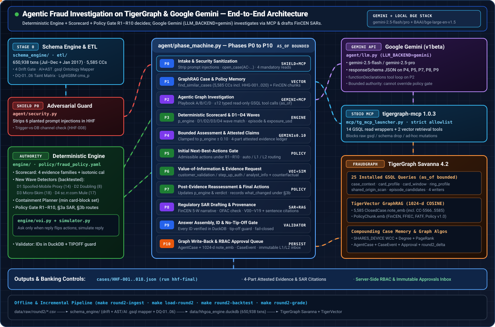

# Agentic Fraud Investigation on TigerGraph — Hacker House Goa 2026

An agent that takes an alert from the HHGOA case pack, investigates it through **TigerGraph** (GSQL query library + graph algorithms, exposed as **TigerGraph MCP** tools), grounds itself with **GraphRAG** over closed cases and FinCEN/FFIEC/FATF guidance (TigerVector), decides under the written **Fraud Policy** with a deterministic policy gate, asks for evidence when the policy says so, explains itself, and **writes its case back into the graph** so later investigations retrieve it. Streamlit UI with an approval inbox.

## Final Round (HHF-001 … HHF-018)

| Deliverable | Where |
|---|---|
| 18 answer files | [`cases/HHF-001.json`](cases/) … `HHF-018.json`, per-case table in [`cases/MANIFEST.md`](cases/MANIFEST.md) |
| The run they come from | `runs/hhf-final/` (`answer.json`, `calls.jsonl`, `phases.jsonl`, `sar.md` per case; `run_manifest.json`) |
| Innovation claim, with measurements | [`docs/INNOVATION.md`](docs/INNOVATION.md) |
| One-page resilience statement | [`docs/RESILIENCE.md`](docs/RESILIENCE.md) |
| 5-minute judged demo | [`docs/demo_script.md`](docs/demo_script.md) |
| January delta: build, gates, load, undo | [`docs/DELTA.md`](docs/DELTA.md) (`make delta`, `make load-delta`) |

### Clean-clone drill: one command, one case

No keys, no graph, no dataset download. The 18 cases and the base + January facts are in the tracked
`data/hhgoa_engine.duckdb`, and the ids the validator checks are in `data/ids.duckdb`:

```bash
git clone <REPO_URL> Tiger-graph && cd Tiger-graph && make install && RUN_MODE=mock uv run python -m agent.bench --cases HHF-004 --run-id drill-1 --mock && uv run python -m agent.validator --db data/ids.duckdb runs/drill-1/HHF-004/answer.json
```

The answer lands in `runs/drill-1/HHF-004/`. In mock mode the model replies are recorded fixtures and the facts come from
DuckDB (including the DuckDB twin of the January typology scan). CI runs the same drill on Ubuntu (step "Final Round
clean-clone drill" in `.github/workflows/ci.yml`).

All 18 against the live graph (`.env`: `TG_HOST`, `TG_SECRET`; set `LLM_BACKEND` explicitly; `gemini` needs `GEMINI_API_KEY`):

```bash
RUN_MODE=live LLM_BACKEND=gemini uv run python -m agent.bench --cases round2 --run-id hhf-rerun
```

On the current code, every January case calls the installed `typology_scan` query on the workspace. If that call fails,
the case stops with `CaseDataMissing` and writes no answer (see [the typology scan](#the-january-typology-scan-runs-in-the-graph) below).

### Results of the promoted run `runs/hhf-final`

The 18 files in `cases/HHF-*.json` are byte-identical to `runs/hhf-final/HHF-*/answer.json`. They come from one live run
against FraudGraph through MCP, from the frozen commit `b397c2c` with no local changes (`git_dirty: false`). The run had
two invocations, both recorded in `runs/hhf-final/run_manifest.json`:

- **11:02:41**, the main run. HHF-005 failed closed in P5. Gemini's structured output failed validation three times,
  each time JSON cut off mid-string at about 33 KB, so no answer was written. The run went on to HHF-003, the next case
  in `opened_at` order, and finished it. The other 16 cases completed.
- **11:35:37**, a `--resume` after HHF-005's partial graph write-back was removed. It re-ran HHF-005 and then HHF-003 in
  `opened_at` order, so that HHF-003's case memory sees HHF-005. The last case finished at 11:38:45. The first HHF-003
  attempt is kept in `runs/hhf-final/_failed_attempt/HHF-003-superseded/`. It has the same verdict, probability, SAR
  decision and final actions as the promoted one.

`runs/hhf-final/provenance.json` records the failure (`failed_attempt`: the P5 error and the resolution; full logs in
`_failed_attempt/HHF-005/`). It also records the guard (`code.list_sha256`). Every tracked file was hashed into
`_failed_attempt/tracked_files_sha256.txt` (534 files), and the four list hashes are identical: before and after the
main run, and before and after the resume. That list file hashes to the same recorded value. An earlier attempt, `r2-submit`, was
discarded because tracked files changed while it was starting. Earlier runs (`r2-final`, `r2-live-gemini`, `r2-graph`)
are superseded and were not promoted.

| Measure | Value |
|---|---|
| Completed | 18 / 18, every case `written_to_graph: true` |
| Verdicts | 7 fraud, 3 uncertain, 8 legitimate |
| Fraud | HHF-001 … HHF-006 (pattern `undocumented`: the four January waves that share no device) and HHF-007 (`card_testing`, the customer denied it) |
| Uncertain | HHF-010, HHF-013, HHF-014 (`out_of_region_use`, status `escalated`) |
| Legitimate | HHF-008, 009, 011, 012, 015, 016, 017, 018, all `closed_legitimate` after a customer-validation request |
| Status | 9 `escalated`, 1 `closed_fraud`, 8 `closed_legitimate` |
| SAR filed | 6: HHF-001 … HHF-006, all `undocumented`. This includes the $23.99 (HHF-004) and $23.17 (HHF-005) micro-skimming cases. |
| Evidence requested | 11 of 18 cases, all `customer_validation` (replies simulated and labelled `ASSUMED`) |
| Final actions by route | 54 auto, 10 L1, 7 L2 |
| Exposure (sum of `exposure_usd`) | $16,968.35 |
| Blocks or reports on a non-fraud case | 0 in the initial or the final set. No `BLOCK_*`, `DECLINE_TRANSACTION` or `FILE_REPORT` on the 8 legitimate cases. The 3 uncertain cases carry `DECLINE_TRANSACTION` (L1) and no block or report. |
| `make validate` | 38 answer files (20 Round 1 + 18 Final Round), 38 clean, 0 problems |

Sources: `runs/hhf-final/HHF-*/answer.json` (verdict, status, pattern, `sar.file`, `evidence_requests`, `next_best_actions`, `exposure_usd`, `written_to_graph`); byte comparison with `cases/HHF-*.json`; `make validate`.

| Per case | Median | p95 | Min | Max | Total |
|---|---:|---:|---:|---:|---:|
| Tool calls | 19.5 | 24 | 15 | 24 | 352 |
| Tokens | 211,265 | 331,456 | 115,149 | 331,456 | 3,900,596 |
| Latency (s) | 92.1 | 186.4 | 62.4 | 186.4 | 1,739.5 |

Sources: the `tool_calls`, `tokens` and `latency_s` fields of the 18 `runs/hhf-final/HHF-*/answer.json`. p95 is nearest-rank: with 18 values it is the 18th, which is also the maximum. Linear interpolation gives 23.2 / 325,024 / 142.5 s. HHF-005's figures are those of its resumed run.

| Model and graph activity | Value |
|---|---|
| Model calls (`kind=llm`) | 141, all `gemini-2.5-flash`, 0 failed (`llm_backend` `gemini`; `run_manifest.json` also names `gemini-2.5-flash` as `sar_model` for every case) |
| Tool rows (`kind=tool`) | 628, 0 failed: 300 harness queries, 52 queries the model chose, 276 write-back calls |
| `typology_scan` | 18 calls, one per case, made by the harness through MCP, all `ok` |
| Write-back calls (`caller=persist`, 276, all `ok`) | 18 `AgentCase` upserts, 18 `open_case`, 125 `append_case_event`, 17 `record_approval` (one per L1/L2 final action), plus the `CASE_*` / `HAS_*` edges |
| In the graph afterwards | 18 `AgentCase` with `run_id` `hhf-final`, 122 HHF `CaseEvent`s, 17 HHF `Approval`s |

Sources: `runs/hhf-final/HHF-*/calls.jsonl` (fields `kind`, `model`, `caller`, `name`, `ok`); `runs/hhf-final/run_manifest.json`. The graph counts are `graph_at_promotion` in `runs/hhf-final/provenance.json`, read through pyTigerGraph (read-only) at 11:45:32. The graph then held 125 `CaseEvent`s in all, 3 of them from another writer and not for HHF cases. An answer's `tool_calls` counts the harness and model rows (300 + 52 = 352), not the write-backs.

**Agreement with the deterministic engine.** `engine.run_cases`, re-run offline on the frozen code, gives the same verdict,
pattern and SAR decision as `runs/hhf-final` on all 18 cases. Probability is within 0.10 on all 18. The final action
set with routes matches on 17. On HHF-013 the live run adds the auto `MONITOR_CONNECTED_CARDS` (in both sets). Initial
sets also differ on HHF-015, where the live run adds the auto `ALLOW_TRANSACTION`. Both extras are low-impact auto
actions that the policy gate admits as optional. This shows self-consistency, not accuracy: the organisers hold the
answer key.

Source: `uv run python -m engine.run_cases --cases HHF-001 … HHF-018 --out <dir> --sheet <dir>/sheet.md`, with each `<dir>/HHF-*.draft.json` compared to `runs/hhf-final/HHF-*/answer.json`.

**Live workspace.** FraudGraph holds July 2016 to January 2017. `uv run python -m ops.check_live_counts` compares the
live vertex and edge counts with `expected_after` in `data/out_delta/delta_manifest.json`, which covers 18 types
(Transaction 650,938; ClosedCase 5,585). `make snapshot` (`ops/graph_snapshot.py`) records the live vertex and edge
counts with a timestamp in `logs/graph_snapshots.jsonl`, and diffs them against the last snapshot. Both are read-only.

### The January typology scan runs in the graph

The January waves share no device, so a device traversal cannot find them. Detectors D1-D4 are filtered scans over
`Transaction` with per-card accumulators. They live in `graph/queries/typology_scan.gsql`, a harness-only query (the
model never sees it), installed on the workspace. The harness calls it from `agent/phase_machine.py` (`_ensure_facts`)
for every case opened in 2017 or later. In `runs/hhf-final` it ran once per case, 18 times, all `ok`. If the scan cannot
run, the case raises `CaseDataMissing` and no answer is written.

The DuckDB twin (`DuckFacts.typology_scan` / `engine.detectors.scan_rows`) serves mock mode, the offline engine and the
backtest. `graph/check_typology_parity.py --installed` compares the installed query with the twin case by case: 30 cases
(the 18 HHF cases plus 12 other January cards), 0 differences, 6 hits (D1 HHF-001 and 002, D2 HHF-003, D3 HHF-004 and 005,
D4 HHF-006).

Source: `engine/out/typology_parity.json` (30 rows; every `ok` true, every `diffs` empty), written by `uv run python graph/check_typology_parity.py --installed --json engine/out/typology_parity.json`.

### The analyst dashboard

Run `make ui` to open http://localhost:8501. With no workspace, use `RUN_MODE=mock make ui`. By default the dashboard
reads the run that `cases/` was promoted from. Every page has a context bar showing:
- the source and whether it is LIVE or MOCK;
- the models seen in that run's `calls.jsonl`;
- the git sha, and whether there are uncommitted changes;
- how many of the 18 cases are decided;
- who is signed in.

The navigation is `PAGES` in `ui/common.py`, rendered with `st.navigation`. A page whose file is not on disk is left
out (`nav_pages()`).

| Where | Page | What it shows |
|---|---|---|
| Top bar | **Overview** (default, `/`) | Source provenance and measured tiles: decided n / 18; the verdict mix next to the brief's 9 legitimate; hard actions on non-fraud verdicts; agreement with the submitted files. Then proof cards and the 18-case decision board, where one click opens a case. |
| Top bar | **Case file** (`/case?case=HHF-0xx`) | The decision card comes first: verdict, how p moved, actions with routes and their real approval state, the simulated evidence reply, the stop rule and the SAR decision. Below it: the untrusted trigger verbatim with the defences that fired, then "TigerGraph in this case" (reads, write-backs, vector-search precedents with distances). Then five tabs: Decision path P0–P10, Evidence ledger (what / evidence / how / when per claim), SAR & citations, Approvals & handover, Raw files. |
| Top bar | **Graph** | The case subgraph. In mock mode it is rebuilt from the answer and labelled that way. |
| Top bar | **Approvals** | A read-only inbox, with sign-in through a server-side approver directory. Sign-in fails closed when `ui/principals.json` is missing. Also the wrong-role drill in a sandbox and the immutable audit log. |
| Proof | **Detectors & containment** | The backtest over 5,585 closed cases, with the cleared customers each detector would act against. Self-growing detector proposals awaiting approval, containment per wave, and a ring replay slider. |
| Proof | **Security & drills** | The 23-attack ablation (`agent.security.run_attack_ablation()`), a hostile-input sandbox and the drills ledger |
| Proof | **Data quality & schema** | Data quality (C11), schema drift (C12) and mapping another bank's schema (C13; mapping only, no investigation run on a variant), from `engine/out/proof_snapshot.json` and `data/schema_approvals.json` |
| Proof | **Runs & consistency** | p50 / p95 per case, numbers to quote, same-case agreement across runs |
| System | **Run console** | Starts agent runs only after a confirm dialog; live backends are disabled in mock mode; with `DEPLOY_READONLY=1` it replays recorded cases and starts no runs |
| System | **How it works** | The TigerGraph-use checklist, known limits and the system map |

The Run console's live pipeline view and a clickable phase inspector are being ported into the new pages; until that
lands, the Case file's Decision path tab is where each phase's recorded payload is shown.

To add approvers, run `uv run python -m ui.approvals_db add-principal <name> --role team_lead` (or
`--role fraud_manager`). Each run prompts for a passphrase.

## Round 1 (HHG-001 … HHG-020)

| Deliverable | Where |
|---|---|
| 20 answer files | [`cases/`](cases/) (`HHG-001.json` … `HHG-020.json`, [`cases/MANIFEST.md`](cases/MANIFEST.md)) |
| Demo video (3–5 min) | `<DEMO_URL>` (its script is in git history; [`docs/demo_script.md`](docs/demo_script.md) now holds the Final Round demo) |
| Technical blog | [`docs/blog.md`](docs/blog.md) (published copy: `<BLOG_URL>`) |
| Social post (tags @TigerGraphDB and @247pmstudio) | [`docs/social.md`](docs/social.md) (posted copy: `<SOCIAL_URL>`) |
| Architecture diagram | [`docs/architecture.svg`](docs/architecture.svg) |

## Judge quick-start, Round 1 (mock mode: no TigerGraph workspace, no API keys)

Everything below runs offline on a fresh clone. The dataset CSVs under `data/raw/` are not in the
repository (they are gitignored), so the checked-in `data/ids.duckdb` (id tables for the validator) and
`data/hhgoa_engine.duckdb` (the engine's facts) stand in for the graph. You need
[uv](https://docs.astral.sh/uv/) and Python 3.12. Tested on macOS; CI runs the same steps on Ubuntu.

Clone the repository:

```bash
git clone <REPO_URL> Tiger-graph && cd Tiger-graph
```

Install the dependencies and create `.env` from `.env.example` (`RUN_MODE=mock`, no keys needed):

```bash
make install
```

Check every answer file in `cases/` (20 Round 1 + 18 Final Round = 38; all 38 clean, 0 problems) against the README
answer schema and the dataset ids:

```bash
make validate
```

Run one case end to end in mock mode (recorded model replies, DuckDB facts instead of the graph). The
one-row case pack fixture replaces `data/raw/case_pack.csv`; the answer lands in `runs/judge/HHG-014/answer.json`:

```bash
CASE_PACK_CSV=tests/fixtures/case_pack_HHG-014.csv uv run python -m agent.bench --cases HHG-014 --run-id judge --mock
```

Build a mock run from the 20 answer files so the dashboard has something to show:

```bash
make mock-run
```

Open the analyst dashboard at http://localhost:8501. The sidebar's run picker opens on the canonical Final Round run
(`runs/hhf-final`) when it is present; pick `mock` there to see the run you just built:

```bash
RUN_MODE=mock make ui
```

The unit tests and the linter (data-backed tests skip without the full DuckDB):

```bash
make test lint
```

## Round 1 results (HHG-001 … HHG-020)

These are the Round 1 numbers, not the Final Round ones. The 20 files `cases/HHG-*.json` are byte-identical to
`runs/live-final-2/HHG-*/answer.json`. That run is one live pass against TigerGraph through MCP, from commit
`be03533` with no local changes (`git_dirty: false`), with all 100 model calls on `claude-sonnet-5` (subscription
backend `cli`). [`cases/MANIFEST.md`](cases/MANIFEST.md) has the per-case rows. The ordered rerun commands are in
[`docs/RERUN.md`](docs/RERUN.md).

| Measure (Round 1) | Value |
|---|---|
| Verdicts | 8 fraud, 7 legitimate, 5 uncertain |
| SAR required | 2: HHG-006 (under-$500 burst) and HHG-014 (anonymous-proxy device ring), both `undocumented` |
| Evidence requested | 14 of 20 cases (9 customer validation, 5 step-up; replies simulated and labelled `ASSUMED`) |
| Final actions by route | 46 auto, 18 L1, 2 L2 |
| Tool calls per case | median 19.5 (15-24) |
| Tokens per case | median 294,301 (232,932-616,283) |
| Time per case | median 162.6 s (112.8-252.6 s) |
| Written back to the graph | 20 / 20 `written_to_graph`; 20 `AgentCase` upserts, 130 `append_case_event`, 20 `record_approval` calls, all `ok` |

Sources: `cases/HHG-*.json`; `runs/live-final-2/run_manifest.json` (git SHA, dirty flag, model); `runs/live-final-2/HHG-*/calls.jsonl` (`kind=llm` model names, `caller=persist` rows).

All 20 answers agree with the engine's own offline prediction (`engine/out/<case>.draft.json`) on verdict, pattern,
episode transactions, exposure, SAR decision, status and both action sets with their routes, and on probability
within 0.10. That is a self-consistency check, not accuracy. Against real outcomes, a replay of 310 labelled closed
cases scores, on the confirmed-fraud ones, pattern accuracy 0.878, SAR decision accuracy 0.939 and episode Jaccard
0.792. All three are below the targets of 0.95, 1.00 and 0.85. [`docs/blog.md`](docs/blog.md) walks through HHG-014 and the lessons.

Sources: `engine/out/HHG-*.draft.json` compared field by field with `cases/HHG-*.json`; `engine/out/replay_metrics.json` (`n`, `pattern_accuracy_fraud_all`, `sar_accuracy_fraud_all`, `episode_jaccard_fraud_all`).

## The two documents

| Document | What it is | Read it when |
|---|---|---|
| [PLAN.md](PLAN.md) | The build plan: what the task asks for, what the data really contains, architecture and stack decisions with their reasons, the decision logic, the 14-day schedule, risks, per-case expectations. | Before anything: it explains *why*. |
| [IMPLEMENTATION.md](IMPLEMENTATION.md) | The implementation specification: every schema definition, loading job, GSQL query, engine module, agent phase, retrieval script, UI page and ops script in full, with the output of running them against the real data, plus a 44-step build order with acceptance checks. | While building: it is the *how*. |

Both are also published as pages: [plan](https://claude.ai/artifact/WobuxhoP2dZd1bZYn9vG4C) · [implementation spec](https://claude.ai/artifact/D5phbGun9znULNQuR51AAb) (private to the repository owner until shared).

`IMPLEMENTATION.md` embeds every source file verbatim, so the document and this tree are the same thing:

List every file the document carries:

```bash
python extract_code.py --dry-run
```

Write them (existing files kept unless `--force`). `IMPLEMENTATION.md` is the Round 1 snapshot: it has none of the Final Round code, so `--force` would overwrite it with Round 1 versions. Do not use `--force` on this branch.

```bash
python extract_code.py
```

Write edited files back into the document:

```bash
python sync_spec.py
```

## Architecture

The diagram shows the Final Round pipeline: Gemini (`LLM_BACKEND=gemini`) in phases P0–P10, TigerGraph MCP, and the
harness-only `typology_scan`. It is also at [`architecture/architecture.svg`](architecture/architecture.svg), with a
walk-through in [`architecture/README.md`](architecture/README.md) and an interactive page,
[`architecture/index.html`](architecture/index.html), that opens in any browser. The text sketch under the diagram is the
Round 1 build (`LLM_BACKEND=cli`).



```
case_pack.csv ─► agent/bench.py ─► agent/phase_machine.py (P0–P10; LLM = claude-agent-sdk, LLM_BACKEND=cli)
                                      │  16 typed read-only tools (14 GSQL query wrappers + 2 retrieval; 12 LLM calls/case) via
                                      │  mcp/tg_mcp_launcher.py → tigergraph-mcp 1.0.3 (stdio)  ──HTTPS──► Savanna TG-00 (4.2.x)
                                      ▼                                                                    FraudGraph + TigerVector
                        engine/ (scorecard · pattern · episode · SAR rule · policy gate · VoI · simulator)
                                      ▼
                        agent/persist (open_case / append_case_event / record_approval + add_edges via MCP; AgentCase + note_emb via pyTigerGraph)
                                      ▼
                  cases/HHG-0xx.json · runs/<run_id>/<case>/{calls,phases}.jsonl · ui/ (Streamlit)
offline once:  etl/ (DuckDB, card_id rule, baselines, LightGBM scorer) → engine/facts_from_etl.py → graph/load_all.py → graph/run_algos.py → rag/ (local embeddings) → graph/install_all.py
```

## Start here

Two commands answer "what can I run?" and "what is already built?". Both are instant, offline, and print
nothing but plain text when piped.

```bash
make help
```

Every target, grouped by build stage, with its description wrapped to your terminal width:

```
== make ============================================================================================
     agentic fraud investigation on TigerGraph - 39 targets, in build order

Start here
  help              this list, grouped by build stage (the default target)
  status            what exists and what does not: data, models, chunks, vectors, cases, backends.
                    Offline; never prints a secret

ETL, scorer, facts (day 1)
  db                data/raw/*.csv -> data/hhgoa.duckdb (tx 590,742 / idn 144,432 / cc 5,565 / cp
                    20; card rule 14,975/14,975)
  ...
```

```bash
make status
```

A dashboard of this checkout: which backends are selected, and which artefact each stage has
produced. It reads only the filesystem — no network, no TigerGraph, and secrets are reported as
`set` / `not set`, never printed.

```
artefact                    state    path                                detail
--------------------------  -------  ----------------------------------  ------
etl duckdb                  ready    data/hhgoa.duckdb                   356M
engine facts db             ready    data/hhgoa_engine.duckdb            50M
graph chunks                ready    data/out/txn_*.csv                  8 files, 324M
embeddings                  ready    data/out/vec_*.psv                  2 files, 53M
answer files                missing  cases/HHG-*.json                    -> make bench promote RUN_ID=v1

WARN 1 artefact(s) missing
     next: make bench promote RUN_ID=v1
```

Every command in this repository prints through one terminal layer (`ops/console.py`): a run header
with the config that decides the outcome, aligned tables instead of Python list reprs, and a summary
block with the totals. On a terminal it is coloured; piped, redirected or in CI it degrades to plain
ASCII with **zero escape bytes**, so `make sheet | cat` stays greppable. `NO_COLOR=1` and
`HHG_PLAIN=1` force plain (useful for a clean demo capture), `FORCE_COLOR=1` forces colour.

Mistyped or pasted a trailing `# comment` after a make command? Make no longer dies with
`No rule to make target '#'` — it names the closest real target, or tells you it was a pasted comment
and carries on.

## Setup (macOS Apple Silicon, Python 3.12 via uv)

```bash
git clone <repo> && cd <repo>
```

```bash
make install                 # uv sync --extra dev; creates .env from .env.example
```

```bash
# fill .env: TG_HOST, TG_SECRET (Savanna Database Secret)
# the model needs NO key: LLM_BACKEND=cli (the default) runs the agent on claude-agent-sdk, which drives
#   the Claude Code CLI it bundles and authenticates with your Claude subscription. It sees ONLY our typed
#   read queries (in-process SDK MCP server), no built-in tools, setting_sources=[] so your own settings
#   and CLAUDE.md never leak in. LLM_BACKEND=api switches back to the anthropic SDK and is the only case
#   that needs ANTHROPIC_API_KEY.
# embeddings need NO key: EMBED_BACKEND=local (the default) runs BAAI/bge-large-en-v1.5 (1024-d, MIT)
#   through sentence-transformers on this machine — one 1.34 GB download to ~/.cache/huggingface, then
#   no network. Lighter: EMBED_MODEL=BAAI/bge-small-en-v1.5 EMBED_DIM=384 (133 MB).
#   EMBED_BACKEND=voyage switches back to the paid Voyage API and is the only case that needs VOYAGE_API_KEY.
# put the four dataset CSVs and the dataset README under data/raw/  (transactions.csv identity.csv closed_cases_history.csv case_pack.csv README.md)
```

Day 0 (accounts, Savanna workspace, smoke tests): follow [`docs/day0_checklist.md`](docs/day0_checklist.md).
Full build order with acceptance checks: [`docs/BUILD_ORDER.md`](docs/BUILD_ORDER.md).

## Build the graph

Run `make status` between any two of these to see what the previous one produced.

DuckDB → features → scorer → engine facts DB → TSV chunks → `ids.duckdb` (day 1):

```bash
make db features cms facts chunks ids
```

Schema + loading jobs + 590,742 transactions; WCC / degree once (day 2, 4):

```bash
make load algos
```

The 25 installed queries (14 LLM-exposed reads + 4 writers + 7 harness-only: `grounding_chunks`, 4 RAG, `post_open_activity` and the UI's `case_subgraph`; the model sees 16 typed tools, the 14 plus `find_similar_cases` and `grounding_chunks`) and their MCP descriptions (day 3–4):

```bash
make install-queries describe
```

Deterministic engine: the expectation sheet (`qa/engine_expectation_sheet.md`) + 20 LLM-free drafts, printed as one aligned table of 20 cases with a summary of SARs filed and total exposure (day 5–6):

```bash
make sheet engine-drafts
```

GraphRAG corpus, local embeddings (no API key), TigerVector loads (day 7):

```bash
make corpus embed vectors
```

## Run the 20 cases

Wake the workspace (auto-resume drops the first request) — prints the TigerGraph version:

```bash
make awake
```

Optional: ping every 3 min while the benchmark runs, one `OK` line per ping:

```bash
make keepalive &
```

All 20 in `opened_at` order → `runs/v1/<case>/{answer.json,calls.jsonl,phases.jsonl,sar.md}`:

```bash
make bench RUN_ID=v1
```

Validator (ids resolved against `data/ids.duckdb`) → `cases/`:

```bash
make promote RUN_ID=v1
```

The analyst dashboard at http://localhost:8501 (pages: [The analyst dashboard](#the-analyst-dashboard)). Its source
defaults to the run `cases/` was promoted from, and every page reads that one source:

```bash
make ui
```

Without a workspace or API keys, render the UI from `cases/` (or the sample HHG-014 answer) and replay recorded tool traces. `make mock-run` prints a table of every case it replayed, with the phase and call counts it synthesised:

```bash
RUN_MODE=mock make mock-run ui
```

Without a workspace but **with** the real model (subscription, still no keys) — the facts come from DuckDB, the decisions from Claude:

```bash
uv run python -m agent.bench --run-id cli1 --cases HHG-014,HHG-010 --mock --llm-backend cli
```

```bash
uv run python -m agent.validator --db data/ids.duckdb runs/cli1/*/answer.json
```

`--mock` picks the fact source (DuckDB instead of TigerGraph); `--llm-backend` picks the model
(`cli` = claude-agent-sdk, `api` = anthropic SDK, `mock` = recorded fixtures). They are independent.

## Checks that need nothing but this checkout

The unit suite (data-backed tests skip when the DuckDB files are absent):

```bash
make test
```

`ruff check .`:

```bash
make lint
```

Static GSQL lint — every `alias.attribute` in `graph/queries/*.gsql` resolves against `graph/schema.gsql`,
brackets balance, and `mcp/query_descriptions.yaml` has one entry per query. Prints a row per query file
and exits 1 on the first problem:

```bash
make lint-gsql
```

Contract lint — GSQL parameter lists vs `mcp/query_descriptions.yaml` vs `engine.facts_duckdb.DuckFacts`
vs `agent.mcp_client.BUILTIN_QUERIES`, as one coverage table (`ok` / `X` / `-` per module):

```bash
make lint-contracts
```

Rebuild the id-only validator DuckDB (`data/ids.duckdb`, checked in) and verify every row count:

```bash
make ids
```

## Deploy on Railway

The analyst dashboard runs on [Railway](https://railway.com) as one small container. The root `Dockerfile`
installs only what `ui/` imports: `requirements-ui.txt`, 70 packages pinned to `uv.lock`, about 127 MB of
wheels. A plain `uv sync` would download 3.4 GB, mostly torch and CUDA wheels. The image ships:
- `cases/` and `ui/`;
- the Final Round run named by `ARG CANONICAL_RUN` (`hhf-final`), and `runs/live-final-2/` (Round 1), so the public page shows every case with its full trace;
- two stdlib-only modules, `agent/security.py` and `schema_engine/attestation.py`;
- `engine/out/detector_backtest.json`, `engine/out/containment_summary.json` and `engine/out/proof_snapshot.json`.

`make proof-snapshot` regenerates `proof_snapshot.json`, which holds the measured sections that the image cannot
compute because it has no duckdb and no `data/`. `tests/unit/test_ui_railway_smoke.py` renders every page from exactly
the Dockerfile's file set, with duckdb blocked. The image starts in mock mode and read-only, so it needs no TigerGraph
connection, no agent and no keys.

1. Commit and push:
   - the deploy files (`Dockerfile`, `.dockerignore`, `.railwayignore`, `railway.json`, `requirements-ui.txt`);
   - the changes to `.gitignore` and `ui/`, and `engine/out/proof_snapshot.json`;
   - `runs/.gitkeep` with the canonical run and `runs/live-final-2/`.

   `.gitignore` lets those runs in, and every other run stays local. If you change `CANONICAL_RUN`, also change its
   `!runs/<name>/` line in `.dockerignore` and its watch pattern in `railway.json`. Before pushing, check that
   `git ls-files runs/<canonical run> | wc -l` prints 73 (18 cases × 4 files + `run_manifest.json`) and that
   `git ls-files runs/live-final-2 | wc -l` prints 82. Without the runs, the build fails at its `COPY`.
2. Sign in at railway.com with GitHub, then choose **New Project → Deploy from GitHub repo**, pick this repository
   and the branch `main`. If Railway asks, grant its GitHub app access to the repository. Railway finds the root
   `Dockerfile`, so leave **Custom Start Command** empty. If you do set one, wrap it so `$PORT` expands:
   `/bin/sh -c "exec streamlit run ui/app.py --server.address=0.0.0.0 --server.port=$PORT"`.
3. Under **Settings → Deploy**, set the healthcheck path to `/_stcore/health`. `railway.json` has the same settings,
   but Railway no longer reads config files for new services.
4. Under **Settings → Networking**, choose **Generate Domain**. The target port is the one Streamlit listens on,
   Railway's `PORT`.
5. No variables are required. Do not add `TG_SECRET` or API keys, and do not accept the variables Railway suggests
   from `.env.example`.

If the page stays on "Please wait...", set `STREAMLIT_BROWSER_SERVER_ADDRESS` to the service's `*.up.railway.app`
domain, so Streamlit accepts the browser's websocket origin. Keep CORS and XSRF protection on.

From a local checkout, `railway up` deploys the same image. It skips everything in `.gitignore` and
`.railwayignore`. Never pass `--no-gitignore`, because that uploads `.env`.

To try the image locally:

```bash
docker build -t hhgoa-ui . && docker run --rm -p 8501:8501 hhgoa-ui
```

| Variable | Image default | Effect |
|---|---|---|
| `RUN_MODE` | `mock` | Set to `live`, with `TG_HOST` and `TG_SECRET`, to make the graph page query `case_subgraph` on the workspace. |
| `DEPLOY_READONLY` | `1` | Investigate replays the recorded trace instead of running the agent, and approval decisions never reach the graph, even in live mode. |
| `APPROVALS_DB` | `/tmp/approvals.sqlite` | Path of the approval inbox, which every visitor shares. It must be an absolute, writable path: the relative `ui/approvals.sqlite` from `.env.example` breaks the Approvals page, because `/app` is read-only for the app user. A redeploy wipes the container disk. To keep decisions, attach a volume at `/data`, set this to `/data/approvals.sqlite` and set `RAILWAY_RUN_UID=0`, because the image runs as a non-root user. |
| `TG_HOST`, `TG_SECRET` | unset | Needed for live mode only. Add `TG_SECRET` as a sealed variable. On a public URL, any visitor who opens the graph page then wakes, and bills, the workspace, and connection errors show its hostname. |
| `PORT` | set by Railway | The port Streamlit listens on; `8501` when unset. |

## Guarantees about the answer files

- **Every id exists in the dataset.** The validator resolves every `TransactionID`, card id, customer id, `CC-` id and device-profile string against DuckDB before a file is promoted; an agent-written `AC-` id never appears in `entity_ids` (it is only in `graph_case_id`).
- `card_id` is derived by the rule that reproduces 100 % of the 14,975 labelled (transaction → card) pairs (`customer_id-K<dense_rank(card6)>`), tested in CI.
- Evidence is time-boxed to `ts <= opened_at`; post-open activity is a monitoring note, never in `affected_txn_ids` / `exposure_usd`.
- Routes and rules come from `policy/fraud_policy.yaml`; `auto` actions execute, `L1`/`L2` land in the approval inbox; `sar.file ⇔ FILE_REPORT ∈ final`; `verdict == fraud` ⇒ a block / decline / escalation in `final` and never `CLOSE_NO_FRAUD`; SAR narratives pass the single validator `rag/validate_sar.py`.
- Each case is written to the graph as `AgentCase AC-HHG-0nn` with `CaseEvent`s, `Approval`s and `CASE_SIMILAR_TO` edges; cases run in `opened_at` order so a later case can retrieve an earlier one (strictly `opened_at < as_of`, so never itself); in the final run none did, and every precedent was a closed case.
- `tool_calls`, `tokens`, `latency_s` come from the run log (`runs/<run_id>/<case>/calls.jsonl`); prompts are frozen and hashed into `run_manifest.json`.

## Repository map

`etl/` DuckDB + features + scorer (owns `data/out/*.csv` incl. `fraud_pattern.csv`) · `graph/` schema, loading jobs, 25 queries, algorithms, loaders · `mcp/` launcher, tool lists, query descriptions · `rag/` corpus, chunks, embeddings, vector loads, SAR generator + validator · `engine/` deterministic decision engine, facts DB builder, replay, drafts · `policy/` fraud_policy.yaml · `agent/` phase machine, prompts, schemas, MCP client, persist, validator, bench · `qa/` GSQL lint + cross-module contract lint · `ui/` Streamlit · `ops/` `console.py` (the one terminal-output layer every CLI prints through), ensure_awake, keep_alive, id export, mock runs · `docs/` checklists, demo script, blog · `tests/` unit + live.

## Data and licensing

IEEE-CIS Fraud Detection (Vesta) via the HHGOA re-cut. Only the HHGOA re-cut is used, and the answer validator (`engine/validator.py`) rejects any answer whose free text names an outside copy of the data or the outcome label (`isFraud`). Regulatory chunks carry url + sha256 + page provenance; full FATF/FFIEC documents are not vendored.
