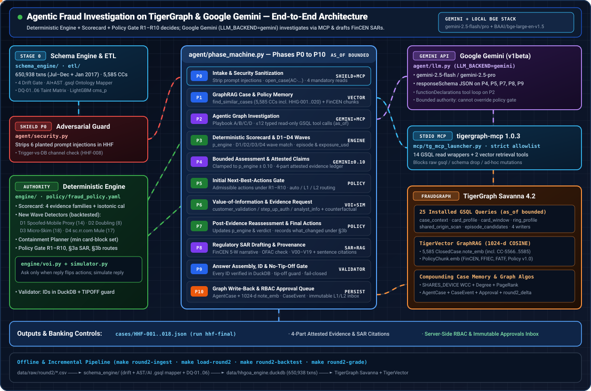

# Agentic Fraud Investigation on TigerGraph & Google Gemini — Animated Architecture



> **Interactive Web Version:** Open [`architecture/index.html`](./index.html) in any browser, or launch the Streamlit dashboard (`make ui` &rarr; **How it works** under System) for the pipeline map with the page that proves each stage. Per-case phase payloads are in the Case file's **Decision path P0–P10** tab; a live pipeline view and clickable phase inspector are being ported into the new pages.

---

## 1. End-to-End Application Flow (Stage 0 &rarr; Phases P0–P10)

```
data/raw/round2/*.csv ──► etl/delta (make delta, gates) ──► make load-delta ──► FraudGraph; schema_engine/ (drift · .gsql mapper · DQ-01..06)
                              │
                              ▼
case_pack_final.csv ──► agent/security.py (Prompt-Injection Shield + Trigger-vs-DB Check)
                              │
                              ▼
                    agent/phase_machine.py (P0–P10; LLM = Google Gemini via LLM_BACKEND=gemini)
                              │  16 typed read-only tools (14 GSQL queries + 2 TigerVector searches)
                              │  mcp/tg_mcp_launcher.py ──► tigergraph-mcp 1.0.3 ──► TigerGraph Savanna 4.2
                              ▼
                    engine/ (Deterministic Scorecard · D1–D4 Wave Detectors · Policy Gate R1–R10 · VoI · Simulator)
                              │
                              ▼
                    cases/HHF-001..018.json (run hhf-final) + Graph Write-Back + RBAC Approvals Inbox
```

| Stage / Phase | Subsystem | Authority | What Happens |
|---|---|---|---|
| **Stage 0** | `etl/delta*`, `schema_engine/` | Deterministic + Gemini AST | Appends the January delta to 590,742 Jul–Dec 2016 rows + 60,196 Jan 2017 rows (**650,938 total**) and **5,585 closed cases** (`CC-0001`…`CC-5585`). Gates 4 schema drifts, maps foreign `.gsql` schemas (`Bank_ISO20022`, `Bank_BIAN`, `Bank_CoreT24`), scans `DQ-01`…`DQ-06`, and scores `cms_p`. |
| **`P0` Intake** | `agent/security.py` + MCP | Code + Shield | Strips all 6 planted prompt injections (`HHF-004, 005, 008, 010, 014, 016`), cross-checks `trigger_text` against DB facts (`HHF-008` `online` vs `in_person`), opens `AC-<case_id>`, and runs 4 mandatory time-boxed queries (`ts <= opened_at`). |
| **`P1` Memory** | `rag/` + TigerVector | Vector + Graph | Retrieves top-8 similar prior closed cases (`ClosedCase.note_emb`, 1024-d local `BAAI/bge-large-en-v1.5`) and top-5 regulatory/policy chunks (`FinCEN`, `FFIEC`, `FATF`, `Fraud Policy v1.0`). |
| **`P2` Investigate** | `agent/llm.py` (`GeminiBackend`) | Google Gemini + MCP | `gemini-2.5-flash` / `gemini-2.5-pro` investigates via `functionDeclarations` over 16 read-only MCP tools (`shared_origin_scan`, `ring_profile`, `card_testing_check`, `episode_candidates`, `region_history`, `device_neighbors`, etc.). |
| **`P3` Scorecard** | `engine/scorecard.py` + `detectors.py` | Deterministic Engine | Computes calibrated `p_engine`, evaluates the 4 evidence families (`history`, `device`, `memory`, `customer`), runs the 4 undocumented wave detectors (`D1`–`D4`), and derives `affected_txn_ids` and `exposure_usd`. |
| **`P4` Assess** | `agent/llm.py` (`responseSchema`) | Gemini (Clamped `±0.10`) | Synthesizes 4-part attested claims (`what`, `evidence`, `how`, `when`); probability is strictly clamped to `[p_engine - 0.10, p_engine + 0.10]`. |
| **`P5` Initial Gate** | `engine/policy.py` | Deterministic Gate | Computes admissible initial actions and approval routes (`auto`, `L1`, `L2`) under Policy Rules `R1`–`R10`. |
| **`P6` VoI & Sim** | `engine/voi.py` + `simulator.py` | Deterministic Sim | Requests evidence (`customer_validation`, `step_up_auth`, `analyst_info`) only if a reply can change the action set (§6); simulates the reply and logs the counterfactual branch. |
| **`P7` Final Gate** | `engine/scorecard.py` + `policy.py` | Deterministic Gate | Updates `p_engine` and `verdict` post-evidence, selects `next_best_actions.final`, and records `what_changed` (§3b). |
| **`P8` SAR** | `rag/sar.py` + `validate_sar.py` | Gemini + 19 Checks | Evaluates §3a (`exposure > $1,000` OR `connected_card_ids` OR `undocumented`), screens OFAC SDN, drafts a 6–12 sentence 5-W narrative with sentence-level citations, and validates `V00`–`V19`. |
| **`P9` Validator** | `engine/validator.py` + `agent/validator.py` | Deterministic Gate | Resolves every ID against `data/ids.duckdb`, checks exact exposure arithmetic, and enforces the `TIPOFF` regex guard on `evidence_requests`. |
| **`P10` Persist** | `agent/persist.py` + `approvals_db.py` | Graph + RBAC SQLite | Writes `AgentCase` (+ 1024-d `note_emb`), `CaseEvent`s, and `Approval`s to TigerGraph, and queues `L1`/`L2` actions in the immutable RBAC inbox. |

---

## 2. How the Deterministic Scorecard Works (`engine/scorecard.py`)

The deterministic scorecard (`engine/scorecard.py`) is the **sole decision authority** for probability calibration, evidence-family counting, typology detection, episode construction, and post-evidence updating. Google Gemini never overrides it (Gemini is restricted to `p_engine ± 0.10` in `P4`).

### Step 1: Base Case-Memory Scorer (`cms_p`) & Isotonic Calibration (`cal_p`)
1. Every transaction is scored offline by a LightGBM model (`data/models/lgb_fraud.txt`) trained on 449 features: Vesta (`V1`–`V339`, `C1`–`C14`, `D1`–`D15`, `M1`–`M9`), identity (`id_01`–`id_38`, `DeviceType`, `DeviceInfo`), and leakage-free prior card-history features (`card_seq`, `prior_in_region`, `prior_on_dev`, `prior_pem`, `prior_pcd`, `prior_med_amt`, `prior_max_amt`).
2. Raw model output `cms_p` is mapped through an out-of-fold **isotonic regression calibrator** (`data/models/isotonic.json`):
   $$\text{cal\_p} = \text{IsotonicInterp}(\text{cms\_p})$$

### Step 2: The Four Independent Evidence Families (`history`, `device`, `memory`, `customer`)
Every signal extracted from the graph queries is added to the evidence ledger with a **family**, a **direction** (`fraud` $= +w$, `legit` $= -w$, `neutral` $= 0$), and a **weight** $w$:

| Family | Fraud Signals ($+w$) | Legitimacy Signals ($-w$) |
|---|---|---|
| **1. `history`** (Card Baseline & Velocity) | • Amount $> 2\times$ prior max ($+1.0$) or $> 1\times$ prior max ($+0.5$)<br>• Card dormant $> 14$ days ($+0.7$)<br>• New/rare in-person billing region on non-roaming card ($+0.8 / +0.4$) + concurrent home activity within 48h ($+0.4$)<br>• Online burst on in-person card ($+0.5$), first `ProductCD` ($+0.3$), first `p_email` ($+0.3$)<br>• Under-$500 burst (`burst_hit`, $+1.5$), `R5` card testing run ($+1.2$), mixed-channel spree ($+0.8$) | • Amount $\le 3\times$ prior median and $\le$ prior max ($-0.7$)<br>• In-person purchase in modal (`home`) or `known` ($\ge 3$ days or $\ge 5$ txns) billing region ($-0.7$)<br>• Known purchaser email domain ($\ge 3$ prior uses, $-0.3$)<br>• `R7` recurring charge match ($-1.5$) or recurring price point ($-0.6$) |
| **2. `device`** (Device / Shared Origin / Rings) | • `R0` strong anonymous-proxy device ring ($+2.0$)<br>• `D1` spoofed-mobile anonymous-proxy wave ($+2.0$)<br>• `D2` dormant-wake escalating drain ($+2.0$)<br>• `D3` sub-threshold micro-charge skimming ($+2.0$)<br>• `D4` one rare recipient domain paid by many cards ($+2.0$; card counts per detector: `engine/out/detector_backtest.json`)<br>• Strong device shared with $\ge 2$ other fraud cards in $\pm 30$d ($+1.5$) | • Device profile known to the card ($\ge 3$ prior uses or `Found` with $\ge 1$ prior use, $-0.6$) |
| **3. `memory`** (Prior & Similar Closed Cases) | • `cal_p` $\ge 0.85$ ($+1.5$) or $\ge 0.50$ ($+1.0$)<br>• Prior confirmed-fraud case on the same card ($+0.8$ if within 30d on same channel, else $+0.4$)<br>• Strong device appears in closed confirmed-fraud cases on other cards ($+0.6$) | • `cal_p` $\le 0.10$ ($-0.8$)<br>• Prior `cleared` risk-score alert on the same card matching the same template (`travel`, `new_phone`, `amount`, $-0.7$)<br>• `New` device profile cleared as "new phone" on $\ge 2$ other cards ($-0.5$) |
| **4. `customer`** (Trigger / Verification Reply) | • `customer_report` denial trigger ($+1.5$)<br>• Customer denies purchase or fails `step_up_auth` in `P6` ($+1.5 / +1.0$) | • Customer confirms purchase ($-2.0$) or passes `step_up_auth` ($-1.0$) in `P6` |

A family counts in `families_fraud` if its net weight $\sum w \ge +0.50$, and in `families_legit` if $\sum w \le -0.50$.
* **Evidence Conflict (`families_conflict`):** Fires when at least one non-customer family is in `families_fraud` AND at least one non-customer family is in `families_legit`, triggering `R8` (`ESCALATE_TO_ANALYST`).

### Step 3: Log-Odds Adjustments, Structural Floors & Verdict Bands
Starting from $\text{logit}(\text{cal\_p}) = \ln\frac{\text{cal\_p}}{1 - \text{cal\_p}}$, the scorecard applies bounded log-odds adjustments ($\Delta \in [-2.5, +2.5]$):
$$p_1 = \sigma\big(\text{logit}(\text{cal\_p}) + \text{clip}(\sum \Delta_i, -2.5, +2.5)\big)$$
Then structural **probability floors** are applied so that planted January waves (where `cms_p` is near zero because the bank's scorer was never retrained) still reach the fraud band deterministically:
* **Ring / Wave Floors:**
  * `R0` Anonymous-proxy device ring: $\text{floor} = 0.90$
  * `D1` Spoofed-mobile anonymous-proxy wave (`HHF-001`, `HHF-002`): $\text{floor} = 0.91$
  * `D2` Geometric doubling drain (`HHF-003`): $\text{floor} = 0.94$
  * `D3` Sub-threshold micro-charge skimming (`HHF-004`, `HHF-005`): $\text{floor} = 0.92$
  * `D4` Shared recipient email mule `sc.rr.com` (`HHF-006`): $\text{floor} = 0.92$
  * `R5` Card-testing sequence + cleared purchase $> \$100$ (`HHF-007`): $\text{floor} = 0.92$
  * Customer denial not explained by `R7`: $\text{floor} = 0.60$
* **Conflict Override Clamp:** When an in-person risk alert has a rulebook spree or concurrent anomalous online `ProductCD='C'` activity (`HHF-010`, `HHF-013`) while `cms_p` is low, `p_engine` is clamped into the uncertain band $[0.30, 0.50]$ so `R1`/`R8` verification + escalation fires.
* **Verdict Thresholds:**
  $$\text{verdict} = \begin{cases} \texttt{fraud} & \text{if } p_{\text{engine}} \ge 0.70 \\ \texttt{legitimate} & \text{if } p_{\text{engine}} \le 0.15 \\ \texttt{uncertain} & \text{if } 0.15 < p_{\text{engine}} < 0.70 \end{cases}$$

### Step 4: Post-Evidence Bayesian Update (`post_evidence` in `P6` &rarr; `P7`)
When an evidence request is made in `P6`, `post_evidence(sc, outcome)` updates `p_engine`:
* **`confirm` / `pass`:** Caps $p_{\text{engine}} \le 0.10$ and sets `verdict = "legitimate"` (unless a ring/wave detector `R0`/`D1`–`D4` fired, which customer confirmation cannot clear).
* **`deny` / `fail`:** Adds $+1.4$ / $+1.0$ log-odds and applies a $0.86$ floor when corroborated by a second fraud family, moving `verdict` to `"fraud"`.
* **`no_reply` / `inconclusive`:** Leaves $p_{\text{engine}}$ unchanged and keeps `verdict = "uncertain"` under `R4`/`R8`.
