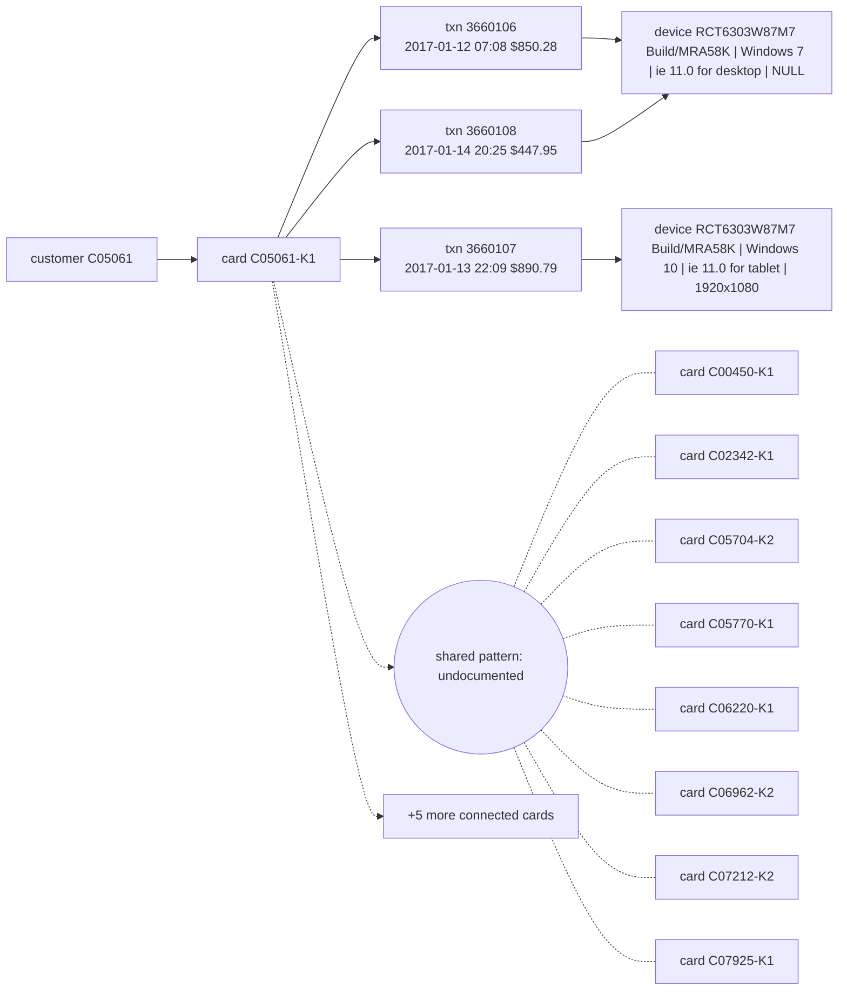

# Suspicious Activity Report: HHF-001

- Filing reason (3a): 3a / R9: undocumented coordinated pattern (Coordinated anonymous-proxy mobile wave across 14 cards with no single shared DeviceProfile)
- Case opened: 2017-01-15 01:25:19; verdict fraud (p = 0.92), pattern undocumented
- Activity dates: 2017-01-12 to 2017-01-14
- Total suspicious amount: $2,189.02 across 3 transaction(s)

## Subjects

- C05061
- C05061-K1
- RCT6303W87M7 Build/MRA58K \| Windows 7 \| ie 11.0 for desktop \| NULL
- RCT6303W87M7 Build/MRA58K \| Windows 10 \| ie 11.0 for tablet \| 1920x1080

## Narrative

1. This suspicious activity report documents an undocumented coordinated fraud pattern under internal case AC-HHF-001. [txn 3660106, 3660107, 3660108]
2. The activity involves customer C05061 holding credit card C05061-K1, operating via new device profiles RCT6303W87M7 Build/MRA58K | Windows 7 | ie 11.0 for desktop | NULL and RCT6303W87M7 Build/MRA58K | Windows 10 | ie 11.0 for tablet | 1920x1080, which share anonymous proxy telemetry with 13 connected cards. [txn 3660106, 3660107, 3660108; card C05061-K1]
3. On 2017-01-12 at 07:08, transaction 3660106 for $850.28 was conducted online in billing region 492.0 under product code C using device profile RCT6303W87M7 Build/MRA58K | Windows 7 | ie 11.0 for desktop | NULL. [txn 3660106]
4. On 2017-01-13 at 22:09, transaction 3660107 for $890.79 was conducted online in billing region 264.0 under product code C using device profile RCT6303W87M7 Build/MRA58K | Windows 10 | ie 11.0 for tablet | 1920x1080. [txn 3660107]
5. On 2017-01-14 at 20:25, transaction 3660108 for $447.95 was conducted online in billing region 492.0 under product code C using device profile RCT6303W87M7 Build/MRA58K | Windows 7 | ie 11.0 for desktop | NULL. [txn 3660108]
6. This online activity totaling $2,189.02 deviates significantly from the cardholder's baseline as of opening, which comprised 119 prior transactions with a median amount of $134.93 and a modal region of 181.0. [txn 3660106, 3660107, 3660108]
7. No prior suspicious activity report has been filed on this card (4 earlier closed case(s), none reported); closed cases CC-3791 on the same device profile or connected cards were confirmed fraud with reports filed. [txn 3660106, 3660107, 3660108; case CC-3791]
8. OFAC screening of the customer and card identifiers against the SDN list returned no match. [txn 3660106, 3660107, 3660108]
9. In case AC-HHF-001, opened 2017-01-15, internal case creation, analyst escalation, and monitoring of connected cards were executed, while a block of card C05061-K1 is recommended and awaits team-lead approval, and this filing is recommended for fraud-manager approval. [txn 3660106, 3660107, 3660108; card C05061-K1]

## Timeline

| ts | txn id | card | amount | channel | why it matters |
|---|---|---|---|---|---|
| 2017-01-12 07:08:46 | 3660106 | C05061-K1 | $850.28 | online | first suspicious transaction; device marked New; anonymous proxy; first use of this device on the card; 6.8x the card's prior median $125.08 |
| 2017-01-13 22:09:55 | 3660107 | C05061-K1 | $890.79 | online | device marked New; anonymous proxy; first use of this device on the card; 6.9x the card's prior median $130.00 |
| 2017-01-14 20:25:19 | 3660108 | C05061-K1 | $447.95 | online | flagged transaction; device marked New; anonymous proxy; 3.3x the card's prior median $134.93 |

## Evidence graph

## Attestation

Resolved against `hhgoa_engine.duckdb` (read-only), as of case open 2017-01-15 01:25:19. 9 of 9 narrative sentences attested.

- `SELECT case_id, opened_at, flagged_txn_id, card_id, customer_id FROM cp_all WHERE case_id = ?` params `['HHF-001']`
- `SELECT TransactionID, card_id, customer_id, ts_str, amt, channel, product_cd, addr1, device_id, device_new, proxy, prior_in_region, prior_on_dev, prior_med_amt FROM txc WHERE TransactionID IN (?, ?, ?)` params `['3660106', '3660107', '3660108']`
- `SELECT id, customer_id, median_amt, p90_amt, max_amt, n_txns FROM card_feat WHERE id IN (?, ?, ?, ?, ?, ?, ?, ?, ?, ?, ?, ?, ?, ?)` params `['C05061-K1', 'C00450-K1', 'C02342-K1', 'C05704-K2', 'C05770-K1', 'C06220-K1', 'C06962-K2', 'C07212-K2', 'C07925-K1', 'C07997-K1', 'C09251-K1', 'C10553-K1', 'C11309-K1', 'C11543-K2']`
- `SELECT case_id, card_id, outcome, report_filed FROM cc WHERE case_id IN (?)` params `['CC-3791']`
- `SELECT DISTINCT card_id FROM txc WHERE device_id = ? AND card_id IN (?, ?, ?, ?, ?, ?, ?, ?)` params `['RCT6303W87M7 Build/MRA58K | Windows 7 | ie 11.0 for desktop | NULL', 'C00450-K1', 'C02342-K1', 'C05704-K2', 'C05770-K1', 'C06220-K1', 'C06962-K2', 'C07212-K2', 'C07925-K1']`
- `SELECT DISTINCT card_id FROM txc WHERE device_id = ? AND card_id IN (?, ?, ?, ?, ?, ?, ?, ?)` params `['RCT6303W87M7 Build/MRA58K | Windows 10 | ie 11.0 for tablet | 1920x1080', 'C00450-K1', 'C02342-K1', 'C05704-K2', 'C05770-K1', 'C06220-K1', 'C06962-K2', 'C07212-K2', 'C07925-K1']`
