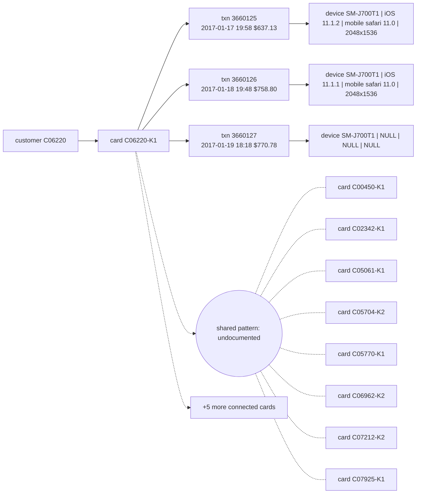

# Suspicious Activity Report: HHF-002

- Filing reason (3a): 3a / R9: undocumented coordinated pattern (Coordinated anonymous-proxy mobile wave across 14 cards with no single shared DeviceProfile)
- Case opened: 2017-01-19 23:18:58; verdict fraud (p = 0.92), pattern undocumented
- Activity dates: 2017-01-17 to 2017-01-19
- Total suspicious amount: $2,166.71 across 3 transaction(s)

## Subjects

- C06220
- C06220-K1
- SM-J700T1 \| iOS 11.1.2 \| mobile safari 11.0 \| 2048x1536
- SM-J700T1 \| iOS 11.1.1 \| mobile safari 11.0 \| 2048x1536
- SM-J700T1 \| NULL \| NULL \| NULL

## Narrative

1. This Suspicious Activity Report is filed to document an undocumented coordinated fraud pattern under internal case AC-HHF-002. [txn 3660125, 3660126, 3660127]
2. The activity involves customer C06220 and Visa credit card C06220-K1, which links to 13 connected cards sharing a coordinated anonymous-proxy mobile pattern. [txn 3660125, 3660126, 3660127; card C06220-K1]
3. On 2017-01-17 at 19:58, an online product code C transaction 3660125 for $637.13 occurred in region 330.0 using device profile SM-J700T1 | iOS 11.1.2 | mobile safari 11.0 | 2048x1536 under a New device status behind IP_PROXY:ANONYMOUS. [txn 3660125]
4. On 2017-01-18 at 19:48, a second online product code C transaction 3660126 for $758.80 occurred in region 384.0 using device profile SM-J700T1 | iOS 11.1.1 | mobile safari 11.0 | 2048x1536 behind IP_PROXY:ANONYMOUS. [txn 3660126]
5. On 2017-01-19 at 18:18, a third online product code C transaction 3660127 for $770.78 occurred in region 126.0 using device profile SM-J700T1 | NULL | NULL | NULL behind IP_PROXY:ANONYMOUS. [txn 3660127]
6. This sudden burst of high-dollar product code C activity is highly unusual compared to the cardholder's baseline as of opening of 366 transactions with a median transaction amount of $107.92. [txn 3660125, 3660126, 3660127]
7. No prior suspicious activity report has been filed on this card (6 earlier closed case(s), none reported); closed cases CC-3436, CC-3419 on the same device profile or connected cards were confirmed fraud with reports filed. [txn 3660125, 3660126, 3660127; case CC-3436, CC-3419]
8. OFAC screening of the customer and card identifiers against the SDN list returned no match. [txn 3660125, 3660126, 3660127]
9. Case AC-HHF-002 was opened, monitoring of connected cards was initiated, and escalation to an analyst was executed, while a block of card C06220-K1 is recommended and awaits team-lead approval and filing this report is recommended and awaits fraud-manager approval, covering a total suspicious exposure of $2,166.71. [txn 3660125, 3660126, 3660127; card C06220-K1]

## Timeline

| ts | txn id | card | amount | channel | why it matters |
|---|---|---|---|---|---|
| 2017-01-17 19:58:27 | 3660125 | C06220-K1 | $637.13 | online | first suspicious transaction; device marked New; anonymous proxy; first use of this device on the card; 5.9x the card's prior median $107.92 |
| 2017-01-18 19:48:45 | 3660126 | C06220-K1 | $758.80 | online | device marked New; anonymous proxy; first use of this device on the card; 7.0x the card's prior median $107.92 |
| 2017-01-19 18:18:58 | 3660127 | C06220-K1 | $770.78 | online | flagged transaction; device marked New; anonymous proxy; first use of this device on the card; 7.1x the card's prior median $107.92 |

## Evidence graph

## Attestation

Resolved against `hhgoa_engine.duckdb` (read-only), as of case open 2017-01-19 23:18:58. 9 of 9 narrative sentences attested.

- `SELECT case_id, opened_at, flagged_txn_id, card_id, customer_id FROM cp_all WHERE case_id = ?` params `['HHF-002']`
- `SELECT TransactionID, card_id, customer_id, ts_str, amt, channel, product_cd, addr1, device_id, device_new, proxy, prior_in_region, prior_on_dev, prior_med_amt FROM txc WHERE TransactionID IN (?, ?, ?)` params `['3660125', '3660126', '3660127']`
- `SELECT id, customer_id, median_amt, p90_amt, max_amt, n_txns FROM card_feat WHERE id IN (?, ?, ?, ?, ?, ?, ?, ?, ?, ?, ?, ?, ?, ?)` params `['C06220-K1', 'C00450-K1', 'C02342-K1', 'C05061-K1', 'C05704-K2', 'C05770-K1', 'C06962-K2', 'C07212-K2', 'C07925-K1', 'C07997-K1', 'C09251-K1', 'C10553-K1', 'C11309-K1', 'C11543-K2']`
- `SELECT case_id, card_id, outcome, report_filed FROM cc WHERE case_id IN (?, ?)` params `['CC-3436', 'CC-3419']`
- `SELECT DISTINCT card_id FROM txc WHERE device_id = ? AND card_id IN (?, ?, ?, ?, ?, ?, ?, ?)` params `['SM-J700T1 | iOS 11.1.2 | mobile safari 11.0 | 2048x1536', 'C00450-K1', 'C02342-K1', 'C05061-K1', 'C05704-K2', 'C05770-K1', 'C06962-K2', 'C07212-K2', 'C07925-K1']`
- `SELECT DISTINCT card_id FROM txc WHERE device_id = ? AND card_id IN (?, ?, ?, ?, ?, ?, ?, ?)` params `['SM-J700T1 | iOS 11.1.1 | mobile safari 11.0 | 2048x1536', 'C00450-K1', 'C02342-K1', 'C05061-K1', 'C05704-K2', 'C05770-K1', 'C06962-K2', 'C07212-K2', 'C07925-K1']`
- `SELECT DISTINCT card_id FROM txc WHERE device_id = ? AND card_id IN (?, ?, ?, ?, ?, ?, ?, ?)` params `['SM-J700T1 | NULL | NULL | NULL', 'C00450-K1', 'C02342-K1', 'C05061-K1', 'C05704-K2', 'C05770-K1', 'C06962-K2', 'C07212-K2', 'C07925-K1']`
