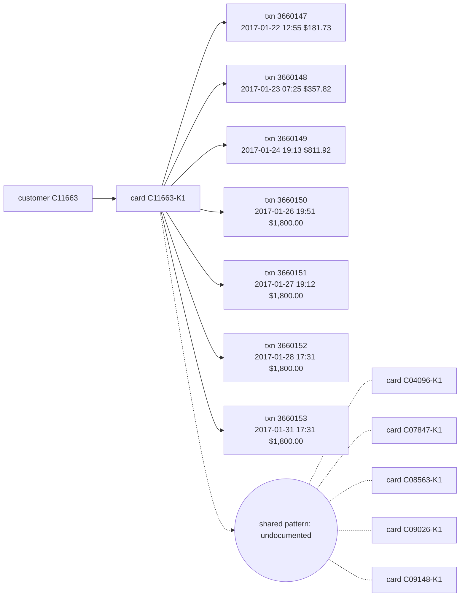

# Suspicious Activity Report: HHF-003

- Filing reason (3a): 3a / R9: undocumented coordinated pattern (Coordinated dormant-wake escalating online drain across 6 cards with no identity records)
- Case opened: 2017-01-31 20:31:28; verdict fraud (p = 0.94), pattern undocumented
- Activity dates: 2017-01-22 to 2017-01-31
- Total suspicious amount: $8,551.47 across 7 transaction(s)

## Subjects

- C11663
- C11663-K1
- C04096-K1
- C07847-K1
- C08563-K1
- C09026-K1
- C09148-K1

## Narrative

1. This Suspicious Activity Report is filed under internal case reference AC-HHF-003 to report an undocumented coordinated fraud pattern involving a dormant-wake escalating online drain. [txn 3660147, 3660148, 3660149, 3660150, 3660151, 3660152, 3660153]
2. The subject of this investigation is customer C11663 and debit mastercard C11663-K1, which exhibits a coordinated pattern linked to peer cards C04096-K1, C07847-K1, C08563-K1, C09026-K1, and C09148-K1. [txn 3660147, 3660148, 3660149, 3660150, 3660151, 3660152, 3660153; card C11663-K1, C04096-K1, C07847-K1, C08563-K1, C09026-K1, C09148-K1]
3. Following over three weeks of card inactivity, online Product C transactions commenced without device identity records on 2017-01-22 at 12:55 for $181.73 in billing region 327.0 (transaction 3660147), on 2017-01-23 at 07:25 for $357.82 in billing region 327.0 (transaction 3660148), and on 2017-01-24 at 19:13 for $811.92 in billing region 327.0 (transaction 3660149). [txn 3660147, 3660148, 3660149]
4. The activity then escalated to repeated maximum charges of $1,800.00 online on 2017-01-26 at 19:51 in billing region 327.0 (transaction 3660150), on 2017-01-27 at 19:12 in billing region 327.0 (transaction 3660151), on 2017-01-28 at 17:31 in billing region 327.0 (transaction 3660152), and on 2017-01-31 at 17:31 in billing region 315.0 (transaction 3660153). [txn 3660150, 3660151, 3660152, 3660153]
5. This rapid progression of online charges without device telemetry replicates a coordinated doubling ramp pattern observed across peer cards C04096-K1, C07847-K1, C08563-K1, C09026-K1, and C09148-K1. [txn 3660147, 3660148, 3660149, 3660150, 3660151, 3660152, 3660153; card C04096-K1, C07847-K1, C08563-K1, C09026-K1, C09148-K1]
6. This spending behavior is highly unusual compared to the cardholder's baseline prior to case opening of 57 prior transactions with a median transaction amount of $91.98. [txn 3660153]
7. No prior suspicious activity report has been filed on this card, and OFAC screening of the customer and card identifiers against the SDN list returned no match. [txn 3660147, 3660148, 3660149, 3660150, 3660151, 3660152, 3660153]
8. The agent opened internal case AC-HHF-003, initiated monitoring on connected cards, and escalated the case to an analyst; a block of card C11663-K1 is recommended and awaits fraud-manager approval, and filing of this report is recommended and awaits fraud-manager approval, covering a total suspicious exposure of $8,551.47. [txn 3660147, 3660148, 3660149, 3660150, 3660151, 3660152, 3660153; card C11663-K1]

## Timeline

| ts | txn id | card | amount | channel | why it matters |
|---|---|---|---|---|---|
| 2017-01-22 12:55:30 | 3660147 | C11663-K1 | $181.73 | online | first suspicious transaction |
| 2017-01-23 07:25:39 | 3660148 | C11663-K1 | $357.82 | online | 3.9x the card's prior median $91.93 |
| 2017-01-24 19:13:18 | 3660149 | C11663-K1 | $811.92 | online | 8.8x the card's prior median $91.94 |
| 2017-01-26 19:51:12 | 3660150 | C11663-K1 | $1,800.00 | online | 19.6x the card's prior median $91.94 |
| 2017-01-27 19:12:10 | 3660151 | C11663-K1 | $1,800.00 | online | 19.6x the card's prior median $91.96 |
| 2017-01-28 17:31:55 | 3660152 | C11663-K1 | $1,800.00 | online | 19.6x the card's prior median $91.97 |
| 2017-01-31 17:31:28 | 3660153 | C11663-K1 | $1,800.00 | online | flagged transaction; 19.6x the card's prior median $91.98 |

## Evidence graph

## Attestation

Resolved against `hhgoa_engine.duckdb` (read-only), as of case open 2017-01-31 20:31:28. 8 of 8 narrative sentences attested.

- `SELECT case_id, opened_at, flagged_txn_id, card_id, customer_id FROM cp_all WHERE case_id = ?` params `['HHF-003']`
- `SELECT TransactionID, card_id, customer_id, ts_str, amt, channel, product_cd, addr1, device_id, device_new, proxy, prior_in_region, prior_on_dev, prior_med_amt FROM txc WHERE TransactionID IN (?, ?, ?, ?, ?, ?, ?)` params `['3660147', '3660148', '3660149', '3660150', '3660151', '3660152', '3660153']`
- `SELECT id, customer_id, median_amt, p90_amt, max_amt, n_txns FROM card_feat WHERE id IN (?, ?, ?, ?, ?, ?)` params `['C11663-K1', 'C04096-K1', 'C07847-K1', 'C08563-K1', 'C09026-K1', 'C09148-K1']`
