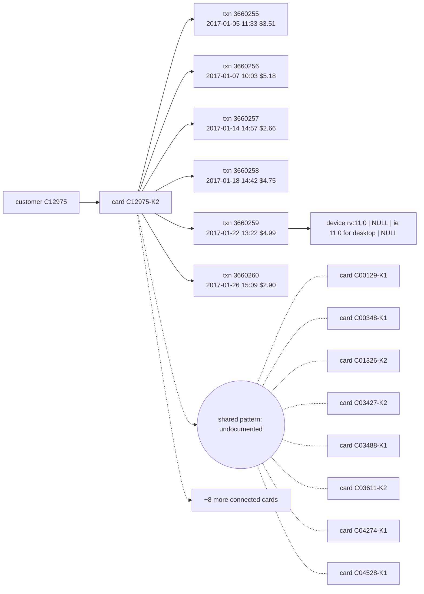

# Suspicious Activity Report: HHF-004

- Filing reason (3a): 3a / R9: undocumented coordinated pattern (Coordinated low-and-slow micro-charge skimming ring across 17 cards)
- Case opened: 2017-01-26 21:09:37; verdict fraud (p = 0.92), pattern undocumented
- Activity dates: 2017-01-05 to 2017-01-26
- Total suspicious amount: $23.99 across 6 transaction(s)

## Subjects

- C12975
- C12975-K2
- C00129-K1
- C00348-K1
- rv:11.0 \| NULL \| ie 11.0 for desktop \| NULL

## Narrative

1. This Suspicious Activity Report is filed regarding an undocumented coordinated fraud pattern identified under case AC-HHF-004. [txn 3660255, 3660256, 3660257, 3660258, 3660259, 3660260]
2. The activity involves customer C12975 and debit card C12975-K2, linked to a coordinated low-and-slow micro-charge skimming wave targeting 16 connected cards including C00129-K1 and C00348-K1. [txn 3660255, 3660256, 3660257, 3660258, 3660259, 3660260; card C12975-K2, C00129-K1, C00348-K1]
3. On 2017-01-05 at 11:33, transaction 3660255 for $3.51 was conducted online in region 191.0, followed on 2017-01-07 at 10:03 by online transaction 3660256 for $5.18 in region 191.0. [txn 3660255, 3660256]
4. Online transaction 3660257 for $2.66 occurred on 2017-01-14 at 14:57 in region 191.0, followed on 2017-01-18 at 14:42 by online transaction 3660258 for $4.75 in region 191.0. [txn 3660257, 3660258]
5. On 2017-01-22 at 13:22, online transaction 3660259 for $4.99 was executed in region 191.0 using device profile rv:11.0 | NULL | ie 11.0 for desktop | NULL, and on 2017-01-26 at 15:09, online transaction 3660260 for $2.90 occurred in region 337.0. [txn 3660259, 3660260]
6. This pattern of repeated low-value online micro-charges is inconsistent with the cardholder's prior baseline of 198 transactions as of opening, which had a median amount of $57.99 and maximum amount of $822.54. [txn 3660259, 3660260; card profile C12975-K2]
7. No prior suspicious activity report has been filed on this card (1 earlier closed case(s), none reported), and OFAC screening of the customer and card identifiers against the SDN list returned no match. [txn 3660255, 3660256, 3660257, 3660258, 3660259, 3660260]
8. Case AC-HHF-004 was opened on 2017-01-26, connected cards were placed on monitoring, the case was escalated to an analyst, a block of card C12975-K2 is recommended and awaits team-lead approval, and this report filing is recommended and awaits fraud-manager approval for total suspicious exposure of $23.99. [txn 3660255, 3660256, 3660257, 3660258, 3660259, 3660260; card C12975-K2]

## Timeline

| ts | txn id | card | amount | channel | why it matters |
|---|---|---|---|---|---|
| 2017-01-05 11:33:02 | 3660255 | C12975-K2 | $3.51 | online | first suspicious transaction |
| 2017-01-07 10:03:06 | 3660256 | C12975-K2 | $5.18 | online | part of the reported activity |
| 2017-01-14 14:57:38 | 3660257 | C12975-K2 | $2.66 | online | part of the reported activity |
| 2017-01-18 14:42:37 | 3660258 | C12975-K2 | $4.75 | online | part of the reported activity |
| 2017-01-22 13:22:25 | 3660259 | C12975-K2 | $4.99 | online | part of the reported activity |
| 2017-01-26 15:09:37 | 3660260 | C12975-K2 | $2.90 | online | flagged transaction |

## Evidence graph

## Attestation

Resolved against `hhgoa_engine.duckdb` (read-only), as of case open 2017-01-26 21:09:37. 8 of 8 narrative sentences attested.

- `SELECT case_id, opened_at, flagged_txn_id, card_id, customer_id FROM cp_all WHERE case_id = ?` params `['HHF-004']`
- `SELECT TransactionID, card_id, customer_id, ts_str, amt, channel, product_cd, addr1, device_id, device_new, proxy, prior_in_region, prior_on_dev, prior_med_amt FROM txc WHERE TransactionID IN (?, ?, ?, ?, ?, ?)` params `['3660255', '3660256', '3660257', '3660258', '3660259', '3660260']`
- `SELECT id, customer_id, median_amt, p90_amt, max_amt, n_txns FROM card_feat WHERE id IN (?, ?, ?, ?, ?, ?, ?, ?, ?, ?, ?, ?, ?, ?, ?, ?, ?)` params `['C12975-K2', 'C00129-K1', 'C00348-K1', 'C01326-K2', 'C03427-K2', 'C03488-K1', 'C03611-K2', 'C04274-K1', 'C04528-K1', 'C05083-K1', 'C05263-K2', 'C06198-K1', 'C09471-K2', 'C10035-K2', 'C10654-K1', 'C11332-K1', 'C13290-K1']`
- `SELECT DISTINCT card_id FROM txc WHERE device_id = ? AND card_id IN (?, ?, ?, ?, ?, ?, ?, ?)` params `['rv:11.0 | NULL | ie 11.0 for desktop | NULL', 'C00129-K1', 'C00348-K1', 'C01326-K2', 'C03427-K2', 'C03488-K1', 'C03611-K2', 'C04274-K1', 'C04528-K1']`
