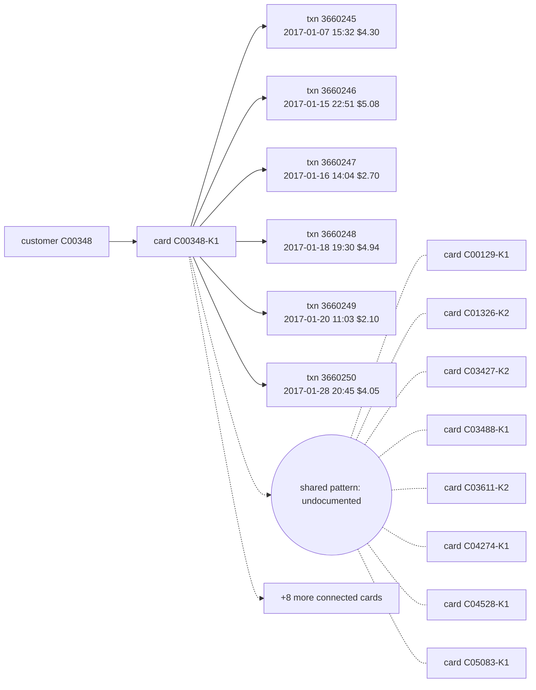

# Suspicious Activity Report: HHF-005

- Filing reason (3a): 3a / R9: undocumented coordinated pattern (Coordinated low-and-slow micro-charge skimming ring across 17 cards)
- Case opened: 2017-01-28 23:45:16; verdict fraud (p = 0.92), pattern undocumented
- Activity dates: 2017-01-07 to 2017-01-28
- Total suspicious amount: $23.17 across 6 transaction(s)

## Subjects

- C00348
- C00348-K1

## Narrative

1. This report details an undocumented coordinated fraud pattern under internal case AC-HHF-005. [txn 3660245, 3660246, 3660247, 3660248, 3660249, 3660250]
2. The suspicious activity involves customer C00348 and debit card C00348-K1. [txn 3660245, 3660246, 3660247, 3660248, 3660249, 3660250; card C00348-K1]
3. Between 2017-01-07 and 2017-01-28, six online micro-charges under product code C occurred on card C00348-K1: transaction 3660245 on 2017-01-07 at 15:32 for $4.30 in region 325.0, transaction 3660246 on 2017-01-15 at 22:51 for $5.08 in region 264.0, transaction 3660247 on 2017-01-16 at 14:04 for $2.70 in region 264.0, transaction 3660248 on 2017-01-18 at 19:30 for $4.94 in region 264.0, transaction 3660249 on 2017-01-20 at 11:03 for $2.10 in region 264.0, and transaction 3660250 on 2017-01-28 at 20:45 for $4.05 in region 264.0. [txn 3660245, 3660246, 3660247, 3660248, 3660249, 3660250; card C00348-K1]
4. Customer C00348 reported non-authorization of transaction 3660250 when the case opened on 2017-01-28. [txn 3660250]
5. Institutional graph analysis linked these six transactions to a coordinated low-and-slow micro-charge skimming ring affecting 17 total cards during the January 2017 wave. [txn 3660245, 3660246, 3660247, 3660248, 3660249, 3660250]
6. This pattern of small online charges is inconsistent with the cardholder's baseline prior to opening of 149 transactions with a median amount of $58.98 and a maximum amount of $774.08. [txn 3660245, 3660246, 3660247, 3660248, 3660249, 3660250; card profile C00348-K1]
7. No prior suspicious activity report has been filed on this card, and OFAC screening of the customer and card identifiers against the SDN list returned no match. [txn 3660245, 3660246, 3660247, 3660248, 3660249, 3660250]
8. The agent opened internal case AC-HHF-005, set connected cards to monitoring, and escalated the case to an analyst; a block of card C00348-K1 is recommended and awaits team-lead approval, and this filing is recommended and awaits fraud-manager approval, covering a total exposure of $23.17. [txn 3660245, 3660246, 3660247, 3660248, 3660249, 3660250; card C00348-K1]

## Timeline

| ts | txn id | card | amount | channel | why it matters |
|---|---|---|---|---|---|
| 2017-01-07 15:32:31 | 3660245 | C00348-K1 | $4.30 | online | first suspicious transaction |
| 2017-01-15 22:51:07 | 3660246 | C00348-K1 | $5.08 | online | part of the reported activity |
| 2017-01-16 14:04:39 | 3660247 | C00348-K1 | $2.70 | online | part of the reported activity |
| 2017-01-18 19:30:07 | 3660248 | C00348-K1 | $4.94 | online | part of the reported activity |
| 2017-01-20 11:03:40 | 3660249 | C00348-K1 | $2.10 | online | part of the reported activity |
| 2017-01-28 20:45:16 | 3660250 | C00348-K1 | $4.05 | online | flagged transaction |

## Evidence graph

## Attestation

Resolved against `hhgoa_engine.duckdb` (read-only), as of case open 2017-01-28 23:45:16. 8 of 8 narrative sentences attested.

- `SELECT case_id, opened_at, flagged_txn_id, card_id, customer_id FROM cp_all WHERE case_id = ?` params `['HHF-005']`
- `SELECT TransactionID, card_id, customer_id, ts_str, amt, channel, product_cd, addr1, device_id, device_new, proxy, prior_in_region, prior_on_dev, prior_med_amt FROM txc WHERE TransactionID IN (?, ?, ?, ?, ?, ?)` params `['3660245', '3660246', '3660247', '3660248', '3660249', '3660250']`
- `SELECT id, customer_id, median_amt, p90_amt, max_amt, n_txns FROM card_feat WHERE id IN (?, ?, ?, ?, ?, ?, ?, ?, ?, ?, ?, ?, ?, ?, ?, ?, ?)` params `['C00348-K1', 'C00129-K1', 'C01326-K2', 'C03427-K2', 'C03488-K1', 'C03611-K2', 'C04274-K1', 'C04528-K1', 'C05083-K1', 'C05263-K2', 'C06198-K1', 'C09471-K2', 'C10035-K2', 'C10654-K1', 'C11332-K1', 'C12975-K2', 'C13290-K1']`
