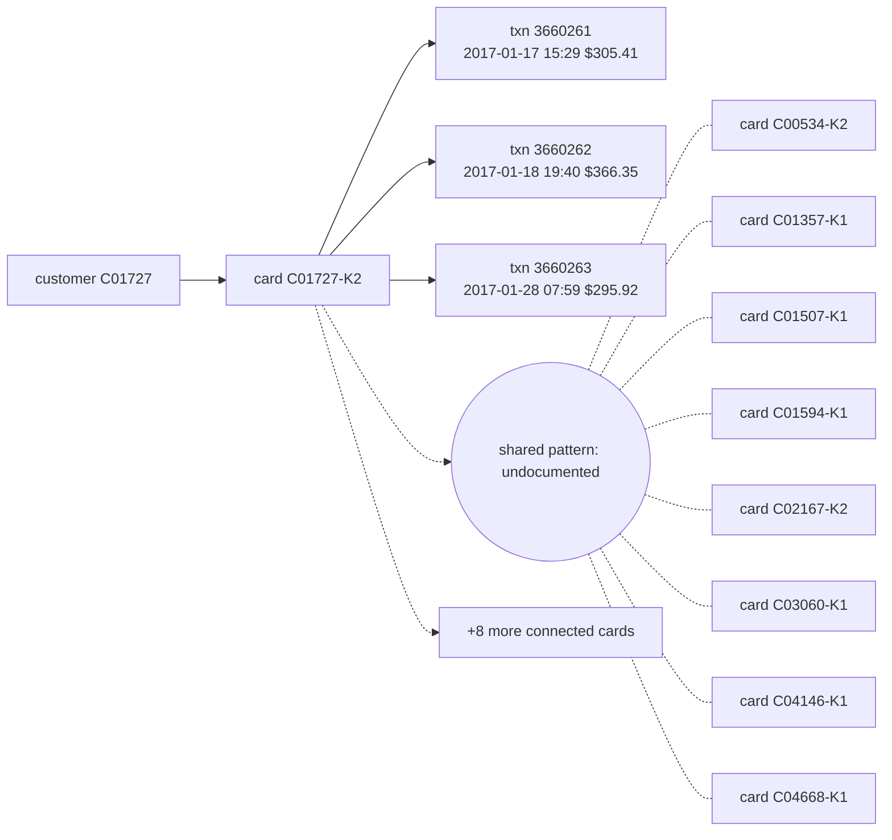

# Suspicious Activity Report: HHF-006

- Filing reason (3a): 3a / R9: undocumented coordinated pattern (Coordinated recipient-email mule ring across 17 cards paying R_emaildomain='sc.rr.com' with no shared device)
- Case opened: 2017-01-28 10:59:42; verdict fraud (p = 0.92), pattern undocumented
- Activity dates: 2017-01-17 to 2017-01-28
- Total suspicious amount: $967.68 across 3 transaction(s)

## Subjects

- C01727
- C01727-K2

## Narrative

1. This Suspicious Activity Report is filed to document an undocumented coordinated fraud pattern under internal case AC-HHF-006. [txn 3660261, 3660262, 3660263]
2. The activity involves customer C01727 using Visa debit card C01727-K2, which is connected to 16 other cards through a shared recipient email domain with no shared device profile. [txn 3660261, 3660262, 3660263; card C01727-K2]
3. On 2017-01-17 at 15:29, online transaction 3660261 for $305.41 with product code C was conducted in billing region 231.0 and delivered to recipient email domain sc.rr.com. [txn 3660261]
4. On 2017-01-18 at 19:40, online transaction 3660262 for $366.35 with product code C was conducted in billing region 231.0 and delivered to sc.rr.com. [txn 3660262]
5. On 2017-01-28 at 07:59, online transaction 3660263 for $295.92 with product code C was conducted in billing region 231.0 and delivered to sc.rr.com. [txn 3660263]
6. These transactions lack device identity telemetry and form a coordinated recipient-email mule ring across 17 cards paying sc.rr.com. [txn 3660261, 3660262, 3660263]
7. Prior to transaction 3660263, the card's baseline as of opening consisted of 121 prior transactions with a median amount of $107.86 and a maximum amount of $1,419.28. [txn 3660263; card profile C01727-K2]
8. A prior suspicious activity report was filed on this card under closed case CC-1975, CC-1833, CC-1501. [txn 3660261, 3660262, 3660263; case CC-1975, CC-1833, CC-1501]
9. OFAC screening of the customer and card identifiers against the SDN list returned no match. [txn 3660261, 3660262, 3660263]
10. Under case opened 2017-01-28, case creation, monitoring of connected cards, and analyst escalation were completed, while a block of card C01727-K2 is recommended and awaits team-lead approval and this report filing is recommended and awaits fraud-manager approval, covering a total suspicious amount of $967.68. [txn 3660261, 3660262, 3660263; card C01727-K2]

## Timeline

| ts | txn id | card | amount | channel | why it matters |
|---|---|---|---|---|---|
| 2017-01-17 15:29:14 | 3660261 | C01727-K2 | $305.41 | online | first suspicious transaction |
| 2017-01-18 19:40:41 | 3660262 | C01727-K2 | $366.35 | online | 3.4x the card's prior median $107.88 |
| 2017-01-28 07:59:42 | 3660263 | C01727-K2 | $295.92 | online | flagged transaction |

## Evidence graph

## Attestation

Resolved against `hhgoa_engine.duckdb` (read-only), as of case open 2017-01-28 10:59:42. 10 of 10 narrative sentences attested.

- `SELECT case_id, opened_at, flagged_txn_id, card_id, customer_id FROM cp_all WHERE case_id = ?` params `['HHF-006']`
- `SELECT TransactionID, card_id, customer_id, ts_str, amt, channel, product_cd, addr1, device_id, device_new, proxy, prior_in_region, prior_on_dev, prior_med_amt FROM txc WHERE TransactionID IN (?, ?, ?)` params `['3660261', '3660262', '3660263']`
- `SELECT id, customer_id, median_amt, p90_amt, max_amt, n_txns FROM card_feat WHERE id IN (?, ?, ?, ?, ?, ?, ?, ?, ?, ?, ?, ?, ?, ?, ?, ?, ?)` params `['C01727-K2', 'C00534-K2', 'C01357-K1', 'C01507-K1', 'C01594-K1', 'C02167-K2', 'C03060-K1', 'C04146-K1', 'C04668-K1', 'C05610-K1', 'C06115-K1', 'C06639-K1', 'C08384-K1', 'C10350-K1', 'C11617-K1', 'C11743-K2', 'C11940-K1']`
- `SELECT case_id, card_id, outcome, report_filed FROM cc WHERE case_id IN (?, ?, ?)` params `['CC-1975', 'CC-1833', 'CC-1501']`
