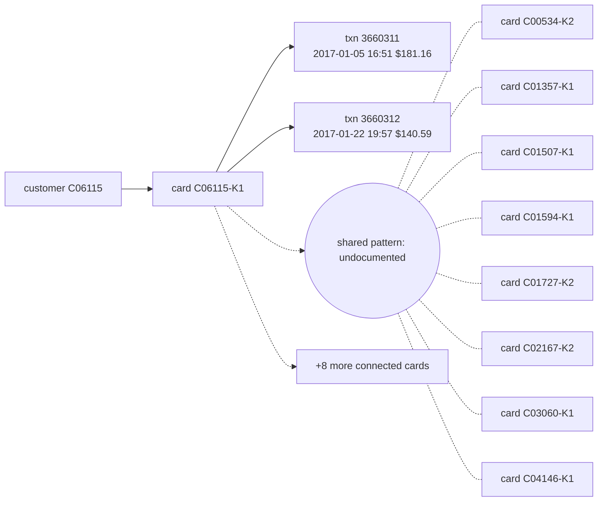

# Suspicious Activity Report: HHF-013

- Filing reason (3a): 3a / R9: undocumented coordinated pattern (Coordinated recipient-email mule ring across 17 cards paying R_emaildomain='sc.rr.com' with no shared device)
- Case opened: 2017-01-26 20:40:00; verdict fraud (p = 0.92), pattern undocumented
- Activity dates: 2017-01-05 to 2017-01-22
- Total suspicious amount: $321.75 across 2 transaction(s)

## Subjects

- C06115
- C06115-K1

## Narrative

1. This Suspicious Activity Report is filed regarding an undocumented coordinated fraud pattern identified under internal case AC-HHF-013. [txn 3660311, 3660312]
2. The investigation involves customer C06115 and credit card C06115-K1, which is linked via cross-card telemetry to 16 other cards paying a common recipient email domain. [txn 3660311, 3660312; card C06115-K1]
3. On 2017-01-05 at 16:51, an online transaction (id 3660311) for $181.16 was conducted under product code C in billing region 203.0 with recipient domain sc.rr.com. [txn 3660311]
4. On 2017-01-22 at 19:57, a second online transaction (id 3660312) for $140.59 was conducted under product code C in billing region 191.0 to the same recipient domain sc.rr.com. [txn 3660312]
5. These transactions form part of a coordinated recipient-email mule ring across 17 total cards with no shared device profile. [txn 3660311, 3660312]
6. This activity represents unusual online product code C transfers to an external recipient domain, departing from the cardholder's baseline as of opening of 83 prior transactions predominantly in person in modal region 123.0. [txn 3660311, 3660312]
7. No prior suspicious activity report has been filed on this card, and OFAC screening of the customer and card identifiers against the SDN list returned no match. [txn 3660311, 3660312]
8. Case AC-HHF-013 was opened, connected card monitoring was initiated, and analyst escalation was performed; a block of card C06115-K1 is recommended and awaits team-lead approval, and this report filing is recommended and awaits fraud-manager approval, covering a total suspicious amount of $321.75. [txn 3660311, 3660312; card C06115-K1]

## Timeline

| ts | txn id | card | amount | channel | why it matters |
|---|---|---|---|---|---|
| 2017-01-05 16:51:07 | 3660311 | C06115-K1 | $181.16 | online | first suspicious transaction |
| 2017-01-22 19:57:29 | 3660312 | C06115-K1 | $140.59 | online | part of the reported activity |

## Evidence graph

## Attestation

Resolved against `hhgoa_engine.duckdb` (read-only), as of case open 2017-01-26 20:40:00. 8 of 8 narrative sentences attested.

- `SELECT case_id, opened_at, flagged_txn_id, card_id, customer_id FROM cp_all WHERE case_id = ?` params `['HHF-013']`
- `SELECT TransactionID, card_id, customer_id, ts_str, amt, channel, product_cd, addr1, device_id, device_new, proxy, prior_in_region, prior_on_dev, prior_med_amt FROM txc WHERE TransactionID IN (?, ?)` params `['3660311', '3660312']`
- `SELECT id, customer_id, median_amt, p90_amt, max_amt, n_txns FROM card_feat WHERE id IN (?, ?, ?, ?, ?, ?, ?, ?, ?, ?, ?, ?, ?, ?, ?, ?, ?)` params `['C06115-K1', 'C00534-K2', 'C01357-K1', 'C01507-K1', 'C01594-K1', 'C01727-K2', 'C02167-K2', 'C03060-K1', 'C04146-K1', 'C04668-K1', 'C05610-K1', 'C06639-K1', 'C08384-K1', 'C10350-K1', 'C11617-K1', 'C11743-K2', 'C11940-K1']`
